<p align="center">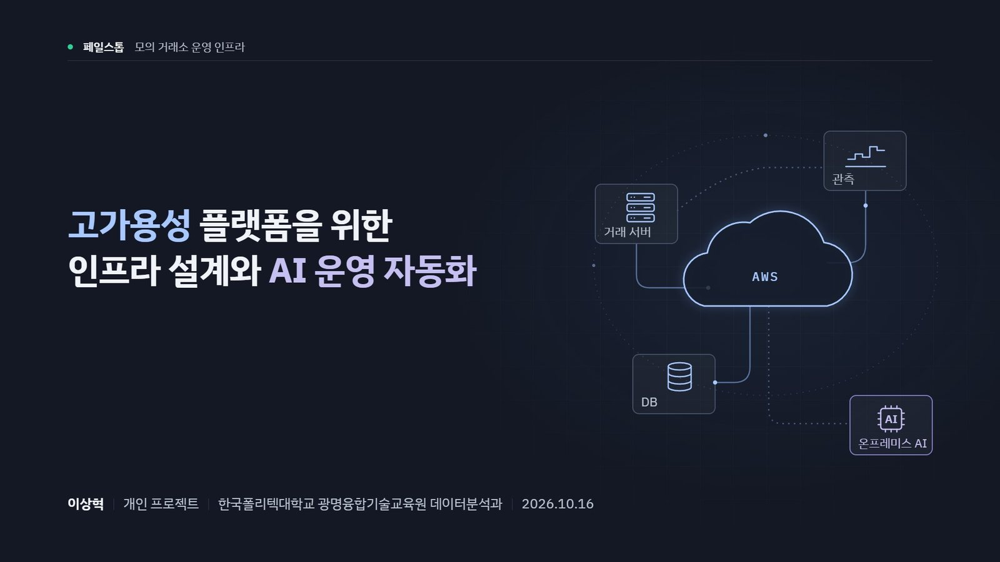</p>

<h1 align="center">「페일스톱 - 고가용성 인프라와 AI 관제」</h1>

<p align="center"><b>Linux·AWS 기반 인프라 운영 및 온프레미스 AI 관제 시스템 구축</b><br>개인 프로젝트 · 2026.07 ~ 2026.10 · 한국폴리텍대학 광명융합기술교육원 데이터분석과</p>

<p align="center">
  
  
  
  
  
  
  
  
  
  <br>
  
  
  
  
  
  
  
  
  
  
</p>

> 직접 만든 모의 거래소 **페일스톱**을 운영 대상으로 삼아, 트래픽이 몰리거나 DB가 멈춰도 서비스가 버티는 인프라를 설계하고 구축했습니다.
> 로컬 Docker에서 먼저 시험하고, Packet Tracer로 망을 설계하고, VM 실습망에서 서버를 직접 구축한 뒤 AWS에 올렸습니다. 관제에는 온프레미스 AI 서버를 붙였습니다.

> **범위 안내**: 페일스톱은 실제 돈이나 암호화폐를 다루지 않는 모의 거래소입니다. 개인 AWS 환경은 발표가 끝난 2026-10-16에 모두 정리했기 때문에, 아래 화면은 운영 당시의 캡처와 녹화입니다. 발표 자료 전체는 [PDF](docs/portfolio/failstop-presentation.pdf)로 볼 수 있습니다.

### 한눈에 보는 결과

| 시험 | 환경 | 결과 |
| :--- | :--- | :--- |
| 장애 주입 시험 | 로컬 Docker | **179회** · 서버 이어받기와 DB 승격 모두 30초 이내 |
| 주 DB 전원 차단 | 개인 AWS | **23.0초**에 예비 DB 자동 승격 · 대조한 주문 196건 **유실 0건** |
| 조회 부하와 서버 증설 | 개인 AWS | 경보부터 조회 서버 합류까지 **4분 44초**(AI 제안 → 운영자 승인 → 승인 뒤 67초 합류) |
| 부하 시험 병목 개선 | 로컬 Docker | 놓치지 않고 받은 주문 초당 40건 → **80건 이상(×2.0)** |
| OS 디스크 삭제 뒤 복구 | VM 실습망 | 재설치와 백업 복원까지 **15분 22초** |
| 월 운영비 | 개인 AWS | 예산 40만 원 · 평상시 예상 약 **36.7만 원**(세금 포함) |

<details open>
<summary><b>목차 (클릭하여 접기/펴기)</b></summary>

<br>

**소개와 기획**
* [1. 프로젝트 개요](#1-프로젝트-개요)
* [2. 기획 배경과 시나리오](#2-기획-배경과-시나리오)
* [3. 설계 방향](#3-설계-방향)

**설계와 구현**
* [4. Docker 시험 환경](#4-docker-시험-환경)
* [5. 네트워크 설계](#5-네트워크-설계)
* [6. VM 실습망과 투명 방화벽](#6-vm-실습망과-투명-방화벽)
* [7. AWS 운영 환경](#7-aws-운영-환경)
* [8. AI 관제](#8-ai-관제)
* [9. 서버 이중화와 백업](#9-서버-이중화와-백업)
* [10. Linux 서버 운영](#10-linux-서버-운영)

**시연과 회고**
* [11. 시연 영상](#11-시연-영상)
* [12. 설계에서 고른 것과 다음 단계](#12-설계에서-고른-것과-다음-단계)

**부록**
* [13. 저장소 구성](#13-저장소-구성)
* [14. 실행 방법](#14-실행-방법)
* [15. 더 읽을 문서](#15-더-읽을-문서)

</details>

---

## 1. 프로젝트 개요

약 3개월 동안 직접 개발한 모의 거래소와 관리 대시보드를 운영 대상으로 삼았습니다. 개발팀이 거래소 개발을 마쳤다고 가정하고, 인프라 담당자가 월 40만 원의 예산 안에서 운영 환경을 설계·구축·검증하는 역할을 맡았습니다. 관제 화면이나 AWS 설정만으로 끝내지 않고 계정·권한, 서비스, 로그, 네트워크, 디스크를 Linux에서 직접 설정하고, 일부러 장애를 내서 복구되는지 확인하는 데 가장 많은 시간을 들였습니다. 혼자 진행한 개인 프로젝트이고, Claude와 Codex를 개발 도구로 함께 썼습니다([AI와 개발하기](docs/reports/AI와_개발하기.md)).

구축은 아래 네 단계로 진행했습니다. 각 단계에서 확인한 결과를 다음 단계의 설계에 반영했습니다.

<p align="center">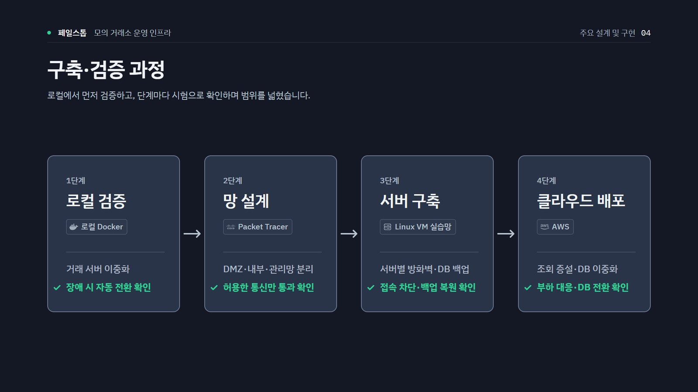</p>

| 단계 | 환경 | 한 일 | 확인한 것 |
| :--- | :--- | :--- | :--- |
| 1. 로컬 검증 | Docker | 거래 서버 이중화, 장애 주입·부하 시험 | 장애 시 자동 전환 |
| 2. 망 설계 | Packet Tracer | DMZ·내부망·관리망 분리, VLAN·ACL | 허용한 통신만 통과 |
| 3. 서버 구축 | VirtualBox VM | 서버별 방화벽, DB 백업, 디스크·NIC 이중화 | 접속 차단과 백업 복원 |
| 4. 클라우드 배포 | AWS | 조회 증설, DB 이중화, AI 관제 | 부하 대응과 DB 자동 전환 |

### 기술 스택

| 분류 | 기술 | 쓴 곳 |
| :--- | :--- | :--- |
| **OS·서버** | Rocky Linux 10, Amazon Linux 2023, systemd, journald, nftables, mdadm, LVM | 서비스 운영, 로그 보존, 서버 방화벽, 디스크 이중화 |
| **네트워크·보안** | Packet Tracer, pfSense CE, HAProxy, Suricata | 망 설계, 투명 방화벽, L7 요청 검사, 침입 탐지 |
| **클라우드** | AWS EC2, ALB, CloudFront, Auto Scaling, SSM, S3 | 서비스 배포, 조회 계층 증설, SSH 없는 관리 접속 |
| **DB** | PostgreSQL 17, Patroni, etcd, HAProxy | 엄격 동기 복제와 자동 장애 전환 |
| **관제** | Prometheus, Alertmanager, Grafana, Microsoft Teams | 지표 수집, 경보, 대시보드, 경보·장애 보고 |
| **AI** | 온프레미스 DGX Spark, Qwen3.6 35B-A3B | 장애 원인 정리와 조치안, 보고서 분석 |
| **시험** | Docker, k6, Toxiproxy | 부하 시험과 장애 주입 |
| **백업** | Databasus, Kopia | DB 백업, OS 백업과 복구 |
| **운영 대상** | Java 21, Spring Boot, Next.js | 거래 엔진·API, 거래 화면과 관리 콘솔 |

--- | :--- | :--- |
| 기간 | 2026-07-22 ~ 2026-10-16(발표) | 첫 커밋 `8e8e1fa9` |
| 커밋 | 773건 | `git rev-list --count d4672d5e` |
| 서버 테스트 | JUnit `@Test` 1,423개 | `git grep -h -E '@Test\b' -- server/ \| wc -l` |
| 웹 테스트 | 테스트 파일 70개 | `git ls-files 'web/**/*.test.ts' 'web/**/*.test.tsx' \| wc -l` |
| 기술 결정 기록(ADR) | 38건 | [docs/reference/adr/](docs/reference/adr/) |

---

## 2. 기획 배경과 시나리오

서버를 운영하다 보면 트래픽이 갑자기 몰리거나 서버가 멈추는 순간이 옵니다. 거래소라면 그 순간에도 주문 기록이 온전히 남아 있어야 합니다. 그래서 트래픽이 급증하거나 DB에 장애가 나도 서비스를 안정적으로 유지하는 것을 목표로 정했습니다. 예산이 넉넉하지 않고 운영도 혼자 해야 했기 때문에, 관제에는 AI를 활용하기로 했습니다.

<p align="center">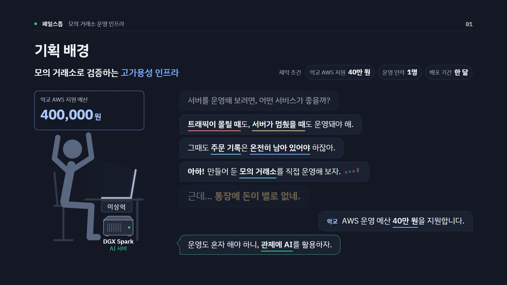</p>

시나리오는 두 가지를 가정했습니다. 요청이 한꺼번에 몰려도 서버가 버텨야 하고, DB가 갑자기 멈춰도 접수 완료된 주문은 지켜야 합니다. 두 경우 모두 경보는 바로 울리고, AI는 지표와 경보를 함께 분석해 원인 후보와 조치안을 제안합니다.

<p align="center">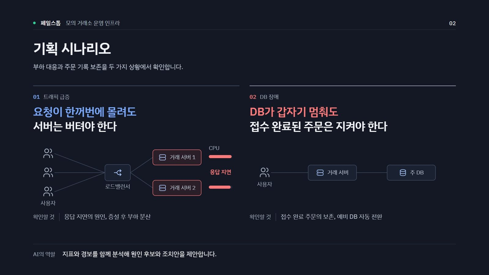</p>

---

## 3. 설계 방향

트래픽이 급증하면 AI가 조회 서버 증설을 제안하고, 운영자가 승인하면 조회 서버를 추가해 부하를 나눕니다. DB는 엄격 동기 복제로 이중화했고, 주 DB가 멈추면 AI가 아니라 Patroni 규칙이 예비 DB로 자동 전환합니다. 두 구조를 합쳐 AWS에 구성했고, 경보가 울리면 온프레미스 AI 서버가 지표를 모아 조치안을 관리 콘솔에 올립니다. 실제 실행은 운영자가 승인해야 일어납니다.

<p align="center">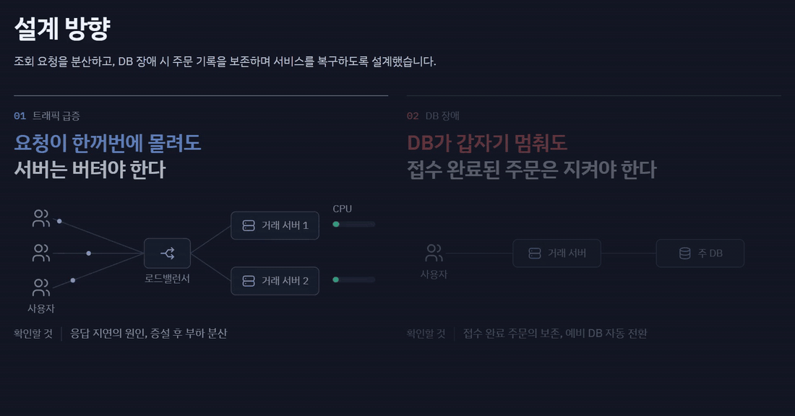</p>

<p align="center">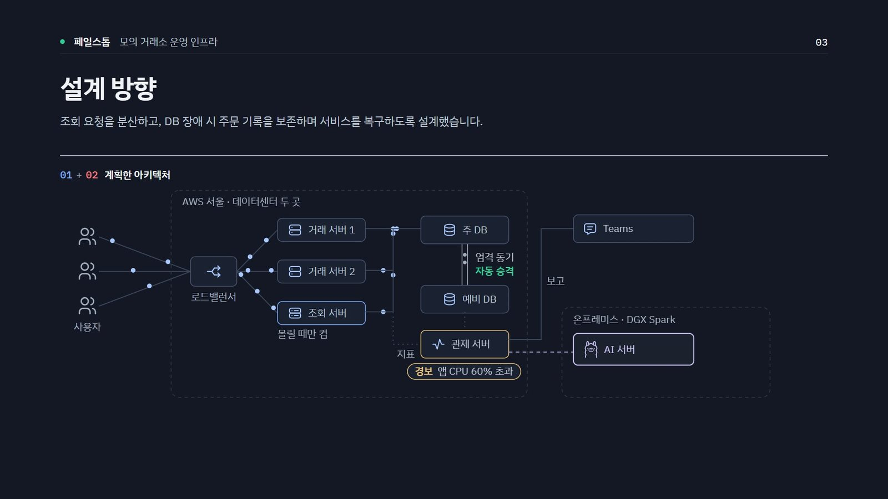</p>

판단을 사람, 코드, AI 중 누구에게 맡길지를 장면마다 나눈 것이 이 설계의 중심입니다.

| 상황 | 감지 | 판단 | 실행 |
| :--- | :--- | :--- | :--- |
| 조회 요청 급증 | 앱 계층 CPU 경보 | AI가 근거를 모아 증설 제안 | 운영자 승인 뒤 조회 서버 합류 |
| 주 DB 장애 | Patroni 상태 감시 | Patroni 규칙(동기 예비만 승격) | 자동 승격, 앱 연결은 HAProxy가 옮김 |
| 장애 보고 | Alertmanager | AI가 지표와 함께 분석 | 보고서를 Teams로 전송 |

결정 이유는 [ADR 0027 운영 범위와 증설](docs/reference/adr/0027-msp-operations-and-autoscaling.md), [ADR 0036 Patroni 엄격 동기](docs/reference/adr/0036-patroni-strict-sync-db-failover.md), [ADR 0035 AI 운영 권한](docs/reference/adr/0035-ai-operations-authority.md)에 남겼습니다.

---

## 4. Docker 시험 환경

기획 시나리오의 두 장면을 개발 PC의 Docker에서 먼저 시험했습니다. API·DB 컨테이너는 2 vCPU·2 GiB로 제한해 AWS의 작은 인스턴스와 비슷한 조건을 만들었습니다.

**트래픽이 몰릴 때.** 부하는 k6로 줬습니다. k6는 스크립트를 짜 두면 그 행동대로 요청을 보내 부하를 주는 시험 도구입니다. 부하로 거래 서버 CPU가 60%를 넘자 조회 서버가 자동으로 붙어 조회 요청을 나눠 맡았고, 거래 서버 CPU가 다시 내려갔습니다.

<p align="center">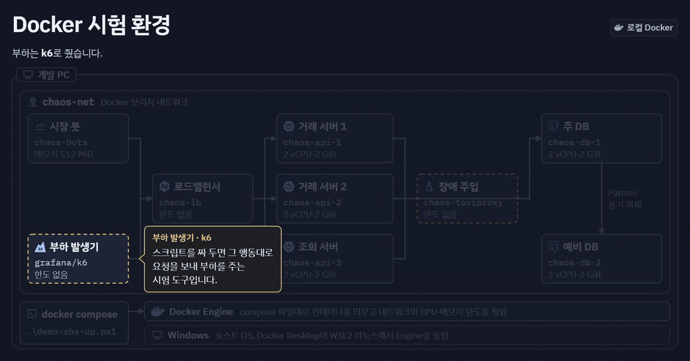</p>

**DB 연결을 흔들 때.** 장애는 Toxiproxy로 넣었습니다. Toxiproxy는 앱과 DB 사이에 끼워 장애 상황을 시뮬레이션하는 오픈소스 TCP 프록시입니다. 지연(200ms), 무응답, 연결 끊기를 일부러 넣고 거래 서버가 리더를 넘겨받는지 확인했습니다.

<p align="center">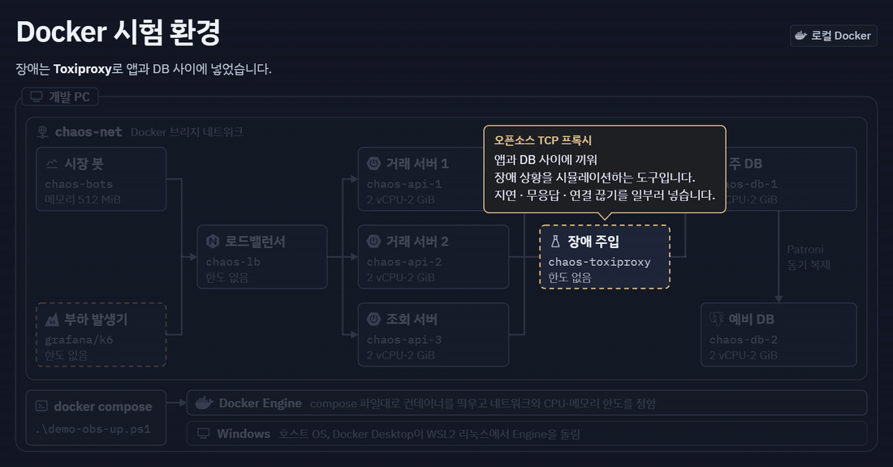</p>

**DB가 멈출 때.** 주 DB 컨테이너를 강제 종료하자 약 23초 만에 Patroni가 예비 DB를 새 주 DB로 승격했고, 앱의 DB 연결도 따라 옮겨 갔습니다. 동기 복제라 확인받은 쓰기의 유실은 없었습니다.

<p align="center">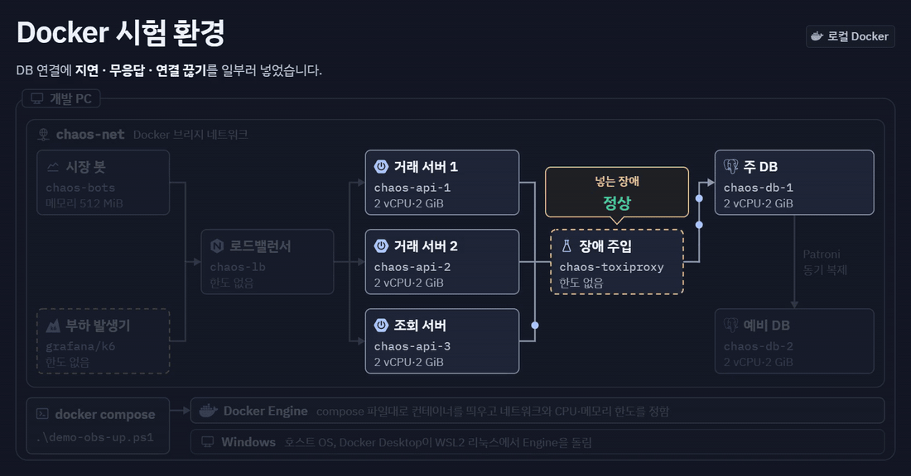</p>

로컬에서 장애 시험을 모두 179회 진행했습니다. DB 연결을 끊거나 거래 서버를 강제 종료·멈춤·망 분리한 시험에서 다른 서버가 이어받은 회차는 모두 30초 안이었고, 주 DB 강제 종료 15회의 승격은 최대 27.0초였습니다.

<p align="center">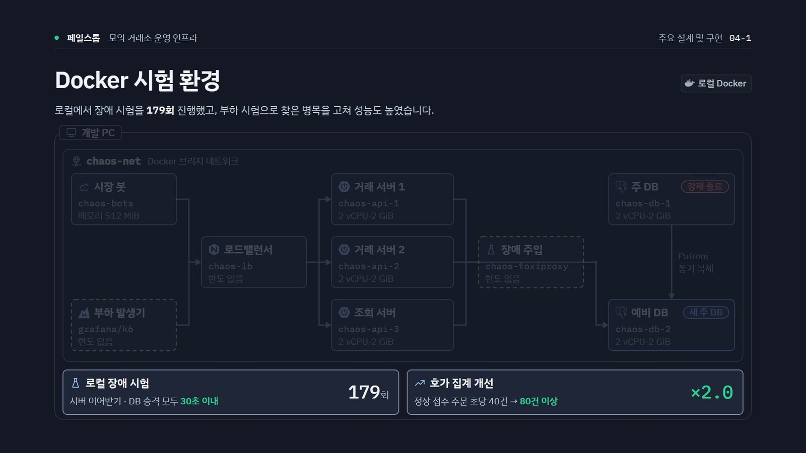</p>

| 만든 장애 | 방법 | 횟수 | 이어받기까지 최대 시간 |
| :--- | :--- | ---: | :--- |
| DB 연결 지연 | Toxiproxy, 200ms | 23회 | 매칭 리더가 바뀌지 않아야 통과 |
| DB 연결 끊기 | Toxiproxy | 28회 | 13.5초 |
| 거래 서버 강제 종료 | `docker kill` | 48회 | 12.9초 |
| 거래 서버 멈춤 | `docker pause` | 28회 | 13.4초 |
| 네트워크 단절 | 망에서 분리 | 17회 | 11.1초 |
| 주 DB 강제 종료 | Patroni 자동 승격 | 15회 | 27.0초 |
| 그 밖의 시험 | 주 DB 격리, 예비 DB·etcd 정지, 전체 재시작 | 20회 | |

시험은 통과 여부만 본 것이 아니라 문제를 찾는 도구로 썼습니다. 장애 시험과 부하 시험에서 찾은 문제를 고친 뒤 같은 시험을 다시 돌려 확인했습니다.

| 장애 시험으로 찾은 문제 | 고친 내용과 다시 시험한 결과 |
| :--- | :--- |
| 지연만 줬는데 매칭 리더가 바뀜 | 리더 갱신을 막던 잠금을 고쳐 3회 모두 통과 |
| 연결이 끊기면 리더 없이 멈춤 | DB 쪽에 연결 시간 제한을 걸어, 고친 직후 13.9초에 이어받음 |
| 멈췄던 서버가 만료된 권한을 받음 | 고친 뒤 10.0~10.6초에 이어받음 |
| DB가 돌아오는 순간 주문 오류 | 옛 리더의 응답을 503으로 바꿔 주문 500 오류 0건 |

| 부하 시험으로 고친 병목 | 고치기 직전 대비 |
| :--- | :--- |
| 호가 집계 1초 캐시 | 놓치지 않고 받은 주문 40 → 80건/s 이상 (×2.0) |
| 마켓별 기록 스레드 | 접수 72.2 → 101.6건/s (×1.4) |
| SQL 네 번을 DB 함수 하나로 | 접수 125.7 → 160.3건/s (×1.3) |
| 마켓별 접수 락 | 접수 112.5 → 152.3건/s (×1.4) |

호가 집계 개선은 2 vCPU·2 GiB 제한, 깨끗한 DB, 봇 없음 조건에서 접수율 100%를 지키는 주입 상한을 잰 값입니다([기록](harness/evidence/gateoff-20260903-2vcpu/README.md)). 조회 서버 자동 증설 시험의 판정 과정은 [증설 시험 기록](harness/evidence/asg-scenario-20260908/README.md)에 있습니다.

---

## 5. 네트워크 설계

Packet Tracer로 회사망을 가정한 네트워크를 설계했습니다. 외부에 열리는 웹 계층은 DMZ에 두고, 거래 서버와 DB가 있는 내부망과 분리했습니다. 내부 서버는 역할마다 VLAN을 나누고, 그 사이에는 필요한 통신만 ACL로 허용했습니다.

<p align="center">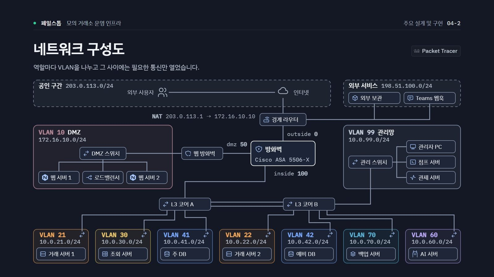</p>

| 정책 | 내용 |
| :--- | :--- |
| 외부 요청 | 로드밸런서를 거쳐서만 들어오고, 외부에서 내부 서버로 바로 가는 길은 차단 |
| 앱 → DB | 앱 서버(WAS)에서 DB로는 5432 포트만 허용 |
| 관리 접속 | 관리자 PC에서 서버로 바로 SSH는 차단하고, 점프 서버를 거치는 SSH만 허용 |
| 서버 구역 | 거래 서버 1·2, 조회 서버, 주 DB, 예비 DB, 백업 서버, AI 서버를 VLAN 일곱 개로 분리 |

통신 경로는 ping으로, 포트 제한은 ACL 설정으로 확인했습니다. 아래는 허용·차단 흐름을 차례로 보여 주는 장면입니다.

<p align="center">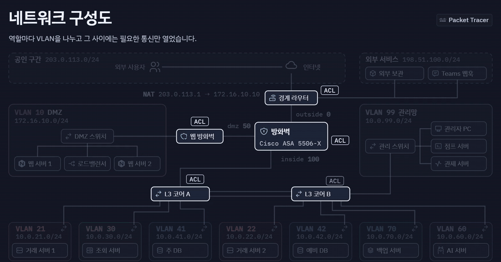</p>

---

## 6. VM 실습망과 투명 방화벽

작업 PC 한 대에 VirtualBox로 서버 VM 여섯 대와 pfSense VM 두 대를 올렸습니다. 서버 OS는 Rocky Linux 10이고, 역할에 맞게 CPU와 메모리를 나눴습니다.

경계 라우터와 서버 사이에는 **투명 방화벽**을 끼웠습니다. 투명 방화벽은 서버의 IP나 설정을 바꾸지 않고 길 가운데에 끼워 두는 검문소입니다. 입구의 HAProxy가 웹 서버의 TLS 인증서로 HTTPS를 풀어 HTTP로 검사한 뒤, 다시 HTTPS로 잠가 웹 서버에 보냅니다.

<p align="center">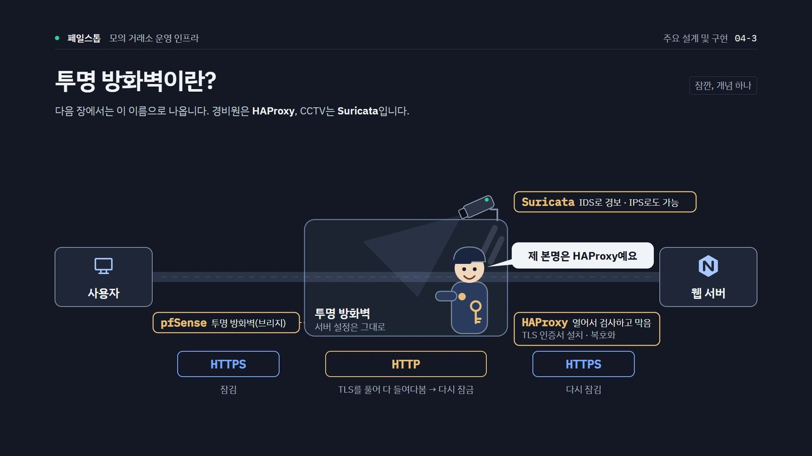</p>

<p align="center">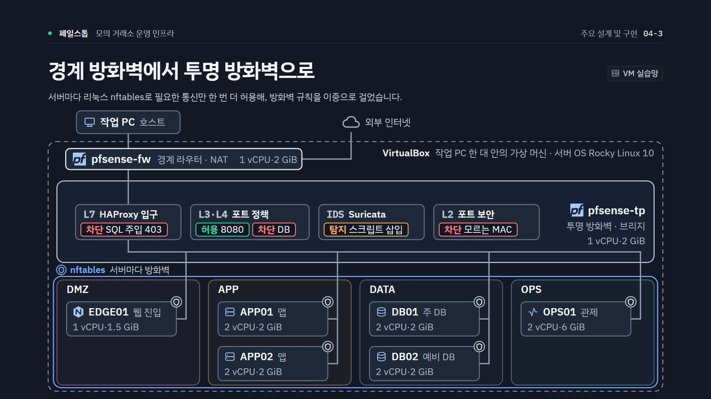</p>

방화벽은 층마다 다른 일을 맡겼습니다.

| 층 | 도구 | 한 일 | 확인한 것 |
| :--- | :--- | :--- | :--- |
| L7 | HAProxy | TLS를 풀어 요청 검사 | SQL 주입 시험 요청을 403으로 차단 |
| L3·L4 | pfSense 규칙 | 구역 사이에 필요한 포트만 허용 | 웹 → 앱 8080 허용, 웹 → DB 차단 |
| L2 | pfSense 포트 보안 | 포트마다 MAC 주소 수 제한 | 허락하지 않은 장비 차단 |
| IDS | Suricata | 웹 → 앱 HTTP 구간 감시 | 스크립트 삽입 시험 요청을 탐지해 관제 서버에 경보 |
| 서버 | nftables | 서버마다 필요한 통신만 허용 | 방화벽 규칙을 이중으로 적용 |

Suricata는 IDS와 IPS가 모두 되는 도구지만 이 실습에서는 IDS로 두고 경보만 받았습니다. 막는 일은 HAProxy의 요청 검사와 방화벽 규칙이 맡았습니다. 실습 기록은 [pfSense](증거본/2026-09-26_VM_pfSense/README.md), [투명 방화벽](증거본/2026-09-28_VM_투명방화벽/README.md), [nftables 중앙 관리](증거본/2026-09-29_VM_nftables_중앙관리/README.md) 증거본에 있습니다.

---

## 7. AWS 운영 환경

서비스를 24시간 운영하려고 개인 AWS 계정의 서울 리전에 올렸습니다. 거래 서버와 DB는 서로 다른 가용 영역에 나눠 배치했고, 서버 관리 접속은 SSH 대신 SSM으로만 했습니다.

<p align="center">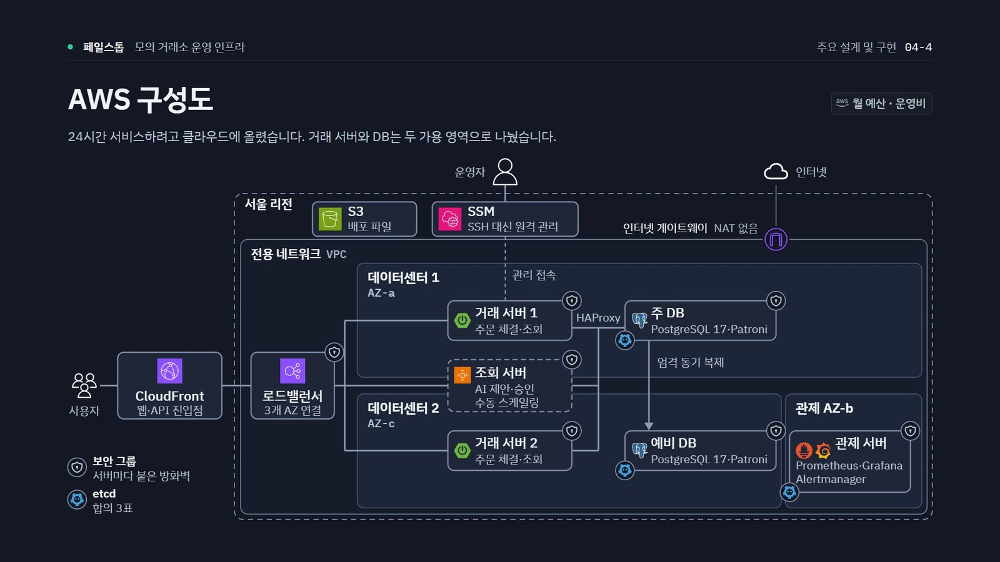</p>

| 역할 | 구성 |
| :--- | :--- |
| 진입 | CloudFront → ALB(세 가용 영역 연결) |
| 거래 서버 1·2 | t3.small, 가용 영역 a·c에 한 대씩. 주문 체결과 조회를 함께 처리 |
| 조회 서버 | Auto Scaling 그룹(0~1대). 평소에는 꺼 두고 부하 때만 합류 |
| 주 DB·예비 DB | t3.medium, PostgreSQL 17 + Patroni 엄격 동기 복제. 앱은 HAProxy를 거쳐 그때의 주 DB에 연결 |
| 관제 서버 | t3.medium, Prometheus·Grafana·Alertmanager와 시장 봇 |
| 관리 | SSH 대신 SSM으로 원격 관리, 배포 파일은 S3 |

월 예산은 40만 원으로 잡았고, 평상시 사용량을 기준으로 한 예상 운영비는 세금 포함 약 36.7만 원입니다. 조회 서버와 부하 시험 서버는 필요할 때만 켜도록 구성해 비용을 맞췄습니다.

<p align="center">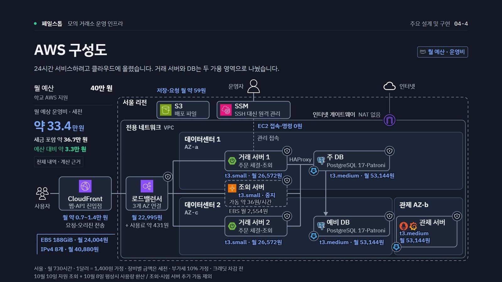</p>

아래는 운영 당시 실제 화면입니다. 거래소와 관리 콘솔은 직접 만들었고, Grafana 대시보드는 서비스와 DB 상태를 나눠 구성했습니다.

<table align="center">
<tr>
<td align="center" width="33%"><a href="docs/portfolio/site-exchange.jpg">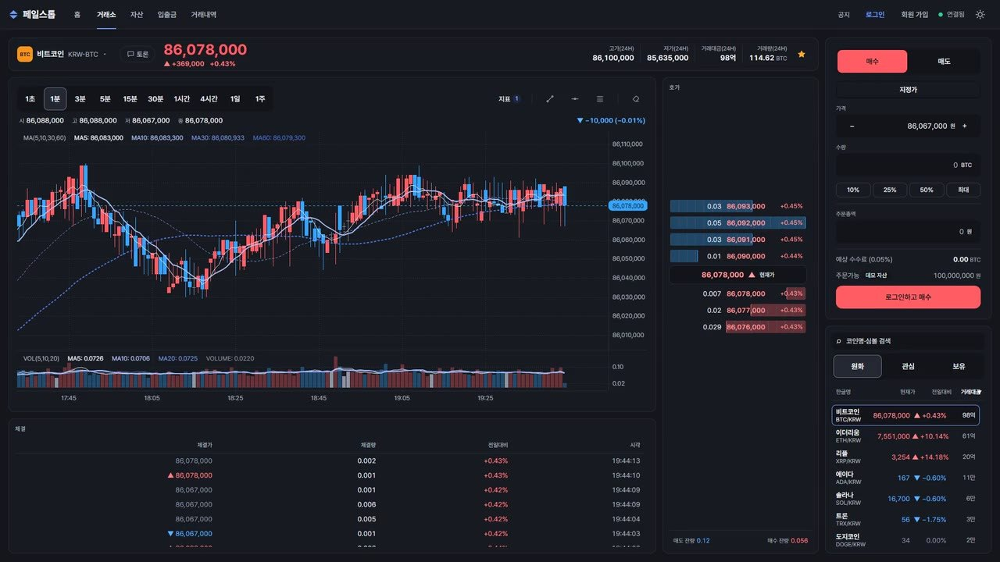</a><br><b>거래소</b><br><sub>시장 봇이 거래하는 모의 거래소</sub></td>
<td align="center" width="33%"><a href="docs/portfolio/site-control.jpg">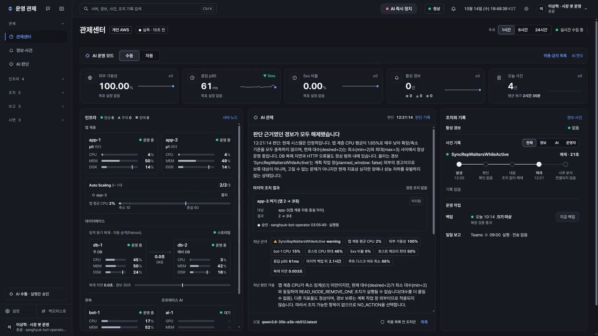</a><br><b>관제센터</b><br><sub>서버·DB 상태와 AI 운영 모드</sub></td>
<td align="center" width="33%"><a href="docs/portfolio/site-flow.jpg">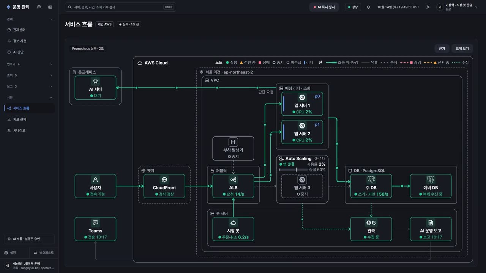</a><br><b>서비스 흐름</b><br><sub>요청 경로와 장비별 상태</sub></td>
</tr>
<tr>
<td align="center" width="33%"><a href="docs/portfolio/site-ai.jpg">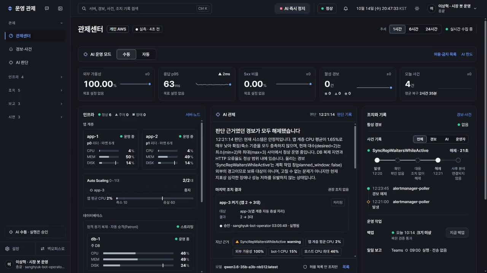</a><br><b>AI 판단</b><br><sub>경보 근거와 조치안</sub></td>
<td align="center" width="33%"><a href="docs/portfolio/site-grafana-service.jpg">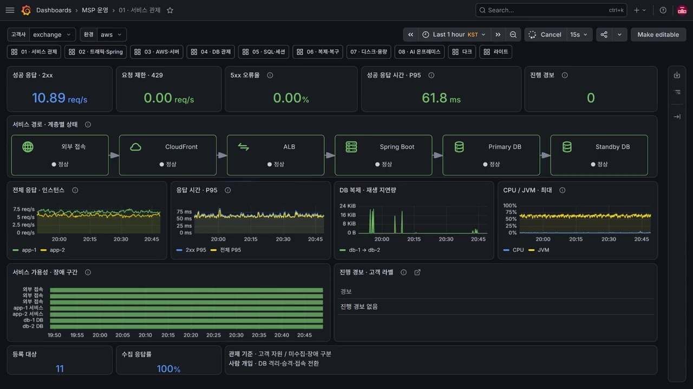</a><br><b>Grafana 서비스 관제</b><br><sub>요청·오류·응답 시간</sub></td>
<td align="center" width="33%"><a href="docs/portfolio/site-grafana-db.jpg">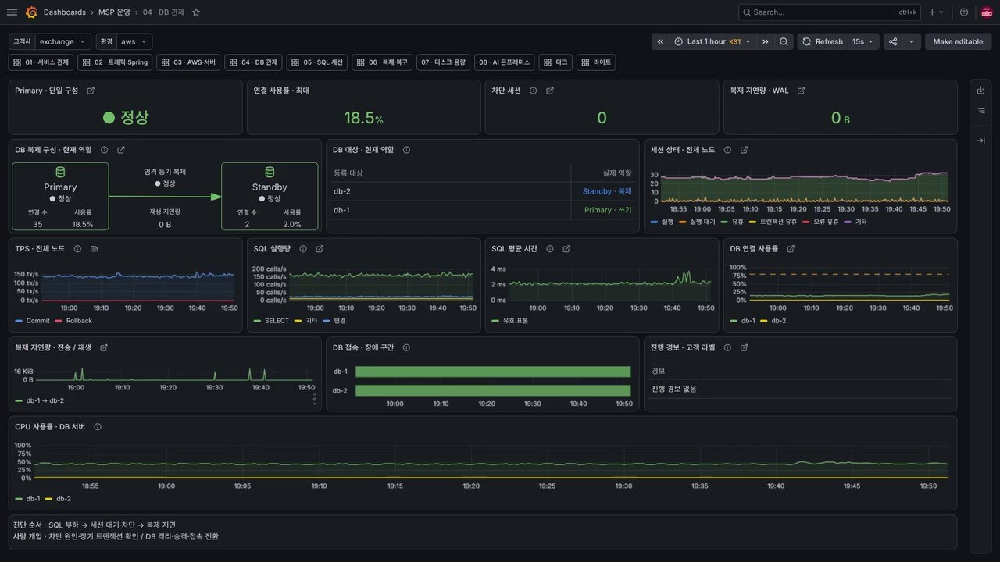</a><br><b>Grafana DB 관제</b><br><sub>복제 상태와 DB 부하</sub></td>
</tr>
</table>

배포 구성과 절차는 [배포 안내](deploy/README.md)와 [Terraform](deploy/terraform/)에 있습니다. 개인 AWS 자원은 발표가 끝난 뒤 모두 정리했습니다.

---

## 8. AI 관제

장애가 나면 엔지니어는 경보를 확인하고, 원인을 찾고, 조치하고, 보고서까지 씁니다. 그중 시간이 가장 많이 드는 원인 정리와 보고를 AI에 맡겼습니다. 새벽에 경보가 울리면 운영자 한 명이 관리 콘솔과 대시보드 여덟 개를 하나씩 열어 원인을 찾아야 했기 때문입니다.

<p align="center">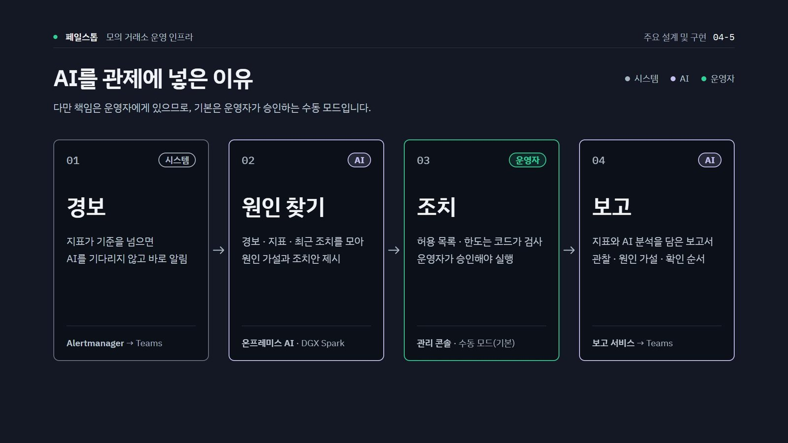</p>

다만 AI가 서버를 마음대로 바꾸면 책임질 사람이 없습니다. 그래서 조치는 운영자가 승인하는 **수동 모드**를 기본으로 두었습니다. 운영자가 켜 둔 동안만 허용 목록 안에서 AI가 직접 실행하는 자동 모드도 만들었지만, 최대 8시간까지만 켤 수 있습니다. AI가 낸 조치안은 AI가 아니라 코드가 다시 검사합니다. 허용 조치 다섯 가지와 금지 조치 여덟 가지를 정해 두었고, DB 전환처럼 목록에 없는 조치는 버리고 기록만 남깁니다. 실제 DB 전환은 Patroni 규칙이 맡습니다.

아래는 2026-10-10 개인 AWS에서 조회 부하를 걸었을 때 실제로 일어난 순서입니다. 시각은 실제 기록(KST)이고, 장면은 이해를 돕기 위해 다시 그렸습니다.

<p align="center">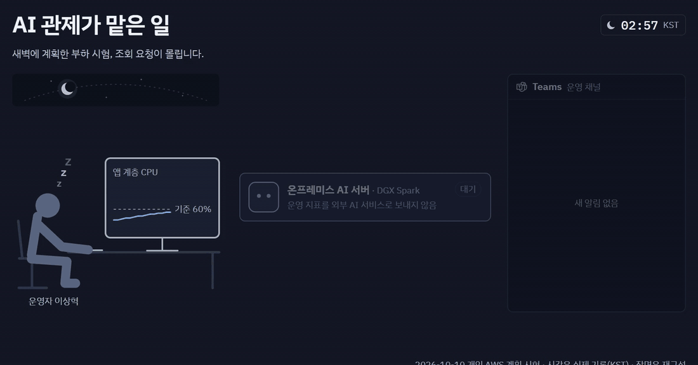</p>

| 시각 | 일어난 일 |
| :--- | :--- |
| 02:57 | 부하 시험 서버에서 조회 부하 시작 |
| 03:02:12 | 앱 계층 CPU 경보 발생, Teams로 바로 전송(경보는 AI를 기다리지 않음) |
| 03:03:57 | 온프레미스 AI가 경보·서버·DB 지표, 서버 대수, 최근 조치를 모아 조회 서버 app-3 켜기를 제안 |
| 03:05:49 | 운영자가 근거를 확인하고 승인 |
| 03:06:56 | 승인 67초 뒤 app-3가 로드밸런서에 합류 |
| 03:07 | 경보 해제, 장애 보고서를 Teams로 전송 |

AI는 Grafana 화면을 읽지 않습니다. Grafana와 같은 원천인 Prometheus 지표와 Alertmanager 경보에서 판단에 필요한 값만 골라 모읍니다. 모델은 온프레미스 DGX Spark에서 돌렸고, 운영 지표를 외부 AI 서비스로 보내지 않습니다. 보고서에는 수집한 지표와 AI의 참고 분석이 함께 들어갑니다.

<p align="center">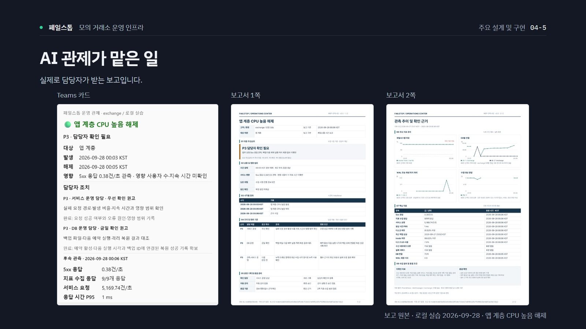</p>

권한 설계는 [ADR 0035](docs/reference/adr/0035-ai-operations-authority.md), AI 서버 결정은 [ADR 0038](docs/reference/adr/0038-on-prem-ai-inference-server.md), 시험 기록은 [시연 촬영 증거본](증거본/2026-10-10_AWS_시연촬영/README.md)에 있습니다.

---

## 9. 서버 이중화와 백업

학교 VM 실습에서 DB 데이터를 RAID 1으로 이중화했습니다. 가상 디스크 하나를 제거한 뒤 교체와 재동기화까지 확인했고, RAID 1 묶음을 하나 더 추가해 LVM과 XFS 파일시스템의 용량을 늘렸습니다. 네트워크는 NIC 본딩(active-backup)으로 묶어, 쓰던 가상 NIC를 끊었을 때 대기 NIC로 넘어가는 것을 확인했습니다.

<p align="center">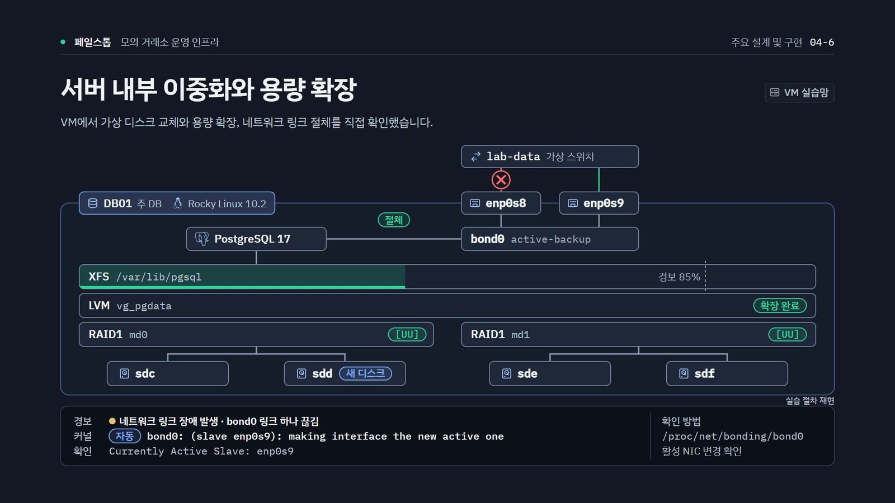</p>

백업은 오픈소스 도구 두 가지로 했습니다. DB는 Databasus로 매일 백업하고, OS는 Kopia로 백업해 둘 다 다른 서버에 보관했습니다. 백업은 실제로 복원해서 확인했습니다.

<p align="center">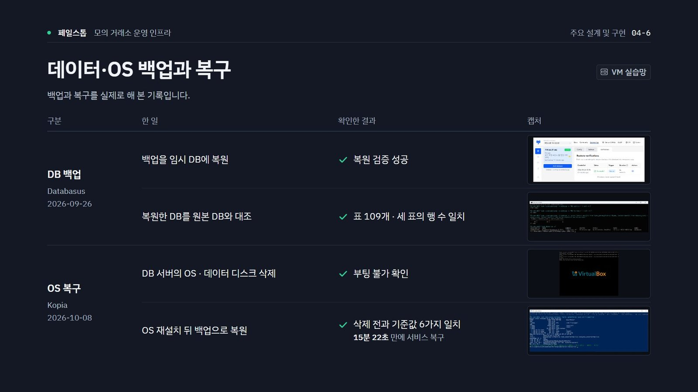</p>

| 구분 | 한 일 | 확인한 결과 |
| :--- | :--- | :--- |
| DB 백업 (Databasus) | 백업을 임시 DB에 복원 | 복원 검증 성공 |
| | 복원한 DB를 원본 DB와 대조 | 표 109개와 세 표의 행 수 일치 |
| OS 복구 (Kopia) | DB 서버의 OS·데이터 디스크 삭제 | 부팅 불가 확인 |
| | OS 재설치 뒤 백업으로 복원 | 삭제 전과 기준값 여섯 가지 일치, **15분 22초** 만에 서비스 복구 |
| 백업 보호 | 백업 대상 서버에서 백업본 삭제 시도 | root 권한으로도 삭제·보존 기간 축소 거부 |

Databasus 실습 기록은 [증거본](증거본/2026-09-26_VM_Databasus/README.md)에 있습니다.

---

## 10. Linux 서버 운영

서버 인프라 엔지니어의 기본기를 Linux에서 직접 설정하고 결과를 확인했습니다. 학교 EC2는 Amazon Linux 2023, VM 실습망은 Rocky Linux 10입니다.

<p align="center">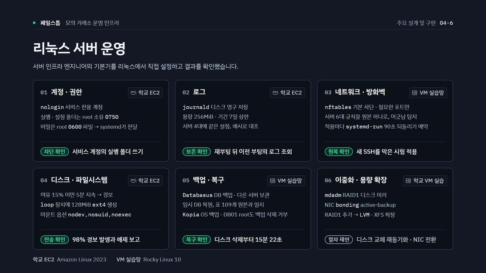</p>

| 영역 | 설정 | 확인한 것 |
| :--- | :--- | :--- |
| 계정·권한 | 앱은 로그인할 수 없는(nologin) 전용 계정으로 실행, 실행·설정 폴더는 root 소유 0750, 비밀 값은 root 0600 파일로 두고 systemd가 전달 | 서비스 계정이 실행 폴더에 쓰지 못함 |
| 로그 | journald를 디스크에 영구 저장, 용량 256MiB·기간 7일 상한, 서버 네 대에 같은 설정을 해시로 대조 | 재부팅 뒤에도 이전 부팅의 로그 조회 |
| 네트워크·방화벽 | nftables 기본 차단·필요한 포트만 허용, 서버 여섯 대 규칙을 원본 하나로 관리하고 어긋나면 탐지 | 적용할 때마다 `systemd-run`으로 90초 뒤 되돌리기 예약, 새 SSH를 막은 시험 적용에서 원복 |
| 디스크·파일시스템 | 여유 공간 15% 미만이 5분 이어지면 경보, loop 장치에 128MiB ext4를 만들어 `nodev,nosuid,noexec`로 마운트 | 98%까지 채워 경보 발생과 해제 보고 |
| 백업·복구 | Databasus DB 백업과 Kopia OS 백업을 다른 서버에 보관 | 디스크 삭제부터 15분 22초에 복구 |
| 이중화·용량 확장 | mdadm RAID1, NIC bonding active-backup, RAID1 추가 → LVM·XFS 확장 | 디스크 교체 재동기화와 NIC 전환 |

학교 EC2에서 Grafana가 메모리 상한에 걸려 종료(OOM)됐을 때 원인을 찾고 systemd 메모리 한도를 다시 잡은 과정은 [AWS 작업 기록](docs/reports/AWS_작업.md)에 남겼습니다.

---

## 11. 시연 영상

요청 급증과 DB 장애에 어떻게 대응하는지 개인 AWS에서 실제로 돌린 시험을 7분 영상으로 녹화했습니다.

<p align="center"><a href="발표덱/assets/video/failstop-aws-demo-v9.mp4">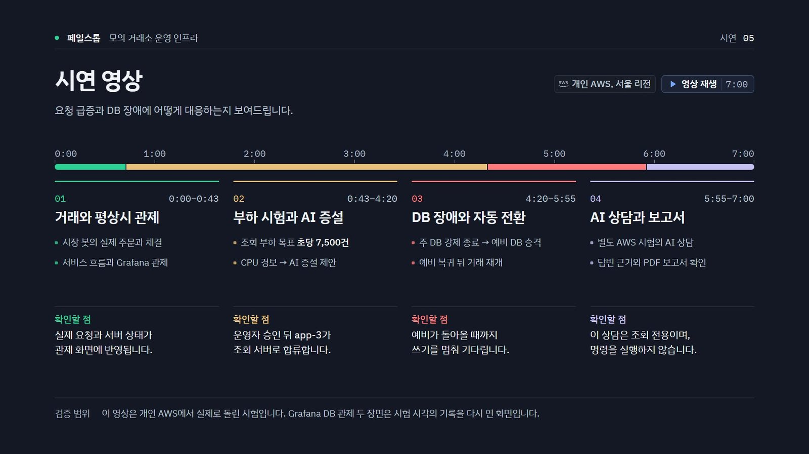</a></p>

| 구간 | 내용 | 확인할 점 |
| :--- | :--- | :--- |
| 0:00 ~ 0:43 | 거래와 평시 관제 | 실제 요청과 서버 상태가 관제 화면에 반영됨 |
| 0:43 ~ 4:20 | 부하 시험과 AI 증설 | 운영자 승인 뒤 app-3가 조회 서버로 합류 |
| 4:20 ~ 5:55 | DB 장애와 자동 전환 | 예비 DB가 승격하고, 동기 예비가 돌아올 때까지 쓰기를 멈춰 기다림 |
| 5:55 ~ 7:00 | AI 상담과 보고서 | 상담 답변은 조회 전용이며, 보고서는 PDF로 받음 |

같은 날 따로 진행한 DB 장애 시험에서는 주 DB의 전원을 갑자기 끊었습니다. 예비 DB가 23.0초에 자동 승격했고, 시험 도구가 옛 주 DB를 28초에 다시 켜 동기 예비로 돌아오자 70.1초에 거래가 다시 열렸습니다. 차단 4~64초 전에 커밋된 주문 196건을 새 주 DB에서 대조해 유실이 없음을 확인했습니다. 자세한 기록은 [DB 장애 시험 증거본](증거본/2026-10-10_개인AWS_DB장애시험/README.md)에 있습니다.

<p align="center">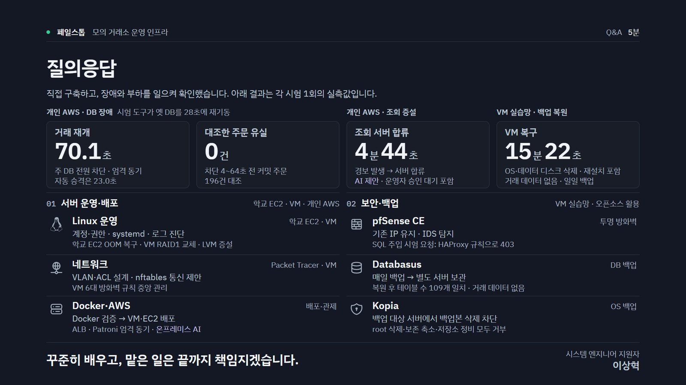</p>

---

## 12. 설계에서 고른 것과 다음 단계

설계하면서 일부러 포기한 것이 있습니다. 결과 수치를 읽을 때 함께 봐 주시면 좋겠습니다.

- **조회 계층만 늘립니다.** 주문은 리더 서버가 처리하는 구조라 서버를 늘려도 주문 처리량의 상한은 그대로입니다. 그래서 증설은 조회 서버에만 적용했습니다.
- **유실 대신 잠시 멈춤을 골랐습니다.** 엄격 동기 복제라서 동기 예비가 없으면 새 주 DB가 쓰기를 멈춥니다. 확인받은 주문을 잃지 않는 대신, 옛 주 DB가 돌아오지 않으면 운영자가 새 예비를 붙일 때까지 거래가 멈춥니다. 위의 70.1초도 옛 주 DB가 바로 돌아온 조건의 값입니다.
- **AWS 증설은 사람이 승인했습니다.** 로컬 Docker에서는 CPU 기준으로 자동 증설했지만, AWS에서는 AI 제안과 운영자 승인(수동 모드)으로 늘렸습니다.
- **대부분 1회 실측입니다.** AWS와 VM 시험 수치는 각 시험 1회의 값이고, 여러 번 반복해 분포를 낸 것은 로컬 Docker 장애 시험입니다.

다음에 이어서 해 보고 싶은 일은 조회 계층에 AWS 지표 기반 자동 증설 정책을 함께 적용해 수동 승인과 비교하는 것, 그리고 같은 시험을 여러 번 반복해 복구 시간의 분포를 보는 것입니다.

---

## 13. 저장소 구성

```
failstop/
├── server/            # Java 매칭 엔진(engine)과 Spring Boot API(app). 거래 기록, 정산, 복구, 봇
├── web/               # Next.js 거래 화면과 관리 콘솔
├── harness/           # 로컬 Docker 부하·장애 시험, 모니터링 설정, 시험 결과(evidence)
├── deploy/            # Linux 역할별 배포, 관측·Teams 보고, DB 백업·복구, AWS Terraform, VM 실습
├── docs/
│   ├── reports/       # 사람이 읽는 설명서
│   ├── reference/     # API·DB 계약, 상세 설계, 기술 결정(ADR)
│   ├── measurements/  # 날짜별 측정 기록
│   └── portfolio/     # 이 README의 그림과 발표 자료 PDF
├── 증거본/            # AWS·VM 작업의 실제 화면과 명령·출력 기록
├── 발표덱/            # HTML 발표 자료(16:9)와 시연 영상
├── 아키텍쳐/          # 보고한 구성도 원본과 캡처
└── seed-data/         # 외부 시세 데이터 수집 도구
```

---

## 14. 실행 방법

웹과 서버를 함께 띄우려면 [실행 가이드](실행_가이드.md)를 따릅니다. Node.js 20 이상, JDK 21, Docker Desktop이 필요합니다. 아래 명령은 각각 저장소 루트에서 시작합니다.

웹 개발 서버:

```powershell
cd web
npm ci
npm run dev
```

웹은 기본 설정에서 브라우저 안의 시뮬레이터를 씁니다. 실제 백엔드에 연결할 때 필요한 환경 변수는 실행 가이드에 있습니다.

백엔드 빌드와 테스트:

```powershell
cd server
.\gradlew.bat build
```

통합 테스트는 Docker로 PostgreSQL을 띄웁니다. Windows에서는 한글이 없는 저장소 경로를 사용해야 합니다. 자세한 조건은 [서버 안내](server/README.md)에 있습니다.

로컬 장애 시험을 다시 돌리는 방법은 [하네스 안내](harness/README.md)에 있습니다.

---

## 15. 더 읽을 문서

* [프로젝트 이해하기](docs/reports/프로젝트_이해하기.md): 운영 대상 거래소의 구조와 운영 관점에서 본 설명
* [현재 구조(ADR 0099)](docs/reference/adr/0099-current-architecture.md): 지금 적용하는 결정과 구조, 검증 범위
* [로드맵](docs/ROADMAP.md): 단계별 진행 기록과 완료 기준
* [코드 지도](docs/reference/architecture/프로젝트_코드지도.md): 기능별 소스와 테스트 위치
* [AWS 작업 기록](docs/reports/AWS_작업.md): 학교 EC2와 AWS 작업 순서, 장애 진단 기록
* [증거본](증거본/README.md): 단계별 실제 화면과 명령·출력
* [문서 안내](docs/README.md): 전체 문서 목록

Claude와 Codex로 작업할 때의 공통 규칙은 [AGENTS.md](AGENTS.md), CI 설정은 [.github/workflows/](.github/workflows/)에 있습니다.
