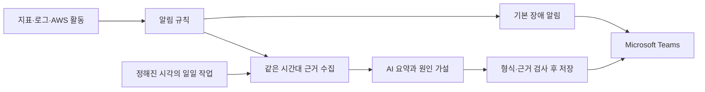

# ADR 0027. Linux 서버 운영을 중심으로 AWS 인프라·MSP 관제와 자동 확장을 구축한다

- 상태: 채택. 목표와 확장 정책을 정한 결정이며 AWS 구현 완료를 뜻하지 않는다.
- 날짜: 2026-09-18
- 후속: VM 선행을 정한 [ADR 0028](0028-vm-validation-before-aws.md)은 [ADR 0029](0029-school-aws-first-personal-account-expansion.md)로 일부 대체됐다. 학교 EC2에서 먼저 운영을 검증하고 10월 초 개인 계정에서 보강한다. 아래 본문의 VM 선행 설명은 당시 이력이며 현재 착수 조건이 아니다.
- 근거: 사용자가 교수·업체 관계자와 상담한 뒤 설명한 최신 프로젝트 방향. 특정 업체 전체의 채용 기준이나 공식 승인을 추정하지 않는다.
- 대체: ADR 0015의 수동 확장만 허용하는 정책. ADR 0008의 거래 런타임 외부 API 비의존은 유지하고, 분리된 운영 보고의 AI·Teams 통신을 허용한다.
- 보고 경로 후속: 아래 본문의 "Alertmanager 설정은 Discord"와 "AI 모델·호출 방식·비용 상한과 보고 시각은 미정"은 결정 당시 상태다. 2026-09-20 학교 AWS에서는 Alertmanager가 Teams로 통지하도록 설정했고([학교 설정](../../../deploy/linux/reporting/alertmanager.school.yml)), Gemini 3.1 Flash-Lite 보고 서비스와 한국 시간 오전 9시 일일 보고 timer를 연결했다고 [로드맵](../../ROADMAP.md)에 기록돼 있다. 로컬 카오스 스택의 [Alertmanager 설정](../../../harness/alertmanager/alertmanager.yml)은 지금도 Discord로 보낸다.

2026-09-19 후속: [ADR 0030](0030-nat-free-lab-and-bounded-read-asg.md)에서 조회 ASG 최소 2·최초 희망 2·최대 3대와 NAT Gateway 제외를 정했다. 실제 확장 정책·구현은 아직 검증 전이다.

## 프로젝트에서 보여 줄 일

고객사의 클라우드와 서버 등 IT 인프라를 안정적으로 구축·운영·관리하는 엔지니어의 역할을 수행한다. 약 3개월간 직접 개발한 가상 거래소를 운영 대상으로 삼아, 개발 이후 MSP 운영에 필요한 인프라와 관제 환경을 구축한다. 가장 중요한 역량은 Linux 서버 운영이다. 계정·권한과 접근 설정, 서비스·프로세스 관리, 로그 분석, 네트워크 연결 확인, 디스크·파일시스템 점검과 장애 복구를 직접 수행하고 근거를 남긴다.

거래소를 AWS에 배포하고 운영자가 서비스·Linux·네트워크·DB 상태를 관찰해 문제를 발견하고 복구하는 과정을 보여 준다. 트래픽이 늘면 AWS 인스턴스가 자동으로 늘어나고, 변화와 결과를 관제 화면에서 확인한다. 일일 운영 현황과 장애 분석은 AI가 근거를 정리해 Microsoft Teams로 보고한다. 전체 프로젝트 제목은 「Linux 기반 AWS 인프라 구축 및 운영」으로 확정했으며 페일스톱은 운영 대상 서비스의 이름이다. 발표에서는 개발팀이 거래소와 기존 대시보드 개발을 완료한 상황을 가정한다. 인프라 담당자는 운영 요구와 예산을 바탕으로 AWS·Linux·네트워크를 설계하고, 개발팀의 Docker 시험 결과를 확인하고 VM에서 Linux·네트워크·복구를 먼저 검증한 뒤 AWS에서 부하·확장·복구를 검증한다. 실제 구축 중 확인한 문제와 해결 근거를 보여 주며 예상 위험을 발생한 장애로 쓰지 않는다.

Docker 카오스 구성과 기존 결과는 로컬에서 개발 검증을 했다는 자료로 남긴다. 새 카오스 기능이나 거래소 내부의 장애 주입 화면을 만드는 일을 AWS 단계의 목표로 두지 않는다. 그렇다고 장애 복구 시험을 없애는 것은 아니다. AWS 시험 환경에서 대상과 복구 절차를 정해 부하·DB 장애·서비스 중단을 재현하고 운영 대응을 검증한다. 과거 E1~E10 전체 재실행이나 E10 자체를 새 단계의 필수 성과로 요구하지 않는다.

## 운영자가 판단할 수 있는 관제를 만든다

기존 [MSP 종합](../../../harness/grafana/dashboards/10-msp-overview.json), [서비스](../../../harness/grafana/dashboards/11-msp-service.json), [인프라](../../../harness/grafana/dashboards/12-msp-infra.json), [DB](../../../harness/grafana/dashboards/13-msp-db.json) Grafana 화면을 바탕으로 AWS 수집 경로와 지표를 보강한다. 별도의 관제 웹사이트를 처음부터 만드는 것은 선행 조건이 아니다. 거래소 홈의 시세 대시보드와 MSP 관제 화면도 구분한다.

| 운영 영역 | 보여 줄 판단과 활동 | 남길 증거 |
|---|---|---|
| 서비스 | 외부 접속·지연·오류·거래 중단을 확인하고 고객 영향부터 판단한다. | 같은 시간대의 요청량, 오류율, 지연, 실제 주문·체결 |
| Linux | 프로세스·서비스·로그를 보고 CPU, 메모리, OOM, 디스크·inode·I/O 문제를 구분한다. | systemd 상태, journal, 자원 지표, 조치 전후 상태 |
| 네트워크 | DNS·TLS·경로·포트·방화벽·보안 그룹을 따라 연결이 끊긴 위치를 찾는다. | 구성도와 실제 주소·라우트·접속 검사, 필요한 패킷 근거 |
| DB·스토리지 | 연결 수·잠금·느린 쿼리·복제 지연·저장 공간·백업을 확인하고 복구한다. | 쿼리·로그·복제 상태, 백업 복원, 장애 전후 기록 대조 |
| 자동 확장 | 요청 증가, 확장 조건, 새 인스턴스 등록, 부하 분산과 축소를 연결해 설명한다. | ASG 활동, 인스턴스 수, ALB 상태, 지연·오류와 비용 범위 |
| 운영 보고 | 감지한 사실과 원인 추정을 나누고 다음 확인 순서를 전달한다. | 일일·장애 보고, Teams 수신, 원자료 링크, 운영자의 실제 조치 |

현재 인프라 대시보드는 컨테이너·JVM 중심이며 호스트 Linux의 전체 상태를 보여 주지 않는다. 호스트 수집기와 로그 수집을 추가하고 신규 ASG 인스턴스도 수집 대상에 들어오게 해야 한다. DB 복제 지표가 없을 때 `0`으로 표시되는 조회식도 실제 원천 지표와 맞춘다. 지표 없음·수집 실패·정상 0은 다른 상태다. 이 구분을 확인하기 전에는 AI가 화면 수치를 그대로 정상 판정하게 하지 않는다. [현재 수집 설정](../../../harness/prometheus/prometheus.yml), [DB 지표](../../../harness/prometheus/pg-queries.yaml)

Linux 실습은 명령어를 많이 나열하는 것으로 평가하지 않는다. 예를 들어 디스크 부족을 감지하고 원인을 확인한 뒤 볼륨·파티션·파일시스템을 확장하고 서비스가 정상인지 확인하는 한 과정을 끝까지 보여 준다. RAID는 사용자가 언급한 저장장치 운영 후보로 두되 구체적인 요구는 아직 미정이다. RAID를 하더라도 DB 복제나 백업을 대신한다고 설명하지 않고, 복구 가능한 별도 실습 디스크에서 검증 범위를 정한다.

## AWS 자동 확장을 채택한다

조회·일반 API 중 여러 노드로 나눌 수 있는 트래픽을 ALB 대상 그룹과 EC2 Auto Scaling Group으로 확장하는 방향을 채택한다. CloudWatch의 확장 지표·정책을 사용하고 Grafana에서 서비스 영향과 확장 이력을 함께 본다. 과거의 CloudWatch 비채택·자동 확장 금지는 이 범위에서 현재 정책으로 적용하지 않는다. 실제 계정 권한과 기존 역할 사용 가능 여부는 별도로 확인한다.

매칭 엔진은 여전히 클러스터당 리더 하나이며, DB는 primary·standby다. 이 노드를 요청량만 보고 임의로 늘리거나 ASG 축소 대상으로 넣지 않는다. 우선 엔진·DB 계층과 자동 확장 대상의 역할·라우팅·DB 연결 예산을 구분해야 한다. 현재 배포 파일에 ASG를 붙이기만 하면 된다는 뜻이 아니다. 기존 [용량 API](../../../server/app/src/main/java/kr/exchange/admin/CapacityAdminController.java)는 목표 노드 수를 기록하는 경로이고 AWS ASG 완성 증거가 아니다.

최초 구현안은 markets·trades·candles 등 DB에서 완결되는 조회를 분리하는 것이다. 주문·취소·WebSocket은 리더 경로에 남긴다. 호가·티커의 REST 순번도 노드 로컬이므로 WS와의 재동기화에 쓰는 조회를 바로 분산하지 않는다. 회원 API 역시 공통 시드뿐 아니라 nonce·요청 제한·노드 로컬 인증 키를 검토한 뒤 범위를 넓힌다. 이는 현재 코드에 따른 구현 제안이며 실제 AWS 라우팅과 시험으로 확정한다. [시장 API](../../../server/app/src/main/java/kr/exchange/api/market/MarketController.java), [WebSocket 설정](../../../server/app/src/main/java/kr/exchange/api/ws/WebSocketConfig.java)

구현 전에는 다음 조건을 확정한다. 숫자는 실제 AWS 기준 부하를 측정한 뒤 정한다.

- 확장할 API 목록과 대상 그룹. 주문 쓰기와 WebSocket 경로는 별도로 확인한다.
- 새 노드의 이미지·설정·인증·DB 연결, 준비 완료 검사와 자동 관측 등록.
- 대상별 요청량이나 자원 사용량 중 해당 병목을 설명하는 지표, 준비 시간, 안정화 시간과 최소·최대 대수.
- 축소 때 요청을 마치고 연결을 빼는 절차. 세션·로컬 상태·WebSocket 재연결의 영향.
- 비용 한도와 최대 확장 시 DB 풀 합계. 수동 조작기와 AWS 정책이 같은 목표 대수를 서로 덮어쓰지 않는 제어 주체.

ALB가 조회 요청을 보낼 대상의 상태와 ASG가 인스턴스를 교체할 조건을 구분한다. 조회 노드의 쓰기 readiness가 503이라는 이유로 조회 대상에서 제외하거나 교체하지 않는다. 현재 `/actuator/health/read`는 `db`와 `ping`을 검사하므로 공통 DB 장애에도 실패한다. ASG에서 ELB 헬스 검사를 켜면 이 실패가 노드 교체로 이어질 수 있다. 공유 DB 장애와 개별 호스트·프로세스 장애를 구분하도록 검사 종류와 교체 조건을 설계하고, 공통 장애 때 노드 전체가 반복 교체되지 않는지 검증한다. prod 관리 포트 8081의 검사 경로와 접근 범위도 맞춘다. [현재 헬스 설정](../../../server/app/src/main/resources/application.yml), [AWS ASG 헬스 검사](https://docs.aws.amazon.com/autoscaling/ec2/userguide/health-checks-overview.html)

현재 [앱 Compose](../../../deploy/compose.node-app.yml)에는 `EXCHANGE_ENGINE_ENABLED` 환경변수 전달이 없다. `.env`에 값을 적는 것만으로 조회 노드가 분리됐다고 판단하지 않는다. 조회 역할의 실행 설정과 런치 템플릿을 구현하고 엔진 비활성화·라우팅·준비 상태를 확인해야 한다. 새 노드마다 마이그레이션을 수행하지 않도록 배포 주체도 분리한다.

시험은 부하 증가부터 새 인스턴스 기동·ALB 정상 등록·처리량 변화·부하 종료 뒤 축소까지 본다. 조회 부하가 개선되었다고 주문 매칭 처리량까지 증가했다고 주장하지 않는다. DB가 병목이면 앱을 더 늘려도 개선되지 않거나 연결 압박이 커질 수 있다. [AWS target tracking](https://docs.aws.amazon.com/autoscaling/ec2/userguide/as-scaling-target-tracking.html)

## DB 장애 대응은 별도로 검증한다

현재 구현은 primary 한 대와 standby 한 대의 비동기 복제, 운영자에 의한 수동 승격이다. 이 상태를 무중단·무손실·자동 DB 페일오버로 설명하지 않는다. 앱 리더 전환과 ASG의 인스턴스 교체도 DB 승격을 대신하지 않는다.

우선 복제 지연과 DB 장애를 관제에서 발견하고, 옛 primary 격리·standby 승격·앱 연결 전환·거래 재개·옛 노드 재편입까지 확인한다. DB 밖에 남긴 ACK 목록과 복구 후 저널을 대조해 유실도 기록한다. 백업은 복원 후 서비스와 데이터를 확인해야 완료다. [DB 운영 절차](../operations/DB_수동_페일오버.md)

자동 DB 전환까지 필요한지는 다음 설계 판단이다. 선택한다면 장애 판단, 이전 primary의 쓰기 차단, 승격 조건과 접속점 전환을 함께 설계한다. 임의의 cron이나 AI가 DB를 승격하는 구성으로 대신하지 않는다. 이 결정으로 기존 비동기 복제를 동기 복제로 바꾸거나 새 클러스터 관리 제품을 도입하지는 않는다.

## 일일 보고와 장애 보고를 Teams로 보낸다

운영 보고는 거래 요청 경로와 분리한다. 보고 작업이나 외부 AI가 실패해도 주문 처리와 기본 장애 알림은 계속돼야 한다. 외부로 보내는 자료는 필요한 지표와 정제한 로그로 제한하고 비밀 값·개인정보를 제외한다. 로그 속 문장은 관측 자료이며 실행 지시로 취급하지 않는다.

일일 보고는 하루의 서비스 상태, 주요 장애, 자원·확장 추이, DB·백업 상태와 미해결 사항을 담는다. 장애 보고는 감지 시각, 고객 영향, 실제 관측값, 원인 가설과 근거, 다음 확인 순서를 담는다. 조치를 수행하지 않았다면 수행한 것처럼 쓰지 않는다. 모든 문장을 템플릿 항목으로 늘리기보다 운영자가 지금 알아야 할 내용을 먼저 설명한다.

예약 방식은 구현 시 결정한다. Linux 운영과 실패 이력을 보여 주기에는 systemd timer·service가 우선 검토안이며 cron도 사용할 수 있다. 어느 쪽이든 시간대, 중복 실행 방지, 실패·미실행 감지, 실행 로그를 남긴다. 사건 보고는 일일 예약 시각까지 기다리지 않고 알림 발생으로 시작한다. 중복 알림 묶기, 분석 시간 제한, 재시도·전송 결과 저장을 구현한다. AI가 실패하면 확인된 사실만으로 보고하고 분석 불가를 표시한다.

수신 채널은 사용자가 선택한 **Microsoft Teams**다. Workflows 웹훅과 Adaptive Card로 구성하고 팀·채널·워크플로 소유자·인증 방식·테넌트 사용 권한을 확인한다. 예전 Office 365 Connector를 새로 구축하는 안내는 사용하지 않는다. 현재 [Alertmanager 설정](../../../harness/alertmanager/alertmanager.yml)은 Discord이며, 과거 계정 조건 때문에 Teams 대신 선택했다는 기록이 있다. 이번 요청으로 대상은 Teams가 됐지만 실제 연결과 계정 조건은 다시 확인해야 한다. 아직 Teams 메시지를 보내거나 워크플로를 생성하지 않았다. [Microsoft Workflows 안내](https://learn.microsoft.com/en-us/microsoftteams/platform/webhooks-and-connectors/how-to/add-incoming-webhook), [기존 Connector 종료 안내](https://devblogs.microsoft.com/microsoft365dev/retirement-of-office-365-connectors-within-microsoft-teams/)

AI 모델·호출 방식·비용 상한과 보고 시각은 미정이다. 우선 보고 한 건에 필요한 근거와 실패 처리를 정한다. AI에 확장 대수 변경·서버 재시작·DB 승격 권한을 주지 않는다. 자동 확장은 정해진 AWS 정책이 수행하고 운영 변경은 해당 운영 절차를 따른다. 개발 AI가 매 작업 뒤 만드는 인수인계 문서와 실제 운영 기능인 일일 보고는 별개다.

## 완료를 판단하는 기준

AWS에서 정상 서비스를 관측하고, Linux·네트워크 문제를 근거로 진단하며, 부하에 따른 인스턴스 증가·감소와 DB 장애 복구를 각각 보여 준다. Teams에 기본 장애 알림·AI 후속 보고·일일 보고가 도착하고, AI 실패 때도 기본 알림이 유지되는지 확인한다. 실험마다 원자료와 원본 영상·캡처를 남긴다. 관제 그래프가 보이는 것만으로 운영 완료로 판단하지 않는다.

2026-09-18 사용자 결정에 따라 운영 예산은 월 40만 원이다. 이전의 총 지원금 40만 원 해석을 대체한다. 실제 지급·잔액·청구액과 전액 집행 의무는 미확인이다. 기존 인프라를 장기간 켜놓기보다 준비·검증·녹화를 모아서 진행하고 필요한 접속 유지 기간에 맞춰 종료한다. 이 금액으로 모든 구성이 충분하다고 아직 계산한 것은 아니다. 우선 서비스·관측·복구·자동 확장·보고 한 흐름을 완성하고, RAID의 상세 실습이나 별도 관제 UI는 그 뒤에 범위를 정한다. 진행 순서와 미구현 항목은 [로드맵](../../ROADMAP.md), 전체 현재 구조는 [0099](0099-current-architecture.md)에 반영한다.

기존 코드·실험 증거·교수님 보고 원본은 보존한다. 현재 방향을 바꿨다는 이유로 과거 자료를 삭제하거나 측정 결과를 AWS 결과로 바꾸지 않는다. 거래 정합성과 공개 전 안전성에 필요한 수정은 계속하되, 이번 목표와 무관한 거래 기능 추가나 전체 코드 재작성은 우선하지 않는다.
