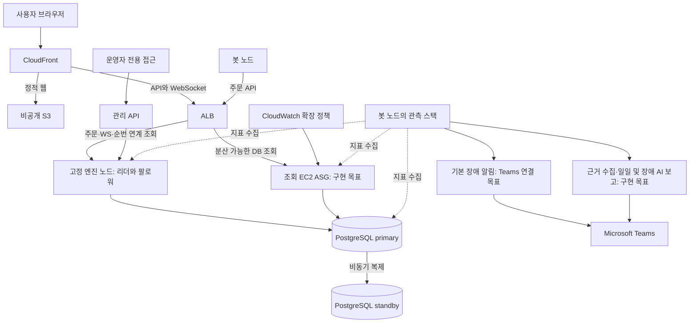

# 0099. 현재 구조와 AWS 배포 판단

이 문서만 읽어도 지금 채택한 구조, 실제 구현 범위, AWS에 올리기 전에 남은 일을 판단할 수 있도록 정리한다. 각 ADR은 선택 이유와 변경 이력을 보존하고, 이 문서는 그 결정들이 합쳐진 현재 모습을 계속 갱신한다. `0099`는 이를 위한 예약 번호다. 개별 결정의 번호는 0099를 제외하고 이어간다.

검토 기준일은 2026-09-20이다. 기존 소스·측정 자료의 대조에 이어 MSP 운영 방향, VM 선행 결정과 학교 EC2 우선 전환을 검토했다. 학교 안내 원문, MFA 재로그인 뒤 자원 생성과 Linux 설정, 별도 DB 두 대의 비동기 복제, HTTPS와 저속 봇 체결을 확인했다. **격리 DB 복원, 수동 DB 장애 복구와 앱·DB 상태를 포함한 Teams 보고는 검증했다. 장시간 운영 측정, 외부 보관·예약 백업, ALB·ASG의 실제 자동 확장은 남아 있다.** 현재 계정 상태와 다음 작업은 [로드맵](../../ROADMAP.md)에 기록한다.

09-17에는 사용자가 교수님께 보고한 구성도와 화면을 확인했다. 원본 15개와 현재 구현과의 차이는 [아키텍쳐 자료](../../../아키텍쳐/README.md)에 있다. 2026-09-18 확정한 운영 예산은 **월 40만 원**이며, 발표는 PPTX에 실제 시연 영상과 캡처를 연결해 준비한다. 과거 문서의 50만 원 전제는 현재 예산 판단에 사용하지 않는다.

세부 필드와 불변 조건은 [계약 문서](../README.md), 진행 중인 작업은 [로드맵](../../ROADMAP.md), 실행 결과는 [측정 기록](../../measurements/README.md)이 기준이다. 이 문서에서 서로 다른 내용을 발견하면 해당 원본과 코드를 함께 고친다. 높은 ADR 번호나 이 요약만으로 기존 계약을 덮어쓰지 않는다.

학교 EC2의 관리 접속은 기존 Instance Connect와 SSM 경로를 유지한다. 2026-09-20 사용자 요청으로 EC2 RSA 키페어를 생성하고 기존 네 서버의 ec2-user에 공개키를 등록했다. 개인키는 PC의 PEM·PPK 파일로 보관하며 Git에 두지 않는다. 실제 SSH 인증은 SSM 경유로 검증했고, 직접 공인 IP 접속을 위한 22번 SG 확대는 하지 않았다. 인스턴스 생성 당시 키페어 표시와 서버의 현재 공개키 인증 설정을 구분한다. 사용법·근거는 [AWS 작업 안내](../../reports/AWS_작업.md#aws-키페어와-putty-접속-파일)를 따른다.

## 지금 판단할 내용

고객사의 IT 인프라를 구축·운영·관리하는 엔지니어의 역할을 수행한다. 약 3개월간 직접 개발한 가상 거래소를 대상으로 AWS 인프라와 관제 기반을 갖추며, 가장 중요한 역량은 Linux 서버 운영이다. 계정·권한·서비스·로그·네트워크·디스크를 직접 설정하고 장애 원인을 좁혀 복구한다. DB 복구와 조회 계층의 EC2 자동 확장도 검증한다. 일일·장애 보고는 AI가 수집한 근거를 정리해 Microsoft Teams로 보낸다. 전체 제목은 「Linux 기반 AWS 인프라 구축 및 운영」이며 페일스톱은 운영 대상 서비스명이다. 개발팀이 거래소와 기존 대시보드를 완성한 상황에서 인프라 담당자가 설계·구축·검증을 수행하는 시나리오다. 개발팀의 Docker 결과를 확인한 뒤 학교 EC2에서 Linux 운영과 서비스를 검증하고, 2026년 10월 초 개인 AWS 계정에서 제한됐던 부분을 보강한다. VM 선행 조건은 [ADR 0029](0029-school-aws-first-personal-account-expansion.md)로 보류했다. 발표에서는 구축 중 확인한 문제, 선택한 설정과 재검증 근거를 설명한다. 시나리오의 개발 완료 전제가 실제 AWS 검증 상태를 바꾸지는 않는다. [ADR 0027](0027-msp-operations-and-autoscaling.md)

Docker 카오스는 로컬에서 개발 검증을 했다는 자료로 보존한다. 새로운 카오스 기능·주입 화면이나 과거 실험 전수 재실행을 목표로 두지 않는다. AWS의 부하·장애 대응 시험은 계속하되 관제에서 진단·조치·보고까지 이어지는 과정으로 판단한다. 기존의 수동 확장 전용 정책은 현재 목표가 아니다.

MSP 업무와 연결할 계정·서비스·로그·스토리지·네트워크 설정과 실습 후보는 [Linux 운영 실무 조사](../../reports/Linux_운영_실무_조사.md)에 정리했다. 공식 자료를 바탕으로 한 제안이며 신규 설정 채택이나 구현·검증 완료를 뜻하지 않는다.

학교 EC2에서는 기존 역할별 인스턴스 분리를 유지한다. 먼저 생성한 t3.small·gp3 20GiB 한 대는 첫 앱 노드이며 접속·계정·권한·서비스·로그·디스크를 검증하는 출발점이다. DB와 관측을 이 서버에 먼저 설치하지 않는다. 각 역할의 Linux에 직접 설치하는 방식이며 Docker 예외는 이유를 기록한다. 50GiB는 학교 안내의 디스크 용량 조건이고 전체 시스템을 한 대에 넣으라는 제한이 아니다. 실제 할당량·추가 노드 생성 권한은 별도 확인한다. [ADR 0029](0029-school-aws-first-personal-account-expansion.md)

[VM 운영환경 구성도](../../../아키텍쳐/교수님_보고본/06_VM_운영환경/Linux_VM_운영환경_구성도.png)는 보류한 VM 단계를 설명하는 설계안으로 보존한다. 웹 진입·앱·DB·관제를 6개 역할로 나눈 예시이며 VM 대수 확정이나 구축 완료를 뜻하지 않는다. 편집 원본과 그림의 적용 범위는 [아키텍쳐 자료](../../../아키텍쳐/README.md)에서 확인한다.

2026-09-19에는 [VM 네트워크·접근제어도](../../../아키텍쳐/교수님_보고본/06_VM_운영환경/VM_네트워크_접근제어도.png)와 [VM DB 장애 복구 흐름도](../../../아키텍쳐/교수님_보고본/06_VM_운영환경/VM_DB_장애복구_흐름도.png)를 추가했다. 출발지별 허용 포트, SSH 터널을 통한 관리 화면 접근, 기존 DB 격리부터 수동 승격·거래 검증·복제본 재구성까지의 설계안이다. 접근제어 적용이나 복구 실습을 실행한 결과가 아니며, 실제 VM 주소·설정·운영 판단 조건은 구축할 때 확인한다.

2026-09-20에는 학교 EC2의 현재 상태를 설명하는 발표용 도면 여섯 장을 [아키텍쳐 자료](../../../아키텍쳐/README.md)의 `07_학교AWS_운영환경`에 추가했다. 실제 역할별 배치, Linux 서비스와 권한, 장애 감지와 Teams 보고, 출발지·포트 기준의 접근 통제, 수동 DB 전환 절차, 조회 계층 확장 계획을 나눠 그렸고 미구축 자원은 점선으로 구분했다. 도면은 AWS 공식 아이콘을 쓰고 한눈에 읽히도록 글자를 줄였으므로, 포트 전체 목록과 식별자·권한 같은 세부 값은 도면이 아니라 [AWS 작업 안내](../../reports/AWS_작업.md)와 이 문서에서 확인한다. 도면의 값은 저장소 설정 파일과 운영 문서에서 확인한 것이며 실행 중 서버를 다시 조회한 결과가 아니다. 이 그림 작업으로 AWS 검증 상태가 달라지지는 않는다.

현재 거래 서버는 한 리더 안에서 마켓별로 주문을 처리한다. DB는 primary 한 대와 standby 한 대의 비동기 복제다. 앱 리더 전환은 자동이지만 DB 승격은 수동이다. 따라서 앱 장애 복구 목표인 30초나 로컬 무손실 결과를 DB 장애 전체의 보장으로 설명하면 안 된다.

## 역할별 인스턴스 배치

학교 DB는 PostgreSQL 17을 OS 서비스로 실행한다. 공통 설정은 [exchange.conf](../../../deploy/linux/postgresql/exchange.conf), 사설 주소는 각 호스트의 `/etc/postgresql/node.conf`에 둔다. 복제 연결은 Standby의 사설 주소 한 개와 복제 전용 계정으로 제한하고 SCRAM 인증과 TLS `verify-full`을 적용한다. 자체 서명한 서버 인증서를 명시적으로 신뢰하며 ACM을 사용하지 않는다. 인증서 교체 시 신뢰 파일도 갱신해야 한다. 재편입은 ADR 0025의 베이스백업 기준을 유지하고 WAL 보존 확대·자동 승격은 추가하지 않았다.

앱·DB·관측을 한 대에 모았다가 나중에 나누는 방식은 사용하지 않는다. 배치는 [교수님께 보고한 전체 구성도](../../../아키텍쳐/교수님_보고본/01_전체구성/거래소_하이브리드_인프라_v5.png)를 기준으로 한다. 기본 역할은 app-1·app-2, DB primary·standby, bot-1의 다섯 노드이며 load-1은 별도 부하 시험 노드다. 도면의 선택적 app-3 수동 증설은 현재 조회 ASG 목표와 구분한다. 첫 앱 노드와 별도 DB 두 대, bot-1 서버를 생성했다. bot-1은 t3.small·암호화 gp3 20GiB로 AZ-c에 배치했다. 관측 프로그램과 BTC 저속 시장 봇을 Linux 서비스로 설치했으며 짧은 동시 기동을 확인했다. 장시간 자원 간섭은 검증해야 한다. 생성·검증 상태는 [로드맵](../../ROADMAP.md)에서 확인한다.

| 역할 | 배치 기준 |
|---|---|
| app-1·app-2 | 리더·팔로워를 서로 다른 EC2에 둔다. Java·거래 앱과 해당 호스트 수집 에이전트를 설치한다. PostgreSQL 서버나 중앙 관측 스택을 동거시키지 않는다. |
| DB primary | 앱과 분리한 전용 EC2에 PostgreSQL을 설치한다. 학교에서는 t3.small·암호화 gp3 50GiB, 기본 VPC의 AZ-a로 준비한다. 앱은 이 노드의 사설 주소로 접속한다. |
| DB standby | primary와 다른 EC2에 둔다. 학교에서는 t3.small·암호화 gp3 50GiB, 기본 VPC의 AZ-c로 준비한다. 비동기 복제·격리·수동 승격·재편입을 검증한다. |
| bot-1 | 도면과 ADR 0016에 따라 시장 봇과 Prometheus·Grafana 등 중앙 관측을 함께 둔다. 앱·DB·자동 축소 대상과 분리한다. 동거에 따른 자원 간섭과 노드 자체 감시는 검증해야 하며, 관측 전용 EC2 추가는 별도 변경 판단이다. |
| 조회 ASG | 분산 가능한 REST 조회를 담당하는 별도 확장 계층이다. 고정 매칭 리더나 DB를 함께 확장하지 않는다. 학교 콘솔에서 ASG 조회와 선행 시작 템플릿 생성이 거부됐다. ASG 생성 API 자체는 미확인이다. 운영자 권한 확인과 학교 배포·부하 검증이 필요하다. 조회 역할 코드와 Terraform 예제는 통합됐지만 AWS 적용 결과는 아니다. |
| load-1 | k6 부하 발생과 외부 계측을 담당한다. 앱·DB·bot-1과 별도 노드로 두며 시험할 때의 가동 시간과 비용을 계산한다. |

학교에서 사용할 정확한 추가 대수·규격·AZ·보안 그룹·가동 시간과 비용은 생성 전에 확정한다. 예산이나 권한 제약이 생겨도 역할을 임의로 합치지 않는다. 이 표는 분리 기준을 명확히 한 것이며 아직 없는 EC2·ASG를 구축 완료로 표시한 것이 아니다.

## 서비스가 연결되는 모습

학교의 시장 봇은 bot-1의 별도 Linux 사용자·systemd 서비스로 실행한다. BTC·ETH·XRP의 전체 주문·취소 목표는 3 OPS이며 매칭 엔진·Flyway를 끄고 공개 HTTPS 앱으로 주문을 보낸다. 봇의 DB 접근은 기존 앱 계정을 사용하되 Primary 인증을 봇 IP 하나로 제한하고 TLS `verify-full`로 검증한다. 봇 관리 API는 사설 8443에서 앱 SG의 mTLS 연결만 받고 관리 지표 8081은 루프백으로 유지한다. 관측과 동시 기동, 봇 정상 종료·재시작을 확인했다. 자동 시작과 제한된 재시도, 디스크 여유·관측 유효성을 기준으로 봇만 중지하는 점검을 적용했다. 장시간 운영·하루 디스크 증가량·호스트 재부팅은 추가 검증해야 한다. 세부 설정과 근거는 [AWS 작업 안내](../../reports/AWS_작업.md#시장-봇을-시작하고-확인하는-방법)를 따른다.

학교 앱의 현재 도메인은 가비아 DNS에서 `www.sang.it.kr`을 app-1의 공인 IP로 연결하고 Nginx가 Let’s Encrypt 인증서로 HTTPS를 처리하는 경로다. 사용자 승인으로 앱 SG의 80·443을 공개했다. 80은 ACME 검증과 HTTPS 이동에만 사용하며, 443은 사용자 웹·API·WebSocket을 제공한다. 443에서 Grafana 로그인과 봇 관리자 로그인을 제공한다. DB와 내부 관측 포트는 지정 SG만 허용한다. 인증서 갱신은 Certbot 타이머와 Nginx 재적용 훅으로 수행하며 모의 갱신에 성공했다. 개인 CloudFront·ACM 연결은 보류했다. 이 경로가 목표 CloudFront·ALB 구성을 대체하지는 않는다. 이후 저속 봇 체결을 확인했지만 고가용성 검증은 남아 있다. 재현 절차와 검증 범위는 [AWS 작업 안내](../../reports/AWS_작업.md)의 도메인 절을 따른다.

페일스톱은 실제 자금을 다루지 않는 가상 자산 거래소다. 사용자는 시세·호가·차트를 보고 주문하며, 회원별 거래 내역과 가상 자산을 확인한다. 게시판·댓글·공지·문의와 관리자 기능도 같은 프로젝트에 있다. 봇은 사용자와 같은 주문 API를 호출해 시장과 실험 부하를 만든다.

아래는 **서비스 연결의 목표 구조**다. 학교 계정에서 ALB·ASG 등을 실제 사용할 수 있는지는 동작별로 확인한다. 학교와 개인 계정의 네트워크 차이는 ADR 0029를 따르며 AWS 자원이 실제로 생성됐다는 뜻은 아니다. 관측 스택, 로드밸런서 경로와 여러 호스트의 연결은 배포 설정에서 마무리해야 한다.

웹은 Next.js·React로 개발하고 정적 파일로 배포한다. 별도의 Next.js 런타임 서버는 두지 않는다. 기본 개발 설정은 브라우저 안의 시뮬레이터이므로 실제 거래 검증에는 `NEXT_PUBLIC_DATASOURCE=http`가 필요하다. 서버는 Java 21·Spring Boot, DB는 자체 운영 PostgreSQL 17 계열이다. `server/engine`은 매칭 규칙을 계산하고 `server/app`은 API·DB·정산·리더 전환을 연결한다. 현재 실행 구성에 Kafka나 Redis는 없다. 시작점과 테스트 위치는 [코드 지도](../architecture/프로젝트_코드지도.md), 웹 빌드는 [웹 안내](../../../web/README.md), 서버 실행은 [서버 안내](../../../server/README.md)를 따른다.

CloudFront는 정적 웹을 S3에서, API와 WebSocket을 ALB에서 받아 브라우저 주소를 하나로 유지한다. ALB가 HTTP·WebSocket과 리더 전환을 어떻게 연결할지 실제 대상 그룹·상태 확인·재접속으로 검증해야 한다. 학교는 Default VPC의 Public Subnet을 사용한다. 학교·개인 실습 모두 NAT Gateway를 제외하고 기존 IGW는 유지한다. 개인 조회 노드는 Public Subnet·공인 IPv4·제한 SG를 전제로 min 2 / desired 2 / max 3으로 계획하며 실제 배포·확장 정책은 미검증이다. 과거 nginx edge 설정과 옛 노드 수·비용표를 현재 배포안으로 사용하지 않는다. [ADR 0030](0030-nat-free-lab-and-bounded-read-asg.md), [배포 안내](../../../deploy/README.md)

교수님께 보고한 하이브리드 구성도도 서울 2 AZ, DB 2노드, NAT 2개와 봇·관측 동거라는 방향이다. 수동 확장 표시는 09-18에 설명한 자동 확장 요구로 바뀌었다. 로컬 Docker 도면의 DynamoDB Local은 현재 기본값이 아닌 선택 실험 경로다. DB 장애 시나리오는 단일 DB 중단·재시작이며 E2의 한 앱 접속 경로 차단이나 AWS standby 수동 승격과 구분한다. 원본은 보존하고 촬영 환경·실험 종류를 정확히 표시한다.

외부 시세·콘텐츠 API가 응답해야 거래나 화면이 동작하는 구조는 채택하지 않았다. 필요한 자료는 시드나 웹 빌드에 포함한다. AWS의 저장소·리스·관리 서비스와 통신하는 것까지 금지한다는 뜻은 아니다. 외부 데이터 수집 도구의 결과를 앱에 자동 적재하는 연결은 아직 없다. [외부 API 전략](../contracts/외부API_전략.md), [수집 도구](../../../seed-data/README.md)

운영 보고의 외부 AI·Teams 호출은 거래 처리와 분리한다. 모델이나 보고 작업이 실패해도 주문과 기본 알림은 유지해야 한다. AI는 수집 근거를 요약하며 AWS 확장·서버 재시작·DB 승격을 직접 실행하지 않는다. 학교 bot-1은 Gemini 3.1 Flash-Lite의 HTTPS API와 Teams Workflows를 사용한다. 정상 지표에서 근거 없는 장애 원인이나 조치를 만들어 내지 않도록 제한한다.

학교 봇 운영자는 기존 HTTPS의 `/admin/bots`에 아이디·비밀번호로 로그인한다. Nginx가 한 운영자의 로그인만 검증하고 내부 mTLS 신원으로 단기 세션을 연결한다. 운영자 PC 인증서는 요구하지 않지만 Nginx가 추가 신뢰 경계가 된다. 기존 서버의 mTLS·세션·역할 검사는 유지하고 VIEWER·BOT_OPS만 부여한다. 실제 플릿 제어를 위해 관리 API와 봇은 같은 JVM에 둔다. 다중 운영자와 다른 배포 환경으로 이 예외를 자동 확대하지 않는다. [ADR 0031](0031-school-admin-password-gateway.md)

## 자동 확장과 관제를 구현할 때의 경계

먼저 DB에서 완결되는 markets·trades·candles 등의 REST 조회를 별도 ASG로 보내는 안을 검증한다. `engine.enabled=false`는 출발점이지만 모든 쓰기 API를 제거하는 역할 설정은 아니다. 주문·취소·WebSocket은 리더 경로에 유지한다. 호가·티커의 REST 순번도 노드 로컬 값이므로 WS와 같은 기준으로 재동기화할 수 있도록 리더 경로에 남기거나 순번 전달을 먼저 구현해야 한다. [엔진 구성](../../../server/app/src/main/java/kr/exchange/config/EngineConfig.java), [시장 API](../../../server/app/src/main/java/kr/exchange/api/market/MarketController.java)

인증 API 전체를 바로 분산하지 않는다. 공통 회원 시드 외에도 노드 로컬 데모·관리 키, nonce, 요청 제한의 범위를 확인해야 한다. ASG 준비 검사·최대 대수의 DB 풀·관측 대상 등록·축소 드레이닝을 설계하고, 기존 Docker 용량 조정기가 AWS 정책과 같은 대수를 동시에 제어하지 않게 한다. 현재 WS는 노드 내 브로커이므로 조회 노드를 늘리는 것만으로 리더 이벤트가 전달되지 않는다. [WebSocket 설정](../../../server/app/src/main/java/kr/exchange/api/ws/WebSocketConfig.java), [API 계약](../contracts/백엔드_API_설계.md)

조회 역할은 원격 작업에서 구현돼 통합됐다. [read 프로파일](../../../server/app/src/main/resources/application-read.yml), [경로 제한 필터](../../../server/app/src/main/java/kr/exchange/api/common/ReadRoleFilter.java), [조회 Compose](../../../deploy/compose.node-read.yml)가 엔진·관리 쓰기를 끄고 markets·trades·candles의 GET/HEAD와 관리 상태 조회만 허용한다. 학교 AWS의 ALB·ASG 배포와 실제 부하·축소 검증은 아직 하지 않았다. ALB의 DB 연계 read health와 EC2/ASG의 liveness·교체 조건을 분리하는 설정을 실제 환경에서 검증해야 한다. [ADR 0027](0027-msp-operations-and-autoscaling.md)

GitHub `6ee1179`의 Grafana MSP 6개 화면을 재사용하되 호스트 Linux의 파일시스템·inode·I/O·네트워크·서비스 상태를 보강한다. 학교 AWS에서는 호스트 4대와 DB 2대 지표를 연결했고 별도 디스크·용량 화면을 추가했다. 앱·DB의 수집 포트는 봇 SG로만 제한하고 DB 관측은 로컬 peer 인증과 통계 권한을 사용한다. 학교의 SQL 통계 확장·외부 사이트 프로브·CloudWatch는 미연결이다. 앱·DB·디스크 경보는 연결해 발생·해제 보고를 확인했다. 실제 원천과 조회식을 맞추고 미수집을 정상이나 지연 0으로 해석하지 않는다. 관측 노드 자체의 실패도 외부에서 감지해야 한다. 기존 봇·관측 동거는 자원과 장애를 공유하므로 부하 발생과 보고 작업이 관제를 방해하지 않는 배치·자원 한도를 정한다. 사용자는 메모리가 부족하면 두 역할을 분리하도록 지시했다. 세 마켓의 저속 봇과 관측의 짧은 동시 기동은 확인했으며, 장시간 부하와 보고 작업까지 포함한 자원 여유는 별도 검증한다. [학교 MSP 화면](../../../deploy/linux/observability/msp-dashboards/10-msp-overview.json), [학교 DB 화면](../../../deploy/linux/observability/msp-dashboards/13-msp-db.json)

기본 장애 알림 뒤에 AI 근거 보고를 보내고, 일일 보고는 별도 예약 작업으로 실행한다. Linux systemd timer 또는 cron의 시간대·중복·실패 이력을 관리한다. 과거 Docker 카오스는 Discord 설정을 보존한다. 학교 AWS는 Teams Workflows·Adaptive Card와 Gemini 요약, PDF·HTML 보고를 사용하며 실제 카드와 파일 열람을 확인했다. 일일 예약 시각의 실행·전송은 후속 확인 대상이다. 상세한 보고 흐름과 완료 조건은 ADR 0027을 따른다. [현재 알림 설정](../../../harness/alertmanager/alertmanager.yml)

## 주문과 데이터의 흐름

주문에는 클라이언트가 만든 `client_order_id`가 필요하다. 응답이 늦거나 결과가 불명확하면 같은 키로 상태를 조회하고 재시도한다. 서버는 요청 제한과 인증을 거쳐 내용·잔고·멱등성을 검사하고, 해당 마켓의 접수 잠금 안에서 명령을 `command_journal`에 확정한다. 그다음 같은 리더 프로세스의 마켓별 라이터가 명령을 순서대로 매칭한다. 마켓을 나눴어도 회원 자산과 DB는 공유하므로 서로 완전히 독립된 시스템은 아니다.

정산은 한 명령의 처리 결과를 이벤트·주문·체결·원장·잔고에 같은 트랜잭션으로 반영한다. 저장 후 WebSocket으로 호가와 체결을 알린다. 웹은 연결이 끊기거나 메시지를 놓치면 REST 조회로 상태를 맞춘다. 명령 저장, 주문의 조회 반영, HTTP 응답 완료는 서로 다른 시점이다. `order_in_progress`나 타임아웃을 주문 부재로 판단하지 않는다. [주문 접수](../../../server/app/src/main/java/kr/exchange/api/order/OrderGateway.java), [엔진 전달](../../../server/app/src/main/java/kr/exchange/engine/EngineBridge.java), [정산](../../../server/app/src/main/java/kr/exchange/ledger/SettlementService.java)

금액·가격·수량은 서버에서 `BigDecimal`, DB에서 `NUMERIC(40,18)`, API에서 십진 문자열로 다룬다. 예약, 정산, 환급, 수수료의 반올림은 각각 계약을 따른다. 시간이나 통계까지 모든 숫자를 같은 타입으로 바꾸라는 규칙은 아니다. 부하 제한은 현재 쓰기·조회·재조회 세 버킷이며 풀 기준 비율은 40/40/10이다. ADR 0007의 제목만 보고 두 버킷으로 되돌리지 않는다. [DB 계약](../contracts/백엔드_DB_설계.md), [API 계약](../contracts/백엔드_API_설계.md), [AdmissionLimits](../../../server/app/src/main/java/kr/exchange/api/common/AdmissionLimits.java)

명령 순번은 DB의 전환 래치를 켜기 전에는 전역 방식, 켠 뒤에는 마켓별 대역 방식이다. 이벤트 순번의 V46 대역 폭은 10¹²이다. 서로 다른 마켓의 순번을 전역 시간 순서처럼 비교하지 않는다. 코드 병합과 실제 DB 전환은 구분해야 하며, 클라우드 래치 적용은 ADR 0022의 사전 조건을 별도로 충족해야 한다.

## 앱 복구와 DB 장애는 다르게 처리한다

리더 권한은 클러스터당 하나다. 기본 제공자는 PostgreSQL 리스이고 DynamoDB 구현도 선택할 수 있다. 어느 쪽이든 거래 쓰기의 마지막 권한 검사는 PostgreSQL 트랜잭션 안에 남는다. 현재 검사 함수는 리스 행을 `FOR KEY SHARE`로 잠가 시간 갱신은 허용하고, holder·epoch 교체는 진행 중 쓰기와 직렬화한다. 이 동작에는 V41의 `(resource, holder, epoch)` UNIQUE 인덱스가 필수다. [리스 구성](../../../server/app/src/main/java/kr/exchange/config/LeaseStoreConfig.java), [V41](../../../server/app/src/main/resources/db/migration/V41__lease_key_share_lock.sql)

팔로워 앱은 평소 마켓별로 저널을 따라가며 엔진 상태를 검증한다. 승격 시 모든 마켓의 최신 위치에 도달해 있으면 재생을 생략하고 그 엔진을 설치한다. 복구가 필요하면 마켓별로 채택 가능한 스냅샷을 읽고 이후 명령을 재생한다. 이미 정산된 구간은 각 마켓의 연속 물질화 경계까지 검증하고 미완료 꼬리를 다시 처리한 뒤 접수를 연다. 손상된 스냅샷은 해당 마켓에서 제외하고 이전 스냅샷이나 전량 재생으로 돌아간다. 스냅샷 저장에도 같은 트랜잭션 안의 리더 권한 검사가 연결돼 있다. 과거 ADR의 “스냅샷 미배선”이나 “저장 시 권한 검사 없음”은 현재 상태가 아니다. [승격 분기](../../../server/app/src/main/java/kr/exchange/engine/PromotionCoordinator.java), [EngineRecovery](../../../server/app/src/main/java/kr/exchange/engine/EngineRecovery.java), [SnapshotStore](../../../server/app/src/main/java/kr/exchange/snapshot/SnapshotStore.java)

DB는 primary 한 대와 standby 한 대의 비동기 복제다. 동기 `ANY 1`의 3노드 안은 ADR 0024가 대체했다. primary가 사라지면 운영자가 옛 primary를 격리하고 standby를 승격한 뒤 앱의 DB 연결을 바꾼다. 돌아온 옛 노드는 전체 베이스백업으로 다시 편입한다. `pg_rewind`를 위한 추가 WAL 보존·아카이브는 채택하지 않았으며 재편입 동안 이중화 공백이 생긴다. 별도의 백업·복원 검증은 여전히 필요하다. [DB 수동 페일오버](../operations/DB_수동_페일오버.md)

비동기 복제에서는 이미 접수 응답을 받은 주문도 standby에 도착하기 전에 primary가 사라지면 잃을 수 있다. 저널도 같은 DB에 있으므로 유실된 저널을 재생으로 복원할 수 없다. 남은 기록을 정확히 재처리한다는 보장과 DB 교체 중 무손실 보장은 다르다.

## 회원·화면·운영 기능의 경계

회원은 세션과 API 키로 자신의 가상 자산·주문·거래 내역에 접근한다. 봇과 회원의 계정·권한은 구분한다. 관리 기능은 별도 인증과 관리 프로파일에서 실행하고 공개 웹 빌드에서는 관리 화면을 제거한다. 관리 API·관리 포트·하네스 실행 경로는 외부 사용자에게 열지 않는다. `prod,admin`을 실행할 때는 예시 인증서 대신 운영용 클라이언트 인증서를 준비해야 한다. [회원 설계](../product/회원_설계.md), [관리자 설계](../product/관리자_설계.md), [웹 배포 절차](../../../web/README.md)

운영 승인은 현재 1인이 수행할 수 있다. 승인 티켓의 유효시간, 단회 사용, 액션·대상·요청자 확인은 유지한다. 기존 카오스 API도 코드에 남아 있지만 AWS 단계의 새 개발 목표가 아니다. 수동 용량 API의 `desired_nodes` 변경은 현재 남아 있는 구현이며, 새 목표인 AWS 지표 기반 자동 확장과 실제 ASG 관측은 아직 연결해야 한다. [확장 API](../../../server/app/src/main/java/kr/exchange/admin/CapacityAdminController.java)

게시판 설계에는 별도 DB·프로세스 격리가 남아 있지만 현재 앱 구성은 거래와 같은 DB 연결·회원 세션 서비스를 사용한다. 글·댓글 기능 완료와 물리 격리 완료를 구분한다. 요구를 유지해 구현을 분리할지, 현재 배치를 받아들이고 계약을 바꿀지 결정한 뒤 부하 간섭을 검증해야 한다. [게시판 설계](../product/게시판_설계.md), [ApiConfig](../../../server/app/src/main/java/kr/exchange/config/ApiConfig.java)

화면의 세부 동작과 표현은 [레이아웃](../contracts/데스크톱_레이아웃설계.md), [디자인 시스템](../contracts/프론트_디자인시스템.md), [대시보드](../product/대시보드_설계.md), [차트](../product/차트_기술적분석_설계.md), [체결 효과](../product/체결_시각효과_관리자제어_설계.md), [화면 명세](../contracts/웹_화면명세서.html)에 둔다. 이 문서에 모든 화면 필드와 SQL을 복사하지 않는다.

## 무엇을 검증했고 무엇이 남았는가

봇은 실제 주문과 체결을 만들고, k6는 지정한 도착률의 부하를 제공한다. SQL 검사는 원장·잔고·주문 관계를 확인하며 장애 스크립트는 앱·DB·네트워크를 흔든다. 결과에는 커밋, 실행 환경, 부하, 장애, 회복 기준과 증거를 함께 남긴다. 위반 0건이어도 실제 요청이나 검증 대상이 없었다면 통과 근거가 아니다. 기준은 [하네스 검증 설계](../contracts/하네스_검증설계.md)와 [실험 안내](../../../harness/README.md)를 따른다.

| 확인 대상 | 현재 근거와 한계 |
|---|---|
| V46 이후 앱 장애 | 09-15 로컬 코드 `3b61c24`, 새 시험 DB와 명령 대역 모드에서 E2·E4·E5·E6·E7 각각 1회 PASS. RTO 5.979~10.134초, E4는 7.925초다. AWS 결과나 반복 안정성 보장이 아니다. [9단계 증거](../../../harness/evidence/adr0022-stage9-chaos-20260915/README.md) |
| 마켓별 스냅샷 복구 | 7단계 로컬 12칸 PASS 중 스냅샷 경로 성립 7칸, 재생 생략 5칸이다. 모든 칸에서 실재 재생을 입증했다는 뜻은 아니다. 꼬리 길이에 따른 RTO 개선량은 미측정이다. [7단계 증거](../../../harness/evidence/adr0022-stage7-snapshot-20260915/README.md) |
| DB 승격과 유실 | 로컬 정상 복제 조건에서는 ACK 88건 중 유실 0, standby를 8초 멈춘 조건에서는 ACK 122건 중 36건을 잃었다. 여러 호스트에서 격리·연결 전환·재편입까지 끝낸 운영 RTO는 미측정이다. [운영 절차와 결과](../operations/DB_수동_페일오버.md) |
| 관측과 알림 | 봇 노드에 관측 스택을 두는 정책은 채택했다. 현재 노드 Compose는 봇 서비스만 정의하며 AWS 관측·알림 전달은 미확인이다. [봇 노드 설정](../../../deploy/compose.node-bot.yml) |
| 성능 조정 | 환경별 캘리브레이션이 기준이다. 옛 로컬 OPS를 AWS 목표 처리량으로 옮기지 않는다. `commit_delay` 실험은 선행 조건 미충족으로 `NOT RUN`이다. [09-15 측정](../../measurements/20260915.md) |

복구 API의 PASS도 단독 증거로 사용하지 않는다. 현재 기록기는 재생 0건을 `matched=true`로 남길 수 있고 관리 API는 실제 검증 이벤트가 있었는지를 PASS 조건으로 강제하지 않는다. 마켓별 재생 범위·건수와 판정 자료를 함께 확인해야 한다. [RecoveryRunRecorder](../../../server/app/src/main/java/kr/exchange/harness/RecoveryRunRecorder.java), [복구 모니터링](../../../server/app/src/main/java/kr/exchange/admin/HaMonitoringController.java)

스냅샷 캡처는 아직 순번 차이를 명령 건수처럼 계산해 대역 모드의 첫 명령에서 바로 캡처될 수 있다. 부분 마켓만 정체되는 상황은 전역 완료율 기반 강등으로 잡힌다고 보장하지 않는다. DynamoDB 리스를 선택하면 PostgreSQL 리스 행을 직접 읽는 관리 모니터링도 맞춰야 한다. 전역 재생 API 정리, 시계 역행과 교차 마켓 복구의 제약은 ADR 0022 및 로드맵의 후속 범위로 남는다. [SnapshotCapture](../../../server/app/src/main/java/kr/exchange/snapshot/SnapshotCapture.java), [LeaderStallDetector](../../../server/app/src/main/java/kr/exchange/engine/LeaderStallDetector.java)

## AWS로 옮기는 순서

[ADR 0029](0029-school-aws-first-personal-account-expansion.md)에 따라 VM 선행 조건은 보류한다. 학교 EC2에서 직접 운영을 검증하고 10월 초 개인 계정으로 재배포한다. Docker·학교·개인 계정 결과에 각각 환경과 실제 실행 근거를 연결한다. 명령과 설정 변경 화면은 [증거본](../../../증거본/README.md)에 보관한다.

### 1. 유료 자원을 만들기 전에 배치와 권한을 확정한다

학교 실습은 t3.small 이하의 x86_64 환경이다. 기존 ADR 0010의 Rocky Linux 10·Graviton 계획에서 아키텍처 제한과 OS 선택을 구분한다. t3 제한이 Rocky 대신 Amazon Linux를 써야 한다는 뜻은 아니다. 첫 EC2 생성 후 차이를 설명했고 사용자가 학교 실습의 Amazon Linux 2023 사용을 확정했다. 현재 생성한 첫 앱 노드는 한 대와 gp3 20GiB이며 전체 시스템 규모가 아니다. 역할별 분리를 전제로 계정 전체 EBS 한도·추가 노드·패키지 지원·기존 역할·접속 경로를 확인한다. 실제 진행 상태는 [로드맵](../../ROADMAP.md)에서 확인한다.

앱·DB 2대·봇 및 관측 노드를 어느 AZ와 서브넷에 둘지, 어떤 포트로 통신할지 정한다. 허용된 CloudFront·S3·ALB·볼륨·로그 등의 규격과 사용 시간으로 비용을 산정한다. 학교 견적에 금지된 NAT를 넣지 않으며 개인 환경 견적은 따로 계산한다. 운영 예산은 월 40만 원이며, 이전의 총 지원금 해석을 대체한다. 전액 사용은 사용자가 설명한 조건이며 실제 지급·정산 조건·잔액·청구액은 미확인이다. ADR에 적힌 과거 가격과 잔액은 현재 견적이 아니다. 생성·변경·철거는 Terraform 또는 동등하게 재현 가능한 절차로 남긴다. 저장소에서 완성된 Terraform 배포 구성을 확인하지 못했으며, 이미지 빌드 CI가 곧 배포 자동화는 아니다. [CI·배포 계약](../contracts/하네스_CICD_IaC.md), [이미지 빌드](../../../.github/workflows/image.yml)

학교 EC2에서 운영 검증·촬영을 진행하고 개인 계정에서 제한됐던 부분을 보강한다. 학교 배치를 과거 보고본 전체의 구현으로 설명하지 않는다. 가동 시간과 재촬영 여유를 산정하고 필요한 외부 접속 유지 기간을 확인한 뒤 종료일을 정한다. 화면·명령·검증 원자료를 보관하고 보존할 데이터와 철거할 자원을 구분한다. EC2 중지 뒤에도 볼륨 등 비용이 남는 점은 [배포 안내](../../../deploy/README.md)에서 확인한다.

학교 계정은 Route 53·ACM·NAT·Private Subnet·VPC Endpoint 구성과 새 IAM 사용자·역할·Access Key 발급을 금지한다. 기존 인스턴스 프로파일의 연결 권한과 필요한 `iam:PassRole`을 확인한다. SG는 빈 인바운드로 생성한 뒤 username 자동 태그를 확인한다. SSM 접속은 에이전트·역할·네트워크가 모두 필요하며 실제 사용 가능 여부를 검증한다. 학교에서는 수동 배포를 따른다. MFA와 IAM 거부를 우회하지 않는다. [ADR 0029](0029-school-aws-first-personal-account-expansion.md), [EC2 역할 연결 권한](https://docs.aws.amazon.com/AWSEC2/latest/UserGuide/permission-to-pass-iam-roles.html), [SSM 준비 조건](https://docs.aws.amazon.com/systems-manager/latest/userguide/getting-started-launch-managed-instance.html)

첫 Linux 운영 설정은 journald 영구 저장과 실습용 보존 한도다. 재부팅 한 번 뒤 이전 부팅의 시험 로그·SSH 재접속·기본 서비스·루트 마운트를 확인했다. [설정과 재현 절차](../../../deploy/README.md), [실행 증거](../../../증거본/2026-09-19_학교AWS/README.md)에 연결한다. 이는 호스트 기본 동작의 확인이며 거래 앱·DB의 재기동과 데이터 복구를 검증한 것은 아니다.

첫 앱은 Java 21·로그인 불가 서비스 계정으로 별도 DB에 TLS 연결하며 systemd로 실행한다. 비공개 S3의 승인된 JAR을 기존 Role로 내려받아 해시를 대조했다. 신규 거래 DB에 V0~V46을 적용·검증했고 소유자 계정은 NOLOGIN, 실행 계정은 app_role을 상속한다. 실행 계정의 public 스키마 생성과 원장·잔고 직접 DML은 실제 거부됐다. 앱 호스트에는 DB 서버·중앙 관측을 설치하지 않았다. 현재 서비스·관리 포트는 루프백만 listen한다. 외부 공개·실제 거래·장애 복구 완료와 구분하며 다음 설치도 역할별 배치를 따른다. [서비스 설정](../../../deploy/linux/app/exchange-app.service), [비공개 기동 설정](../../../deploy/linux/app/app.env.school-private)

학교 사용자 콘솔에서 ALB와 ASG 목록 조회가 각각 DescribeLoadBalancers·DescribeAutoScalingGroups 권한 부족으로 거부됐다. 기존 EC2 Role도 ALB·CloudFront 목록 조회가 거부됐다. 사용자 콘솔의 CloudFront 목록은 정상 조회됐지만 생성 권한은 아직 검증하지 않았다. 학교 운영자 확인 전에는 ALB·ASG를 실행 가능한 구성으로 전제하지 않으며, 수동 증설을 자동 확장 성과로 바꾸어 기록하지 않는다.

추가 생성 시험에서 `elasticloadbalancing:CreateLoadBalancer`와 `ec2:CreateLaunchTemplate`이 모두 identity-based policy의 허용 부재로 거부됐다. ALB는 앱 연결 없는 고정 503 응답·기존 제한 SG로 요청했으며 생성되지 않았다. ASG는 선택할 시작 템플릿이 없고 템플릿 생성도 막혀 `CreateAutoScalingGroup` 요청까지 진행하지 못했다. ASG 생성 API 자체의 허용·거부는 미확인이다. 이번 시험으로 새 ALB·리스너·템플릿·ASG·EC2는 생성되지 않았다. 증거 258~262에 화면과 오류를 보관했다.

### 2. 여러 호스트에서 첫 실행을 할 수 있도록 설정을 맞춘다

| 먼저 해결할 것 | 현재 파일에서 확인한 문제와 완료 기준 |
|---|---|
| DB의 호스트 간 연결 | DB Compose에 포트 공개·host network·호스트 간 네트워크 정의가 없다. 다른 호스트의 앱과 standby가 지정한 DB 주소로 접속하도록 사설 경로를 마련하고 실제 접속을 확인한다. 보안 그룹만 열어서는 컨테이너 포트가 연결되지 않는다. [DB 노드](../../../deploy/compose.node-data.yml) |
| DB 연결 수 | 문서의 기본 풀 최대 합계는 앱당 48, 앱 2대와 엔진을 끈 봇을 합해 106이다. 실제 동시 사용량의 측정값은 아니지만 PostgreSQL 기본 100 및 일반 연결 한도 97을 넘는다. 리스·append·운영 여유까지 포함해 풀과 DB 설정을 함께 확정한다. 단순히 상한만 올려 메모리 문제를 만들지 않는다. [CI·배포 계약의 연결 예산](../contracts/하네스_CICD_IaC.md) |
| 실행 이미지와 DB 계정 | 학교 x86_64에 맞는 JAR·런타임과 prod 부팅을 확인한다. 컨테이너 예외를 쓰면 해당 아키텍처의 이미지 digest도 검증한다. 앱·봇 로그인 역할, 마이그레이션 소유자와 권한을 분리한다. 현재 `app_role`·`harness_role` 정의만으로 실제 접속 계정의 권한이 제한됐다고 볼 수 없다. [앱 노드](../../../deploy/compose.node-app.yml), [배포 변수](../../../deploy/.env.example) |
| 첫 prod 부팅에 필요한 값 | 마스터키·비밀번호 페퍼·세션 시드와 CORS·WebSocket 허용 오리진을 첫 기동 전에 준비한다. 앱·봇 사이의 비밀 값도 맞춘다. 이 값이 없으면 공개 여부와 관계없이 prod 부팅 검사를 통과할 수 없다. 실제 값은 문서에 넣지 않는다. |
| 스키마와 전환 순서 | 한 노드에서 마이그레이션을 완료한 뒤 나머지를 시작한다. V41 인덱스를 먼저 적용하고, V44 명령 래치는 ADR 0022 §7의 조건으로 판단한다. V46은 전체 엔진·API 버전을 맞춘 쓰기 정지 창에서 적용한다. 첫 이벤트 대역 행 이후 구버전 복귀는 허용되지 않으므로 롤백 범위를 미리 정한다. |

### 3. 외부 사용자에게 열기 전에 거래와 접근 통제를 확인한다

주문 접수에는 우선 확인할 위험 경로가 있다. `OrderGateway`는 저널 제출이 반환돼야 `journaled=true`로 표시하고, 그 전에 예외가 나면 선삽입한 멱등 키를 삭제한다. DB 커밋 여부가 불명확했던 요청을 재시도할 때 기존 저널의 내용 대조가 불가능해지면 새 키를 요구하는 응답으로 이어질 수 있다. 같은 주문을 새 키로 제출하면 중복 접수할 위험이 있으므로 해당 예외·타임아웃을 재현하고 재조회·재시도 계약을 고친 뒤 회귀 검증한다. 이번에는 현재 코드 경로와 ADR 0022 §9-13을 대조했으며 장애를 다시 실행하지는 않았다. [OrderGateway](../../../server/app/src/main/java/kr/exchange/api/order/OrderGateway.java)

실제 공개 도메인·TLS와 웹의 API·WebSocket 주소, 서버의 허용 오리진이 일치하는지 확인한다. 공개 번들에서 관리 화면을 제거하고 관리 API·관리 포트는 사설 접근으로 제한한다. `prod,admin`을 사용할 때만 해당 운영 인증서 구성도 적용한다. ALB·CloudFront 뒤에서 클라이언트 주소를 올바르게 읽도록 신뢰 프록시 범위를 설정한다. 현재 앱 Compose에는 `EXCHANGE_TRUSTED_PROXIES` 전달이 없으므로 기본 설정 그대로 사용했을 때 요청 제한이 프록시 주소 하나에 몰리지 않는지 확인해야 한다. [앱 설정](../../../server/app/src/main/resources/application.yml), [배포 안내](../../../deploy/README.md)

### 4. AWS에서 연결·관측·복구를 확인한 뒤 최종 실험을 한다

먼저 주문·조회·WebSocket이 올바른 노드로 전달되는지, 팔로워의 생존 확인과 리더의 요청 수용 판단이 맞는지 확인한다. 실제 지표 수집과 알림 전달, 재배포와 롤백, 백업에서의 복원을 시험한다. 현재 Prometheus 설정은 로컬 chaos 서비스 이름과 포트를 사용하므로 prod 관리 포트 8081 및 사설 주소에 맞춰야 한다. [관측 설정](../../../harness/prometheus/prometheus.yml)

그다음 옛 primary 격리, standby 승격, 앱 DB 주소 전환, 리더 회복, 옛 노드 베이스백업 재편입을 여러 호스트에서 끝까지 연습한다. 사람의 판단 시간과 앱 연결 전환까지 포함해 DB 복구 시간을 잰다. `pg_promote` 명령 소요만 운영 RTO로 제시하지 않는다.

최종 발표는 Linux·네트워크 문제의 관측과 조치, DB 복구, ASG 인스턴스 증가·감소, Teams 기본 알림과 AI 보고를 실제 근거로 보여 준다. AWS에서 부하를 다시 캘리브레이션하고 거래 기록·자산합·복구 시간도 확인한다. 과거 E10이나 카오스 전수 재실행을 현재 필수 목표로 두지 않으며, 커널 장애를 시험한다면 격리 환경에서만 수행한다. 스냅샷 최적화·`commit_delay` 튜닝·별도 관제 UI보다 운영 흐름을 우선한다. [로드맵 M4](../../ROADMAP.md)

## 각 ADR이 현재 구조에 남긴 것

이 표는 옛 문서의 모든 문장이 여전히 유효하다는 표시가 아니다. 당시 결정 중 현재 적용하는 부분과 후속 변경을 함께 적었다. 최신 기록을 읽어도 모순이 남으면 본문의 미확인 사항으로 드러내고 해당 원본을 대조한다.

| ADR | 현재 적용하는 내용과 후속 변경 |
|---|---|
| [0001 기록 관례](0001-record-architecture-decisions.md) | 개별 결정은 이력으로 남긴다. 0099는 현재 구조를 계속 갱신하는 예외다. |
| [0002 단일 리더](0002-db-leader-lease-single-writer.md) | 클러스터 리더 하나와 DB 트랜잭션 내 쓰기 권한 검사. 리스 제공자는 0017, 잠금 방식은 0026이 보완했다. |
| [0003 금액 정밀도](0003-numeric-40-18-no-float.md) | NUMERIC(40,18)·BigDecimal·십진 문자열과 용도별 반올림을 유지한다. |
| [0004 자체 운영 DB](0004-no-rds-self-managed-postgres.md) | 장애 실험을 위해 PostgreSQL을 EC2에서 운영한다. 현재 복제 구성은 0024를 따른다. |
| [0005 주문 멱등 키](0005-client-order-id-mandatory.md) | client_order_id 필수와 같은 키 재조회·재시도. 현재 저널 키의 범위는 0022 및 DDL을 함께 본다. |
| [0006 스냅샷과 꼬리 재생](0006-snapshot-tail-replay-rto.md) | 복구 방식은 유지한다. 전역 복구 축은 0022·0023이 마켓별 경계로 바꿨고 캡처도 구현됐다. |
| [0007 요청 제한](0007-admission-control-two-buckets.md) | 풀 고갈 방지 목적은 유지한다. 현재는 제목의 두 버킷이 아닌 쓰기·조회·재조회 세 버킷이다. |
| [0008 외부 API 비의존](0008-no-runtime-external-api.md) | 거래가 외부 시세·콘텐츠에 의존하지 않게 한다. 0027의 분리된 운영 AI·Teams 호출은 허용하며 거래 가용성과 분리한다. |
| [0009 서비스 정체 시 강등](0009-leader-standdown-on-service-stall.md) | 수요가 있는데 완료율이 지속해서 무너지면 리스 갱신을 포기한다. 판정 대기까지 포함한 시간은 kill 실험 RTO와 다르다. |
| [0010 AWS 배포](0010-onprem-to-aws-deployment.md) | 외부 접속과 서비스·실험 환경 분리. 학교의 규격·역할·수동 배포는 0029가 우선하며 기존 Graviton·OIDC 전제를 강제하지 않는다. |
| [0011 CloudFront 두 원본](0011-cloudfront-two-origins.md) | S3 정적 웹과 ALB API·WS를 같은 브라우저 오리진으로 제공한다. 실제 AWS 배포는 미확인이다. |
| [0012 양성 증거](0012-positive-evidence-gates.md) | 위반 0뿐 아니라 검사할 거래·재생·구독이 실제 있었는지 본다. 복구 API 판정에는 여전히 보강할 부분이 있다. |
| [0013 실측 부하](0013-capacity-calibration-measured-ops.md) | 환경별 처리량을 먼저 측정한다. 과거 로컬 OPS와 천장은 현재 AWS 성능값이 아니다. |
| [0014 카오스 승인 선택](0014-chaos-actions-approval-optional.md) | 카오스 4종 토큰은 선택이며 제공한 토큰은 검증·소각한다. 현재 카탈로그의 approval_required도 false다. |
| [0015 수동 확장](0015-manual-scaling.md) | 수동 확장 전용 정책은 0027로 대체됐다. 기존 API·Docker 조정기 구현과 과거 측정은 남아 있다. |
| [0016 관측 배치](0016-observability-on-bot-node.md) | 봇 노드에 관측 스택을 둔다. 노드 Compose와 AWS 알림 배선은 남아 있다. |
| [0017 리스 갱신 분리](0017-leader-lease-out-of-commit-path.md) | PostgreSQL 기본 경로와 선택형 DynamoDB 구현이 공존한다. 쓰기 권한 검사는 DB 트랜잭션에 남는다. |
| [0018 동기 ANY 1](0018-synchronous-quorum-any1.md) | **0024로 대체됐다.** primary 1 + standby 2 동기 구성을 현재 구조로 사용하지 않는다. |
| [0019 1인 승인](0019-single-operator-approval.md) | 한 운영자가 승인·실행할 수 있다. 티켓 수명·단회 사용·대상 바인딩은 유지한다. |
| [0020 관리형 NAT](0020-managed-nat-gateway.md) | 현재 학교·개인 실습의 NAT Gateway 사용은 0030으로 대체됐다. 기존 보고 도면은 이력으로 보존한다. |
| [0021 마켓별 처리](0021-market-partitioned-ordering.md) | 한 리더 안의 마켓별 라이터 기반. 명령 저널·복구·이벤트 폭은 0022에서 후속 변경됐다. |
| [0022 마켓별 명령 저널](0022-market-partitioned-command-journal.md) | 0~9단계 코드와 로컬 검증이 들어왔다. DB 래치·V46 적용 상태와 클라우드 사전 조건은 별도로 판단한다. |
| [0023 재생 경계와 커서](0023-replay-bound-and-cursor-axis.md) | 연속 물질화 경계와 엔진 유도 커서를 사용한다. 0022가 마켓별 복구 축으로 확장했다. |
| [0024 비동기 2노드](0024-async-two-node-replication.md) | primary 1 + standby 1, DB 수동 승격. 미복제 ACK 기록을 잃을 수 있다. |
| [0025 베이스백업 재편입](0025-rejoin-by-basebackup-no-wal-retention.md) | 구 primary는 전량 복사로 편입한다. rewind용 WAL 보존은 비채택이고 이중화 공백이 남는다. |
| [0026 리스 KEY SHARE](0026-leader-lease-key-share-lock.md) | V41 인덱스와 FOR KEY SHARE가 전제다. 당시 후속 과제였던 SnapshotStore의 권한 검사는 현재 연결됐다. |
| [0027 MSP 운영·자동 확장](0027-msp-operations-and-autoscaling.md) | Linux·네트워크·DB 운영과 관제, 조회 ASG, Teams·AI 일일 및 장애 보고를 현재 목표로 삼는다. 로컬 카오스는 개발 검증 이력으로 보존한다. |
| [0028 VM 사전 검증](0028-vm-validation-before-aws.md) | VM 선행 조건은 0029로 보류했다. Linux 직접 설치·기동·진단 원칙과 과거 VM 설계 자료는 유지한다. |
| [0029 학교 AWS 선행](0029-school-aws-first-personal-account-expansion.md) | 학교 EC2에서 직접 운영을 검증하고 10월 초 개인 계정에서 보강한다. 계정별 제한·비용·실행 증거를 구분한다. |
| [0030 NAT 제외·조회 ASG 대수](0030-nat-free-lab-and-bounded-read-asg.md) | 학교·개인 실습에서 NAT Gateway를 제외하고 조회 ASG min 2 / desired 2 / max 3을 계획한다. 피어링의 학교 허용은 별도 조건이며 실제 ASG 배포는 미완료다. |

학교 DB의 현재 역할은 AZ-c `172.31.33.195`가 Primary, AZ-a `172.31.1.229`가 Standby다. 수동 전환에서 쓰기 중단·복제 완료·옛 Primary의 서비스 중지와 mask·접속 거부를 확인한 다음 승격했다. 앱·봇은 새 공개 인증서를 검증하는 TLS 연결로 전환했다. 기존 데이터 디렉터리를 보존하고 베이스백업 검증 후 옛 Primary를 Standby로 재편입했으며 기존 복제 슬롯 참조는 해제했다. 복제 계정의 비밀번호는 재사용하고 postgres 전용 0600 passfile로 연결한다. 현재 복제는 비동기·슬롯 없음이며 단절 중 필요한 WAL이 사라지면 다시 베이스백업한다. 실측 결과와 제한은 로드맵·실행 증거를 따른다. 앱 한 대인 현재 구성을 고가용성 완성으로 표현하지 않는다.

학교에서 작성한 Grafana 기본 관제 결정은 [0032](0032-operator-console.md)로 보존한다. 원격 브랜치의 0028과 학교 AWS 준비에서 사용한 VM 결정 0028이 겹쳐 관제 결정을 0032로 재배정했다. 별도 운영 콘솔은 선택적 확장 자료이며 학교 EC2의 기본 화면은 기존 Grafana다. 원격의 Docker·Terraform·조회 노드·예약 백업·운영 콘솔 구현을 저장소에 통합했지만, 해당 코드가 있다는 사실을 학교 AWS에서 배포·검증했다는 뜻으로 쓰지 않는다. 학교의 실제 배포는 deploy/linux와 AWS 작업 안내를 따르며 로컬 실행 근거는 [09-18 기록](../../measurements/20260918.md)으로 구분한다.

## 이 문서를 갱신하는 방법

백업 검증은 운영 데이터와 분리한 Unix socket 전용 PostgreSQL에서 수행한다. 동일 스냅샷의 주요 건수와 정합성 검사를 대조하고 시험 클러스터를 종료한다. 원본 운영 데이터를 지우지 않으며 로컬 백업 검증을 외부 보관·예약 백업 또는 장애 복구 완료로 해석하지 않는다.

학교 app-1은 PC 제한 HTTP 미리보기에서 공개 HTTPS 경로로 전환했다. 사용자 요청에 따라 Let’s Encrypt 인증서와 자동 갱신을 적용했으며 초기에는 관리 경로를 차단했다. 이후 사용자 승인으로 Grafana와 봇 관리자 로그인을 HTTPS에 연결했다. 빈 DB 카탈로그에 개발 코드와 같은 종목·마켓 기본값을 등록하고 데모 조회·WebSocket 연결을 확인했다. 세 마켓의 시장 봇 체결은 확인했고 회원 주문 검증은 남아 있다. 봇 SG는 EIC용 22와 앱 SG 전용 3000·8443·9088만 허용한다. Grafana는 사설 주소에 바인딩하고 사용자 인증을 유지한다. 학교 사용자 CloudShell과 PC의 SSM 포트 포워딩에 성공했고 PC에서 Grafana 로그인 화면을 확인했다. 운영자가 최초 관리자 비밀번호를 직접 설정한 뒤 로그인과 bot-1 지표의 패널 렌더링을 확인했다. 이후 GitHub `codex/docs-linux-operations`의 `6ee1179`에서 MSP 화면 6개를 AWS용 사본으로 연결했다. 로컬 구버전 배포를 정정했다. 당시에는 필요한 파일만 가져왔고 이번 정리에서 원격 브랜치 전체를 병합했다. 앱 지표는 봇 SG만 허용한 Nginx 사설 9101 경로로 수집하며 앱 8081은 루프백을 유지한다. 이후 앱·DB의 Linux 수집과 DB 통계를 연결했다. 외부 사이트 프로브는 남아 있다. 앱·DB·디스크 경보와 보고 연결은 검증했으며 미수집을 정상으로 표시하지 않는다. 목록 조회 거부, StartSession 허용, TerminateSession 거부를 구분한다.

학교 작업의 최신 실행 범위는 DB 백업·복원, 장애 감지·Teams 보고, DB 수동 복구 시연이다. 앱 이중화와 ALB·ASG는 학교 허용 후로 보류한다. 부하 시험·ASG 실행은 사용자가 이번 범위에서 제외했다. 전체 목표의 자동 확장을 폐기한 것은 아니다. bot-1에 Prometheus·Linux 지표 수집기·Grafana를 직접 설치했다. Prometheus와 관리 지표는 루프백으로 제한하며 Grafana 익명 접근은 차단했다. Grafana의 사설 3000은 앱 Nginx만 허용한다. 초기 보고 서비스는 bot-1만 대상으로 했으며 첫 수신을 사용자가 확인했다. 이후 사용자가 승인한 앱·DB 운영 지표 범위로 별도 보고 서비스를 연결했다. 기존 카드와 PDF·HTML 모듈을 재사용하며 서명 링크는 7일 후 만료된다. 보고 포트 9088은 앱 SG만 허용하고 내부 관리 API는 HTTPS로 노출하지 않는다. 일일 보고는 매일 09시 KST timer로 실행한다. 기존 2분 폴링은 비활성화했고 Prometheus 15초 평가와 규칙별 지속 시간·Alertmanager로 상태 변화를 전달한다. AI는 운영 조치를 실행하지 않는다. 앱의 사설 지표 수집과 SSM을 통한 Grafana 관리자 로그인·화면 접근은 확인했다. DB 수집과 앱·DB를 포함한 AI 시험 보고의 웹훅 접수·파일 응답을 확인했다. 장애 발생·해제 검증 상태는 로드맵을 따른다. 기존 bot-1 전용 timer는 비활성화했다. 디스크 화면의 임계 색상은 경보 발송이나 자동 삭제를 뜻하지 않는다. 실제 EC2 실행 역할은 기존 프로파일에 연결된 `SafeRole-2026-ai-kopo-04`다.

학교 DB·관측과 개인 계정 앱·ALB·ASG를 연결하는 안은 학교 허용을 기다린다. 학교 사용자로 피어링 생성·라우트 추가를 dry-run 검사했고 두 권한 모두 거부됐다. 실제 요청이 없어 수락 권한은 미검사다. 개인 서울 기본 VPC도 `172.31.0.0/16`으로 겹치므로 그대로 연결할 수 없다. 겹치지 않는 개인 VPC와 운영자가 허용한 왕복 경로·SG가 선행 조건이며 현재 연결 요청이나 네트워크 변경은 하지 않았다. 사용자는 30일 상시 운영과 `www.sang.it.kr`, 0030의 NAT 제외·조회 ASG 2~3대 기준을 지정했다. 월요일 상담 항목과 비용·어드민 유지보수 검토는 AWS 작업 안내를 따른다. 연결이 불가하면 0029의 개인 독립 재배포 경로를 유지한다.

구조를 바꾸거나 구현·검증 상태가 달라지면 관련 계약·ADR·로드맵·측정 원본을 먼저 확인하고, 같은 변경에서 이 문서의 해당 설명과 위 표를 갱신한다. 현재 설명을 고칠 때마다 `0099-v2` 같은 파일을 만들지 않는다. 변경 이력은 Git에 남긴다. 기존 ADR의 옛 측정이나 반박을 현재 사실처럼 복사하지 않는다.

`scripts/check-adr-current.ps1`은 개별 ADR 링크 누락·번호 중복과 원자료 변경 후 검토 표시 누락을 검사한다. 대상은 개별 ADR, 로드맵, 상세 설계·계약·운영 Markdown, 측정 Markdown, 배포 안내와 노드 Compose, 아키텍쳐 안내다. 자료가 바뀌면 0099에 영향이 있는지 검토한 뒤 `-PrintDigest`로 읽은 값을 아래 표시 한 곳에 반영한다. 내용은 그대로 둔 채 검사만 통과하려고 해시를 바꾸지 않는다.

이 검사는 내용을 자동으로 요약하지 않으며, 소스만 바뀌었을 때 구조 설명이 맞는지까지 증명하지 않는다. Claude와 Codex는 코드 변경도 [공통 작업 규칙](../../../AGENTS.md)에 따라 관련 문서와 대조해야 한다. 이번 검토에서 읽지 않은 개별 테스트 전체와 서비스 배포·DNS·청구 상태는 미확인이다. 본인 SG·첫 EC2 생성, 기존 프로파일 연결, 제한된 EC2 Instance Connect SSH와 Linux 기본 점검은 확인했다. SSM 조회 권한은 부족하며 이를 모든 서비스의 허용으로 확대하지 않는다. 비밀 값은 증거에 저장하지 않는다.

<!-- sources-sha256: 0db295d3f4206c2ecffd9c4721d850cbb8102b8ac74ca98e388ebc8d3e6a7271 -->
