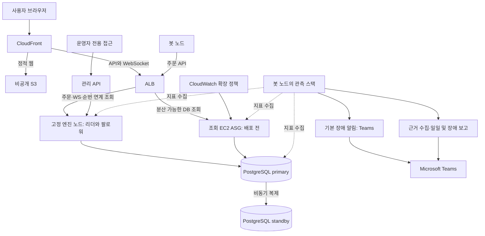

# 0099. 현재 구조와 AWS 배포 판단

이 문서만 읽어도 지금 채택한 구조, 실제 구현 범위, AWS에 올리기 전에 남은 일을 판단할 수 있도록 정리한다. 각 ADR은 선택 이유와 변경 이력을 보존하고, 이 문서는 그 결정들이 합쳐진 현재 모습을 계속 갱신한다. `0099`는 이를 위한 예약 번호다. 개별 결정의 번호는 0099를 제외하고 이어간다.

검토 기준일은 2026-09-18이다. ADR 0027의 범위에 맞춰 Linux 운영·역할별 배포·관측·DB 복구·보고와 Terraform 사전 구현을 대조했다. 서버·웹 시험과 Ubuntu 계정·SSH·권한·방화벽, 조회 역할의 실제 DB 장애 응답, 거래가 있는 DB의 수동 승격·재편입·백업 복원을 로컬에서 검증했다. **AWS 계정은 아직 없으며 실제 클라우드 배포·자동 확장·다중 호스트 복구 완료를 판단할 증거는 없다.** 현재 상태는 [로드맵](../../ROADMAP.md), 당일 실행 조건과 원자료는 [09-18 운영 검증](../../measurements/20260918.md)에 모은다.

09-17에는 사용자가 교수님께 보고한 구성도와 화면을 확인했다. 원본 15개와 현재 구현과의 차이는 [아키텍쳐 자료](../../../아키텍쳐/README.md)에 있다. 지원금은 **40만 원**이며, 발표는 PPTX에 실제 시연 영상과 캡처를 연결해 준비한다. 과거 문서의 50만 원 전제는 현재 예산 판단에 사용하지 않는다.

세부 필드와 불변 조건은 [계약 문서](../README.md), 진행 중인 작업은 [로드맵](../../ROADMAP.md), 실행 결과는 [측정 기록](../../measurements/README.md)이 기준이다. 이 문서에서 서로 다른 내용을 발견하면 해당 원본과 코드를 함께 고친다. 높은 ADR 번호나 이 요약만으로 기존 계약을 덮어쓰지 않는다.

## 지금 판단할 내용

고객사의 IT 인프라를 구축·운영·관리하는 엔지니어의 역할을 수행한다. 약 3개월간 직접 개발한 가상 거래소를 대상으로 AWS 인프라와 관제 기반을 갖추며, 가장 중요한 역량은 Linux 서버 운영이다. 계정·권한·서비스·로그·네트워크·디스크를 직접 설정하고 장애 원인을 좁혀 복구한다. DB 복구와 조회 계층의 EC2 자동 확장도 검증한다. 일일·장애 보고는 AI가 수집한 근거를 정리해 Microsoft Teams로 보낸다. 전체 제목은 아직 미정이고 페일스톱은 운영 대상 서비스명이다. [ADR 0027](0027-msp-operations-and-autoscaling.md)

Docker 카오스는 로컬에서 개발 검증을 했다는 자료로 보존한다. 새로운 카오스 기능·주입 화면이나 과거 실험 전수 재실행을 목표로 두지 않는다. AWS의 부하·장애 대응 시험은 계속하되 관제에서 진단·조치·보고까지 이어지는 과정으로 판단한다. 기존의 수동 확장 전용 정책은 현재 목표가 아니다.

역할별 Compose에 사설 DB 포트·전체 연결 예산·실행 계정·별도 스키마 적용 순서를 구현했다. 계정이 제공되면 비공개 AWS 환경에서 실제 호스트 연결과 접근 권한부터 검증한다. 공개 접속 전에는 주문 재시도 위험과 운영 접근 통제도 확인해야 한다. 구체적인 순서는 아래의 **AWS로 옮기는 순서**에 있다.

현재 거래 서버는 한 리더 안에서 마켓별로 주문을 처리한다. DB는 primary 한 대와 standby 한 대의 비동기 복제다. 앱 리더 전환은 자동이지만 DB 승격은 수동이다. 따라서 앱 장애 복구 목표인 30초나 로컬 무손실 결과를 DB 장애 전체의 보장으로 설명하면 안 된다.

## 서비스가 연결되는 모습

페일스톱은 실제 자금을 다루지 않는 가상 자산 거래소다. 사용자는 시세·호가·차트를 보고 주문하며, 회원별 거래 내역과 가상 자산을 확인한다. 게시판·댓글·공지·문의와 관리자 기능도 같은 프로젝트에 있다. 봇은 사용자와 같은 주문 API를 호출해 시장과 실험 부하를 만든다.

아래는 **채택한 AWS 배치**다. 역할별 배포 코드는 준비했으나 AWS 자원이 실제로 생성됐다는 뜻은 아니다. 로드밸런서 경로와 여러 호스트의 연결은 실제 AWS 검증이 필요하다.

웹은 Next.js·React로 개발하고 정적 파일로 배포한다. 별도의 Next.js 런타임 서버는 두지 않는다. 기본 개발 설정은 브라우저 안의 시뮬레이터이므로 실제 거래 검증에는 `NEXT_PUBLIC_DATASOURCE=http`가 필요하다. 서버는 Java 21·Spring Boot, DB는 자체 운영 PostgreSQL 17 계열이다. `server/engine`은 매칭 규칙을 계산하고 `server/app`은 API·DB·정산·리더 전환을 연결한다. 현재 실행 구성에 Kafka나 Redis는 없다. 시작점과 테스트 위치는 [코드 지도](../architecture/프로젝트_코드지도.md), 웹 빌드는 [웹 안내](../../../web/README.md), 서버 실행은 [서버 안내](../../../server/README.md)를 따른다.

CloudFront는 정적 웹을 S3에서, API와 WebSocket을 ALB에서 받아 브라우저 주소를 하나로 유지한다. ALB가 HTTP·WebSocket과 리더 전환을 어떻게 연결할지 실제 대상 그룹·상태 확인·재접속으로 검증해야 한다. AZ별 관리형 NAT Gateway 사용은 채택한 정책이다. 과거 nginx edge 설정과 옛 노드 수·비용표를 현재 배포안으로 사용하지 않는다. [배포 안내](../../../deploy/README.md)

교수님께 보고한 하이브리드 구성도도 서울 2 AZ, DB 2노드, NAT 2개와 봇·관측 동거라는 방향이다. 수동 확장 표시는 09-18에 설명한 자동 확장 요구로 바뀌었다. 로컬 Docker 도면의 DynamoDB Local은 현재 기본값이 아닌 선택 실험 경로다. DB 장애 시나리오는 단일 DB 중단·재시작이며 E2의 한 앱 접속 경로 차단이나 AWS standby 수동 승격과 구분한다. 원본은 보존하고 촬영 환경·실험 종류를 정확히 표시한다.

외부 시세·콘텐츠 API가 응답해야 거래나 화면이 동작하는 구조는 채택하지 않았다. 필요한 자료는 시드나 웹 빌드에 포함한다. AWS의 저장소·리스·관리 서비스와 통신하는 것까지 금지한다는 뜻은 아니다. 외부 데이터 수집 도구의 결과를 앱에 자동 적재하는 연결은 아직 없다. [외부 API 전략](../contracts/외부API_전략.md), [수집 도구](../../../seed-data/README.md)

운영 보고의 외부 AI·Teams 호출은 거래 처리와 분리한다. Alertmanager 기본 알림과 보고 webhook은 독립 경로다. 보고는 수집 근거·가설·확인 순서를 구분하며 AWS 확장·서버 재시작·DB 승격을 실행하지 않는다. Google 키 요청에 맞춰 Gemini 3.1 Flash-Lite 직접 연결을 구현했고 실제 생성 1회를 확인했다. 첫 응답의 과도한 정상 판정을 막도록 지시를 보강했으며 추가 실측 전송은 사용자 동의를 기다린다. 현재 서비스는 `facts-only`다. 명시한 모델·Google HTTPS 주소·근거 ID 검증·입출력 토큰과 SQLite 호출 상한을 적용하며 AI 실패는 사실 보고로 대체한다. [보고 서비스](../../../deploy/reporting/README.md)

## 자동 확장과 관제를 구현할 때의 경계

먼저 DB에서 완결되는 markets·trades·candles 등의 REST 조회를 별도 ASG로 보내는 안을 검증한다. `engine.enabled=false`는 출발점이지만 모든 쓰기 API를 제거하는 역할 설정은 아니다. 주문·취소·WebSocket은 리더 경로에 유지한다. 호가·티커의 REST 순번도 노드 로컬 값이므로 WS와 같은 기준으로 재동기화할 수 있도록 리더 경로에 남기거나 순번 전달을 먼저 구현해야 한다. [엔진 구성](../../../server/app/src/main/java/kr/exchange/config/EngineConfig.java), [시장 API](../../../server/app/src/main/java/kr/exchange/api/market/MarketController.java)

인증 API 전체를 바로 분산하지 않는다. 공통 회원 시드 외에도 노드 로컬 데모·관리 키, nonce, 요청 제한의 범위를 확인해야 한다. ASG 준비 검사·최대 대수의 DB 풀·관측 대상 등록·축소 드레이닝을 설계하고, 기존 Docker 용량 조정기가 AWS 정책과 같은 대수를 동시에 제어하지 않게 한다. 현재 WS는 노드 내 브로커이므로 조회 노드를 늘리는 것만으로 리더 이벤트가 전달되지 않는다. [WebSocket 설정](../../../server/app/src/main/java/kr/exchange/api/ws/WebSocketConfig.java), [API 계약](../contracts/백엔드_API_설계.md)

[조회 Compose](../../../deploy/compose.node-read.yml)는 `prod,read`, 엔진·Flyway·하네스·관리 기능 비활성화와 별도 SELECT 로그인을 강제한다. 앱 필터는 GET/HEAD markets·trades·candles 이외 경로를 거절한다. 로컬 실제 프로세스에서 리스 미획득·쓰기 거절과 DB 중단 시 read 503/liveness 200, 복구 후 read 200을 확인했다. ALB는 조회 DB health, ASG는 EC2 health를 사용하며 AWS에서 공통 DB 장애 시 반복 교체가 없는지 추가 검증한다. [ADR 0027](0027-msp-operations-and-autoscaling.md)

기존 Grafana MSP 4개 화면에 Linux 파일시스템·inode·I/O·네트워크·서비스 상태를 보강했다. 고객 관측 범위는 Spring과 이를 운영하는 고객 서버·DB·접속 경로이며, 모든 Docker 컨테이너나 관측 도구 자체를 고객 서비스로 집계하지 않는다. 과거 `chaos-*` 패널은 Spring 프로세스·JVM과 고객 호스트 지표로 교체하고 고객사·환경 선택을 연결했다. 별도 Ubuntu 운영 실습과 C드라이브는 고객 AWS 서버를 대신하지 않으며 고객 보고에서 제외한다. DB 복제 지표 원천과 조회식을 맞추고 미수집의 `or vector(0)`과 지연 NULL의 0 변환을 제거했다. 수집 성공 여부와 오래된 근거를 별도로 관측한다. 관측 노드 자체의 외부 감시는 AWS에서 남아 있다. 봇·관측 동거의 자원·장애 공유는 컨테이너 한도와 실제 부하로 확인한다. [관측 배포](../../../deploy/observability/README.md), [DB 화면](../../../harness/grafana/dashboards/13-msp-db.json)

일일 보고는 사용자 선택인 09:00 Asia/Seoul systemd timer, 장애 보고는 인증된 webhook으로 실행한다. SQLite가 중복·재시작·전송 재시도를 관리하고 분석 실패는 사실 보고로 대체한다. 새 배포는 Teams Workflows·Adaptive Card를 사용하며 승인된 기본 발화·해제, 모의 사건 발화·해제, 일일 보고 5종의 HTTP 접수를 확인했다. 해제 사건은 한 번 재시도했으며 실제 채널 게시·중복 여부와 AWS 운영 자료는 별도 검증이다. 기존 하네스 Discord는 과거 개발 검증 자료로 남긴다. [새 알림 설정](../../../deploy/observability/alertmanager.yml)

로컬과 AWS의 Prometheus·Alertmanager·보고 설정은 [공통 환경 생성기](../../../deploy/observability/configure-environment.py)에서 준비한다. 고객사·환경을 보고 조회와 알림 묶음에 넣고, AWS에서는 지정 `FailstopCluster`의 Spring·고객 호스트·DB를 등록한다. Windows·WSL bridge는 로컬에만 둔다. AWS 실제 연결과 CloudWatch의 관리형 지표는 별도 검증 대상이다. 격리된 DB 반복 실험은 자동으로 관측 대상에 등록하지 않으며, [관측 경로 검사](../../../deploy/observability/tests/check-monitored-standby.py)는 등록된 로컬 replica의 중단·복구, 실제 지표·경보·발화 및 해제 보고의 HTTP 접수를 대조한다. 이 검사는 수동 DB 승격을 대신하지 않는다. 실행 뒤 사용자가 Teams 채널의 두 보고 표시를 확인했으며 [로드맵](../../ROADMAP.md)에 해당 로컬 검증 범위를 기록했다.

Grafana 화면은 서비스 관제·트래픽/Spring·AWS/서버·DB/복구의 네 경로로 정리했다. 명사형 상태·역할별 대상·장애 구간을 표시하고 `pg_up=0`인 DB 접속 장애와 exporter 수집 경로 장애를 구분한다. Spring HTTP histogram을 켜 실제 요청 지연을 수집한다. AWS 전용 [CloudWatch 설정](../../../deploy/compose.observability-aws.yml)은 기존 EC2 instance profile과 서울 리전을 사용하며 ALB·조회 ASG·EBS 지표를 별도 영역에 연결한다. 실제 자원 식별자는 Terraform 출력으로 제공하고 관측 bot만 IMDSv2 hop limit 2를 사용한다. 자격증명이나 임의의 AWS 측정값을 대시보드에 넣지 않았으며 실제 AWS 조회는 미검증이다.

보고의 원자료 JSON 나열은 사건·영향·현재 상태·담당자 개입·조치와 완료 조건으로 바꿨다. 경보 해제와 서비스 전체 복구를 구분하며, DB는 exchange 데이터베이스 연결만 집계하고 업무 HTTP 지표에서는 actuator를 제외한다. 자료 없음은 정상 0으로 바꾸지 않는다. Teams와 HTML·PDF는 같은 개입 판정과 표시 모델을 사용한다. 한글 PDF는 2쪽 고정 양식이며 저장된 조회 표본으로 그래프를 그린다. 수집 공백은 선으로 메우지 않고 예전 요약 보고는 마지막 값의 막대로 구분한다. 백업 예약·복원 확인 자료의 선택적 입력을 두되 없거나 오래된 확인으로 관찰 유지 판정을 내리지 않는다. 새 장애·해제 카드와 PDF/HTML 버튼을 전송했고 사용자가 PDF 열기를 확인했다. 개선 지시의 실제 AI 응답은 아직 검증하지 않았다.

보고 파일은 송신 전에 생성하고 별도 키로 서명한 7일 유효 링크를 Teams 카드에 붙인다. 형식·파일·만료 시각에 묶인 링크만 열 수 있으며 PDF 오류는 요약 카드 전송을 중단하지 않는다. 파일 실패 상태도 영속 저장하고 경보로 관측한다. 로컬 다운로드는 이 PC의 bridge에서 제공한다. AWS의 외부 관계자 접근에는 HTTPS와 조직 접근 정책이 필요하며, Teams 파일 탭의 실제 첨부는 별도 Microsoft 365 저장소 연동 범위다. [보고 파일 제공](../../../deploy/reporting/README.md#teams에서-pdf와-html을-연다)

## 주문과 데이터의 흐름

주문에는 클라이언트가 만든 `client_order_id`가 필요하다. 응답이 늦거나 결과가 불명확하면 같은 키로 상태를 조회하고 재시도한다. 서버는 요청 제한과 인증을 거쳐 내용·잔고·멱등성을 검사하고, 해당 마켓의 접수 잠금 안에서 명령을 `command_journal`에 확정한다. 그다음 같은 리더 프로세스의 마켓별 라이터가 명령을 순서대로 매칭한다. 마켓을 나눴어도 회원 자산과 DB는 공유하므로 서로 완전히 독립된 시스템은 아니다.

정산은 한 명령의 처리 결과를 이벤트·주문·체결·원장·잔고에 같은 트랜잭션으로 반영한다. 저장 후 WebSocket으로 호가와 체결을 알린다. 웹은 연결이 끊기거나 메시지를 놓치면 REST 조회로 상태를 맞춘다. 명령 저장, 주문의 조회 반영, HTTP 응답 완료는 서로 다른 시점이다. `order_in_progress`나 타임아웃을 주문 부재로 판단하지 않는다. [주문 접수](../../../server/app/src/main/java/kr/exchange/api/order/OrderGateway.java), [엔진 전달](../../../server/app/src/main/java/kr/exchange/engine/EngineBridge.java), [정산](../../../server/app/src/main/java/kr/exchange/ledger/SettlementService.java)

금액·가격·수량은 서버에서 `BigDecimal`, DB에서 `NUMERIC(40,18)`, API에서 십진 문자열로 다룬다. 예약, 정산, 환급, 수수료의 반올림은 각각 계약을 따른다. 시간이나 통계까지 모든 숫자를 같은 타입으로 바꾸라는 규칙은 아니다. 부하 제한은 현재 쓰기·조회·재조회 세 버킷이며 풀 기준 비율은 40/40/10이다. ADR 0007의 제목만 보고 두 버킷으로 되돌리지 않는다. [DB 계약](../contracts/백엔드_DB_설계.md), [API 계약](../contracts/백엔드_API_설계.md), [AdmissionLimits](../../../server/app/src/main/java/kr/exchange/api/common/AdmissionLimits.java)

명령 순번은 DB의 전환 래치를 켜기 전에는 전역 방식, 켠 뒤에는 마켓별 대역 방식이다. 이벤트 순번의 V46 대역 폭은 10¹²이다. 서로 다른 마켓의 순번을 전역 시간 순서처럼 비교하지 않는다. 코드 병합과 실제 DB 전환은 구분해야 하며, 클라우드 래치 적용은 ADR 0022의 사전 조건을 별도로 충족해야 한다.

## 앱 복구와 DB 장애는 다르게 처리한다

리더 권한은 클러스터당 하나다. 기본 제공자는 PostgreSQL 리스이고 DynamoDB 구현도 선택할 수 있다. 어느 쪽이든 거래 쓰기의 마지막 권한 검사는 PostgreSQL 트랜잭션 안에 남는다. 현재 검사 함수는 리스 행을 `FOR KEY SHARE`로 잠가 시간 갱신은 허용하고, holder·epoch 교체는 진행 중 쓰기와 직렬화한다. 이 동작에는 V41의 `(resource, holder, epoch)` UNIQUE 인덱스가 필수다. [리스 구성](../../../server/app/src/main/java/kr/exchange/config/LeaseStoreConfig.java), [V41](../../../server/app/src/main/resources/db/migration/V41__lease_key_share_lock.sql)

팔로워 앱은 평소 마켓별로 저널을 따라가며 엔진 상태를 검증한다. 승격 시 모든 마켓의 최신 위치에 도달해 있으면 재생을 생략하고 그 엔진을 설치한다. 복구가 필요하면 마켓별로 채택 가능한 스냅샷을 읽고 이후 명령을 재생한다. 이미 정산된 구간은 각 마켓의 연속 물질화 경계까지 검증하고 미완료 꼬리를 다시 처리한 뒤 접수를 연다. 손상된 스냅샷은 해당 마켓에서 제외하고 이전 스냅샷이나 전량 재생으로 돌아간다. 스냅샷 저장에도 같은 트랜잭션 안의 리더 권한 검사가 연결돼 있다. 과거 ADR의 “스냅샷 미배선”이나 “저장 시 권한 검사 없음”은 현재 상태가 아니다. [승격 분기](../../../server/app/src/main/java/kr/exchange/engine/PromotionCoordinator.java), [EngineRecovery](../../../server/app/src/main/java/kr/exchange/engine/EngineRecovery.java), [SnapshotStore](../../../server/app/src/main/java/kr/exchange/snapshot/SnapshotStore.java)

DB는 primary 한 대와 standby 한 대의 비동기 복제다. 동기 `ANY 1`의 3노드 안은 ADR 0024가 대체했다. 운영자가 옛 primary를 격리하고 standby를 승격한 뒤 앱·조회·봇의 DB 연결을 바꾼다. 새 볼륨에 전체 베이스백업으로 재편입하며 이중화 공백이 생긴다. `pg_rewind`용 추가 WAL 보존·아카이브는 채택하지 않았다. 실제 거래가 있는 로컬 DB의 전환과 별도 pg_dump 복원을 검증했다. 재실험은 새 프로젝트·볼륨·포트로 수행하고 성공한 임시 자원만 정리하므로 기존 고객 실습 DB를 초기화하지 않는다. AWS 다중 호스트·갑작스러운 장애와 PITR 보장은 남아 있다. [DB 수동 페일오버](../operations/DB_수동_페일오버.md), [백업 도구](../../../deploy/backup/README.md), [DB 실습](../../../deploy/lab/README.md)

비동기 복제에서는 이미 접수 응답을 받은 주문도 standby에 도착하기 전에 primary가 사라지면 잃을 수 있다. 저널도 같은 DB에 있으므로 유실된 저널을 재생으로 복원할 수 없다. 남은 기록을 정확히 재처리한다는 보장과 DB 교체 중 무손실 보장은 다르다.

## 회원·화면·운영 기능의 경계

회원은 세션과 API 키로 자신의 가상 자산·주문·거래 내역에 접근한다. 봇과 회원의 계정·권한은 구분한다. 관리 기능은 별도 인증과 관리 프로파일에서 실행하고 공개 웹 빌드에서는 관리 화면을 제거한다. 관리 API·관리 포트·하네스 실행 경로는 외부 사용자에게 열지 않는다. `prod,admin`을 실행할 때는 예시 인증서 대신 운영용 클라이언트 인증서를 준비해야 한다. [회원 설계](../product/회원_설계.md), [관리자 설계](../product/관리자_설계.md), [웹 배포 절차](../../../web/README.md)

운영 승인은 현재 1인이 수행할 수 있다. 승인 티켓의 유효시간, 단회 사용, 액션·대상·요청자 확인은 유지한다. 기존 카오스 API도 코드에 남아 있지만 AWS 단계의 새 개발 목표가 아니다. 수동 용량 API의 `desired_nodes` 변경은 현재 남아 있는 구현이며, 새 목표인 AWS 지표 기반 자동 확장과 실제 ASG 관측은 아직 연결해야 한다. [확장 API](../../../server/app/src/main/java/kr/exchange/admin/CapacityAdminController.java)

게시판 설계에는 별도 DB·프로세스 격리가 남아 있지만 현재 앱 구성은 거래와 같은 DB 연결·회원 세션 서비스를 사용한다. 글·댓글 기능 완료와 물리 격리 완료를 구분한다. 요구를 유지해 구현을 분리할지, 현재 배치를 받아들이고 계약을 바꿀지 결정한 뒤 부하 간섭을 검증해야 한다. [게시판 설계](../product/게시판_설계.md), [ApiConfig](../../../server/app/src/main/java/kr/exchange/config/ApiConfig.java)

화면의 세부 동작과 표현은 [레이아웃](../contracts/데스크톱_레이아웃설계.md), [디자인 시스템](../contracts/프론트_디자인시스템.md), [대시보드](../product/대시보드_설계.md), [차트](../product/차트_기술적분석_설계.md), [체결 효과](../product/체결_시각효과_관리자제어_설계.md), [화면 명세](../contracts/웹_화면명세서.html)에 둔다. 이 문서에 모든 화면 필드와 SQL을 복사하지 않는다.

## 무엇을 검증했고 무엇이 남았는가

봇은 실제 주문과 체결을 만들고, k6는 지정한 도착률의 부하를 제공한다. SQL 검사는 원장·잔고·주문 관계를 확인하며 장애 스크립트는 앱·DB·네트워크를 흔든다. 결과에는 커밋, 실행 환경, 부하, 장애, 회복 기준과 증거를 함께 남긴다. 위반 0건이어도 실제 요청이나 검증 대상이 없었다면 통과 근거가 아니다. 기준은 [하네스 검증 설계](../contracts/하네스_검증설계.md)와 [실험 안내](../../../harness/README.md)를 따른다.

| 확인 대상 | 현재 근거와 한계 |
|---|---|
| V46 이후 앱 장애 | 09-15 로컬 코드 `3b61c24`, 새 시험 DB와 명령 대역 모드에서 E2·E4·E5·E6·E7 각각 1회 PASS. RTO 5.979~10.134초, E4는 7.925초다. AWS 결과나 반복 안정성 보장이 아니다. [9단계 증거](../../../harness/evidence/adr0022-stage9-chaos-20260915/README.md) |
| 마켓별 스냅샷 복구 | 7단계 로컬 12칸 PASS 중 스냅샷 경로 성립 7칸, 재생 생략 5칸이다. 모든 칸에서 실재 재생을 입증했다는 뜻은 아니다. 꼬리 길이에 따른 RTO 개선량은 미측정이다. [7단계 증거](../../../harness/evidence/adr0022-stage7-snapshot-20260915/README.md) |
| DB 승격과 유실 | 로컬 정상 복제 조건에서는 ACK 88건 중 유실 0, standby를 8초 멈춘 조건에서는 ACK 122건 중 36건을 잃었다. 여러 호스트에서 격리·연결 전환·재편입까지 끝낸 운영 RTO는 미측정이다. [운영 절차와 결과](../operations/DB_수동_페일오버.md) |
| 관측과 알림 | 봇 노드의 별도 관측 Compose와 AWS CloudWatch overlay를 준비했다. 실제 AWS 관측·알림 전달은 미확인이다. [관측 배포](../../../deploy/observability/README.md) |
| 성능 조정 | 환경별 캘리브레이션이 기준이다. 옛 로컬 OPS를 AWS 목표 처리량으로 옮기지 않는다. `commit_delay` 실험은 선행 조건 미충족으로 `NOT RUN`이다. [09-15 측정](../../measurements/20260915.md) |

복구 API의 PASS도 단독 증거로 사용하지 않는다. 현재 기록기는 재생 0건을 `matched=true`로 남길 수 있고 관리 API는 실제 검증 이벤트가 있었는지를 PASS 조건으로 강제하지 않는다. 마켓별 재생 범위·건수와 판정 자료를 함께 확인해야 한다. [RecoveryRunRecorder](../../../server/app/src/main/java/kr/exchange/harness/RecoveryRunRecorder.java), [복구 모니터링](../../../server/app/src/main/java/kr/exchange/admin/HaMonitoringController.java)

스냅샷 캡처는 아직 순번 차이를 명령 건수처럼 계산해 대역 모드의 첫 명령에서 바로 캡처될 수 있다. 부분 마켓만 정체되는 상황은 전역 완료율 기반 강등으로 잡힌다고 보장하지 않는다. DynamoDB 리스를 선택하면 PostgreSQL 리스 행을 직접 읽는 관리 모니터링도 맞춰야 한다. 전역 재생 API 정리, 시계 역행과 교차 마켓 복구의 제약은 ADR 0022 및 로드맵의 후속 범위로 남는다. [SnapshotCapture](../../../server/app/src/main/java/kr/exchange/snapshot/SnapshotCapture.java), [LeaderStallDetector](../../../server/app/src/main/java/kr/exchange/engine/LeaderStallDetector.java)

## AWS로 옮기는 순서

### 1. 유료 자원을 만들기 전에 배치와 권한을 확정한다

Linux 실행 환경부터 확인한다. 기존 ADR 0010의 Rocky Linux 10 계열·Graviton ARM64 전제를 기준으로 사용할 OS 버전과 AMI, 이미지 digest를 확인하고 계정·서비스·로그·파일시스템 운영 기준을 정한다. 현재 AWS 호스트의 실제 OS와 적용 상태는 미확인이다. 첫 작업의 범위와 완료 기준은 [로드맵](../../ROADMAP.md)의 '다음 작업의 시작점'을 따른다.

고정 앱 2대·DB 2대·봇/관측과 조회 ASG의 2 AZ 배치, SG·ALB·NAT·CloudFront·S3를 [Terraform](../../../deploy/terraform/README.md)으로 준비한다. 실제 plan/apply와 AWS 동작 검증은 계정 제공 후 수행한다. 지원금 40만 원은 월 한도가 아니며 실제 지급·잔액·청구액은 미확인이다. EC2·ASG 상한·볼륨·ALB·NAT·전송량과 가동 기간으로 비용을 다시 산정한다. ADR의 과거 가격과 잔액을 현재 견적으로 사용하지 않는다. [CI·배포 계약](../contracts/하네스_CICD_IaC.md)

로컬에서 절차를 연습하고 AWS 배포·검증·촬영을 집중해서 진행하는 운영 계획이다. 보고한 자원 구성을 임의로 축소하지 않고 가동 시간과 재촬영 여유를 산정한다. 기존 외부 상시 접속 요구가 영상 발표로 면제됐다고 볼 수는 없으므로 필요한 유지 기간을 확인한 뒤 종료일을 정한다. 영상·캡처·검증 원자료를 보관한 다음 보존할 데이터와 철거할 자원을 구분한다. EC2 정지 뒤에도 볼륨이나 NAT·ALB 등 비용이 남는 점은 [배포 안내](../../../deploy/README.md)의 종료 절차에서 확인한다.

“IAM 외 서비스는 사용 가능”은 사용자 설명이며 실제 권한 검증 결과가 아니다. 기존 EC2 역할과 인스턴스 프로파일을 연결할 수 있는지, 필요한 `iam:PassRole`이 있는지 확인한다. 새 역할·신뢰 정책 변경이 필요하면 계정 관리자와 해결한다. SSM을 운영 접근 경로로 택할 경우 에이전트·역할·네트워크가 모두 필요하다. OIDC 배포도 기존 역할과 신뢰 정책이 준비되어야 한다. [AWS의 EC2 역할 연결 권한](https://docs.aws.amazon.com/AWSEC2/latest/UserGuide/permission-to-pass-iam-roles.html), [SSM 준비 조건](https://docs.aws.amazon.com/systems-manager/latest/userguide/getting-started-launch-managed-instance.html)

### 2. 여러 호스트에서 첫 실행을 할 수 있도록 설정을 맞춘다

| 먼저 해결할 것 | 현재 파일에서 확인한 문제와 완료 기준 |
|---|---|
| DB의 호스트 간 연결 | 명시적인 사설 IP에 published port를 연결했다. 별도 standby 호스트는 5432로 지정한다. 실제 AWS의 SG·방화벽·호스트 간 접속을 검증한다. [DB 노드](../../../deploy/compose.node-data.yml) |
| DB 연결 수 | 엔진 교체 여유·조회 ASG 최대·봇·운영·복제를 포함해 기본 상한 188, DB 일반 한도 197이다. 검사기가 초과를 거절한다. 실제 접속량·메모리·부하를 AWS에서 확인한다. [연결 예산](../contracts/하네스_CICD_IaC.md) |
| 실행 이미지와 DB 계정 | 마이그레이션 소유자와 앱·조회·봇 로그인을 분리했고 reader 권한 거절을 실제 DB에서 검증했다. 배포할 ARM64 digest의 prod 기동은 추가 확인한다. [역할 SQL](../../../deploy/provision-runtime-roles.sql), [배포 변수](../../../deploy/.env.example) |
| 첫 prod 부팅에 필요한 값 | 마스터키·비밀번호 페퍼·세션 시드와 CORS·WebSocket 허용 오리진을 첫 기동 전에 준비한다. 앱·봇 사이의 비밀 값도 맞춘다. 이 값이 없으면 공개 여부와 관계없이 prod 부팅 검사를 통과할 수 없다. 실제 값은 문서에 넣지 않는다. |
| 스키마와 전환 순서 | 별도 migrate→초기 catalog-seed→provision 이후 앱을 시작한다. V41 인덱스·V44 래치는 ADR 0022 §7을 따르고 V46은 전체 엔진·API 버전을 맞춘 쓰기 정지 창에서 적용한다. 첫 이벤트 대역 행 이후 구버전 복귀는 허용되지 않는다. |

### 3. 외부 사용자에게 열기 전에 거래와 접근 통제를 확인한다

주문 접수에는 우선 확인할 위험 경로가 있다. `OrderGateway`는 저널 제출이 반환돼야 `journaled=true`로 표시하고, 그 전에 예외가 나면 선삽입한 멱등 키를 삭제한다. DB 커밋 여부가 불명확했던 요청을 재시도할 때 기존 저널의 내용 대조가 불가능해지면 새 키를 요구하는 응답으로 이어질 수 있다. 같은 주문을 새 키로 제출하면 중복 접수할 위험이 있으므로 해당 예외·타임아웃을 재현하고 재조회·재시도 계약을 고친 뒤 회귀 검증한다. 이번에는 현재 코드 경로와 ADR 0022 §9-13을 대조했으며 장애를 다시 실행하지는 않았다. [OrderGateway](../../../server/app/src/main/java/kr/exchange/api/order/OrderGateway.java)

실제 공개 도메인·TLS와 웹의 API·WebSocket 주소, 서버 허용 오리진을 맞춘다. 공개 번들에서 관리 화면을 제거하고 관리 API·포트는 사설 접근으로 제한한다. `prod,admin`만 별도 운영 인증서를 사용한다. 앱·조회 Compose가 전달하는 `EXCHANGE_TRUSTED_PROXIES`는 실제 ALB 서브넷과 공식 AWS `CLOUDFRONT_ORIGIN_FACING` IPv4만 포함하는 Java 정규식으로 만든다. 주소 목록을 받지 못하면 부팅을 중단하며 목록 변경 시 갱신이 필요하다. 로컬 정규식·프록시 체인 시험과 별개로 실제 ALB·Tomcat에서 클라이언트 IP·요청 제한이 올바르게 구분되는지 검증한다. [앱 설정](../../../server/app/src/main/resources/application.yml), [배포 안내](../../../deploy/README.md)

### 4. AWS에서 연결·관측·복구를 확인한 뒤 최종 실험을 한다

먼저 주문·조회·WebSocket의 대상 노드, 팔로워 생존과 리더 요청 수용 판단을 확인한다. 지표·알림·재배포·롤백·백업 복원을 실제 호스트에서 시험한다. 새 [관측 설정](../../../deploy/observability/prometheus.yml)의 file discovery에 prod 관리 포트 8081과 사설 exporter 주소를 등록하고 ASG 증감 시 대상 갱신을 확인한다.

그다음 옛 primary 격리, standby 승격, 앱 DB 주소 전환, 리더 회복, 옛 노드 베이스백업 재편입을 여러 호스트에서 끝까지 연습한다. 사람의 판단 시간과 앱 연결 전환까지 포함해 DB 복구 시간을 잰다. `pg_promote` 명령 소요만 운영 RTO로 제시하지 않는다.

최종 발표는 Linux·네트워크 문제의 관측과 조치, DB 복구, ASG 인스턴스 증가·감소, Teams 기본 알림과 AI 보고를 실제 근거로 보여 준다. AWS에서 부하를 다시 캘리브레이션하고 거래 기록·자산합·복구 시간도 확인한다. 과거 E10이나 카오스 전수 재실행을 현재 필수 목표로 두지 않으며, 커널 장애를 시험한다면 격리 환경에서만 수행한다. 스냅샷 최적화·`commit_delay` 튜닝·별도 관제 UI보다 운영 흐름을 우선한다. [로드맵 M4](../../ROADMAP.md)

## 각 ADR이 현재 구조에 남긴 것

이 표는 옛 문서의 모든 문장이 여전히 유효하다는 표시가 아니다. 당시 결정 중 현재 적용하는 부분과 후속 변경을 함께 적었다. 최신 기록을 읽어도 모순이 남으면 본문의 미확인 사항으로 드러내고 해당 원본을 대조한다.

| ADR | 현재 적용하는 내용과 후속 변경 |
|---|---|
| [0001 기록 관례](0001-record-architecture-decisions.md) | 개별 결정은 이력으로 남긴다. 0099는 현재 구조를 계속 갱신하는 예외다. |
| [0002 단일 리더](0002-db-leader-lease-single-writer.md) | 클러스터 리더 하나와 DB 트랜잭션 내 쓰기 권한 검사. 리스 제공자는 0017, 잠금 방식은 0026이 보완했다. |
| [0003 금액 정밀도](0003-numeric-40-18-no-float.md) | NUMERIC(40,18)·BigDecimal·십진 문자열과 용도별 반올림을 유지한다. |
| [0004 자체 운영 DB](0004-no-rds-self-managed-postgres.md) | 장애 실험을 위해 PostgreSQL을 EC2에서 운영한다. 현재 복제 구성은 0024를 따른다. |
| [0005 주문 멱등 키](0005-client-order-id-mandatory.md) | client_order_id 필수와 같은 키 재조회·재시도. 현재 저널 키의 범위는 0022 및 DDL을 함께 본다. |
| [0006 스냅샷과 꼬리 재생](0006-snapshot-tail-replay-rto.md) | 복구 방식은 유지한다. 전역 복구 축은 0022·0023이 마켓별 경계로 바꿨고 캡처도 구현됐다. |
| [0007 요청 제한](0007-admission-control-two-buckets.md) | 풀 고갈 방지 목적은 유지한다. 현재는 제목의 두 버킷이 아닌 쓰기·조회·재조회 세 버킷이다. |
| [0008 외부 API 비의존](0008-no-runtime-external-api.md) | 거래가 외부 시세·콘텐츠에 의존하지 않게 한다. 0027의 분리된 운영 AI·Teams 호출은 허용하며 거래 가용성과 분리한다. |
| [0009 서비스 정체 시 강등](0009-leader-standdown-on-service-stall.md) | 수요가 있는데 완료율이 지속해서 무너지면 리스 갱신을 포기한다. 판정 대기까지 포함한 시간은 kill 실험 RTO와 다르다. |
| [0010 AWS 배포](0010-onprem-to-aws-deployment.md) | 외부 접속과 서비스·실험 환경 분리, digest 기반 배포. 초기에 기각했던 ALB는 후속 기록에서 채택했다. |
| [0011 CloudFront 두 원본](0011-cloudfront-two-origins.md) | S3 정적 웹과 ALB API·WS를 같은 브라우저 오리진으로 제공한다. 실제 AWS 배포는 미확인이다. |
| [0012 양성 증거](0012-positive-evidence-gates.md) | 위반 0뿐 아니라 검사할 거래·재생·구독이 실제 있었는지 본다. 복구 API 판정에는 여전히 보강할 부분이 있다. |
| [0013 실측 부하](0013-capacity-calibration-measured-ops.md) | 환경별 처리량을 먼저 측정한다. 과거 로컬 OPS와 천장은 현재 AWS 성능값이 아니다. |
| [0014 카오스 승인 선택](0014-chaos-actions-approval-optional.md) | 카오스 4종 토큰은 선택이며 제공한 토큰은 검증·소각한다. 현재 카탈로그의 approval_required도 false다. |
| [0015 수동 확장](0015-manual-scaling.md) | 수동 확장 전용 정책은 0027로 대체됐다. 기존 API·Docker 조정기 구현과 과거 측정은 남아 있다. |
| [0016 관측 배치](0016-observability-on-bot-node.md) | 봇 노드에 관측 스택을 둔다. 관측 Compose·Teams 배선을 구현했고 실제 AWS 연결은 남아 있다. |
| [0017 리스 갱신 분리](0017-leader-lease-out-of-commit-path.md) | PostgreSQL 기본 경로와 선택형 DynamoDB 구현이 공존한다. 쓰기 권한 검사는 DB 트랜잭션에 남는다. |
| [0018 동기 ANY 1](0018-synchronous-quorum-any1.md) | **0024로 대체됐다.** primary 1 + standby 2 동기 구성을 현재 구조로 사용하지 않는다. |
| [0019 1인 승인](0019-single-operator-approval.md) | 한 운영자가 승인·실행할 수 있다. 티켓 수명·단회 사용·대상 바인딩은 유지한다. |
| [0020 관리형 NAT](0020-managed-nat-gateway.md) | AZ별 관리형 NAT Gateway 정책. 실제 생성과 현재 비용은 별도 확인한다. |
| [0021 마켓별 처리](0021-market-partitioned-ordering.md) | 한 리더 안의 마켓별 라이터 기반. 명령 저널·복구·이벤트 폭은 0022에서 후속 변경됐다. |
| [0022 마켓별 명령 저널](0022-market-partitioned-command-journal.md) | 0~9단계 코드와 로컬 검증이 들어왔다. DB 래치·V46 적용 상태와 클라우드 사전 조건은 별도로 판단한다. |
| [0023 재생 경계와 커서](0023-replay-bound-and-cursor-axis.md) | 연속 물질화 경계와 엔진 유도 커서를 사용한다. 0022가 마켓별 복구 축으로 확장했다. |
| [0024 비동기 2노드](0024-async-two-node-replication.md) | primary 1 + standby 1, DB 수동 승격. 미복제 ACK 기록을 잃을 수 있다. |
| [0025 베이스백업 재편입](0025-rejoin-by-basebackup-no-wal-retention.md) | 구 primary는 전량 복사로 편입한다. rewind용 WAL 보존은 비채택이고 이중화 공백이 남는다. |
| [0026 리스 KEY SHARE](0026-leader-lease-key-share-lock.md) | V41 인덱스와 FOR KEY SHARE가 전제다. 당시 후속 과제였던 SnapshotStore의 권한 검사는 현재 연결됐다. |
| [0027 MSP 운영·자동 확장](0027-msp-operations-and-autoscaling.md) | Linux·네트워크·DB 운영과 관제, 조회 ASG, Teams·AI 일일 및 장애 보고를 현재 목표로 삼는다. 로컬 카오스는 개발 검증 이력으로 보존한다. |

## 이 문서를 갱신하는 방법

구조를 바꾸거나 구현·검증 상태가 달라지면 관련 계약·ADR·로드맵·측정 원본을 먼저 확인하고, 같은 변경에서 이 문서의 해당 설명과 위 표를 갱신한다. 현재 설명을 고칠 때마다 `0099-v2` 같은 파일을 만들지 않는다. 변경 이력은 Git에 남긴다. 기존 ADR의 옛 측정이나 반박을 현재 사실처럼 복사하지 않는다.

`scripts/check-adr-current.ps1`은 개별 ADR 링크 누락·번호 중복과 원자료 변경 후 검토 표시 누락을 검사한다. 대상은 개별 ADR, 로드맵, 상세 설계·계약·운영 Markdown, 측정 Markdown, 배포 안내와 노드 Compose, 아키텍쳐 안내다. 자료가 바뀌면 0099에 영향이 있는지 검토한 뒤 `-PrintDigest`로 읽은 값을 아래 표시 한 곳에 반영한다. 내용은 그대로 둔 채 검사만 통과하려고 해시를 바꾸지 않는다.

이 검사는 내용을 자동으로 요약하지 않으며 소스 변경의 설명 정확성까지 증명하지 않는다. 코드 변경도 [공통 작업 규칙](../../../AGENTS.md)에 따라 원본과 대조한다. 로컬에서 실행한 범위는 로드맵과 증거에 한정하며 AWS 권한·자원·DNS·청구와 실제 AI 모델은 여전히 미확인이다.

<!-- sources-sha256: 1102483e0448c4c266dfc5c426f538dc73fff69554759ec71cfba77a40345488 -->
