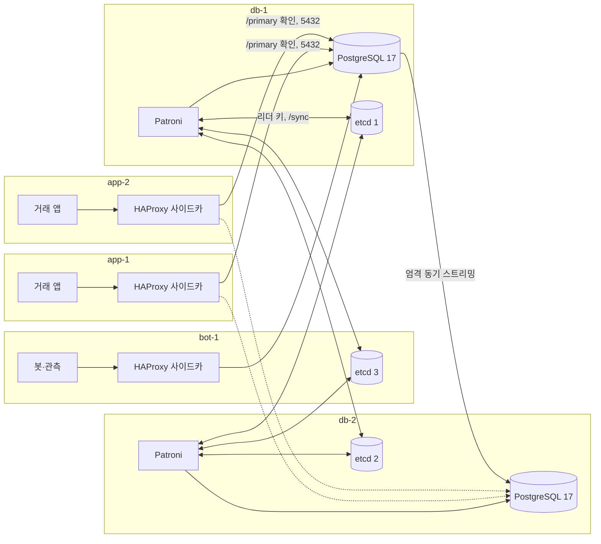

# DB 자동 전환(Patroni) 상세 설계

2026-09-25 작성. PostgreSQL 두 노드를 Patroni로 자동 전환하고, 유실 0을 위해 엄격 동기 복제를 쓰며, 동기 Standby가 없는 동안 거래를 멈추고 화면에 '거래 일시 중단'을 보이는 설계다. 결정은 [ADR 0036](../adr/0036-patroni-strict-sync-db-failover.md)이다. 작업 브랜치는 `claude/patroni`(기준 `9a6d2474`, 마켓별 리더 S4b)다. 계약을 코드보다 먼저 고쳤고, 그 뒤 같은 브랜치에 앱·웹·하네스 코드와 로컬 실험 스택(`harness/patroni/`)을 만들어 E-P1~E-P7을 돌렸다. 구현한 것, 실제로 실행해 확인한 것, 실험 판정과 증거 경로, 남은 것은 15절에 모았고, 현재 상태는 [로드맵](../../ROADMAP.md)이 관리한다. 회차 기록은 [실험 스택 README](../../../harness/patroni/README.md)와 [E-P1~E-P6 한 벌 기록](../../../harness/evidence/patroni-20260925-1015/README.md)에 있다. AWS에는 적용하지 않았다. 고친 계약은 [DB 설계](../contracts/백엔드_DB_설계.md) v2.60, [API 설계](../contracts/백엔드_API_설계.md) v2.60, [하네스 검증설계](../contracts/하네스_검증설계.md)의 Patroni 패치 노트, [하네스 CI/CD](../contracts/하네스_CICD_IaC.md) §3-5·§5-2·§8-1, [관리자 설계](../product/관리자_설계.md) v1.6이다(11절). 설계가 기대는 PostgreSQL 동작은 폐기용 컨테이너 두 개로 먼저 확인했다([사전 확인](../../../harness/evidence/patroni-sync-probe-20260925/README.md), 2-6절). 같은 날 설계 검토 지적 13건을 받아 설계와 계약을 고쳤다(14절). 코드 단계 뒤의 코드 검토 지적 8건은 해당 절(3-2, 3-7, 4-3~4-6, 7-3, 8-1, 8-3, 12절)에 반영했고, 같은 키 재전송의 재생 `200`에도 확정 응답 보류를 걸자는 지적은 재생 트랜잭션 자신의 동기 커밋이 근거라 받아들이지 않았다(4-5). 설계 검토가 짚은 PostgreSQL 동작 두 가지(Patroni가 거는 `'*'`가 멤버가 아닌 복제 스트림을 동기 대기 서버로 받는지, 크래시 재시작 뒤 커밋을 기다리던 행이 보이는지)는 같은 폐기용 구성으로, 경보 식은 로컬 promtool로 다시 확인했다.

바꾸지 않는 것부터 적는다. 자산 보존(원장 합 0, 잔고 CHECK), 주문 멱등(`client_order_id`, 어드바이저리 락, V47 판정), 리더 권한 검사(쓰기 트랜잭션 안의 리스 판정), 오래된 리더의 쓰기 차단(epoch fencing, 기간 결속)은 DB 쪽 장치와 규칙 그대로다. 새 마이그레이션은 없다. 바뀌는 것은 DB 클러스터의 선출 주체(사람에서 Patroni로), 복제 모드(비동기에서 엄격 동기로), 앱이 DB 쓰기 불가를 알아채고 요청을 거절하는 방식, 리스 갱신 한 가지의 커밋 수준과 리스 획득의 시점(쓰기를 받는 동안에만), 공개 상태 API와 거래 화면이다.

사용자가 정한 것은 ADR 0036 머리말에 있다. Patroni, DB 두 대, etcd 세 표(db-1·db-2·bot-1), HAProxy, 엄격 동기와 Standby 부재 시 쓰기 정지, 거래 화면의 '작동 안 함, 거래 일시 중단', AI는 DB 승격·페일오버를 실행하지 않음(ADR 0035, 다른 작업 브랜치), Docker 먼저, 개인 AWS DB t3.medium 두 대다. 그 밖의 값은 이 설계를 맡은 AI가 골랐고 13절에 모았다.

## 1. 범위와 전제

범위는 여덟이다. (1) ADR 0036, (2) 토폴로지(3절), (3) 엄격 동기의 쓰기 정지와 앱 동작(4절), (4) 웹과 공개 상태 API(6절), (5) DB 전환 때의 앱 동작(5절), (6) 관측(7절), (7) 실험과 판정(8절), (8) AWS 적용 절차 초안(9절)이다.

전제는 다섯이다.

- 앱 코드는 이 브랜치의 S4b 판이다. 리더 모드는 폐기용 DB에서 P2(접수 시점 예약, 파티션 `matching-engine` 하나)로 올려 돈다. S4b 관문과 같은 모드라 접수 append 트랜잭션이 잔고 행 잠금까지 쥔다(4-1).
- Docker 실험 스택은 compose 프로젝트 `exchange-patroni`, 컨테이너 접두 `patroni-`, 호스트 포트 59xxx 대역, 앱 이미지 `exchange-chaos-app:patroni`만 쓴다. 보존 볼륨(`exchange-chaos_chaos-pgdata`, `failstop-keep-*`)은 어떤 명령으로도 마운트·삭제·수정하지 않고, 같은 PC에서 도는 마켓별 리더 S5·S6의 프로젝트(`exchange-pml`)·컨테이너(`chaos-*`)·이미지 태그에는 명령을 보내지 않는다.
- AWS는 이번 범위 밖이다. 9절은 적용 순서의 초안이고 실행하지 않았다.
- 실험 전용 값(DB 비밀번호, Patroni REST 자격 증명)은 새 실험 전용 env 파일(`harness/patroni/.env.patroni.example`을 복사한 로컬 파일, Git 제외)에 넣고 실제 비밀을 쓰지 않는다. 기존 비밀 파일은 읽지 않는다.
- 학교 서버와 보존한 로컬 카오스 볼륨의 DB에는 적용하지 않는다.

## 2. 현재 구조와 확인한 사실

### 2-1. 지금의 DB 이중화

학교 AWS와 저장소 배포 설정은 Primary 한 대와 Standby 한 대의 비동기 스트리밍 복제다([ADR 0024](../adr/0024-async-two-node-replication.md), `deploy/compose.node-data.yml`, `deploy/linux/postgresql/exchange.conf`의 `synchronous_standby_names = ''`). 전환은 사람이 한다([DB 수동 페일오버](../operations/DB_수동_페일오버.md)). 학교에서는 2026-09-20 쓰기를 멈추고 복제를 맞춘 계획 전환을 한 번 했다([AWS 작업 안내](../../reports/AWS_작업.md#db-수동-전환을-재현할-때)). 옛 Primary는 전량 베이스백업으로 다시 붙인다([ADR 0025](../adr/0025-rejoin-by-basebackup-no-wal-retention.md)). 로컬 카오스 스택(`harness/docker-compose.chaos.yml`)은 PostgreSQL 한 대이고 복제 실험은 `harness/replication/`과 `harness/scale/`의 별도 스크립트다. 학교 배포와 `deploy/`에는 Patroni·etcd·HAProxy 설정이 없다. 로컬 실험 스택은 이 작업이 만든 `harness/patroni/`다(3-7).

### 2-2. 동기 복제의 리스 연쇄

2026-09-08 실측에서 동기 Standby를 모두 잃자 2초 만에 접수가 0이 됐다. 리스 갱신이 커밋이라 함께 멈췄고, 9.6초 뒤 리스가 만료됐지만 만료를 확인할 커밋도 막혀 아무도 몰랐다. Standby가 돌아와 커밋이 풀리는 순간 fencing이 리더를 끌어내려 readiness가 503에 머물렀고, 앱 재기동 전까지 회복하지 않았다(`harness/evidence/replication-fault-20260908/README.md`, DB 설계 §5.4-a). 지금 코드는 S4부터 강등된 파티션을 재기동 없이 재구성하지만, 연쇄 자체는 남아 있어 Standby 공백이 리스 TTL보다 길면 재개 때마다 앱 리더가 한 번 바뀌고 강등이 차단기(10분 3회)에 쌓인다.

### 2-3. 앱의 풀과 시간 제한

`server/app/src/main/resources/application.yml`과 `config/LeaseDataSourceConfig.java`를 읽었다.

| 풀 | 쓰는 곳 | 세션 제한 |
|---|---|---|
| 기본 풀(prod 32, 카오스 32) | 조회, 정산, V47 판정, 멱등 키, 게시판·회원·이체 등 | prod·prod-timeouts는 `statement_timeout 3000ms`, `lock_timeout 2000ms`. dev는 없음 |
| 접수 append 풀(14) | 명령 저널 append | `accept-lock-timeout` 1000ms를 트랜잭션마다 `set_config`로 건다 |
| 리스 풀(2) | 리스 갱신·획득·재확인 | 없음. 획득만 `lease-acquire-lock-timeout` 1000ms |

JDBC `socketTimeout`은 어느 풀에도 없다. 앱 코드에는 질의 취소(`setQueryTimeout`, `Statement.cancel`, `pg_cancel_backend`, `pg_terminate_backend`)가 없다(2026-09-25 `server/app/src/main/java` 검색, 0건). 리스 갱신(`PostgresLeaderLeaseStore.renew`)은 자동 커밋 한 문장이고 획득은 트랜잭션 안에서 `lock_timeout`을 건다.

### 2-4. 좀비 판정

노드 층은 인증 필터 진입에서 주문 쓰기 요청을 수요로 세고, 저널 append와 정산 커밋을 완료로 센다. 완료율 5% 미만이 45초 이어지면 리스 갱신을 포기한다(DB 설계 §5.4 v2.19, §5.4-c 8, `engine/LeaderWriteProgress.java`). 마켓 접수 경합의 `429`·`409`는 두 층 모두 수요에서 뺀다. 원인을 묻지 않는 판정이라 'DB가 전원에게 쓰기를 받지 않음'을 '이 노드가 고장'으로 본다(DB 설계 §5.4-a 셋째 항목).

### 2-5. 인그레스

하네스 LB와 엣지는 조회 세 경로를 뺀 모든 경로를 쓰기 업스트림으로 보내고 `max_fails=1 fail_timeout=2s`, `proxy_next_upstream error timeout http_502 http_503 non_idempotent`, `proxy_read_timeout 10s`다. 리더의 `503` 한 건이 그 노드를 2초 빼고, 팔로워도 쓰기에 `503`이라 그동안 쓰기 업스트림을 지나는 계좌·미체결 주문 조회까지 `502`가 된다. `429`·`409`·`500`은 목록에 없어 재시도·퇴출이 없다(S4b 설계 3-2, 하네스 검증설계 §3 LB 배선). POST가 10초 응답이 없으면 다음 업스트림으로 다시 간다.

### 2-6. PostgreSQL 사전 확인

폐기용 `postgres:17-alpine`(PostgreSQL 17.10) 두 노드에서 대기 서버 이름 `s1`을 동기로 걸고 그 서버를 멈춘 뒤 확인했다(1·2차). 검토 뒤 같은 구성에서 Patroni가 거는 `'*'`를 걸고 멤버가 아닌 복제 클라이언트를 붙이는 주행(3차)과, 커밋 대기 중의 크래시 재시작 주행(4차)을 더 돌렸다. 결과 원문은 [사전 확인](../../../harness/evidence/patroni-sync-probe-20260925/README.md)이다.

| 번호 | 사실 | 설계에 쓰는 곳 |
|---|---|---|
| A·B | `statement_timeout` 1초는 자동 커밋과 명시 `COMMIT`의 동기 대기를 끊지 않는다. 클라이언트가 먼저 죽어도 서버 백엔드는 `SyncRep`에서 기다리고 그 행은 보이지 않는다 | 4-2, 4-5 |
| C·D | 커밋 대기 중인 트랜잭션은 어드바이저리 락과 행 잠금을 쥔다. 같은 락을 요청한 세션은 `lock_timeout`으로 55P03을 받는다 | 4-5, 4-8 |
| E | `SET LOCAL synchronous_commit = local`인 트랜잭션은 기다리지 않고 곧바로 보인다 | 4-6 |
| F | `txid_current()`만 한 트랜잭션은 WAL을 쓰지 않아 동기 대기를 타지 않는다 | 4-3 |
| G | 대기 중인 커밋을 `pg_cancel_backend`하면 클라이언트는 WARNING과 함께 성공을 받고 행이 보인다. 복제되지 않은 커밋이 성공으로 응답된다 | 4-2 |
| H | `pg_terminate_backend`하면 연결이 끊기고 행은 로컬에 커밋돼 보인다 | 4-2, 5-4 |
| I·K | `client_connection_check_interval`은 커밋 대기는 끝내지 않지만 클라이언트가 죽은 잠금 대기는 정리한다. 0이면 그 잠금 대기가 나중에 실행돼 커밋된다 | 3-2, 4-5 |
| J | `pg_logical_emit_message(true, ...)`는 superuser가 아닌 로그인 역할로 실행되고 동기 대기를 탄다 | 4-3 |
| 복귀 | 대기 서버가 돌아오면 남아 있던 대기가 모두 커밋되고 대기 서버에도 같은 행이 있다 | 4-7 |
| P(3차) | `'*'`에서 슬롯 없는 `pg_receivewal --synchronous`를 붙이면 그 연결이 동기 대기 서버(`sync`, 우선순위 1)가 되고, 기다리던 커밋이 곧바로 풀리며 새 커밋도 0.01초에 끝난다 | 3-2, 3-5, 4-3 |
| M(3차) | `'*'`에서 `pg_basebackup -X stream`(기본 임시 슬롯)을 돌리면 그 WAL 스트림이 동기 대기 서버가 된다. 백업 시작이 WAL 세그먼트를 넘기므로 시작 전부터 기다리던 커밋 둘은 백업 시작 3초 뒤의 첫 관찰에서 이미 풀려 있었다. 백업 중에 들어온 커밋은 세그먼트가 끝날 때까지(16초) 기다리다가 수동 전환 뒤 10초 안에 풀렸다 | 3-2, 3-5, 12절 |
| N(3차) | 같은 백업에 `--no-slot`을 주면 그 스트림은 flush 위치를 보고하지 않아 `async`로 보이고, 백업 시작의 세그먼트 전환과 수동 전환 뒤 약 17초까지 기다리던 커밋 둘이 풀리지 않았다 | 3-2 |
| O(3차) | 설정에 멤버 이름(`s1`)이 적혀 있으면 같은 `pg_receivewal --synchronous`는 `async`이고 커밋이 풀리지 않는다 | 4-3 |
| Q1(4차) | 커밋 대기 중에 다른 백엔드 하나가 SIGKILL로 죽으면 postmaster가 크래시 재시작을 하고, 복구 뒤 기다리던 행이 대기 서버 없이 보인다. 그 클라이언트는 57P02 경고와 연결 끊김을 받았다 | 4-3, 4-5, 5-5 |
| Q2·Q3(4차) | 공식 이미지는 postmaster가 PID 1이라 고아 프로세스가 그 자식이 된다. 그 고아가 신호로 끝나면 postmaster가 크래시 재시작을 하고(Q2) 정상 종료하면 하지 않는다(Q3). 3차 재주행의 사례 N 끝에서 기다리던 행이 보이게 된 원인이 이것이다 | 3-6 |

## 3. 토폴로지

### 3-1. 구성 요소



db-1과 db-2에는 PostgreSQL 17과 Patroni, etcd 멤버가 있다. bot-1에는 etcd 멤버 하나만 더한다. app-1·app-2·bot-1에는 HAProxy를 한 개씩 두고 그 노드의 프로세스만 로컬 주소로 붙는다. 앱의 JDBC 주소는 로컬 HAProxy다. 조회 ASG의 조회 노드도 같은 방식이다.

### 3-2. Patroni 설정

DCS 설정(`patronictl edit-config`로 바꾸는 값)과 노드 설정을 나눠 적는다. 괄호의 AWS 값은 9절의 시작값이다.

| 항목 | 값 | 이유 |
|---|---|---|
| `ttl`, `loop_wait`, `retry_timeout` | 로컬 20·5·5(AWS 30·10·10, Patroni 기본값) | `loop_wait + 2 × retry_timeout <= ttl`을 지킨다. 로컬은 실험 시간을 줄이려고 짧게 한다. Primary는 DCS를 `retry_timeout` 넘게 못 보면 리더 키가 만료되기 전에 스스로 강등한다(Patroni 문서) |
| `synchronous_mode`, `synchronous_mode_strict`, `synchronous_node_count` | true, true, 1 | 사용자 결정. 동기 후보가 없으면 `synchronous_standby_names = '*'`로 두어 쓰기를 막는다(Patroni 문서). `'*'`는 이름과 무관하게 flush 위치를 보고하는 모든 복제 연결을 동기 대기 서버로 받는다(2-6 P·M). 그래서 아래 `basebackup` 값과 표 아래의 복제 클라이언트 규칙을 함께 둔다 |
| `failsafe_mode` | true(AI 선택) | etcd 과반을 잃어도 Primary가 Patroni REST로 모든 멤버에 닿으면 Primary를 유지한다. 닿지 못하면 종전처럼 강등한다. E-P4에서 끈 대조군과 함께 본다 |
| `postgresql.use_pg_rewind` | true | 옛 Primary를 되감아 붙인다 |
| `postgresql.remove_data_directory_on_rewind_failure` | true | 되감기가 실패하면 자동 재초기화(새 베이스백업)로 넘어간다. ADR 0025가 본 되감기 실패(세그먼트 소실 원인 미판별)가 다시 나도 사람 손 없이 붙는다 |
| `postgresql.basebackup` | `no-slot`(Patroni 사용자 옵션 목록의 한 항목, `--no-slot`으로 넘어간다) | 기본 임시 슬롯이면 재초기화와 새 멤버의 베이스백업 WAL 스트림이 `'*'` 아래에서 동기 대기 서버가 되어, 새 Standby가 다 만들어지기 전에 새 Primary 한 사본만으로 커밋이 확인된다. 백업 시작의 세그먼트 전환 때문에 그때까지 기다리던 커밋은 백업을 시작하자마자 모두 풀린다(2-6 M). `--no-slot`이면 스트림이 flush 위치를 보고하지 않아 대상이 아니다(2-6 N). 슬롯이 없으면 백업이 도는 동안 필요한 WAL이 재사용돼 백업이 실패할 수 있다. 그 실패는 Patroni가 다시 시도하는 가용성 문제이고 확인 커밋을 만들지 않는다. Patroni가 이 옵션을 그대로 넘기는지와 멤버 슬롯(`use_slots`)이 그 WAL을 붙잡는지는 판을 고정한 뒤 E-P6(b)에서 확인한다 |
| `postgresql.use_slots` | true | Patroni가 멤버 슬롯을 만들어 Standby가 잠깐 끊겨도 필요한 WAL이 남는다. 상한은 `max_slot_wal_keep_size` |
| `wal_level`, `hot_standby`, `wal_log_hints` | replica, on, on | 되감기 전제(학교 클러스터는 데이터 체크섬도 켜져 있다) |
| `synchronous_commit` | on | 원격 flush. 리스 갱신만 트랜잭션 한정으로 local(4-6) |
| `max_wal_senders`, `max_replication_slots`, `max_slot_wal_keep_size` | 4, 4, 4GB(로컬 1GB) | 기존 설정 유지. 로컬은 디스크가 작다 |
| `wal_keep_size`, `archive_mode` | 1GB, off | 2026-09-27 사용자 결정으로 16MB에서 1GB로 올렸다([ADR 0036](../adr/0036-patroni-strict-sync-db-failover.md) 결정 4). 16MB는 Patroni 4.1.5가 받는 가장 작은 값이었다(그 아래는 설정 검증에서 기본값 128MB로 되돌린다, [실험 스택 README](../../../harness/patroni/README.md)). 로컬 시연 스택의 첫 장애 회차에서 되감긴 옛 Primary가 마지막 공통 체크포인트의 REDO 지점부터 읽을 WAL이 두 노드에서 이미 재활용돼 약 10분 재합류하지 못했다. 1GB는 ADR 0025 재진입 산정식에 시연 스택 값(`checkpoint_timeout` 5분, WAL 최대 약 0.85MB/s)을 넣은 약 255MB의 세 배를 넘는다. 아카이브 비채택은 그대로다. Standby가 잠깐 끊겼을 때 필요한 WAL은 멤버 슬롯도 붙잡는다(위 `use_slots`) |
| `idle_in_transaction_session_timeout` | 10s | 기존 값 |
| `client_connection_check_interval` | 2s(새 값) | 클라이언트가 먼저 죽은 잠금 대기를 정리한다(2-6 I·K). 정리하지 않으면 재개 뒤 아무도 모르는 쓰기가 커밋된다 |
| `tcp_keepalives_idle`·`interval`·`count` | 5·2·3 | 기존 값 |
| `max_connections`, `superuser_reserved_connections` | 로컬 200·3(AWS는 9절) | 기존 카오스 산식에 Patroni 연결과 탐지 연결을 더해 다시 센다(9-4) |
| `watchdog.mode` | 로컬 off(AWS required) | Docker Desktop에는 `/dev/watchdog`이 없다. 대신 3-5의 성질이 갈라진 확인 커밋을 막는다 |
| `restapi.authentication` | 변경 메서드에만 사용자·비밀번호 | 조회(GET·OPTIONS)는 HAProxy와 관측이 쓰고, 전환·재시작 같은 변경은 DB 호스트의 운영자만 한다. AI·보고 서비스에는 자격 증명을 주지 않는다 |
| 태그 | `nofailover`·`nosync`·`noloadbalance`·`clonefrom` 모두 false | 두 노드가 대칭이다 |

`pg_hba`는 Patroni 설정에 둔다. 복제·되감기 계정은 DB 서로에게만, 앱 계정은 앱·봇·조회 노드의 주소에서만 허용한다. 로컬 스택은 격리 망이라 SCRAM으로 두고 값은 실험 전용 env에서 받는다. AWS는 기존처럼 `hostssl`과 TLS `verify-full`이다(9-2).

엄격 구성의 클러스터에는 멤버가 아닌 복제 클라이언트를 flush 위치를 보고하는 방식(슬롯 사용, `--synchronous`)으로 붙이지 않는다. `pg_receivewal`, 외부 복제, 백업 도구의 `pg_basebackup` 스트림이 여기에 든다. 이런 연결은 온전한 Standby가 아닌데도 `'*'` 아래에서 동기 대기 서버가 되어 커밋을 확인해 준다(2-6 P·M). 백업은 `--no-slot`으로 받거나 Standby에서 받는다. Standby에서 받는 스트림은 연쇄 walsender라 동기 우선순위가 늘 0이다. 학교 예약 백업 도구(`deploy/linux/postgresql/backup/db-backup.py` 310행)는 지금 `--wal-method=stream`을 임시 슬롯으로 돌리므로 Patroni 적용 전에 `--no-slot`을 더한다(9-1). 규칙을 어긴 연결은 경보가 잡는다(7-2 `NonMemberWalSender`). 설정에 멤버 이름이 적혀 있는 동안에는 PostgreSQL이 `application_name`이 그 이름과 같은 연결만 동기 대기 서버로 받으므로(2-6 O) 이 문제는 `'*'` 구간에만 있다. 멤버 이름을 흉내 낸 연결은 복제 계정과 위 `pg_hba`가 막는다.

### 3-3. etcd

세 멤버(db-1, db-2, bot-1)다. 클라이언트 2379, 피어 2380이다. Patroni는 세 멤버를 모두 주소 목록으로 받는다(`etcd3.hosts`). 과반은 둘이다. 한 호스트(DB든 bot-1이든)를 잃어도 선출과 리더 키 갱신이 계속된다. 둘을 잃으면 리더 키를 갱신할 수 없고 새 선출도 없다. 그때 Primary는 `failsafe_mode`로 버틸 수 있지만 Standby 승격은 일어나지 않는다(E-P4). 데이터는 Patroni의 작은 키 몇 개라 백엔드 한도를 512MB로 두고 자동 압축(1시간)을 켠다. etcd는 디스크 fsync 지연에 민감하므로 AWS에서는 gp3의 fsync 지연을 관측한다(7-1).

bot-1에 표를 두는 이유는 사용자 결정(비용)이다. DB 두 대만으로는 한 대를 잃으면 과반이 없다. bot-1은 봇·관측과 자원을 나누므로 메모리가 모자라면 etcd 응답이 늦어 리더 교체가 잦아질 수 있다. 그 신호(`etcd_server_leader_changes_seen_total` 증가, 피어 왕복 지연)를 경보로 본다.

### 3-4. HAProxy 위치

선택은 앱·봇 노드마다 로컬 사이드카다(AI 선택, 사용자 확인 필요).

| 기준 | 로컬 사이드카 | 별도 HAProxy 노드 |
|---|---|---|
| 장애 범위 | 그 노드의 HAProxy가 죽으면 그 노드만 DB에 못 닿는다. 앱 리더가 그 노드면 리스 갱신이 실패해 다른 노드로 리더가 넘어간다 | 그 노드가 죽으면 모든 앱이 DB에 못 닿는다. 둘로 늘리면 가상 IP(keepalived, AWS에서는 ENI 재할당이나 NLB)가 필요하다 |
| 비용 | 새 EC2 없음. 메모리 수십 MB | EC2 하나 이상 추가(월 40만 원 예산 안에서 역할만 늘어난다) |
| 경로 | 앱과 HAProxy 사이가 루프백이라 네트워크 분할이 없다 | 앱과 HAProxy 사이의 분할을 따로 다뤄야 한다 |
| 관점 불일치 | 노드마다 Patroni REST를 따로 보므로 전환 직후 몇 초 동안 두 앱 노드가 서로 다른 DB를 볼 수 있다 | 하나라 일치한다 |

관점 불일치는 안전 문제가 아니다. 두 DB가 동시에 '확인된 커밋'을 받을 수 없고(3-5), 앱 쓰기는 리스 판정을 트랜잭션 안에서 받는다. 비용은 전환 직후 한 노드가 강등 중인 옛 Primary에 몇 초 붙어 오류나 커밋 대기를 보는 것이다.

설정은 다음과 같다. 쓰기용 리스너 하나(로컬 `127.0.0.1:5000`, 로컬 스택은 컨테이너 망의 5000)를 두고 두 DB를 `server db-N <주소>:5432 check port 8008`로 적는다. 확인은 `option httpchk`와 `http-check send meth OPTIONS uri /primary`, `http-check expect status 200`이고 `default-server inter 1s fall 2 rise 2 on-marked-down shutdown-sessions`다. 노드가 내려가면 그 노드로 열린 세션을 끊어 앱 풀이 옛 Primary에 붙은 채 남지 않게 한다. 시간 제한은 `timeout connect 2s`, `timeout client 35m`, `timeout server 35m`, `timeout check 1s`다. HikariCP의 최대 수명 30분보다 길게 둔다. 지표는 내장 Prometheus 내보내기(`/metrics`, 8404)로 낸다. 조회 전용 리스너(`/replica`)는 두지 않는다. 앱은 조회를 Standby로 보내지 않는다.

Patroni REST 확인은 `/primary`다. 엄격 모드에서 동기 Standby가 없어도 리더는 `/primary`에 200을 내므로 조회는 계속 Primary로 간다.

### 3-5. 두 Primary 문제와 격리

엄격 동기이고 노드가 둘이면 확인된 커밋은 두 노드에 있거나(정상), 어느 쪽에도 새로 생기지 않는다(한쪽이 빠짐). 이 성질은 동기 대기 서버가 될 수 있는 것이 Patroni 멤버뿐이라는 조건에서 성립한다. Patroni가 동기 후보를 잃었을 때 거는 `'*'`는 flush 위치를 보고하는 모든 복제 연결을 받으므로(2-6 P·M), 멤버가 아닌 연결이 붙어 있으면 온전한 사본이 Primary 하나뿐인데도 커밋이 확인된다. 그래서 3-2의 복제 클라이언트 규칙과 베이스백업 `--no-slot`, 탐지기의 `'*'` 확인(4-3), 경보(7-2)를 겹쳐 둔다. 이 조건 아래에서는 옛 Primary가 격리된 채 살아 있어도 그 커밋을 확인해 줄 Standby가 없다. 새 Primary도 옛 노드가 Standby로 돌아올 때까지 커밋을 확인하지 않는다. 그래서 두 노드가 서로 다른 확인 커밋을 갖는 갈라짐은 생기지 않는다. 남는 위험은 확인되지 않은 커밋이다. 옛 Primary에서 커밋 대기 중이던 트랜잭션은 강등 때 종료되며 로컬에 커밋되고(2-6 H), 되감기가 그 WAL을 지운다. 그 트랜잭션의 클라이언트는 확인을 받지 못했다. 예외는 커밋 대기를 취소한 경우(2-6 G)다. 그래서 4-2의 금지 규칙을 둔다. 크래시 재시작도 확인은 주지 않지만 기다리던 행을 복제 없이 보이게 하므로(2-6 Q1) 그 행을 읽은 응답을 4-5의 확정 응답 규칙으로 다룬다.

Patroni 쪽 겹은 셋이다. Primary는 DCS를 `retry_timeout` 넘게 못 보면 리더 키가 만료되기 전에 강등한다. `/sync`에 없는 노드는 스스로 승격하지 않는다. HAProxy는 `/primary`가 200인 노드로만 보낸다. AWS에서는 여기에 softdog 워치독을 더해 Patroni가 멈춘 채 PostgreSQL만 Primary로 남는 경우를 막는다(9-2).

### 3-6. 이미지와 판

| 구성 요소 | 로컬 스택 | 이유 |
|---|---|---|
| PostgreSQL + Patroni | `postgres:17`의 Debian판 위에 Patroni 4.x(`patroni[etcd3]`)와 psycopg를 고정 판으로 설치한 이미지(`harness/patroni/Dockerfile`, 태그 `exchange-patroni-db:local`) | 학교 DB는 glibc(Amazon Linux)라 musl인 alpine보다 정렬 규칙이 가깝다. 확장은 기존과 같은 contrib(`pgcrypto`, `pg_stat_statements`)만 쓴다 |
| etcd | 공식 이미지 3.5.x 고정 | Patroni etcd3 클라이언트 |
| HAProxy | 공식 이미지 3.0 LTS 고정 | `http-check send`, 내장 Prometheus 내보내기 |
| 앱 | `exchange-chaos-app:patroni`(이 브랜치 코드) | 다른 작업의 태그와 겹치지 않게 한다 |

판 숫자는 코드 단계에서 고정해 [실험 스택 README](../../../harness/patroni/README.md)에 적었다. PostgreSQL 17.11, Patroni 4.1.5, etcd v3.5.34, HAProxy 3.0.27이다.

DB 컨테이너는 compose의 `init: true`로 PID 1을 Docker의 init(tini)에 맡긴다. 공식 postgres 이미지를 그대로 쓰면 postmaster가 PID 1이라 컨테이너 안의 고아 프로세스(`docker exec`로 띄운 도구가 남긴 자식, `timeout`의 감시 프로세스)가 그 자식이 된다. 그 고아가 신호로 끝나면 postmaster는 모르는 자식의 비정상 종료를 백엔드 충돌로 보고 크래시 재시작을 하고, 커밋 대기 중이던 행이 복제 없이 보이게 된다(2-6 Q2). Patroni 이미지에서 Patroni가 PID 1이면 postmaster는 PID 1이 아니지만, 고아가 Patroni의 자식이 되어 좀비를 거두는 주체가 불분명해진다. 그래서 PID 1은 init에 둔다. AWS의 systemd 배치는 PID 1이 systemd라 이 경로가 없다.

### 3-7. 로컬 실험 스택

compose 파일은 `harness/patroni/docker-compose.patroni.yml`, 프로젝트 이름은 `exchange-patroni`다.

| 컨테이너 | 역할 | 호스트 포트 | 상한(CPU, 메모리) |
|---|---|---|---|
| `patroni-etcd-1`, `-2`, `-3` | etcd(각각 db-1, db-2, bot-1 역할) | 없음 | 1.0, 256m |
| `patroni-db-1`, `patroni-db-2` | Patroni + PostgreSQL(`init: true`, 3-6) | Patroni REST 59008, 59009 | 1.5, 1g |
| `patroni-haproxy-1`, `-2` | api-1, api-2의 사이드카 | 통계 59404, 59405 | 0.25, 64m |
| `patroni-haproxy-b` | 봇, ACK 기록기, 하네스 도구의 사이드카 | 쓰기 리스너 59432 | 0.25, 64m |
| `patroni-toxiproxy` | api-1·api-2와 각자의 HAProxy 사이의 경로(E-P7의 한 노드 경로 지연). 평소에는 독성 없이 통과 | 없음(`docker exec`로 `toxiproxy-cli`) | 0.25, 64m |
| `patroni-api-1`, `patroni-api-2` | 거래 앱(엔진 켬) | 59181, 59182 | 1.0, 1g(카오스 스택과 같다) |
| `patroni-lb` | nginx(하네스 LB와 같은 배치, 업스트림 이름만 다름) | 59180 | 0.5, 128m |
| `patroni-bots` | 봇(엔진 끔) | 없음 | 1.0, 512m |
| `patroni-toolbox` | 하네스 스크립트가 `docker exec`로 쓰는 psql 도구. `patroni-haproxy-b`로 현재 Primary에 붙는다(8-1) | 없음 | 0.25, 128m |
| `ep` 프로파일: `patroni-ackrec` | DB 수준 ACK 기록기(8-1). 실행기가 회차마다 띄우고 멈춘다 | 없음 | 0.5, 128m |
| `obs` 프로파일: `patroni-prometheus`, `patroni-pg-exporter-1`·`-2` | 관측. Grafana는 두지 않고 대시보드 파일(7-3)을 쓸 때는 기존 Grafana에 이 Prometheus를 데이터 소스로 붙인다 | 59190 | 0.5, 512m / 0.25, 64m |

상한은 같은 PC에서 마켓별 리더 S5·S6의 스택과 빌드가 함께 돌 때 이 스택이 호스트를 차지하지 않고, 다른 작업의 폭주가 이 스택의 시간 판정을 덜 흔들게 하려는 것이다. 합은 관측 프로파일을 빼고 ACK 기록기를 넣어 CPU 약 11, 메모리 약 5.9GiB이고 호스트는 16 CPU·15.2GiB다. 상한은 할당이 아니라 천장이다. etcd의 CPU 상한을 낮게 두지 않는 이유는 CPU 상한이 CFS 할당량이라 짧은 폭주에서 스로틀 지연을 만들고, etcd는 그 지연에 리더 교체로 반응하기 때문이다. 상한만으로 잡음을 없앨 수 없으므로 회차 무효 조건을 8-1에 둔다.

망은 둘이다. `patroni-db`에는 DB·etcd가, `patroni-app`에는 LB·앱·HAProxy·toxiproxy·봇·기록기·도구·DB가 붙는다. api-N의 JDBC 주소는 `patroni-toxiproxy`의 api-N 전용 리스너이고, 그 리스너가 `patroni-haproxy-N:5000`으로 넘긴다. 탐지기의 두 연결(4-3)과 세 풀이 모두 이 경로를 지나므로 E-P7의 지연은 그 노드의 모든 DB 왕복에 걸린다. Patroni의 복제·REST 연결 주소(`postgresql.connect_address`, `restapi.connect_address`)와 etcd 피어·클라이언트 주소는 `patroni-db` 망의 별칭으로 적고, HAProxy는 `patroni-app` 망의 주소로 DB에 붙는다. 그래서 DB 한 대를 `patroni-db`에서만 떼면 복제와 etcd에서는 격리되고 앱 쪽에서는 계속 닿는 비대칭 분할(E-P3b)을 만들 수 있다. 호스트 포트는 카오스·마켓별 리더 스택이 쓰는 55432, 58474, 18080, 28080, 38080, 58080, 59090, 59093, 53001과 겹치지 않는다. DB 데이터는 프로젝트 안의 이름 있는 볼륨 두 개(`patroni-db-1-data`, `patroni-db-2-data`)에 두고 `down -v --remove-orphans`로 지운다. DB 컨테이너는 `restart: "no"`다. 실험이 옛 노드의 복귀 시점을 정해야 하기 때문이다. 앱·봇·LB는 `unless-stopped`다.

## 4. 엄격 동기에서의 쓰기 정지와 거래 일시 중단

### 4-1. Standby가 없을 때 일어나는 일

Primary는 살아 있고 조회는 된다. WAL을 쓰는 트랜잭션의 커밋은 대기 서버의 확인을 기다리며 끝나지 않는다. 그 트랜잭션은 다른 세션에 보이지 않고 잠금을 모두 쥔 채다(2-6 A~D). 앱 경로별로 보면 이렇다.

| 경로 | 커밋 대기에서 쥐는 것 | 지금 코드의 결과 |
|---|---|---|
| 접수 append(P2) | 리스 행 KEY SHARE, `cmd-new:` 어드바이저리 락, 잔고 행, 마켓 채번 카운터 행 | 스레드가 끝없이 기다린다. 같은 마켓의 다음 append는 카운터 행에서 `lock_timeout` 1초 뒤 55P03이라 경합 `429`·`409` |
| 정산(라이터) | 리스 행 KEY SHARE, 이벤트 카운터, 주문·잔고 행 | 그 마켓 라이터가 멈춘다 |
| 리스 갱신 | 리스 행(키가 아닌 열 갱신) | 갱신이 멈춰 리스가 만료되고, 재개 때 fencing이 리더를 강등한다(2-2) |
| 리스 획득 | 리스 행과 `leader_protocol` 행의 `FOR UPDATE` | 리스 스레드가 기다린다. `lease_until`은 커밋 전에 정해지므로 풀리는 순간 이미 만료된 리스를 받는다(4-6) |
| 멱등 키 INSERT, V47의 키 삭제, 게시판·회원·이체 쓰기 | 각자의 행 | 요청 스레드가 멈춘다 |
| 스냅샷·불변식 기록·하네스 기록 | 각자의 행 | 백그라운드 스레드가 멈춘다 |

멈춘 요청이 쌓이면 Tomcat 스레드와 풀 연결이 차고 조회까지 멈춘다. 그리고 쓰기 수요는 오는데 완료가 0이라 45초 뒤 좀비 판정이 리스를 포기하게 만든다. 이 둘을 막는 것이 이 절의 설계다.

### 4-2. 커밋 대기에 관한 규칙

규칙은 셋이다(DB 설계 v2.60 §5.4-f 1~3).

1. 거래 쓰기는 `synchronous_commit = on`이다. 트랜잭션 안에서 이 값을 낮추는 것은 리스 갱신 하나뿐이다(4-6).
2. 커밋 대기는 끊지 않는다. 앱은 쓰기 경로에 질의 시간 제한(JDBC `setQueryTimeout`, Spring 트랜잭션 제한 시간)과 취소 요청을 쓰지 않는다. 운영자는 Primary에서 `SyncRep`을 기다리는 백엔드에 `pg_cancel_backend`·`pg_terminate_backend`를 쓰지 않는다. 취소는 복제되지 않은 커밋을 성공으로 돌려준다(2-6 G). 그 뒤 Primary를 잃으면 Standby에 없는 확인 커밋이 된다. 종료는 확인을 주지 않지만 로컬에 커밋된 행이 그 Primary에서 보이게 된다(2-6 H). 예외는 쓰기 가능 탐지기가 자기 이전 탐지 백엔드를 끝내는 경우 하나다(4-3). 그 트랜잭션은 업무 데이터를 쓰지 않는다.
3. 서버 쪽 시간 제한은 커밋 대기를 끊지 않는다(2-6 A·B). `statement_timeout`은 조회와 잠금 대기의 상한으로 그대로 둔다. 커밋 대기에서 앱 스레드를 푸는 것은 쓰기를 시작하기 전에 막는 게이트(4-4)와, 접수 append 풀 하나의 클라이언트 쪽 소켓 제한(4-5)이다.

### 4-3. 쓰기 가능 탐지기

쓰기를 받는 앱 프로세스(엔진 노드와 관리 평면)가 하나씩 둔다. 설정 `exchange.write-availability.enabled`(기본 false, Patroni 스택과 AWS Patroni 배포에서 켬)다.

- 탐지 문장은 `BEGIN; SELECT pg_logical_emit_message(true, 'exchange-write-probe', ''); COMMIT`이다. 트랜잭션 메시지 하나를 WAL에 쓰므로 커밋이 동기 대기를 탄다(2-6 J). 행을 쓰지 않아 표·권한·마이그레이션이 필요 없다. `txid_current()`만으로는 WAL을 쓰지 않아 동기 대기를 재지 못한다(2-6 F).
- 풀을 쓰지 않는 전용 연결 둘로 로컬 HAProxy에 붙는다. 탐지 연결은 위 문장만 보내고, 확인 연결은 원인 확인과 설정 읽기만 한다. 둘 다 풀 연결과 같은 로그인 역할을 쓴다. 같은 역할이라 확인 연결이 `pg_stat_activity`에서 탐지 백엔드의 대기 사건을 볼 수 있고 추가 권한이 필요 없다. 탐지 연결은 `ApplicationName=exchange-write-probe`, 세션에 `synchronous_commit = on`을 명시하고, 붙을 때 `pg_backend_pid()`를 읽어 둔다. 탐지는 1초마다 하되 한 번에 하나만 보낸다. 앞 탐지가 끝나지 않았으면 새 탐지를 보내지 않는다. 그래서 Standby가 없는 동안 서버에 남는 탐지 백엔드는 노드마다 하나다.
- 탐지 연결의 소켓 제한은 60초이고 조용한 분할의 안전망일 뿐이다. 그 제한으로 연결을 버리고 다시 붙을 때는 먼저 이전 탐지 백엔드가 `application_name = 'exchange-write-probe'`이고 `SyncRep`을 기다리면 그 PID를 `pg_terminate_backend`로 끝낸다. 같은 로그인 역할의 백엔드라 추가 권한이 필요 없다. 이 트랜잭션은 업무 데이터가 없으므로 4-2의 금지 대상이 아니다. 확인 연결은 읽기만 하므로 소켓 제한을 2초로 둔다.
- 확인 연결은 주기마다 `select current_setting('synchronous_standby_names'), pg_is_in_recovery()`를 읽는다. 탐지가 2초 넘게 끝나지 않으면 `select wait_event from pg_stat_activity where pid = <탐지 백엔드 PID>`를 0.5초 간격으로 두 번 읽는다.
- 상태는 셋이다. `ACTIVE`(쓰기 받음), `SUSPENDED`(DB가 커밋을 확인하지 않는다는 것을 DB에서 확인함), `UNREACHABLE`(DB에 연결하지 못함).

| 전이 | 조건 |
|---|---|
| ACTIVE → SUSPENDED | (1) 확인 연결이 `synchronous_standby_names = '*'`를 읽음. 탐지가 빨라도 그 주기에 곧바로 바꾼다. 또는 (2) 보낸 탐지가 2초 넘게 끝나지 않았고, 확인 연결이 그 탐지 백엔드의 `wait_event = 'SyncRep'`을 0.5초 간격으로 두 번 읽음 |
| ACTIVE 유지(확인 안 된 느림) | 탐지가 2초 넘게 끝나지 않았지만 (2)의 확인이 되지 않음(백엔드가 `SyncRep`이 아니거나 확인 연결이 소켓 제한 안에 한 번 답하지 않음). 상태를 바꾸지 않고 `exchange_write_probe_unconfirmed_total`을 올려 로그를 남긴다. 이 노드만의 느림일 수 있으므로 게이트를 닫지 않고 좀비 판정을 멈추지 않는다(4-6). 확인 연결이 두 번 연달아 답하지 않으면 아래 행의 UNREACHABLE이다 |
| ACTIVE·SUSPENDED → UNREACHABLE | 탐지 연결이나 확인 연결의 DB 불통(S4b의 획득 실패·연결 끊김·자원 부족, 소켓 제한 초과)이 두 번 연달아 남. 다만 커밋 대기(`SyncRep`)를 DB에서 확인한 탐지가 소켓 제한이나 연결 끊김으로 끝난 것은 세지 않는다. 확인한 대기는 불통이 아니고, 세면 멤버가 스트리밍만 하고 flush하지 않는 긴 중단(Patroni가 그 멤버를 동기로 두어 `'*'`가 걸리지 않음)에서 소켓 제한(60초)마다 SUSPENDED와 UNREACHABLE을 오간다. 정말 불통이면 다시 붙는 시도가 곧바로 센다 |
| UNREACHABLE → SUSPENDED | 다시 붙었고 위 (1)이나 (2)가 성립 |
| SUSPENDED·UNREACHABLE → ACTIVE | 밀려 있던 탐지가 끝난 뒤 새 탐지 두 번이 연달아 각 1초 안에 끝나고, 확인 연결이 읽은 `synchronous_standby_names`가 `'*'`가 아님 |

SUSPENDED를 DB 쪽 확인이 있을 때만 정하는 이유는 탐지 커밋 시간이 노드마다 재는 값이라서다(검토 R3). 한 노드의 경로만 느린 경우(그 노드의 패킷 손실, CPU 고갈, HAProxy 과부하)에도 2초를 넘는다. 그 노드를 SUSPENDED로 두면 리더일 때 모든 거래 쓰기에 `423`을 내고, `423`은 인그레스가 재시도·퇴출하지 않으며, 좀비 판정이 멈추고 리스 갱신은 로컬 커밋이라 계속 성공해 다른 노드가 ACTIVE인데도 중단이 풀리지 않는다. `SyncRep` 대기는 동기 대기 서버의 확인을 기다린다는 뜻이라 모든 노드의 커밋에 같이 걸리는 클러스터의 사실이고, `'*'`는 Patroni가 동기 후보를 잃었다는 기록이다. 확인에 `pg_stat_replication`의 `sync_state`를 쓰지 않는 이유는 둘이다. 그 열은 `pg_read_all_stats` 권한이 있어야 보이고, 소리 없는 정지(E-P2b)에서는 walsender가 `wal_sender_timeout`까지 멈춘 Standby를 여전히 `sync`로 보인다. `SyncRep` 대기는 그 경우에도 곧바로 보인다.

재개 조건에 `'*'`가 아님을 넣는 이유는 멤버가 아닌 복제 연결이다(3-5, 2-6 P·M). `'*'` 아래에서는 그런 연결이 커밋을 풀어 탐지가 빨라질 수 있다. 설정에 멤버 이름이 적혀 있으면 PostgreSQL은 그 이름의 연결만 동기 대기 서버로 받으므로(2-6 O) 빠른 탐지가 곧 멤버의 flush다. 운영자가 비상 비동기 전환(9-5)으로 엄격을 끄면 Patroni가 설정을 비우고, 탐지가 빨라져 ACTIVE로 돌아간다. 그 결정은 사람이 하고 기록을 남긴다.

ACTIVE를 떠날 때마다 세대 번호(`generation`)를 1 올린다. 상태를 바꿀 때 이유를 로그와 지표에 남긴다. `'*'`면 '동기 Standby 없음', 복구 중이면 'DB 전환 중', `SyncRep` 확인이면 '커밋 대기'다. Patroni REST를 주 신호로 쓰지 않는 이유는 커밋이 실제로 끝나는지를 보여 주지 않고, 소리 없는 분할에서 Standby가 아직 동기로 적혀 있어도 커밋은 멈추기 때문이다. `'*'` 확인도 PostgreSQL 설정을 확인 연결로 읽으므로 앱이 8008에 의존하지 않는다.

재확인 전 표시. 탐지 연결이 한 번이라도 끊기면(DB 오류, 소켓 제한, 크래시 재시작, 계획 전환의 세션 절단) 이 표시를 세우고, 다시 붙은 뒤 보낸 탐지가 끝나고 그때 읽은 설정이 `'*'`가 아니면 내린다. 크래시 재시작은 커밋을 기다리던 트랜잭션을 복제 없이 보이게 한다(2-6 Q1). 다시 붙은 뒤의 탐지가 끝났다는 것은 멤버인 동기 대기 서버가 그 탐지의 WAL까지, 곧 복구로 보이게 된 행까지 받았다는 뜻이다. 표시가 서 있는 동안 읽은 행은 확정 응답의 근거로 쓰지 않는다(4-5).

임계 2초·1초·두 번과 확인 0.5초 두 번, 확인 연결 소켓 제한 2초는 로컬 기본값이고 E-P2에서 다시 정한다. 정상 커밋은 로컬에서 수 밀리초, 사전 확인에서 0.01초였다. 부하 아래 정상 커밋이 1초를 넘는 환경이면 임계를 올린다. 확인 연결의 소켓 제한은 그 노드의 DB 왕복이 2초를 넘는 느림을 UNREACHABLE로 만든다(4-4, E-P7 회차에서 확인).

### 4-4. 쓰기 게이트와 응답

탐지기 상태를 요청 경로의 새 필터가 본다. 위치는 order 4다(2026-09-26 main 병합 때 마켓별 리더 S5가 바디 상한 필터를 order 4로, 소유권 선검사를 order 5로 옮겨 두어 게이트를 order 3으로 옮겼다. 순서는 CORS(0), 게이트(3), 바디 상한(4), 소유권 선검사(5), 수용 제한(6), IP 스로틀(7), 인증(10)이다. 중단은 파티션과 무관한 클러스터 상태라 소유권 선검사보다 먼저 답한다. 그래서 UNREACHABLE의 `503`은 이 노드가 소유하지 않는 마켓의 주문 쓰기도 노드 층 수요로 센다(병합을 맡은 AI의 선택, 사용자 확인 대상).). CORS 필터(order 0) 뒤이고, 바디 상한 필터(order 5), 수용 제한 필터(order 6), 공개 IP 스로틀(order 7), 인증 필터(order 10)보다 앞이다(`config/ApiConfig.java`, `api/common/RequestSizeLimitFilter.java`). 게이트는 DB에 닿지 않으므로 수용 제한의 목적(DB 연결을 쓰는 요청 수의 상한)과 부딪치지 않는다. 수용 제한 뒤에 두면, 중단 직전에 들어와 커밋을 기다리는 요청이 수용 허가를 재개까지 쥐고(허가는 요청이 끝날 때 `finally`에서만 반납된다, `AdmissionFilter.java`) 주문 버킷(풀 32 기준 in-flight 12)이 차면 중단 동안의 주문·취소가 게이트에 닿기 전에 `429 동시 처리 한도`로 거절된다. `429`는 인그레스가 다른 노드로 보내지 않으므로 클라이언트는 거래 일시 중단을 알 수 없다(검토 R6). 게이트의 거절은 바디를 읽지 않고, IP 스로틀의 토큰도 쓰지 않는다. 인증 필터 앞이라 좀비 판정 수요와의 관계는 게이트가 직접 정한다(SUSPENDED 거절은 세지 않고 UNREACHABLE 거절은 센다, 4-6).

| 대상 | ACTIVE | SUSPENDED | UNREACHABLE |
|---|---|---|---|
| 안전 메서드(GET·HEAD·OPTIONS) | 통과 | 통과 | 통과(DB 조회는 S4b 규칙대로 `503`일 수 있다) |
| `/api/v1/**`의 POST·PUT·PATCH·DELETE(주문, 취소, 배치, 일괄 취소, 입출금, 게시판, 문의, 회원 인증, API 키) | 통과 | `423 trading_suspended` | `503 service_unavailable` |
| 관리 평면의 변경(봇·용량·마켓·회원 운영) | 통과 | `423 trading_suspended` | `503` |
| `/actuator/**`, `/harness/v1/**`, `GET /api/v1/status` | 통과 | 통과 | 통과 |

`423 trading_suspended`의 뜻은 '이 시도는 이 노드에서 DB에 닿기 전에 거절됐고 아무것도 쓰지 않았다'다. 같은 요청의 앞선 시도가 없었다는 뜻은 아니다(검토 R2). 인그레스는 10초 동안 응답이 없는 POST를 다음 노드로 다시 보내므로(2-5), 게이트가 닫히기 직전에 들어와 커밋을 기다리는 첫 시도가 있으면 클라이언트는 다시 보낸 시도의 `423`만 받는다. 그 첫 시도는 재개 뒤 커밋될 수 있다. 출금은 요청 행과 잔고 잠금을 기본 풀의 한 트랜잭션으로 커밋하고 소켓 제한이 없어 재개까지 기다리고, 주문은 앞선 대기(접수 락 대기 2초, append 풀 연결 대기 2초, V47의 기본 풀 연결 대기 3초)가 소켓 제한 6초와 V47의 `lock_timeout` 2초에 더해지면 10초를 넘을 수 있다(4-5). 그래서 `423`을 받은 클라이언트는 재개를 확인한 뒤 같은 `client_order_id`(이체는 같은 `Idempotency-Key`)로 다시 내거나 by-client 재조회로 결과를 정하고, 새 키로 다시 내지 않는다. 같은 키 재전송은 멱등 키로 한 번의 효과로 모인다. 새 키를 쓰면 모르는 주문이 체결되거나 출금이 두 번 잠길 수 있다. 본문 `detail`에 `reason`, `since`, `status_url`을 싣고 `Retry-After: 5`를 붙인다. 클라이언트는 중단 중에 자동 재전송하지 않는다(API 설계 v2.60 §2-5-e).

`503`이 아닌 이유는 2-5의 인그레스다. 중단은 몇 분 갈 수 있고, 그동안 쓰기 요청마다 리더와 팔로워가 `503`을 내면 쓰기 업스트림이 계속 비어 계좌·미체결 주문 조회까지 `502`가 된다. `423`은 `proxy_next_upstream` 목록에 없어 재시도·퇴출이 없다. 이 코드는 API 설계에 로그인 실패 잠금(`423 account_locked`)으로 이미 있어 클라이언트가 '잠겨 있으니 Retry-After 뒤'로 다룬다. `422 domain_rejected`(정지 마켓의 `market_suspended`와 같은 모양)도 검토했으나 게시판·회원 인증 같은 거래 밖 쓰기에 도메인 거부를 붙이기 어색하고, 한 오류 이름으로 모든 쓰기를 덮는 쪽을 골랐다(AI 선택).

UNREACHABLE의 `503`은 S4b의 'DB에 닿지 못함'과 같은 응답이다. 이 노드가 두 번 연달아 DB에 연결하지 못했음을 이미 확인했으므로 풀의 연결 대기(3초)를 쓰지 않고 곧바로 낸다. 아무것도 쓰지 않았으므로 LB가 다른 노드로 다시 보내도 된다. DB 전환 중에는 두 노드가 모두 UNREACHABLE이라 결국 `502`가 되지만, 그때는 어차피 조회도 할 수 없다(5-1). 게이트가 UNREACHABLE로 거절한 주문 쓰기는 좀비 판정의 노드 층 수요로 센다(4-6).

모든 노드가 같은 게이트를 가진다. 팔로워에 온 거래 쓰기도 SUSPENDED면 `423`이다. SUSPENDED는 DB가 커밋을 확인하지 않는다는 것을 DB에서 확인한 상태라(4-3) 클러스터 전체의 사실이고, 두 노드의 판단은 탐지 주기 안에 같아진다. 한 노드의 경로만 느리거나 끊긴 경우는 SUSPENDED가 되지 않는다. 느림이 확인 연결의 소켓 제한(2초) 안이면 그 노드는 ACTIVE로 남아 쓰기를 받고, 리스 갱신이 TTL을 넘기거나 좀비 판정이 리스를 포기해 리더가 다른 노드로 옮겨 간다. 이 경우는 설계의 기대이고 아직 실험하지 않았다(E-P7의 지연은 제한을 넘는다). DB 왕복이 그 제한을 넘으면 확인 연결이 두 번 연달아 끝나지 않아 UNREACHABLE이 되고, 쓰기에 `503`을 내며 그 노드의 공개 상태도 `trading_suspended=true`(`database_unavailable`)다. LB는 그 `503`으로 이 노드를 빼고 다른 노드로 넘긴다. E-P7 두 회차(api-1 경로 양방향 지연 3000ms, 왕복 약 6초)에서 api-1은 2.4~3.1초에 확인 안 된 느림을 적은 뒤 7.4~8.1초에 UNREACHABLE이 됐다. SUSPENDED 표본과 게이트 `423`은 0이었고 api-2가 5.6~6.4초에 승격했다([첫 회차](../../../harness/evidence/patroni-EP-20260925-0819/README.md), [둘째 회차](../../../harness/evidence/patroni-EP-20260925-0825/README.md)). 끊기면 UNREACHABLE이라 `503`을 내고 LB가 다른 노드로 넘긴다.

대상 경로는 필터 등록(`/api/v1/*`, `/admin/v1/*`)만 정하고 게이트는 안전 메서드만 스스로 거른다. 컨테이너는 `;` 매개변수를 떼고 퍼센트 인코딩과 `//`·`/./`·`/../`를 푼 경로로 필터 등록과 서블릿 매핑을 함께 고른다. 게이트가 원시 URI의 접두로 대상을 다시 가리면 `POST /api/v1;x=1/orders`나 `/api/%761/orders`처럼 컨트롤러에는 닿는 요청이 게이트만 비껴간다(코드 검토에서 찾아 고쳤고, 실제 Tomcat에 운영과 같은 등록을 올린 `WriteGateContainerPathTest`가 이 경로들의 `423`을 본다). 같은 원시 URI 검사가 수용 제한·인증·관리 인증 필터에 남아 있다(12절).

마켓별 리더 S5가 넣을 파티션 선검사 필터(인증 앞, 그 마켓의 파티션을 쥐지 않은 노드는 `503`, ADR 0034 결정 9)는 이 게이트보다 뒤(order 5 이상)에 둔다. 중단은 클러스터 전체의 상태라 어느 파티션이든 답이 같고, 선검사의 `503`이 먼저 나가면 중단 동안 쓰기 업스트림이 비는 문제가 되돌아오기 때문이다. S5 계약을 쓸 때 이 순서를 함께 적는다.

### 4-5. 중단이 시작될 때 이미 들어온 요청

게이트는 탐지 임계(2초)와 원인 확인(0.5초 두 번)만큼 늦게 닫힌다. Patroni가 `'*'`를 먼저 걸었으면 다음 탐지 주기에 닫힌다. 그 사이에 들어온 쓰기는 커밋 대기에 걸린다. 게이트가 수용 제한보다 앞이라(4-4) 게이트가 닫힌 뒤의 쓰기는 이들이 쥔 수용 허가와 무관하게 `423`을 받는다.

- 접수 append. Patroni 스택과 AWS Patroni 배포에서만 append 풀에 pgjdbc `socketTimeout=6`을 준다. 6초 뒤 소켓이 끊기면 S4b의 연결 끊김 분기다. V47 판정은 같은 키의 어드바이저리 락을 커밋 대기 중인 append가 쥐고 있어 `lock_timeout`(2초) 뒤 55P03으로 끝나고(2-6 C), 'DB에 닿았으나 판정 못 함'이라 `409 order_in_progress`다. 앞선 대기가 없으면 합해 약 8초로 nginx의 10초 안이다. 접수 락 대기(최대 2초), append 풀 연결 대기(최대 2초), V47의 기본 풀 연결 대기(최대 3초)가 겹치면 10초를 넘을 수 있고, 그때 nginx가 다른 노드로 다시 보낸 시도는 `423`이다. 서버 쪽 append는 Standby가 돌아오면 커밋된다(결과를 모르는 쓰기). 그래서 `423`의 뜻을 '이 시도는 쓰지 않음'으로 좁히고 같은 키 규칙을 둔다(4-4). 기존 카오스 스택과 S5·S6 관문은 이 값을 켜지 않아 조건이 바뀌지 않는다.
- 게이트를 지난 뒤 멱등 키 INSERT에서 멈춘 주문. 키 INSERT가 커밋 대기에 걸리면 그 요청은 재개 뒤에야 다음 줄로 간다. 게이트웨이는 게이트를 지날 때 세대 번호를 기억하고, append 직전에 다시 본다. 번호가 바뀌었거나 상태가 ACTIVE가 아니면 append하지 않고 `423`이다. 그래서 중단 동안 재조회에서 '저널에 없음'을 본 클라이언트의 주문이 몇 분 뒤 몰래 접수되지 않는다. 키는 남긴다(같은 내용의 재전송은 해시 대조를 지나 새 접수가 된다. §2-4의 고아 해시와 같다). 취소와 입출금 요청도 쓰기 직전에 같은 확인을 한다.
- 재조회. `GET /orders/by-client/{coid}`는 저널에 없으면 `404`(미접수, 재전송 가능)다(API 설계 §4-B-4 (a)). 커밋 대기 중인 append는 저널에 보이지 않으므로 이 규칙은 중단 동안 거짓 `404`를 낸다. 상태가 ACTIVE가 아니거나 ACTIVE로 돌아온 지 10초가 안 됐을 때, 그 사용자의 그 키로 `idempotency_keys` 행이 있는데 저널에 NEW가 없으면 `404` 대신 `409 order_in_progress` + `Retry-After: 1`이다. 저장된 해시가 있다는 것은 그 요청이 멱등 키 단계를 지났다는 뜻이고, 커밋 대기 중인 append가 있을 수 있다. 재개 뒤 10초가 지나면 종전 규칙으로 돌아간다(4-7).
- 확정 응답 보류(검토 R4). 반대 방향의 거짓도 있다. 크래시 재시작(백엔드 하나의 메모리 부족 종료, 같은 노드의 빠른 재기동) 뒤에는 커밋을 기다리던 행이 복제 없이 보인다(2-6 Q1). 그 행을 보고 by-client 재조회가 '접수됨'(`200`, 재전송 금지)을 내거나 V47이 커밋 회수(`201`)를 내면, 복제되지 않은 데이터에 확인에 해당하는 응답이 나간다. 따라잡기 전에 그 Primary를 다시 잃으면 그 행은 사라진다. 그래서 상태가 ACTIVE가 아니거나 재확인 전 표시가 서 있으면(4-3), 저널에 NEW가 보여도 by-client 재조회는 `409 order_in_progress` + `Retry-After: 1`이고 V47의 커밋 회수도 `201` 대신 `409 order_in_progress`다. V47이 찾은 명령의 라이터 따라잡기 요청은 그대로 한다. 이 방향은 클라이언트를 더 기다리게 할 뿐 틀린 확정을 내지 않는다. 정상 접수의 `201`은 이 규칙의 대상이 아니다. 그 응답의 근거는 그 요청 자신의 커밋이 동기 대기를 통과했다는 사실이다. 같은 키 재전송의 재생 `200`도 같은 이유로 대상이 아니다. 재생도 append 머리말이 멱등 판정보다 먼저 리스 행을 `FOR KEY SHARE`로 잠가(V50 머리말 (1)) 행 잠금의 WAL을 쓰므로, 그 트랜잭션의 커밋이 동기 대기를 통과한 뒤에야 응답이 나간다. 그때는 WAL 순서상 크래시 재시작으로 보이게 된 앞선 NEW도 Standby에 있다. 재생 트랜잭션이 WAL을 쓰지 않게 바뀌면(멱등 판정을 잠금 앞으로 옮기는 등) 재생도 이 규칙의 대상이 된다. 그 변화는 재확인 전 상태에서 재생이 동기 대기를 기다리는지 보는 `OrderGatewayTradingSuspensionTest`가 잡는다. 이체의 같은 `Idempotency-Key` 재요청은 기존 행을 읽기만 해 돌려주므로 이 논거가 서지 않는다. 재확인 전 창에서 복제되지 않은 이체 행을 `200`으로 돌려줄 수 있고 아직 막지 않았다(12절).
- 정산과 백그라운드 쓰기. 정산 라이터는 기본 풀에서 기다린 채 두고 소켓 제한을 걸지 않는다. 걸면 연결 오류(08006)로 끝나 라이터 치명과 파티션 강등이 되고, 재구성도 DB 쓰기에서 다시 멈춘다. 기다리는 라이터는 마켓당 연결 하나를 쥔다. 게이트 전에 들어와 멱등 키 INSERT에서 멈춘 주문도 기본 풀 연결을 쥔다(주문 버킷 in-flight 상한 12 이하). 최악에는 라이터 12와 주문 12가 기본 풀 32 가운데 24를 쥐어 조회에 8이 남고, 조회 버킷의 in-flight 상한(12)보다 적어 조회가 연결 대기(3초)를 쓸 수 있다(검토 R6을 대조하다 찾았다). 크기는 E-P2a에서 기본 풀 활성 연결 수와 조회 버킷 in-flight로 재고, 모자라면 코드 단계에서 멱등 키 INSERT에도 소켓 제한이 있는 연결을 쓰는 방안(끊기면 결과 불명의 `409`, 키는 재개 뒤 커밋되는 고아 해시)을 검토한다(12절). 스냅샷 캡처, 불변식 검증기의 기록, 하네스 기록, 봇 플릿 상태 기록은 상태가 ACTIVE가 아니면 새로 시작하지 않는다.
- 출금. 출금 요청은 요청 행과 잔고 잠금을 기본 풀의 한 트랜잭션으로 커밋한다(`TransferService.request`). 게이트 전에 들어와 커밋을 기다리면 재개까지 기다리고, nginx가 10초 뒤 다시 보낸 시도는 `423`이다. 첫 시도는 재개 뒤 커밋되고, 같은 `Idempotency-Key` 재전송은 유일 제약과 기존 행 반환으로 한 번의 출금이 된다. 새 키로 다시 내면 두 번 잠긴다. 그래서 `423` 뒤 새 키 재발급을 계약으로 금지한다(4-4).
- 게시판·회원 인증 같은 기본 풀의 쓰기. 게이트 전에 들어온 몇 건은 재개까지 기다린다. nginx가 10초 뒤 같은 POST를 다른 노드로 다시 보내면 그 노드의 게이트가 이미 닫혀 `423`이다. 게이트가 10초 안에 닫히지 않으면 멱등 키 없는 쓰기가 두 노드에서 한 번씩 커밋될 수 있다(12절 위험).
- 잠금 대기. 게이트 전에 들어와 커밋 대기 중인 트랜잭션의 잠금을 기다리던 요청은 `lock_timeout`으로 끝나거나, 클라이언트가 먼저 끊으면 `client_connection_check_interval`이 서버 백엔드를 정리한다(2-6 I-lock). 설정이 없으면 그 쓰기가 재개 뒤에 커밋된다(2-6 K).

### 4-6. 리스와 fencing

리스 갱신(`renew_lease`)과 fencing 거부 뒤의 재확인은 트랜잭션 안에서 `set_config('synchronous_commit', 'local', true)` 다음에 부른다. 로컬 flush만 기다리므로 Standby가 없어도 끝나고 곧바로 보인다(2-6 E). 획득(`try_acquire_lease`), 게시(`publish_leader_epoch`), 모드 전환은 `on`이다. 획득은 쓰기 가능 상태가 ACTIVE일 때만 시도한다(아래 획득 규칙).

안전 논증은 넷이다.

- 같은 Primary 안의 fencing. 쓰기 트랜잭션의 리스 판정은 그 Primary의 리스 행을 읽는다. 로컬 커밋한 갱신은 곧바로 보이므로 판정은 비동기 구성에서 갱신이 곧바로 보이던 것과 같다. 갱신은 `lease_until`만 바꾸고 holder·epoch를 바꾸지 않아, 커밋을 기다리는 쓰기 트랜잭션이 쥔 KEY SHARE와 충돌하지 않는다(V41, DB 설계 §5.4 v2.43). 이 호환은 사전 확인에서 따로 재지 않았고 코드 단계 시험에서 확인한다.
- epoch의 단조성. epoch를 만드는 획득과 게시는 동기 커밋이라 확인되면 Standby에 있다. DB 전환 뒤에도 획득 이력(`lease_acquisitions`)과 epoch가 되돌아가지 않는다.
- DB 전환 뒤의 리스. 로컬 커밋한 마지막 갱신 몇 개는 새 Primary에 없을 수 있다. 그러면 새 Primary의 리스가 더 일찍 만료된 것으로 보일 뿐이다. Patroni 전환 시간(로컬 TTL 20초)이 앱 리스 TTL(카오스 6초, 기본 10초)보다 길어 어느 쪽이든 만료로 보이고, 앱 리더 전환이 종전 규칙(만료 뒤 획득, epoch + 1)으로 일어난다. 획득은 새 Primary가 동기 Standby를 얻어 탐지기가 ACTIVE로 돌아온 뒤에 한다.
- WAL 순서. 로컬 커밋한 갱신 뒤에 동기 커밋이 확인되면 Standby는 그 WAL까지 받았으므로 갱신도 가진다. 확인된 쓰기가 있는 구간의 리스 상태는 Standby에 남는다.

획득 규칙(검토 R5). 획득은 동기 커밋이고 `lease_until`은 커밋 전에 함수 안에서 정해진다(V52 `lease_acquire_core`·`lease_acquire_capped`의 `clock_timestamp() + p_ttl`). 커밋이 동기 대기에 걸리면 풀리는 순간 그 리스는 이미 만료돼 있다. 새 리더는 첫 쓰기의 fencing(`lease_until > clock_timestamp()`, V48 214행·V50 301행)과 첫 갱신(`lease_until >= clock_timestamp()`, V48 353행)에서 거부돼 곧바로 강등하고, 그 강등이 차단기(10분 3회)에 쌓인다. S3 관문 X3에서 V52로 고친 결함(획득이 오래 기다리면 만료된 리스를 받음)이 커밋 대기라는 새 경로로 되살아나는 것이다. 기다리는 동안 그 트랜잭션은 `leader_lease`와 `leader_protocol`의 행 잠금을 쥐고, 리스 풀에는 소켓 제한이 없어 그 파티션의 리스 스레드(갱신과 획득을 함께 도는 한 스레드)도 매달린다. 그래서 두 가지를 둔다.

- 획득은 쓰기 가능 상태가 ACTIVE일 때만 시도한다. SUSPENDED와 UNREACHABLE에서는 시도하지 않고 다음 주기로 넘긴다. 게이트와 같은 판단이라 이 경로는 게이트가 닫히기 전 탐지 창(2~3초)에 시작한 획득으로 좁혀진다.
- 남는 경우를 위해 획득이 epoch를 돌려주면 같은 리스 풀 연결로 `select lease_until > clock_timestamp() from leader_lease where resource = ? and holder = ? and epoch = ?`를 읽는다. 거짓이면 획득 실패로 보고 승격하지 않는다(`exchange_lease_acquire_expired_total`). 그 리스는 이미 만료라 다음 획득이 epoch를 한 번 더 올린다. 강등과 차단기 계수는 생기지 않는다. 이 확인은 읽기라 커밋 대기를 타지 않는다. 두 규칙은 쓰기 가능 탐지를 켠 노드에만 적용해 다른 스택의 관문 조건을 바꾸지 않는다.

리스 풀에 소켓 제한을 더하지는 않는다. 갱신은 슬로 윈도에서 끊기면 안 되고(DB 설계 §5.4 v2.18), 획득을 끊어도 서버 쪽 트랜잭션은 잠금을 쥔 채 커밋 대기에 남아 얻는 것이 없다. Standby가 없는 동안 리더가 죽으면 리스는 만료된 채 남고, 재개 뒤 첫 획득이 승격한다. 게시(외부 리스 보관소)는 P1·P2 전용이고 동기 커밋이다.

좀비 판정은 상태가 SUSPENDED인 동안 두 층 모두 멈춘다. 표본을 쌓지 않고, arm이나 hold도 진행하지 않는다. ACTIVE로 돌아올 때 승격 경계와 같은 방식으로 창을 다시 세운다(DB 설계 v2.60 §5.4-c 8). SUSPENDED는 DB가 커밋을 확인하지 않는다는 것을 DB에서 확인한 상태라(4-3) 모든 노드의 쓰기가 막혀 있고, 앱 리더를 바꿔도 풀리지 않기 때문이다. 게이트 전에 들어와 멈춘 몇 건의 수요도 이 규칙으로 판정에 들어가지 않는다.

UNREACHABLE과 '확인 안 된 느림'에서는 멈추지 않는다(검토 R3). 이 노드만 DB에 못 닿거나 느린 경우일 수 있고, 그때는 리더가 물러나야 다른 노드가 이어받는다. 느림이 확인 연결의 소켓 제한 안인 노드는 쓰기가 게이트를 지나므로 종전처럼 인증 필터가 수요를 세고, 그보다 느려 UNREACHABLE이 된 노드(4-4)는 아래처럼 게이트가 센다. UNREACHABLE로 거절한 주문 쓰기는 인증 필터에 닿지 않으므로 게이트가 노드 층 수요로 센다. 세지 않으면 게이트의 `503` 뒤에서 수요가 0이 되어, 탐지 연결만 새로 붙지 못하고 풀 연결로는 리스 갱신이 성공하는 리더(예: DB의 `max_connections`가 차 새 연결만 거절되는 경우)가 끝없이 리더로 남는다. DB 전체가 멈춘 E-P1에서는 옛 리더가 어차피 리스를 잃고, UNREACHABLE 구간(로컬 약 20~25초)이 좀비 판정의 45초보다 짧다.

### 4-7. 재개

Standby가 돌아와 동기 Standby가 되면 커밋 대기가 WAL 위치 순서로 풀린다. 탐지는 가장 나중에 보낸 트랜잭션이라, 밀려 있던 탐지가 끝났다는 것은 그 앞의 대기가 모두 커밋됐다는 뜻이다(2-6 복귀). 새 탐지 두 번이 빠르게 끝나고 Patroni가 설정을 `'*'`에서 멤버 이름으로 바꾸면 ACTIVE로 돌아간다. 돌아온 멤버는 `'*'` 아래에서 이미 동기 대기 서버라 커밋이 풀리지만, 탐지기는 Patroni가 그 멤버를 기록할 때(로컬 `loop_wait` 5초 안)까지 기다린다. 이때 좀비 판정 창을 다시 세우고, 재조회 규칙의 10초 유예를 시작하고, 멈췄던 백그라운드 쓰기와 리스 획득을 다시 연다. Standby를 잃은 경우(E-P2) 앱 리더는 바뀌지 않는다(리스를 로컬 커밋으로 유지했다). Primary를 잃은 경우(E-P1)는 재개 뒤 첫 획득이 새 리더를 세운다(5-1). 라이터는 멈췄던 정산을 끝내고 이어간다.

소켓 제한으로 끊긴 append가 재개 뒤 커밋되면 그 명령은 저널에만 있고 라이터 큐에는 없다. 그대로 두면 같은 마켓의 다음 명령이 갭을 드러낼 때까지 적용되지 않고(S4b 4-3), 한가한 마켓에서는 그 주문의 재조회와 같은 키 재전송이 계속 `409`다. 그래서 리더는 ACTIVE로 돌아올 때 자기 파티션의 마켓마다 저널 머리까지 따라잡기를 라이터에 요청한다. V47 커밋 회수가 쓰는 경로(`EngineBridge.requestCatchUp`)와 같고, 따라잡기는 저널 순서대로 적용하며 쓰기마다 종전 fencing 판정을 받는다. 재개 판정은 사람의 조작 없이 한다.

### 4-8. 결과를 모르는 쓰기와 V47

| 경우 | 서버 쪽 결과 | 클라이언트가 받는 것 | 수렴 |
|---|---|---|---|
| 게이트가 막은 쓰기 | 이 시도는 쓰지 않음. 같은 요청의 앞선 시도(인그레스가 다시 보내기 전의 시도)가 커밋을 기다리고 있었을 수 있음 | `423` | 재개 뒤 같은 키로 재전송하거나 재조회. 앞선 시도가 커밋됐으면 같은 키 재전송이 그 결과를 돌려주고, 아니면 새 접수 하나. 새 키는 쓰지 않는다 |
| append 커밋 대기 중 소켓 제한 | Standby가 돌아오면 커밋, 그 전에 Primary를 잃으면 사라짐(5-4) | `409 order_in_progress`. 앞선 대기가 길어 10초를 넘으면 다시 보낸 시도의 `423` | 재조회는 중단 동안 `409`(4-5), 재개 뒤 저널에 있으면 `200`, 없으면 `404`. 같은 키 재전송은 해시 대조와 저널 확인으로 기존 주문이나 새 접수 하나 |
| 키 INSERT 커밋 대기 중 세대 변경 | 키는 재개 뒤 커밋, append는 하지 않음 | 대개 nginx가 다시 보낸 시도의 `423`이나 시간 초과(`502`·`504`) | 재조회 `404`, 같은 키 재전송은 새 접수 하나 |
| 크래시 재시작으로 보이게 된 대기 행 | 로컬 커밋, 복제 전. Standby가 따라잡으면 복제되고, 그 전에 Primary를 잃으면 사라짐 | 연결 끊김(57P02) | 재확인 전 표시와 ACTIVE 아님 동안 재조회·V47은 `409`(4-5), 확인된 탐지 뒤 확정 |
| 커밋 대기를 누가 취소함(금지) | 로컬 커밋, 복제 전 | 성공 | 금지 규칙(4-2)으로 막는다. 운영 절차와 앱 코드 검사 대상 |

V47은 같은 키의 append와 같은 어드바이저리 락 아래에서 판정한다. 커밋 대기 중인 append가 있으면 락을 얻지 못해 판정하지 못하고(`409`), 판정했다면 그 순간 이 키로 커밋 대기 중인 append가 없다는 뜻이라 S4b의 규칙이 그대로 성립한다. V47의 첫 호출이 키를 지우는 쓰기도 커밋 대기에 걸릴 수 있다. 그 요청 스레드는 재개까지 기다리고 키 삭제는 재개 뒤에 커밋된다. 삭제는 그 키로 커밋되거나 커밋 중인 주문이 없음을 락 아래에서 확인한 뒤의 쓰기라 늦게 커밋돼도 뜻이 같다.

### 4-9. 자산 보존과 멱등의 논증

자산 보존. 원장은 여전히 `post_ledger_transaction`만 쓰고 트랜잭션마다 자산별 합 0을 커밋 전 트리거가 강제한다. 엄격 동기는 트랜잭션을 쪼개지 않는다. 한 트랜잭션은 커밋되거나(두 노드), 커밋 대기 중이거나(보이지 않음), Primary와 함께 사라진다. 어느 부분 집합이 남아도 각 트랜잭션이 균형이므로 합은 0이다. P2의 접수 예약은 저널 행과 한 트랜잭션이라 함께 움직인다. P1의 in-flight 예약은 판정 실패 시 TTL로 지연 회수하는 종전 규칙 그대로다.

주문 멱등. 확인(`201`·`200`)은 동기 커밋이 끝난 append나, 그 뒤의 동기 커밋(정산)이 만든 조회 프로젝션을 본 경우에만 나간다. WAL 순서상 뒤의 커밋이 확인됐으면 앞의 저널 행도 Standby에 있다. V47의 커밋 회수 응답도 프로젝션 반영을 기다린다. 보이는 행이 확인되지 않은 채 보일 수 있는 두 경우(크래시 재시작 뒤, 탐지기가 ACTIVE가 아닐 때)에는 재조회와 V47이 확정을 미룬다(4-5). 중단 동안의 재조회는 거짓 `404`를 내지 않고(4-5), 세대 확인이 중단을 넘긴 요청의 늦은 접수를 막는다. 같은 키 재전송은 어드바이저리 락과 저장된 해시로 한 번의 접수로 모인다. `423`은 이 시도만의 미접수라 클라이언트가 새 키를 쓰지 않게 계약으로 막는다(4-4).

확인의 전제. 위 논증은 동기 대기 서버가 될 수 있는 것이 Patroni 멤버뿐일 때 성립한다. 3-2의 복제 클라이언트 규칙과 베이스백업 `--no-slot`, 탐지기의 `'*'` 확인(4-3), 경보(7-2 `NonMemberWalSender`)가 그 전제를 지킨다. 규칙을 어긴 연결이 `'*'` 아래 붙어도 게이트는 닫힌 채다. 그래도 게이트 전에 들어와 기다리던 몇 건과 백그라운드 쓰기, 탐지기가 `'*'`를 읽기 전 한 주기 안의 쓰기는 한 사본만으로 확인될 수 있다(12절).

오래된 리더의 쓰기 차단. 모든 엔진 기원 쓰기는 종전처럼 기록할 행의 마켓으로 리스 행을 찾아 holder·epoch·만료를 트랜잭션 안에서 판정받는다. 로컬 커밋 갱신은 같은 Primary에서 곧바로 보이므로 판정이 약해지지 않는다. epoch를 바꾸는 쓰기는 동기 커밋이다. 게이트, 탐지기, 좀비 판정 정지, 획득 게이트와 획득 사후 확인은 쓰기를 더 막거나 판정과 승격의 시점을 늦출 뿐 DB 판정을 건너뛰게 하지 않는다.

금액 계산. 이 설계는 금액 연산을 더하지 않는다.

## 5. DB 전환 때의 앱 동작

### 5-1. Primary가 죽었을 때의 순서

1. db-1(Primary)이 죽는다. HAProxy가 1초 간격 확인 두 번에 db-1을 내리고 그 세션을 끊는다. 앱 풀의 연결은 다음 사용 때 오류가 나 버려진다.
2. 앱의 DB 호출은 S4b 규칙대로 끝나고(조회 `503`, 주문 접수는 V47마저 닿지 못하면 `503`), 탐지기는 두 번 연달아 연결에 실패해 UNREACHABLE이 된다. 이때부터 쓰기는 게이트에서 곧바로 `503`이다. 공개 상태 API는 거래 일시 중단(이유 `database_unavailable`)을 낸다.
3. etcd의 리더 키가 만료되면(로컬 TTL 20초) `/sync`에 있던 db-2가 승격한다. 엄격 모드라 동기 후보가 없어 `synchronous_standby_names = '*'`다. HAProxy가 db-2의 `/primary` 200을 보고 연결을 넘긴다.
4. 조회가 돌아온다. 탐지기는 다시 붙고, 확인 연결이 `'*'`를 읽거나 탐지 백엔드의 `SyncRep` 대기를 확인해 SUSPENDED(이유 `replication_unavailable`)가 된다. 쓰기는 `423`이다. 탐지 연결이 끊겼으므로 재확인 전 표시가 서 있다.
5. 새 Primary의 리스 행은 만료로 보인다(4-6). 옛 리더의 갱신은 거부돼 강등한다(옛 리더 노드의 강등 한 번). 탐지기가 ACTIVE가 아니므로 어느 노드도 획득을 시도하지 않는다(4-6 획득 규칙).
6. db-1이 돌아오면 Patroni가 되감기(실패하면 `--no-slot` 베이스백업의 재초기화)로 Standby를 만들고, 스트리밍이 동기가 되면 커밋 대기가 풀린다. Patroni가 설정을 멤버 이름으로 바꾸고 탐지가 빠르게 끝나면 탐지기가 ACTIVE로 돌아가 재확인 전 표시가 내려가고 게이트가 열린다.
7. 한 노드가 획득해(epoch + 1, 곧바로 커밋된다) 승격 재생을 하고 체결이 재개된다. 재개 뒤 첫 30초 안에 fencing 거부나 강등이 없어야 한다(E-P1).

db-1이 돌아오지 않으면 6·7이 없다. 거래는 새 Standby를 만들 때까지 멈춘다(ADR 0036 영향). 사람의 절차와 목표 시간은 9-5다.

### 5-2. 풀 재연결

HikariCP는 끊긴 연결을 대여 때 검사로 버리고 새로 만든다. HAProxy의 `shutdown-sessions`가 옛 Primary로 열린 세션을 끊으므로 풀이 강등 중인 노드에 붙은 채 남지 않는다. pgjdbc의 다중 호스트나 `targetServerType`은 쓰지 않는다. 어느 노드가 Primary인지는 HAProxy가 Patroni REST로 정한다. 연결 대기 3초(기본 풀)·2초(append·리스 풀)는 그대로다.

### 5-3. epoch와 리스

앱 리더 전환은 종전 규칙이다. 리스가 만료된 뒤에만 획득하고 epoch는 모든 리스 행과 획득 이력의 최대 + 1이다. 획득 이력은 동기 커밋이라 DB 전환을 넘어 보존된다. DB 전환이 끝나기 전에 옛 리더가 쓴 epoch N의 쓰기는 새 Primary에 확인된 것만 있고, 승격한 새 리더는 N + 1 이상이라 옛 epoch의 새 쓰기는 판정에서 0행이다. 획득을 ACTIVE에서만 하므로 한 번의 DB 전환에서 epoch는 정확히 1 오르는 것이 기대값이다. 게이트가 닫히기 전 탐지 창에 시작한 획득이 만료된 리스를 받았으면 사후 확인이 버리고 epoch가 한 번 더 오른다. E-P 실험의 판정 축 '구 epoch 쓰기 증분 0'과 'epoch 증가 정확히 1'이 이것을 본다(8-3).

### 5-4. 옛 Primary의 격리와 되감기

옛 Primary가 네트워크에서만 떨어져 살아 있으면(E-P3) Patroni는 DCS를 `retry_timeout` 넘게 못 보고 강등한다. `failsafe_mode`는 모든 멤버의 REST에 닿을 때만 Primary를 유지하므로 격리된 노드에는 적용되지 않는다. 강등 전에 그 노드로 들어온 커밋은 확인해 줄 Standby가 없어 대기하다가 강등 때 종료되며 로컬에 커밋된다(2-6 H). 그 클라이언트는 연결 끊김을 받는다. 되감기가 그 WAL을 새 Primary의 타임라인으로 되돌리므로 그 행은 사라진다. 앱은 그 요청을 결과 불명으로 다루고 새 Primary에서 V47로 판정한다(4-8). 되감기 전 옛 노드는 단일 사용자 모드로 크래시 복구만 하므로 그 행을 조회로 내보내지 않는다(Patroni 문서, E-P6에서 확인).

### 5-5. 전환 중 쓰기 결과

전환 창에서 연결이 끊긴 쓰기는 S4b의 연결 끊김 규칙과 V47로 판정한다. V47은 새 Primary에서 돌므로 판정은 살아남은 타임라인 기준이다. 저널에 있으면 커밋 회수이고, 없으면 `429`(확정 미접수)나 `409`다. 커밋 회수의 `201`은 탐지기가 ACTIVE이고 재확인 전 표시가 내려가 있을 때만 내고, 그 전에는 `409 order_in_progress`다(4-5). 새 Primary는 동기 Standby를 얻기 전까지 커밋을 확인하지 않지만, 그 사이에 크래시 재시작을 하면 기다리던 행이 보일 수 있기 때문이다. 확인된 쓰기는 모두 새 Primary에 있으므로 'ACK했는데 없음'은 생기지 않아야 하고, 이것이 E-P1·E-P5의 RPO 판정이다.

## 6. 웹과 공개 상태 API

### 6-1. `GET /api/v1/status`

무인증 공개 조회다. 노드 메모리의 탐지기 상태만 읽고 DB에 닿지 않는다. 계약은 API 설계 v2.60 §4-A-7이다.

```json
{ "schema_version": "1.0",
  "trading_suspended": true,
  "trading_state": "SUSPENDED",
  "reason": "replication_unavailable",
  "since": 1790000000000,
  "checked_at": 1790000001234,
  "poll_after_seconds": 5 }
```

`trading_state`는 `ACTIVE`·`SUSPENDED`다(탐지기의 UNREACHABLE도 공개로는 SUSPENDED이고 이유가 다르다). `reason`은 `replication_unavailable`(DB 복제 대기 서버가 없어 쓰기 불가)과 `database_unavailable`(DB 전환 중이거나 연결 불가), ACTIVE면 null이다. 노드·DB 이름과 주소는 싣지 않는다(관리자 설계 §2-3의 공개 범위). 탐지기를 끈 노드는 늘 ACTIVE다. 수용 제한 버킷에 넣지 않고(DB 무접촉), 공지 조회처럼 자기 IP 스로틀(60초에 120회)을 둔다. `Cache-Control: no-store`다. 경로는 쓰기 업스트림(리더 우선)으로 간다. 쓰기를 판정하는 노드의 관점을 보이려는 것이다.

### 6-2. 거래 화면

- 상태를 읽는 때. 화면을 열 때, `poll_after_seconds`마다, 쓰기 요청이 `423`을 받았을 때, WebSocket이 다시 붙었을 때다.
- 배너. 화면당 배너는 하나다. 우선순위는 실시간 연결 끊김, 거래 일시 중단, 공지 순이다(API 설계 v2.60 §4-F). 닫을 수 없다.
- 주문 영역. 매수·매도 버튼과 미체결 주문의 취소 버튼을 끄고 버튼 자리에 중단 표시를 둔다. 입력칸은 그대로 두어 재개 뒤 바로 낼 수 있게 한다. 이 차단은 서버가 확정한 상태에 따른 것이라 '낡은 값이 확정 행위를 막지 않는다'(API 설계 §2-3)의 예외다.
- 조회. 시세·호가·체결·차트·잔고·미체결 목록은 계속 갱신한다. 중단 동안 체결이 없어 조용한 것은 정상이다.
- 결과를 모르는 주문. 중단 직전에 낸 주문이 `409`, 시간 초과, `423`으로 끝났으면 '결과 확인 중'으로 두고 그 `client_order_id`를 버리지 않는다. `409`와 시간 초과는 by-client 재조회를 이어가고, `423`은 재개를 확인한 뒤 같은 키로 재조회한다. `423`도 인그레스가 다시 보낸 시도의 답일 수 있어 앞선 시도가 재개 뒤 커밋될 수 있기 때문이다(4-4). 재조회가 `404`로 확정되기 전에는 새 키로 다시 내지 않는다.
- 재개. 배너를 내리고 버튼을 켠다. 자동 재전송은 하지 않는다. 사용자가 같은 내용으로 다시 내면 '결과 확인 중'인 키를 그대로 쓴다.
- 다른 쓰기 화면(게시판, 문의, 입출금, 계정). 같은 배너가 뜨고 제출 버튼을 끈다.

문구는 [디자인 시스템](../contracts/프론트_디자인시스템.md) §10-1을 따른다. 화면에 보이는 문구는 명사형 종결이고, 보조기술 낭독문만 합니다체를 쓴다. 작업 지시는 화면 문구를 합니다체로 적었으나 §10-1이 보이는 문구의 합쇼체를 금지하고 `scripts/check-tokens.mjs`가 그것을 검사한다. 보이는 문구를 합니다체로 바꾸려면 §10-1과 검사기를 먼저 바꿔야 하므로 사용자 확인 대상으로 남긴다(13절).

| 자리 | 보이는 문구(§10-1) | 낭독문 |
|---|---|---|
| 배너 제목 | 거래 일시 중단 | 거래가 일시 중단되었습니다. |
| 배너 본문(`replication_unavailable`) | DB 복제 서버 복구 대기. 시세·잔고 조회는 계속 가능. 복구되면 자동 재개 | 데이터베이스 복제 서버가 복구될 때까지 주문과 취소를 받지 않습니다. 조회는 계속할 수 있고 복구되면 자동으로 재개됩니다. |
| 배너 본문(`database_unavailable`) | DB 전환 진행 중. 전환이 끝나면 자동 재개 | 데이터베이스 전환이 진행 중입니다. 전환이 끝나면 자동으로 재개됩니다. |
| 중단 시각 | 중단 시각 HH:MM:SS | (본문에 포함) |
| 주문 버튼 자리 | 거래 일시 중단 · 주문·취소 불가 | 거래가 일시 중단되어 주문할 수 없습니다. |
| 결과를 모르는 주문 | 주문 결과 확인 중 | 직전 주문의 결과를 확인하고 있습니다. 같은 주문을 다시 내지 마십시오. |
| 재개 알림(토스트) | 거래 재개 | 거래가 재개되었습니다. |
| 다른 쓰기 화면 | 일시적으로 저장 불가. 재개 후 다시 시도 필요 | 거래 일시 중단으로 지금은 저장할 수 없습니다. |

### 6-3. 봇과 k6

봇은 주문이 `423`을 받으면 그 마켓의 주문 생성을 멈추고 상태 API를 읽어 재개를 기다린다. 대기 중인 `client_order_id`는 버리지 않고, 재개 뒤 같은 키로 다시 내거나 재조회로 결과를 정한다. k6 시나리오는 `423`을 가용성 실패로 세지 않고 중단 구간의 거절로 따로 센다. `423`을 받은 키는 재개 뒤 같은 키로 재조회해 결과를 정하고, 새 키로 다시 낸 수(0이어야 한다)와 재개 뒤 커밋이 확인된 수를 기록한다. 재조회 `409`는 종전처럼 반복한다.

## 7. 관측과 경보

이번 범위는 규칙과 대시보드 파일이다. Grafana 화면 구성과 학교·개인 AWS 연결은 코드 단계 뒤 적용 단계에서 한다.

### 7-1. 지표

| 원천 | 지표(설치한 판의 `/metrics`로 이름 확인) | 보는 것 |
|---|---|---|
| Patroni REST `/metrics`(8008) | `patroni_primary`, `patroni_replica`, `patroni_sync_standby`, `patroni_postgres_running`, `patroni_postgres_timeline`, `patroni_xlog_location`·`patroni_xlog_received_location`·`patroni_xlog_replayed_location`, `patroni_cluster_unlocked`, `patroni_failsafe_mode_is_active`, `patroni_dcs_last_seen`, `patroni_is_paused` | 역할, 동기 Standby 유무, 전환(타임라인 증가), 복제 지연 |
| etcd `/metrics`(2379 또는 2381) | `etcd_server_has_leader`, `etcd_server_leader_changes_seen_total`, `etcd_server_proposals_failed_total`, `etcd_disk_wal_fsync_duration_seconds`, `etcd_network_peer_round_trip_time_seconds`, `etcd_mvcc_db_total_size_in_bytes`, `up{job="etcd"}` | 과반, 리더 교체, 디스크·망 지연 |
| HAProxy `/metrics`(8404) | `haproxy_backend_active_servers`, `haproxy_server_status`, `haproxy_server_check_failures_total`, `haproxy_backend_current_sessions` | Primary 백엔드 유무와 전환 |
| postgres_exporter 확장 질의 | `pg_syncrep_waiters_count`(`count(*) from pg_stat_activity where wait_event = 'SyncRep' and application_name <> 'exchange-write-probe'`), `pg_nonmember_walsenders_count`(`count(*) from pg_stat_replication where application_name <> all(<멤버 이름 목록>)`, 멤버 이름은 환경별 질의 파일에 적는다) | 탐지 백엔드를 뺀 커밋 대기 백엔드 수, 멤버가 아닌 복제 연결 수(3-2). 수집기는 `pg_monitor` 역할이라 두 뷰의 모든 행을 본다 |
| 앱(새 지표) | `exchange_write_availability_state{state}`(ACTIVE·SUSPENDED·UNREACHABLE 게이지), `exchange_write_probe_seconds`(탐지 커밋 시간), `exchange_write_probe_outstanding_seconds`, `exchange_write_probe_unconfirmed_total`(확인 안 된 느림, 4-3), `exchange_write_generation`, `exchange_write_gate_rejected_total{response}`(423·503), `exchange_trading_suspended_total{reason}`(중단 진입 수), `exchange_write_definitive_deferred_total{path}`(확정 응답 보류, `requery`·`v47`, 4-5), `exchange_lease_acquire_expired_total`(획득 사후 확인 실패, 4-6) | 거래 일시 중단과 그 이유, 게이트가 막은 수, 확정을 미룬 응답, 버린 획득 |

앱 지표는 `exchange.write.*` 이름으로 등록하고 하네스 CI/CD §5-2의 지표 개수 규칙으로 코드 단계에서 다시 센다.

### 7-2. 경보

| 경보 | 등급 | 조건(초안) |
|---|---|---|
| `PatroniSyncStandbyMissing` | critical | `max(patroni_primary) == 1 and sum(patroni_sync_standby) == 0`, 15초 |
| `PatroniPrimaryAbsent` | critical | `(sum(patroni_primary) or vector(0)) == 0`, 10초. 시계열이 없어도 발화한다 |
| `PatroniMultiplePrimaries` | critical | `sum(patroni_primary) > 1`, 0초 |
| `PatroniFailoverOccurred` | warning | `changes(max(patroni_postgres_timeline)[5m:15s]) > 0`. 집계식에는 범위 선택자를 붙일 수 없어 하위 질의로 쓴다 |
| `PatroniFailsafeActive` | warning | `max(patroni_failsafe_mode_is_active) == 1`, 0초 |
| `EtcdMemberDown` | warning | `up{job="etcd"} == 0`, 30초 |
| `EtcdQuorumLost` | critical | `(count(up{job="etcd"} == 1) or vector(0)) < 2 or max(etcd_server_has_leader) == 0`, 10초. 세 멤버가 모두 죽어 `count`가 빈 벡터여도 발화한다 |
| `EtcdLeaderChangesFrequent` | warning | `increase(etcd_server_leader_changes_seen_total[10m]) > 3` |
| `HAProxyPrimaryBackendMissing` | critical | `haproxy_backend_active_servers{proxy="pg_write"} == 0`(앱 노드 HAProxy의 쓰기 백엔드), 5초 |
| `TradingSuspended` | critical | `max(exchange_write_availability_state{state!="ACTIVE"}) == 1`, 5초. 설명문에 'Primary에서 `SyncRep`을 기다리는 백엔드를 취소·종료하지 않는다(4-2)'를 싣는다 |
| `NonMemberWalSender` | critical | `max(pg_nonmember_walsenders_count) > 0`, 0초. 멤버가 아닌 복제 연결은 `'*'` 아래에서 한 사본만으로 커밋을 확인해 줄 수 있다(3-2) |
| `SyncRepWaitersWhileActive` | warning | `max(pg_syncrep_waiters_count) > 0 and on() min(exchange_write_availability_state{state="ACTIVE"}) == 1`, 30초. 탐지 백엔드를 뺀 커밋 대기가 있는데 모든 앱 노드가 ACTIVE라고 함 |

첫 판의 `SyncRepWaitersStuck`(`pg_syncrep_waiters > 0`, 30초)은 늘 남는 탐지 백엔드까지 세어 30초를 넘는 모든 중단에서 발화했고, 중단 중에는 정산 라이터와 게이트 전에 들어온 요청이 설계대로 커밋을 기다리므로 탐지 백엔드를 빼도 `TradingSuspended`와 겹쳤다. 목적이던 '운영자가 커밋 대기를 취소하지 않게 하기'는 중단 경보의 조치 안내로 옮기고, 이 경보는 탐지기와 DB의 판단이 어긋나는 경우(탐지 임계가 너무 높거나 풀리지 않는 대기)를 잡게 바꿨다(검토 R12). 첫 판의 `PatroniFailoverOccurred`는 promtool이 구문 오류로 거부했고, `EtcdQuorumLost`는 세 멤버가 모두 죽으면 발화하지 않았다. 고친 초안 12개는 로컬 promtool 3.13.0에서 읽히고 여섯 장면(etcd 전부 정지, 한 멤버 정지, 타임라인 증가, 모든 노드 ACTIVE인 커밋 대기, 중단 중 커밋 대기, 멤버가 아닌 복제 연결)에서 기대대로 발화했다([사전 확인](../../../harness/evidence/patroni-sync-probe-20260925/README.md) 경보 식). 지표 이름은 설치한 판에서 다시 확인한다.

`TradingSuspended`와 `PatroniSyncStandbyMissing`은 같은 사건을 앱과 DB 쪽에서 본다. 둘 중 하나만 뜨면 탐지 임계나 Patroni 상태가 어긋난 것이다. 알림은 발화만 하고 조치를 자동 실행하지 않는다(하네스 CI/CD §5-6의 자동 조치 상한). AI 운영 보고는 이 경보와 지표를 요약만 한다.

### 7-3. 파일

코드 단계에서 아래 파일을 만들었다. 규칙·스크레이프·수집기 질의는 `harness/prometheus/`가 아니라 실험 스택 폴더에 둔다. 카오스 스택 Prometheus와 수집기가 `harness/prometheus/`를 읽으므로 거기 두면 Patroni가 없는 그 스택에서 `PatroniPrimaryAbsent`·`EtcdQuorumLost`가 늘 발화하고, 멤버 이름을 적는 질의가 그 스택에 섞인다.

- `harness/patroni/prometheus/rules/patroni-alerts.yml`과 `promtool test rules`용 `harness/patroni/prometheus/tests/patroni-alerts.test.yml`. 사전 확인의 초안(`alerts/patroni-alerts-draft.yml`과 시험)에서 출발했고 etcd 전부 정지와 중단 중 탐지 백엔드만 남은 장면을 빼지 않았다
- `harness/patroni/prometheus/prometheus.patroni.yml`(Patroni 스택 전용 스크레이프 설정)
- `harness/patroni/prometheus/pg-queries.patroni.yaml`(`pg_syncrep_waiters`(탐지 백엔드 제외)와 `pg_nonmember_walsenders` 질의. 카오스 스택의 `harness/prometheus/pg-queries.yaml`과 따로 둔다)
- `harness/grafana/dashboards/db-ha-patroni.json`(패널: 노드 역할과 타임라인, 동기 Standby 유무, 복제 flush·재생 지연, 커밋 대기 백엔드 수, etcd 과반·리더 교체·fsync p99, HAProxy 백엔드 상태, 거래 일시 중단 상태·탐지 커밋 시간·게이트 거절 수). 실험 스택에는 Grafana가 없어(3-7) 기존 Grafana에 실험 스택 Prometheus(59190)를 붙여 연다
- AWS 적용 때 만들 것: `deploy/linux/observability/msp-dashboards/17-msp-db-ha.json`, 학교 경보 규칙 추가분

## 8. 실험과 판정

### 8-1. 공통 규약

- 스택은 3-7이다. 앱은 `CHAOS_SPRING_PROFILES`에 해당하는 값으로 `dev,chaos-monkey,prod-timeouts,patroni`를 쓴다. `patroni` 프로필이 탐지기, append 풀 소켓 제한, JDBC 주소를 켠다. 마이그레이션 뒤 쓰기를 멈춘 창에서 P2로 전환한다.
- 회차마다 스택을 새로 세운다(`down -v --remove-orphans` 뒤 `up`). 앱의 강등 계수와 차단기(10분 3회), 탐지기 상태, 지표 계수가 0에서 시작한다. 같은 스택에서 회차를 이어 돌리면 E-P1마다 옛 리더 노드에 쌓이는 강등 한 번이 차단기에 누적돼 뒤 회차의 재개를 막을 수 있다(검토 R5).
- 부하는 봇(기본 10 OPS)과 k6 접수 주행(ACK를 `harness.loadtest_acks`에 적재해 C16으로 판정)이다. E-P2a·E-P5에는 출금 요청기(초당 1건, `423`·5xx·시간 초과면 재개 뒤 같은 `Idempotency-Key`로 다시 낸다)를 더한다. 여기에 DB 수준 ACK 기록기를 더한다(아래).
- DB 수준 ACK 기록기(`harness/scale/ack_recorder.py`, 컨테이너 `patroni-ackrec`). `failover_rpo_check.py`의 Writer는 쓰지 않는다. 그 Writer는 `subprocess.run`에 준 시간 제한 10초의 예외(`TimeoutExpired`)를 잡지 않아 커밋이 10초 넘게 기다리면 스레드가 죽고, 오류가 50건을 넘으면 기록을 멈춘다(`failover_rpo_check.py` 76~91행). DB가 없는 약 20초 동안 연결 실패는 곧바로 되풀이되므로 승격 전에 기록기가 끝나 'ACK 유실 0'과 'T_promote~T_sync 사이 확인된 쓰기 0'이 기록 없이 통과한다(검토 R8). 명세는 일곱이다. (1) 대상은 같은 클러스터의 실험 전용 DB `infra_probe`의 표 `ack_probe(n bigint primary key, writer int, t_client timestamptz)`이고 `patroni-haproxy-b`로 붙는다. 거래 스키마와 마이그레이션을 건드리지 않는다. (2) 쓰기 스레드 넷이 각자 연결 하나로 한 트랜잭션에 한 행을 자동 커밋으로 넣는다. 시도마다 번호, 시작·끝 시각(호스트 벽시계 UTC), 결과를 적는다. 결과는 `acked`(RETURNING을 받음), `failed`(문장을 보내기 전의 연결 실패나 커밋 전에 받은 오류 응답), `unknown`(문장을 보낸 뒤 연결이 끊기거나 소켓 제한에 걸림)이다. (3) 취소 요청(CancelRequest), `statement_timeout`, 드라이버의 질의 시간 제한을 쓰지 않는다. 취소는 복제되지 않은 커밋을 확인으로 돌려준다(2-6 G). 죽은 연결은 TCP keepalive(5·2·3)와 소켓 제한 90초로만 끊고, 끊을 때는 소켓만 닫는다. (4) 오류 상한이 없다. 연결에 실패하면 0.5초 뒤 다시 붙고 주행 끝까지 돈다. 스레드마다 1초마다 살아 있음을 적는다. (5) 판정은 주행 뒤 최종 Primary에서 읽은 `ack_probe`와 `acked` 기록을 대조해 빠진 번호 0이다. `unknown`은 있든 없든 위반이 아니다. (6) 비공허 조건은 주입 전 30초와 T_resume 뒤 30초에 각각 `acked` 100건 이상, 모든 스레드의 마지막 살아 있음 기록이 주행 끝 2초 안, `acked`가 아닌 시도의 수와 이유 기록이다. 하나라도 어기면 그 회차의 RPO 판정은 판정 불가다. (7) '승격 뒤 멤버 사본 없이 확인된 쓰기 0'은 끝 시각이 T_promote부터 새 Primary에 멤버의 walsender가 붙은 시각까지에 든 `acked` 시도 수로 센다. 붙은 시각은 기록기가 0.5초마다 새 Primary에서 읽는 `pg_stat_replication`의 멤버 행 `backend_start`다. 끝을 T_sync(`/cluster`의 `sync_standby`)로 두지 않는다. 새 Primary는 동기 대상이 `'*'`라 되감기를 마친 멤버가 붙는 순간부터 커밋을 확인하고, `/cluster`는 Patroni HA 루프만큼 늦게 그 멤버를 적는다. 그 사이의 확인은 멤버 사본이 있는 정상 확인이다. E-P1 둘째 회차에서 T_promote~T_sync의 확인 600건은 모두 멤버 walsender가 붙은 뒤였다. 첫 회차의 692건은 복제 표본이 없어 옛 노드를 되살린 뒤라는 것까지만 확인했다. 판정 도구는 이 수를 기록으로만 남긴다. 스레드는 새 Primary에 다시 붙으면 보낸 시도가 커밋 대기로 그 구간을 지나가므로 이 축이 비지 않는다. 스레드마다 그 구간에 새 Primary로 보낸 시도가 있었는지를 함께 적고, 하나도 없으면 이 축은 판정 불가다. 멤버가 아닌 walsender 표본도 함께 기록한다.
- 하네스 공용 스크립트. 기존 하네스는 카오스 스택에 묶여 있다. `harness/scripts/lib.ps1`은 DB 컨테이너를 `chaos-pg`, 포트를 18080·28080·58080으로 고정하고(15~21행), `Invoke-Psql`은 그 컨테이너에 `docker exec`하며(193행), `Get-LeaderContainer`의 후보 기본값은 `chaos-api-1`·`chaos-api-2`다(646행). `harness/scripts/load-acks.ps1`도 `docker exec $Pg psql`로 TRUNCATE와 INSERT를 한다(39·99행). Patroni 스택에서는 Primary가 두 DB 컨테이너 사이를 옮겨 다니므로 고정 컨테이너로 `docker exec`하면 Standby에 붙어 쓰기(C16 적재, 기록)는 실패하고 조회는 지연된 사본을 읽는다(검토 R7). 그래서 코드 단계에서 두 스크립트에 DB 대상과 API 대상의 매개변수를 더한다. DB 대상을 주면 `patroni-toolbox`에서 `patroni-haproxy-b`를 거치는 psql로 현재 Primary에 붙고, API 컨테이너 후보와 포트, LB 포트도 환경 변수로 받는다. 값을 주지 않으면 종전 `chaos-*` 기본값 그대로라 카오스 스택과 S5·S6 관문 스크립트의 동작은 바뀌지 않는다. 기본값은 스크립트 시험으로 고정한다(10절).
- 관측 주기. Patroni REST `/cluster`를 0.5초마다, 공개 상태 API를 1초마다, 조회 대표 경로(시장, 호가, 체결, 계좌, 미체결 주문)를 1초마다 기록한다. E-P2a·E-P5는 두 앱 노드의 기본 풀 활성 연결 수(`hikaricp_connections_active`)와 수용 버킷 in-flight를 1초마다 더 기록한다.
- 사전·사후 권위 불변식 run(하네스 검증설계 §1)을 뜨고, 사후 run은 봇을 멈추고 드레인한 뒤 뜬다(E4 방식).
- 시각은 호스트 벽시계(UTC)로 적고 주입 전에 호스트와 DB의 시계 차를 잰다(§5-1 시계 전제).
- 회차 무효 조건(검토 R13). 같은 PC에서 S5·S6의 스택과 빌드가 함께 돌고, etcd·Patroni의 TTL과 이 절의 시간 상한은 CPU 기아에 민감하다. 다음 가운데 하나라도 맞으면 그 회차의 시간 축 판정(T_ 구간 상한, 재개 뒤 첫 체결, 조회 표본 비율)은 무효이고 같은 조건으로 다시 돈다. (a) etcd를 주입하지 않은 실험에서 `etcd_server_leader_changes_seen_total`이 오름. (b) 주입 앞 10초부터 T_resume까지 etcd WAL fsync p99(`etcd_disk_wal_fsync_duration_seconds`)가 100ms를 넘거나 피어 왕복 p99가 100ms를 넘음. (c) 주입 전후 호스트 CPU 표본 다섯의 평균이 80% 이상이거나, 호스트에 이 실험 밖의 부하 도구(k6, Gradle 빌드, java 시험)가 돎(S4b 설계 7-3의 잡음 규칙과 같다). (d) 시간 판정 회차는 S5·S6의 부하 주행과 겹치지 않게 잡고, 겹침은 호스트의 프로세스 목록과 CPU 표본으로만 판단한다. 다른 작업의 컨테이너에는 명령을 보내지 않는다. 불변식, ACK 유실, 구 epoch 쓰기, 확인 커밋 구간, epoch 증가, 주문 `500`은 무효 조건을 이유로 면제하지 않는다.
- 증거는 `harness/evidence/patroni-EP-<YYYYMMDD-HHMM>/`에 판정 JSON, 원시 표본, 컨테이너 로그의 해시를 둔다. 로그 원문은 저장소 밖에 둔다.
- 끝나면 `docker compose -p exchange-patroni down -v --remove-orphans`로 지우고 남은 컨테이너·볼륨이 0인지 확인한다.

### 8-2. 시각과 파생 값

| 기호 | 뜻 | 원천 |
|---|---|---|
| T0 | 주입 | 실행기 |
| T_down | HAProxy가 옛 Primary를 내림 | HAProxy 통계 |
| T_suspend | 공개 상태가 `trading_suspended=true`가 됨 | 상태 API 표본 |
| T_promote | 새 노드가 Patroni 리더가 됨 | `/cluster` 표본 |
| T_reads | 주입 뒤 조회 대표 경로가 다시 모두 200 | 조회 표본 |
| T_back | 빠진 노드를 되살림(시작, 재연결) | 실행기 |
| T_sync | 돌아온 노드가 동기 Standby가 됨 | `/cluster`의 `sync_standby` |
| T_resume | 공개 상태가 ACTIVE로 돌아옴 | 상태 API 표본 |
| T5 | 주입 뒤 명령 축 fencing이 옛 앱 epoch보다 큰 첫 체결(하네스 §5-1 T5) | DB |

DB 자동 전환 시간은 T_promote − T0, 조회 복구 시간은 T_reads − T0, 재개 지연은 T_resume − T_sync, 체결 재개 지연은 T5 − T_sync다. 엄격 2노드에서는 T5가 T_back보다 앞설 수 없으므로 T5 − T0는 실험이 정한 복귀 시점을 포함한다. 종전 RTO<30초(T5 − T0)와 섞어 비교하지 않는다.

### 8-3. 실험 목록

| ID | 주입 | 기대 동작 | PASS 조건 |
|---|---|---|---|
| E-P1 | Primary 컨테이너 `docker kill`. 60초 뒤 `docker start` | 5-1의 1~7. 앱 리더 전환(epoch + 1)은 옛 노드가 동기로 돌아와 탐지기가 ACTIVE가 된 뒤 끝난다 | T_promote − T0 ≤ 30초, T_reads − T_promote ≤ 10초, T_resume − T_sync ≤ 5초, T5 − T_sync ≤ 30초. 재개 전후 앱 리스 epoch 증가 정확히 1, 재개 뒤 승격한 리더의 승격 뒤 30초 안 fencing 거부 0·강등 0, 획득 사후 확인 실패 0(검토 R5). DB 수준 ACK 유실 0(비공허 조건 충족), `rpo_records`(C16) 0, 사후 run 불변식 위반 0(C01·C02·C05·C07'·C13A·C14'·C17·C31), 구 epoch 쓰기 증분 0, 주문 `500` 0(S4b 세 원천), 승격 뒤 멤버 사본 없이 확인된 쓰기 0(DB 수준 기록기, 8-1 (7)), 중단 구간에 상태 API가 참을 냄 |
| E-P1b | Primary 컨테이너 `docker kill` 직후 `docker start`(리더 키 TTL 안의 빠른 재기동. `docker restart`는 정상 종료라 Patroni가 리더 키를 놓아 계획 전환이 되므로 쓰지 않는다) | 같은 노드가 리더 키를 쥔 채 크래시 복구 뒤 Primary로 돌아온다(노드 전환 없음). Patroni 4.1.5는 그 노드를 읽기 전용으로 띄운 뒤 스스로 다시 승격하므로 타임라인이 하나 오른다(15-3). 커밋을 기다리던 트랜잭션은 복구 뒤 보이고 Standby가 다시 따라잡은 뒤 확인된다. 탐지 연결이 끊겼으므로 재확인 전 표시가 선다. 짧은 중단 뒤 자동 재개 | DB 수준 ACK 유실 0, C16·불변식 0, 구 epoch 쓰기 증분 0, 주문 `500` 0. 타임라인 변경은 허용하고 전후 값을 기록한다(판정 축 아님, 사용자 확정 2026-09-25, 13절 26). 탐지 연결이 다시 붙은 뒤 첫 확인 탐지 전에 나간 by-client 재조회 `200`과 V47 `201` 0(앱의 응답 기록과 `exchange_write_definitive_deferred_total`, 검토 R4). 앱 리더 전환 여부 기록(리스 TTL보다 재기동이 길면 전환) |
| E-P2a | Standby 컨테이너 `docker stop`. 90초 뒤 `docker start` | 쓰기 정지, 게이트 `423`, 조회 계속, 앱 리더 유지. 복귀 뒤 자동 재개 | T_suspend − T0 ≤ 5초. 중단 구간(T_suspend + 2초 ~ T_back)에 조회 대표 경로 표본의 99% 이상 200, 쓰기 표본은 모두 `423`이고 쓰기의 `429` 0(검토 R6). epoch 불변, 강등·자발적 강등·회복 가능 반납 계수 증가 0. T_resume − T_sync ≤ 5초, 재개 뒤 10초 안 첫 체결. C16·C07'·불변식 0. 재개 뒤 `pg_syncrep_waiters_count` 0. `423`을 받은 뒤 새 키로 다시 낸 요청 0(k6·봇·출금 요청기 기록), 요청기의 요청 하나에 출금 행 둘 0, 같은 `client_order_id`의 주문 둘 0(검토 R2). `423`을 받은 키 가운데 재개 뒤 커밋이 확인된 수, 기본 풀 활성 연결 수와 조회 버킷 in-flight의 최댓값 기록 |
| E-P2b | Standby 컨테이너 `docker pause`(소리 없는 정지). 60초 뒤 `unpause` | Patroni는 한동안 Standby를 동기로 적은 채이고 커밋은 멈춘다. 탐지기가 탐지 백엔드의 `SyncRep` 대기로 알아챈다 | E-P2a와 같다. `synchronous_standby_names`가 `'*'`로 바뀌기 전에 T_suspend가 오는지 기록 |
| E-P2c | E-P2a처럼 동기 Standby를 멈춘 뒤, 도구 컨테이너(`patroni-toolbox`)에서 복제 계정으로 Primary에 `pg_receivewal --synchronous`를 30초 붙였다가 뗀다(규칙을 일부러 어기는 대조. 이 실험에서만 `pg_hba`에 도구 컨테이너의 복제 연결을 연다) | `'*'` 아래 그 연결이 동기 대기 서버가 되어 기다리던 커밋이 풀리지만, 탐지기는 `'*'`를 읽어 SUSPENDED를 유지하고 게이트는 닫혀 있다. `NonMemberWalSender`가 발화한다 | 연결이 붙은 동안 상태 ACTIVE 0회, 쓰기 표본 모두 `423`, `NonMemberWalSender` 발화, 불변식 0. 그 구간 DB 수준 기록기의 `acked` 수와 풀린 커밋 대기 수는 규칙 위반의 영향으로 기록한다(검토 R1) |
| E-P3a | Primary 호스트 전체 격리(현재 Primary 컨테이너와 같은 역할의 etcd를 두 망에서 뗌. Primary가 db-1이면 `patroni-db-1`·`patroni-etcd-1`). 60초 뒤 다시 붙임 | 옛 Primary는 앱에서도 안 보인다. 다른 노드가 승격하고 쓰기는 옛 노드 복귀까지 멈춘다 | E-P1의 RPO·불변식·epoch 조건. 두 노드가 같은 구간에 확인한 커밋 0(DB 수준 기록기의 확인 행이 한 타임라인에만 있음). 옛 노드는 되감기나 재초기화로 복귀 |
| E-P3b | 비대칭 격리(같은 두 컨테이너를 `patroni-db` 망에서만 뗌, `patroni-app` 망은 유지). 60초 뒤 다시 붙임 | 옛 Primary는 앱에서 닿지만 Standby와 etcd에서 떨어진다. 커밋은 확인받지 못하고, `retry_timeout` 뒤 옛 Primary가 강등한다. 다른 노드가 승격한 뒤 HAProxy가 넘긴다 | E-P3a 조건에 더해, 격리 동안 옛 Primary에 직접 쓴 DB 수준 기록 가운데 확인된 것 0, 옛 Primary가 강등하기 전까지 두 노드의 `patroni_primary` 합이 2인 구간이 있어도 그 구간의 확인 커밋 0 |
| E-P4a | etcd 한 멤버 정지(bot-1 역할), 60초 | 영향 없음 | 쓰기 중단 0, `EtcdMemberDown` 발화, 불변식 0 |
| E-P4b | etcd 두 멤버 정지, 60초. `failsafe_mode` 켬 | Primary 유지(모든 멤버 REST 도달). 승격 없음 | 쓰기 중단 없음(상태 API 불변), `patroni_failsafe_mode_is_active` 1, `EtcdQuorumLost` 발화, 복귀 뒤 정상 |
| E-P4c | E-P4b와 같되 `failsafe_mode` 끔(대조군) | Primary가 강등하고 Primary 없음. 쓰기·조회 모두 중단 | 기록. 복귀 뒤 선출과 자동 재개, 불변식 0 |
| E-P5 | 봇 40 OPS, k6 접수 주행, 출금 요청기 중 E-P1 주입 | 결과를 모르는 접수가 생기고 V47이 새 Primary에서 판정 | C07' 0, C16 0, k6 재조회 수렴(끝없는 UNKNOWN 0), 같은 `client_order_id`의 주문 둘 0, 요청기의 요청 하나에 출금 행 둘 0, `423` 뒤 새 키 재발급 0, V47 결과 수(`commit_recovered`, `unresolved`, `unavailable{cause,response}`)와 확정 응답 보류 수 기록, E-P1의 epoch 축, 불변식 0, 주문 `500` 0 |
| E-P6 | 옛 Primary 재합류: (a) E-P1·E-P3 뒤의 되감기, (b) 옛 노드 데이터 볼륨을 지우고 재초기화 | 사람 조작 없이 동기 Standby로 복귀. (b)의 베이스백업은 `--no-slot`이라 백업 스트림이 커밋을 확인하지 않는다 | 자동 복귀 완료, 되감기와 재초기화 가운데 무엇이었는지 기록, E-P3b에서 옛 Primary에만 남은 확인 안 된 행이 복귀 뒤 없음, 두 노드의 주요 표 건수·합 일치, 복귀 소요 기록. (b)는 더해 재초기화 시작부터 T_sync까지 상태 SUSPENDED 유지(ACTIVE 0회), 재초기화 시작부터 새 멤버의 walsender가 붙기 전까지 DB 수준 `acked` 0(8-1 (7)과 같은 끝), 베이스백업 스트림의 `pg_stat_replication.sync_state`가 `sync`인 표본 0, Patroni 로그에서 `--no-slot` 전달 확인(검토 R1) |
| E-P7 | api-1 경로만 느림. `patroni-toxiproxy`의 api-1 리스너에 양방향 지연 3000ms를 60초 건다. 시작 전에 api-1이 리더이게 둔다 | api-1의 탐지는 2초를 넘지만 탐지 백엔드가 `SyncRep`에 있지 않아 SUSPENDED가 되지 않는다. 경로 왕복(약 6초)이 확인 연결의 소켓 제한(2초)을 넘으므로 확인 연결이 두 번 연달아 끝나지 않아 api-1은 UNREACHABLE(쓰기 `503`, 공개 상태 `database_unavailable`)이 된다(4-4). api-1의 리스 갱신이 TTL 안에 끝나지 않거나 좀비 판정이 리스를 포기해 api-2가 리더가 되고 거래가 이어진다 | api-1의 SUSPENDED 진입 0, 두 노드의 `423` 0, 지연 시작 뒤 60초 안에 api-2 승격과 체결 재개, `exchange_write_probe_unconfirmed_total` 증가(비공허), 구 epoch 쓰기 증분 0, 불변식 0(검토 R3). api-1의 UNREACHABLE 표본 수와 게이트 `503` 수는 기록한다 |
| E-P8a | DB 호스트 영구 손실. 현재 Primary 컨테이너와 그 볼륨, 같은 역할의 etcd 멤버를 지운다. 9-5 절차대로 새 이름의 멤버(`patroni-db-3`, 새 볼륨)와 새 etcd 멤버(`patroni-etcd-4`, `member remove`·`member add`)를 붙인다 | 남은 노드가 승격하고, 새 멤버가 `--no-slot` 베이스백업으로 동기 Standby가 될 때까지 거래가 멈춘 뒤 자동 재개 | 새 멤버 동기 복귀, etcd 멤버 교체 뒤 투표 멤버 셋과 리더 확인, T_promote부터 새 멤버의 walsender가 붙기 전까지 DB 수준 `acked` 0(8-1 (7)과 같은 끝), ACK 유실 0, 불변식 0, E-P1의 epoch 축. 경보부터 재개까지 사람 조치를 포함한 시간을 단계별로 기록하고 9-5의 목표와 대조한다(검토 R11) |
| E-P8b | E-P8a의 중단 중에 운영자가 9-5의 비상 비동기 전환을 실행하고, 새 멤버가 따라잡은 뒤 엄격을 되돌린다 | `synchronous_standby_names`가 빈 값이 되고 탐지기가 ACTIVE로 돌아가 거래가 재개된다. 엄격 복귀 뒤 다시 멤버 이름이 걸린다 | 기록. 결정부터 재개까지 시간, 비동기 구간의 `acked`(한 사본), 엄격 복귀 뒤 상태, 불변식 0 |
| E-P9 | 되돌리기 연습. Patroni 구성에서 종전 비동기 구성으로 되돌린다. (a) 전환이 없었던 클러스터, (b) 계획 전환을 한 번 한 클러스터 | 9-2의 되돌리기 절차가 로컬에서 끝까지 돈다 | 기록. 두 경우의 명령·출력·소요, 되돌린 뒤 복제 상태와 앱 연결, 불변식 0. 컨테이너에는 systemd가 없으므로 서비스 전환은 같은 볼륨으로 postgres를 직접 띄워 흉내 내고, 그 차이를 적는다(검토 R10) |

E-P4c, E-P8b, E-P9는 대조군이거나 연습이라 PASS·FAIL 판정 대상이 아니고 기록이다. E-P6(b)와 E-P8a의 소요는 데이터 크기에 비례하므로 게이트로 두지 않는다. E-P2c는 규칙 위반의 대조라 규칙을 지키는 운영에서는 일어나지 않아야 하는 장면이다.

### 8-4. 실험을 누가 하는가

주입은 하네스 실행기가 사람의 실행으로 한다. AI 운영 보고와 관리 콘솔은 주입하거나 Patroni에 쓰지 않는다. 실행기는 compose 프로젝트 `exchange-patroni`의 컨테이너 이름만 인자로 받는다.

## 9. AWS 적용 절차 초안(실행 범위 밖)

아래는 Docker 실험을 통과한 뒤 사용자 승인으로 할 순서의 초안이다. 명령과 화면은 증거본에 남기고 비밀 값 입력은 캡처하지 않는다.

### 9-1. 공통 준비

1. 역할 확인. db-1·db-2는 기존 DB 두 대(학교는 `172.31.33.195` Primary, `172.31.1.229` Standby), bot-1은 기존 봇·관측 노드다. 새 인스턴스를 만들지 않는다(0099 역할 분리 유지).
2. 설치. PostgreSQL 17은 이미 있다. Patroni는 전용 가상 환경(`/opt/patroni`)에 고정 판을 설치하고, etcd는 공식 배포 tarball의 SHA-256을 대조해 `/usr/local/bin`에 둔다. HAProxy는 배포판 패키지를 쓴다. 모두 systemd 서비스로 돌린다.
3. 보안 그룹(출발지 SG 기준, 사용자 승인 뒤 추가).

| 대상 SG | 포트 | 출발지 | 용도 |
|---|---|---|---|
| DB | 5432 | 앱, 봇, DB 자신 | 앱·봇 연결(HAProxy 경유), 복제·되감기 |
| DB | 8008 | 앱, 봇, DB 자신 | HAProxy 확인, Patroni 멤버 확인·failsafe, 관측 수집 |
| DB | 2379 | DB 자신, 봇 | Patroni의 etcd 클라이언트, etcd 관측 |
| DB | 2380 | DB 자신, 봇 | etcd 피어 |
| 봇 | 2379, 2380 | DB | bot-1 etcd의 클라이언트·피어 |
| 앱 | 8404 | 봇 | HAProxy 지표 수집 |

4. TLS. PostgreSQL은 기존 `hostssl`·SCRAM·`verify-full`을 유지한다. 앱은 로컬 HAProxy(`127.0.0.1:5000`)로 붙으므로 호스트 이름 검증을 위해 두 DB 인증서에 공통 이름(예: `db.failstop.internal`)을 SAN으로 넣고, 앱·봇 호스트의 `/etc/hosts`에서 그 이름을 `127.0.0.1`로 둔다. JDBC 주소는 그 이름을 쓴다. etcd 피어·클라이언트는 자체 CA 인증서로 TLS를 켠다. Patroni REST는 변경 메서드에 인증을 건다.
5. 워치독. DB 호스트에 `softdog` 모듈을 적재하고 `/dev/watchdog`을 postgres 사용자에게 준 뒤 Patroni `watchdog.mode: required`로 둔다. 학교 계정에서 모듈 적재가 되는지 먼저 확인한다.
6. 백업 도구. 학교 예약 백업(`deploy/linux/postgresql/backup/db-backup.py`)의 `pg_basebackup`에 `--no-slot`을 더한다(3-2). 지금은 `--wal-method=stream`을 임시 슬롯으로 돌려(310행) `'*'` 아래에서 동기 대기 서버가 된다. `BACKUP_ROLE`은 지금처럼 `primary`로 둘 수 있다. `--no-slot`이면 Primary에서 받아도 동기 대기 서버가 되지 않는다.

### 9-2. 학교 기존 클러스터를 Patroni로 옮기는 순서

1. 쓰기 정지 창을 잡는다. 봇, 앱 순서로 멈추고 백업 도구로 Primary의 물리 백업을 한 번 받는다.
2. 운영 도구를 Patroni 기준으로 바꾼다(검토 R9). 지금 도구는 DB 역할이 고정돼 있고 `postgresql.service`가 돈다고 가정한다. 그대로 두면 3단계부터 보고가 매번 `service_inactive`를 내고, Patroni가 한 번이라도 전환하면 `unexpected_db_role`이 계속 떠 Teams AI 보고에 이상 징후로 들어간다. (a) 보고 설정(`deploy/linux/reporting/config.all-nodes.json`)의 DB 노드 필수 서비스를 `postgresql.service`에서 `patroni.service`와 `etcd.service`로 바꾸고, bot-1에 `etcd.service`와 `haproxy.service`를, app-1에 `haproxy.service`를 더한다. `db_nodes`의 고정 역할 대조(`report.py` 172~175행)는 `pg_is_in_recovery`나 `patroni_primary`로 정하는 동적 역할로 바꾸고, 역할이 바뀐 것은 이상 징후가 아니라 전환 사건(타임라인 증가)으로 보고한다. (b) 학교 Prometheus(`deploy/linux/observability/prometheus.yml` 47~58행)의 `node` 라벨을 `db-primary`·`db-standby`에서 호스트 이름(`db-1`, `db-2`)으로 바꾸고, 고정 `role` 라벨(`data`·`standby`)은 지표(`patroni_primary`, `pg_replication_is_replica`)에서 얻는다. 학교 경보·보고 질의의 `role=~"...data|standby..."` 선택자(`config.school.json`, `school-alerts.yml`)도 같은 기준으로 고친다. (c) 수동 복구 도구(`deploy/linux/postgresql/prepare-db-recovery.py`, `finish-db-recovery.py`, `switch-db-endpoint.py`)는 호스트에 `patroni.service`가 있으면 실행을 거부하게 한다. `prepare-db-recovery.py`는 `postgresql.service`를 unmask·enable한다(174~175행). Patroni가 관리하는 데이터 디렉터리에서 그 서비스를 켜면 두 관리자가 한 클러스터를 다툰다. (d) 예약 백업의 `--no-slot`(9-1). (e) `docs/reports/AWS_작업.md`의 DB 절(수동 전환, 재편입, 보고 설정)을 Patroni 절차로 바꾸는 범위를 이 단계에서 정하고 같은 변경에서 고친다.
3. 세 호스트에 etcd를 올리고 과반과 리더를 확인한다.
4. Primary에서 `postgresql.service`를 멈추고 비활성화한 뒤, 같은 데이터 디렉터리(`/var/lib/pgsql/data`)와 기존 `exchange.conf` 값을 옮긴 Patroni 설정으로 Patroni를 시작한다. 처음에는 `synchronous_mode: false`로 둔다. Patroni가 기존 클러스터를 리더로 받아들이는지 `patronictl list`로 확인한다. Patroni는 기존 `postgresql.conf`를 `postgresql.base.conf`로 옮기고 자기 파일을 쓴다(Patroni 문서 기준, E-P9에서 확인). 되돌리기에 이 파일을 쓴다.
5. Standby에서도 `postgresql.service`를 멈추고 기존 데이터 디렉터리로 Patroni를 시작한다. 스트리밍 복귀를 확인한다. 기존 복제 슬롯 참조는 Patroni의 멤버 슬롯으로 바뀐다.
6. 앱 선행 조건(검토 R10). 탐지기·게이트·상태 API·리스 획득 규칙·append 풀 소켓 제한이 들어간 앱 판을 배포한다. 설정은 `exchange.write-availability.enabled=true`와 append 풀 `socketTimeout`(로컬 `patroni` 프로필에 해당하는 운영 설정)이다. app-1과 bot-1에 HAProxy를 올리고 앱·봇의 DB 주소를 로컬 HAProxy로 바꾼 뒤 앱, 봇 순서로 시작한다. 거래 증가와 상태 API의 ACTIVE를 확인한다. 이 판이 없는 앱으로 엄격 모드를 켜면 Standby를 잃는 순간 2026-09-08의 연쇄(Tomcat·풀 고갈, 좀비 판정 강등)가 그대로 난다.
7. `patronictl edit-config`로 `synchronous_mode: true`, `synchronous_mode_strict: true`를 켜고 `/sync`와 `pg_stat_replication`의 `sync`를 확인한다. 상태 API가 ACTIVE로 남는지 본다. 이때부터 Standby를 잃으면 쓰기가 멈춘다.
8. 관측 수집(Patroni·etcd·HAProxy, 7-1의 두 질의)과 경보를 bot-1 Prometheus에 더한다.
9. 학교에서의 전환 시험은 계획 전환(`patronictl switchover`)부터 하고, 예고 없는 장애 시험은 사용자와 범위를 정한 뒤 한다.

되돌리기는 전환이 있었는지로 나뉜다(검토 R10). 어느 경우든 먼저 엄격과 동기 모드를 끄고(`synchronous_mode_strict: false`, `synchronous_mode: false`), 앱을 쓰기 정지 창에 둔다. Patroni는 `postgresql.conf`를 직접 쓰고 멤버 슬롯으로 복제하므로 서비스만 바꿔서는 ADR 0024 구성이 되지 않는다.

- (a) 전환이 한 번도 없었으면(Primary가 `172.31.33.195` 그대로) Patroni 서비스를 멈추고(PostgreSQL도 함께 멈춘다), 4단계에서 옮겨진 `postgresql.base.conf`를 `postgresql.conf`로 되돌린다. Standby에서는 `standby.signal`, `primary_conninfo`, `primary_slot_name`을 ADR 0024 구성(슬롯 없음)대로 다시 만들고, Patroni가 만든 멤버 슬롯을 Primary에서 지운다. 그 뒤 두 노드의 `postgresql.service`를 enable해 올리고 앱·봇 주소를 종전 DB 주소로 되돌린다.
- (b) 전환이 있었으면 현재 Primary가 `172.31.1.229`일 수 있다. 그때는 앱·봇 엔드포인트, 관측 라벨, 백업 역할, 인증서의 기대 호스트를 현재 Primary 기준으로 바꾼 뒤 (a)와 같이 서비스를 옮긴다. 옛 Primary를 Standby로 다시 만드는 일은 ADR 0025의 베이스백업 절차다.

두 경우의 절차는 학교에 적용하기 전에 로컬 폐기용 스택에서 한 번씩 돌려 기록한다(8-3 E-P9).

### 9-3. 개인 계정(10월 초)

DB 두 대는 t3.medium, 암호화 gp3, 서로 다른 AZ다. etcd는 DB 두 대와 bot-1이다. app-1·app-2에 HAProxy 사이드카를 둔다. 새로 만드는 환경이라 Patroni 부트스트랩으로 초기화하고 Flyway를 한 노드에서 적용한다. 순서는 9-2의 2~3, 6~9와 같고, 운영 도구는 처음부터 2단계의 Patroni 기준으로 만든다. 월 비용은 적용 전에 공식 단가로 다시 계산한다(t3.small에서 t3.medium으로 오르는 차이 포함).

### 9-4. 메모리와 연결 예산

| 호스트 | 규격 | 배분(시작값) |
|---|---|---|
| 학교 DB | t3.small(약 2GiB) | PostgreSQL `shared_buffers` 256MB(현재 값), Patroni 약 80MB, etcd 약 100MB(백엔드 한도 512MB), 수집기 약 50MB. 페이지 캐시 여유가 줄어 조회 성능은 재측정 |
| 개인 DB | t3.medium(약 4GiB) | `shared_buffers` 1GB, `effective_cache_size` 2.5GB, Patroni·etcd·수집기 약 250MB |
| bot-1 | t3.small | 봇·Prometheus·Grafana·보고에 etcd 약 100MB가 더해진다. 2026-09-20 표본의 가용 약 600MiB에서 줄어든다. 모자라면 사용자 지시대로 역할 분리를 판단한다 |

연결은 Patroni 자체(노드당 superuser 연결 1~2, 복제 1, 되감기·베이스백업 때 1), 탐지기(엔진·관리 프로세스마다 탐지 연결 1과 확인 연결 1)가 는다. 학교 `max_connections = 100`, 새 배포 계약 200(하네스 CI/CD 머리말)에 이 몫을 더해 다시 센다. HAProxy는 연결을 모으지 않으므로 앱 풀 크기가 그대로 DB 연결이다.

### 9-5. DB 호스트를 잃었을 때와 비상 비동기 전환

DB 호스트 하나를 되살릴 수 없으면(EC2 손상, EBS 손실, AZ 장애) 거래는 새 Standby가 동기로 붙을 때까지 멈춘다. Docker 실험(E-P1)은 실행기가 60초 뒤 옛 노드를 되살리지만 AWS에서는 되살릴 주체가 사람이다. etcd 멤버도 그 호스트에 있으므로 교체 전까지 etcd는 두 멤버이고, 한 표만 더 잃으면 과반을 잃는다(검토 R11). 순서는 다음과 같다.

1. 경보(`PatroniSyncStandbyMissing`, `TradingSuspended`, `EtcdMemberDown`)를 확인하고 `patronictl list`로 남은 노드가 Primary인지 본다. 잃은 것이 Primary였으면 Patroni가 이미 남은 노드를 승격했다.
2. 복구 방식을 정한다. 같은 인스턴스를 되살릴 수 있으면(EC2 자동 복구, 재부팅) 되살리고, Patroni가 되감기나 재초기화로 붙인다. 되살릴 수 없으면 새 인스턴스를 만든다(사용자 승인, 같은 역할의 SG·IAM·암호화 gp3).
3. 새 인스턴스에 9-1대로 PostgreSQL 17, Patroni, etcd를 설치한다.
4. etcd 멤버를 교체한다. 남은 멤버에서 `etcdctl member remove <잃은 멤버 ID>`, `etcdctl member add <새 이름> --peer-urls=<새 주소>`를 하고, 새 호스트의 etcd를 `--initial-cluster-state existing`으로 시작한다. `etcdctl endpoint status --cluster`로 투표 멤버 셋과 리더를 확인한다. Patroni 설정의 `etcd3.hosts`에서 옛 주소를 새 주소로 바꾼다.
5. 새 호스트의 Patroni를 빈 데이터 디렉터리로 시작한다. `--no-slot` 베이스백업으로 Standby가 만들어지고 동기로 붙으면 커밋 대기가 풀리고 탐지기가 ACTIVE로 돌아간다. Primary에 남은 옛 멤버의 슬롯은 Patroni가 지우는지 확인하고, 남으면 운영자가 지운다(WAL이 쌓이지 않게).
6. 상태 API의 ACTIVE와 체결 재개를 확인한다. 보고·관측 설정의 호스트 목록을 새 호스트로 바꾼다.
7. 각 단계의 명령·출력·시각을 증거본에 남긴다.

비상 비동기 전환은 유실 0 주장을 잠시 포기하고 거래를 재개하는 사람의 결정이다. AI와 운영 보고 서비스는 이 전환을 실행하지 않고, 관리 콘솔의 조치안에도 넣지 않는다(DB 승격·전환을 조치안에서 빼는 관리자 설계 4-2와 같은 취지). 판단 기준은 새 Standby를 목표 시간 안에 붙일 수 없다고 판단됐고, 사용자가 거래 중단의 비용이 한 사본 운영의 유실 위험보다 크다고 정한 경우다. 명령은 DB 호스트에서 `patronictl edit-config -s synchronous_mode_strict=false`다. 동기 후보가 없으면 Patroni가 `synchronous_standby_names`를 비워 비동기로 돌고, 탐지기가 ACTIVE로 돌아가 거래가 재개된다(4-3). 증거는 결정 시각·결정자·사유, 명령과 출력, 전후 `synchronous_standby_names` 값, 재개 시각이다. 이 구간에 확인된 커밋은 한 사본뿐이라 유실 0 주장에서 빠지고, 그 구간을 로드맵과 보고에 적는다. 새 Standby가 스트리밍하고 따라잡으면 `synchronous_mode_strict=true`로 되돌리고 `/sync`와 `pg_stat_replication`의 `sync`를 확인한다.

목표 시간(AI 제안, 사용자 확인 필요). DB 호스트 하나를 영구히 잃었을 때 경보부터 거래 재개까지 60분 이내를 제안한다. 경보 확인과 방식 결정 15분, 새 인스턴스 준비와 설치·etcd 교체 25분, 베이스백업과 동기 복귀 10분(데이터 크기에 비례한다. 로컬 428.7MiB에 264.7초, ADR 0025), 확인 10분을 가정한 값이다. 60분 안에 붙일 수 없다고 판단되면 비상 비동기 전환을 사용자에게 묻는다. 이 목표는 앱 리더 전환의 30초 목표(API 설계 §7-4)와 다른 사건의 목표이고, 실측은 E-P8a와 학교 적용 뒤의 연습으로 한다.

## 10. 바꿀 파일(코드 단계)

경로는 저장소 루트 기준이다.

- 하네스 스택: `harness/patroni/Dockerfile`, `harness/patroni/docker-compose.patroni.yml`(DB 컨테이너 `init: true`, 3-7의 상한, `patroni-toxiproxy`·`patroni-ackrec`·`patroni-toolbox`), `harness/patroni/patroni-db-1.yml`·`patroni-db-2.yml`(템플릿, `basebackup: [no-slot]`), `harness/patroni/haproxy.cfg`, `harness/patroni/.env.patroni.example`, `harness/patroni/README.md`, 실행기 `harness/scripts/ep-*.ps1`(E-P2c·E-P7·E-P8a·b·E-P9 포함), DB 수준 ACK 기록기 `harness/scale/ack_recorder.py`(8-1 명세)와 시험, 판정 `harness/scale/patroni_axes.py`와 시험.
- 하네스 공용 스크립트(검토 R7): `harness/scripts/lib.ps1`(DB 대상·API 후보·포트 매개변수, `Invoke-Psql`·`Get-LeaderContainer`·시계 가드의 대상), `harness/scripts/load-acks.ps1`(DB 대상 매개변수). 기본값은 종전 `chaos-*` 그대로이고 시험으로 고정한다.
- 서버: 새 `engine/WriteAvailability`(탐지 연결과 확인 연결, `SyncRep`·`'*'` 확인, 상태, 세대, 재확인 전 표시), 새 `api/common/WriteGateFilter`(order 4, UNREACHABLE 거절의 수요 계수), 새 `api/system/StatusController`(`GET /api/v1/status`), `engine/lease/PostgresLeaderLeaseStore`(갱신·재확인을 트랜잭션 한정 `synchronous_commit = local`로, 획득 뒤 유효성 읽기), `engine/LeaderLeaseService`(ACTIVE가 아니면 획득하지 않음, 사후 확인 실패를 획득 실패로), `config/LeaseDataSourceConfig`(append 풀 `socketTimeout` 설정 키), `api/order/OrderGateway`(세대 재확인, by-client 재조회의 `409` 규칙과 확정 응답 보류, V47 커밋 회수의 `201` 보류), `api/transfer/TransferService`(세대 재확인), `engine/NodeServiceHealth` 구현과 파티션 층 판정(SUSPENDED 동안만 정지, 복귀 때 창 초기화), 재개 때 마켓별 따라잡기 요청(`engine/EngineBridge.requestCatchUp`), 스냅샷·불변식 검증기·하네스 기록의 비ACTIVE 건너뛰기, `api/common/ApiExceptionHandler`(`423 trading_suspended` 렌더), `config/ApiConfig`(필터 등록과 지표), `application.yml`(`patroni` 프로필).
- 웹: 상태 API 바인딩과 저장소 상태, 배너 우선순위, 주문·취소 버튼 비활성, `423` 처리(키를 버리지 않고 재개 뒤 같은 키로 재조회), 재조회 '결과 확인 중' 표시, 다른 쓰기 화면의 제출 비활성, 단위 시험.
- 봇: `423`에서 마켓별 주문 생성 정지, 상태 API 재개 확인, 재개 뒤 같은 키 재전송. k6: `423` 키의 재개 뒤 재조회와 새 키 재발급 계수.
- 관측: 7-3의 파일.
- AWS(적용 단계): `deploy/linux/patroni/`(systemd 단위, 설정 템플릿, etcd·HAProxy 설치 스크립트), `deploy/linux/postgresql/backup/db-backup.py`(`--no-slot`), `deploy/linux/reporting/config.all-nodes.json`·`report.py`(서비스 목록과 동적 역할), `deploy/linux/reporting/config.school.json`·`school-alerts.yml`과 `deploy/linux/observability/prometheus.yml`(라벨), `deploy/linux/postgresql/prepare-db-recovery.py`·`finish-db-recovery.py`·`switch-db-endpoint.py`(Patroni 호스트 거부), `docs/reports/AWS_작업.md`의 DB 절(9-2).

시험은 Testcontainers에서 두 노드 동기 복제를 세워(`synchronous_standby_names`를 컨테이너 이름으로) Standby를 멈추고 탐지기 전이, 게이트 응답, 리스 갱신의 로컬 커밋, 세대 재확인, 재조회 `409`, 좀비 판정 정지를 확인한다. 검토 뒤 더할 사례는 다섯이다. `'*'`를 건 상태의 즉시 SUSPENDED와 재개 거부, 탐지 백엔드가 `SyncRep`이 아닌 느림(확인 연결을 흉내 낸 이음매)의 ACTIVE 유지, 커밋 대기에 걸렸다 풀린 획득의 사후 확인 실패와 승격 없음, 크래시 재시작(컨테이너 안에서 다른 백엔드 하나를 `kill -9`, 2-6 Q1) 뒤 재확인 전 표시와 재조회 `409`, 게이트 필터가 수용 제한보다 앞인지(필터 순서 고정 시험)다. pgjdbc 확장 질의에서 `statement_timeout`이 커밋 대기를 끊지 않는지도 거기서 확인한다(사전 확인은 psql 단순 질의였다).

## 11. 계약 문서 반영

| 문서 | 고친 곳 |
|---|---|
| [ADR 0036](../adr/0036-patroni-strict-sync-db-failover.md) | 신설. 검토 뒤 결정 3·4·6·8, 근거, 대안, 영향, 확인하지 못한 것. 코드 단계 뒤 상태, 결정 4의 `wal_keep_size`, 확인하지 못한 것 |
| [ADR 0024](../adr/0024-async-two-node-replication.md), [ADR 0025](../adr/0025-rejoin-by-basebackup-no-wal-retention.md) | 상태를 0024는 '대체됨', 0025는 '일부 대체됨'(0036, 적용 환경부터)으로 |
| [DB 설계](../contracts/백엔드_DB_설계.md) v2.60 | §5.4 유효 범위, §5.4-a 끝 문단, §5.4-c 8, §5.4-f 신설(검토 뒤 2~7 보강, 코드 검토 뒤 4의 불통 계수), §7.1, §7.2, 패치 노트 |
| [API 설계](../contracts/백엔드_API_설계.md) v2.60 | §0-2, §1 DB 자체 HA 행, §2-3(`423 trading_suspended`, 검토 뒤 뜻을 좁힘), §2-5-e 신설(검토 뒤 상태 조건, 필터 위치, 확정 응답 보류. 코드 검토 뒤 대상 경로 판정과 재생 응답의 근거), §4-A 표와 §4-A-7 신설, §4-B-4 (a), §4-F 배너 우선순위, §7-6 보장 범위, 패치 노트 |
| [하네스 검증설계](../contracts/하네스_검증설계.md) | 계약 판 핀, Patroni 패치 노트(검토 반영 포함, 코드 단계와 첫 회차의 노트, E-P1~E-P6 한 벌의 노트), §3 E-P1~E-P9 표, §5-1 DB 전환 체인, §5-2 엄격 동기 RPO와 ACK 기록기 |
| [하네스 CI/CD](../contracts/하네스_CICD_IaC.md) | §3-5(코드 단계 뒤 실험 스택과 관측 파일), §5-2(새 지표), §8-1(AWS 적용분만 남김) |
| [관리자 설계](../product/관리자_설계.md) v1.6 | 4-2 상황별 대본의 DB 문구, 개정 이력 |
| [0099](../adr/0099-current-architecture.md), [로드맵](../../ROADMAP.md), [상세 자료 안내](../README.md), [DB 수동 페일오버](../operations/DB_수동_페일오버.md) | 현재 상태, ADR 표, 색인, 적용 범위 머리말 |

## 12. 남은 위험

- 가용성. DB 노드 하나를 잃으면 거래가 멈춘다. 옛 노드를 되살리지 못하면 새 Standby를 `--no-slot` 베이스백업으로 만드는 동안 멈춘다. 사람의 절차와 목표 시간(제안 60분)은 9-5다. 사용자가 받아들인 비용이지만 발표에서 '자동 전환'을 '무중단'으로 말하지 않는다.
- 이중 장애. 두 노드를 함께 잃으면 WAL 아카이브가 없어 유실 0을 주장하지 못한다.
- `'*'`와 멤버가 아닌 복제 연결. 3-2의 규칙을 어긴 연결(임시 슬롯의 `pg_basebackup`, `pg_receivewal`)이 `'*'` 아래 붙으면 온전한 사본이 Primary 하나뿐인데 커밋이 확인된다(2-6 P·M). 게이트는 `'*'`를 읽어 닫힌 채지만(4-3), 게이트 전에 들어와 기다리던 몇 건, 정산 라이터와 백그라운드 쓰기, 탐지기가 `'*'`를 읽기 전 한 주기 안의 쓰기는 한 사본만으로 확인될 수 있다. 그 사이 Primary의 스토리지를 잃으면 그 확인은 사라진다. 막는 것은 규칙, `pg_hba`, 경보(`NonMemberWalSender`)이고 PostgreSQL 설정으로 `'*'`의 이 성질을 끌 수는 없다.
- 크래시 재시작. 백엔드 하나가 비정상 종료하면(메모리 부족 종료 등) postmaster의 크래시 재시작 뒤 커밋 대기 중이던 행이 복제 없이 보인다(2-6 Q1). 재조회와 V47은 확정을 미루지만(4-5), Standby가 따라잡기 전에 그 Primary를 또 잃으면 그 행은 사라진다. 그 클라이언트는 확인을 받지 못했다. 메모리 여유가 작은 학교 t3.small DB(9-4)에서는 메모리 부족이 현실적인 경로다.
- 이체 재생의 확정 응답. 크래시 재시작 뒤 재확인 전 창에서 같은 `Idempotency-Key`의 이체 재요청은 복제되지 않은 이체 행을 읽어 `200` 재생으로 돌려줄 수 있다(4-5). 주문의 재조회·V47처럼 `409`로 미루려면 이체 계약(API 설계 §4-E)에 진행 중 응답의 이름과 웹·요청기의 처리를 정해야 해서 이 단계에서는 막지 않았다. 사용자 확인 대상이다.
- 요청 경로의 원시 URI 검사. 수용 제한(`AdmissionFilter`), 인증(`ApiAuthFilter`), 관리 인증(`AdminAuthFilter`) 필터는 대상 판정을 `getRequestURI()`의 접두로 한다. `;` 매개변수나 퍼센트 인코딩으로 적은 경로는 컨트롤러에 닿으면서 이 필터들을 비껴간다. 쓰기 게이트는 등록 경로로 고쳤다(4-4). 인증을 비껴간 요청은 주문 컨트롤러와 관리 컨트롤러의 인증 컨텍스트 읽기에서 `401`로 끝나지만 모든 경로를 대조하지는 않았고, 수용 제한을 비껴간 요청은 풀을 지키는 동시 처리 상한 없이 들어온다. main에도 있는 코드라 별도 과제로 남긴다.
- 커밋 대기 취소. 운영자가 Primary에서 커밋 대기 백엔드를 취소하면 복제되지 않은 커밋이 확인된다. 절차와 `TradingSuspended` 경보의 조치 안내로만 막는다. 기술적으로 막는 PostgreSQL 설정은 없다(17 기준).
- 중단 초기의 기본 풀 점유. 게이트 전에 들어와 멱등 키 INSERT에서 기다리는 주문(최대 12)과 정산 라이터(마켓당 하나)가 기본 풀을 쥐어 조회 여유가 줄 수 있다(4-5). E-P2a 첫 회차(봇 10 OPS, 시간 축 무효의 INCONCLUSIVE)에서는 api-1 기본 풀 활성 최댓값이 3이었다. 시간 축까지 판정한 E-P2a 회차(봇 10 OPS)에서는 두 노드 기본 풀 활성 최댓값이 2와 1, 봇 40 OPS의 E-P5 두 회차에서는 4·5와 5·6이었다(판정 파일의 `extra.pool_max`). 모자라면 키 INSERT의 연결을 바꾼다.
- 멱등 키 없는 쓰기의 중복. 게이트가 닫히기 전(탐지 임계 2초)에 들어온 게시판·문의·회원 인증 쓰기는 커밋 대기에 걸리고, nginx가 10초 뒤 다른 노드로 다시 보냈을 때 그 노드의 게이트가 아직 열려 있으면 두 번 커밋될 수 있다. 탐지 임계가 nginx 시간 제한보다 훨씬 짧아 드물지만 0은 아니다.
- 중단 시작의 `502`. 게이트 전에 들어와 멈춘 주문이 nginx 시간 초과로 끝나면 그 리더가 2초 빠질 수 있다. append 풀 소켓 제한(6초)이 대부분을 먼저 `409`로 끝낸다. 크기는 E-P2에서 잰다.
- 리더 메모리의 호가. 정산이 커밋 대기에 걸린 명령은 이미 리더 메모리의 오더북에 적용돼 있어, 중단 동안 호가 REST가 아직 커밋되지 않은 결과를 보일 수 있다. 재개하면 같은 결과로 커밋된다(결정론). 그 전에 Primary를 잃어 그 정산이 사라져도, 그 명령은 동기 커밋으로 확인된 저널 행이라 새 Primary에 있고 새 리더가 같은 결과로 다시 정산한다. 화면이 잠깐 보인 값이 되돌아가는 경우는 없어야 하지만 E-P1·E-P5에서 호가 표본으로 확인한다.
- 기동 중 쓰기. 중단 동안 앱이 재기동하면 기동 시의 쓰기(데모 키 시드 등)가 커밋 대기에 걸려 기동이 재개까지 멈출 수 있다. 코드 단계에서 dev·관리 데모 시드는 탐지기가 ACTIVE가 될 때까지 기다리고 그 안에 되지 않으면 재개 뒤로 미루게 했다(`WriteAvailability.runWhenActive`). 봇 플릿도 ACTIVE를 기다린 뒤 시작한다. 목록에 없는 기동 쓰기가 새로 생기면 같은 문제가 되돌아온다.
- 조회 안의 쓰기. 조회 요청이 세션 갱신 같은 쓰기를 하면 중단 동안 그 조회가 멈춘다. 코드 단계에서 찾은 곳(게시판 인기순 첫 조회의 순위 스냅샷, 관리 평면 조회의 감사 적재)은 비ACTIVE 동안 건너뛰게 했고, 백그라운드 기록(스냅샷, 불변식 검증기, 하네스 기록, 봇 상태 기록)도 비ACTIVE 동안 새로 시작하지 않고, 기동 재생의 복구 기록은 재개 뒤로 미룬다. 목록은 코드 검색으로 만든 것이라 빠진 경로가 있을 수 있다.
- bot-1 자원. etcd가 봇·관측과 자원을 나눠 리더 교체가 잦아질 수 있다.
- Docker와 AWS의 차이. 로컬에는 워치독이 없고 모든 노드가 한 호스트다. AWS의 AZ 사이 지연과 gp3 fsync는 따로 잰다. 같은 PC의 S5·S6 작업이 시간 판정을 흔들 수 있어 회차 무효 조건을 둔다(8-1). 2026-09-25 첫 회차들은 실제로 이 실험 밖의 Gradle 프로세스와 겹쳐 시간 축이 판정에서 빠졌다. 뒤의 한 벌(15-3)은 다른 작업이 없을 때를 기다려 돌렸지만, E-P3b 한 회차가 다른 작업의 k6 컨테이너와 겹쳐 무효였고 E-P2a 한 회차는 다른 작업의 시험 JVM이 멈춘 DB 컨테이너의 호스트 포트(59009)를 가져가 무효였다. 실험 스택의 호스트 포트 59xxx가 Windows 동적 포트 대역(49152~65535) 안에 있기 때문이다.
- 판 차이. 판은 Patroni 4.1.5, etcd v3.5.34, HAProxy 3.0.27로 고정했다(3-6). 승격, `failsafe_mode`로 Primary를 지키는 것(E-P4b), 옛 Primary의 `pg_rewind` 재합류(E-P1·E-P3a·E-P3b·E-P5), 빈 데이터 디렉터리의 재초기화(E-P6(b))는 로컬 회차에서 봤다. Patroni 4.1.5가 `basebackup`의 `no-slot`을 `--no-slot`으로 넘기는 것은 E-P6(b) 실행 중의 `pg_basebackup` 명령줄로 확인했다. 되감기가 실패한 뒤의 자동 재초기화, 재초기화 베이스백업 연결의 `application_name`, 멤버 슬롯의 WAL 보존, 옛 멤버 슬롯의 정리는 아직 실험으로 확인하지 않았다. E-P1b에서는 리더 키를 쥔 채 재기동한 노드를 Patroni가 읽기 전용으로 띄운 뒤 스스로 승격해 타임라인이 하나 올랐다. 첫 설계가 기대한 '타임라인 불변'과 다른 이 판의 정상 동작이라, 사용자 확정(2026-09-25)으로 E-P1b의 타임라인을 판정 축에서 기록 항목으로 바꿨다(13절 26, 15-3). 판을 올리면 이 동작이 달라질 수 있어 기록 값을 다시 본다.

## 13. 사용자 확인이 필요한 것

이 설계를 맡은 AI가 2026-09-25에 정했다.

1. HAProxy를 앱·봇 노드의 로컬 사이드카로 둔다(3-4).
2. 리스 갱신과 fencing 재확인만 `synchronous_commit = local`로 커밋한다(4-6).
3. 중단 동안의 쓰기 거절을 `423 trading_suspended`로 하고, 이 노드가 DB에 연결조차 못 할 때만 `503`으로 한다(4-4).
4. 쓰기 가능 탐지 문장(`pg_logical_emit_message`)과 임계(2초 중단, 1초 두 번 재개, 1초 주기)(4-3).
5. Patroni `failsafe_mode`를 켠다(3-2).
6. 로컬 Patroni 시간 값 20·5·5, HAProxy 확인 1초·두 번(3-2, 3-4).
7. append 풀 소켓 제한 6초와 중단·재개 10초 동안의 재조회 `409` 규칙(4-5).
8. 좀비 판정을 SUSPENDED 동안만 멈추고, UNREACHABLE 게이트 거절을 노드 층 수요로 세는 규칙(4-6. 검토 뒤 범위를 좁혔다).
9. `client_connection_check_interval = 2s`를 새로 켠다(3-2).
10. 화면 문구. 작업 지시의 합니다체와 디자인 시스템 §10-1(보이는 문구는 명사형, 낭독문만 합니다체)이 부딪친다. 이 설계는 §10-1을 따랐다. 보이는 문구를 합니다체로 바꾸려면 §10-1과 `scripts/check-tokens.mjs`를 먼저 바꾼다(6-2).
11. `AGENTS.md`의 '자동 DB 페일오버는 아직 선택·구현하지 않았다' 문장을 '선택했으나 구현하지 않았다'로 고칠지(ADR 0036 머리말).

같은 날 설계 검토(14절)를 반영하며 AI가 더 정한 것이다.

12. 베이스백업 `--no-slot`, 멤버가 아닌 복제 클라이언트 금지, 학교 예약 백업 도구의 `--no-slot` 수정(3-2, 9-1).
13. 탐지기의 SUSPENDED를 DB 쪽 확인(`'*'`나 탐지 백엔드의 `SyncRep` 대기)으로만 정하고, 확인 안 된 느림은 ACTIVE로 두며, `'*'` 아래에서는 재개하지 않는 규칙. 확인 0.5초 두 번, 확인 연결 소켓 제한 2초(4-3). 이 제한 때문에 DB 왕복이 2초를 넘는 한 노드의 느림은 UNREACHABLE(`503`)이 된다(4-4, E-P7 회차에서 확인). 커밋 대기를 확인한 탐지가 소켓 제한으로 끝난 것은 UNREACHABLE로 세지 않는다(코드 검토 뒤, 4-3).
14. `423`의 뜻을 '이 시도는 쓰지 않음'으로 좁히고, 재개 뒤 같은 키 재전송이나 재조회를 클라이언트 의무로, 새 키 재발급을 금지로 두는 계약(4-4).
15. 리스 획득을 ACTIVE에서만 하고 반환 뒤 유효성을 읽어 확인하는 규칙(4-6).
16. 쓰기 게이트 필터를 order 4(수용 제한 앞)에 두는 것(4-4).
17. 재확인 전 표시와 ACTIVE 아님 동안 by-client 재조회의 확정 응답과 V47 `201`을 `409`로 미루는 규칙(4-3, 4-5).
18. DB 컨테이너의 PID 1을 init으로 두는 것(3-6), 로컬 스택의 자원 상한(3-7), 회차 무효 조건의 값(8-1).
19. ACK 기록기 명세, 회차마다 새 스택, 하네스 공용 스크립트의 매개변수화(8-1).
20. 새 실험 E-P2c·E-P7·E-P8a·E-P8b·E-P9와 E-P1·E-P1b·E-P2a·E-P5·E-P6의 판정 축 추가(8-3).
21. DB 호스트 영구 손실 절차, 비상 비동기 전환의 판단 기준과 절차, 목표 시간 60분(9-5).
22. 학교 운영 도구 수정 범위와 앱 선행 조건, 두 갈래 되돌리기(9-2).
23. 경보 식과 이름 변경(`SyncRepWaitersStuck`을 `SyncRepWaitersWhileActive`로, `NonMemberWalSender` 신설)(7-2).

코드 단계와 코드 검토에서 AI가 더 정한 것이다.

24. 승격 뒤 확인 커밋 축의 끝을 T_sync가 아니라 새 Primary에 멤버 walsender가 붙은 시각으로 재는 판정 기준(8-1 (7), E-P1·E-P3·E-P5·E-P6(b)·E-P8a). E-P6(b)의 'T_sync까지 ACTIVE 0회'도 같은 끝으로 판정했다. 설계 문구대로 T_sync까지 세면 멤버가 붙은 뒤 `/cluster`가 적기까지 8초 사이의 ACTIVE 표본 3개가 들어간다(15-3).
25. 이체의 같은 `Idempotency-Key` 재생 `200`에는 이 단계에서 확정 응답 보류를 걸지 않은 것. 걸려면 이체 계약의 진행 중 응답을 먼저 정한다(4-5, 12절).

E-P1~E-P6 한 벌(15-3)을 돌리며 AI가 더 정했거나 남긴 것이다.

26. E-P1b의 '타임라인 불변' 축. **사용자 확정(2026-09-25).** Patroni 4.1.5가 리더 키를 쥔 채 재시작한 노드를 읽기 전용으로 띄운 뒤 스스로 다시 승격해 타임라인이 1에서 2로 바뀌는 것은 Patroni의 정상 동작이다. 타임라인 변경은 허용하고 기록하며 판정 축에서 뺀다. 유실 0과 안전 축(탐지 연결 재연결 뒤 첫 확인 탐지 전 확정 응답 0, epoch 규칙, 구 epoch 쓰기 0, 불변식 등 나머지 축)은 관문으로 그대로 둔다. 판정 도구는 `extra.timeline_change`와 `extra.patroni_leader_changed`로 기록하고, 기록된 회차를 다시 판정한 결과는 15-3에 있다. 메인 세션이 추천한 안을 사용자가 확정했다.
27. 실행기가 멈춘 컨테이너를 되살릴 때 2초마다 다시 시도하고 30초 안에 못 띄우면 회차를 오류로 끝내는 것(`Start-EpContainer`), 그리고 호스트 포트를 59xxx 그대로 둔 것. 동적 포트 대역 밖(예: 4xxxx)으로 옮길지 정한다.
28. E-P5가 V47 경로를 지나지 않았는데도 판정 축이 모두 참이라 PASS로 적은 것. V47을 반드시 타게 하는 변형(커밋 대기 중 Primary kill을 노리는 주입 시점)과 k6가 결과를 모르는 키를 재개 뒤 다시 묻는 경로를 더할지 정한다.

## 14. 검토 대응 (2026-09-25)

같은 날 이 설계와 계약에 대한 검토 지적 13건을 받았다. 코드(`AdmissionFilter`, `ApiConfig`, `OrderGateway`, `TransferService`, `LeaderLeaseService`, `PostgresLeaderLeaseStore`, V48·V50·V52), 하네스 스크립트, 학교 배포 도구와 대조했고, PostgreSQL 동작이 걸린 두 지적(R1, R4)은 폐기용 두 노드로 다시 돌려 확인했다(2-6의 P·M·N·O·Q1~Q3). 경보 식(R12)은 로컬 promtool로 확인했다. 모두 실제 문제로 판단해 설계와 계약을 고쳤고 통째로 반박한 지적은 없다. 검토가 낸 선택지와 다르게 고친 곳(R1의 멤버 확인 방식, R2의 판정 축, R3의 확인 조건, R5의 소켓 제한)은 이유를 적었다. 대조 중에 찾은 것 넷(백업 시작이 그때까지의 커밋 대기를 한꺼번에 푸는 것, Docker의 PID 1 고아가 크래시 재시작을 부르는 것, 학교 예약 백업 도구의 임시 슬롯, 중단 초기의 기본 풀 점유)도 함께 적었다. 번호 R1~R13은 받은 순서이고 심각도는 검토가 매긴 값이다.

### R1. `'*'`가 멤버가 아닌 베이스백업 스트림을 동기 대기 서버로 받는다 (high)

지적대로다. 3차 사전 확인에서 `'*'`를 걸고 Standby를 멈춘 뒤 슬롯 없는 `pg_receivewal --synchronous`를 붙이자 그 연결이 `sync`가 되어 기다리던 커밋이 곧바로 풀렸다(P). `pg_basebackup -X stream`(기본 임시 슬롯)의 WAL 스트림도 `sync`가 됐다(M). 검토가 짐작한 것보다 영향이 컸다. 백업 시작이 WAL 세그먼트를 넘기므로 그때까지 기다리던 커밋 둘은 백업을 시작하고 3초 뒤의 첫 관찰에서 이미 풀려 있었다. 게이트 전에 들어와 기다리던 요청, 정산 라이터, 리스 획득이 새 Standby가 다 만들어지기 전에 한 사본만으로 확인되는 것이다. `--no-slot`이면 스트림이 flush 위치를 보고하지 않아 `async`로 보이고 커밋이 풀리지 않았다(N). 설정에 멤버 이름이 적혀 있으면 같은 연결이 `async`였다(O). 대조 중에 학교 예약 백업 도구(`db-backup.py` 310행)가 임시 슬롯으로 스트림을 받는 것도 찾았다. Standby가 빠진 때 이 백업이 돌면 같은 일이 난다.

바꾼 것: Patroni `basebackup` 옵션에 `no-slot`을 넣고(3-2), 멤버가 아닌 복제 클라이언트를 flush 보고 방식으로 붙이지 않는 규칙과 학교 백업 도구의 `--no-slot` 수정(3-2, 9-1)을 뒀다. 탐지기는 `'*'`를 읽으면 탐지가 빨라도 곧바로 SUSPENDED로 가고, `'*'`인 동안에는 재개하지 않는다(4-3). 멤버가 아닌 복제 연결을 잡는 경보 `NonMemberWalSender`를 더했다(7-2). E-P6(b)에 '재초기화 동안 SUSPENDED 유지, 확인 커밋 0, 백업 스트림이 `sync`인 표본 0'을 넣고, 규칙을 일부러 어기는 대조 실험 E-P2c를 더했다(8-3). 3-5, 4-9, 12절의 서술을 '멤버가 아닌 연결이 없다는 조건에서'로 고쳤다. 검토가 낸 '`pg_stat_replication`에 멤버 이름의 `sync` 행이 있어야 ACTIVE'는 그대로 쓰지 않았다. `sync_state`는 `pg_read_all_stats` 권한이 있어야 보이는데 앱 역할에 그 권한을 주지 않는다. 설정이 멤버 이름이면 PostgreSQL이 그 이름의 연결만 동기 대기 서버로 받으므로(O) '설정이 `'*'`가 아님과 빠른 탐지'가 같은 뜻이다. 멤버 확인은 `pg_monitor` 역할의 수집기 질의(`pg_nonmember_walsenders`)와 경보로 옮겼다. ADR 0036 결정 3·4와 근거, DB 설계 §5.4-f 4·7, §7.2 동기 복제 행을 같이 고쳤다.

### R2. `423`을 '확정 미접수'로 정의했지만 인그레스 재시도 때문에 앞선 시도가 커밋될 수 있다 (medium, API 설계)

지적대로다. 인그레스는 10초 동안 응답이 없는 POST를 다음 노드로 다시 보내고(2-5), 클라이언트는 그 시도의 `423`만 받는다. 출금은 요청 행과 잔고 잠금을 기본 풀의 한 트랜잭션으로 커밋하고(`TransferService.request`) 소켓 제한이 없어 재개까지 기다린 뒤 커밋된다. 주문도 앞선 대기(접수 락 대기 2초, append 풀 연결 대기 2초, V47의 기본 풀 연결 대기 3초)가 소켓 제한 6초와 V47 `lock_timeout` 2초에 더해지면 10초를 넘는다. 첫 판 4-5의 게시판 항목이 이 경로를 인정하면서도 멱등 키가 없는 쓰기의 문제로만 다뤘다.

바꾼 것: `423`의 뜻을 '이 시도는 이 노드에서 아무것도 쓰지 않았다'로 좁히고, 클라이언트는 재개 뒤 같은 키로 다시 내거나 재조회로 결과를 정하며 새 키로 다시 내지 않게 계약했다(4-4, API 설계 §2-3·§2-5-e). 웹은 `423`을 받은 키를 '결과 확인 중'으로 두고 재개 뒤 같은 키로 재조회하고(6-2), 봇과 k6도 같은 규칙이다(6-3). 검토가 함께 낸 '멱등 키가 있는 모든 쓰기에 10초보다 짧은 클라이언트 쪽 제한과 `409`'는 고르지 않았다. 출금과 V47 키 삭제가 쓰는 기본 풀에는 소켓 제한을 걸 수 없다. 같은 풀의 정산 라이터가 연결 오류로 끝나 라이터 치명과 강등이 된다(4-5). 판정 축은 검토의 '`423`을 받은 키가 재개 뒤 커밋된 건수 0'을 쓰지 않았다. 좁힌 뜻 아래에서는 그 수가 정상적으로 0보다 클 수 있다. 대신 '`423` 뒤 새 키 재발급 0', '같은 키 이중 주문 0', '요청 하나에 출금 행 둘 0'을 PASS로, 재개 뒤 커밋된 수를 기록으로 E-P2a·E-P5에 넣었다(8-3). 출금 요청기를 부하에 더했다(8-1).

### R3. 노드마다 잰 SUSPENDED가 한 노드만 느린 경우를 클러스터 중단으로 본다 (medium)

지적대로다. 첫 판은 탐지 커밋 시간만으로 SUSPENDED를 정해, 한 노드의 경로만 느려도(패킷 손실, CPU 고갈, HAProxy 과부하) 그 노드가 SUSPENDED가 됐다. 리더라면 모든 거래 쓰기에 `423`을 내고, `423`은 인그레스가 재시도·퇴출하지 않으며, 좀비 판정은 멈추고 리스 갱신은 로컬 커밋이라 성공해(`LeaderLeaseService.extendLease`가 판정이 통과하면 갱신한다) 다른 노드가 ACTIVE인데도 중단이 풀리지 않았다. 대조 중에 UNREACHABLE에도 같은 모양이 있음을 찾았다. 게이트의 `503`이 인증 필터 앞에서 끝나 좀비 판정 수요가 0이 되므로, 탐지 연결만 새로 붙지 못하고 풀 연결로는 갱신이 성공하는 리더가 물러나지 않는다.

바꾼 것: SUSPENDED는 DB 쪽 확인이 있을 때만 된다. 확인 연결이 `'*'`를 읽었거나, 2초 넘게 끝나지 않은 탐지의 백엔드가 `SyncRep`에서 기다리는 것을 두 번 읽은 경우다(4-3). 확인이 안 된 느림은 ACTIVE로 두고 계수만 올린다. 좀비 판정은 SUSPENDED에서만 멈추고, UNREACHABLE로 거절한 주문 쓰기는 게이트가 노드 층 수요로 센다(4-6). 한 노드 경로 지연 실험 E-P7을 더했다(8-3). 검토가 예로 든 조건('`'*'`이거나 `pg_stat_replication`에 동기 멤버가 없음')은 소리 없는 정지(E-P2b)를 늦게 잡는다. 그때 설정은 멈춘 멤버 이름 그대로이고 walsender는 `wal_sender_timeout`까지 그 멤버를 `sync`로 보여, Patroni가 멤버 키 만료로 `'*'`를 걸 때(로컬 TTL 20초 이상)까지 조건이 서지 않는다. 그동안 요청이 쌓여 2026-09-08의 연쇄가 난다. `SyncRep` 대기는 그 경우에도 2~3초 안에 보이고, 같은 로그인 역할이라 추가 권한 없이 읽힌다.

### R4. 크래시 재시작 뒤에는 커밋을 기다리던 행이 복제 없이 보인다 (low, DB 설계)

지적대로다. 4차 사전 확인에서 Standby를 멈추고 커밋 하나를 기다리게 한 뒤 다른 백엔드 하나를 SIGKILL로 죽이자, postmaster가 크래시 재시작을 했고 복구 뒤 그 행이 Standby 없이 보였다(Q1). 그 클라이언트는 57P02와 연결 끊김을 받아 확인은 없었다. 대조 중에 Docker 쪽 경로를 하나 더 찾았다. 3차 재주행의 사례 N 끝에서 기다리던 행 둘이 갑자기 보였는데, 원인은 공식 이미지에서 PID 1인 postmaster의 자식이 된 `timeout` 감시 프로세스를 정리 단계가 신호로 끝낸 것이었다. 4차에서 고아가 신호로 끝나면 크래시 재시작이 나고(Q2) 정상 종료하면 나지 않음(Q3)을 확인했다.

바꾼 것: DB 설계 §5.4-f 3에 크래시 재시작의 예외를 적었다. 탐지 연결이 한 번이라도 끊기면 '재확인 전' 표시를 세우고 다시 붙은 뒤의 탐지가 끝나면 내린다(4-3). 표시가 서 있거나 ACTIVE가 아닌 동안 by-client 재조회는 저널에 NEW가 보여도 `409 order_in_progress`이고, V47 커밋 회수도 `201` 대신 `409`다(4-5, 5-5, API 설계 §2-5-e·§4-B-4 (a)). 이 방향은 기다림만 늘린다. E-P1b에 '재연결 뒤 첫 확인 탐지 전에 나간 확정 응답 0'을 넣었다(8-3). DB 컨테이너는 `init: true`로 PID 1을 init에 맡긴다(3-6). 12절에 메모리 부족 종료의 위험을 적었다.

### R5. 커밋 대기에 걸린 리스 획득은 풀리는 순간 만료된 리스를 준다 (high)

지적대로다. V52의 `lease_acquire_core`·`lease_acquire_capped`는 `lease_until = clock_timestamp() + p_ttl`을 커밋 전에 정하고, 커밋은 함수가 돌아온 뒤 `COMMIT`에서 기다린다. E-P1에서 그 대기는 60초 이상이고 앱 리스 TTL은 6초다. 풀리면 새 리더는 첫 쓰기의 fencing(V48 214행, V50 301행)과 첫 갱신(V48 353행)에서 거부돼 곧바로 강등한다. 첫 판 5-1의 6단계('획득이 커밋돼 새 앱 리더가 승격 재생')는 성립하지 않았고, E-P1의 PASS에는 이를 잡을 축이 없었다. 리스 스레드는 파티션마다 하나라(`LeaderLeaseService.start`) 대기 동안 갱신과 획득이 함께 매달린다.

바꾼 것: 획득은 탐지기가 ACTIVE일 때만 시도하고, 획득이 epoch를 돌려주면 그 리스가 아직 유효한지 읽어 거짓이면 획득 실패로 보고 승격하지 않는다(4-6, DB 설계 §5.4-f 2). 5-1의 순서를 '재개 뒤 획득'으로 고쳤고, ADR 0036 결정 8과 근거를 고쳤다. E-P1·E-P3·E-P5의 PASS에 'epoch 증가 정확히 1, 승격 뒤 30초 안 fencing 거부·강등 0, 획득 사후 확인 실패 0'을 넣고, 회차마다 스택을 새로 세워 차단기를 초기화한다(8-1, 8-3). 검토가 짚은 '리스 풀에 소켓 제한이 없다'는 그대로 두었다. 갱신은 슬로 윈도에서 끊기면 안 되고, 획득을 소켓 제한으로 끊어도 서버 쪽 트랜잭션은 잠금을 쥔 채 남아 얻는 것이 없다. 게이트와 같은 판단으로 획득을 막는 것이 대기 자체를 없앤다.

### R6. 쓰기 게이트가 수용 제한 뒤라 중단 동안의 주문이 `423` 대신 `429`를 받는다 (high)

지적대로다. `AdmissionFilter`는 허가를 `finally`에서만 반납하고(요청이 끝나야 반납), 주문 버킷은 풀 32 기준 in-flight 12다. 게이트가 닫히기 전 2~3초에 들어와 멱등 키 INSERT나 append의 커밋 대기에 걸린 주문이 허가를 쥐면, 중단 동안의 주문·취소가 게이트에 닿기 전에 `429 동시 처리 한도`로 끝난다. `429`는 인그레스가 다른 노드로 보내지 않아 클라이언트가 중단을 알 수 없다.

바꾼 것: 게이트를 order 4로 옮겨 CORS 뒤, 바디 상한(5)·수용 제한(6)·IP 스로틀(7)·인증(10) 앞에 둔다(4-4). 게이트는 DB에 닿지 않으므로 수용 제한의 목적과 부딪치지 않는다. S5 선검사 필터는 order 5 이상에 둔다. E-P2a에 '중단 구간 쓰기 `429` 0'과 조회 버킷 in-flight·기본 풀 활성 연결 기록을 넣었다(8-3). 대조 중에 같은 대기 요청이 기본 풀 연결도 쥔다는 것을 찾았다. 키 INSERT에서 기다리는 주문(최대 12)과 정산 라이터(마켓당 하나)가 기본 풀 32 가운데 24까지 쥐면 조회 여유가 줄어든다. 4-5와 12절에 적고 E-P2a에서 잰다.

### R7. 하네스 공용 스크립트가 카오스 스택의 고정 컨테이너에 묶여 있다 (medium)

지적대로다. `lib.ps1`은 DB 컨테이너(`chaos-pg`)와 포트를 고정하고 `Invoke-Psql`·`Get-LeaderContainer`가 그 값을 쓰며, `load-acks.ps1`도 `docker exec $Pg psql`로 TRUNCATE·INSERT를 한다. Patroni 스택에서 고정 DB 컨테이너로 `docker exec`하면 Standby에 붙을 수 있다.

바꾼 것: 두 스크립트에 DB 대상과 API 후보·포트 매개변수를 더하고, DB 대상은 `patroni-toolbox`에서 `patroni-haproxy-b`를 거쳐 현재 Primary에 붙게 한다. 기본값은 종전 `chaos-*` 그대로이고 시험으로 고정한다(8-1, 10절). 검토가 낸 다른 방법(호출마다 `/cluster`에서 리더 컨테이너 찾기)은 HAProxy 자체를 거치지 않아 E-P3b의 대조에만 쓸 수 있어 기본으로 두지 않았다.

### R8. DB 수준 ACK 기록기를 기존 Writer 방식으로 하면 전환 구간의 판정이 공허해진다 (medium)

지적대로다. `failover_rpo_check.py`의 Writer는 `dex(..., timeout=10)`의 `subprocess.TimeoutExpired`를 잡지 않아 커밋이 10초 넘게 기다리면 스레드가 죽고, `errors > 50`이면 기록을 멈춘다. 첫 판은 그 방식을 그대로 따른다고 적었다.

바꾼 것: 새 기록기 명세를 8-1에 적었다. 시도마다 `acked`·`failed`·`unknown`을 기록하고, 오류 상한 없이 주행 끝까지 돌며, 취소 요청·`statement_timeout`·질의 시간 제한을 쓰지 않고(취소는 복제되지 않은 커밋을 확인으로 돌려준다), `patroni-haproxy-b`로 붙는다. 비공허 조건(주입 전과 T_resume 뒤 각 100건 이상의 `acked`, 스레드 생존 기록, 구간마다 새 Primary로 보낸 시도)을 어기면 그 회차의 RPO 판정은 판정 불가다. 하네스 검증설계 §5-2도 고쳤다.

### R9. 학교 전환 순서가 기존 보고·관측·수동 복구 도구와 부딪친다 (medium)

지적대로다. `config.all-nodes.json`은 DB 역할을 고정하고 두 노드에 `postgresql.service`를 요구하며, `report.py` 172~175행은 역할이 다르면 `unexpected_db_role`을 낸다. 학교 Prometheus는 IP마다 `node`·`role` 라벨을 고정하고, `prepare-db-recovery.py`는 `postgresql.service`를 unmask·enable한다.

바꾼 것: 9-2에 2단계를 더했다. 보고 설정의 서비스 목록을 `patroni.service`·`etcd.service`(bot-1은 `etcd.service`·`haproxy.service`)로 바꾸고 역할을 동적으로 정하며, 역할 변경은 전환 사건으로 보고한다. 관측 라벨은 호스트 이름으로 바꾸고 역할은 지표에서 얻는다. 수동 복구 도구는 Patroni 호스트에서 실행을 거부한다. `AWS_작업.md`의 개정 범위를 같은 단계에서 정한다. 바꿀 파일은 10절에 적었다.

### R10. AWS 순서에 앱 선행 조건이 없고 되돌리기가 사실과 다르다 (medium)

지적대로다. 첫 판은 엄격 모드를 켠 뒤에 앱 주소만 바꿨고, 탐지기·게이트·소켓 제한이 들어간 앱 판의 배포와 설정이 없었다. 되돌리기의 'Patroni를 멈추고 `postgresql.service`로 되돌리면 ADR 0024 구성'은 Patroni가 `postgresql.conf`와 멤버 슬롯을 관리하고 전환 뒤에는 Primary가 바뀔 수 있다는 사실을 빠뜨렸다.

바꾼 것: 9-2의 6단계에 앱 선행 조건(새 판 배포, 탐지기와 소켓 제한 설정, 상태 API ACTIVE 확인)을 두고 엄격 모드를 그 뒤 7단계로 옮겼다. 되돌리기는 전환이 없었던 경우(설정 원복, `standby.signal`·`primary_conninfo`·슬롯 정리)와 있었던 경우(엔드포인트·라벨·백업 역할을 현재 Primary 기준으로 바꾼 뒤 같은 절차)로 나눴다. 두 경우를 로컬에서 한 번씩 돌리는 연습 E-P9를 더했다. 컨테이너에는 systemd가 없어 서비스 전환은 흉내만 내므로 그 차이를 기록한다.

### R11. DB 호스트를 영구히 잃었을 때의 절차와 목표 시간이 없다 (medium)

지적대로다. E-P1은 실행기가 60초 뒤 옛 노드를 되살린다는 전제였고, AWS에서는 되살릴 주체가 사람이며 그 호스트의 etcd 멤버도 함께 잃는다. ADR 0036의 비상 선택지에는 판단 기준·명령·증거·복귀가 없었다.

바꾼 것: 9-5에 호스트 손실 절차(방식 결정, 새 인스턴스, etcd `member remove`·`member add`, 새 멤버의 `--no-slot` 베이스백업, 옛 슬롯 정리, 증거)와 비상 비동기 전환(판단 기준, `patronictl edit-config -s synchronous_mode_strict=false`, 증거, 엄격 복귀)을 적었다. 사람 조치를 포함한 목표 시간은 경보부터 재개까지 60분 이내를 AI 제안으로 두고 ADR 0036 영향 절과 로드맵에 적었다. 새 이름·새 볼륨의 멤버 합류와 etcd 멤버 교체를 보는 E-P8a, 비상 전환 연습 E-P8b를 더했다(8-3). 비상 전환 뒤 탐지기가 ACTIVE로 돌아가는 동작은 4-3의 재개 조건(`'*'`가 아님)이 그대로 허용한다. 그때 설정은 빈 값이다.

### R12. 경보 초안의 식 셋이 동작하지 않는다 (low)

지적대로다. promtool 3.13.0으로 확인했다. 첫 판의 `PatroniFailoverOccurred`는 `ranges only allowed for vector selectors`로 거부됐고, `EtcdQuorumLost`는 세 멤버가 모두 죽은 장면에서 발화하지 않았다. `SyncRepWaitersStuck`은 늘 남는 탐지 백엔드를 세고, 탐지 백엔드를 빼도 중단 중에는 정산 라이터와 게이트 전 요청이 설계대로 기다리므로 `TradingSuspended`와 겹친다.

바꾼 것: 앞의 둘은 검토가 낸 식으로 고쳤다. 셋째는 수집기 질의에서 탐지 백엔드를 빼고, 경보를 '모든 앱 노드가 ACTIVE인데 커밋 대기가 있음'(`SyncRepWaitersWhileActive`)으로 바꿨다. 운영자가 커밋 대기를 취소하지 않게 하는 안내는 `TradingSuspended`의 설명문으로 옮겼다(7-2). `PatroniPrimaryAbsent`의 '시계열 없음'도 식으로 적었다. 고친 초안 12개는 promtool에서 읽히고 여섯 장면 시험을 통과했다(사전 확인 `alerts/`). 7-3의 시험 파일은 이 초안에서 출발한다.

### R13. 같은 PC에서 S5·S6이 도는데 자원 상한과 회차 무효 조건이 없다 (low)

지적대로다. 카오스 스택은 앱에 1 CPU·1g 상한을 걸지만 첫 판의 Patroni 스택에는 대응하는 규정이 없었고, '흔들리면 다시 잰다'는 판정 기준이 아니었다.

바꾼 것: 3-7에 컨테이너별 CPU·메모리 상한을 적었다. etcd는 CFS 스로틀을 피하려고 상한을 높게 둔다. 8-1에 회차 무효 조건을 두었다. etcd를 주입하지 않은 실험에서 etcd 리더가 바뀌었거나, etcd fsync·피어 왕복 p99가 100ms를 넘었거나, 호스트 CPU 평균이 80% 이상이거나 이 실험 밖의 부하 도구가 돌았으면 시간 축 판정이 무효다. 시간 판정 회차는 S5·S6의 부하 주행과 겹치지 않게 잡고, 겹침은 호스트 프로세스와 CPU로만 판단해 다른 작업의 컨테이너에는 명령을 보내지 않는다. 안전 축은 면제하지 않는다.

## 15. 진행 (2026-09-25 기준)

이 절은 브랜치 `claude/patroni`에서 실제로 만든 것과 돌린 것을 설계 요구와 나눠 적는다. 설계에 적힌 동작이라도 여기 없는 것은 구현되거나 검증된 것이 아니다. 현재 상태의 기준은 [로드맵](../../ROADMAP.md)이다.

### 15-1. 구현한 것

앱은 노드마다 쓰기 가능 상태를 잰다. `engine/WriteAvailability`와 `engine/WriteProbe`가 탐지 연결과 확인 연결로 ACTIVE·SUSPENDED·UNREACHABLE과 세대, 재확인 전 표시를 정하고(4-3), `api/common/WriteGateFilter`가 필터 등록 경로(`/api/v1/*`, `/admin/v1/*`)의 안전하지 않은 메서드를 수용 제한 앞에서 `423 trading_suspended`나 `503`으로 거절한다(4-4). 대상 판정은 원시 요청 URI를 보지 않고 등록 경로에 맡긴다. `api/system/StatusController`가 `GET /api/v1/status`를 낸다. 리스 보관소는 갱신과 재확인만 로컬 커밋으로 하고 획득 뒤 유효성을 읽으며, `LeaderLeaseService`는 ACTIVE일 때만 획득한다(4-6). `OrderGateway`와 `TransferService`는 세대를 다시 확인하고, 주문의 by-client 재조회와 V47 커밋 회수는 재확인 전이나 ACTIVE가 아닌 동안 확정 응답을 `409`로 미룬다(4-5). `EngineConfig.catchUpOnResume`은 재개 때 쥔 파티션의 마켓을 저널 머리까지 따라잡게 한다(4-7). 좀비 판정은 SUSPENDED 동안 멈추고, 스냅샷·불변식 검증기·하네스 기록·봇 상태 기록·게시판 순위 스냅샷·관리 감사 적재는 ACTIVE가 아닌 동안 건너뛰며, dev·관리 데모 시드와 봇 플릿은 ACTIVE를 기다린다(12절). `application.yml`의 `patroni` 프로필이 탐지기, append 풀 소켓 제한, JDBC 주소를 켠다. 새 마이그레이션은 없다.

웹은 상태 API를 저장소 상태로 받아 거래 일시 중단 배너를 보이고 주문·취소 버튼과 다른 쓰기 화면(입출금, 게시판, 문의)의 제출을 막는다. `423`을 받은 주문은 키를 버리지 않고 재개 뒤 같은 키로 재조회한다(`web/lib/tradingStatus.ts`, `web/components/StatusSignals.tsx`, `web/components/trade/OrderPanel.tsx`). 봇은 `423`에서 마켓별 주문을 멈추고 상태 API의 재개를 확인한 뒤 같은 키로 다시 낸다(`sim/TradingSuspensionWatch`). k6 `order_flow.js`는 `423`을 받은 키를 재개 뒤 같은 키로 재조회해 커밋된 수와 없는 수를 센다. k6에는 재전송 경로가 없어 새 키 재발급은 생기지 않는다.

하네스는 실험 스택 `harness/patroni/`(PostgreSQL 17.11, Patroni 4.1.5, etcd v3.5.34 세 멤버, HAProxy 3.0.27, toxiproxy, 앱 두 노드, 봇, DB 수준 ACK 기록기, 도구 컨테이너, Prometheus와 Patroni 경보·시험), 실행기 `harness/scripts/ep-*.ps1`(E-P1·E-P1b·E-P2a·E-P2b·E-P3a·E-P3b·E-P4(a·b)·E-P5·E-P6(b)·E-P7)과 공용 함수 `ep-lib.ps1`, DB 수준 ACK 기록기 `harness/scale/ack_recorder.py`, 관측기 `patroni_observe.py`, 판정 도구 `patroni_axes.py`를 둔다. 공용 스크립트 `lib.ps1`·`load-acks.ps1`은 DB 대상과 API 후보를 환경 변수로 받고 기본값은 종전 `chaos-*` 그대로다. Grafana 대시보드 초안 `harness/grafana/dashboards/db-ha-patroni.json`은 저장소에 있으나 실험 스택에는 Grafana가 없다(3-7). CI 백엔드 작업이 Patroni 스크레이프 설정과 경보 시험을 promtool로 본다. E-P2c, E-P4c, E-P8a·b, E-P9의 실행기와 AWS용 `deploy/linux/patroni/` 이하 파일(10절)은 만들지 않았다.

### 15-2. 실제로 실행해 확인한 것

| 검사 | 결과 |
|---|---|
| `server`에서 `.\gradlew.bat build`(코드 검토 대응 뒤) | 통과. app 시험 181개 클래스 936건, 실패·오류·건너뜀 0, 17분 50초. Testcontainers 일회용 DB |
| 관련 시험 여덟 클래스(`WriteGateFilterTest`, `WriteGateFilterOrderTest`, `WriteGateContainerPathTest`, `WriteAvailabilityTest`, `ResumeCatchUpTest`, `WriteAvailabilityIntegrationTest`, `OrderGatewayTradingSuspensionTest`, `SyncStandbyLossIntegrationTest`) | 44건 통과 |
| 운영 코드 변이 다섯(옛 게이트 경로 검사, 옛 불통 계수, 획득 게이트 제거, 재개 따라잡기 범위 필터 무력화, 재개 콜백 등록 생략) | 다섯 모두 해당 시험이 실패했고 원복을 확인했다 |
| `npm --prefix web test` | 545건 통과 |
| `harness/scale` 파이썬 시험 전체 | 374건 통과(Patroni 판정 도구·기록기·관측기 시험 포함). E-P1b 타임라인을 기록 항목으로 바꾼 뒤 376건 통과 |
| `harness/scripts/tests`의 Pester 시험(`ep-lib`, `lib-target`) | 1건, 6건 통과(`Start-EpContainer`를 더한 뒤) |
| 문서 검사 네 가지 | 통과(이 절을 쓴 뒤 다시 돌린 결과는 커밋 본문) |

재개 뒤 같은 키 재전송의 재생 `200`이 그 트랜잭션 자신의 동기 커밋을 기다린다는 성질(4-5)은 `OrderGatewayTradingSuspensionTest`가 고정한다. 웹 빌드·토큰·브라우저 게이트는 이 단계에서 다시 돌리지 않았다. `engineRuntimeLifecycle` 빈 메서드가 `catchUpOnResume`을 부르는 한 줄은 스프링 컨텍스트 시험이 없어 지워도 잡히지 않는다.

### 15-3. 실험 판정과 증거

모든 회차는 로컬 Docker 한 호스트(Windows 11, Docker Desktop 16 CPU·16GB)에서 compose 프로젝트 `exchange-patroni`로 돌았고 회차마다 스택을 새로 세워 끝에 지웠다. 보존 볼륨 두 개는 시작과 끝의 생성 시각이 같았다. 첫 회차들(07:32~08:32 UTC)은 코드 검토 전 작업 트리로 구운 이미지다. E-P1~E-P6 한 벌(10:14~14:30 UTC)의 이미지(`exchange-chaos-app:patroni`, `sha256:ce71e5ec…`)는 코드 검토 대응을 마친 작업 트리의 bootJar(SHA-256 `8bb694b8…`, 전체 빌드가 만든 파일과 같다)로 구웠다. Patroni 시간 값은 로컬 값 20·5·5다.

| 실험 | 회차 | 판정 | 핵심 값 |
|---|---|---|---|
| E-P1 Primary kill | [1014](../../../harness/evidence/patroni-EP-20260925-1014/) | PASS 18/18 | 승격 22.75초, 승격 뒤 조회 3.92초, 중단 탐지 3.13초, 재개가 T_sync보다 1.36초 앞섬, 앱 epoch +1, 옛 Primary `pg_rewind` 재합류 뒤 두 노드 표 건수·합 같음 |
| E-P1b Primary kill 직후 start | [1417](../../../harness/evidence/patroni-EP-20260925-1417/) | PASS 7/7(재판정), 처음 판정 FAIL 7/8 | 타임라인 1에서 2(기록 항목, 13절 26). 리더 노드·앱 리더·epoch 불변, 재개 T0+10.3초, 확정 응답 보류 12건, 안전 축 모두 0. 처음 판정의 거짓 축은 '타임라인 불변' 하나 |
| E-P2a 동기 Standby stop 90초 | [1048](../../../harness/evidence/patroni-EP-20260925-1048/) | PASS 18/18 | 중단 탐지 1.68초, 중단 구간 조회 200 비율 1.0(n=435), 쓰기 표본 87건 모두 `423`·`429` 0, epoch 불변, 출금 불확실 키 95개 모두 같은 키로 재전송·행 중복 0 |
| E-P2b 동기 Standby pause 60초 | [1053](../../../harness/evidence/patroni-EP-20260925-1053/) | PASS 18/18 | 중단 탐지 3.41초. `/cluster`가 동기 Standby를 잃었다고 적기 17.18초 전에 탐지 백엔드의 `SyncRep` 대기로 중단했다 |
| E-P3a Primary 두 망 격리 | [1056](../../../harness/evidence/patroni-EP-20260925-1056/) | PASS 19/19 | 승격 27.27초, 두 노드가 같은 시간대에 확인한 커밋 0(옛 Primary 마지막 확인 T0+0.04초) |
| E-P3b 비대칭 격리 | [1420](../../../harness/evidence/patroni-EP-20260925-1420/) | PASS 19/19 | 승격 27.68초, 두 노드 확인 겹침 0(옛 Primary 마지막 확인 T0+0.05초) |
| E-P4a etcd 한 멤버 정지 | [1335](../../../harness/evidence/patroni-EP-20260925-1335/) | PASS 7/7 | 중단 표본 0, `EtcdMemberDown` 발화 |
| E-P4b etcd 두 멤버 정지 | [1409](../../../harness/evidence/patroni-EP-20260925-1409/), 첫 회차 [0829](../../../harness/evidence/patroni-EP-20260925-0829/README.md) | PASS 8/8, PASS | 중단 표본 0, `failsafe_mode_is_active` 1, `EtcdQuorumLost` 발화, Primary 유지 |
| E-P5 봇 40 OPS 중 Primary kill | [1413](../../../harness/evidence/patroni-EP-20260925-1413/), [1425](../../../harness/evidence/patroni-EP-20260925-1425/) | PASS 20/20 두 번 | 승격 23.18·22.98초, 같은 `client_order_id` 주문 둘 0, 출금 불확실 키 62·62개 같은 키 재전송·행 중복 0, C07'·C16 0, epoch +1. V47 결과와 확정 응답 보류는 두 회차 모두 0 |
| E-P6(a) 되감기 재합류 | E-P1·E-P3a·E-P3b·E-P5 회차 | PASS | 사람 조작 없이 `pg_rewind`로 동기 Standby 복귀 |
| E-P6(b) 볼륨 삭제 뒤 재초기화 | [1019](../../../harness/evidence/patroni-EP-20260925-1019/) | PASS(E-P1 축 18/18, 재초기화 축 4/4) | 재초기화 시작부터 새 멤버 walsender까지 2.54초(그동안 ACTIVE 0·`acked` 0), T_sync까지 10.51초, `pg_basebackup ... --no-slot` 명령줄 확인 |
| E-P7 api-1 경로 지연 | [0819](../../../harness/evidence/patroni-EP-20260925-0819/README.md), [0825](../../../harness/evidence/patroni-EP-20260925-0825/README.md) | FAIL(실행기 결함), INCONCLUSIVE | 두 노드 `423` 0, api-2 승격 5.6~6.4초. 느린 노드는 UNREACHABLE(4-4) |

한 벌의 모든 회차에서 사후 권위 run 위반 0, C16 0, 구 epoch 쓰기 증분 0, 주문 `500` 0, DB 수준 ACK 유실 0이었다. 한 벌의 판정표, 명령, 사고 기록은 [E-P1~E-P6 한 벌 기록](../../../harness/evidence/patroni-20260925-1015/README.md)에 있다. 첫 회차들(E-P1 두 회차, E-P2a, E-P3b, E-P7 둘째)은 시간 축이 아닌 축이 모두 참이었지만 같은 PC의 Gradle 프로세스 때문에 시간 축이 무효인 INCONCLUSIVE이거나 실행기 결함 회차이고, 기록은 [실험 스택 README](../../../harness/patroni/README.md)에 있다. 한 벌에서 판정에 쓰지 않은 회차는 둘이다. E-P2a [1024](../../../harness/evidence/patroni-EP-20260925-1024/)는 다른 작업의 시험 JVM이 멈춘 Standby의 호스트 포트를 가져가 `docker start`가 실패한 무효 회차다. 약 22분의 쓰기 정지 뒤에도 ACK 유실과 사후 불변식 위반은 0이었다. E-P3b [1111](../../../harness/evidence/patroni-EP-20260925-1111/)는 다른 작업의 k6 컨테이너와 겹친 INCONCLUSIVE다.

판정을 읽을 때 조건이 셋 있다. E-P1b의 처음 판정 FAIL은 Patroni 4.1.5가 리더 키를 쥔 채 재기동한 노드를 읽기 전용으로 띄운 뒤 스스로 승격해 타임라인을 올린 데서 났다. 노드 전환은 없었고 안전 축은 모두 0이었다. 사용자가 타임라인 변경을 기록 항목으로 두기로 확정한 뒤(13절 26) 바꾼 판정 도구로 같은 원자료를 다시 판정해 PASS 7/7을 얻었다([재판정 파일](../../../harness/evidence/patroni-EP-20260925-1417/EP1b-20260925-141742.verdict-rejudge-20260925.json), 처음 판정 파일은 이력으로 보존). 스택을 다시 띄운 회차가 아니라 기록된 회차의 재판정이다. E-P1b가 요구한 '첫 확인 탐지 전에 나간 by-client `200`·V47 `201` 0'은 판정 도구에 축이 없어 재판정에서도 판정하지 않았고(확정 응답 보류 12건만 기록), epoch 규칙도 도구의 축이 아니라 실행기가 적은 전후 값(epoch·앱 리더 불변)으로만 확인했다. E-P5는 판정 축이 모두 참이지만 기대한 장면(결과를 모르는 접수를 새 Primary에서 V47이 판정)이 나지 않아 V47 경로를 검증하지 못했고, k6의 by-client 재조회가 DB 부재 중에 한 번만 시도돼 회차마다 21건이 확정되지 않았다(`idempotent_safe` 98.79%·98.81%, DB의 같은 `client_order_id` 중복 0). E-P6(b)의 '백업 스트림 `sync` 표본 0'은 베이스백업이 약 0.6초에 끝나 0.5초 간격 표본이 그 스트림을 잡지 못한 0이다.

과제 문장은 중단 중 주문 응답을 `503`으로 적었지만 계약(API 설계 §2-5-e)과 코드는 SUSPENDED를 `423 trading_suspended`, UNREACHABLE을 `503`으로 가르고 판정도 계약을 따랐다. E-P2a·E-P2b 중단 구간의 쓰기 표본은 모두 `423`이었다. Primary가 사라지는 E-P1·E-P5 구간에는 게이트 `503`과 LB `502`가 먼저 오고 승격 뒤 동기 Standby가 없는 동안 `423`이 온다.

유실 0은 이 범위에서만 말한다. 로컬 Docker 한 호스트의 단일 노드 장애(E-P1, E-P3a, E-P3b, E-P5, E-P6(b))에서 확인받은 쓰기가 새 Primary에서 빠진 경우가 DB 수준 기록기와 C16 모두 0이었다. AWS의 AZ 사이 지연, gp3 fsync, 워치독, 기본 시간 값(30·10·10)에서는 재지 않았고, 두 노드를 함께 잃는 이중 장애는 범위 밖이다.

### 15-4. 남은 것

- 돌리지 않은 실험. E-P2c(멤버가 아닌 복제 연결의 대조), E-P4c(`failsafe_mode` 끈 대조군), E-P7의 시간 축 판정 회차와 소켓 제한 안의 느림 변형, E-P8a·b(DB 호스트 영구 손실과 비상 비동기 전환), E-P9(되돌리기 연습)는 NOT RUN이다. E-P5의 V47 경로와 k6 재조회는 13절 28의 결정이 필요하다. E-P1b의 '첫 확인 탐지 전 확정 응답 0'을 판정 도구의 축으로 만드는 일도 남았다.
- 코드. 이체의 같은 `Idempotency-Key` 재생 `200`의 확정 응답 보류(13절 25), 수용 제한·인증·관리 인증 필터의 원시 URI 경로 검사(12절, main에도 있는 코드), `catchUpOnResume` 호출 한 줄의 시험.
- 문서. CI/CD §5-2의 지표 개수 재집계, `AGENTS.md`의 자동 DB 페일오버 문장(13절 11).
- 환경. 실험 스택 호스트 포트가 Windows 동적 포트 대역 안에 있다(13절 27). 실행기의 재시도가 증상만 막는다.
- AWS. 9절 절차는 초안이고 학교·개인 계정 어디에도 적용하지 않았다. 학교 DB와 main은 여전히 ADR 0024의 비동기 복제와 수동 승격이다.
- 사용자 확인. 13절의 스물여덟 항목 가운데 사용자가 확정한 26을 뺀 스물일곱이다.
