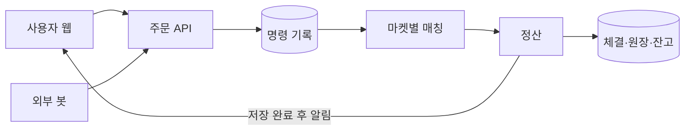

# 프로젝트 이해하기

이 프로젝트에서 맡는 역할은 고객사의 클라우드와 서버 등 IT 인프라를 안정적으로 구축·운영·관리하는 엔지니어다. 약 3개월간 직접 개발한 가상 거래소를 운영 대상으로 삼고, Linux 서버 운영을 가장 중요하게 다룬다. 개발한 서비스를 AWS에 배포하고 네트워크·서버·DB 구성과 관제·알림·복구 절차를 갖춰, 운영자가 상태를 파악하고 부하와 장애에 대응할 수 있도록 만든다. 페일스톱은 운영 대상 거래소의 이름이고 전체 프로젝트 제목은 아직 정하지 않았다.

거래소의 사용자는 시세와 호가를 보고 주문을 넣으며, 봇도 같은 시장에서 매수와 매도를 반복한다. 실제 돈이나 암호화폐를 맡기거나 주고받는 서비스는 아니다. 주문이 몰리거나 서버가 멈춰도 거래 기록과 잔고가 맞는지 확인하려고 주문 기록, 정산, 앱 리더 복구와 로컬 Docker 카오스 실험을 개발했다. 이 자료는 운영 대상의 특성과 검증 이력을 이해하는 근거로 남긴다.

앞으로의 중심은 Linux·네트워크·스토리지·DB 운영과 관제다. 부하가 늘면 조회·API 계층을 증설하고 줄면 축소하는 과정, DB 장애 후 복구와 데이터 확인, 로그·지표를 근거로 작성한 AI 운영 보고를 보여준다. 새 카오스 기능이나 거래 화면을 늘리기보다 운영에 필요한 안전성 수정과 검증을 먼저 한다. 이 범위는 [ADR 0027](../reference/adr/0027-msp-operations-and-autoscaling.md)에 기록한다.

2026-09-17 기준으로 거래·회원·게시판·관리자 기능은 로드맵에서 구현 완료로 기록되어 있다. MSP 운영 기능은 앞으로 구축하고 검증할 범위다. 이 글은 저장소의 코드와 기존 실험 기록을 바탕으로 작성했다. 이번 문서 정리에서 서비스를 새로 실행하거나 AWS 계정에 접속한 것은 아니다. 진행 상태는 [로드맵](../ROADMAP.md)에서 이어서 관리한다.

## 발표에서 설명할 주제

추천 제목은 **Linux 기반 AWS 인프라 구축 및 운영**이다. 아직 확정한 제목은 아니다. 부제는 “자체 개발 거래소를 활용한 관제·장애 대응과 AI 운영 보고”로 두면 운영 대상과 다룰 내용을 알 수 있다.

프로젝트는 다음 문장으로 소개할 수 있다.

> 고객사의 IT 인프라를 담당하는 엔지니어의 입장에서, 직접 개발한 거래소의 AWS 운영 환경을 구축하고 Linux 서버 관리와 장애 대응을 검증하는 프로젝트입니다.

개발 과정에서는 주문과 데이터가 어떻게 흐르는지 확인했다. AWS 단계에서는 그 흐름을 바탕으로 서버와 네트워크를 배치하고, 문제가 생긴 위치를 로그와 지표로 찾아 복구하는 과정을 보여 준다. 부하에 따른 조회 계층의 자동 확장과 AI가 정리한 Microsoft Teams 보고도 같은 운영 과정에 포함한다. AI 보고는 운영자의 판단을 돕는 기능으로 설명한다.

Linux 운영은 다음 활동과 조치 전후의 증거로 보여 준다. 아래 항목은 앞으로 구현하고 검증할 범위이며 완료 목록은 아니다.

| 운영할 대상 | 직접 수행하고 설명할 일 |
|---|---|
| 계정·권한·접근 | 관리자와 서비스 계정을 구분하고, SSH·sudo·파일 권한을 필요한 범위로 설정한다. |
| 서비스·프로세스·로그 | systemd로 서비스를 관리하고 journal과 애플리케이션 로그를 연결해 중단·재시작 원인을 찾는다. |
| CPU·메모리·디스크 | 자원 부족, OOM, 파일시스템·inode 부족, 디스크 I/O 병목을 구분하고 조치 후 회복을 확인한다. |
| 네트워크 | 서버의 주소·라우트·DNS·열린 포트를 AWS 보안 그룹과 함께 확인해 접속이 끊긴 위치를 찾는다. |
| DB·백업·복구 | PostgreSQL 서비스와 저장 공간·복제 상태를 확인하고, 백업 복원과 장애 복구 후 데이터를 대조한다. |
| 정기 작업·보고 | 예약 작업의 실행 계정·로그·실패·재시도를 관리하고, 일일 보고의 Microsoft Teams 전달을 확인한다. |

시스원은 공식 자료에서 전산시스템 구축부터 운영 관리까지의 MSP 서비스를 소개하고, AiWACS의 서버·네트워크 관제와 장애 대시보드, CPU·메모리·디스크·프로세스 조회 기능을 설명한다. 이 업무와 연결해 프로젝트를 설명할 수 있다는 판단이며, 시스원의 공식 평가 기준이나 프로젝트 승인을 뜻하지 않는다. [시스원 MSP 서비스](https://www.sysone.co.kr/product_list.php?idx=15), [AiWACS 제품 소개](https://www.sysone.co.kr/product_view.php?idx=28)

## 전체 구조

서비스는 웹, 거래 서버, PostgreSQL로 나뉜다. 웹은 사용자의 입력을 받아 서버에 보내고 시세와 거래 결과를 보여준다. 거래 서버는 주문을 받아 매수와 매도를 맞추고, PostgreSQL에 주문·체결·잔고와 복구 기록을 저장한다. 봇은 서버 바깥에서 주문 API를 호출하므로 사용자의 주문과 같은 접수 경로를 거친다.

서버 안에는 두 모듈이 있다. `engine`은 어느 주문을 어떤 순서로 체결할지 계산한다. DB나 웹 프레임워크에 의존하지 않는 순수 Java 코드다. `app`은 이 엔진에 API, 저장, 정산, 리더 전환과 관리 기능을 연결한다. 매칭 규칙을 바꿀 때와 회원 API를 바꿀 때 시작할 파일이 다른 이유다.

거래를 처리하는 리더 서버는 한 대다. 리더 내부에서는 BTC, ETH 같은 마켓마다 별도의 처리 루프가 돌고, 각 루프는 해당 마켓의 명령을 차례대로 적용한다. 서버가 하나의 전역 순서로 모든 마켓을 처리하는 구조와는 구분해야 한다. 다만 마켓을 나눴다고 DB와 잔고까지 서로 독립된 것은 아니다. 여러 마켓에서 같은 회원의 자산을 사용할 수 있어 DB 정산과 복구 순서도 함께 관리한다.

웹은 Next.js와 React, 서버는 Java 21과 Spring Boot, DB는 PostgreSQL 17 계열을 사용한다. 웹을 배포할 때는 정적 파일을 만들며 별도의 Next.js 서버를 운영하지 않는다. 현재 실행 구성에는 Kafka와 Redis가 연결되어 있지 않다. 이름만 보고 일반적인 거래소 구성을 추정하기보다 실제 설정에 있는 구성부터 확인하는 편이 정확하다.

구현을 찾을 때는 [코드 지도](../reference/architecture/프로젝트_코드지도.md), 모듈과 실행 환경은 [서버 안내](../../server/README.md), 웹 빌드는 [웹 안내](../../web/README.md)를 보면 된다.

## 주문 한 건이 처리되는 과정

사용자가 매수 버튼을 누르면 웹은 주문 내용과 `client_order_id`를 함께 보낸다. 이 값은 같은 요청을 다시 보냈는지 구분하기 위한 식별자다. 응답이 늦거나 연결이 끊겼다고 매번 새 식별자를 만들면 사용자가 의도한 한 건이 여러 주문으로 접수될 수 있다. 재시도와 상태 조회에서도 처음 사용한 값을 유지해야 한다.

서버는 먼저 인증과 주문 조건, 잔고를 확인한다. 같은 식별자가 이미 사용되었다면 주문 내용까지 대조한다. 그다음 명령을 `command_journal`이라는 DB 테이블에 기록하고 저장을 확정한다. 이 저장이 끝나야 매칭 엔진에 명령을 넘긴다. 엔진이 먼저 거래를 처리하고 나중에 기록하는 순서라면, 그 사이 서버가 꺼졌을 때 무엇을 처리했는지 확인할 수 없기 때문이다.

매칭 엔진은 해당 마켓의 주문장을 읽는다. 매수는 높은 가격, 매도는 낮은 가격부터 비교하며, 같은 가격에서는 먼저 들어온 주문을 우선한다. 한 주문이 여러 상대 주문과 체결될 수도 있고, 일부 수량만 체결된 뒤 남을 수도 있다. 엔진은 이 결과를 이벤트로 내보내고, 정산 코드가 주문·체결 내역과 자산 이동을 DB에 반영한다.

정산은 한 명령에서 나온 결과를 하나의 DB 트랜잭션으로 저장한다. 체결 내역만 생기고 잔고는 바뀌지 않거나, 잔고만 줄었는데 거래 기록이 없는 상태를 막기 위해서다. 저장 대상에는 처리 결과인 `event_journal`, 주문과 체결, 자산의 이동을 기록하는 원장, 조회에 쓰는 잔고가 포함된다. 잔고는 현재 얼마를 갖고 있는지를 보여주고, 원장은 그 금액이 어떤 거래로 바뀌었는지를 설명한다.

금액과 수량은 서버에서 `BigDecimal`, DB에서 `NUMERIC(40,18)`을 사용한다. 웹과 API 사이에서는 문자열로 전달한다. 소수점이 있는 금액을 일반 부동소수점 계산에 맡기지 않기 위한 선택이다. 수수료, 주문 때 묶어두는 금액, 취소 후 돌려주는 금액에는 서로 정해진 반올림 규칙이 있으므로, 표시 자릿수를 바꾸는 작업과 실제 계산식을 바꾸는 작업을 구분해야 한다.

정산이 끝나면 서버는 WebSocket으로 호가와 체결 정보를 보낸다. 웹은 이 알림으로 화면을 빠르게 갱신한다. 알림은 영구 저장소가 아니므로 연결이 끊겨 일부를 놓칠 수 있다. 웹이 메시지의 순서와 리더 세대를 확인하고 REST 조회로 상태를 다시 맞추는 이유다.

명령을 DB에 저장했다는 사실과 주문 HTTP 응답이 끝났다는 사실도 다르다. 현재 API는 주문이 조회 결과에 반영되기를 기다린다. 새 주문은 201, 같은 주문의 재응답은 200으로 반환하지만, 아직 처리 중이면 `order_in_progress`를 받을 수 있다. 이런 응답이나 타임아웃만 보고 주문이 없다고 판단해서는 안 된다. 원래 식별자로 상태를 확인해야 한다.

이 흐름은 [주문 접수](../../server/app/src/main/java/kr/exchange/api/order/OrderGateway.java), [엔진 전달](../../server/app/src/main/java/kr/exchange/engine/EngineBridge.java), [정산](../../server/app/src/main/java/kr/exchange/ledger/SettlementService.java)에 이어져 있다. 요청·응답의 세부 조건은 [API 설계](../reference/contracts/백엔드_API_설계.md), 금액과 기록의 규칙은 [DB 설계](../reference/contracts/백엔드_DB_설계.md)를 따른다.

## 거래 서버가 멈췄을 때

앱 서버를 두 대 띄워도 두 서버가 동시에 같은 주문장을 변경하면 안 된다. 그래서 리더에게만 유효기간이 있는 처리 자격을 주고, 리더는 그 자격을 계속 갱신한다. 이 자격을 리스라고 한다. 리더가 중단되어 갱신하지 못하면 대기 서버가 만료를 확인하고 승격을 시도한다.

승격할 때마다 `epoch`라는 세대 번호가 올라간다. 예전 리더가 잠깐 멈췄다가 돌아오는 경우에도, 이전 세대의 권한으로 거래 기록을 계속 쓰지 못하게 해야 한다. 거래 쓰기 트랜잭션은 DB에서 리더 자격을 검증하며, 오래된 세대의 쓰기를 거부한다. 이를 fencing이라고 부른다. 서버가 살아 있다는 사실만으로 주문을 받아도 되는 것은 아니다.

기본 설정에서는 PostgreSQL이 리스를 보관한다. DynamoDB를 사용하는 선택 설정도 구현되어 있다. DynamoDB를 선택하더라도 거래 기록은 PostgreSQL에 저장하고, DB에서 세대를 검증하는 절차는 유지한다. 어느 방식을 실제 배포에 쓸지는 설정과 계정 권한을 확인해야 한다.

새 리더는 주문 접수를 바로 열지 않는다. 먼저 마켓별 스냅샷을 읽고, 스냅샷 이후의 명령을 DB에서 다시 적용해 주문장을 복구한다. 스냅샷은 특정 시점의 주문장 상태를 저장한 것이다. 평소 대기 서버도 기록을 따라가므로, 승격 시점에 이미 따라잡은 마켓은 추가 재생이 필요하지 않을 수 있다.

재생 중에는 이미 정산된 명령과 아직 정산되지 않은 명령을 구분한다. 정산된 구간은 다시 계산한 결과를 저장된 이벤트와 대조하고, 명령만 남아 있는 구간은 정산을 마친다. 이를 위해 체결에 영향을 주는 시각과 수수료율 같은 입력도 명령에 남긴다. 복구할 때의 현재 시각이나 새 난수로 결과를 바꾸면 과거 거래와 맞춰볼 수 없기 때문이다.

복구 시간의 목표는 앱 리더 장애 후 30초 안에 거래를 재개하는 것이다. 측정은 새 리더를 정했다는 로그에서 끝내지 않고 실제 체결이 다시 발생한 시점까지 본다. 코드에 자동 전환 기능이 있어도 그때의 부하, 기록량과 연결 상태에서 목표를 만족하는지는 실험으로 확인해야 한다.

복구 구현은 [EngineRecovery](../../server/app/src/main/java/kr/exchange/engine/EngineRecovery.java)와 [ReplayService](../../server/app/src/main/java/kr/exchange/journal/ReplayService.java)에 있다. 마켓별 복구 범위를 나눈 이유는 [ADR 0022](../reference/adr/0022-market-partitioned-command-journal.md)와 [ADR 0023](../reference/adr/0023-replay-bound-and-cursor-axis.md), 리스 설정은 [LeaseStoreConfig](../../server/app/src/main/java/kr/exchange/config/LeaseStoreConfig.java)에서 확인할 수 있다.

## DB 장애에는 별도의 복구가 필요하다

앱 리더가 자동으로 바뀌는 것과 DB 서버를 교체하는 것은 다른 문제다. 현재 DB 설계는 쓰기를 받는 primary 한 대와 복제본인 standby 한 대를 두며, primary 장애 시 사람이 standby를 승격하고 앱의 연결을 바꾼다. 앱 자동 전환을 설명하면서 DB까지 자동으로 복구된다고 말하면 현재 구현 범위를 넘는다.

DB 복제는 비동기다. primary는 자기 디스크에 기록을 확정한 뒤 standby의 응답을 기다리지 않고 처리를 이어간다. 덕분에 standby가 느려지거나 멈췄다는 이유만으로 모든 쓰기가 대기하지는 않는다. 대신 primary가 갑자기 사라지면 standby에 아직 도착하지 않은 기록을 잃을 수 있다.

명령 저널도 같은 PostgreSQL에 있다. 따라서 유실된 저널을 재생으로 되살릴 수는 없다. 남아 있는 명령을 중복 정산하지 않는 기능과, DB 교체 중에도 모든 기록을 보존한다는 보장은 구분해야 한다. 정상 복제 상태의 한 실험에서 유실이 없었더라도 비동기 구성 전체의 무손실을 증명하지는 못한다.

DB 승격 연습에서는 대기 DB를 올리는 명령뿐 아니라 기존 primary를 확실히 배제하는 과정, 앱 연결 전환, 거래 재개와 데이터 검사를 끝까지 확인해야 한다. 백업도 파일이 있다는 것만으로 끝나지 않는다. 실제로 복원한 DB에서 데이터를 읽고 서비스를 다시 시작할 수 있어야 한다. 여러 호스트에서의 이 검증과 백업 복원 시험은 현재 로드맵의 남은 작업이다.

비동기 복제를 선택한 이유와 손실 가능성은 [ADR 0024](../reference/adr/0024-async-two-node-replication.md), 실제 작업 순서는 [DB 수동 페일오버](../reference/operations/DB_수동_페일오버.md)에 정리되어 있다.

## 사용자가 보는 화면과 운영 기능

거래 화면에는 시세, 호가, 차트, 주문 입력과 주문·체결 내역이 있다. 회원은 로그인한 계정의 가상 자산과 거래 내역을 보고, 가상 입출금을 요청할 수 있다. 종목별 게시판과 댓글, 공지와 문의도 같은 웹 프로젝트에 들어 있다. 화면은 데스크톱 사용을 기준으로 하며 현재 설계의 최소 폭은 1280px이다.

웹에는 두 가지 데이터 연결 방식이 있다. 기본값은 브라우저 안에서 주문과 시세를 만드는 시뮬레이터다. 서버 없이 화면을 살펴볼 때 사용할 수 있지만, 여기서 주문 버튼이 동작한다고 백엔드 거래가 검증된 것은 아니다. `NEXT_PUBLIC_DATASOURCE=http`로 빌드하거나 실행해야 실제 API와 WebSocket에 연결한다. 반면 서버 쪽 봇은 실제 주문 API를 호출하는 별도 프로세스다. 장애 후 거래가 재개되었는지 관찰할 때도 이 구분이 필요하다.

관리자는 별도 인증을 거쳐 봇과 장애 실험을 제어하고 운영 상태를 확인한다. 관리 API는 별도 실행 설정과 포트를 사용하며 클라이언트 인증서를 확인한다. 주요 작업에는 승인 티켓과 감사 기록이 남는다. 현재는 한 운영자가 승인과 실행을 모두 할 수 있는 1인 승인 방식이다. 두 사람이 서로 검토하는 절차로 설명해서는 안 된다.

이 관리 기능과 앞으로 만들 MSP 관제는 구분한다. 장애 주입 화면을 핵심 제품으로 확장하지 않고, 운영자가 서비스 상태와 원인을 찾고 대응 결과를 확인하는 흐름을 만든다. 기존 Grafana의 [MSP 종합](../../harness/grafana/dashboards/10-msp-overview.json), [서비스](../../harness/grafana/dashboards/11-msp-service.json), [인프라](../../harness/grafana/dashboards/12-msp-infra.json), [DB](../../harness/grafana/dashboards/13-msp-db.json) 대시보드를 재사용한다. 이 파일들이 있다는 것과 AWS의 실제 지표·로그·알림까지 연결된 관제가 완성됐다는 것은 다르다.

공개 웹을 배포할 때는 관리 화면을 빌드 결과물에서 제거하고 잔존 여부를 검사한다. 저장소에 거래 화면과 관리 화면이 함께 있다는 것과 둘을 인터넷에 함께 공개한다는 것은 별개의 선택이다. API·WebSocket 주소 등 `NEXT_PUBLIC_*` 설정은 웹을 빌드할 때 들어가므로, 배포 주소가 바뀌면 웹도 다시 만들어야 한다.

설계와 구현이 아직 맞지 않는 부분도 있다. 게시판 설계에는 거래 서버와 다른 DB·프로세스를 사용하고 공개키로 회원 신원을 확인한다는 요구가 남아 있다. 현재 `ApiConfig`에서는 게시판 서비스를 같은 Spring 앱의 DB 연결과 회원 세션 서비스에 연결한다. 글과 댓글 기능이 구현되었다는 사실만으로 거래와 게시판의 물리적 격리까지 완료되었다고 볼 수 없다. 분리 요구를 유지할지, 구현을 바꿀지 먼저 결정하고 그에 맞는 부하·장애 검증을 해야 한다.

화면의 연결 방식은 [datasource.ts](../../web/lib/api/datasource.ts), 관리자 배포는 [웹 안내](../../web/README.md), 승인 방식은 [ADR 0019](../reference/adr/0019-single-operator-approval.md)를 보면 된다. 게시판의 차이는 [설계](../reference/product/게시판_설계.md)와 [ApiConfig](../../server/app/src/main/java/kr/exchange/config/ApiConfig.java)를 함께 읽으면 확인할 수 있다.

## 실험 결과를 읽는 방법

이 프로젝트의 하네스는 거래 서버에 부하와 장애를 주고, 복구 시간과 데이터 상태를 검사하는 도구 모음이다. 앱을 강제로 종료하거나 DB 연결을 끊고, 네트워크를 분리하거나 프로세스를 일시 정지하는 스크립트가 있다. Prometheus와 Grafana는 지표를 모아 보여주며, SQL 검사는 원장·잔고·주문·체결의 관계가 맞는지 확인한다.

봇과 k6는 목적이 다르다. 봇은 시장에 호가와 체결을 만들지만, 서버 응답이 느려지면 봇의 주문 속도도 영향을 받는다. k6는 정해진 도착률로 요청을 넣어 제공한 부하와 처리된 부하를 비교할 수 있게 한다. 처리량을 설명할 때는 초당 몇 건이라는 숫자와 함께 무엇을 센 것인지도 밝혀야 한다. 주문 요청 수, 접수 응답 수와 체결 수는 서로 다르다.

검사 결과가 0건이라는 표시도 먼저 내용을 봐야 한다. 실제로 처리한 주문이 있는지, 검사 쿼리가 성공했는지, 장애가 의도한 서버에 도달했는지를 확인한 뒤에 위반 0건을 해석한다. 이번 구성에 Redis가 없어 생략한 실험과 실행 후 통과한 실험은 같은 성과로 세지 않는다. 조건을 채우지 못해 유효한 결론을 낼 수 없는 회차도 결과에 그대로 남긴다.

현재 참고할 만한 결과는 아래와 같다. 날짜별 기록은 서로 다른 코드와 조건에서 나온 것이므로 표의 숫자를 합쳐 전체 서비스의 성능으로 읽지는 않는다.

| 확인한 기록 | 결과와 적용 범위 |
|---|---|
| 09-13 앱 장애 실험 | V41 적용 코드 `2a818b6`에서 E1·E2·E4·E5·E6·E7 통과가 기록되어 있다. 페일오버 실험의 복구 시간은 5.116~10.226초였다. |
| 09-15 이벤트 순번 확대 후 실험 | 이미지 `3b61c24`의 E2·E4·E5·E6·E7이 각 한 회차씩 통과했다. 복구 시간은 5.979~10.134초였다. |
| 09-15 DB 커밋 지연 설정 실험 | 사전 조건과 기준 회차의 안정성을 충족하지 못해 `NOT RUN`으로 판정했다. 설정의 효과를 확정하는 근거로 쓰지 않는다. |
| 09-17 웹 테스트 | 이전 코드 분석에서 실행한 테스트 440개가 통과했고 실패·취소·생략은 0개였다. 백엔드·배포·브라우저 검증까지 포함한 결과는 아니다. |

앞의 장애 수치는 로컬 Docker 환경에서 얻었다. 한 PC의 컨테이너를 나눈 실험은 실제 호스트나 가용영역을 나눈 AWS 실험과 조건이 다르다. 코드에 장애 대응 절차가 있고 로컬에서 동작했다는 근거는 되지만, 클라우드의 네트워크·저장소·라우팅 조건까지 확인했다고 말할 수는 없다.

복구 자체의 검증에도 남은 범위가 있다. 09-15 스냅샷 실험에서는 일부 회차가 이미 따라잡은 상태라 재생 없이 승격했다. 이것은 스냅샷 이후의 명령을 충분히 재생하는 시험과 다르다. 대역 모드에서 이력 중간의 스냅샷을 채택한 증거도 제한되어 있어, 긴 이력이 쌓였을 때의 복구 시간 개선은 추가 측정이 필요하다.

판정 기준은 [하네스 검증 설계](../reference/contracts/하네스_검증설계.md), 회차별 조건과 한계는 [측정 안내](../measurements/README.md)와 [09-15 기록](../measurements/20260915.md)에 있다. 원자료는 [harness/evidence](../../harness/evidence/)에 있다. 09-17 웹 테스트 로그는 로컬의 `artifacts/project-analysis-20260917/web-tests.log`에 남겼으며 Git에 포함되지 않는다. 새 체크아웃에서 같은 결과를 확인하려면 테스트를 다시 실행해야 한다.

## 지금 마무리해야 할 일

AWS용 앱·DB·봇 노드 설정은 `deploy/`에 있다. 로컬의 루트 Compose는 여러 서비스를 한 호스트에서 띄우는 구성이므로 그대로 옮기는 것만으로 AWS 배포가 끝나지는 않는다. 노드 사이의 연결, 진입 경로, 도메인과 TLS, 비밀 값, 관리 접근과 관측 도구를 실제 환경에 맞춰 연결해야 한다. 일부 엣지 설정은 ALB 채택 전 파일이 남아 있어 사용할 구성을 먼저 확정해야 한다.

AWS 사용 조건은 사용자의 설명에 따라 IAM을 제외한 서비스를 사용할 수 있을 것으로 보고 있다. 실제 권한은 아직 조회하지 않았다. 기존 역할을 사용할 수 있는지와 필요한 IAM 설정을 요청해야 하는지를 확인하면 배포 계획을 구체화할 수 있다. 과거 문서에 있던 여러 서비스의 일괄 사용 제한을 현재 조건으로 가져오지는 않는다.

먼저 Linux 호스트와 네트워크·스토리지·DB의 운영 구성을 정하고, 배포·재배포·복구를 재현할 수 있게 해야 한다. 관제에서는 사용자 요청의 실패와 지연을 호스트 자원, DB 연결·복제 상태와 함께 읽고 알림의 근거를 찾아갈 수 있어야 한다. 기존 대시보드를 실제 AWS 데이터에 연결하는 작업과 알림 전달 검증은 아직 남아 있다.

부하 대응은 [ADR 0027](../reference/adr/0027-msp-operations-and-autoscaling.md)에 따라 조회·API 계층의 EC2 Auto Scaling Group(ASG)을 채택한다. AWS 지표에 따른 정책이 증설·축소를 제어하며 AI 보고가 자원 변경을 지시하지 않는다. 현재 라우팅, 계정·세션 처리, 전체 DB 연결 수와 노드 종료 시 처리 중 요청을 마치는 조건부터 맞춰야 한다. ASG를 설정했다는 이유만으로 단일 리더인 매칭 엔진이나 DB까지 함께 수평 확장하지 않는다. 증설·축소와 처리량 변화는 실제 부하를 넣어 확인할 과제다.

DB의 현재 구성은 비동기 복제와 수동 승격이다. 여러 호스트에서 기존 primary 배제, standby 승격, 앱 연결 전환, 거래 재개와 백업 복원을 끝까지 연습해야 한다. 자동 DB 페일오버를 어떤 방식으로 구현할지는 아직 정하지 않았고 구현 완료로 볼 근거도 없다. 기존 앱 리더 자동 전환과 이 과제를 섞지 않는다.

일일 운영 보고와 장애 후속 보고는 수집한 로그·지표·이벤트를 AI가 요약하고 원본 근거를 함께 제시하는 기능으로 만든다. 전달 채널은 Microsoft Teams로 정했으며 Workflows 웹훅과 Adaptive Card를 사용하는 방향이다. 사용할 AI 모델과 실제 연결은 아직 미정·미구현이다. AI가 추정한 원인과 확인된 사실을 구분하고, AI는 서버 재시작·DB 승격·자원 변경 같은 운영 조치를 직접 실행하지 않는다. 이는 삭제한 작업 인수인계 문서를 다시 쌓는 일이 아니라 사용자가 요청한 운영 기능이다.

사용자가 밝힌 AWS 지원금은 40만 원이다. 월별 한도나 입금 확인으로 해석하지 않는다. 발표는 PPTX와 사전 녹화 영상·캡처로 준비하고, AWS 실행·검증·촬영 기간과 필요한 접속 유지 기간을 정해 비용을 관리한다. 녹화 장면에는 관제, 부하에 따른 증설·축소, 복구와 보고의 근거를 연결한다. 저장소 밖에서 진행한 배포나 실험은 이번 조사 범위에 포함되지 않았다.

이번 정리에서는 핵심 주문·정산·복구 코드와 실행 설정, 대표 기능과 테스트 위치를 확인했다. 모든 화면과 예외 처리, 모든 DB 함수와 실험 원자료를 감사한 것은 아니다. 현재 실행 중인 서비스와 DB의 마이그레이션 적용 상태도 확인하지 않았다. 기능을 수정할 때는 이 설명으로 위치를 잡고, 해당 설계와 소스·테스트를 다시 읽어야 한다.

배포에 필요한 파일과 현재 제약은 [배포 안내](../../deploy/README.md), 남은 작업과 완료 조건은 [로드맵](../ROADMAP.md)에 모아 두었다. 로컬에서 직접 확인하려면 [실행 가이드](../../실행_가이드.md)부터 시작하면 된다.
