# 고가용성 가상 암호화폐 거래소 PostgreSQL 스키마 설계 (제출본 v2.27)

> 대상: Java 21 / Spring Boot 3.5+ / **PostgreSQL 17+** (파티션드 테이블의 `GENERATED ... AS IDENTITY`는 PG17에서 지원, ledger_entries/outbox가 이에 의존. trades는 P0-4로 IDENTITY 제거, id=event_seq 명시 삽입. audit_log는 V1 범위 외, V13+ 로드맵)
> DB의 책임: **(1) 체결 정합성** = 복식부기 원장의 자산별 합계 = 0 불변식 + `client_order_id` 멱등성, **(2) 자동 복구** = append-only 명령 저널(`command_journal`) + 스냅샷 + 결정론 재생(replay).
> 설계 우선순위: **정확성(exactness) > 성능 > 편의성**. DB는 매칭 핫패스가 아니라 "진실의 원천(SoT) + 최종 방어선"이다.
> 이 제출본은 초안·v2.0 검증에서 지적된 critical/high 결함(파티션 소진, RESERVE amount=0 모순, `user_id=0` 수수료 계정 무효, 파티션 seq 유일성 무력화, 비원자적 fencing, `transaction_id` 권위 부재, RULE 기반 무음 무시)을 **계정 모델 재설계**로 근본 해결한다. (v2.1~v2.15 패치 반영 사항은 문서 말미 참조)

---

## 1. 도메인 개요 및 정규화 판단

### 1.1 진실의 원천(SoT) 3계층

| 계층 | 성격 | 대표 테이블 | 규칙 |
|---|---|---|---|
| **① 복구 원천** | append-only, 불변, 재생 가능 | `command_journal`, `event_journal`, `snapshots` | UPDATE/DELETE/TRUNCATE 금지. 이것만으로 전체 상태 재구성 |
| **② 회계 원천** | append-only, 불변, 복식부기 | `ledger_entries`(+ `ledger_transactions` 헤더) | 정정은 상계 분개(reversal)로만. 자산별 합 = 0 |
| **③ 파생 프로젝션** | 가변, 재구축 가능 | `balances`, `orders`, `trades`, `candles` | ①②로부터 언제든 재계산. 실패해도 fail-safe |

캡스톤의 두 증명 목표가 정확히 ①②에 대응한다. "자동 복구"는 ①(명령 재생), "체결이 어긋나지 않음"은 ②(자산 보존 불변식)로 **데이터 레벨에서** 증명된다.

### 1.2 계정 모델 재설계: 초안 3개 critical의 근본 해결

초안의 세 critical(§5.1 `RESERVE amount=0` ↔ `CHECK(amount<>0)` 모순, §5.2 `user_id=0` 수수료 계정이 IDENTITY·FK상 존재 불가, 시스템 계정의 balances 표현 위치 부재)은 **모두 "잔고를 user_id로 키잉하고 available/locked를 balances 컬럼으로 둔" 데서 파생**된다.

해결: **모든 잔고를 `account_id` 단일 키로 통일**하고, `available`·`locked`·수수료·GENESIS를 **각각 독립 계정(account)**으로 승격한다.

- 사용자 1인 + 자산 1종 → 계정 2개: `USER_AVAILABLE`, `USER_LOCKED`
- 시스템 계정: `FEE_INCOME`(자산당 N샤드), `GENESIS`, `GATEWAY`
- `balances`는 `account_id → balance` 프로젝션. `available/locked`는 뷰로 피벗.

이 재설계의 효과:
1. **예약(RESERVE)이 진짜 복식부기가 된다**: `USER_AVAILABLE −x`, `USER_LOCKED +x` → 합 0, 각 행 `amount<>0` 만족. (critical #1·#2 동시 해소)
2. **수수료·시스템 계정이 잔고 모델에 정식 존재**: `user_id=0` 무효 UPDATE 소멸. `balances↔ledger` 대조가 **시스템 계정 포함 전 계정**에서 성립. (critical #3 해소)
3. **`CHECK(balance>=0)`가 `USER_AVAILABLE`·`USER_LOCKED` 양쪽에 적용** → 이중지출·과다락 최종 방어선.

**계정 모델 제약 현황과 한계 (P1)**

- DB가 물리 강제하는 것: purpose 어휘 CHECK, USER 계정은 AVAILABLE/LOCKED만(`chk_user_purpose`), SYSTEM은 owner_id=0(`chk_sys_owner`), `UNIQUE(owner_type, owner_id, purpose, asset_id, shard)`, 계정·분개 자산 라벨 복합 FK, 계정·잔고 1:1 트리거, `CHECK(balance >= 0 OR allow_negative)`.
- 한계(앱·운영 규율로 보완, 정직한 명시):
  - `owner_id` → `users.id` 물리 FK가 없다(SYSTEM owner_id=0과 단일 컬럼을 공유하는 구조상 불가). USER 계정의 실존 사용자 대응은 고아 탐지 쿼리로 보완한다.
  - `allow_negative`는 purpose에서만 파생되는 생성열이다. GENESIS/GATEWAY 외 계정의 음수 허용(마이너스 수수료, 신용 등)은 표현할 수 없고, 도입하려면 컬럼·CHECK 마이그레이션이 필요하다.
  - 수수료 샤드 수 K는 DDL에 없다. 증설은 계정 행 추가로 가능하지만 축소·재배치는 원장 이관 분개를 요구한다. `hash(event_seq)%K`의 K 변경은 재생·catch-up의 샤드 동일성을 깨므로 K는 설정 박제 대상이다.
  - 신규 purpose(스테이킹, 에스크로 등)는 CHECK 어휘 변경 마이그레이션이 선행돼야 한다. 어휘 고정은 오타 계정 생성을 막는 대신 확장 비용을 치르는 의도적 선택이다.
  - `balances.version` 낙관적 락은 사용자 개시 경로 전용 계약이다. version 증가는 `post_ledger_transaction`이 강제하지만, `WHERE version = :v` 검사 자체는 앱 책임이다.

### 1.3 정규화 판단 (3NF 기본 + 의도적 비정규화)

| 대상 | 판단 | 근거 | 정합성 보증 |
|---|---|---|---|
| `balances`(account_id별 balance) | 비정규화(원장 파생) | 매 조회 원장 SUM은 O(N) | §6.1 대조 쿼리 상시 0행 검증 + 위반 시 자동 재빌드 |
| `orders.filled_qty/remaining_qty` | 비정규화(체결 집계) | trades 매번 SUM 회피 | `filled+remaining=quantity` CHECK(수량기반 한정) |
| `candles` | 비정규화(trades 파생) | 차트 조회 최적화 | trades에서 재계산 가능 |
| `trades.maker/taker_user_id` | 비정규화(조인 회피) | 체결 조회 성능 | 삽입 시점 FK-less 논리참조, 불변 + 고아 탐지 쿼리 |
| `orders.market_id` | **정규화**(문자열 중복 금지) | 마켓 상태/수수료 전파 | SMALLINT FK |

### 1.4 금액/수량 타입 정책 (float 절대 금지)

- **모든 금액·수량·가격 = `NUMERIC(40,18)`.** 초안의 `NUMERIC(36,18)`은 정수부 18자리(<10^18)로, `qty×price` notional이 10^18을 넘으면 `numeric field overflow(22003)`로 트랜잭션이 실패한다(초안 medium 지적). 정수부를 **22자리**로 확대해 곱셈 중간결과 여유를 확보하고, 추가로 **마켓별 상한값 `max_notional`·`max_qty`를 `markets`에 저장**해 **주문 검증 경로의 앱 가드**가 명시적으로 강제한다. (DDL의 CHECK는 상한 설정값 자체의 양수성 검사일 뿐이며, 주문별 `notional≤max_notional`·`qty≤max_qty` 강제 주체는 DB CHECK가 아니라 앱 가드다. §8 앱 가드 목록·회귀 테스트 대상.)
- 스케일 18: 1 ETH = 10^18 wei, 1 BTC = 10^8 사토시. 18자리면 무손실.
- 자산별 유효 소수 자리는 `assets.scale`(BTC=8, KRW=0, ETH=18)로 관리, 입력값은 저장 전 **양자화**.
- **방향별 양자화 레짐(v2.9 명문화)**: 양자화 방향은 용도별로 고정한다. 코드가 이 표와 어긋나면 코드가 틀린 것이다.
  - **예약(락 산정)**: `RoundingMode.UP`. LIMIT 매수 예약 `qty x price`를 quote scale UP 양자화. 체결별 차감이 DOWN 절사이므로 예약이 차감 합보다 작아지는 방향의 잔차를 봉쇄한다(중간 체결의 락 잔여 초과 방지). 시장가 매수(notional)는 금액 그대로 예약(양자화 없음), 매도는 base 수량 그대로.
  - **체결·감액별 차감·환급**: `RoundingMode.DOWN` 절사. 체결대금은 quote scale DOWN(notional 주문은 엔진 소진액 규약과 동일하게 scale 18 DOWN), STP 부분 감액·비종결 취소의 수량 비례 환급도 DOWN.
  - **수수료**: `RoundingMode.HALF_UP`. `체결대금(또는 수량) x 요율`을 정산 자산 scale로 선양자화(§5.2, API 설계 §4-B-5).
  - **종결과 잔차**: 최종 체결·종결 취소는 계산값이 아니라 그 주문의 실잔여 락을 전량 소비·해제한다(FILLED·CANCELED 시 락 잔량 정확히 0). 체결 분개의 반올림 잔차는 자산별 마지막 FEE leg가 흡수해 자산별 합=0을 유지하며, 음수 FEE leg는 산식 계약 위반으로 fail-fast다.
- 반올림 정책: 수수료·환산은 자산 scale 양자화 + 명시적 `RoundingMode`(방향은 위 레짐 표를 따른다). 반올림 잔차는 `FEE_INCOME` 흡수(합=0 유지). float·`double` 금지.
- **앱 가드 목록(§8과 동일 축, v2.9 추가 항목 포함)**: tick_size·lot_size 정합, min_notional·max_notional·max_qty 상한, MARKET BUY의 quantity·quote_order_qty 동시 지정 거부, 그리고 **MARKET BUY(notional)를 허용하는 마켓은 quote 자산 scale 18 필수**(notional 나눗셈이 scale 18 소진액을 만들므로 quote scale<18이면 정산 양자화 재검증에서 fail-fast로 이어진다. 게이트웨이 검증 경로가 선차단한다). **MARKET BUY notional 소수 자리 초과 거부(v2.10)**: notional 값의 유효 소수 자리가 scale 18을 초과하면 게이트웨이가 400으로 거부한다. 시장가 매수 예약은 양자화 없이 금액 그대로이고 소진 차감도 scale 18 DOWN이라, 초과 자리는 예약·소진 어느 경로로도 표현할 수 없다(API 설계 v2.7 W4).

---

## 2. 전체 ERD (Mermaid)

> ERD는 **주요 컬럼만 발췌 표기**한다. 전체 컬럼·제약의 정본은 §3 DDL이다(예: `outbox.aggregate_id`, `orders.reject_reason`/`orders.updated_at` 등은 지면상 ERD에서 생략된 것으로, 누락이 아니라 발췌 표기다, v2.5).
> INVARIANT_CHECKS·RECOVERY_RUNS는 V3(관측성)에 적용됐다. TRANSFER_REQUESTS·CANDLES·audit_log·shedlock은 V1 범위 외 V11+ 로드맵 엔티티다. V1 정본은 §3.1 구현 목록을 따른다(v2.6, v2.11 로드맵 정정).

```mermaid
erDiagram
    ASSETS ||--o{ MARKETS : "base/quote"
    ASSETS ||--o{ ACCOUNTS : "denominated in"
    ASSETS ||--o{ LEDGER_ENTRIES : "of asset"

    USERS ||--o{ API_KEYS : owns
    USERS ||--o{ ACCOUNTS : "owns (logical)"
    USERS ||--o{ ORDERS : places
    USERS ||--o{ TRANSFER_REQUESTS : requests

    MARKETS ||--o{ ORDERS : "traded on"
    MARKETS ||--o{ TRADES : "executed on"
    MARKETS ||--o{ CANDLES : "aggregated to"

    ACCOUNTS ||--|| BALANCES : "projected as"
    ACCOUNTS ||--o{ LEDGER_ENTRIES : "debited/credited"

    LEDGER_TRANSACTIONS ||--o{ LEDGER_ENTRIES : "groups (sum=0)"
    TRADES ||--o{ LEDGER_ENTRIES : "settles into (logical)"
    TRANSFER_REQUESTS ||--o| LEDGER_TRANSACTIONS : settles

    COMMAND_JOURNAL ||--o{ EVENT_JOURNAL : "produces (logical)"
    COMMAND_JOURNAL ||--o{ ORDERS : "materializes (logical)"
    LEADER_LEASE ||--o{ COMMAND_JOURNAL : "fences (epoch)"
    TRADES ||--|| TRADE_SEQ_REGISTRY : "registers (trigger)"
    EVENT_JOURNAL ||--|| EVENT_EMISSION_REGISTRY : "registers (trigger)"

    ASSETS {
        smallint id PK
        varchar symbol UK
        varchar kind
        smallint scale
        varchar status
    }
    MARKETS {
        smallint id PK
        varchar symbol UK
        smallint base_asset_id FK
        smallint quote_asset_id FK
        numeric tick_size
        numeric lot_size
        numeric min_notional
        numeric max_notional
        numeric max_qty
        numeric maker_fee_rate
        numeric taker_fee_rate
        varchar status
    }
    USERS {
        bigint id PK
        uuid external_id UK
        varchar email UK
        varchar kind
        varchar status
    }
    API_KEYS {
        bigint id PK
        bigint user_id FK
        varchar access_key UK
        varchar enc_secret
        varchar scope
        timestamptz deleted_at
    }
    ACCOUNTS {
        bigint id PK
        varchar owner_type
        bigint owner_id
        varchar purpose
        smallint asset_id FK
        smallint shard
        boolean allow_negative
    }
    BALANCES {
        bigint account_id PK
        numeric balance
        boolean allow_negative
        bigint version
        timestamptz updated_at
    }
    ORDERS {
        bigint id PK
        uuid external_id UK
        bigint user_id FK
        smallint market_id FK
        varchar client_order_id
        varchar side
        varchar ord_type
        varchar time_in_force
        numeric price
        numeric quantity
        numeric quote_order_qty
        numeric filled_qty
        numeric remaining_qty
        numeric executed_quote
        bigint locked_account_id
        numeric locked_amount
        varchar status
        bigint version
        bigint command_seq
        timestamptz created_at
    }
    TRADES {
        bigint id PK "= event_journal.event_seq"
        smallint market_id FK
        bigint maker_order_id
        bigint taker_order_id
        bigint maker_user_id
        bigint taker_user_id
        varchar taker_side
        numeric price
        numeric quantity
        numeric maker_fee
        numeric taker_fee
        bigint fencing_epoch
        timestamptz executed_at
        timestamptz created_at PK
    }
    LEDGER_TRANSACTIONS {
        bigint id PK
        varchar business_event_type UK "UNIQUE(type, id) 멱등 키"
        bigint business_event_id UK
        varchar status
        timestamptz created_at
        timestamptz sealed_at
    }
    LEDGER_ENTRIES {
        bigint id PK
        bigint transaction_id FK
        bigint account_id FK
        smallint asset_id FK
        numeric amount
        varchar entry_type
        timestamptz created_at PK
    }
    TRANSFER_REQUESTS {
        bigint id PK
        uuid external_id UK
        bigint user_id FK
        smallint asset_id FK
        varchar direction
        numeric amount
        varchar status
        varchar idem_key
        bigint ledger_txn_id
    }
    COMMAND_JOURNAL {
        bigint seq PK
        smallint market_id
        varchar command_type
        bigint user_id
        varchar client_order_id
        bigint assigned_order_id
        bigint engine_ts
        bigint tie_break
        jsonb payload
        bigint fencing_token
        bigint checksum
    }
    EVENT_JOURNAL {
        bigint event_seq PK
        bigint source_cmd_seq
        int event_ordinal
        varchar event_type
        jsonb payload
        smallint payload_schema_version
        bigint fencing_epoch
        timestamptz created_at
    }
    SNAPSHOTS {
        bigint snapshot_id PK
        smallint market_id
        bigint last_applied_seq
        bytea state
        bigint state_checksum
        varchar engine_version
        varchar config_hash
        smallint format_version
        bigint fencing_epoch
    }
    TRADE_SEQ_REGISTRY {
        bigint seq PK "= trades.id"
        timestamptz trade_created_at
    }
    EVENT_EMISSION_REGISTRY {
        bigint source_cmd_seq PK
        int event_ordinal PK
        bigint event_seq UK
    }
    JOURNAL_COUNTERS {
        text name PK
        bigint next_value
    }
    OUTBOX {
        bigint id PK
        uuid event_id UK
        varchar aggregate_type
        varchar event_type
        jsonb payload
        timestamptz published_at
        timestamptz created_at PK
    }
    PROCESSED_EVENTS {
        varchar consumer_group PK
        uuid event_id PK
    }
    IDEMPOTENCY_KEYS {
        bigint user_id PK
        varchar idem_key PK
        varchar request_hash
        int response_status
        jsonb response_body
    }
    LEADER_LEASE {
        varchar resource PK
        varchar holder
        bigint epoch
        timestamptz lease_until
    }
    CANDLES {
        smallint market_id PK
        varchar interval PK
        timestamptz bucket PK
        numeric open
        numeric high
        numeric low
        numeric close
        numeric volume
    }
    INVARIANT_CHECKS {
        bigint id PK
        varchar check_name
        boolean ok
        bigint violated_rows
        jsonb details
        timestamptz checked_at
    }
    RECOVERY_RUNS {
        bigint id PK
        smallint market_id
        bigint replayed_from_seq
        bigint replayed_to_seq
        varchar fp_replay
        varchar fp_live
        boolean matched
        timestamptz created_at
    }
```



> Mermaid는 파티션 키를 PK 일부로 표기(`trades.created_at PK` 등). "(logical)"로 표기한 관계는 **핫패스/파티션 성능상 물리 FK를 생략**하고 앱과 §6 정합 검증 쿼리로 보증한다(초안 medium: ERD↔DDL FK 불일치 명시화).

---

## 3. 전체 DDL

정본 마이그레이션은 현재 `V0`~`V12` 13개 파일이며(경로: `server/app/src/main/resources/db/migration/`), **외부 확장(pg_partman/pg_cron) 의존 없이 빈 PostgreSQL 17에 단독 적용 가능**하다(Testcontainers `postgres:17` 통합테스트 통과로 실증). V13 이후는 로드맵이다. 문서와 SQL이 다르면 SQL 정본을 따른다.

| 버전 | 파일 | 내용 | 적용 전제 |
|---|---|---|---|
| V0 | `V0__roles.sql` | `app_role`·`harness_role` 부트스트랩(NOLOGIN 그룹 롤, 존재 검사로 멱등), `REVOKE CREATE ON SCHEMA public FROM PUBLIC` | 없음(빈 PG17) |
| V1 | `V1__init.sql` | 전체 스키마·함수·트리거·권한 경계. 초기 파티션은 partman 명명 규칙 부트스트랩 | pgcrypto만. V0 선행 권장(롤 부재 시 GRANT 블록은 존재 검사로 no-op) |
| V2 | `V2__gateway_counters.sql` | 게이트웨이 주문 id 사전 채번 카운터(§5.1 (e), API §4-B-1) | V1 |
| V3 | `V3__observability_tables.sql` | 관측 테이블 `invariant_checks`·`recovery_runs` 도입 | V1 |
| V4 | `V4__harness_schema.sql` | 하네스 전용 객체를 `harness` 스키마로 격리(계약 스키마 public 오염 차단) | V1 |
| V5 | `V5__admin.sql` | 관리 평면(exchange-admin) 스키마: `api_keys.scope`에 `ADMIN` 추가·operator 바인딩, `admin_operators`·`operator_roles`·`admin_sessions`·`admin_approvals`·`system_config`·`notices`(severity CHECK `INFO|WARNING|CRITICAL`)(관리자 설계 v1.2 §1-5) | V1 |
| V6 | `V6__members.sql` | 회원 인증·세션·프로필: `user_credentials`·`user_profiles`·`auth_sessions`·`user_provisioning`(회원_설계.md §2, §3.3). 기존 `users`·`api_keys`·`accounts` 무변경 | V1 |
| V7 | `V7__community_board.sql` | M3 종목 토론 게시판 7개 테이블(§9). `app_role`에 게시판 SELECT·INSERT·UPDATE + 좋아요 2테이블 DELETE | V1 |
| V8 | `V8__trades_order_index_and_partitions.sql` | `trades` order_id 축 조회 인덱스, 시간 파티션 12개월 수동 선생성(§3.1·§3.2). 적재 DB 증분 적용 대응(v2.16): DEFAULT에 신규 범위 행이 있으면 파티션 생성이 중단되므로 DETACH → 월 파티션 생성 → 행 재배치 → 재ATTACH로 수행. 재배치 구간은 `DISABLE TRIGGER USER`로 사용자 트리거(레지스트리·봉인 가드)를 우회하고 같은 트랜잭션에서 ENABLE 원복(owner 권한 충분, superuser 불요). 상단 `SET LOCAL statement_timeout/lock_timeout = 0`으로 풀 상속 타임아웃 해제, `SET LOCAL timezone='UTC'` + 명시 오프셋 리터럴로 세션 TZ 독립 | V1 |
| V9 | `V9__operator_roles_delete_grant.sql` | `app_role`에 `operator_roles`·`idempotency_keys` DELETE 부여. 두 효과 테이블의 하드 DELETE 런타임 경로가 V5·V1 GRANT 누락으로 운영 롤에서 42501 실패하던 결함 교정 | V5, V1 |
| V10 | `V10__orders_fee_projection.sql` | `orders` 수수료 프로젝션(`paid_fee`·`trades_count`) 물질화. 정산 경로에서 결정론적 누적, 주문 조회 feeStats N+1 재집계 제거 | V1 |
| V11 | `V11__sim_run_ordinal.sql` | 봇 플릿 run ordinal 채번 시퀀스 `sim_run_ordinal`. 플릿 기동마다 `nextval` 1건으로 `client_order_id` nonce 접두의 JVM 경계 유일성을 보장한다. 종전 인메모리 카운터는 프로세스 재기동마다 0으로 리셋돼 DB 보존 재기동 시 직전 run의 coid 열을 재생성했고, `idempotency_keys` 재충돌로 409 `duplicate_client_order_id`가 폭주했다. 봇 클라이언트측 채번이라 엔진 임계경로·`journal_counters`와 분리 | V0, V1 |
| V12 | `V12__outbox_2026_08_partition.sql` | `outbox` 2026-08 월 파티션 신설. V1이 2026-07까지(상한 2026-08-01), V8이 2026-09부터 만들어 2026-08 한 달이 정규 파티션 없이 남아 있었다(`trades`·`ledger_entries`는 V1이 2026-08까지 만들어 정상). 2026-08 진입과 함께 신규 `outbox` 행이 전부 `outbox_default`로 유입돼 `C15_DEFAULT_PARTITION`이 상시 위반됐다. 절차는 V8과 동일(DETACH → 생성 → 재배치 → 재ATTACH). `outbox`는 사용자 트리거가 없어 트리거 우회 불요, `id`가 IDENTITY라 `OVERRIDING SYSTEM VALUE` 필요. `to_regclass` 가드로 재실행 안전, 이동·삭제 행 수 대칭과 전후 총행 수 일치를 블록 안에서 검증(불일치 시 `RAISE EXCEPTION`) | V1, V8 |
| V13+ | 로드맵(미배정) | 파티션 자동화(pg_partman·pg_cron), `audit_log` 감사 트리거, `candles` 비정규화 프로젝션(§7), 봇·효과 config 확장 | 항목별 별도 전제. 번호는 착수 시점 다음 가용값으로 배정 |

### 3.1 `V0__roles.sql` / `V1__init.sql`

V0는 app_role/harness_role 부트스트랩과 `REVOKE CREATE ON SCHEMA public FROM PUBLIC`, V1은 스키마 본문이다. 롤은 클러스터 전역 객체라 존재 검사 DO 블록으로 생성한다.

```sql
-- ============================================================================
-- V1__init.sql: 고가용성 가상 암호화폐 거래소 초기 스키마 (롤 부트스트랩은 V0__roles.sql)
-- 전제: PostgreSQL 17+(파티션드 테이블 IDENTITY 필요), 확장 pgcrypto, 세션 TZ=UTC
-- ============================================================================
SET timezone = 'UTC';
CREATE EXTENSION IF NOT EXISTS pgcrypto;

-- ────────────────────────────────────────────────────────────────
-- 0. 참조/메타데이터
-- ────────────────────────────────────────────────────────────────
CREATE TABLE assets (
    id          SMALLINT     PRIMARY KEY,
    symbol      VARCHAR(16)  NOT NULL UNIQUE,
    name        VARCHAR(64)  NOT NULL,
    kind        VARCHAR(8)   NOT NULL CHECK (kind IN ('CRYPTO','FIAT')),
    scale       SMALLINT     NOT NULL CHECK (scale BETWEEN 0 AND 18),
    status      VARCHAR(16)  NOT NULL DEFAULT 'ACTIVE'
                CHECK (status IN ('ACTIVE','HALTED','DELISTED')),
    created_at  TIMESTAMPTZ  NOT NULL DEFAULT now(),
    updated_at  TIMESTAMPTZ  NOT NULL DEFAULT now()
);
COMMENT ON COLUMN assets.scale IS '정산/표시 소수 자리(BTC=8,KRW=0,ETH=18). 저장은 NUMERIC(40,18) 통일, 입력은 이 scale로 양자화';

CREATE TABLE markets (
    id             SMALLINT     PRIMARY KEY,
    symbol         VARCHAR(24)  NOT NULL UNIQUE,
    base_asset_id  SMALLINT     NOT NULL REFERENCES assets(id),
    quote_asset_id SMALLINT     NOT NULL REFERENCES assets(id),
    tick_size      NUMERIC(40,18) NOT NULL CHECK (tick_size > 0),
    lot_size       NUMERIC(40,18) NOT NULL CHECK (lot_size  > 0),
    min_notional   NUMERIC(40,18) NOT NULL CHECK (min_notional >= 0),
    max_notional   NUMERIC(40,18) NOT NULL CHECK (max_notional > 0),   -- 곱셈 오버플로 상한값(주문별 강제는 앱 가드, §1.4)
    max_qty        NUMERIC(40,18) NOT NULL CHECK (max_qty > 0),
    maker_fee_rate NUMERIC(10,8)  NOT NULL DEFAULT 0.0005
                   CHECK (maker_fee_rate BETWEEN 0 AND 0.1),           -- 상한 추가(초안 low)
    taker_fee_rate NUMERIC(10,8)  NOT NULL DEFAULT 0.0005  -- 정본 taker=0.0005(API §4-A-1 권위 소스). 적용 V1__init.sql:50-51도 0.0005로 정합 완료(v2.11 Z1 이행)
                   CHECK (taker_fee_rate BETWEEN 0 AND 0.1),
    status         VARCHAR(16)  NOT NULL DEFAULT 'ACTIVE'
                   CHECK (status IN ('ACTIVE','HALTED','DELISTED')),
    created_at     TIMESTAMPTZ  NOT NULL DEFAULT now(),
    updated_at     TIMESTAMPTZ  NOT NULL DEFAULT now(),
    CONSTRAINT chk_market_distinct_assets CHECK (base_asset_id <> quote_asset_id),
    CONSTRAINT chk_market_notional_order  CHECK (max_notional >= min_notional)
);

-- ────────────────────────────────────────────────────────────────
-- 1. 사용자 / 인증
-- ────────────────────────────────────────────────────────────────
CREATE TABLE users (
    id          BIGINT       GENERATED ALWAYS AS IDENTITY PRIMARY KEY,
    external_id UUID         NOT NULL DEFAULT gen_random_uuid() UNIQUE,
    email       VARCHAR(255) NOT NULL UNIQUE,
    kind        VARCHAR(8)   NOT NULL DEFAULT 'HUMAN' CHECK (kind IN ('HUMAN','BOT')),
    status      VARCHAR(16)  NOT NULL DEFAULT 'ACTIVE'
                CHECK (status IN ('ACTIVE','SUSPENDED','CLOSED')),
    created_at  TIMESTAMPTZ  NOT NULL DEFAULT now(),
    updated_at  TIMESTAMPTZ  NOT NULL DEFAULT now()
);

CREATE TABLE api_keys (
    id          BIGINT       GENERATED ALWAYS AS IDENTITY PRIMARY KEY,
    user_id     BIGINT       NOT NULL REFERENCES users(id),
    access_key  VARCHAR(64)  NOT NULL UNIQUE,
    -- AES-256-GCM 암호문 저장. HMAC 재계산에 복호화가 필요하므로 비가역 해시 저장 금지(API v2.6 §3-2)
    enc_secret  VARCHAR(255) NOT NULL,
    label       VARCHAR(64),
    scope       VARCHAR(32)  NOT NULL DEFAULT 'TRADE'
                CHECK (scope IN ('READ','TRADE','WITHDRAW')),
    allow_ips   INET[]       NOT NULL DEFAULT '{}',
    created_at  TIMESTAMPTZ  NOT NULL DEFAULT now(),
    deleted_at  TIMESTAMPTZ
);
CREATE UNIQUE INDEX uq_apikey_active ON api_keys (user_id, label) WHERE deleted_at IS NULL;

-- ────────────────────────────────────────────────────────────────
-- 2. 계정 / 잔고  (account_id 단일 키로 통일, critical #1~#3 해결)
-- ────────────────────────────────────────────────────────────────
-- 시스템 소유자는 owner_id=0 고정(NOT NULL) → NULL<>NULL 중복생성 봉쇄(초안 medium)
CREATE TABLE accounts (
    id          BIGINT       GENERATED ALWAYS AS IDENTITY PRIMARY KEY,
    owner_type  VARCHAR(8)   NOT NULL CHECK (owner_type IN ('USER','SYSTEM')),
    owner_id    BIGINT       NOT NULL DEFAULT 0,          -- USER=user_id, SYSTEM=0
    purpose     VARCHAR(16)  NOT NULL
                CHECK (purpose IN ('AVAILABLE','LOCKED','FEE_INCOME','GENESIS','GATEWAY')),
    asset_id    SMALLINT     NOT NULL REFERENCES assets(id),
    shard       SMALLINT     NOT NULL DEFAULT 0,          -- FEE_INCOME 등 핫계정 분산
    -- 자산별 총합=0 불변식상 소스계정(GENESIS/GATEWAY)은 음수 잔고를 정상 보유(§6.1①).
    -- purpose에서 파생되는 STORED 생성열 → balances 행에 복제되어 CHECK 완화의 근거가 됨(critical#1).
    allow_negative BOOLEAN   GENERATED ALWAYS AS (purpose IN ('GENESIS','GATEWAY')) STORED,
    created_at  TIMESTAMPTZ  NOT NULL DEFAULT now(),
    UNIQUE (owner_type, owner_id, purpose, asset_id, shard),
    UNIQUE (id, asset_id),   -- ledger_entries 복합 FK 대상: 계정↔분개 자산 라벨 정합 물리 강제(v2.2)
    CONSTRAINT chk_user_purpose  CHECK (owner_type <> 'USER'   OR purpose IN ('AVAILABLE','LOCKED')),
    CONSTRAINT chk_sys_owner     CHECK (owner_type <> 'SYSTEM' OR owner_id = 0)
);

-- 잔고 = account_id 파생 프로젝션. balance>=0 이 이중지출/과다락 최종 방어선
-- 단, 소스계정(GENESIS/GATEWAY)은 음수 보유가 불변식상 정상이므로 allow_negative로 조건부 완화(critical#1).
CREATE TABLE balances (
    account_id     BIGINT       PRIMARY KEY REFERENCES accounts(id),
    balance        NUMERIC(40,18) NOT NULL DEFAULT 0,
    allow_negative BOOLEAN      NOT NULL DEFAULT false,   -- accounts.allow_negative 복제(트리거 세팅)
    version        BIGINT       NOT NULL DEFAULT 0,       -- 낙관적 락(사용자 개시 경로)
    updated_at     TIMESTAMPTZ  NOT NULL DEFAULT now(),
    -- 일반계정: balance>=0 최종 방어선. 소스계정만 음수 허용(자산 보존 불변식과 정합)
    CONSTRAINT chk_balance_nonneg CHECK (balance >= 0 OR allow_negative)
);

-- 계정↔잔고 1:1 물리 강제(high#3): accounts INSERT 시 balances 행을 자동 생성하고
-- allow_negative를 복제. 이로써 차감/가산 UPDATE가 항상 대상 행을 만나 CHECK가 발동(무음 통과 봉쇄).
-- SECURITY DEFINER: app_role은 balances 직접 DML이 없으므로 트리거가 소유자 권한으로 삽입한다.
CREATE OR REPLACE FUNCTION create_balance_for_account() RETURNS trigger
LANGUAGE plpgsql SECURITY DEFINER SET search_path = public AS $$
BEGIN
    INSERT INTO balances (account_id, allow_negative)
    VALUES (NEW.id, NEW.allow_negative);
    RETURN NEW;
END $$;
CREATE TRIGGER trg_account_balance AFTER INSERT ON accounts
    FOR EACH ROW EXECUTE FUNCTION create_balance_for_account();

-- 사용자 available/locked 피벗 뷰 (조회 편의)
CREATE VIEW user_balances AS
SELECT a.owner_id AS user_id, a.asset_id,
       SUM(CASE WHEN a.purpose='AVAILABLE' THEN b.balance ELSE 0 END) AS available,
       SUM(CASE WHEN a.purpose='LOCKED'    THEN b.balance ELSE 0 END) AS locked
FROM accounts a JOIN balances b ON b.account_id = a.id
WHERE a.owner_type='USER'
GROUP BY a.owner_id, a.asset_id;

-- 잔고 정합 검증 뷰(P1). FULL OUTER JOIN으로 고아 계정/고아 잔고까지 드러낸다.
-- mismatch=true 행이 하나라도 있으면 불변식 위반이다(하네스 감사 대상). §6.1 ②의 정본.
CREATE VIEW balance_ledger_check AS
SELECT COALESCE(a.id, b.account_id)                          AS account_id,
       (a.id IS NULL)                                        AS orphan_balance,
       (b.account_id IS NULL)                                AS missing_balance,
       b.balance,
       COALESCE(l.ledger_sum, 0)                             AS ledger_sum,
       (a.id IS NULL OR b.account_id IS NULL
        OR b.balance IS DISTINCT FROM COALESCE(l.ledger_sum, 0)) AS mismatch
FROM accounts a
FULL OUTER JOIN balances b ON b.account_id = a.id
LEFT JOIN (
    SELECT account_id, SUM(amount) AS ledger_sum
    FROM ledger_entries GROUP BY account_id
) l ON l.account_id = COALESCE(a.id, b.account_id);

-- ────────────────────────────────────────────────────────────────
-- 3. 주문 / 체결
-- ────────────────────────────────────────────────────────────────
CREATE TABLE orders (
    -- 주문 id는 항상 시퀀서 사전채번 값(command_journal.assigned_order_id)을 명시 삽입한다.
    -- IDENTITY를 두면 명시 삽입 계약이 모호해지고 자동채번 오삽입이 무음 통과하므로
    -- 시퀀스 자체를 제거한다(P1). orders.id = assigned_order_id = trades.maker/taker_order_id.
    id              BIGINT       PRIMARY KEY,
    -- 사전 발급 규약(P0-4): 명령 접수 전 API 계층이 발급한 UUID를 command payload에 박제하고
    -- 그 값을 명시 삽입한다. DB 자동 발급(DEFAULT)을 두면 재생 시 매번 달라져 결정론이 깨진다.
    external_id     UUID         NOT NULL UNIQUE,
    user_id         BIGINT       NOT NULL REFERENCES users(id),
    market_id       SMALLINT     NOT NULL REFERENCES markets(id),
    client_order_id VARCHAR(36),
    side            VARCHAR(4)   NOT NULL CHECK (side IN ('BUY','SELL')),
    ord_type        VARCHAR(8)   NOT NULL CHECK (ord_type IN ('LIMIT','MARKET','BEST')),
    time_in_force   VARCHAR(10)  NOT NULL DEFAULT 'GTC'
                    CHECK (time_in_force IN ('GTC','IOC','FOK','POST_ONLY')),
    price           NUMERIC(40,18) CHECK (price IS NULL OR price > 0),
    quantity        NUMERIC(40,18) CHECK (quantity IS NULL OR quantity > 0),   -- base 수량
    quote_order_qty NUMERIC(40,18) CHECK (quote_order_qty IS NULL OR quote_order_qty > 0), -- 시장가 매수 금액기반
    filled_qty      NUMERIC(40,18) NOT NULL DEFAULT 0 CHECK (filled_qty >= 0),
    remaining_qty   NUMERIC(40,18) CHECK (remaining_qty IS NULL OR remaining_qty >= 0),
    -- STP Decrement & Cancel 부분 감액 누계(v2.8). 체결 없이 제거된 수량이 여기 쌓여야
    -- 열린 주문에서도 아래 보존식이 성립한다. 금액기반(notional) 주문은 사용하지 않는다.
    canceled_qty    NUMERIC(40,18) NOT NULL DEFAULT 0 CHECK (canceled_qty >= 0),
    executed_quote  NUMERIC(40,18) NOT NULL DEFAULT 0 CHECK (executed_quote >= 0),
    -- 조회 핫패스 물질화(V10). 주문 자기 측 수수료 누계(maker면 maker_fee, taker면 taker_fee)와
    -- 체결 횟수. §5.2 체결 UPDATE가 filled_qty·executed_quote와 같은 트랜잭션에서 누적한다.
    -- 재생 시 정산이 재구성하는 프로젝션이라 엔진 상태가 아니다. 조회는 trades 재집계 없이
    -- orders 단일 스캔으로 paid_fee·trades_count를 답한다(감사 R2 rank2).
    paid_fee        NUMERIC(40,18) NOT NULL DEFAULT 0 CHECK (paid_fee >= 0),
    trades_count    BIGINT         NOT NULL DEFAULT 0 CHECK (trades_count >= 0),
    locked_account_id BIGINT     REFERENCES accounts(id),   -- 예약 자금이 묶인 LOCKED 계정
    -- 과다 환급/음수 락 방지 최종 방어선(P0-3). 부분 체결의 마지막 체결은 계산값이 아니라
    -- 이 실잔여를 전부 소비 또는 환급해 잔차를 남기지 않는다(정산 계층 규약).
    locked_amount   NUMERIC(40,18) NOT NULL DEFAULT 0 CHECK (locked_amount >= 0),
    -- status DEFAULT 'PENDING'(v2.5 표기 정밀화): 정본 경로는 disposition 확정 후 'OPEN'(§5.1 (e))
    --   또는 'REJECTED'(§5.1 (a') 거절 기록)를 항상 **명시 삽입**하므로 이 DEFAULT는 정본 경로에서
    --   발동하지 않는다. 'PENDING'은 status를 누락한 비정본 INSERT가 열린 주문(OPEN)으로 오인되지
    --   않게 하는 방어적 기본값으로 유지한다(OPEN/PARTIAL 한정 idx_orderbook_open 대상 아님,
    --   외부 API 상태 어휘(OPEN/PARTIAL/FILLED/CANCELED/REJECTED)에도 미노출).
    status          VARCHAR(16)  NOT NULL DEFAULT 'PENDING'
                    CHECK (status IN ('PENDING','OPEN','PARTIAL','FILLED','CANCELED','REJECTED')),
    reject_reason   VARCHAR(48),
    version         BIGINT       NOT NULL DEFAULT 0,
    command_seq     BIGINT,                                 -- 생성 command_journal.seq (논리참조)
    created_at      TIMESTAMPTZ  NOT NULL DEFAULT now(),
    updated_at      TIMESTAMPTZ  NOT NULL DEFAULT now(),
    -- 수량 기반 주문: filled+remaining+canceled=quantity (시장가 매수는 금액기반이라 예외).
    -- canceled_qty 항은 STP 부분 감액이 열린 주문의 보존식을 깨지 않게 한다(v2.8).
    -- 종결상태(CANCELED/REJECTED)는 remaining_qty=0으로 정리되므로 보존식에서 면제(high#2).
    -- 미체결·부분체결 주문을 취소할 때 remaining_qty=0 대입이 이 CHECK를 위반(23514)해
    -- 취소 트랜잭션이 롤백되던 결함을 해소한다.
    CONSTRAINT chk_qty_conservation CHECK (
        status IN ('CANCELED','REJECTED')
        OR quantity IS NULL OR remaining_qty IS NULL
        OR filled_qty + remaining_qty + canceled_qty = quantity),
    CONSTRAINT chk_limit_price CHECK (ord_type <> 'LIMIT' OR price IS NOT NULL),
    -- 주문 형태 정합: LIMIT/일반=수량기반, MARKET BUY=금액기반 허용
    CONSTRAINT chk_order_shape CHECK (
        (ord_type = 'MARKET' AND side = 'BUY'  AND quote_order_qty IS NOT NULL)
        OR (quantity IS NOT NULL)
    ),
    CONSTRAINT chk_filled_no_remaining CHECK (
        status <> 'FILLED' OR remaining_qty = 0),
    CONSTRAINT chk_market_no_postonly CHECK (
        ord_type <> 'MARKET' OR time_in_force <> 'POST_ONLY'),
    -- MARKET BUY는 quantity와 quote_order_qty 중 정확히 하나만 지정한다.
    CONSTRAINT chk_market_buy_qty_xor CHECK (
        NOT (ord_type = 'MARKET' AND side = 'BUY')
        OR ((quantity IS NULL) <> (quote_order_qty IS NULL))),
    -- quote_order_qty는 MARKET 전용. LIMIT/BEST에 섞이면 정산 해석이 갈린다.
    CONSTRAINT chk_quote_qty_market_only CHECK (
        ord_type = 'MARKET' OR quote_order_qty IS NULL)
);
CREATE UNIQUE INDEX uq_orders_client ON orders (user_id, client_order_id)
    WHERE client_order_id IS NOT NULL;
CREATE INDEX idx_orderbook_open ON orders (market_id, side, price, created_at)
    INCLUDE (remaining_qty, user_id) WHERE status IN ('OPEN','PARTIAL');
CREATE INDEX idx_orders_user ON orders (user_id, status, created_at DESC);

-- 체결(시간 range 파티션) + DEFAULT 파티션(초안 critical: 소진 시 흡수)
-- trade_id = event_seq 규약(P0-4): id는 자동채번이 아니라 event_journal.event_seq를 명시 삽입한다.
-- executed_at/created_at은 현재시각이 아니라 command.engine_ts 파생값을 명시 삽입한다(재생 결정론).
CREATE TABLE trades (
    id             BIGINT       NOT NULL,       -- = event_journal.event_seq
    market_id      SMALLINT     NOT NULL REFERENCES markets(id),
    maker_order_id BIGINT       NOT NULL,      -- FK 생략(파티션/핫패스), 고아탐지로 보증
    taker_order_id BIGINT       NOT NULL,
    maker_user_id  BIGINT       NOT NULL,
    taker_user_id  BIGINT       NOT NULL,
    taker_side     VARCHAR(4)   NOT NULL CHECK (taker_side IN ('BUY','SELL')),
    price          NUMERIC(40,18) NOT NULL CHECK (price > 0),
    quantity       NUMERIC(40,18) NOT NULL CHECK (quantity > 0),
    maker_fee      NUMERIC(40,18) NOT NULL DEFAULT 0 CHECK (maker_fee >= 0),
    taker_fee      NUMERIC(40,18) NOT NULL DEFAULT 0 CHECK (taker_fee >= 0),
    fencing_epoch  BIGINT       NOT NULL,       -- 기록 시점 리더 epoch(P0-1)
    executed_at    TIMESTAMPTZ  NOT NULL,       -- engine_ts 파생. DB now() 금지
    created_at     TIMESTAMPTZ  NOT NULL,       -- engine_ts 파생(파티션 키). DEFAULT 없음
    PRIMARY KEY (id, created_at)
) PARTITION BY RANGE (created_at);
CREATE INDEX idx_trades_market_time ON trades (market_id, created_at DESC);
CREATE INDEX idx_trades_taker_time  ON trades (taker_user_id, created_at DESC);
CREATE INDEX idx_trades_maker_time  ON trades (maker_user_id, created_at DESC);
-- (v2.13) order_id 축 인덱스(V8). maker_order_id = ? OR taker_order_id = ? 로
-- trades를 스캔하는 경로용이다. user/market 축 인덱스만으로는 order_id 조회가
-- 전 파티션 seq scan이 되어 체결 누적에 선형 붕괴한다. maker/taker를 분리 단일열
-- 인덱스로 두어 OR을 BitmapOr로 처리한다.
-- 용도(v2.15 갱신): 최초 목적이던 §4-B-1 주문 조회의 수수료 재집계는 V10이
-- paid_fee·trades_count를 orders에 물질화하면서 핫패스에서 제거됐다. 이 인덱스는
-- 이제 V10 백필(maker/taker_order_id UNION 집계, §3 V10 항목)과 admin·감사 대조·
-- 재정산 backfill 경로가 소비한다. 조회 핫패스는 orders 단일 스캔이다.
-- created_at 하한은 걸지 않는다: trades.created_at=engine_ts, orders.created_at=정산 now()라
-- trade.created_at < order.created_at이 정상이므로 order.created_at 하한은 체결을 누락한다.
CREATE INDEX idx_trades_maker_order ON trades (maker_order_id);
CREATE INDEX idx_trades_taker_order ON trades (taker_order_id);
-- (v2.6) idx_trades_seq 삭제: seq 컬럼 자체가 없음. id 유일성은 레지스트리 PK가 담당.
-- ※ 아래 초기 파티션/DEFAULT는 partman 명명 규칙(_pYYYY_MM)에 맞춘 부트스트랩이다(v2.3 정합화).
--   V0→V1은 단일 Flyway 체인이므로 운영에서도 이 수동 파티션이 무조건 먼저 생성되며, **드랍하지
--   않고 유지**한다.
--   실제 채택 경로(v2.13): 표준 배포(Testcontainers postgres:17 포함)는 외부 확장 없이 단독
--   적용되어야 하므로, 2026-09 이후 월 파티션을 **V8이 수동 선생성**한다(trades/ledger_entries/outbox,
--   2026-09~2027-08 12개월). partman.create_parent는 pg_partman·pg_cron 전제를 갖춘 환경의
--   선택 경로이며(§3.2), 이 경우 p_start_partition으로 경계를 정렬해 수동 파티션을 채택하고
--   이후 사전생성을 전담한다(medium#5). 둘 중 하나만 적용한다.
--   적재 DB 증분 적용(v2.16): DEFAULT에 신규 범위 행이 존재하면 CREATE ... PARTITION OF가
--   "default partition would be violated"로 중단되므로, V8은 각 DEFAULT를 DETACH한 뒤 월
--   파티션을 만들고 잘못 든 행을 정규 파티션으로 재배치(명시 컬럼 리스트 INSERT ... SELECT +
--   DELETE)한 후 재ATTACH한다. 재배치는 이미 검증·봉인된 행의 물리 이동이므로 신규 쓰기용
--   가드(trades 레지스트리 트리거, ledger 봉인·무변경 가드, 커밋 시점 제약 트리거)를
--   DISABLE TRIGGER USER로 구간 한정 우회하고 같은 트랜잭션에서 ENABLE 원복한다. owner
--   권한으로 충분해 마이그레이션 주체에 superuser를 요구하지 않으며, FK 내부 트리거는 계속
--   발화하나 재배치 행의 참조가 유효해 통과한다. 상단 SET LOCAL statement_timeout/lock_timeout=0
--   이 풀 상속 타임아웃(prod connection-init-sql)을 트랜잭션 한정 해제한다.
CREATE TABLE trades_p2026_07 PARTITION OF trades FOR VALUES FROM ('2026-07-01') TO ('2026-08-01');
CREATE TABLE trades_p2026_08 PARTITION OF trades FOR VALUES FROM ('2026-08-01') TO ('2026-09-01');
CREATE TABLE trades_default PARTITION OF trades DEFAULT;   -- 소진 방어(partman 관리형 DEFAULT로 대체 채택)

-- trades.id 전역유일 belt-and-suspenders(low#6): 시간 파티션(created_at) 때문에 trades에는
-- id 물리 UNIQUE를 걸 수 없다. trades INSERT 트리거가 비파티션 레지스트리에 자동 기입해
-- PK로 중복을 차단한다. 앱 규율이 아니라 트리거 강제라 created_at이 다른 동일 id 재삽입도
-- 23505로 막힌다. §6.4 ⑧ 스캔은 회귀 안전망으로 병행 유지.
CREATE TABLE trade_seq_registry (
    seq              BIGINT      PRIMARY KEY,        -- = trades.id(event_journal.event_seq), 전역유일 물리강제
    trade_created_at TIMESTAMPTZ NOT NULL,           -- 파티션 조회 힌트(어느 trades 파티션인지)
    created_at       TIMESTAMPTZ NOT NULL DEFAULT now()
);

-- SECURITY DEFINER: app_role은 레지스트리 직접 INSERT가 없다(선점 삽입으로 정상 기록 차단 방지).
CREATE OR REPLACE FUNCTION register_trade_seq() RETURNS trigger
LANGUAGE plpgsql SECURITY DEFINER SET search_path = public AS $$
BEGIN
    INSERT INTO trade_seq_registry (seq, trade_created_at)
    VALUES (NEW.id, NEW.created_at);
    RETURN NEW;
END $$;
CREATE TRIGGER trg_trades_register AFTER INSERT ON trades
    FOR EACH ROW EXECUTE FUNCTION register_trade_seq();  -- PG13+: 파티션 전파

-- ────────────────────────────────────────────────────────────────
-- 4. 복식부기 원장 (헤더 봉인 + 파티션 명세 + 상계)
-- ────────────────────────────────────────────────────────────────
-- 4.1 거래 헤더: transaction_id 채번 권위 + 봉인(초안 high: 원자 단위 미완결 해결)
CREATE TABLE ledger_transactions (
    id                  BIGINT       GENERATED ALWAYS AS IDENTITY PRIMARY KEY,
    business_event_type VARCHAR(16)  NOT NULL
                        CHECK (business_event_type IN
                               ('TRADE','RESERVE','RELEASE','TRANSFER','GENESIS','REVERSAL')),
    business_event_id   BIGINT       NOT NULL,
    status              VARCHAR(8)   NOT NULL DEFAULT 'OPEN' CHECK (status IN ('OPEN','SEALED')),
    created_at          TIMESTAMPTZ  NOT NULL DEFAULT now(),
    sealed_at           TIMESTAMPTZ,
    CONSTRAINT uq_ledger_business_event UNIQUE (business_event_type, business_event_id),
    CONSTRAINT chk_sealed_at_consistency CHECK ((status = 'SEALED') = (sealed_at IS NOT NULL))
);

CREATE TABLE ledger_entries (
    id             BIGINT       GENERATED ALWAYS AS IDENTITY,
    transaction_id BIGINT       NOT NULL REFERENCES ledger_transactions(id),  -- 권위 있는 헤더 FK
    account_id     BIGINT       NOT NULL REFERENCES accounts(id),
    asset_id       SMALLINT     NOT NULL REFERENCES assets(id),
    amount         NUMERIC(40,18) NOT NULL CHECK (amount <> 0),   -- +입금/-출금
    entry_type     VARCHAR(24)  NOT NULL
                   CHECK (entry_type IN ('DEPOSIT','WITHDRAW','TRADE','FEE',
                                         'RESERVE','RELEASE','GENESIS','REVERSAL')),
    created_at     TIMESTAMPTZ  NOT NULL DEFAULT now(),
    PRIMARY KEY (id, created_at),
    -- 계정↔분개 자산 정합 물리 강제(v2.2): account_id가 가리키는 계정의 asset_id와 분개의
    -- asset_id 일치를 복합 FK로 보증. 오표기 자산 분개는 페어로 넣어도 합=0이 유지되어
    -- §6.1 ①·②로 탐지 불가하므로, '자산' 라벨 무결성은 이 FK가 유일한 방어선이다.
    FOREIGN KEY (account_id, asset_id) REFERENCES accounts (id, asset_id)
) PARTITION BY RANGE (created_at);
CREATE INDEX idx_ledger_account_time ON ledger_entries (account_id, created_at DESC)
    INCLUDE (amount, asset_id, entry_type);
CREATE INDEX idx_ledger_txn ON ledger_entries (transaction_id);
-- ※ 명명은 partman 규칙(_pYYYY_MM). 수동 파티션은 유지한 채 §3.2 create_parent가 채택(adoption)하고 이후 사전생성/DEFAULT를 전담(medium#5).
CREATE TABLE ledger_entries_p2026_07 PARTITION OF ledger_entries FOR VALUES FROM ('2026-07-01') TO ('2026-08-01');
CREATE TABLE ledger_entries_p2026_08 PARTITION OF ledger_entries FOR VALUES FROM ('2026-08-01') TO ('2026-09-01');
CREATE TABLE ledger_entries_default PARTITION OF ledger_entries DEFAULT;

-- 파티션과 게시 핫패스의 관계(P1, 현 V1 선택과 근거): post_ledger_transaction의 델타 집계·
-- 합=0 검증과 커밋 백스톱(assert_txn_sealed_balanced)은 transaction_id 술어라 파티션 프루닝이
-- 적용되지 않고 idx_ledger_txn을 파티션마다 프로브한다. 그럼에도 created_at 월 파티션을
-- 유지하는 근거:
--   (1) 대상 행은 항상 같은 트랜잭션에서 방금 삽입된 현재 파티션 행이다. 타 파티션 프로브는
--       빈 인덱스 조회로, 비용이 O(파티션 수)이며 월 단위 사전생성(premake 4)에서는 무시 가능.
--   (2) 시간 파티션이어야 retention detach·아카이브가 성립한다. transaction_id 파티션은
--       시간 기준 보존 정책과 양립하지 않는다.
--   (3) 파티션 수가 수백 개 규모로 커져 프로브 비용이 관측되면, idx_ledger_txn을
--       (transaction_id, created_at) 복합으로 바꾸고 게시 함수 조회에 created_at 범위 술어를
--       더하는 후속 최적화를 V2+에서 검토한다(현 시점 미적용이 정본).

-- 4.2 봉인된 txn에는 추가 append 금지(초안 high: 재사용/사후삽입 은폐 차단)
--     FOR SHARE: 일반 SELECT는 READ COMMITTED에서 seal UPDATE와 교차해 봉인 후 사후 삽입이
--     성립할 수 있으므로 헤더 행 공유 잠금으로 seal(배타 잠금)과 직렬화한다(P0-2).
CREATE OR REPLACE FUNCTION guard_sealed_txn() RETURNS trigger LANGUAGE plpgsql AS $$
DECLARE st TEXT;
BEGIN
    SELECT status INTO st FROM ledger_transactions WHERE id = NEW.transaction_id FOR SHARE;
    IF st IS NULL THEN
        RAISE EXCEPTION '존재하지 않는 거래(txn=%)에 분개 삽입 불가', NEW.transaction_id;
    END IF;
    IF st = 'SEALED' THEN
        RAISE EXCEPTION '봉인된 거래(txn=%)에 원장 분개 추가 불가', NEW.transaction_id;
    END IF;
    RETURN NEW;
END $$;
CREATE TRIGGER trg_guard_sealed BEFORE INSERT ON ledger_entries
    FOR EACH ROW EXECUTE FUNCTION guard_sealed_txn();  -- PG13+: 파티션 전파

-- 4.2' 봉인 역전이 차단(v2.4): guard_sealed_txn은 INSERT 시점의 status만 검사하므로,
--      UPDATE ledger_transactions SET status='OPEN'으로 역전이한 뒤 균형 잡힌 분개 페어를
--      사후삽입하고 재봉인하면 seal 검증·커밋 백스톱·§6.2 ③④를 전부 통과한 채 봉인된 과거
--      거래에 사후삽입이 가능했다. 상태 전이를 OPEN→SEALED **단방향**으로 물리 강제하고,
--      헤더 불변 컬럼(business_event_type/business_event_id/created_at) 변경과 DELETE/TRUNCATE를
--      금지한다. 빈 거래(분개 없는 SEALED)도 봉인을 거부한다(v2.6).
CREATE OR REPLACE FUNCTION guard_txn_transition() RETURNS trigger LANGUAGE plpgsql AS $$
BEGIN
    IF OLD.status = 'SEALED' THEN
        RAISE EXCEPTION '봉인된 거래(txn=%)는 어떤 UPDATE도 불가(SEALED는 종결 상태, 역전이 금지)', OLD.id;
    END IF;
    IF NEW.business_event_type <> OLD.business_event_type
       OR NEW.business_event_id <> OLD.business_event_id
       OR NEW.created_at <> OLD.created_at THEN
        RAISE EXCEPTION '거래 헤더 불변 컬럼(business_event_type/business_event_id/created_at) 변경 불가: txn=%', OLD.id;
    END IF;
    IF NEW.status = 'SEALED'
       AND NOT EXISTS (SELECT 1 FROM ledger_entries WHERE transaction_id = OLD.id) THEN
        RAISE EXCEPTION '빈 거래(txn=%) 봉인 불가: 분개 없는 SEALED 금지', OLD.id;
    END IF;
    RETURN NEW;
END $$;
CREATE TRIGGER trg_guard_txn_transition BEFORE UPDATE ON ledger_transactions
    FOR EACH ROW EXECUTE FUNCTION guard_txn_transition();
-- (DELETE/TRUNCATE 금지 트리거는 forbid_mutation 정의 이후인 4.5에서 부착, DDL 실행 순서)

-- 4.3 원장 게시 단일 경로 post_ledger_transaction(P0-2)
--     게시 경로는 SECURITY DEFINER post_ledger_transaction 하나다. 헤더 FOR UPDATE,
--     entry 수 일치 검증, 자산 scale 양자화 재검증(P0-3), 삽입된 entry에서 델타 직접 집계,
--     account_id 오름차순 잔고 갱신(전역 잠금 순서 규약), 자산별 합=0 검증,
--     clock_timestamp() 봉인까지 함수가 수행한다. seal_ledger_transaction은 제거한다.
--     앱 롤은 원장·잔고 직접 DML이 없고 함수 EXECUTE만 가진다.
-- 잠금 순서 규약(전역, 데드락 방지):
--   1) ledger_transactions 헤더 행(자체 생성분) FOR UPDATE
--   2) balances를 account_id 오름차순으로 행 잠금
-- 예약/취소/체결 등 원장을 만지는 모든 경로가 이 함수를 경유하므로 규약이 물리 강제된다.
-- 검증: entry 수 일치, 자산 scale 양자화(P0-3), 자산별 합=0, 빈 거래 금지.
-- 잔고 델타는 앱 전달값이 아니라 삽입된 entry에서 DB가 직접 집계한다.
CREATE OR REPLACE FUNCTION post_ledger_transaction(
    p_business_event_type VARCHAR,
    p_business_event_id   BIGINT,
    p_entries             JSONB
) RETURNS BIGINT
LANGUAGE plpgsql SECURITY DEFINER SET search_path = public AS $$
DECLARE
    v_txn      BIGINT;
    v_expected INT;
    v_inserted INT;
    r          RECORD;
BEGIN
    IF p_entries IS NULL OR jsonb_typeof(p_entries) <> 'array'
       OR jsonb_array_length(p_entries) = 0 THEN
        RAISE EXCEPTION '빈 거래 게시 금지: entries가 비어 있음(event=% %)',
            p_business_event_type, p_business_event_id;
    END IF;
    v_expected := jsonb_array_length(p_entries);

    -- 멱등 키 UNIQUE가 이중 게시를 23505로 차단한다.
    INSERT INTO ledger_transactions (business_event_type, business_event_id)
    VALUES (p_business_event_type, p_business_event_id)
    RETURNING id INTO v_txn;

    -- 헤더 잠금. 자체 생성 행이라 이미 배타적이지만 게시 경로의 잠금 패턴을 고정한다.
    PERFORM 1 FROM ledger_transactions WHERE id = v_txn FOR UPDATE;

    INSERT INTO ledger_entries (transaction_id, account_id, asset_id, amount, entry_type)
    SELECT v_txn, e.account_id, e.asset_id, e.amount, e.entry_type
    FROM jsonb_to_recordset(p_entries)
         AS e(account_id BIGINT, asset_id SMALLINT, amount NUMERIC, entry_type VARCHAR);
    GET DIAGNOSTICS v_inserted = ROW_COUNT;
    IF v_inserted <> v_expected THEN
        RAISE EXCEPTION 'entry 수 불일치: 기대 % 실제 % (txn=%)', v_expected, v_inserted, v_txn;
    END IF;

    -- 양자화 검증(P0-3): 자산 scale을 넘는 소수는 게시 자체를 거부한다.
    IF EXISTS (
        SELECT 1 FROM ledger_entries le JOIN assets a ON a.id = le.asset_id
        WHERE le.transaction_id = v_txn
          AND le.amount <> round(le.amount, a.scale::int)
    ) THEN
        RAISE EXCEPTION '양자화 위반: 자산 scale 초과 소수 존재(txn=%)', v_txn;
    END IF;

    -- 잔고 갱신. account_id 오름차순 UPDATE로 행 배타 잠금을 항상 같은 순서로 획득한다.
    -- balances CHECK(>=0)가 이중지출/과다락을 커밋 전에 차단한다.
    FOR r IN
        SELECT le.account_id, SUM(le.amount) AS delta
        FROM ledger_entries le
        WHERE le.transaction_id = v_txn
        GROUP BY le.account_id
        ORDER BY le.account_id
    LOOP
        UPDATE balances
        SET balance = balance + r.delta, version = version + 1
        WHERE account_id = r.account_id;
        IF NOT FOUND THEN
            RAISE EXCEPTION 'balances 행 없음: account=% (txn=%)', r.account_id, v_txn;
        END IF;
    END LOOP;

    -- 자산별 합=0 최종 검증(자산 보존)
    IF EXISTS (
        SELECT 1 FROM ledger_entries
        WHERE transaction_id = v_txn
        GROUP BY asset_id HAVING SUM(amount) <> 0
    ) THEN
        RAISE EXCEPTION '원장 불균형: txn=% 자산별 합이 0이 아님(자산 보존 위반)', v_txn;
    END IF;

    -- clock_timestamp(): 장기 트랜잭션에서도 실제 봉인 시각을 기록한다.
    UPDATE ledger_transactions
    SET status = 'SEALED', sealed_at = clock_timestamp()
    WHERE id = v_txn AND status = 'OPEN';
    IF NOT FOUND THEN
        RAISE EXCEPTION '봉인 실패: txn=% OPEN 상태 아님', v_txn;
    END IF;

    RETURN v_txn;
END $$;

-- 예약/해제 헬퍼(P1). 자금 이동은 전부 post_ledger_transaction 경유이므로
-- 오름차순 잠금 규약이 자동 적용된다. 앱은 직접 balances를 만지지 않는다.
-- p_business_event_id: 예약은 order_id, 해제는 해제를 유발한 이벤트의 식별자.
CREATE OR REPLACE FUNCTION reserve_funds(
    p_business_event_id BIGINT,
    p_from_account      BIGINT,   -- AVAILABLE 계정
    p_to_account        BIGINT,   -- LOCKED 계정
    p_asset             SMALLINT,
    p_amount            NUMERIC
) RETURNS BIGINT
LANGUAGE plpgsql SECURITY DEFINER SET search_path = public AS $$
BEGIN
    IF p_amount <= 0 THEN RAISE EXCEPTION '예약 금액은 양수: %', p_amount; END IF;
    IF p_from_account = p_to_account THEN RAISE EXCEPTION '동일 계정 예약 불가'; END IF;
    RETURN post_ledger_transaction('RESERVE', p_business_event_id, jsonb_build_array(
        jsonb_build_object('account_id', p_from_account, 'asset_id', p_asset,
                           'amount', -p_amount, 'entry_type', 'RESERVE'),
        jsonb_build_object('account_id', p_to_account, 'asset_id', p_asset,
                           'amount',  p_amount, 'entry_type', 'RESERVE')));
END $$;

CREATE OR REPLACE FUNCTION release_funds(
    p_business_event_id BIGINT,
    p_from_account      BIGINT,   -- LOCKED 계정
    p_to_account        BIGINT,   -- AVAILABLE 계정
    p_asset             SMALLINT,
    p_amount            NUMERIC
) RETURNS BIGINT
LANGUAGE plpgsql SECURITY DEFINER SET search_path = public AS $$
BEGIN
    IF p_amount <= 0 THEN RAISE EXCEPTION '해제 금액은 양수: %', p_amount; END IF;
    IF p_from_account = p_to_account THEN RAISE EXCEPTION '동일 계정 해제 불가'; END IF;
    RETURN post_ledger_transaction('RELEASE', p_business_event_id, jsonb_build_array(
        jsonb_build_object('account_id', p_from_account, 'asset_id', p_asset,
                           'amount', -p_amount, 'entry_type', 'RELEASE'),
        jsonb_build_object('account_id', p_to_account, 'asset_id', p_asset,
                           'amount',  p_amount, 'entry_type', 'RELEASE')));
END $$;

-- 4.4 커밋 시점 백스톱: 모든 손댄 txn이 봉인+균형인지 최종 강제(DEFERRABLE)
--     PG13+에서 파티션 부모의 constraint trigger는 각 파티션에 전파됨.
--     ※ 반드시 통합테스트로 "위반 케이스가 COMMIT에서 롤백되는지" 증명(초안 high).
CREATE OR REPLACE FUNCTION assert_txn_sealed_balanced() RETURNS trigger
LANGUAGE plpgsql AS $$
DECLARE st TEXT; bad INT;
BEGIN
    SELECT status INTO st FROM ledger_transactions WHERE id = NEW.transaction_id;
    IF st <> 'SEALED' THEN
        RAISE EXCEPTION '커밋 시점 미봉인 txn=%: post_ledger_transaction 경유 누락', NEW.transaction_id;
    END IF;
    SELECT count(*) INTO bad FROM (
        SELECT asset_id FROM ledger_entries WHERE transaction_id = NEW.transaction_id
        GROUP BY asset_id HAVING SUM(amount) <> 0
    ) t;
    IF bad > 0 THEN
        RAISE EXCEPTION '커밋 시점 불균형 txn=%', NEW.transaction_id;
    END IF;
    RETURN NULL;
END $$;
CREATE CONSTRAINT TRIGGER trg_ledger_committed
    AFTER INSERT ON ledger_entries
    DEFERRABLE INITIALLY DEFERRED
    FOR EACH ROW EXECUTE FUNCTION assert_txn_sealed_balanced();

-- 4.5 append-only 강제: RULE(무음 무시) 대신 명시적 예외 트리거(초안 high)
CREATE OR REPLACE FUNCTION forbid_mutation() RETURNS trigger LANGUAGE plpgsql AS $$
BEGIN RAISE EXCEPTION 'append-only 위반: %.%', TG_TABLE_NAME, TG_OP; END $$;

CREATE TRIGGER trg_ledger_noupd BEFORE UPDATE OR DELETE ON ledger_entries
    FOR EACH ROW EXECUTE FUNCTION forbid_mutation();
CREATE TRIGGER trg_ledger_notrunc BEFORE TRUNCATE ON ledger_entries
    FOR EACH STATEMENT EXECUTE FUNCTION forbid_mutation();
-- ledger_transactions 헤더(v2.4, 4.2' 참조): UPDATE는 seal(OPEN→SEALED)에 필요하므로 남기되
-- trg_guard_txn_transition이 단방향 전이만 허용. DELETE/TRUNCATE는 전면 금지.
CREATE TRIGGER trg_ledger_txn_nodel BEFORE DELETE ON ledger_transactions
    FOR EACH ROW EXECUTE FUNCTION forbid_mutation();
CREATE TRIGGER trg_ledger_txn_notrunc BEFORE TRUNCATE ON ledger_transactions
    FOR EACH STATEMENT EXECUTE FUNCTION forbid_mutation();

-- ────────────────────────────────────────────────────────────────
-- 5. 입출금 요청 수명주기 (게이트웨이 요청 + 멱등성)
--    ※ V1 범위 외. 로드맵(V2~) 예정 DDL (v2.6. V1 헤더의 제외 목록: transfer_requests,
--      candles, audit_log, invariant_checks, recovery_runs, shedlock)
-- ────────────────────────────────────────────────────────────────
CREATE TABLE transfer_requests (
    id            BIGINT       GENERATED ALWAYS AS IDENTITY PRIMARY KEY,
    external_id   UUID         NOT NULL DEFAULT gen_random_uuid() UNIQUE,
    user_id       BIGINT       NOT NULL REFERENCES users(id),
    asset_id      SMALLINT     NOT NULL REFERENCES assets(id),
    direction     VARCHAR(8)   NOT NULL CHECK (direction IN ('DEPOSIT','WITHDRAW')),
    amount        NUMERIC(40,18) NOT NULL CHECK (amount > 0),
    status        VARCHAR(12)  NOT NULL DEFAULT 'REQUESTED'
                  CHECK (status IN ('REQUESTED','PENDING','COMPLETED','FAILED','CANCELED')),
    idem_key      VARCHAR(64)  NOT NULL,
    ledger_txn_id BIGINT       REFERENCES ledger_transactions(id),  -- 정산 시 연결
    created_at    TIMESTAMPTZ  NOT NULL DEFAULT now(),
    updated_at    TIMESTAMPTZ  NOT NULL DEFAULT now(),
    UNIQUE (user_id, idem_key)   -- 재시도 중복 요청 차단
);
CREATE INDEX idx_transfer_pending ON transfer_requests (status, created_at)
    WHERE status IN ('REQUESTED','PENDING');

-- ────────────────────────────────────────────────────────────────
-- 6. HA / 복구
-- ────────────────────────────────────────────────────────────────
-- 6.0 gapless 채번(P0-5): 인메모리 카운터는 동시 in-flight 실패 시 영구 결번을 만든다.
-- 단일 행 UPDATE ... RETURNING으로 번호 확보와 저널 INSERT를 동일 DB 트랜잭션에 묶어
-- 할당과 커밋의 원자성을 보장한다. 실패하면 카운터 증가도 함께 롤백되어 결번이 없다.
CREATE TABLE journal_counters (
    name       TEXT   PRIMARY KEY,
    next_value BIGINT NOT NULL CHECK (next_value > 0)
);
INSERT INTO journal_counters (name, next_value) VALUES
    ('command_seq', 1),
    ('event_seq',   1);

CREATE OR REPLACE FUNCTION next_journal_value(p_name TEXT, p_count BIGINT DEFAULT 1)
RETURNS BIGINT
LANGUAGE plpgsql AS $$
DECLARE v_start BIGINT;
BEGIN
    IF p_count < 1 THEN RAISE EXCEPTION '채번 개수는 1 이상: %', p_count; END IF;
    UPDATE journal_counters
    SET next_value = next_value + p_count
    WHERE name = p_name
    RETURNING next_value - p_count INTO v_start;
    IF v_start IS NULL THEN
        RAISE EXCEPTION '미등록 카운터: %', p_name;
    END IF;
    RETURN v_start;
END $$;

-- 6.1 명령 저널: seq range 파티션. PK=seq(전역유일·gapless), fencing 결합
CREATE TABLE command_journal (
    seq               BIGINT      NOT NULL,
    market_id         SMALLINT    NOT NULL,
    -- v2.4: 'AMEND' 제거. 정산 트랜잭션(예약 델타 RESERVE/RELEASE)·대응 이벤트 타입·재생 apply
    --       의미론이 정의되지 않은 어휘를 CHECK에 남기면 재생 계약(§5.5)이 불완전해진다.
    --       AMEND는 1차 범위에서 제외하고, 규칙 일체(§5 정산 SQL·이벤트·재생)와 함께 후속 버전에서 재도입한다.
    command_type      VARCHAR(16) NOT NULL CHECK (command_type IN ('NEW','CANCEL')),
    user_id           BIGINT      NOT NULL,
    client_order_id   VARCHAR(36),
    assigned_order_id BIGINT      NOT NULL,     -- 시퀀서 사전채번 → 재생 결정론
    engine_ts         BIGINT      NOT NULL,     -- 시간 박제(엔진 내부 now() 금지)
    tie_break         BIGINT      NOT NULL,     -- self-trade/동시성 tie-break 박제
    payload           JSONB       NOT NULL,     -- payload에 price,qty,side,tif,market_state,적용 수수료율,사전 발급 external_id 전부 박제(P0-4)
    fencing_token     BIGINT      NOT NULL,     -- 기록 시점 리더 epoch
    checksum          BIGINT      NOT NULL,
    created_at        TIMESTAMPTZ NOT NULL DEFAULT now(),
    PRIMARY KEY (seq)                            -- 파티션키 seq ⊆ PK → seq 전역유일 성립
) PARTITION BY RANGE (seq);
CREATE INDEX idx_cmd_market ON command_journal (market_id, seq);
-- NEW 멱등 재전송 판정(§5.1 (a'))과 by-client 재조회(API §7-6)의 (user_id, client_order_id)
-- 탐색용(v2.6). 이 인덱스가 없으면 신규 키(매치 0건)마다 전 파티션 스캔이 되어 append
-- 핫패스가 저널 크기에 비례한다. UNIQUE는 파티션 키(seq) 미포함이라 불가하고 여기서는
-- 탐색만 받친다. 유일성 완결 강제는 orders의 uq_orders_client 담당(§5.1 (a)).
CREATE INDEX idx_cmd_client_new ON command_journal (user_id, client_order_id)
    WHERE command_type = 'NEW';
CREATE TABLE command_journal_p0         PARTITION OF command_journal FOR VALUES FROM (0) TO (100000000);
CREATE TABLE command_journal_p100000000 PARTITION OF command_journal FOR VALUES FROM (100000000) TO (200000000);
CREATE TABLE command_journal_default PARTITION OF command_journal DEFAULT;  -- seq 소진 방어
CREATE TRIGGER trg_cj_noupd BEFORE UPDATE OR DELETE ON command_journal
    FOR EACH ROW EXECUTE FUNCTION forbid_mutation();
CREATE TRIGGER trg_cj_notrunc BEFORE TRUNCATE ON command_journal
    FOR EACH STATEMENT EXECUTE FUNCTION forbid_mutation();

-- 6.2 이벤트 저널: event_seq 전역유일(gapless), trades.id의 진실 원천(v2.6)
--     적재 규칙(v2.2): 이벤트를 낳은 정산/상태변경 DB 트랜잭션과 **동일 트랜잭션**으로 INSERT한다
--     (체결 TRADE는 §5.2 (0), 접수/거절/취소 이벤트도 각 상태변경 트랜잭션에 포함).
--     별도 트랜잭션 금지. 분리하면 크래시 창에서 ⑥ gapless·⑨ trades↔event 대조가 깨진다.
--     v2.4: 'EXPIRED' 제거. IOC/FOK 잔량 소멸도 'CANCELED' 이벤트로 방출해 §5.3 RELEASE 정산·
--     §5.5 ② 유형별 재정산·orders.status('CANCELED') 매핑과 어휘를 일원화한다(별도 EXPIRED
--     유형은 정산·상태 매핑 규칙이 없어 크래시 창 catch-up에서 해석이 갈리므로 사용하지 않는다).
CREATE TABLE event_journal (
    event_seq              BIGINT      NOT NULL, -- journal_counters('event_seq') 채번
    source_cmd_seq         BIGINT      NOT NULL,
    event_ordinal          INT         NOT NULL CHECK (event_ordinal >= 0),
    event_type             VARCHAR(16) NOT NULL
                           CHECK (event_type IN ('TRADE','ACCEPTED','REJECTED','CANCELED')),
    payload                JSONB       NOT NULL,
    payload_schema_version SMALLINT    NOT NULL DEFAULT 1,  -- 재생기 호환성 판별(P0-4)
    fencing_epoch          BIGINT      NOT NULL,            -- 기록 시점 리더 epoch(P0-1)
    created_at             TIMESTAMPTZ NOT NULL,            -- engine_ts 파생. DB now() 금지(P0-4)
    PRIMARY KEY (event_seq)
) PARTITION BY RANGE (event_seq);
CREATE INDEX idx_evt_src ON event_journal (source_cmd_seq);   -- 고아 event 탐지(초안 medium)
CREATE TABLE event_journal_p0 PARTITION OF event_journal FOR VALUES FROM (0) TO (200000000);   -- partman <table>_p<start_value> 규칙(medium#5)
CREATE TABLE event_journal_default PARTITION OF event_journal DEFAULT;
CREATE TRIGGER trg_ej_noupd BEFORE UPDATE OR DELETE ON event_journal
    FOR EACH ROW EXECUTE FUNCTION forbid_mutation();
CREATE TRIGGER trg_ej_notrunc BEFORE TRUNCATE ON event_journal
    FOR EACH STATEMENT EXECUTE FUNCTION forbid_mutation();   -- append-only TRUNCATE 우회 봉쇄(medium#4)

-- 6.2' 이벤트 방출 레지스트리: UNIQUE(source_cmd_seq, event_ordinal)의 물리 강제(P0-4).
-- event_journal은 event_seq range 파티션이라 파티션 키를 포함하지 않는 UNIQUE를 걸 수 없다.
-- 아래 event_journal INSERT 트리거가 이 비파티션 레지스트리에 자동 기입해
-- PK로 동일 명령 내 중복 방출을, event_seq UNIQUE로 seq 재사용을 차단한다.
CREATE TABLE event_emission_registry (
    source_cmd_seq BIGINT NOT NULL,
    event_ordinal  INT    NOT NULL CHECK (event_ordinal >= 0),
    event_seq      BIGINT NOT NULL UNIQUE,
    created_at     TIMESTAMPTZ NOT NULL DEFAULT now(),
    PRIMARY KEY (source_cmd_seq, event_ordinal)
);

CREATE OR REPLACE FUNCTION register_event_emission() RETURNS trigger
LANGUAGE plpgsql SECURITY DEFINER SET search_path = public AS $$
BEGIN
    INSERT INTO event_emission_registry (source_cmd_seq, event_ordinal, event_seq)
    VALUES (NEW.source_cmd_seq, NEW.event_ordinal, NEW.event_seq);
    RETURN NEW;
END $$;
CREATE TRIGGER trg_ej_register AFTER INSERT ON event_journal
    FOR EACH ROW EXECUTE FUNCTION register_event_emission();  -- PG13+: 파티션 전파

-- 6.3 스냅샷
-- engine_version/config_hash/format_version(P0-4): 재생기가 스냅샷 채택 가능 여부를
-- 데이터만으로 판별한다. 불일치 스냅샷은 무시하고 저널 재생으로 폴백한다.
CREATE TABLE snapshots (
    snapshot_id      BIGINT      GENERATED ALWAYS AS IDENTITY PRIMARY KEY,
    market_id        SMALLINT    NOT NULL,
    last_applied_seq BIGINT      NOT NULL,
    state            BYTEA       NOT NULL,
    state_checksum   BIGINT      NOT NULL,
    engine_version   VARCHAR(64) NOT NULL,
    config_hash      VARCHAR(64) NOT NULL,
    format_version   SMALLINT    NOT NULL,
    fencing_epoch    BIGINT      NOT NULL,      -- 기록 시점 리더 epoch(P0-1)
    created_at       TIMESTAMPTZ NOT NULL DEFAULT now()
);
CREATE INDEX idx_snapshots_market ON snapshots (market_id, last_applied_seq DESC);
-- §1.1 ① 복구 원천 규칙(UPDATE/DELETE/TRUNCATE 금지)의 물리 강제(v2.2): 다른 ①·② 계층
-- 테이블과 동일하게 트리거+REVOKE(§9) 적용. 손상/구식 스냅샷은 삭제가 아니라 무시(fallback)한다.
CREATE TRIGGER trg_snap_noupd BEFORE UPDATE OR DELETE ON snapshots
    FOR EACH ROW EXECUTE FUNCTION forbid_mutation();
CREATE TRIGGER trg_snap_notrunc BEFORE TRUNCATE ON snapshots
    FOR EACH STATEMENT EXECUTE FUNCTION forbid_mutation();

-- 6.4 트랜잭셔널 아웃박스 (published_at UPDATE 필요 → append-only 아님)
CREATE TABLE outbox (
    id             BIGINT       GENERATED ALWAYS AS IDENTITY,
    event_id       UUID         NOT NULL DEFAULT gen_random_uuid(),
    aggregate_type VARCHAR(32)  NOT NULL,
    aggregate_id   VARCHAR(64)  NOT NULL,
    event_type     VARCHAR(48)  NOT NULL,
    payload        JSONB        NOT NULL,
    published_at   TIMESTAMPTZ,
    created_at     TIMESTAMPTZ  NOT NULL DEFAULT now(),
    PRIMARY KEY (id, created_at)
) PARTITION BY RANGE (created_at);
CREATE INDEX idx_outbox_unpublished ON outbox (created_at) WHERE published_at IS NULL;
CREATE UNIQUE INDEX uq_outbox_event ON outbox (event_id, created_at);
CREATE TABLE outbox_p2026_07 PARTITION OF outbox FOR VALUES FROM ('2026-07-01') TO ('2026-08-01');
CREATE TABLE outbox_default PARTITION OF outbox DEFAULT;   -- 명명 partman 규칙 통일(medium#5)
-- ※ 결손 교정(v2.25): 위 부트스트랩은 trades·ledger_entries와 달리 2026-08을 만들지 않았고,
--   V8이 2026-09부터 시작해 2026-08 한 달이 어느 정규 파티션에도 속하지 않았다. V1은 적용
--   완료라 수정 불가이므로 V12가 같은 경계(2026-08-01T00:00Z ~ 2026-09-01T00:00Z)로 채운다.
--   신규 파티션 테이블·마이그레이션은 §3.2의 커버리지 규약(현재 시점 + 6개월)을 만족해야 한다.

-- 6.5 소비자 멱등 dedup
CREATE TABLE processed_events (
    consumer_group TEXT        NOT NULL,
    event_id       UUID        NOT NULL,
    processed_at   TIMESTAMPTZ NOT NULL DEFAULT now(),
    PRIMARY KEY (consumer_group, event_id)
);

-- 6.6 리더 리스 + fencing (단일 라이터 보장)
--     ※ 채번 권위 규칙(v2.2): command_journal.seq / event_journal.event_seq는 **전역** gapless
--       PK이므로 채번 권위도 전역 단일이어야 한다. resource는 전 마켓 공용 단일 값
--       'matching-engine' 하나만 사용한다. 마켓별 리스 분할('matching-engine:KRW-BTC' 식)은
--       서로 다른 노드가 서로 다른 마켓의 리더가 되는 것을 허용해 전역 seq 채번 권위가
--       분열되므로 금지한다(§4.4 '전 마켓 단일 라이터'·§6.3 ⑤⑥ gapless 검증과 정합).
--     ※ 유효 범위(P0-6): leader_lease는 **동일 PostgreSQL primary에 접속한 앱 인스턴스
--       사이의** 단일 라이터 보장 장치다. DB 클러스터 자체의 primary 교체(failover)는
--       조율하지 못한다. split-brain으로 두 primary가 병존하면 각 primary의 leader_lease가
--       독립적으로 리더를 승인해 fencing이 무력화되므로, DB 계층 리더 선출과 STONITH는
--       별도 요건이다(§7.2).
CREATE TABLE leader_lease (
    resource    TEXT        PRIMARY KEY,       -- 'matching-engine' (전 마켓 단일, 마켓별 분할 금지)
    -- holder(P0-1): 호스트명이 아니라 프로세스 기동마다 새로 발급하는 UUID 문자열.
    -- 같은 호스트에서 재기동한 구/신 프로세스를 구분하지 못하면 fencing이 무력화된다.
    holder      TEXT        NOT NULL,
    epoch       BIGINT      NOT NULL DEFAULT 0,
    lease_until TIMESTAMPTZ NOT NULL
);
-- 부트스트랩 시드(v2.4): §5.4의 승격은 조건부 UPDATE 단독이므로 행이 **선재**해야 한다.
-- 빈 테이블에서는 UPDATE가 항상 0행이고 §5.4 규칙상 0행='타 리더 존재'로 해석되어
-- 최초 리더 선출이 영구 불가(부트스트랩 교착). 만료 상태로 시드해 첫 승격 UPDATE가 즉시 성립한다.
-- 부팅 승격 재시도(v2.17): 앱 부팅 lifecycle의 최초 승격은 실패 시 즉시 포기하지 않고 리스
-- 만료를 lease TTL의 1.5배(상한 30초, API §7-4 RTO 목표)까지 250ms 간격으로 폴링 재시도한다.
-- 강제 종료 후 TTL 내 재기동 시 구 프로세스의 잔존 리스가 만료되길 기다려 승격을 성사시키므로
-- 크래시 창의 로그 우선 커밋 명령이 미물질화로 남지 않는다(RPO=0 강화). 승격 규칙 자체(만료
-- 리스만 조건부 UPDATE 탈취, epoch+1 단조)는 불변이고 대기는 부팅 스레드 스케줄링에만 적용된다.
-- 런타임 승격(PromotionCoordinator)은 강등 지연 금지를 위해 무대기 즉시 실패를 유지한다.
INSERT INTO leader_lease (resource, holder, epoch, lease_until)
VALUES ('matching-engine', '', 0, now() - interval '1 s');

-- fencing 공통 검증(P0-1). 자산을 바꾸는 모든 엔진 기원 트랜잭션(주문 접수/취소/체결 정산/
-- 이벤트 catch-up/스냅샷 저장)은 커밋 전 이 함수를 호출해 자신이 여전히 리더인지 확인한다.
-- 호출 규율 자체는 앱 계층 책임이며, 저장된 fencing_epoch 감사 쿼리로 보완한다(§6.4).
-- clock_timestamp(): now()는 트랜잭션 시작 시각으로 고정되어 장기 트랜잭션에서
-- 만료된 리스를 유효로 오판한다. 실제 벽시계와 비교해야 한다.
-- 리스 행을 잠그지 않는 이유: 모든 정산 트랜잭션이 단일 행 잠금에 직렬화되고
-- 리스 갱신 UPDATE의 liveness가 깨진다. epoch 불일치 검출 + 저장된 fencing_epoch 컬럼
-- 감사가 잠금 없는 읽기의 보완이다.
CREATE OR REPLACE FUNCTION assert_current_leader(p_holder TEXT, p_epoch BIGINT)
RETURNS void
LANGUAGE plpgsql AS $$
DECLARE r RECORD;
BEGIN
    SELECT holder, epoch, lease_until INTO r
    FROM leader_lease WHERE resource = 'matching-engine';
    IF NOT FOUND THEN
        RAISE EXCEPTION 'leader_lease 시드 행 없음: 부트스트랩 오류';
    END IF;
    IF r.holder <> p_holder OR r.epoch <> p_epoch THEN
        RAISE EXCEPTION 'fencing 위반: 현재 리더(holder=%, epoch=%)가 아님(요청 holder=%, epoch=%)',
            r.holder, r.epoch, p_holder, p_epoch;
    END IF;
    IF r.lease_until < clock_timestamp() THEN
        RAISE EXCEPTION 'fencing 위반: 리스 만료(lease_until=%, now=%)',
            r.lease_until, clock_timestamp();
    END IF;
END $$;

-- 승격: 만료된 리스만 탈취 가능. epoch 단조 증가가 fencing 토큰의 원천이다.
-- 반환값은 획득한 epoch, 실패 시 NULL.
CREATE OR REPLACE FUNCTION try_acquire_leader(p_holder TEXT, p_ttl INTERVAL)
RETURNS BIGINT
LANGUAGE plpgsql AS $$
DECLARE v_epoch BIGINT;
BEGIN
    UPDATE leader_lease
    SET holder = p_holder, epoch = epoch + 1,
        lease_until = clock_timestamp() + p_ttl
    WHERE resource = 'matching-engine'
      AND lease_until < clock_timestamp()
    RETURNING epoch INTO v_epoch;
    RETURN v_epoch;
END $$;

-- 갱신: holder+epoch 일치하고 아직 만료 전인 경우만. 만료 후 갱신은 재승격 경로로만 가능.
CREATE OR REPLACE FUNCTION renew_leader_lease(p_holder TEXT, p_epoch BIGINT, p_ttl INTERVAL)
RETURNS BOOLEAN
LANGUAGE plpgsql AS $$
BEGIN
    UPDATE leader_lease
    SET lease_until = clock_timestamp() + p_ttl
    WHERE resource = 'matching-engine'
      AND holder = p_holder AND epoch = p_epoch
      AND lease_until >= clock_timestamp();
    RETURN FOUND;
END $$;

-- 6.7 ShedLock (배치 중복 실행 방지)
--     ※ V1 범위 외. 로드맵(V2~) 예정 DDL (v2.6)
CREATE TABLE shedlock (
    name       VARCHAR(64)  PRIMARY KEY,
    lock_until TIMESTAMPTZ  NOT NULL,
    locked_at  TIMESTAMPTZ  NOT NULL,
    locked_by  VARCHAR(255) NOT NULL
);

-- 6.8 API 멱등성 키
CREATE TABLE idempotency_keys (
    user_id         BIGINT       NOT NULL,
    idem_key        VARCHAR(64)  NOT NULL,
    request_hash    VARCHAR(64)  NOT NULL,
    response_status INT,
    response_body   JSONB,
    created_at      TIMESTAMPTZ  NOT NULL DEFAULT now(),
    PRIMARY KEY (user_id, idem_key)
);

-- ────────────────────────────────────────────────────────────────
-- 7. 시장데이터 / 감사 / 관측
--    ※ V1 범위 외. 로드맵(V11+) 예정 DDL. invariant_checks·recovery_runs는 V3에서
--      선반영됐고, candles·audit_log는 미배정 로드맵이다. V1 정본은 §3 도입부 로드맵 표.
-- ────────────────────────────────────────────────────────────────
CREATE TABLE candles (
    market_id   SMALLINT    NOT NULL REFERENCES markets(id),
    -- interval 토큰은 API §4-A-5 unit과 동일 어휘로 통일한다('1h'가 아니라 '60m'). VARCHAR(4)는 '240m'(4자)까지 수용.
    interval    VARCHAR(4)  NOT NULL CHECK (interval IN ('1s','1m','3m','5m','15m','30m','60m','240m','1d','1w')),
    bucket      TIMESTAMPTZ NOT NULL,
    open  NUMERIC(40,18) NOT NULL, high NUMERIC(40,18) NOT NULL,
    low   NUMERIC(40,18) NOT NULL, close NUMERIC(40,18) NOT NULL,
    volume NUMERIC(40,18) NOT NULL DEFAULT 0,
    trade_count INT NOT NULL DEFAULT 0,
    PRIMARY KEY (market_id, interval, bucket)
);

CREATE TABLE audit_log (
    id         BIGINT       GENERATED ALWAYS AS IDENTITY,
    table_name VARCHAR(48)  NOT NULL,
    row_pk     VARCHAR(64)  NOT NULL,
    action     VARCHAR(8)   NOT NULL CHECK (action IN ('INSERT','UPDATE','DELETE')),
    old_row    JSONB, new_row JSONB, actor VARCHAR(64),
    created_at TIMESTAMPTZ  NOT NULL DEFAULT now(),
    PRIMARY KEY (id, created_at)
) PARTITION BY RANGE (created_at);
CREATE TABLE audit_log_p2026_07 PARTITION OF audit_log FOR VALUES FROM ('2026-07-01') TO ('2026-08-01');
CREATE TABLE audit_log_default PARTITION OF audit_log DEFAULT;   -- 명명 partman 규칙 통일(medium#5)
CREATE TRIGGER trg_audit_noupd BEFORE UPDATE OR DELETE ON audit_log
    FOR EACH ROW EXECUTE FUNCTION forbid_mutation();   -- 감사로그 위변조 차단(초안 low)
CREATE TRIGGER trg_audit_notrunc BEFORE TRUNCATE ON audit_log
    FOR EACH STATEMENT EXECUTE FUNCTION forbid_mutation();   -- append-only TRUNCATE 우회 봉쇄(medium#4)

-- 관측(observability): '데이터로 증명' 산출물의 저장소
CREATE TABLE invariant_checks (
    id           BIGINT       GENERATED ALWAYS AS IDENTITY PRIMARY KEY,
    check_name   VARCHAR(48)  NOT NULL,     -- 'ASSET_CONSERVATION','BAL_VS_LEDGER',...
    ok           BOOLEAN      NOT NULL,
    violated_rows BIGINT      NOT NULL DEFAULT 0,
    details      JSONB,
    checked_at   TIMESTAMPTZ  NOT NULL DEFAULT now()
);
CREATE INDEX idx_invariant_recent ON invariant_checks (check_name, checked_at DESC);

CREATE TABLE recovery_runs (
    id               BIGINT      GENERATED ALWAYS AS IDENTITY PRIMARY KEY,
    market_id        SMALLINT    NOT NULL,
    snapshot_id      BIGINT,
    replayed_from_seq BIGINT     NOT NULL,
    replayed_to_seq  BIGINT      NOT NULL,
    fp_replay        VARCHAR(64) NOT NULL,   -- SHA-256(직전 스냅샷 S_prev→S 재생 상태)
    fp_live          VARCHAR(64),            -- SHA-256(재생 종점과 **동일 seq(S)**의 최신 스냅샷 상태, §5.5)
    matched          BOOLEAN,
    duration_ms      INT,
    created_at       TIMESTAMPTZ NOT NULL DEFAULT now()
);

-- ────────────────────────────────────────────────────────────────
-- 8. updated_at 자동 갱신 (balances 포함, 초안 medium)
-- ────────────────────────────────────────────────────────────────
CREATE OR REPLACE FUNCTION touch_updated_at() RETURNS trigger LANGUAGE plpgsql AS $$
BEGIN NEW.updated_at = now(); RETURN NEW; END $$;
CREATE TRIGGER trg_touch_users     BEFORE UPDATE ON users     FOR EACH ROW EXECUTE FUNCTION touch_updated_at();
CREATE TRIGGER trg_touch_orders    BEFORE UPDATE ON orders    FOR EACH ROW EXECUTE FUNCTION touch_updated_at();
CREATE TRIGGER trg_touch_markets   BEFORE UPDATE ON markets   FOR EACH ROW EXECUTE FUNCTION touch_updated_at();
CREATE TRIGGER trg_touch_assets    BEFORE UPDATE ON assets    FOR EACH ROW EXECUTE FUNCTION touch_updated_at();
CREATE TRIGGER trg_touch_balances  BEFORE UPDATE ON balances  FOR EACH ROW EXECUTE FUNCTION touch_updated_at();
-- (v2.6) trg_touch_transfer 삭제: transfer_requests가 V1에 없음(로드맵 절 참조).

-- ────────────────────────────────────────────────────────────────
-- 9. 권한 경계 (P0-2, P0-7. 롤 생성은 V0__roles.sql)
--    회수형이 아니라 GRANT 화이트리스트형이다(v2.6). 핵심 3가지:
--    (1) app_role은 ledger_transactions/ledger_entries/balances에 SELECT만
--        (INSERT 포함 전면 회수, 게시는 post_ledger_transaction EXECUTE 유일 경로).
--    (2) 레지스트리 2종(trade_seq_registry/event_emission_registry)은 SELECT만
--        (트리거 자동 기입 전용).
--    (3) SECURITY DEFINER 함수는 PUBLIC EXECUTE 회수 후 app_role에 명시 부여.
--        harness_role은 전 테이블 SELECT.
-- ────────────────────────────────────────────────────────────────
-- V0__roles.sql: 롤 부트스트랩. 클러스터 전역 객체라 존재 검사로 멱등 생성.
DO $$
BEGIN
    IF NOT EXISTS (SELECT 1 FROM pg_roles WHERE rolname = 'app_role') THEN
        CREATE ROLE app_role NOLOGIN;
    END IF;
    IF NOT EXISTS (SELECT 1 FROM pg_roles WHERE rolname = 'harness_role') THEN
        CREATE ROLE harness_role NOLOGIN;
    END IF;
END $$;
-- PG15+ 기본이지만 명시: 임의 롤의 public 스키마 객체 생성 봉쇄
REVOKE CREATE ON SCHEMA public FROM PUBLIC;

-- V1 말미: 권한 경계 본문.
-- 존재 검사로 감싸 빈 PG17 단독 적용성을 지킨다(정상 번들에서는 V0가 선행 생성).
-- 핵심: app_role은 ledger_transactions/ledger_entries/balances에 DML이 없다.
-- 원장 게시와 잔고 갱신은 SECURITY DEFINER post_ledger_transaction 경유가 유일 경로다.
DO $$
BEGIN
    IF EXISTS (SELECT 1 FROM pg_roles WHERE rolname = 'app_role') THEN
        GRANT USAGE ON SCHEMA public TO app_role;
        GRANT USAGE ON ALL SEQUENCES IN SCHEMA public TO app_role;

        -- 운영 테이블: 필요한 동사만
        GRANT SELECT, INSERT, UPDATE ON assets, markets, users, api_keys, orders,
                                        outbox, idempotency_keys TO app_role;
        GRANT SELECT, INSERT ON accounts, trades, command_journal, event_journal,
                                snapshots, processed_events TO app_role;
        -- 레지스트리는 트리거 자동 기입 전용. 직접 INSERT는 seq 선점 우회가 되므로 읽기만 부여
        GRANT SELECT ON trade_seq_registry, event_emission_registry TO app_role;
        GRANT SELECT, UPDATE ON leader_lease, journal_counters TO app_role;
        GRANT SELECT ON user_balances, balance_ledger_check TO app_role;

        -- 원장/잔고: 읽기만. 직접 DML 회수(게시 일원화의 물리 강제)
        GRANT SELECT ON ledger_transactions, ledger_entries, balances TO app_role;
        REVOKE INSERT, UPDATE, DELETE, TRUNCATE
            ON ledger_transactions, ledger_entries, balances FROM app_role;
    END IF;

    IF EXISTS (SELECT 1 FROM pg_roles WHERE rolname = 'harness_role') THEN
        GRANT USAGE ON SCHEMA public TO harness_role;
        GRANT SELECT ON ALL TABLES IN SCHEMA public TO harness_role;
    END IF;
END $$;
```

위 블록은 V1 시점 상태다. `idempotency_keys`는 이후 `V9`가 DELETE를 추가로 부여한다.
`OrderGateway.deleteOrphanKey`와 `gc-idem` cron이 하드 DELETE로 정리하는 효과 테이블이라
V1의 SELECT·INSERT·UPDATE만으로는 운영 롤 경로에서 42501이 나기 때문이다. 관리 평면
`operator_roles`(V5) DELETE도 같은 이유로 V9가 부여한다(효과 테이블, 소프트 삭제 아님).

```sql

-- SECURITY DEFINER 함수는 PUBLIC 기본 EXECUTE를 회수하고 명시 부여한다.
REVOKE ALL ON FUNCTION post_ledger_transaction(VARCHAR, BIGINT, JSONB) FROM PUBLIC;
REVOKE ALL ON FUNCTION reserve_funds(BIGINT, BIGINT, BIGINT, SMALLINT, NUMERIC) FROM PUBLIC;
REVOKE ALL ON FUNCTION release_funds(BIGINT, BIGINT, BIGINT, SMALLINT, NUMERIC) FROM PUBLIC;
DO $$
BEGIN
    IF EXISTS (SELECT 1 FROM pg_roles WHERE rolname = 'app_role') THEN
        GRANT EXECUTE ON FUNCTION
            post_ledger_transaction(VARCHAR, BIGINT, JSONB),
            reserve_funds(BIGINT, BIGINT, BIGINT, SMALLINT, NUMERIC),
            release_funds(BIGINT, BIGINT, BIGINT, SMALLINT, NUMERIC),
            assert_current_leader(TEXT, BIGINT),
            try_acquire_leader(TEXT, INTERVAL),
            renew_leader_lease(TEXT, BIGINT, INTERVAL),
            next_journal_value(TEXT, BIGINT)
        TO app_role;
    END IF;
END $$;
-- (app_role/harness_role은 V0__roles.sql이 NOLOGIN 그룹 롤로 생성한다. 실제 LOGIN 사용자는
--  배포 프로비저닝에서 별도 생성 후 GRANT app_role 한다. GRANT/REVOKE 블록은 롤 존재 검사로
--  감싸 V1 단독 적용성을 유지한다. 신규 파티션 권한 전파는 §3.2 partman 템플릿 REVOKE +
--  통합테스트로 실증.)
```

### 3.2 `V2__partition_automation.sql`: 파티션 소진 방어 실구현 (초안 critical)

초안은 pg_partman을 "권장"만 했다. DEFAULT 파티션은 오류를 흡수하지만 **DEFAULT에 쌓이면 이후 해당 범위 파티션 생성이 불가**하므로 사전 생성이 필수다.

**베이스라인(v2.13): 확장 없는 수동 선생성.** 표준 배포와 통합테스트(Testcontainers `postgres:17`)는 외부 확장(pg_partman/pg_cron) 없이 단독 적용되어야 한다. 따라서 시간 파티션 소진 방어의 1차 수단은 `V8`이 월 파티션을 수동 선생성하는 것이다(trades·ledger_entries·outbox, 2026-09~2027-08 12개월). 이는 이후에도 새 월을 추가하는 마이그레이션으로 연장한다. 아래 partman·pg_cron 배선은 그 전제(shared_preload_libraries, 확장 설치)를 충족하는 환경에서만 채택하는 자동화 경로이며, 수동 선생성과 병용하지 않는다(둘 중 하나).

**커버리지 규약(v2.25).** 수동 선생성 베이스라인에는 지평이 언제 소진되는지 알려주는 장치가 없었고, 지평 사이에 뚫린 구멍(V1 `outbox` 상한 2026-08-01 ↔ V8 시작 2026-09-01)은 그 달이 오기 전까지 어떤 테스트도 건드리지 않았다. 규약을 셋으로 고정한다.

1. **현재 커버리지**: 실행 시점이 속한 구간을 모든 시간 파티션 부모가 정규 파티션으로 담는다. seq 축 저널은 `journal_counters`의 현재 채번값이 정규 파티션에 속한다.
2. **선행 커버리지**: 실행 시점부터 **6개월 앞**까지 담는다. 마이그레이션 작성·검토·배포 여유다. 현 지평은 2027-09-01이므로 이 단언은 2027-03에 의도적으로 깨지며, 그때 월 파티션을 연장하는 마이그레이션을 추가한다.
3. **연속성**: 정규 파티션 사슬에 내부 구멍이 없다. 부모별로 "하한이 다른 파티션의 상한과 맞물리는" 파티션 수가 전체보다 정확히 1 작아야 한다. 이 형태는 정렬을 쓰지 않아 시간·정수 경계에 공통 적용된다.

세 규약은 `PartitionCoverageIntegrationTest`가 빈 PG17에 전 마이그레이션을 적용한 뒤 카탈로그(`pg_get_expr(relpartbound)`)로 판정한다. DEFAULT 파티션은 판정에서 제외한다(모든 값을 담아 구멍을 가린다). 위반은 `C15_DEFAULT_PARTITION` 위반보다 **앞서** 잡히므로, 종전처럼 "행이 실제로 DEFAULT에 쌓인 뒤에야" 발견되지 않는다.

**partman 채택과의 관계(v2.25).** V12가 채운 2026-08 경계는 UTC 월 경계라 `p_start_partition := '2026-07-01'` + `'1 month'` 격자와 정확히 정렬된다. 즉 `create_parent`의 채택 경로에 겹침을 만들지 않는다. 오히려 채택 전 필요조건에 가깝다. partman은 등록 시점에 기존 파티션 격자를 자기 간격 격자로 해석하는데, 결손이 있으면 그 달을 자기 소유로 새로 만들려 하고 이때 DEFAULT에 이미 쌓인 그 달 행이 생성을 막는다. 세 시간 테이블(trades·ledger_entries·outbox)의 파티션 경계가 2026-07-01부터 동일해진 것이 채택 전제다.

**채택(adoption) 원칙(medium#5)**: §3.1의 수동 초기 파티션은 partman 명명 규칙(`_pYYYY_MM` / `_p<start_value>`)에 이미 맞춰 두었다. `create_parent`는 **기존 파티션을 등록**하되, `p_start_partition`으로 시작점을 명시해 **겹치는 범위를 새로 만들지 않게** 한다. 관리형 DEFAULT는 partman이 소유하며, 수동 DEFAULT와 이름이 같으면 그대로 채택된다. `create_parent` 직후 첫 `run_maintenance`가 **범위 겹침 없이** 동작하는지는 `V3` 통합테스트로 실증한다.

§3.2 이하는 로드맵(V2~)이다. V0(롤)~V1은 단독 적용 가능하며, 버전별 전제는 §3 도입부 로드맵 표를 따른다(v2.6).

```sql
-- 대상 버전: pg_partman 5.x (시그니처: create_parent(p_parent_table, p_control, p_interval,
-- p_type DEFAULT 'range', ...), p_type은 기본값 'range'를 그대로 사용, v2.2에서 인자 순서 정정)
-- pg_cron 전제(P0-7): shared_preload_libraries='pg_cron' 사전 설정(인스턴스 재시작 필요),
-- cron.database_name이 본 DB를 가리켜야 한다. 미충족 환경에는 V2를 적용하지 않는다(V0~V1 단독 운용).
-- pg_partman은 스키마를 고정해 설치한다(P0-7). 스키마 미지정 설치는 search_path 의존으로
-- part_config·run_maintenance 참조가 배포 환경마다 갈린다.
CREATE SCHEMA IF NOT EXISTS partman;
CREATE EXTENSION IF NOT EXISTS pg_partman SCHEMA partman;
CREATE EXTENSION IF NOT EXISTS pg_cron;

-- 시간 파티션: 4개월 사전 생성 유지. p_start_partition으로 기존 최초 파티션 경계와 정렬 → 겹침 회피
SELECT partman.create_parent('public.trades',         'created_at', '1 month',
       p_premake := 4, p_start_partition := '2026-07-01');
SELECT partman.create_parent('public.ledger_entries', 'created_at', '1 month',
       p_premake := 4, p_start_partition := '2026-07-01');
SELECT partman.create_parent('public.outbox',         'created_at', '1 month',
       p_premake := 4, p_start_partition := '2026-07-01');
-- audit_log create_parent는 audit_log가 생기는 V4 이후로 이동한다(v2.6. V1에 테이블 없음).

-- seq 파티션: 1억/2억 폭, 3구간 사전 생성. 기존 p0 경계와 정렬
SELECT partman.create_parent('public.command_journal','seq','100000000',
       p_premake := 3, p_start_partition := '0');
SELECT partman.create_parent('public.event_journal',  'event_seq','200000000',
       p_premake := 3, p_start_partition := '0');

-- append-only 저널의 신규 자동생성 파티션에도 REVOKE가 전파되도록 partman 템플릿 권한을 회수(medium#4).
-- partman은 템플릿 테이블(part_config.template_table)의 권한을 자식에 복제한다.
DO $$
DECLARE tmpl TEXT;
BEGIN
  FOR tmpl IN SELECT template_table FROM partman.part_config
              WHERE parent_table IN ('public.ledger_entries','public.command_journal',
                                     'public.event_journal')   -- audit_log는 V4 이후(v2.6)
                AND template_table IS NOT NULL LOOP
    EXECUTE format('REVOKE UPDATE, DELETE, TRUNCATE ON %s FROM app_role', tmpl);
  END LOOP;
END $$;

-- 유지관리: 매시 사전생성 + retention(파티션 detach, 물리삭제 아님)
-- outbox 제외(P1): 미발행 행(published_at IS NULL)을 보유한 파티션이 detach되면 §5.5 ④의
-- 재발행 경로가 유실되어 at-least-once 계약이 깨진다. outbox는 일괄 retention 대상에서 빼고
-- 아래 조건부 정리로만 다룬다. (audit_log는 V4 이후 대상 추가, v2.6)
UPDATE partman.part_config SET retention = '90 days', retention_keep_table = true
 WHERE parent_table IN ('public.trades','public.audit_log');

-- outbox 조건부 정리(P1): 범위 전체가 90일보다 오래됐고 **미발행 행이 0건인** 파티션만 detach.
-- 미발행 잔존 파티션은 detach하지 않고 경보만 적재한다(재발행 완료가 선행 조건).
CREATE OR REPLACE FUNCTION prune_outbox_partitions() RETURNS void LANGUAGE plpgsql AS $$
DECLARE r RECORD; unpub BIGINT;
BEGIN
  FOR r IN
    SELECT c.relname
    FROM pg_inherits i
    JOIN pg_class c ON c.oid = i.inhrelid
    JOIN pg_class p ON p.oid = i.inhparent
    WHERE p.relname = 'outbox' AND c.relname <> 'outbox_default'
  LOOP
    -- 경계 파싱은 partman 메타(part_config_sub) 또는 pg_get_expr(relpartbound) 기준.
    -- 상한이 now()-90일보다 과거인 파티션만 후보로 삼는다(구현은 V2 통합테스트로 실증).
    EXECUTE format('SELECT count(*) FROM %I WHERE published_at IS NULL', r.relname) INTO unpub;
    IF unpub > 0 THEN
      INSERT INTO invariant_checks(check_name, ok, violated_rows, details)
      VALUES ('OUTBOX_RETENTION_BLOCKED', false, unpub,
              jsonb_build_object('partition', r.relname));
      CONTINUE;  -- detach 금지
    END IF;
    -- 후보 조건 충족 + 미발행 0건 → detach(retention_keep_table 동등 정책, 물리삭제 아님)
  END LOOP;
END $$;
SELECT cron.schedule('prune-outbox','30 3 * * *', $$SELECT prune_outbox_partitions()$$);

SELECT cron.schedule('partman-maintenance','5 * * * *', $$CALL partman.run_maintenance_proc()$$);

-- 멱등키 TTL(무한증가 방지, 종전 유지)
SELECT cron.schedule('gc-idem','0 3 * * *',
  $$DELETE FROM idempotency_keys WHERE created_at < now()-interval '7 days'$$);
-- processed_events TTL 재정의(P1): dedup 보존 기간은 outbox '재발행 가능 창'보다 길어야 한다.
-- 7일 일괄 삭제는 7일 이상 미발행이던 이벤트가 재발행될 때 소비자 중복 처리를 허용한다.
-- 정책: 대응 outbox 행이 미발행이면 삭제 보류, 그 외에는 30일(>= outbox 정리 주기 여유분) 경과분만 삭제.
SELECT cron.schedule('gc-processed','0 3 * * *', $$
  DELETE FROM processed_events p
  WHERE p.processed_at < now() - interval '30 days'
    AND NOT EXISTS (
      SELECT 1 FROM outbox o
      WHERE o.event_id = p.event_id AND o.published_at IS NULL)
$$);

-- 파티션 소진 감시: DEFAULT 파티션에 행이 유입되면 경보(관측 테이블 적재)
-- invariant_checks 적재와 audit_log_default 항목은 해당 테이블이 생기는 V4 이후 유효(v2.6)
CREATE OR REPLACE FUNCTION check_default_partitions() RETURNS void LANGUAGE plpgsql AS $$
DECLARE r RECORD; n BIGINT;
BEGIN
  FOR r IN SELECT unnest(ARRAY['trades_default','ledger_entries_default',
           'command_journal_default','event_journal_default','outbox_default']) t LOOP
    EXECUTE format('SELECT count(*) FROM %I', r.t) INTO n;
    INSERT INTO invariant_checks(check_name, ok, violated_rows, details)
    VALUES ('DEFAULT_PARTITION_'||r.t, n=0, n, jsonb_build_object('table', r.t));
  END LOOP;
END $$;
SELECT cron.schedule('check-default-part','*/5 * * * *', $$SELECT check_default_partitions()$$);
```

> V3·V4 내용과 적용 전제는 §3 도입부 로드맵 표를 정본으로 한다(v2.6).

### 3.3 `V6__members.sql`: 회원 인증·세션·프로필 (v2.11 신설)

회원 기능은 코어(매칭·저널·정산)에 의존성을 더하지 않는 격리 모듈이다. 자금 프로비저닝만 기존 원장 단일 경로 `post_ledger_transaction`을 재사용한다. 상세 설계·근거는 `회원_설계.md` §2. 신규 테이블 4종만 더하고 기존 `users`·`api_keys`·`accounts`는 변경하지 않는다.

```sql
-- V6__members.sql
SET timezone = 'UTC';

-- 자격 증명: users와 1:1 분리(인증 관심사 격리). 평문·가역 저장 금지.
CREATE TABLE user_credentials (
    user_id         BIGINT       PRIMARY KEY REFERENCES users(id),
    algo            VARCHAR(16)  NOT NULL DEFAULT 'ARGON2ID' CHECK (algo IN ('ARGON2ID','BCRYPT')),
    password_hash   VARCHAR(255) NOT NULL,   -- Argon2id 인코딩 문자열(파라미터 내장). 가역 저장 금지
    pwd_updated_at  TIMESTAMPTZ  NOT NULL DEFAULT now(),
    failed_attempts SMALLINT     NOT NULL DEFAULT 0 CHECK (failed_attempts >= 0),  -- 온라인 브루트포스 백오프
    locked_until    TIMESTAMPTZ,
    created_at      TIMESTAMPTZ  NOT NULL DEFAULT now()
);

CREATE TABLE user_profiles (
    user_id      BIGINT       PRIMARY KEY REFERENCES users(id),
    display_name VARCHAR(32)  NOT NULL,
    created_at   TIMESTAMPTZ  NOT NULL DEFAULT now(),
    updated_at   TIMESTAMPTZ  NOT NULL DEFAULT now()
);

-- 리프레시 토큰 패밀리(회전·재사용 탐지). raw는 저장하지 않고 SHA-256 해시만 저장.
CREATE TABLE auth_sessions (
    id          BIGINT       GENERATED ALWAYS AS IDENTITY PRIMARY KEY,
    user_id     BIGINT       NOT NULL REFERENCES users(id),
    family_id   UUID         NOT NULL,          -- 로그인 1회 = 1 패밀리
    token_hash  CHAR(64)     NOT NULL UNIQUE,   -- SHA-256 hex
    prev_id     BIGINT       REFERENCES auth_sessions(id),  -- 회전 체인
    issued_at   TIMESTAMPTZ  NOT NULL DEFAULT now(),
    expires_at  TIMESTAMPTZ  NOT NULL,
    used_at     TIMESTAMPTZ,                    -- 회전 시 소각 시각(단회용)
    revoked_at  TIMESTAMPTZ,                    -- 로그아웃·재사용 탐지 시 패밀리 폐기
    user_agent  VARCHAR(256),
    ip          INET,
    CONSTRAINT chk_expiry CHECK (expires_at > issued_at)
);
CREATE INDEX idx_auth_sessions_user   ON auth_sessions (user_id, expires_at);
CREATE INDEX idx_auth_sessions_family ON auth_sessions (family_id);

-- 가입 GENESIS 자금 발급의 멱등 기록. genesis_event_id = PROVISION_GENESIS_BASE + user_id.
CREATE TABLE user_provisioning (
    user_id          BIGINT      PRIMARY KEY REFERENCES users(id),
    status           VARCHAR(16) NOT NULL DEFAULT 'PENDING' CHECK (status IN ('PENDING','DONE')),
    genesis_event_id BIGINT      NOT NULL,   -- ledger_transactions.business_event_id로 사용
    created_at       TIMESTAMPTZ NOT NULL DEFAULT now(),
    completed_at     TIMESTAMPTZ,
    UNIQUE (genesis_event_id)
);
```

권한 경계: `app_role`은 위 4개 테이블에 SELECT·INSERT·UPDATE만 갖고 잔고·원장 직접 DML은 없다(자금 이동은 `post_ledger_transaction` EXECUTE 유일 경로, §9 경계 유지). `harness_role`은 상시 게이트 불변식 검증용 SELECT만 갖는다(V5 패턴 일치). `auth_sessions.id`는 `GENERATED ALWAYS AS IDENTITY`라 INSERT 권한만으로 채번되어 별도 시퀀스 `USAGE` GRANT가 불요하다(public 전체 시퀀스로 넓히지 않음).

#### GENESIS `business_event_id` 네임스페이스 예약 (회원_설계.md §2-4)

`ledger_transactions`의 멱등은 `UNIQUE(business_event_type, business_event_id)`다. `business_event_type='GENESIS'`는 시드 초기 유동성 발급과 회원 가입 프로비저닝이 함께 쓰므로, 두 발급원의 `business_event_id`가 겹치면 회원 가입이 23505로 오작동한다. 아래 네임스페이스로 서로소를 물리 보증한다.

- **시드 GENESIS**: `business_event_id ∈ [1, SEED_GENESIS_MAX]`. `SEED_GENESIS_MAX = 1_000_000_000`(코드: `AccountBootstrap.SEED_GENESIS_MAX`). 시드 입금의 `max+1` 채번은 `WHERE business_event_id <= SEED_GENESIS_MAX`로 이 범위에 갇혀 회원 범위로 진입하지 않는다.
- **회원 프로비저닝**: `genesis_event_id = PROVISION_GENESIS_BASE + user_id`. `PROVISION_GENESIS_BASE = 1_000_000_000_000`(코드: `MemberAuthService.PROVISION_GENESIS_BASE`), `SEED_GENESIS_MAX`를 넘는 예약 상수. `user_id`가 BIGINT 양수 identity라 두 범위는 서로소이고 프로비저닝 내부 유일성도 성립한다.
- 대안(`business_event_type`에 `PROVISION` 전용 타입 추가)은 CHECK 변경이라 더 무겁다. 예약 오프셋을 정본으로 채택한다.

---

## 4. 테이블별 컬럼 설명표 (핵심)

### 4.1 `accounts` / `balances` (재설계 핵심)
| 컬럼 | 타입 | 설명 |
|---|---|---|
| `accounts.owner_type/owner_id/purpose` | VARCHAR/BIGINT | USER는 AVAILABLE·LOCKED 2계정, SYSTEM(owner_id=0)은 FEE_INCOME·GENESIS·GATEWAY. `user_id=0` 문제 제거 |
| `accounts.shard` | SMALLINT | FEE_INCOME 등 핫계정 N분산. 체결마다 `hash(event_seq)%K`로 선택 → 단일행 병목 해소(초안 high). 키는 event_seq(v2.3): 트랜잭션 진입 전에 확정되는 결정론 값이라 §5.2 수수료 샤드 선정과 재생·catch-up 재정산의 샤드 동일성이 모두 성립한다(v2.6: trade_id=event_seq 명시 삽입 규약으로 두 값이 동일해졌으며, 샤드 키의 근거는 'DB 채번 회피'가 아니라 '트랜잭션 진입 전 확정되는 결정론 값'이다) |
| `balances.account_id` | BIGINT PK | 잔고 키를 account_id로 통일. 시스템·LOCKED·소스계정 포함 전 계정이 balances에 존재(계정 생성 시 `trg_account_balance`가 1:1 자동 생성, high#3) |
| `balances.balance` | NUMERIC(40,18) | `CHECK(balance>=0 OR allow_negative)`. 일반계정은 AVAILABLE(이중지출)·LOCKED(과다락) 최종 방어선, 소스계정만 음수 허용(critical#1) |
| `balances.allow_negative` | BOOLEAN | `accounts.allow_negative`(=purpose IN GENESIS/GATEWAY) 복제. 자산 총합=0 불변식상 소스계정의 음수 보유를 CHECK가 허용하도록 하는 근거 |
| `balances.version` | BIGINT | 낙관적 락. 사용자 개시 경로에서 `WHERE version=:v` 일관 적용. 체결 경로는 FOR UPDATE 비관 락이되, balances를 갱신하는 **모든 정본 경로**(§5.1 (d)·§5.2 (5)·§5.3)가 `version=version+1`로 증가시켜 version 검사가 실효한다(v2.4) |

### 4.2 `orders`
| 컬럼 | 설명 |
|---|---|
| `client_order_id` | 멱등성 키. `UNIQUE(user_id, client_order_id)` 부분 인덱스로 이중주문 차단 |
| `quantity` / `quote_order_qty` | 수량기반(base) / 금액기반(시장가 매수, quote). `chk_order_shape`로 형태별 강제 |
| `filled_qty/remaining_qty/canceled_qty/executed_quote` | 체결·감액 집계. 수량기반은 `filled+remaining+canceled=quantity` CHECK(v2.8), 금액기반은 `executed_quote`·`locked_amount`로 추적. `canceled_qty`는 STP 부분 감액 누계 |
| `paid_fee/trades_count` | 조회 핫패스 물질화(V10). 주문 자기 측 수수료 누계(maker=maker_fee, taker=taker_fee)와 체결 횟수. §5.2 체결 UPDATE가 `filled_qty`·`executed_quote`와 같은 트랜잭션에서 누적. 재생 시 정산이 재구성하는 프로젝션이라 조회가 trades를 재집계하지 않는다(N+1 제거, 감사 R2 rank2) |
| `locked_account_id/locked_amount` | 예약 자금이 묶인 LOCKED 계정과 잔여 예약액. 취소 시 환급 기준 |
| `command_seq` | 생성 command_journal.seq(논리참조). 재생 추적 |

### 4.3 `ledger_transactions` / `ledger_entries`
| 컬럼 | 설명 |
|---|---|
| `ledger_transactions.id` | 자산 보존 불변식의 **원자 단위**. 전용 IDENTITY 채번 = 권위(초안 high) |
| `ledger_transactions.business_event_type/business_event_id` | 게시 멱등 키(v2.6). `UNIQUE(business_event_type, business_event_id)`가 동일 비즈니스 이벤트의 이중 게시를 23505로 차단. 예약=order_id, 해제=유발 이벤트 event_seq, 체결=event_seq |
| `ledger_transactions.status` | OPEN→SEALED **단방향**. `post_ledger_transaction`이 합=0 검증 후 봉인(v2.6, seal_ledger_transaction 제거). 이후 append 거부, SEALED→OPEN 역전이·불변 컬럼 변경·DELETE/TRUNCATE는 `trg_guard_txn_transition`·forbid 트리거+§9 권한 경계가 차단(v2.4) |
| `ledger_entries.transaction_id` | 헤더 FK. 서로 다른 논리거래의 id 재사용·사후삽입 은폐 불가 |
| `ledger_entries.amount` | +입금/−출금, `<>0` CHECK. 예약도 AVAILABLE↔LOCKED 페어 분개라 amount<>0·합=0 동시 만족 |

### 4.4 HA/복구
| 테이블.컬럼 | 설명 |
|---|---|
| `command_journal.seq` | **전 마켓 단일 라이터** gapless 채번(리스도 단일 resource `'matching-engine'`, §3.1 6.6). **파티션키=seq이자 PK → 전역유일 성립**(초안 high: trades.seq 문제와 대비) |
| `command_journal.engine_ts/tie_break/payload` | 모든 비결정 입력(시간·tie-break·market_state·적용 수수료율) 박제 → 재생 비트동일(초안 missing, v2.3: 수수료율 포함. 체결 수수료 금액은 TRADE 이벤트 payload에 추가 박제, §5.2 (0)) |
| `command_journal.fencing_token` | 기록 시점 리더 epoch. §5.4 원자적 fencing으로 stale 이중쓰기 차단 |
| `event_journal.event_seq` | 출력 사실의 전역유일 gapless 시퀀스. **trades.id의 진실 원천**(v2.6: trade_id=event_seq 명시 삽입) |
| `snapshots.last_applied_seq/state_checksum` | 재생 시작점 / 손상 스냅샷 폐기 fallback |
| `leader_lease.epoch` | fencing token 발급원. 승격(탈취) 시에만 원자적 +1, 리스 갱신(heartbeat)은 epoch 보존(v2.4, §5.4). 행은 V1 부트스트랩 시드로 선재 |

---

## 5. 핵심 트랜잭션 SQL

> 수수료 정책: **각 당사자는 자신이 받는 자산으로 수수료 지불**(taker BUY→BTC 수수료, maker SELL→KRW 수수료). LIMIT 매수의 price improvement(체결가 < 지정가)는 차액을 taker AVAILABLE로 환급.

### 5.0 전역 잠금 순서 규약 (P1)

- 모든 자금 경로(예약 §5.1, 체결 정산 §5.2, 해제·취소 §5.3, 입출금 정산)는 `balances` 행 배타 잠금을 **account_id 오름차순**으로만 획득한다. 예외 없음.
- 원장 게시·잔고 갱신은 `post_ledger_transaction`(SECURITY DEFINER, V1 정본) 단일 경로다. 함수 내부가 헤더 행 FOR UPDATE 후 삽입된 entry에서 계정별 델타를 집계해 account_id 오름차순 UPDATE로 적용하므로, 이 경로를 쓰는 한 규약이 물리 강제된다.
- 예약·해제는 `reserve_funds` / `release_funds` 헬퍼로 호출한다. 두 헬퍼 모두 `post_ledger_transaction` 경유이므로 동일 규약이 자동 적용된다.
- 자금 외 행 잠금(`orders` FOR UPDATE)은 id 오름차순으로 통일하고, 한 트랜잭션 안에서 테이블 간 잠금 순서(balances 다음 orders 또는 그 역)를 경로 전체에서 하나로 고정한다(§5.2의 순서가 정본).
- 호출 규율("모든 자금 트랜잭션이 이 경로만 사용") 자체는 앱 계층 책임이다. `app_role`의 원장·잔고 직접 DML 회수(§9)가 우회를 물리 차단하고, 감사 쿼리(§6)가 잔여 위반을 탐지한다.

### 5.1 주문 접수 시 예약 (AVAILABLE → LOCKED, 진짜 복식부기)

```sql
BEGIN;
-- (a0) fencing(P0-1): 자산을 바꾸는 모든 엔진 기원 트랜잭션은 리더 검증을 호출한다.
--      호출 규율 자체는 앱 계층 책임이며, 저장된 fencing_epoch 컬럼 감사로 보완한다.
--      §5.2·§5.3·스냅샷 저장·catch-up도 동일.
SELECT assert_current_leader(:holder_uuid, :my_epoch);
-- (a) 멱등성: UNIQUE(user_id, client_order_id) 위반(23505) 시 게이트웨이가 기존 주문 반환
-- (a') 명령 저널 append(v2.2): §5.4의 fencing INSERT…SELECT(:cmd_seq 채번분)를 **이 트랜잭션에
--      포함**한다. 저널·예약·주문이 원자 커밋되므로 크래시 창에서 '저널만 있는 자금 미예약
--      명령'(재생 시 잠긴 자금 없는 주문 매칭 → balances CHECK 롤백)도,
--      '저널에 없는 커밋된 주문'(단일 인스턴스 스코프의 RPO 0 위배, §7.1)도 생기지 않는다.
--      COMMIT의 WAL fsync가 곧 §7의 'fsync 후 ACK'다. 이 보장은 §7.1의 스코프 한정을 따른다.
--      거절(REJECT) 경로 규칙(v2.3, v2.4 롤백 원인별 분기 명확화): 이 트랜잭션이 롤백되면
--        **롤백 원인별로 분기**한다.
--        - 23505(중복 client_order_id = 멱등 중복): 거절 기록 대상이 **아니다**. 저널·orders·
--          이벤트를 일절 기록하지 않고 :cmd_seq/:order_id/:event_seq를 폐기(롤백으로 카운터
--          증가도 함께 롤백, 아래 seq 채번 규칙)한 뒤 (a)대로 기존 주문을 반환하고 종결한다. (이 경우 거절 기록 트랜잭션을 시도하면
--          orders(REJECTED) INSERT가 동일한 uq_orders_client 부분 유니크 인덱스를 다시
--          위반(23505)해 '즉시 커밋' 자체가 불가능하다. 분기 없이는 규칙이 자기모순.)
--        - 그 외(잔고부족 23514 등): 단일 라이터는 **동일 :cmd_seq/:order_id/:event_seq**
--          (롤백으로 카운터가 되돌아가 next_journal_value 재채번 값이 동일)를 사용해
--          [command_journal append((a')와 동일 fencing INSERT…SELECT) +
--          orders(status='REJECTED', reject_reason) INSERT + event_journal 'REJECTED' 이벤트
--          INSERT]만을 담은 **별도 원자 트랜잭션**을 즉시 커밋한다(원장·balances 무변경 →
--          합=0 영향 없음). 이로써 ⑤⑥ gapless(결번 없음)·⑫(고아 event 0행)·§3.1 6.2(거절
--          이벤트도 상태변경 트랜잭션에 원자 포함)가 모두 성립한다. 거절 여부(disposition)는
--          접수 시점 잔고 등 재생 시점에 재구성 불가능한 상태에 의존하므로, 재생은 잔고를
--          재평가하지 않고 event_journal의 ACCEPTED/REJECTED 이벤트로 disposition을
--          읽는다(§5.5 STEP2 disposition 규칙, v2.4).
--      seq 채번 규칙(P0-5): :cmd_seq/:event_seq는 저널 INSERT와 동일 DB 트랜잭션에서
--        `next_journal_value('command_seq')`/`next_journal_value('event_seq')`
--        (journal_counters 단일 행 UPDATE ... RETURNING, 블록 채번 지원)로 채번한다.
--        할당과 커밋이 원자라 트랜잭션이 롤백되면 카운터 증가도 함께 롤백되어 결번이 없고,
--        별도 회수/재사용 규칙이 필요 없다. DB 시퀀스와 인메모리 카운터는 모두 금지한다.
--      잔고 검증 시점 분기(v2.9): 접수 시점 잔고 검증의 주체는 **게이트웨이 사전 가드**다.
--        잔고 부족 주문은 저널 append **이전**에 HTTP 400 insufficient_funds로 종결하며
--        저널·orders·이벤트를 일절 기록하지 않는다(미접수. :cmd_seq 채번 자체가 없다).
--        따라서 정산(예약) 시점의 23514는 '접수 시점 거절'이 아니라 사전 가드를 통과한
--        명령의 **무결성 위반**이다. 엔진이 이미 수락·매칭해 오더북과 disposition이 확정된
--        뒤의 사후 거절은 저널과 상태를 가르므로, REJECTED 기록 대상이 아니라
--        배치 전체 롤백 + 단일 라이터 루프 정지 + demote(fail-fast)로 처리한다(§5.4).
-- (a'') 접수 이벤트 적재(v2.3): §3.1 6.2 규칙대로 동일 트랜잭션에 원자 포함(별도 트랜잭션 금지)
INSERT INTO event_journal (event_seq, source_cmd_seq, event_ordinal, event_type,
                           payload, payload_schema_version, fencing_epoch, created_at)
VALUES (:event_seq, :cmd_seq, 0, 'ACCEPTED',
        jsonb_build_object('orderId', :order_id), 1, :my_epoch, :engine_ts_tz);

-- (b~d, f) 예약 게시: 단일 경로 함수(P0-2). 헤더 개설·분개·잔고 갱신(rowcount 검증 포함)·
--     오름차순 잠금·합=0 검증·봉인을 함수가 수행한다. business_event_id는 order_id.
--     동일 order_id 재게시는 uq_ledger_business_event가 23505로 차단한다.
--     app_role은 ledger_transactions/ledger_entries/balances에 DML 권한이 없어
--     직접 INSERT/UPDATE는 permission denied로 실패한다.
--     잔고 행 부재는 post_ledger_transaction 내부 IF NOT FOUND RAISE가 강제한다.
--     BUY LIMIT: need_quote = qty × price  (수수료는 BTC라 quote 예약에 미포함)
SELECT reserve_funds(:order_id, :acc_user_avail_quote, :acc_user_locked_quote,
                     :quote, :need_quote);

-- (e) 주문 생성: id는 시퀀서 사전채번 :order_id(=command_journal.assigned_order_id)를
--     **명시 삽입**한다(DB 채번 미사용, v2.2). business_event_id와 동일 값 → 재생 결정론·§6.4 ⑪ 정합.
--     external_id는 사전 발급 UUID를 명시 삽입한다(P0-4).
INSERT INTO orders (id, external_id, user_id, market_id, client_order_id, side, ord_type,
                    time_in_force, price, quantity, remaining_qty,
                    locked_account_id, locked_amount, status, command_seq)
VALUES (:order_id, :external_id, :uid, :mid, :coid, 'BUY', 'LIMIT', 'GTC',
        :price, :qty, :qty, :acc_user_locked_quote, :need_quote, 'OPEN', :cmd_seq);
COMMIT;
```

### 5.2 체결 트랜잭션 (핵심, 자산별 합=0을 트리거가 최종 강제)

taker(BUY, 지정가 L) ↔ maker(SELL), KRW-BTC, 체결가 P=maker price (P≤L). 자산당 다수 계정을 오름차순 `account_id`로 잠가 데드락·핫스팟 회피(수수료 샤드 계정도 락 집합 포함, 초안 high).

```sql
BEGIN;
-- (a0) fencing(P0-1): §5.1 (a0)과 동일 계약
SELECT assert_current_leader(:holder_uuid, :my_epoch);

-- balances 잠금(v2.6): post_ledger_transaction 내부에서 account_id 오름차순 UPDATE로
-- 획득한다(전역 잠금 순서 규약의 물리 강제, §5.0). app_role은 balances UPDATE 권한이 없어
-- SELECT ... FOR UPDATE 자체가 불가하다. 자금 경로 전부가 함수를 경유하므로
-- 오름차순 규약이 자동 적용된다.

-- 단일 라이터 매칭엔진 경로에서는 orders도 비관 락으로 일원화(low#6).
-- 낙관적 version 충돌은 단일 라이터 전제상 발생해선 안 되며(발생 시 불변식 위반),
-- 아래 order_id 오름차순 FOR UPDATE로 잠가 balances와 락 규율을 통일한다.
SELECT id FROM orders
WHERE id IN (:maker_oid, :taker_oid)
ORDER BY id
FOR UPDATE;

-- (0) 이벤트 저널 적재(v2.2). 반드시 정산과 **동일 트랜잭션**(원자 커밋).
--     별도 트랜잭션으로 분리하면 크래시 창에서 ⑥ gapless 또는 ⑨ trades↔event 대조가 깨진다(§3.1 6.2).
INSERT INTO event_journal (event_seq, source_cmd_seq, event_ordinal, event_type,
                           payload, payload_schema_version, fencing_epoch, created_at)
VALUES (:event_seq, :cmd_seq, :ordinal, 'TRADE',
        jsonb_build_object('price',:P::text,'qty',:qty::text,'makerOid',:maker_oid,'takerOid',:taker_oid,
                           'makerFee',:maker_fee_krw::text,'takerFee',:taker_fee_btc::text),
        1, :my_epoch, :engine_ts_tz);
--     payload 수치 표기(v2.7, payload_schema_version 1 계약): NUMERIC 수치 필드(price/qty/
--       makerFee/takerFee)는 JSON number가 아니라 **text 박제**다. JSON number는 소비자
--       파서에 따라 double 경유 손실이 생겨 scale 18 재생 바이트 동일성(§5.5)이 깨질 수 있다.
--       주문 id류(makerOid/takerOid/orderId)는 int64 정수라 number를 유지한다.
--     수수료 박제(v2.3): maker/taker 수수료는 **계산 완료 금액**으로 payload에 박제한다.
--       markets.maker/taker_fee_rate는 가변(trg_touch_markets 갱신 상정)이므로, 복구 정산
--       catch-up(§5.5 ②)의 재정산은 현재 요율 재계산이 아니라 **이 박제값만** 사용한다
--       (§4.4 '모든 비결정 입력 박제 → 재생 비트동일'과 정합).

-- (1) 체결 기록: trade_id = event_seq(P0-4). id·executed_at·created_at 전부 명시 삽입.
INSERT INTO trades (id, market_id, maker_order_id, taker_order_id, maker_user_id, taker_user_id,
                    taker_side, price, quantity, maker_fee, taker_fee,
                    fencing_epoch, executed_at, created_at)
VALUES (:event_seq, :mid, :maker_oid, :taker_oid, :maker_uid, :taker_uid,
        'BUY', :P, :qty, :maker_fee_krw, :taker_fee_btc,
        :my_epoch, :engine_ts_tz, :engine_ts_tz);
-- :trade_id = :event_seq (RETURNING 불필요)

-- (1') trade_seq_registry는 trades INSERT 트리거(register_trade_seq)가 자동 기입한다.
--      app_role은 직접 INSERT 권한이 없다. 중복 id의 23505 문맥별 규칙은 trades INSERT
--      자체에서 발생하는 것으로 유지: 라이브 체결 경로의 23505 = 있어선 안 되는 중복 →
--      즉시 롤백 + fail-fast(low#6). 복구 정산 catch-up 경로(§5.5 ②)의 23505 =
--      '이미 정산된 이벤트' → 멱등 스킵.

-- (2~5, 8) 원장 게시 단일 경로(P0-2). 잔고 갱신·합=0·봉인은 함수 내부.
--     반올림 규약(P0-3): 모든 금액은 자산 scale로 양자화한 값만 전달한다(함수가 재검증).
--     자산별 마지막 분개는 계산값이 아니라 나머지 분개의 음수 합으로 만들어
--     양자화 잔차를 FEE_INCOME 계정이 흡수한다. 0금액이 될 행은 삽입 생략(기존 규칙 유지).
SELECT post_ledger_transaction('TRADE', :event_seq, jsonb_build_array(
  jsonb_build_object('account_id',:maker_locked_btc,'asset_id',:btc,'amount',-:qty,'entry_type','TRADE'),
  jsonb_build_object('account_id',:taker_avail_btc,'asset_id',:btc,'amount',(:qty - :taker_fee_btc),'entry_type','TRADE'),
  jsonb_build_object('account_id',:fee_btc_shard,'asset_id',:btc,'amount',:taker_fee_btc,'entry_type','FEE'),
  jsonb_build_object('account_id',:taker_locked_krw,'asset_id',:krw,'amount',-(:qty * :L),'entry_type','TRADE'),
  jsonb_build_object('account_id',:taker_avail_krw,'asset_id',:krw,'amount',(:qty * (:L - :P)),'entry_type','TRADE'),
  jsonb_build_object('account_id',:maker_avail_krw,'asset_id',:krw,'amount',(:qty * :P - :maker_fee_krw),'entry_type','TRADE'),
  jsonb_build_object('account_id',:fee_krw_shard,'asset_id',:krw,'amount',:maker_fee_krw,'entry_type','FEE')));
--   BTC 합 = -qty + (qty-fee) + fee = 0, KRW 합 = -qty·L + qty·(L-P) + (qty·P - fee) + fee = 0
--   (행을 생략해도 합=0 유지. price improvement 환급 행은 P<L일 때만 삽입)

-- (6) 주문 상태 (위 FOR UPDATE로 이미 잠금 확보. version은 정합 감사용으로 유지)
--     단일 라이터 경로에서 version 불일치(0행)는 '있어선 안 되는' 상태 → 재시도가 아니라
--     fail-fast: 트랜잭션 롤백 + 불변식 경보(invariant_checks 적재) + 엔진 self-shutdown 후 복구(low#6).
--     locked_amount 잔차 규칙(P0-3): 부분 체결의 최종 체결은 계산값 차감이 아니라 실잔여
--     locked_amount를 전량 소비 또는 환급한다(정산 계층 규약). orders.locked_amount
--     CHECK(>=0)가 과다 차감을 커밋 전에 차단한다. 최종 체결이면 locked_amount = 0 대입 +
--     잔차는 환급 분개로 정산.
-- paid_fee/trades_count: 조회 핫패스 프로젝션(V10). 자기 측 수수료를 같은 UPDATE에서 누적.
UPDATE orders SET filled_qty=filled_qty+:qty, remaining_qty=remaining_qty-:qty,
    locked_amount = locked_amount - (:qty * :L),
    paid_fee = paid_fee + :taker_fee, trades_count = trades_count + 1,
    status = CASE WHEN remaining_qty-:qty=0 THEN 'FILLED' ELSE 'PARTIAL' END,
    version = version+1
 WHERE id=:taker_oid AND version=:taker_ver;   -- 0행이면 불변식 위반 → fail-fast(재시도 아님)
UPDATE orders SET filled_qty=filled_qty+:qty, remaining_qty=remaining_qty-:qty,
    locked_amount = locked_amount - :qty,
    paid_fee = paid_fee + :maker_fee, trades_count = trades_count + 1,
    status = CASE WHEN remaining_qty-:qty=0 THEN 'FILLED' ELSE 'PARTIAL' END,
    version = version+1
 WHERE id=:maker_oid AND version=:maker_ver;   -- 동일: 0행이면 fail-fast

-- (7) 아웃박스 (동일 트랜잭션 → dual-write 방지)
INSERT INTO outbox (aggregate_type, aggregate_id, event_type, payload)
VALUES ('TRADE', :trade_id::text, 'TradeExecuted',
        jsonb_build_object('tradeId',:trade_id,'price',:P,'qty',:qty,'seq',:event_seq));

-- (8) 봉인은 (2~5, 8)의 post_ledger_transaction이 이미 수행했다(별도 호출 없음, v2.6).
COMMIT;   -- trg_ledger_committed가 자산별 합=0·봉인 최종 강제. 위반 시 전체 롤백
```

### 5.3 취소 트랜잭션 (LOCKED 잔여 → AVAILABLE 환급)

```sql
BEGIN;
SELECT assert_current_leader(:holder_uuid, :my_epoch);          -- P0-1
-- (a') CANCEL 명령 저널 append(v2.3): §5.4의 fencing INSERT…SELECT(command_type='CANCEL',
--      :cmd_seq 채번분)를 §5.1 (a')와 **동일한 규칙으로 이 트랜잭션에 포함**한다(§5.1의 거절
--      경로 규칙도 동일 적용). :cmd_seq/:event_seq는 next_journal_value 채번(P0-5).
--      저널·취소 이벤트·RELEASE 정산이 원자 커밋되므로
--      '저널엔 CANCEL이 있는데 환급 정산이 없는' 크래시 창이 열리지 않는다.
-- (0) 취소 이벤트 적재(v2.3): §3.1 6.2 규칙대로 동일 트랜잭션에 원자 포함(별도 트랜잭션 금지.
--     분리하면 취소마다 ⑥ gapless 결번 또는 재생 시 취소 미재현으로 결정론 검증이 깨진다)
INSERT INTO event_journal (event_seq, source_cmd_seq, event_ordinal, event_type,
                           payload, payload_schema_version, fencing_epoch, created_at)
VALUES (:event_seq, :cmd_seq, 0, 'CANCELED',
        jsonb_build_object('orderId', :oid, 'qty', :released_qty::text), 1, :my_epoch, :engine_ts_tz);
--     qty(v2.7, payload_schema_version 1 계약): 주문에서 제거된 수량의 text 박제. §5.5 ②
--       catch-up 재정산이 이벤트만으로 환급량을 재구성하는 근거 필드다. STP Decrement &
--       Cancel의 부분 감액도 CANCELED로 방출되므로 정산은 이 수량 비례로 잠금을 해제한다.
--       단위는 주문의 잔여 추적 단위를 따른다(v2.8 정정): 시장가 매수(notional 추적) 주문의
--       CANCELED는 잔여 취소·STP 감액 모두 quote 금액 단위이고, 그 외 주문은 base 수량
--       단위다. 엔진 기원 취소(STP 감액, 시장가 잔여
--       소멸)는 reason 필드('self_trade_prevented'/'no_liquidity')를 추가하고, 사용자
--       CANCEL 명령 이행은 reason을 생략한다.
-- RELEASE 게시: business_event_id는 해제를 유발한 이벤트의 식별자(:event_seq).
--     예약(RESERVE)의 business_event_id가 order_id인 것과 구분한다(멱등 UNIQUE 충돌 방지).
--     LOCKED → AVAILABLE 페어 분개·잔고 갱신·봉인은 함수 내부(P0-2).
SELECT release_funds(:event_seq, :acc_locked, :acc_avail, :asset, :locked_amount);
-- canceled_qty 가산(v2.8): 제거 수량을 보존식(filled+remaining+canceled=quantity)에 남긴다.
-- STP 부분 감액(비종결)은 status를 바꾸지 않고 canceled_qty·remaining_qty·locked_amount만 갱신한다.
UPDATE orders SET status='CANCELED', locked_amount=0,
    canceled_qty=canceled_qty+remaining_qty, remaining_qty=0, version=version+1
 WHERE id=:oid AND version=:ver;
COMMIT;
```

### 5.4 원자적 fencing (split-brain 차단, 초안 high 완전 해결)

초안은 `read-then-insert` 비원자 + `>=` 비교 + 저널 max 참조라 실제로 막지 못했다. 수정:

```sql
-- 정본은 V1 함수 3종(try_acquire_leader/renew_leader_lease/assert_current_leader, §3.1 6.6)이다.
-- now()는 clock_timestamp()로 정정(P0-1): 장기 트랜잭션에서 now()는 시작 시각으로 고정된다.
-- 리더 승격(takeover, v2.4 갱신과 분리): 리스가 **만료된 경우에만** epoch +1로 탈취한다.
--   대상 행은 V1 부트스트랩 시드('matching-engine', epoch=0, 만료 상태, §3.1 6.6)로
--   **선재함을 전제**한다(빈 테이블이면 UPDATE가 항상 0행이라 최초 선출이 불가능하므로).
-- 승격(탈취): 만료 리스만. 반환 epoch, 실패 NULL. holder는 기동별 UUID(P0-1).
SELECT try_acquire_leader(:holder_uuid, interval '10 s') AS my_epoch;

-- 리스 갱신(heartbeat, v2.4 신설): 현 리더는 epoch를 **보존**한 채 lease_until만 연장한다.
--   승격으로 갱신하면 epoch가 갱신마다 증가해, 진행 중 append 트랜잭션이 든 :my_epoch가
--   엄격 비교에서 불일치 → 정상 리더가 자기 하트비트에 의해 반복 자기-fencing된다. 반대로
--   갱신을 안 하면 10초마다 리스가 만료되어 탈취·복구가 도는 가용성 플래핑이 된다.
-- 갱신(heartbeat): epoch 보존. false면 리더십 상실, 즉시 self-shutdown.
SELECT renew_leader_lease(:holder_uuid, :my_epoch, interval '10 s');

-- 쓰기 트랜잭션 공통: 커밋 전 assert_current_leader(:holder_uuid, :my_epoch) 호출 계약(P0-1).
--   assert_current_leader는 의도적으로 리스 행을 잠그지 않는다(전 정산 트랜잭션이 단일 행
--   잠금에 직렬화되는 것과 리스 갱신 liveness 붕괴 방지). epoch 불일치 검출 + 저장된
--   fencing_epoch 감사가 보완한다.

-- 저널 append: 권위 있는 leader_lease를 동일 문장에서 참조(FOR SHARE 잠금), 엄격 일치 검사
INSERT INTO command_journal
  (seq, market_id, command_type, user_id, client_order_id, assigned_order_id, engine_ts, tie_break,
   payload, fencing_token, checksum)
SELECT :seq, :mid, :type, :uid, :coid, :oid, :ts, :tie, :payload, l.epoch, :cksum
--     client_order_id 포함(v2.3): §5.5 STEP2 재생 SELECT와 ⑦ 멱등성 판정이 이 컬럼을 읽으므로
--     payload 박제와 별도로 컬럼에도 채운다(NEW 외 명령은 NULL 허용).
FROM leader_lease l
WHERE l.resource = :r AND l.holder = :me
  AND l.epoch = :my_epoch AND l.lease_until > now()
FOR SHARE OF l;
--   FOR SHARE(v2.4): 잠금 없는 스냅샷 읽기(check-then-act)면 [이 문장 실행 → 트랜잭션 COMMIT]
--     사이에 신규 리더의 탈취 UPDATE가 병행 커밋될 수 있고, (a') 규칙상 이 문장은 §5.1/§5.3
--     비즈니스 트랜잭션 내부에 있어 그 창이 길다(GC pause 등으로 수 초 이상 가능). FOR SHARE는
--     lease 행에 공유 락을 걸어 탈취 UPDATE를 이 트랜잭션의 COMMIT/ROLLBACK까지 대기시키고,
--     탈취 커밋 이후의 모든 stale append는 epoch 불일치로 0행이 된다 → stale 명령이 저널에
--     커밋되는 레이스 창 자체가 닫힌다. 이 공유 락은 §5.1/§5.3 트랜잭션 전체 동안 유지된다
--     (트레이드오프: 탈취·heartbeat UPDATE가 진행 중 append의 커밋을 대기. 단일 라이터의
--     직렬 실행상 대기는 최대 트랜잭션 1개 분량이며 승격 지연으로만 나타난다).
--   0행 삽입 → 내 epoch가 이미 밀렸거나 리스 만료 → 나는 stale 리더 → 즉시 self-shutdown.
--   구 리더의 :my_epoch는 현재 l.epoch와 불일치하여 append 거부됨. seq는 PK라 중복도 23505.
```

- 원자성: 승격(탈취)은 단일 조건부 UPDATE, 갱신(heartbeat)은 epoch 보존 단일 UPDATE(v2.4), append는 leader_lease를 **FOR SHARE로 잠그는** 단일 INSERT…SELECT. 탈취가 진행 중 append 트랜잭션의 커밋을 대기하므로 문장 실행과 COMMIT 사이의 레이스 창이 없다(v2.4).
- 엄격 비교: `l.epoch = :my_epoch` (동일 epoch 두 리더 동시 허용하던 `>=` 제거).
- 권위 참조: 저널 max가 아니라 `leader_lease.epoch` 참조.
- 부팅 승격 대기: 강제 종료 직후 재기동은 직전 프로세스 리스가 TTL 내 유효하므로, 부팅 복구 경로는 즉시 실패하지 않고 TTL 1.5배(상한 30초)까지 짧은 간격으로 try_acquire_leader를 재시도한 뒤 실패 처리한다(만료 전 탈취 없음, 승격 규칙 불변).
- 강등 사유 분류(v2.23, E2 라이브 교정): 강등은 **종신**과 **회복 가능** 두 등급이다. 가르는 축은 사유 문구가 아니라 **그 강등이 단일 라이터 루프를 정지시켰는가**다. 루프가 halt되면 인메모리 오더북이 타 리더의 커밋을 반영하지 못한 stale로 굳고 소비자도 사라져, 리스만 다시 얻으면 '접수는 ACK되는데 체결이 없는' 반쪽 리더가 된다. 그때만 종신이다.
  - 종신(재승격 금지, 복귀는 재기동): 이벤트 sink 실패(루프 fail-fast), 접수 개방 이후의 renew 거부·fencing 상실, 서비스 불능 지속의 자발적 강등. 전부 self-shutdown(루프 halt)을 동반한다.
  - 회복 가능(리스 반납, 만료 후 재승격 허용): **승격 재생 구간의 실패**. 이 구간은 fresh 엔진에 대한 스냅샷 로드 → tail 재생 → 크래시 창 재정산이 끝나야 엔진을 루프에 설치하고 접수를 열므로, 실패 시점의 루프는 승격 전 상태 그대로이고 게이트도 닫힌 채다. 종신이 전제하는 상태가 성립하지 않는다. 다음 승격은 새 epoch로 재생을 처음부터 다시 하므로 stale 상태를 물려받지 않는다.
  - 근거(E2 라이브 실측): 스탠바이가 epoch 2를 정상 획득한 123ms 뒤 승격 재생의 정산이 assert_current_leader 거부를 받아 종신 강등했고, 같은 창에서 구 리더도 sink 실패로 종신 강등해 **승격 가능한 후보가 0**이 됐다. leader_lease는 epoch 2·만료 상태로 남고 체결이 영구 정지했다(재기동으로만 해소). 무결성은 유지됐으므로 결함은 정확성이 아니라 가용성 등급 판정에 있었다.
  - 원자성·fencing 불변: 회복 가능 반납도 leader_lease에 **아무것도 쓰지 않는다**. 갱신만 멈추므로 다음 리더는 종전대로 TTL 만료 뒤 try_acquire_leader(epoch +1) 단독 UPDATE로만 정해진다. 반납한 노드의 인메모리 epoch는 즉시 비워져 이후 모든 쓰기가 DB 왕복 전에 거부되고, 다시 승격하면 반드시 더 큰 epoch를 받으므로 구 epoch의 append는 계속 0행이다. 만료 전 창에서 타 노드가 탈취할 수 없다는 성질도 그대로다.
- fencing 거부의 권위 재확인(v2.23): assert_current_leader 거부를 받은 쓰기 경로는 **거부 즉시 강등하지 않고** renew_leader_lease를 한 번 호출해 권위를 재확인한다. 이 함수는 (holder, epoch)가 여전히 리스 행의 값이고 만료 전일 때만 참이므로, 참이면 이 노드가 정당한 현재 리더임이 DB로 증명된다. 참이면 강등하지 않고 호출자가 재시도한다. 거짓이면 실제 상실이므로 그 자리에서 강등한다. 재확인 왕복 자체가 실패하면 만료 여부를 알 수 없으므로 상실로 단정하지 않는다(renew 실패 처리와 같은 규칙). 이 경로는 만료 리스를 대상으로 하는 UPDATE가 아니라 탈취가 불가능하고 epoch도 바꾸지 않으므로 이중 리더를 만들 수 없다. 근거와 한계: assert_current_leader의 만료 조건(`lease_until < clock_timestamp()`)과 renew_leader_lease의 성공 조건(`lease_until >= clock_timestamp()`)은 같은 행·같은 시각에 정확히 여집합이다. 따라서 시각이 단조로우면 거부 직후의 재확인은 반드시 거짓이고, 재확인이 참을 내는 실제 경우는 둘뿐이다. (a) DB 시계 후진(하네스 §3 시계 전제조건), (b) 거부와 재확인 사이 이 노드가 스스로 재승격해 인메모리 epoch가 커진 경우. 곧 이 절차는 그 두 경우의 오강등만 막는 보조 장치이고, 승격 재생 구간 실패에서 후보 소진을 실제로 막는 것은 아래 강등 등급 분리(회복 가능 반납)다.
- 승격 재생 재시도(v2.23 · v2.24 예산 기준 정정): 승격 재생 실패는 같은 리스를 쥔 채 최대 3회 재시도한다. 매 시도는 새 엔진으로 처음부터 재생하며(중단된 엔진을 이어 쓰지 않는다), 재적재는 event_emission_registry 판정으로 멱등이라 반복이 중복을 만들지 않는다. 예산을 소진하면 회복 가능 반납으로 종결한다. **재생 정확성은 완화하지 않는다.** 성공하지 못한 재생으로는 어떤 경우에도 접수를 열지 않으며, 재생이 결정적으로 실패하는 노드는 리더가 되지 못한 채 반납과 재시도를 반복한다(그 상태의 클러스터 정지는 데이터가 재생 불가라는 뜻이고, 종신 강등으로 바꿔도 정지는 동일하되 자력 회복 가능성만 잃는다).
  - 5초 예산은 **첫 실패 시각부터** 잰다(v2.24). 재생 자체의 소요는 예산에 포함하지 않는다. 승격 진입 시각부터 재면 크래시 창이 커서 시도 1회가 5초를 넘기는 경우 첫 실패에서 예산이 이미 소진돼 재시도가 한 번도 돌지 않는다. 재승격 비용(TTL 대기 + 전량 재생)이 가장 큰 상황에서 정확히 재시도가 사라지는 역전이다.
  - 리스 보유 상한(TTL 대비): 재생 구간에는 renew 틱이 계속 돌아 리스가 유지되므로 재시도는 스탠바이 승격을 그만큼 늦춘다. 예산은 다음 시도의 시작만 막고 진행 중인 시도를 끊지 않으므로, 첫 실패 이후 추가 보유는 [예산 5s + 마지막 백오프 0.5s + 시도 1회]로 상한된다. 재생 1회가 예산보다 긴 경우에는 두 번째 실패에서 예산이 소진돼 시도가 정확히 2회로 줄어든다(추가 보유 = 백오프 0.25s + 시도 1회). 이 상한은 재시도가 더하는 지연에만 해당한다(v2.26 정정). 페일오버 총 벽시계는 [TTL + 첫 시도 + 백오프 + 마지막 시도 + TTL + 다음 리더 재생]이라 이 값보다 크고, SLO로 재는 `exchange_failover_downtime_seconds`(API §7-4)는 승격 시각 - 구 리더 최종 심박이라 재생 구간을 포함하지 않아 이 값보다 작다. 세 수치는 서로 다른 양이므로 섞어 비교하지 않는다. RTO 목표 30초 대비 여유는 이 상한이 아니라 실측 게이지로 판정한다(볼륨을 비운 스택의 E2 라이브 14.367s. 앞선 실험 상태를 물려받은 스택의 측정치는 리스가 이미 만료 근처라 훨씬 작게 나오므로 근거로 쓰지 않는다).
  - VM Error는 재시도 대상이 아니며 **종신**이다(v2.24). 회복 가능 등급의 전제는 '같은 재생을 다시 하면 같은 결과'인데 OOM·StackOverflowError는 그 전제 밖이다. 전량 재생을 3회 더 도는 것은 회복이 아니라 악화이고, 회복 가능 반납은 TTL마다 그 반복을 재개시킨다. 종신으로 올리는 것이지 분류 축을 바꾸는 것이 아니다. 종신 강등이 단일 라이터를 halt시키므로 축(그 강등이 루프를 정지시켰는가)과 그대로 일치한다.
  - 재생 구간 표식은 **시도별 토큰**이다(v2.24). 회복 가능 반납으로 [재생 실패 -> 반납 -> 만료 -> 같은 노드가 재승격]이 정상 경로가 됐고, 앞선 시도가 뒷정리를 하는 동안 새 시도가 시작될 수 있다. 낡은 해제가 새 표식을 지우면 새 시도의 재생 실패가 종신으로 잘못 내려가 후보가 소진된다. 해제는 자기 토큰에 대해서만 성립하며, 구간이 겹치면(단일 승격 워커 전제 위반) 오류 로그를 남긴다.
- 리스 연장 단일 경로(v2.24): `lease_until`을 미는 호출은 앱에 정확히 하나만 둔다. 하트비트와 위 fencing 거부 재확인이 같은 `renew_leader_lease`를 쓰므로, '연장 직전 생존성 판정'(아래 자발적 강등)을 호출자별로 두면 하나만 빠져도 좀비 리더가 그 경로로 리스를 무한 연장한다. 재확인이 판정을 통과하지 못하면 연장하지 않고 그 자리에서 자발적 강등한다. 노출 자체는 좁았지만(다음 renew 틱이 닫는다) '리스를 연장하는 경로는 모두 생존성 판정을 통과한다'가 참이 아니게 되는 것이 결함이다. 판정을 renew 틱보다 자주 부르는 것은 무해하다. 누적 창이라 표본이 잘게 쪼개져도 비율과 초기화 규칙이 같다.
- 접수 개방 조건에 소비자 생존 포함(v2.24): 승격 재생 완료 후 접수 게이트를 여는 조건은 [승격 시도 세대 일치 + 상태 PROMOTING + 리스 보유 + **단일 라이터 루프 가동**]이다. 정지한 루프 위에서 게이트를 열면 저널에 커밋되고 영원히 체결되지 않는 주문이 생긴다. 현재 배선에서는 재생 구간에 루프가 유휴라 도달하지 않지만 그 불변이 코드에 없으면 배선 변경으로 무음으로 깨진다. 이 조건에 걸리면 종신 강등한다. 루프 정지는 강등 등급 분류의 종신 축 그 자체이고, 회복 가능으로 내리면 죽은 루프 위에서 승격과 반납을 무한 반복한다.
- 승격 경계 판정 초기화(v2.23): 자발적 강등 판정기(아래)의 누적 창은 승격 시점에 다시 세운다. serviceable() 판정은 renew 직전에만 불리고 renew는 리더만 하므로 팔로워 구간에는 표본이 한 번도 채취되지 않는다. 그 사이 쌓인 수요는 '리더 일을 못 했다'가 아니라 '리더가 아니어서 거절했다'는 기록이다. 초기화하지 않으면 승격 후 첫 표본이 팔로워 구간 전량을 완료 0과 함께 창에 접고, 비율이 임계를 회복하려면 그 분모의 5%를 새로 채워야 해서 정상 처리율로도 임계 시간 안에 회복이 불가능하다. 결과는 페일오버 standdownAfter 초 뒤의 확정적 재강등이며, 2노드에서는 곧 클러스터 정지다.
- 유효 범위: 이 fencing은 동일 primary 접속 앱 사이에서만 성립한다. DB 클러스터 failover의 무손실·단일 primary 보장은 §7.2 요건이 담당한다(P0-6).
- 리스 전용 커넥션 풀(v2.18): renew_leader_lease heartbeat와 try_acquire_leader 승격 UPDATE는 요청 트래픽용 기본 HikariCP 풀과 분리된 소형 전용 풀(`exchange.engine.lease-datasource`, maximum-pool-size 2·minimum-idle 1·connection-timeout 2000ms·session init UTC)로만 수행한다. 근거: 요청 풀이 pg 지연·부하 급증으로 포화되면 heartbeat가 커넥션을 얻지 못해 TTL 내 갱신에 실패하고, 정당 단독 리더가 스스로 페일오버한다(하네스 검증 §3 E1 라이브 실측: downstream latency가 다중행 쿼리 점유를 폭증시켜 무제한 봇 부하와 겹쳐 풀을 고갈, heartbeat 기아). 전용 풀은 요청 부하와 무관하게 renew에 커넥션을 즉시 내주므로 가용성이 보전된다. 분리 범위는 리스 UPDATE(heartbeat·승격 시도)와 승격 다운타임 관측 SELECT뿐이다. 승격 성사 이후의 재생·저널 append·정산은 기존 기본 풀·트랜잭션 경계를 그대로 타므로(append의 FOR SHARE fencing 원자성 불변) split-brain 차단 성질에는 영향이 없다. statement_timeout은 전용 풀 세션에 걸지 않는다(단일 행 renew가 슬로 윈도에서 취소돼 리더십을 잃는 것을 막음).
- 서비스 불능 지속 시 자발적 강등(standdown, v2.19): 전용 풀 격리는 하트비트 생존성을 서비스 생존성과 분리한다. 그 결과 요청 경로가 완전히 멈춘 노드도 heartbeat만은 성공해 리스가 계속 유효하고, 스탠바이는 만료를 보지 못해 승격하지 않는다(좀비 리더 → 클러스터 무기한 정지, 라이브 실측: 요청 풀 고갈 상태의 리더가 30분 이상 체결 0인 채 lease_until만 전진, epoch 불변). 앱은 renew 직전에 이 노드가 일을 할 수 있는지 판정하고, 불능이 임계 시간 동안 끊김 없이 지속되면 **갱신을 포기**한다.
  - 판정 명제: **쓰기 수요 대비 완료율이 붕괴한 상태가 임계 시간 지속되면 리더 자격을 내려놓는다.** 원인은 묻지 않는다. 두 축뿐이다. ① 주문 쓰기 요청 도착(수요), ② 그 요청 경로가 끝낸 일(완료). 둘 다 인메모리 카운터라 판정이 굶거나 실패할 여지가 없다(판정이 DB를 타면 판정 자체가 굶어 하트비트를 막는다).
  - 신호가 **비율**인 근거(라이브 3회 실증): 이 장애는 정지가 아니라 처리율 붕괴다. (1차) 요청 풀 전량 점유(active >= maximum-pool-size)를 필수 조건으로 뒀더니, 실제 좀비는 커넥션 대기가 아니라 CPU 폭주(chaos-api-1 463%, HikariCP housekeeper 지연 59초)로 죽어 있어 커넥션이 계속 반납됐고 점유 조건이 거짓인 표본이 섞여 발동하지 않았다. (2차) '완료 0'을 조건으로 뒀더니, 노드가 완전히 죽지 않고 **5분에 체결 1건**을 내는 상태였다(정상은 초당 20건). 완료 1건이 누적을 초기화하는 규칙 때문에 역시 발동하지 않았다. (3차) 비율을 도입했으나 완료 축이 넓어 발동하지 않았다(아래 ②). 정상 구간의 완료/수요는 1 이상이고 좀비 구간은 0.04 수준이므로, 그 간극을 비율로 재면 임계 선택이 예민하지 않다. 풀 점유는 판정에서 빼고 강등 로그의 진단 정보로만 남긴다(사후 원인 분류용). 능동 커넥션 프로브도 채택하지 않는다. HikariCP가 대기자를 FIFO로 처리하므로 대기열이 길기만 해도 실패해 지연을 정지로 오판하고 v2.18 이전(헛페일오버)으로 회귀한다.
  - ① 계측 지점의 도달 가능성(필수 제약): 좀비 상태에서는 인증 필터의 `api_keys` 조회부터 실패한다. 따라서 컨트롤러·게이트웨이·저널 append 중 어디에서 세든 수요가 한 번도 증가하지 않고 판정이 성립하지 않는다. ①은 **인증·DB 접촉 이전**(ApiAuthFilter의 주문 POST·DELETE 분기)에서 센다.
  - ② 완료는 **리더 기원 쓰기 커밋만** 센다: `command_journal` append 커밋과 정산 커밋뿐이다. 인증 조회 성공·계정 조회 성공·조기 거절 같은 읽기 완료를 포함하면 축이 '이 노드가 주문을 처리하는가'가 아니라 '어딘가 DB 호출 하나가 성공했는가'를 재게 된다. 3차 라이브가 정확히 그 상태였다. 좀비는 쓰기가 완전히 막혀도 인증 조회 한 번은 간헐적으로 성공하고, LB가 트래픽을 빼면 분모까지 함께 줄어 비율이 1 언저리로 유지된다(실측 1.35, 기준선 3.85). 체결이 6분에 6건인 노드가 계속 정상으로 판정됐다. 반면 같은 창에서 `trades`는 5분 넘게 고정돼 있었다. 즉 진짜 신호는 관측되고 있었고 판정기가 그것을 보지 않았을 뿐이다. 두 축 모두 주문 쓰기 요청만 대상으로 한다.
  - 누적 창과 임계: 마지막 건강 판정 이후의 수요·완료를 **누적**해 비율을 낸다. 표본별 비율이 아니라 누적 비율인 것이 핵심이다. 좀비가 간헐적으로 요청 하나를 끝내도 분모가 이미 크므로 비율이 회복되지 않는다(2차 설계가 무너진 지점). 완료율 임계는 **5%**(`MIN_COMPLETION_RATIO`), 시간 임계는 `exchange.engine.lease-standdown-after`(기본 45s, TTL보다 길어야 함을 기동 시 강제). 창 초기화는 **누적 비율이 임계를 회복할 때만** 한다. 총 페일오버 시간은 시간 임계 + TTL이며, kill·pause 페일오버(리스가 즉시 만료되는 경로, RTO<30s)와는 다른 경로다.
  - 수요 하한: 누적 수요가 **20건**(`MIN_WINDOW_DEMAND`, 완료율 임계의 역수) 미만이면 비율의 통계적 의미가 없어 판정을 보류한다. arm도 초기화도 하지 않는다. 주문이 오지 않는 유휴 노드는 이 게이트에서 영원히 멈추고, 단발 실패 한두 건으로는 강등이 시작되지 않는다. 이 하한과 시간 임계의 조합이 오탐 방어의 주축이다.
  - hold: arm 이후에는 수요가 끊겨도 누적을 유지한다. 라이브에서 nginx가 실패한 리더를 업스트림에서 빼자(max_fails=1·fail_timeout=2s) 수요가 초당 40건에서 0.5건 수준으로 무너졌다. 수요 없음을 건강 증거로 두면 그 순간 판정이 무력화된다. arm은 붕괴 직후 수요가 아직 이 노드로 오는 창에서 걸리고(proxy_read_timeout 10s), 나머지는 hold가 이어받는다.
  - 알려진 사각(수용한 교환): 도메인 사유로 주문이 100% 거절되는 노드(전 계정 잔고 부족 등)는 쓰기 커밋이 0이라 오탐 강등될 수 있다. 완료 축을 읽기까지 넓히면 막히지만 그러면 신호가 눈먼다(3차 라이브 실패). 수요 하한 20건과 45초 임계가 있으므로, 45초 연속으로 단 한 건의 주문도 접수되지 않는 상태는 그 자체로 비정상이라 보고 이 교환을 수용한다.
  - 실측 대조표(임계 여백): 정상 구간 완료율 2.4~3.9(수요 40/s에 append·정산 커밋이 각각 붙는다), 좀비 구간 0.04(5분간 수요 약 150건에 커밋 6건). 임계 5%는 정상 대비 약 50배, 좀비 대비 약 1.25배 여백이다. 좀비 쪽 여백이 좁으므로 완료 축 정의나 임계를 바꾸면 이 대조가 먼저 깨진다.
  - 근본 원인 교정(수용 제한, v2.20 도입 · v2.21 읽기 확장): 이 장애의 뿌리는 수용 제한(admission control) 부재였다. 지연된 DB에 요청이 무한 적재되어 노드가 CPU 포화로 스스로 죽는다. 자발적 강등은 대증요법이며 그 자체로 필요하지만, 뿌리는 세 가지로 막았다. (a) 요청 풀 커넥션 획득 타임아웃을 dev에서도 유계화(30초 기본 -> 3초, prod와 동일). (b) 주문 쓰기 동시 처리 상한을 인증 이전에 걸고 초과분을 무대기 `429`로 거절. (c) 조회 동시 처리 상한을 별도 버킷으로 추가(v2.21). (b)만으로는 부족함이 라이브에서 확증됐다. 쓰기가 실제로 잘렸는데도(in_flight 23~24, rejected 276) 노드는 cpu 319%로 죽고 해제 후 회복하지 못했다. 쓰기가 상한을 채우면 남는 커넥션은 생존 신호 전용이 아니라 모든 조회가 경합하는 공용 잔량이라, 봇의 다중행 시장 데이터 조회가 그것을 채우는 순간 status가 종전대로 굶는다. 배분은 쓰기 40%·조회 40%·예비 20%이며 합이 풀보다 작다(API §2-5-a 노드 용량 버킷). 하네스 §3 E1의 errOk 게이트와 같은 뿌리다.
  - 수용 거절은 수요 축이 아니다(판정 불변식): 수용 제한으로 거절된 요청은 ①(수요)에 계상하지 않는다. 거절을 수요로 세면 부하를 정상적으로 흘리는 건강한 노드가 분모만 키워 완료율이 임계 아래로 떨어지고 헛강등한다. 순서는 [수용 판정(AdmissionFilter, order 6) -> `recordAttempt`(ApiAuthFilter, order 10) -> 인증]이며, 이 순서가 뒤집히면 백프레셔가 곧 페일오버가 된다. 좀비 상태에서는 슬롯을 쥔 요청이 실패·반납을 반복하므로 수요는 계속 누적되고 완료는 0이라 판정은 종전대로 성립한다.
  - 생존 신호는 수용 제한 대상이 아니다: `/actuator/**`(health·readiness·liveness·prometheus)와 `/harness/v1/**`는 게이트의 URL 패턴(`/api/v1/*`) 밖이라 구조적으로 도달하지 않는다. 노드가 살아 있다는 것은 곧 이 질문들에 답할 수 있다는 뜻이고, 이 판정 자체와 컨테이너 healthcheck·하네스가 그 응답에 의존한다. 상한 합을 풀보다 작게 잡는 것이 이 면제를 필터 계층이 아니라 커넥션 계층에서도 참으로 만든다. 예비분 산정 시 `/harness/v1/status`는 커넥션 1개가 아니라 **2개**로 계상한다. 외부 질의의 RowMapper 안에서 스칼라 질의를 돌려 트랜잭션 없이 두 번째 커넥션을 빌리기 때문이다. '요청 하나가 동시에 쥐는 커넥션은 최대 1개'라는 무대기 성질의 전제는 **게이트된 경로에만** 성립한다.
  - 무제한 면제는 두지 않는다(v2.22): §7-6 by-client 재조회는 429를 줄 수 없어 조회 버킷에 넣을 수 없지만, 완전 면제하면 동시성 상한이 사라진다. 그런데 이 경로는 하필 노드가 굶는 순간에 몰린다. 커넥션 획득 3초 초과가 503을 만들고 클라이언트는 5xx에 재조회로 반응하므로 되먹임 고리가 된다. 전용 소형 버킷(풀의 10%, 하한 2)을 두고 초과분은 거절이 아니라 판정 보류(`409 requery_deferred`)로 내보내 수렴을 유지한다(API §2-5-a). 보류는 저널 존재를 주장하지 않으므로 잘못된 404(이중 접수의 유일한 원인)를 만들지 않는다.
  - 판정 실패 처리: 풀 상태 조회가 예외를 내면 그 표본은 정상으로 흡수하고 누적을 초기화한다. 예외를 renew 호출자로 흘리면 갱신 SQL 자체가 실행되지 않아 리스가 TTL 만료로 소멸한다. '판정 못 함'이 '강등 안 함'이 아니라 비자발적 페일오버가 되는 것을 막는다.
  - 원자성·fencing 불변: 자발적 강등은 `leader_lease`에 **아무것도 쓰지 않는다**. 리스를 즉시 반납하지도 않는다. 승격은 종전대로 TTL 만료 후 스탠바이의 `try_acquire_leader`(epoch +1) 단독 UPDATE로만 성립하므로 만료 구동 승격 규칙·epoch 단조·stale append 0행 거부가 모두 불변이다.
  - 강등 후 상태: **종신** 등급이다(위 강등 사유 분류). self-shutdown(단일 라이터 halt + 재승격 금지)이 적용되고 복귀는 재생을 포함한 프로세스 재기동뿐이다. 서비스 불능이 확인된 노드가 리스를 다시 노리면 손상 노드 사이의 리더십 플래핑이 되고, halt된 루프 위의 재승격은 '접수는 ACK되는데 소비자가 없는' 반쪽 리더를 만든다. 회복 가능 등급은 승격 재생 구간에만 적용되며 이 사유에는 해당하지 않는다.
  - readiness 연동: 강등은 리스 상실 콜백을 타 readiness를 REFUSING_TRAFFIC으로 내린다. readiness의 소비자는 컨테이너 healthcheck와 운영자·하네스 관측이다. **LB는 readiness를 조회하지 않는다**(오픈소스 nginx에 능동 health_check가 없다). 트래픽 이동을 만드는 것은 프록시된 응답의 503이 `max_fails`에 계상되는 수동 판정이고, 그 503은 접수 경로가 낸다(리더 아님, 승격 재생 중 AcceptGate 거부, 강등 직후 단일 라이터 정지). 강등 시 두 축(readiness REFUSING, 접수 경로 폐쇄)이 함께 움직여야 '승격은 됐는데 체결은 재개되지 않는' 상태를 피한다. 강등 사유별로 readiness 의미를 나누지 않는다.
  - readiness 발행 정정은 비대칭이다(v2.27): 승격 상태와 어긋난 발행을 되돌리는 감시(v2.19 도입)의 정정 대상은 **[목표 REFUSING인데 ACCEPTING이 발행됨] 한 방향뿐**이다. 반대 방향(목표 ACCEPTING인데 REFUSING 발행)은 되돌리지 않고 수용한다. 근거는 종료 경로다. Spring의 웹 컨텍스트 close는 웹서버를 내리기 **전에** REFUSING_TRAFFIC을 발행하고, 그 뒤 종료 경로에는 접수 목표를 내리는 지점이 없다. 대칭으로 정정하면 그 발행이 ACCEPTING으로 되돌려져 웹서버가 실제로 닫힐 때까지 `/actuator/health/readiness`가 200 UP을 내고, 컨테이너 healthcheck·하네스·운영자가 종료 중인 리더를 정상 수용 노드로 관측한다(하네스 CICD §4-1 graceful 경로 'readiness=REFUSING_TRAFFIC -> in-flight 완료 -> 종료' 위반). 수용 방향은 안전측이라(트래픽을 덜 받는다) 그대로 둔다. 차단해야 하는 위험 방향인 [readiness UP + 접수 폐쇄]는 종전대로 정정된다. 앱 안에서 readiness를 발행하는 주체는 이 감시를 든 컴포넌트 하나뿐이라, 수용한 REFUSING이 오발행일 가능성은 현재 배선에 없다.
  - 강등 노드의 잔존 오류 바닥: 강등해도 프로세스는 살아 있으므로 nginx primary 슬롯에서 빠지지 않는다. `max_fails=1 fail_timeout=2s` 구성에서 2초마다 1건이 그 노드로 가서 503을 받고, 비멱등 메서드(POST)는 기본적으로 다음 업스트림으로 재시도되지 않아 그대로 클라이언트에 반환된다(약 0.5건/s. 봇 40 ops/s 기준 약 1.25%). 강등 이전의 좀비 상태가 100% 실패였으므로 순개선이지만 0은 아니다. 제거 수단은 세 가지이며 전부 이 변경 범위 밖이다: nginx `non_idempotent` 추가(하네스 소관), 강등 노드를 업스트림에서 내리는 운영 절차, 강등 시 프로세스 종료(self-shutdown 의미를 프로세스 수준으로 확장하는 별도 정책 변경). 하네스 §3 E1·E7' 판정에 이 바닥을 명시한다.
  - 관측: `exchange.leader.standdown`(Prometheus `exchange_leader_standdown_total`, 자발적 강등 횟수), `exchange.node.serviceable`(`exchange_node_serviceable`, 1 정상·0 불능 판정), `exchange.node.write_completion_ratio`(`exchange_node_write_completion_ratio`, 누적 완료율. 붕괴 진행을 실시간으로 좇는 축). 하네스 CICD §5-2 명세표 등재.
- 회복 가능 반납 관측(v2.24): `exchange.leader.recoverable_standdown`(Prometheus `exchange_leader_recoverable_standdown_total`, 승격 재생 실패로 리더십을 회복 가능하게 반납한 횟수). 자발적 강등 축(`exchange.leader.standdown`)과 **분리한다**. v2.23이 신설한 실패 모드는 [재생 실패 -> 반납 -> 만료 -> 재승격]의 반복이고, 합산하면 자발적 강등 1회와 구분되지 않으며 `exchange_leader_epoch` 계단만으로는 정상 페일오버와도 구분되지 않는다. 두 축의 판정 용법: 반납 카운터가 오르는데 `exchange_leader_is_leader`가 1로 안정되지 않으면 재생 불가 데이터를 의심한다(반복 반납). 하네스 CICD §5-2 명세표 등재.

### 5.5 복구: 스냅샷 + tail 재생 + 결정론 검증

```sql
-- STEP1. 최신 유효 스냅샷 (checksum 불일치면 앱이 폐기 후 다음으로 fallback)
SELECT snapshot_id, last_applied_seq, state, state_checksum
FROM snapshots WHERE market_id=:mid ORDER BY last_applied_seq DESC LIMIT 1;

-- STEP2. 스냅샷 이후 명령 tail 재생: **전 마켓 통합, 전역 seq 오름차순 단일 패스**(v2.3).
--   seq/event_seq는 전역 단일 gapless 시퀀스(§3.1 6.6)이므로 마켓별 독립 재생으로는 크래시 창
--   이벤트의 전역 인터리빙(=event_seq 배정)을 재구성할 수 없다. 단일 라이터와 동일한 순서로
--   전역 1회 재생한다. :min_applied_seq = 전 마켓 스냅샷 last_applied_seq의 최솟값이며,
--   각 명령은 자기 마켓(STEP1에서 로드한 스냅샷)의 last_applied_seq 이하이면 skip(이미 반영),
--   초과이면 apply한다.
SELECT seq, market_id, command_type, user_id, client_order_id, assigned_order_id,
       engine_ts, tie_break, payload, fencing_token
FROM command_journal
WHERE seq > :min_applied_seq
ORDER BY seq ASC;
--   결정론 엔진: apply(state, cmd). engine_ts/tie_break/assigned_order_id/payload를 명령에서만
--   읽으므로(엔진 내부 now()·랜덤 금지) 재생 결과가 원본과 비트동일.
--   disposition 규칙(v2.4): 명령의 수락/거절은 접수 시점 잔고에 의존하고, 잔고는 저널 밖의
--     입출금(transfer_requests→ledger, command_journal에 없음)으로도 변하므로 '해당 seq 당시의
--     잔고'는 재생 시점에 재구성 불가능하다. 따라서 재생은 잔고를 **재평가하지 않고**, 각 명령의
--     disposition을 event_journal에서 source_cmd_seq로 조회(idx_evt_src)한 이벤트로 읽는다
--     (NEW: ACCEPTED/REJECTED, CANCEL: CANCELED/REJECTED. ①계층 내 참조라 복구 원천 규칙과
--     정합). §5.1 (a')·(a'')·§5.3 (a') 규칙상 커밋된 모든 명령은 **동일 원자 트랜잭션**에
--     disposition 이벤트를 반드시 동반하므로 이 조회는 전량 결정된다. REJECTED 명령은 오더북
--     적용을 skip한다. 데드락 등 비결정적 원인으로 REJECTED가 기록된 명령도 동일하게 skip되어
--     원 타임라인이 보존된다. (payload 비결정 입력 박제는 종전대로 '수락된 명령의 매칭 결과'
--     비트동일성을 보장하고, 본 규칙은 '수락/거절 갈림' 자체를 저널 계층에 박제한다.)
--   도달 불가 분기 명시(v2.9): '잔고부족 REJECTED skip' 분기는 **도달 불가 전제**로 미구현이다.
--     §5.1 v2.9 규칙상 잔고 부족은 게이트웨이 사전 가드가 저널 append 이전에 차단하므로
--     저널에는 잔고부족 REJECTED 명령이 존재하지 않고, 정산 시점 23514는 fail-fast(루프
--     정지 + demote)로 종결되어 커밋되지 않는다. 재생이 이 분기를 만나면 전제 위반이다.
--   (※ 마켓별 결정론 검증 재생(아래 fp 비교)은 오더북 상태가 마켓 로컬이므로 해당 마켓 명령만
--    S_prev→S 구간에서 적용해도 동일 결과. 전역 단일 패스 규칙은 event_seq를 새로 배정해야
--    하는 '서비스 복원·catch-up' 재생에 적용되는 규칙이다.)
```

복구 결정론 증명(관측 테이블 적재). **비교는 반드시 동일 seq 시점끼리** 수행한다(v2.2):

```text
// 결정론 검증 재생: 직전 스냅샷(S_prev)에서 최신 스냅샷 seq(S)까지 재생 → 동일 seq 비교
fp_replay = SHA-256(정렬된 오더북 직렬화)   // S_prev → S 재생 상태 (replayed_from_seq=S_prev+1, replayed_to_seq=S)
fp_live   = SHA-256(최신 스냅샷 state)      // 라이브 엔진이 **동일 seq(S)**에서 영속화한 상태(state_checksum으로 무결성 선검증)
// S 이후 저널 끝(T)까지의 tail 재생(STEP2)은 서비스 복원용이다. T 시점에는 대조할
// 라이브 영속 상태가 존재하지 않으므로(크래시로 소실) matched 산정 대상이 아니다.
// 최초 스냅샷이 1개뿐이면 S_prev=없음 → seq 0부터 S까지 재생해 동일 방식으로 비교한다.
INSERT INTO recovery_runs(market_id, snapshot_id, replayed_from_seq, replayed_to_seq,
                          fp_replay, fp_live, matched, duration_ms)  -- matched=false면 비결정성 → fail-fast
```

**자동 재조정 절차**: ① 스냅샷+tail 재생(STEP2 전역 단일 패스) → ② **재방출 이벤트 catch-up(v2.2, v2.3 확장)**: 크래시 창(명령 fsync 후·상태변경 커밋 전)의 이벤트는 §3.1 6.2 규칙상 event_journal에 없으므로, tail 재생이 재방출한 **모든 유형의 이벤트**(TRADE뿐 아니라 ACCEPTED/REJECTED/CANCELED 포함)를 재적재·재정산한다.
  - **event_seq 재구성 규칙(v2.3, v2.6 레지스트리 물리 강제로 판정 교체)**: 재방출 이벤트를 `(source_cmd_seq, 명령 내 방출 순번)` 전역 오름차순으로 정렬한다. STEP2가 전역 seq 순 단일 패스이므로 재생 방출 순서가 곧 이 정렬이며 단일 라이터의 원 타임라인과 일치한다. **이미 적재분 판정(P0-4)**: 재방출 이벤트는 명령 내 방출 순번을 event_ordinal로 갖는다. 이미 적재분 판정은 event_emission_registry를 (source_cmd_seq, event_ordinal)로 조회해 존재하면 스킵, 없으면 신규 적재한다. 신규 적재 시 트리거가 레지스트리에 자동 기입되므로 동일 (source_cmd_seq, event_ordinal) 중복 방출은 레지스트리 PK가 23505로 물리 차단하고, event_seq 재사용은 레지스트리 UNIQUE(event_seq)가 차단한다. 미적재분에만 정산 워터마크 **W(=event_journal의 max(event_seq))+1부터 연속 배정**한다. 종전의 '기적재 수 n 프리픽스' 판정은 레지스트리 물리 강제로 대체한다(23505 멱등 스킵은 동시 stale 라이터 최후 안전망 역할 유지).
  - **유형별 재정산(v2.3)**: TRADE → §5.2 전 절차(수수료는 payload 박제값 사용. `trade_seq_registry` 23505 = '이미 정산됨' → 멱등 스킵, §5.2 (1')), CANCELED → §5.3의 RELEASE 정산(잠금 환급 + orders CANCELED), REJECTED → orders(REJECTED) 기록만(원장 무변경, §5.1 (a') 거절 경로와 동일), ACCEPTED → event_journal 적재만. 어느 유형이든 이벤트 적재와 대응 정산은 §3.1 6.2대로 **동일 트랜잭션 원자 커밋**한다.
→ ③ §6 불변식 배치 실행(위반 0 확인, `invariant_checks` 적재) → ④ 미발행 outbox 재발행(소비자는 `processed_events`로 중복 흡수) → ⑤ 필요 시 프로젝션 폐기 후 재구성: `orders`는 ① 저널·이벤트(`command_journal`/`event_journal`)에서, `balances`는 ② 원장(`ledger_entries`)에서 재빌드(§1.1 계층 대응으로 정정, v2.5).

---

## 6. 총자산 보존 불변식 + 검증 쿼리 (정합성 증명, 모두 0행이어야 정상)

### 6.1 자산 보존 (핵심)
```sql
-- ① 자산별 전 계정 원장 총합 = 0 (창조/파괴 없음. 소스계정 GENESIS/GATEWAY 음수 ↔ 보유측 양수)
--    이 불변식이 성립하려면 소스계정이 음수 잔고를 보유해야 하므로 balances.CHECK는
--    allow_negative(=purpose IN GENESIS/GATEWAY)일 때만 음수를 허용한다(critical#1).
SELECT asset_id, SUM(amount) net FROM ledger_entries
GROUP BY asset_id HAVING SUM(amount) <> 0;                 -- 0행이면 자산 보존 성립

-- ② balances 프로젝션 vs 원장 재계산 (시스템·LOCKED·소스계정 포함 전 계정)  critical#3 해결
--    소스계정(음수 잔고)도 balances에 1:1 존재(trg_account_balance)하므로 이 대조에 실제 포함된다.
--    정본은 V1의 balance_ledger_check 뷰(P1). balances 기준 LEFT JOIN은 balances 행이 없는
--    계정(missing_balance)과 accounts 행이 없는 잔고(orphan_balance)를 놓친다.
--    뷰는 accounts FULL OUTER JOIN balances로 세 경우(고아 잔고/잔고 누락/금액 불일치)를
--    전부 mismatch로 드러낸다.
SELECT * FROM balance_ledger_check WHERE mismatch;         -- 0행이면 일치
```

### 6.2 봉인·균형 무결성
```sql
-- ③ 미봉인 채로 남은 거래(누수 감지)
SELECT id FROM ledger_transactions WHERE status='OPEN' AND created_at < now()-interval '1 min';
-- ④ 봉인됐지만 불균형인 거래(트리거 우회 감지)
SELECT transaction_id, asset_id, SUM(amount) FROM ledger_entries l
JOIN ledger_transactions t ON t.id=l.transaction_id AND t.status='SEALED'
GROUP BY transaction_id, asset_id HAVING SUM(amount) <> 0;
```

### 6.3 저널 gapless / 멱등성
```sql
-- ⑤ command_journal gapless (유실 0. RPO 0 주장은 §7.1의 단일 인스턴스 스코프 한정)
--    COALESCE(v2.5): 빈 테이블이면 max/min이 NULL이라 식 전체가 NULL을 반환해 '0이어야 정상'
--    판정과 어긋난다. 부트스트랩 직후(0행)는 결번이 정의상 없으므로 0(통과)으로 판정한다(⑥ 동일).
SELECT COALESCE((max(seq)-min(seq)+1) - count(*), 0) AS gaps FROM command_journal;       -- 0
-- ⑥ event_journal gapless
SELECT COALESCE((max(event_seq)-min(event_seq)+1) - count(*), 0) AS gaps FROM event_journal;
-- ⑦ 중복 주문 0 (멱등성)
SELECT user_id, client_order_id, count(*) FROM orders
WHERE client_order_id IS NOT NULL GROUP BY 1,2 HAVING count(*)>1;            -- 0행
```

### 6.4 trades.id / 주문집계 / 고아 탐지 (초안 high·missing)
```sql
-- ⑧ trades.id(=event_seq) 중복은 트리거 경유 trade_seq_registry PK가 물리 차단. 회귀 스캔:
SELECT id, count(*) FROM trades GROUP BY id HAVING count(*)>1;               -- 0행
-- ⑧' 레지스트리 대조: 모든 체결 id가 registry에 1:1 존재(누락=삽입 누수)
SELECT t.id FROM trades t LEFT JOIN trade_seq_registry r ON r.seq = t.id
WHERE r.seq IS NULL;                                                         -- 0행
-- ⑨ trade_id = event_seq 규약 대조(P0-4)
SELECT t.id FROM trades t
LEFT JOIN event_journal e ON e.event_seq = t.id AND e.event_type='TRADE'
WHERE e.event_seq IS NULL;                                                   -- 0행
-- ⑩ 주문 집계 무결성: 체결 합 = filled_qty (수량기반)
--    검증 구간 하한(v2.4): trades는 §3.2에서 90일 retention(파티션 detach) 대상이지만 orders는
--    영구 보존이므로, 하한 없이 대조하면 detach 이후 체결 이력이 있는 모든 주문이 상시
--    위반(영구 오탐)으로 잡힌다. 주문의 모든 체결은 주문 생성 이후에 발생하고 retention은
--    범위 전체가 90일보다 오래된 파티션만 detach하므로, o.created_at ≥ now()-90일인 주문의
--    체결은 전부 보존 구간에 있어 이 하한이 안전하다(§3.2 retention 변경 시 하한도 함께 조정).
SELECT o.id FROM orders o
LEFT JOIN trades t ON t.maker_order_id=o.id OR t.taker_order_id=o.id
WHERE o.quantity IS NOT NULL
  AND o.created_at >= now() - interval '90 days'   -- §3.2 trades retention 경계와 연동(v2.4)
GROUP BY o.id, o.filled_qty HAVING o.filled_qty <> COALESCE(SUM(t.quantity),0); -- 0행
-- ⑪ 고아 체결: maker/taker_order_id가 실제 주문과 매칭되는지(FK 생략 보완)
SELECT t.id FROM trades t
WHERE NOT EXISTS (SELECT 1 FROM orders o WHERE o.id=t.maker_order_id)
   OR NOT EXISTS (SELECT 1 FROM orders o WHERE o.id=t.taker_order_id);       -- 0행
-- ⑫ 고아 event: source_cmd_seq가 실제 명령과 매칭
SELECT e.event_seq FROM event_journal e
WHERE NOT EXISTS (SELECT 1 FROM command_journal c WHERE c.seq=e.source_cmd_seq); -- 0행
-- 고아 탐지 목록(P1): 물리 FK를 생략한 논리참조의 전수 목록과 담당 검증.
--   trades.maker/taker_order_id → orders.id            : ⑪
--   event_journal.source_cmd_seq → command_journal.seq : ⑫
--   orders.command_seq → command_journal.seq           : ⑬(신설, 아래)
--   trades.maker/taker_user_id → users.id              : ⑭(신설, 아래)
--   event_journal ↔ event_emission_registry 1:1        : ⑮(신설, 아래. 트리거 자동 기입 검산)
--   trades.id ↔ trade_seq_registry 1:1                 : ⑧'
--   (orders.locked_account_id, transfer_requests.ledger_txn_id는 물리 FK가 있어 대상 아님)
-- ⑬ 고아 command_seq
SELECT o.id FROM orders o
WHERE o.command_seq IS NOT NULL
  AND NOT EXISTS (SELECT 1 FROM command_journal c WHERE c.seq = o.command_seq);  -- 0행
-- ⑭ 고아 체결 사용자
SELECT t.id FROM trades t
WHERE NOT EXISTS (SELECT 1 FROM users u WHERE u.id = t.maker_user_id)
   OR NOT EXISTS (SELECT 1 FROM users u WHERE u.id = t.taker_user_id);           -- 0행
-- ⑮ 이벤트 방출 레지스트리 대조(양방향 누락, P0-4)
SELECT e.event_seq FROM event_journal e
LEFT JOIN event_emission_registry r ON r.event_seq = e.event_seq
WHERE r.event_seq IS NULL
UNION ALL
SELECT r.event_seq FROM event_emission_registry r
LEFT JOIN event_journal e ON e.event_seq = r.event_seq
WHERE e.event_seq IS NULL;                                                       -- 0행
-- ⑯ fencing_epoch 단조성 감사(P0-1): assert_current_leader 호출 규율은 앱 책임이므로
--    저장된 epoch 열의 사후 감사로 보완한다(event_journal/trades/snapshots 동일 패턴).
SELECT seq FROM (
  SELECT seq, fencing_token, lag(fencing_token) OVER (ORDER BY seq) AS prev
  FROM command_journal) t
WHERE prev > fencing_token;                                                  -- 0행
-- ⑰ 채번 카운터 정합(P0-5): 카운터가 저널 최대값 이하이면 재사용 위험
SELECT name FROM journal_counters c
WHERE (name='command_seq' AND next_value <= (SELECT COALESCE(max(seq),0)       FROM command_journal))
   OR (name='event_seq'   AND next_value <= (SELECT COALESCE(max(event_seq),0) FROM event_journal)); -- 0행
```

### 6.5 상시 강제 + 위반 대응 (초안 missing)

invariant_checks 테이블과 pg_cron은 V1 범위 외다(V2~V4 로드맵, pg_cron은 shared_preload_libraries 전제). V1 시점 검증은 harness_role(전 테이블 SELECT)로 §6 쿼리를 외부 하네스에서 주기 실행한다(v2.6).

```sql
-- pg_cron으로 위 쿼리들을 주기 실행하여 invariant_checks에 적재하고,
-- ok=false면 (1) 알림 발화 (2) 해당 마켓 read-model 재빌드 트리거 예약.
SELECT cron.schedule('invariant-scan','*/1 * * * *', $$
  INSERT INTO invariant_checks(check_name, ok, violated_rows)
  SELECT 'ASSET_CONSERVATION', (c=0), c FROM (
    SELECT count(*) c FROM (SELECT asset_id FROM ledger_entries
      GROUP BY asset_id HAVING SUM(amount)<>0) x) y;
$$);
```

---

## 7. 설계 요약 및 캡스톤 증명 연결

| 증명 목표 | DB 메커니즘 | 검증 산출물 |
|---|---|---|
| 체결이 어긋나지 않음 | 복식부기 원장(계정 단일키) + 원장 게시 단일 경로 post_ledger_transaction(봉인 포함, v2.6) + 커밋 백스톱 트리거(합=0) | §6.1 ①② 항상 0행 |
| 중복 체결 0 | `UNIQUE(user_id, client_order_id)` + idempotency_keys | §6.3 ⑦ 0행 |
| 주문 유실 0 (RPO 0, 단일 인스턴스 스코프 §7.1) | append-only `command_journal`(PK=seq) + fsync 후 ACK. failover 무손실은 §7.2 요건 충족 시에만 | §6.3 ⑤ gaps=0 |
| 자동 복구 | 스냅샷 + tail 재생 + 결정론(비결정 입력 박제) | §5.5 fp 일치, `recovery_runs.matched` |
| split-brain 없음 | `leader_lease.epoch` 원자적 fencing(엄격=) | stale append REJECT 카운트 |
| 이중지출/과다락 0 | `balances.balance>=0`(AVAILABLE·LOCKED) + FOR UPDATE 정렬 락 | 폭주에도 위반 0 |
| dual-write 부정합 0 | 트랜잭셔널 아웃박스(동일 트랜잭션) | 미발행분 재발행 완료 |
| 가용성(파티션 소진) | DEFAULT 파티션 + pg_partman 사전생성 + 소진 감시 | `invariant_checks` DEFAULT_PARTITION_* ok |

### 주요 결정 근거
1. **계정 단일키(account_id) 재설계**: 초안 3 critical의 공통 뿌리(user_id 키잉)를 제거. 예약이 진짜 복식부기가 되고 시스템·수수료·LOCKED 계정이 정합 검증에 포함.
2. **`ledger_transactions` 헤더 + 봉인**: transaction_id 채번 권위와 원자 단위 확정, 사후삽입·재사용 은폐 차단.
3. **NUMERIC(40,18) + 마켓 max_notional/max_qty**: 곱셈 오버플로 방어. 상한값은 markets에 저장하고 주문 검증 경로의 앱 가드가 강제(§1.4).
4. **파티션키=seq(저널)/created_at(시계열) + DEFAULT + 사전생성**: seq 저널은 전역유일, 시계열은 retention detach.
5. **append-only는 예외 트리거 + TRUNCATE 트리거 + REVOKE**: RULE의 무음 무시 제거.
6. **원자적 fencing + 수수료 샤딩**: split-brain 실차단과 핫스팟 해소.
7. **관측 테이블(invariant_checks/recovery_runs)**: "데이터로 증명" 목표의 1차 산출물.

### 7.1 RPO 0 주장의 스코프 한정 (P0-6)

- 본 문서의 "RPO 0"(주문 유실 0)은 **단일 PostgreSQL 인스턴스의 프로세스 크래시·전원 장애** 범위로 한정한다. 근거가 COMMIT의 WAL fsync이므로, 스토리지가 보존된 채 동일 인스턴스가 재기동하는 시나리오에서만 성립한다.
- 스토리지 소실·인스턴스 대체(failover)에서는 §7.2 요건을 충족한 구성에서만 무손실이 성립한다. 요건 미충족 구성(비동기 복제, 아카이브 부재)의 failover는 RPO > 0이며, 이때는 승격 전 WAL 위치 검증으로 손실 구간을 계량해 보고하는 것이 정직한 한계다.
- leader_lease fencing(§5.4)은 동일 primary 접속 앱 사이의 단일 라이터 장치다. DB primary 교체를 조율하지 못하므로 §7.2의 클러스터 리더 선출·STONITH와 계층이 다르다.

### 7.2 무손실 failover 요건 (P0-6)

failover에서도 RPO 0을 주장하려면 아래 요건을 전부 갖춰야 한다. 미충족 항목이 하나라도 있으면 해당 구성의 RPO 주장을 §7.1 스코프로 축소한다.

| 요건 | 구성 | 목적 |
|---|---|---|
| 동기 복제 | `synchronous_standby_names`(예: `ANY 1 (s1, s2)`). 승격 후보 standby가 반드시 동기 목록에 포함 | 커밋 확인 시점에 standby WAL flush 보장 |
| 정산 트랜잭션 동기 커밋 | 자금 경로(§5.1~§5.3, `post_ledger_transaction` 호출 트랜잭션)와 저널 append는 `synchronous_commit = on`(remote flush) 이상. 비자금 경로(프로젝션 재빌드, 조회 부가 기록)만 `local` 완화 허용 | 무손실 대상 트랜잭션의 선별적 보장, 성능 절충의 명시화 |
| 클러스터 리더 선출 | Patroni 등 DCS 기반 자동 failover. 구 primary의 재기동·이중 기동을 막는 STONITH/워치독 필수 | 두 primary 병존(split-brain) 봉쇄. leader_lease는 이를 대체하지 못함(§7.1) |
| WAL archive·PITR | `archive_command` 또는 `pg_receivewal` 상시 아카이브, 주기 base backup | 동기 standby까지 소실되는 이중 장애의 최후 복구선 |
| 승격 전 WAL 위치 검증 | 승격 대상 standby의 `pg_last_wal_receive_lsn()`이 구 primary의 최종 flush LSN 이상인지 확인 후 승격. 확인 불가 시 무손실 승격을 주장하지 않고 손실 구간을 기록 | "무손실" 판정을 데이터로 증명 |
| 승격 후 앱 재선출 | 앱은 신규 primary로 재접속 후 `leader_lease` 승격 절차(§5.4)를 새로 수행한다. holder는 기동별 UUID이므로 구 리더 세션의 잔존 lease는 epoch 탈취로 무효화된다 | 앱 계층 단일 라이터의 재확립 |

---

## 8. 적용한 검증 반영 사항 요약

**Critical (전부 반영)**
- **파티션 소진(가용성 붕괴)**: 모든 RANGE 테이블에 `*_default` DEFAULT 파티션 추가 + `V2`에서 pg_partman/pg_cron **실 DDL**로 사전생성·retention·DEFAULT 유입 감시(`check_default_partitions`) 구현.
- **RESERVE amount=0 ↔ CHECK(amount<>0) 모순**: 계정을 `USER_AVAILABLE`/`USER_LOCKED`로 분리해 예약을 **페어 분개**(−x/+x)로 전환 → amount<>0·합=0 동시 만족. §5.1 실행 가능.
- **`user_id=0` 수수료 계정 무효**: 잔고를 `account_id`로 통일, 수수료·시스템 계정을 정식 `accounts`+`balances`로 표현. `user_id=0` UPDATE 제거, §6.1 ② 대조가 시스템 계정 포함 전 계정에서 성립.

**High (전부 반영)**
- **trades.seq 유일성 무력화**: 진실 원천을 `event_journal.event_seq`(PK, 파티션키=seq → 전역유일)로 명시, `trades.seq`는 파생으로 문서화 + §6.4 ⑧⑨ 검증 쿼리 추가.
- **비원자 fencing/`>=` 비교**: `leader_lease` 조건부 UPDATE로 epoch 원자 승격 + append를 leader_lease 참조 단일 INSERT…SELECT + **엄격 `=`** 비교로 교체(§5.4).
- **transaction_id 권위 부재**: `ledger_transactions` 헤더 + IDENTITY 채번 + FK + 봉인(`seal`/`guard_sealed_txn`)으로 원자 단위 확정·사후삽입 차단.
- **DEFERRABLE 트리거 파티션 전파 불확실 + RULE 무음 무시**: 봉인 함수(명시적 합=0 검증) + 커밋 백스톱 constraint 트리거(PG13+ 전파, 통합테스트 의무화) + append-only를 **예외 트리거 + TRUNCATE 트리거 + REVOKE**로 전환.
- **수수료 단일행 병목/락 순서**: `accounts.shard`로 FEE_INCOME N분산 + 수수료 계정을 정렬된 FOR UPDATE 락 집합에 포함.

**Medium/Low 반영**
- accounts 시스템 owner_id=0 NOT NULL(NULL 중복생성 차단), balances.version 일관 사용 + `trg_touch_balances`, 시장가 매수 `quote_order_qty`/`executed_quote`+`chk_order_shape`, NUMERIC(40,18)+max_notional/max_qty 오버플로 상한, 수수료율 상한 CHECK, audit_log append-only 트리거, ERD의 FK를 "논리참조"로 명확화 + 고아 탐지 쿼리(§6.4 ⑪⑫), 멱등키·저널 retention/TTL(V2).

**Missing 반영**
- 파티션 자동화 실구현(V2), transaction_id 권위·봉인, 시스템/수수료 계정 정합, 상시 대조·알림·재빌드(§6.5 `invariant-scan`), 입출금 수명주기 `transfer_requests`(멱등 `UNIQUE(user_id, idem_key)`), trades.seq/고아 검증, tick/lot/min_notional·max_notional/max_qty는 앱 가드로 명시 + 회귀 테스트 대상화, 재생 결정론 완결성(engine_ts·tie_break·payload 박제), 관측 테이블(`invariant_checks`/`recovery_runs`)로 "데이터 증명" 산출물 확보.

**미해결/후속 과제(정직한 한계)**
- `trades.seq` 전역 유일성은 시간 파티셔닝을 유지하는 한 `trades` 자체에 물리 UNIQUE로 강제 불가 → v2.1에서 비파티션 `trade_seq_registry`(PK=seq)로 물리 강제를 belt-and-suspenders로 보강했고, 단일 라이터 보증 + §6.4 ⑧⑧' 상시 검증을 병행한다.
- 커밋 백스톱 constraint 트리거의 파티션 전파는 **반드시 `V3` 통합테스트로 실증**해야 하며, 문서 단정만으로 신뢰하지 않는다(위반 케이스 롤백 테스트 포함).

---

## 9. M3 게시판(커뮤니티) 스키마 (V7)

게시판_설계.md §3 정본을 실제 마이그레이션 `V7__community_board.sql`로 확정한 스키마다. 코어(원장·저널·정산·엔진)와 격리한다. 게시판 테이블은 원장·저널과 어떤 FK·트리거로도 무관하고, 작성자만 `users(id)`로 논리 연결한다. 데모 동거 구성(단일 PG17)이라 코어 라인의 다음 가용 버전 V7에 얹었다. 물리 DB 분리 구성으로 승격하면 이 라인을 커뮤니티 전용 Flyway 이력으로 분리한다(설계 §2.3).

타입 규약: 식별자 `BIGINT GENERATED ALWAYS AS IDENTITY` PK + `external_id UUID UNIQUE`(코어 orders·users 패턴 계승). 시각 `TIMESTAMPTZ` UTC, 카운트 `INTEGER`. 금액·수량 타입 규칙은 게시판에 해당 없다(수치는 카운트뿐).

| 테이블 | 역할 | 핵심 제약 |
|---|---|---|
| `posts` | 마켓별 글. market_symbol은 markets.symbol 값 참조(물리 FK 없음, 앱 검증) | author_id FK users(id), status CHECK(VISIBLE/HIDDEN/DELETED), like_count·comment_count CHECK ≥ 0 |
| `comments` | 1뎁스 대댓글까지(깊이 제한 앱 가드) | post_id FK posts, parent_comment_id FK comments, author_id FK users |
| `post_likes` / `comment_likes` | 회원·대상 1:1 토글 | PK(대상, member_id)로 중복 물리 차단(자연 멱등) |
| `post_rank_snapshot` | 인기순 페이징용 세대 불변 순위 | PK(market_symbol, post_id), 인덱스(market_symbol, generation, rank_score DESC, post_id DESC) |
| `reports` | 글·댓글 신고 | UNIQUE(target_type, target_id, reporter_id)로 1인 1회, reason·status CHECK |
| `community_moderation_log` | MEMBER_MOD 숨김·복구·삭제·신고 처리 이력 | action CHECK(HIDE/UNHIDE/DELETE), operator_id 값 참조 |

- 상태·삭제(설계 §1.3): 물리 삭제 없음. `deleted_at` soft delete + 본문 마스킹. 숨김·삭제는 목록·집계에서 제외.
- 카운트 정합: like_count·comment_count는 좋아요·댓글 INSERT/soft-delete와 같은 커뮤니티 DB 트랜잭션에서 앱 계층이 갱신한다(코어 원장 불변식과 분리).
- 인기순 스냅샷(설계 §1.2): 가변 like_count를 커서 축에서 분리한다. 세대 단위 불변 순위를 적재하고, 인기순 커서는 첫 페이지에서 고른 세대를 시퀀스 끝까지 유지한다. 첫 요청 시 지연 산출, 주기 재산출은 운영 스케줄러 훅으로 확장한다.
- 권한 경계: app_role은 게시판 테이블에 SELECT·INSERT·UPDATE. 좋아요 토글은 물리 삭제라 post_likes·comment_likes에만 DELETE를 더한다. 글·댓글은 soft delete뿐이라 DELETE 없음. 원장·잔고 직접 DML 경계(§7)는 그대로다.

---

## v2.1 패치 반영 사항

v2.0 제출 후 잔여 검증에서 지적된 결함을 아래와 같이 수정했다. (반영 위치는 §/DDL 기준)

**Critical**
1. **소스계정 음수 잔고 vs 무조건 `CHECK(balance>=0)` 모순** (§2 `balances`, §6.1①)
   - 문제: 자산별 총합=0 불변식상 `GENESIS`(및 입금 소스 `GATEWAY`)는 **음수 잔고를 정상 보유**해야 하는데, 모든 계정에 걸린 무조건 `CHECK(balance>=0)`가 소스계정 프로젝션을 위반시켜 GENESIS 발행 자체가 불가능했다. 소스계정을 `balances`에서 빼면 §6.1②의 '전 계정 대조'(critical#3 해소 근거)가 거짓이 되는 딜레마.
   - 수정: `accounts.allow_negative`를 `GENERATED ALWAYS AS (purpose IN ('GENESIS','GATEWAY')) STORED` 생성열로 추가하고, `balances`에 이를 복제하는 컬럼을 두어 `CHECK (balance >= 0 OR allow_negative)`로 **purpose 조건부 완화**. 소스계정도 `balances`에 1:1 존재(아래 high#3 트리거)하므로 §6.1② '전 계정 대조'가 소스계정을 **실제 포함**한 채로 참이 유지됨을 §6.1 주석에 명시.

**High**
2. **취소가 `chk_qty_conservation`을 위반해 롤백** (§3.1 orders CHECK, §5.3)
   - 문제: 취소가 `remaining_qty=0`으로 덮으면서 `filled_qty`는 유지 → 미체결/부분체결 주문에서 `filled+remaining=quantity`가 깨져 `23514`로 취소 트랜잭션이 롤백, **열린 주문을 취소할 수 없었다**.
   - 수정: `chk_qty_conservation`을 종결상태에서 면제. `status IN ('CANCELED','REJECTED') OR ... filled_qty+remaining_qty=quantity`. `locked_amount=0` 환급 처리는 그대로 유지.
3. **`balances` 행 미존재 시 차감 UPDATE 0행 무음 통과(이중지출 우회)** (§2 `balances`, §5.1/§5.2)
   - 문제: 계정별 `balances` 1:1 존재가 DB로 강제되지 않아, 행이 없으면 `CHECK(balance>=0)`가 발동하지 않고 예약/체결 차감이 0행으로 조용히 통과 → 최종 방어선 우회·원장↔balances 드리프트.
   - 수정: `accounts` INSERT 시 `balances` 행을 자동 생성하고 `allow_negative`를 복제하는 `AFTER INSERT` 트리거 `trg_account_balance`로 **1:1 물리 강제**. 추가로 각 잔고 UPDATE의 `rowcount=1`을 앱이 assert(0행이면 롤백)하도록 §5.1에 명문화.

**Medium**
4. **`event_journal`·`audit_log` TRUNCATE 우회 + 비활성 REVOKE + 자식 파티션 직접 TRUNCATE** (§3.1 §9)
   - 문제: 두 저널에 `BEFORE TRUNCATE` 트리거가 없어 append-only가 TRUNCATE로 우회 가능. 부모의 STATEMENT-level 트리거는 자식 파티션 직접 TRUNCATE 시 발화하지 않고, 실질 방어인 REVOKE가 주석 처리되어 비활성.
   - 수정: `event_journal`·`audit_log`에 `BEFORE TRUNCATE FOR EACH STATEMENT` `forbid_mutation` 트리거 추가. §9의 REVOKE를 **실 DDL로 활성화**(부모+현존 자식 파티션 일괄 회수 `DO` 블록) + `ALTER DEFAULT PRIVILEGES`로 신규 테이블 전파. §3.2에서 partman **템플릿 테이블 REVOKE**로 자동생성 파티션까지 전파.
5. **수동 파티션 명명·DEFAULT가 pg_partman 채택과 충돌** (§3.1, §3.2)
   - 문제: 비표준 명명(`trades_2026_07`)의 수동 파티션·수동 DEFAULT 위에 `create_parent`를 얹으면 partman의 `_pYYYY_MM` 명명/관리형 DEFAULT 전제와 충돌해 `run_maintenance`가 겹치는 범위 생성으로 실패 → '파티션 소진' 방어가 오히려 자동생성 중단으로 붕괴할 위험.
   - 수정: 수동 초기 파티션 명명을 partman 규칙(`_p2026_07`, seq는 `_p<start_value>`)으로 통일하고, `create_parent`에 `p_start_partition`을 명시해 기존 파티션 경계와 정렬(겹침 회피). 관리형 DEFAULT는 partman 소유로 채택. `create_parent` 후 첫 `run_maintenance`의 무충돌을 `V3` 통합테스트로 실증하도록 명문화.

**Low**
6. **단일 라이터 경로의 orders 낙관적 락 실패 모드 미정의 + `trades.seq` 물리 제약 부재** (§5.2, §3.1, §6.4)
   - 문제: 단일 라이터 전제상 발생하면 안 되는 orders `version` 충돌의 처리 절차가 미정의였고, `trades.seq` 전역유일이 §6.4 스캔에만 의존.
   - 수정: §5.2에서 orders를 `order_id` 오름차순 `FOR UPDATE` 비관 락으로 일원화(balances와 락 규율 통일)하고, `version` 불일치(0행)는 재시도가 아니라 **fail-fast**(롤백+경보+self-shutdown 후 복구)로 명문화. 비파티션 `trade_seq_registry`(PK=seq)에 체결마다 동일 트랜잭션으로 seq를 삽입해 중복을 물리 차단(§6.4 ⑧' 대조 추가).

> 상기 수정 중 DB 물리로 강제되는 것(조건부 CHECK, 1:1 balances 트리거, TRUNCATE 트리거/REVOKE, 종결상태 CHECK 면제, `trade_seq_registry` PK)과 앱/운영 규율로 보완되는 것(rowcount assert, partman 채택 절차, orders fail-fast)을 구분했으며, 후자는 `V3` 통합테스트 대상으로 승격한다.

---

## v2.2 패치 반영 사항

v2.1 제출 후 잔여 검증에서 지적된 결함을 아래와 같이 수정했다. (반영 위치는 §/DDL 기준)

**High**
1. **파티션드 테이블 IDENTITY의 PG16 미지원으로 V1 실행 불가** (문서 헤더, §3.1 전제)
   - 문제: `trades`/`ledger_entries`/`outbox`/`audit_log` 4개 파티션 부모에 `GENERATED ALWAYS AS IDENTITY`를 선언했으나, 파티션드 테이블의 identity 컬럼은 **PG17**에서야 지원된다. 명시된 최소 버전 PG16에서는 `CREATE TABLE` 시점 오류로 V1 스크립트 전체가 실행 불가.
   - 수정: 최소 버전을 **PostgreSQL 17+**로 상향(헤더·§3.1 전제 주석). DDL은 유지.
2. **P=L(체결가=지정가) 체결에서 환급 분개 amount=0 → `CHECK(amount<>0)` 위반으로 체결 롤백** (§5.2 (3)(4), §3.1 ledger_entries CHECK)
   - 문제: price improvement 환급 행을 무조건 삽입해 가장 흔한 P=L 케이스에서 amount=0(23514)으로 체결 트랜잭션 전체가 롤백. 수수료율 0 마켓의 FEE 분개도 동일 위반.
   - 수정: **0금액 분개 생략 규칙** 명문화. amount=0이 될 행(P=L 환급 행, 수수료 0 FEE 행)은 삽입 자체를 생략하고, 대응하는 balances 0델타 UPDATE도 생략. 잔여 행만으로 자산별 합=0 성립을 주석으로 명시(§5.2 (3)(4)).
3. **`orders.id` DB 채번 ↔ 시퀀서 사전채번 `assigned_order_id` 계약 모호** (§3.1 orders, §5.1 (e), §6.4 ⑪)
   - 문제: `GENERATED ALWAYS AS IDENTITY`라 사전채번 id를 일반 INSERT로 넣을 수 없어(OVERRIDING 필요, 미언급) 구현이 갈리고, DB 채번 해석 시 trades의 엔진 산출 order id와 §6.4 ⑪ 조인이 정상 데이터에서도 위반을 낸다.
   - 수정: `orders.id`를 `GENERATED BY DEFAULT AS IDENTITY`로 완화하고 **'주문 id는 항상 assigned_order_id를 명시 삽입, DB 채번 미사용'** 규칙을 DDL 주석·§5.1 (e)(INSERT에 id 컬럼 명시)로 명문화. `orders.id = assigned_order_id = trades.maker/taker_order_id` 정합 확정. (역사 서술. 현행 정본은 §3.1: v2.6에서 IDENTITY 자체를 제거)
4. **복구 결정론 검증이 서로 다른 seq 시점(재생 종점 T vs 스냅샷 S)을 비교 → tail>0이면 구조적으로 matched=false** (§5.5, §3.1 recovery_runs)
   - 문제: fp_replay는 저널 끝(T) 시점, fp_live는 스냅샷(S) 시점 상태의 해시라 정상 복구조차 항상 fail-fast.
   - 수정: **동일 seq 비교로 재정의**. 직전 스냅샷(S_prev)에서 최신 스냅샷 seq(S)까지 재생한 fp_replay를 동일 seq(S)의 최신 스냅샷 상태 해시(fp_live)와 대조. `replayed_from_seq=S_prev+1, replayed_to_seq=S` 관계 확정, S→T tail 재생은 서비스 복원용으로 matched 산정에서 제외. recovery_runs 컬럼 주석 정합화.
5. **전역 gapless seq ↔ 마켓별 리더 리스 양립 불가** (§3.1 6.6, §4.4, §6.3 ⑤⑥)
   - 문제: `command_journal.seq`/`event_journal.event_seq`는 전역 단일 시퀀스인데 fencing 단위가 마켓별 리스(`'matching-engine:KRW-BTC'`)라 다중 노드 리더 하의 전역 채번 권위가 미정의(23505 충돌 루프 또는 gapless 거짓 경보).
   - 수정: **전 마켓 단일 라이터로 확정**. `leader_lease.resource`를 전 마켓 공용 단일 값 `'matching-engine'`으로 통일하고 마켓별 리스 분할 금지를 §3.1 6.6에 명문화, §4.4를 '전 마켓 단일 라이터'로 정정. ⑤⑥ 전역 gapless 검증은 그대로 유효.
6. **크래시 시 미정산 이벤트 catch-up 단계 부재 + 23505 규칙 모순** (§5.5 자동 재조정, §5.2 (1'))
   - 문제: 명령 fsync 후·정산 커밋 전 크래시하면 엔진 상태에는 있으나 trades/ledger에 없는 체결이 생기는데 재조정 절차에 재정산 단계가 없고, 재정산하면 `trade_seq_registry` 23505가 '즉시 롤백' 규정과 충돌.
   - 수정: 재조정 절차에 **② 정산 catch-up** 추가(registry 대조로 미정산 이벤트만 재정산) + 23505를 **문맥별 규칙**으로 분리. 라이브 경로 fail-fast / 복구 catch-up 경로 멱등 스킵(§5.2 (1') 주석).

**Medium**
7. **pg_partman `create_parent` 인자 순서가 어느 메이저 버전과도 불일치** (§3.2)
   - 문제: `('parent','control','range','1 month')` 형태는 4.x p_type 유효값('native'/'partman')에도, 5.x 위치 인자(p_interval이 3번째)에도 맞지 않는 혼합형 → V2 실행 불가.
   - 수정: **pg_partman 5.x 기준으로 정정**. `create_parent(parent, control, interval, ...)` 순서로 6건 모두 수정(p_type은 기본값 'range'), 대상 버전 5.x를 주석으로 명기.
8. **ledger_entries.asset_id ↔ accounts.asset_id 정합 비강제(자산 라벨 무결성 무방비)** (§3.1 accounts/ledger_entries)
   - 문제: 오표기 자산 분개를 페어로 넣으면 합=0이 유지되어 §6.1 ①·②·seal 검증을 전부 통과. 물리 제약도 탐지 쿼리도 없었다.
   - 수정: `accounts UNIQUE (id, asset_id)` 추가 + `ledger_entries FOREIGN KEY (account_id, asset_id) REFERENCES accounts(id, asset_id)` **복합 FK로 물리 강제**(파티션 자식 전파).
9. **event_journal 적재 주체·트랜잭션 경계 미정의** (§3.1 6.2, §5.2)
   - 문제: event_seq가 gapless 증명 대상(⑥)이자 trades.seq의 진실 원천(⑨)인데 어느 트랜잭션에서 INSERT되는지 명세가 없어 크래시 창 판정이 불가능.
   - 수정: **정산과 동일 트랜잭션 원자 커밋**으로 확정. §5.2에 (0) `INSERT INTO event_journal` 단계 추가, §3.1 6.2에 적재 규칙(별도 트랜잭션 금지) 명문화.
10. **command_journal append ↔ §5.1 예약 트랜잭션 경계 미정의** (§5.1, §5.4, §7)
    - 문제: journal-first/reserve-first 어느 쪽이든 크래시 창에서 재생 결정론 또는 RPO=0 주장이 깨지는 경로가 열림.
    - 수정: §5.4의 fencing INSERT…SELECT를 **§5.1 트랜잭션 내부에 포함**(a')하여 저널·예약·주문 원자 커밋으로 명시. COMMIT의 WAL fsync = 'fsync 후 ACK' 관계 명문화.
11. **max_notional/max_qty 'CHECK로 상한' 서술 ↔ 실제 DDL 불일치(강제 주체 미지정)** (§1.4, §3.1 markets, §7, §8)
    - 문제: DDL의 CHECK는 설정값 양수성 검사뿐인데 본문이 'CHECK로 상한을 건다'고 서술해 오버플로 방어가 미구현으로 남을 위험.
    - 수정: §1.4·§7을 '상한값은 markets에 저장 + **주문 검증 경로의 앱 가드가 강제**'로 정정, §8 앱 가드 목록에 max_notional/max_qty 추가, markets DDL 주석 정합화.
12. **snapshots만 §1.1 불변 규칙의 강제 장치 부재** (§1.1, §3.1 6.3, §9)
    - 문제: 같은 ① 계층의 command_journal/event_journal에는 트리거+REVOKE가 있는데 snapshots에는 아무 장치가 없어 가변/불변 해석이 갈림.
    - 수정: snapshots에 `forbid_mutation`(UPDATE/DELETE) + TRUNCATE 트리거 부착, §9 REVOKE 배열에 `snapshots` 추가(비파티션 테이블의 자식 없음 케이스는 `COALESCE`로 no-op 처리). 손상/구식 스냅샷은 삭제가 아니라 무시(fallback)로 처리함을 명시.

---

## v2.3 패치 반영 사항

v2.2 제출 후 잔여 검증에서 지적된 결함을 아래와 같이 수정했다. (반영 위치는 §/DDL 기준)

**High**
1. **마켓별 tail 재생 ↔ 전역 gapless event_seq의 재구성 규칙 부재** (§5.5 STEP2, §5.5 ②, §3.1 6.6)
   - 문제: seq/event_seq는 전역 단일 gapless 시퀀스인데 STEP2 재생이 `market_id` 필터의 마켓별 독립 재생이라, 크래시 창의 여러 마켓 미정산 이벤트에 '원래 전역 event_seq'를 배정할 규칙이 없었다. 배정이 갈리면 ⑥ gapless·⑨ 대조·`trade_seq_registry` PK가 연쇄로 깨져 자동 복구 증명이 실패.
   - 수정: STEP2를 **전 마켓 통합·전역 seq 오름차순 단일 패스**로 재정의(단일 라이터 순서와 정합, 마켓별 스냅샷 워터마크 이하 명령은 skip). §5.5 ②에 **event_seq 재구성 규칙** 명문화. 재방출 이벤트를 `(source_cmd_seq, 명령 내 방출 순번)` 전역 오름차순으로 정산 워터마크 W(=max(event_seq))+1부터 연속 배정. 마켓별 fp 결정론 검증 재생은 오더북이 마켓 로컬이므로 종전대로 유효함을 주석으로 구분.
2. **정산 catch-up이 TRADE 이벤트 한정 → non-TRADE 크래시 창 이벤트 영구 결번·미정산** (§5.5 ②, §3.1 6.2, §6.3 ⑥)
   - 문제: 크래시 창의 ACCEPTED/REJECTED/CANCELED 이벤트는 6.2 규칙상 event_journal에 없는데 재조정 절차에 재적재·재정산 단계가 없어, 해당 event_seq가 영구 결번(⑥ 상시 오탐)되고 취소의 RELEASE 정산이 영원히 누락되어 엔진↔DB가 무검출 분기.
   - 수정: ②를 '재방출 이벤트 catch-up'으로 확장. **모든 유형** 재적재 + 유형별 재정산(TRADE→§5.2, CANCELED→§5.3 RELEASE, REJECTED→orders 기록만, ACCEPTED→적재만) + 멱등 판정(`event_journal` PK 23505 = 이미 적재 → 스킵)을 문맥별 규칙에 추가.

**Medium**
3. **수수료 샤드 키 `hash(trade_id)%K` 충족 불가** (§4.1, §5.2)
   - 문제: 수수료 샤드는 §5.2 트랜잭션 첫 문장에서 선(先)잠금되는데 trade_id는 (1)에서야 DB 채번(GENERATED ALWAYS)되어 샤드 선택 입력값이 잠금 시점에 부재. DB 채번이라 비결정적이어서 재생·catch-up 재정산의 샤드 동일성도 불성립.
   - 수정: 샤드 키를 **`hash(event_seq)%K`**로 변경(§4.1). 트랜잭션 진입 전 확정되는 결정론 값이라 선잠금·재생 결정론 모두 정합.
4. **거절(REJECT) 경로 규칙 상충** (§5.1 (a'), orders 'REJECTED', event_journal 'REJECTED', §3.1 6.2, §6.3 ⑤, §6.4 ⑫)
   - 문제: '롤백되면 저널에도 남지 않는다'는 (a') 서술과 REJECTED 상태/이벤트·6.2 원자 포함 규칙·⑤ gapless가 동시에 충족 불가(거절 기록을 넣을 트랜잭션 부재, 별도 커밋 시 ⑫ 위반, seq 소실 시 ⑤ 위반).
   - 수정: **거절 기록 트랜잭션** 명문화(§5.1 (a')). 롤백 시 동일 seq/order_id/event_seq를 재사용해 [저널 append + orders(REJECTED) + REJECTED 이벤트]만의 별도 원자 트랜잭션을 커밋(원장 무변경). ⑤⑥⑫·6.2·재생 결정론이 모두 성립.
5. **롤백 seq 결번 ↔ ⑤ gapless 상충(재사용 규칙 부재)** (§5.1 (a'), §6.3 ⑤)
   - 문제: 사전채번 seq의 트랜잭션이 롤백되면 영구 결번이 되어 ⑤가 실제 유실과 구분 불가한 갭을 오탐. DB 시퀀스 구현 시 상시 오탐.
   - 수정: **seq 채번 규칙** 명문화(§5.1 (a')). DB 시퀀스 금지, 단일 라이터 인메모리 카운터(재기동 시 max(seq)+1 초기화), 롤백 시 카운터 미전진·seq 회수 후 다음 커밋이 재사용.
6. **§5.1/§5.3에 이벤트 적재 단계 부재 + §5.3 CANCEL 저널 경계 미정의** (§3.1 6.2, §5.1, §5.3)
   - 문제: 6.2가 '접수/거절/취소 이벤트도 각 상태변경 트랜잭션에 포함(별도 트랜잭션 금지)'을 규정하는데 §5.1엔 ACCEPTED, §5.3엔 CANCELED 이벤트 INSERT가 없고, CANCEL 명령의 command_journal append 경계도 미정의. 예시대로 구현하면 취소가 저널·이벤트에 남지 않아 재생 미재현·⑥ 결번.
   - 수정: §5.1에 (a'') ACCEPTED 이벤트 INSERT, §5.3에 (a') CANCEL fencing append(§5.1과 동일 규칙) + (0) CANCELED 이벤트 INSERT 추가. 저널·이벤트·RELEASE 정산 원자 커밋 명문화.
7. **TRADE 이벤트 payload 수수료 미박제(결정론 누락)** (§5.2 (0), §3.1 6.1, §4.4)
   - 문제: 수수료 원천인 markets 요율이 가변이라, 크래시 창 사이 요율 변경 시 catch-up 재정산의 trades.maker/taker_fee·FEE 분개가 원 타임라인과 달라짐. '모든 비결정 입력 박제' 주장과 배치.
   - 수정: TRADE 이벤트 payload에 **makerFee/takerFee(계산 완료 금액) 박제** + catch-up은 박제값만 사용(§5.2 (0)). 명령 payload 박제 목록(§3.1 6.1 주석·§4.4)에 적용 수수료율 명시.
8. **§5.4 append 컬럼 목록에 client_order_id 누락** (§5.4, §3.1 command_journal, §5.5 STEP2)
   - 문제: 컬럼은 정의되고 STEP2 재생 SELECT가 읽는데 정본 INSERT 예시에 없어 항상 NULL. 멱등성 판정(⑦)의 조회처 계약이 갈림.
   - 수정: §5.4 INSERT 컬럼 목록·SELECT에 `client_order_id(:coid)` 추가(NEW 외 명령은 NULL 허용 주석).
9. **§3.1 파티션 부트스트랩 주석 ↔ §3.2 채택 원칙 상충** (§3.1 trades 주석, §3.2)
   - 문제: §3.1은 "둘 중 하나만 쓴다"(수동 파티션 유지+create_parent 병용 금지), §3.2는 정반대의 채택(유지+등록) 원칙. V1→V2 단일 Flyway 체인이라 '로컬·테스트용 예시' 프레이밍도 불성립. 구현자가 V2 전 드랍/유지를 판단 불가.
   - 수정: §3.2 채택 원칙으로 **단일화**. §3.1 주석을 '수동 파티션은 유지, create_parent가 p_start_partition 정렬로 채택'으로 교체(ledger_entries 주석 동일 정합화). 채택 동작 자체의 실증은 종전대로 V3 위임.
10. **ERD '(logical)' 표기 양방향 오류** (§2 ERD, §3.1 DDL)
    - 문제: USERS→ACCOUNTS는 무표기인데 DDL에 FK 없음(owner_id=0 시스템 계정 때문에 FK 불가), TRANSFER_REQUESTS→LEDGER_TRANSACTIONS는 "(logical)" 표기인데 실제 FK 존재. ERD만 보면 물리 FK 유무를 반대로 해석.
    - 수정: USERS→ACCOUNTS에 "(logical)" 부여, TRANSFER_REQUESTS→LEDGER_TRANSACTIONS의 "(logical)" 제거. DDL과 정렬.

---

## v2.4 패치 반영 사항

v2.3 제출 후 잔여 검증에서 지적된 결함을 아래와 같이 수정했다. (반영 위치는 §/DDL 기준)

**High**
1. **fencing append의 check-then-act 레이스(잠금 부재)** (§5.4, §5.1/§5.3 (a'))
   - 문제: fencing INSERT…SELECT가 leader_lease를 행 잠금 없이 스냅샷으로만 읽었고, (a') 규칙상 이 문장이 §5.1/§5.3 비즈니스 트랜잭션 내부에 있어 [문장 실행 → COMMIT] 전 구간이 레이스 창이었다. 이 창에서 신규 리더의 승격이 병행 커밋되면 구 리더의 stale 명령이 저널에 커밋될 수 있어(주문 방치·다음 append 23505 fail-fast) 'stale 이중쓰기 차단' 주장이 설계만으로 성립하지 않았다.
   - 수정: append의 SELECT에 **`FOR SHARE OF l`** 추가. 탈취 UPDATE가 진행 중 append 트랜잭션의 커밋까지 대기하고, 탈취 커밋 이후의 stale append는 epoch 불일치로 0행이 되어 레이스 창이 닫힌다. 공유 락이 §5.1/§5.3 트랜잭션 전체 동안 유지되는 트레이드오프(탈취·heartbeat 지연, 단일 라이터 직렬 실행상 최대 트랜잭션 1개 분량)를 명문화.
2. **거절 disposition이 저널만으로 재구성 불가 → 재생 비결정** (§5.5 STEP2, §5.1 (a'))
   - 문제: 거절 여부는 접수 시점 잔고에 대한 DB CHECK로 결정되는데, 잔고를 바꾸는 입출금은 command_journal 밖이라 '해당 seq 당시 잔고'는 재생 시 재구성 불가. '동일 잔고 상태에서 결정론적으로 거절 재현' 전제가 거짓이었다. 재생이 현재 잔고로 재평가하면 수락/거절이 갈려 매칭 전체가 분기(fp 상시 불일치 또는 오복원)하고, 데드락 등 비결정적 롤백의 REJECTED는 원리적으로 재평가로 재현 불가.
   - 수정: **disposition 규칙 신설(§5.5 STEP2)**. 재생은 잔고를 재평가하지 않고 event_journal을 source_cmd_seq로 조회(idx_evt_src)한 이벤트(NEW: ACCEPTED/REJECTED, CANCEL: CANCELED/REJECTED)로 disposition을 읽어 REJECTED 명령은 오더북 적용을 skip. §5.1 (a')·(a'')·§5.3 (a')의 원자 규칙상 커밋된 모든 명령이 disposition 이벤트를 동반하므로 ①계층 내에서 전량 결정된다. (a')의 '동일 잔고 상태에서 재현' 문장은 삭제·정정.

**Medium**
3. **거절 경로가 23505(중복 client_order_id) 롤백에서 자기모순** (§5.1 (a'), §3.1 uq_orders_client)
   - 문제: 롤백 원인이 23505면 거절 기록 트랜잭션의 orders(REJECTED) INSERT가 동일 부분 유니크 인덱스를 다시 위반해 '즉시 커밋'이 불가능한데 처리 분기가 미정의였다.
   - 수정: **롤백 원인별 분기 명문화**. 23505(멱등 중복)는 저널·orders·이벤트 무기록, seq 회수 후 (a)대로 기존 주문 반환으로 종결(거절 기록 대상 아님); 그 외(23514 등)만 거절 기록 트랜잭션 수행.
4. **event_type 'EXPIRED'·command_type 'AMEND' 어휘 ↔ 규칙 불일치** (§3.1 6.1/6.2, §5.5 ②, orders.status)
   - 문제: 'EXPIRED'는 CHECK에만 존재하고 §5.5 ② 유형별 재정산·정산 의미·orders 상태 매핑이 전무(크래시 창 환급 누락 위험), 'AMEND'는 정산 트랜잭션·이벤트 타입·재생 의미론이 문서 어디에도 없어 재생 계약이 불완전했다.
   - 수정: 'EXPIRED'를 CHECK에서 제거하고 IOC/FOK 잔량 소멸을 **'CANCELED'로 일원화**(§5.3 RELEASE 정산·orders 'CANCELED' 매핑·§5.5 ② 열거와 정합). 'AMEND'는 1차 범위에서 제외해 CHECK에서 제거(규칙 일체와 함께 후속 재도입).
5. **봉인 역전이(SEALED→OPEN) 우회로 사후삽입 가능** (§3.1 4.2'/4.5, §9, §4.3)
   - 문제: guard_sealed_txn은 INSERT 시점 status만 검사하고 ledger_transactions에는 역전이를 막는 장치·§9 회수 정책이 없어, SEALED→OPEN UPDATE 후 균형 페어를 사후삽입·재봉인하면 모든 검증(③④·seal·백스톱)을 통과했다.
   - 수정: `trg_guard_txn_transition`(BEFORE UPDATE, SEALED면 예외, 불변 컬럼 txn_type/ref/created_at 변경 금지, OPEN→SEALED 단방향만 허용) + DELETE/TRUNCATE forbid 트리거(4.5) + §9에 ledger_transactions DELETE/TRUNCATE REVOKE 추가(UPDATE는 seal에 필요해 유지하되 트리거가 전이를 강제). §4.3 표 정합화.
6. **leader_lease 시드 행 부재 → 최초 리더 선출 불가(부트스트랩 교착)** (§3.1 6.6, §5.4)
   - 문제: 승격이 조건부 UPDATE 단독인데 V1·V2 어디에도 행 INSERT가 없어, 빈 테이블에서 UPDATE=항상 0행='타 리더 존재'로 해석되어 전 시스템이 라이터 없이 고착.
   - 수정: V1 6.6에 만료 상태 시드 `INSERT ('matching-engine','',0, now()-interval '1 s')` 추가, §5.4에 '행은 부트스트랩 시드로 선재' 전제 명문화.
7. **리스 갱신(renewal) 규칙 부재: 자기-fencing 또는 플래핑** (§5.4)
   - 문제: lease_until 연장 수단이 epoch+1 승격 UPDATE뿐이라, 하트비트로 쓰면 진행 중 append의 :my_epoch가 불일치해 정상 리더가 반복 자기-fencing되고, 안 쓰면 10초마다 만료·탈취·복구가 도는 플래핑이 된다.
   - 수정: **epoch 보존 heartbeat UPDATE 신설**(`SET lease_until=… WHERE holder=:me AND epoch=:my_epoch`, 0행=리더십 상실→self-shutdown). 승격 UPDATE는 리스 만료 시 탈취 전용으로 분리(epoch+1은 탈취 시에만, 'OR holder=:me' 자기 승격 경로 제거).
8. **trades 90일 retention ↔ ⑩ filled_qty 대조 상시 오탐** (§3.2, §6.4 ⑩)
   - 문제: orders는 영구 보존인데 trades 파티션은 90일 후 detach되므로, 체결 후 90일 지난 모든 주문에서 filled_qty ≠ SUM(quantity)이 되어 ⑩이 구조적 영구 오탐(§6.5 주기 실행에서 가짜 경보).
   - 수정: ⑩에 검증 구간 하한 `o.created_at ≥ now()-interval '90 days'` 추가. 주문의 체결은 생성 이후이고 retention은 범위 전체가 90일 초과인 파티션만 detach하므로 하한 내 주문의 체결은 전부 보존 구간(안전성 논증·retention 연동 주석 명시).
9. **catch-up '이미 적재분' 판정이 순환 정의** (§5.5 ②)
   - 문제: 배정 전 재방출 이벤트에는 event_seq가 없어 'event_seq ≤ W' 판정이 불가능하고, 'W+1부터 연속 배정'과 '23505=이미 적재' 멱등 판정이 앞뒤가 맞지 않아, 자연스러운 오독 구현에서 기적재 이벤트가 새 seq로 중복 적재·TRADE 이중 정산(합=0 검증 무검출)될 수 있었다.
   - 수정: **판정 절차 명시**. 명령별로 event_journal을 source_cmd_seq로 조회(idx_evt_src)해 기적재 이벤트 수 n을 세고 방출 순번 ≤ n prefix를 제외, 나머지에만 W+1부터 연속 배정(prefix 대응의 유일성 논증 포함). 23505 스킵은 동시 stale 라이터 레이스 전용 최후 안전망으로 역할 한정.
10. **balances.version 미증가로 낙관적 락 무력** (§4.1, §5.1 (d)/§5.2 (5)/§5.3, §8)
    - 문제: §4.1·§8은 'WHERE version=:v 일관 적용'을 계약했지만 정본 예시 SQL의 balances UPDATE 11곳 어디에도 version 증가가 없어 어떤 경로도 동시 변경을 탐지할 수 없었다(예시대로 vs 컬럼표대로 구현이 갈림).
    - 수정: balances를 갱신하는 **전 정본 경로에 `version=version+1` 추가**(§5.1 (d) 2건, §5.2 (5) 7건, §5.3 2건). §4.1 계약이 실효하도록 정합화(§4.1 표에 '모든 정본 경로 증가' 명시).

---

## v2.5 패치 반영 사항

v2.4 제출 후 잔여 검증에서 지적된 표기 수준(low) 결함 6건을 확정 수정했다. **전부 서술·표기 정밀화이며 실질 의미(스키마 계약·트랜잭션 규칙·검증 판정 기준) 변경은 없다.** (반영 위치는 §/DDL 기준)

| # | 심각도 | 위치 | 문제 | 수정 |
|---|---|---|---|---|
| T1 | low | §9 (2) | `ALTER DEFAULT PRIVILEGES … REVOKE` 주석이 "신규 자동생성 파티션에도 회수가 자동 전파"라는 인과를 서술. 실제로 이 REVOKE는 **선행 기본권한 GRANT가 없으면 no-op**이라 전파 장치가 아니며, 실질 방어 주체(partman 템플릿 REVOKE + 자식 파티션 무GRANT 기본 상태)와 뒤바뀐 서술 | 주석을 정확한 인과로 재서술. 실질 방어=(i) §3.2 템플릿 REVOKE, (ii) 자식 파티션 무권한 기본 상태. ALTER DEFAULT PRIVILEGES 문장은 향후 기본권한 GRANT 추가에 대비한 **보강막**으로 역할 한정(전파 실증은 종전대로 §3.2/V3 통합테스트 위임 유지) |
| T2 | low | §6.3 ⑤⑥ | gapless 검증 쿼리가 빈 테이블에서 max/min=NULL → 식 전체 NULL 반환. '0이어야 정상' 판정 규약과 어긋나 부트스트랩 직후 오판정 여지 | **`COALESCE(…, 0)`** 적용 + "부트스트랩 직후(0행)는 결번이 정의상 없어 통과 판정" 주석 명시 |
| T3 | low | §3.1 orders.status | DEFAULT 'PENDING'이 정본 경로(§5.1은 'OPEN'/'REJECTED' 명시 삽입)에서 미사용인데 용도 무설명. DEFAULT/CHECK 어휘 사문화로 오독 여지 | 두 대안(DEFAULT를 'OPEN'으로 변경 vs 용도 명시) 중 **용도 명시 주석 채택**: 정본 경로는 status를 항상 명시 삽입하므로 DEFAULT 미발동이며, 'PENDING'은 status 누락 INSERT가 열린 주문으로 오인되지 않게 하는 **방어적 기본값**으로 유지. DEFAULT 'OPEN' 변경안은 누락 INSERT를 조용히 열린 주문으로 만들고(방어 약화), 'PENDING'을 참조하는 외부 검증 쿼리(하네스 C14의 status 열거)와의 정합도 깨뜨릴 수 있어 배제 |
| T4 | low | §5.5 자동 재조정 ⑤ | "balances/orders 프로젝션 폐기 후 **원장에서** 재빌드"가 §1.1 계층 대응과 불일치. orders는 ①저널/이벤트에서 재구성되는 프로젝션(②원장에는 주문 상태가 없음) | ⑤를 "**orders=①저널·이벤트에서, balances=②원장에서** 재빌드"로 정정(§1.1 SoT 3계층 표와 정합) |
| T5 | low | §3.1 chk_order_shape | CHECK가 MARKET BUY에서 quantity·quote_order_qty **동시 지정**을 배제하지 않음이 무언급. DDL만 읽으면 동시 지정이 허용 형태로 오독 | 두 대안(CHECK 상호배타 강화 vs 담당 주체 명시) 중 **담당 주체 명시 채택**(DDL 일관성 유지): 동시 지정 거부는 주문 검증 경로의 **앱 검증 계층 담당**임을 DDL 주석으로 확정(§1.4 max_notional/max_qty 앱 가드와 동일 주체. CHECK 강화는 기존 행·경로 회귀 검증이 필요한 실질 변경이라 표기 정밀화 범위 밖) (역사 서술. 현행 정본은 §3.1: v2.6에서 `chk_market_buy_qty_xor`로 동시 지정을 DB CHECK가 물리 배제) |
| T6 | low | §2 ERD | ERD가 일부 컬럼(`outbox.aggregate_id`, `orders.reject_reason`/`updated_at` 등)을 생략하는데 발췌 표기임이 무언급. ERD↔DDL 대조 시 누락으로 오독 | §2 상단에 "**ERD는 주요 컬럼만 발췌 표기, 전체 컬럼·제약의 정본은 §3 DDL**" 각주 1줄 추가(생략 예시 명기) |

**세부 노트**
- T3·T5는 지시된 두 대안 중 **실질 의미를 바꾸지 않는 주석 명시안**을 채택했다. 본 패치의 범위 규정(전부 표기 정밀화, 스키마 계약 불변)에 따른 선택이며, 채택·배제 사유를 각 DDL 주석에 병기했다.
- T1 관련: v2.1 패치 노트의 "`ALTER DEFAULT PRIVILEGES`로 신규 테이블 전파" 문구는 역사 서술로 원문 유지한다(현행 규정은 §9 (2) 주석이 정본). §3.2의 템플릿 REVOKE 주석("전파되도록 partman 템플릿 권한을 회수")은 템플릿 권한 복제라는 실제 메커니즘 서술이므로 그대로 유효하다.
- 문서 헤더 버전을 v2.5로 순증(§8·v2.1~v2.4 패치 노트의 역사 서술은 원문 유지).
- 2026-07-21: 스타일 정리, 내용 무변경.

---

## v2.6 패치 반영 사항

v2.6 correctness: 외부 검토 P0 반영(전 경로 fencing 계약, 원장 게시 일원화, 양자화·잔차, 결정론 이벤트 모델, DB 채번, RPO 스코프·무손실 failover 요건, 번들 로드맵). 정본 SQL(V0__roles.sql, V1__init.sql)과 MigrationSmokeTest(postgres:17 통과 계약) 기준으로 문서 전수 정합화. 문서와 SQL이 다르면 SQL 정본을 따른다.

**P0-1 전 경로 fencing 계약**
- 리스 조작을 V1 함수 3종(`try_acquire_leader`/`renew_leader_lease`/`assert_current_leader`) 정본으로 교체(§3.1 6.6, §5.4). now()는 clock_timestamp()로 정정.
- 자산을 바꾸는 모든 엔진 기원 트랜잭션에 커밋 전 `assert_current_leader` 호출 계약 명문화(§5.1~§5.3). 호출 규율은 앱 책임, 저장된 fencing_epoch 컬럼(trades/event_journal/snapshots) 감사로 보완(§6.4 ⑯).
- holder는 호스트명이 아니라 기동별 UUID임을 DDL 주석으로 확정.

**P0-2 원장 게시 일원화**
- `seal_ledger_transaction` 제거. 게시 경로는 SECURITY DEFINER `post_ledger_transaction` 하나(헤더 FOR UPDATE, entry 수 검증, 양자화 재검증, 델타 직접 집계, account_id 오름차순 잔고 갱신, 합=0, clock_timestamp() 봉인). 예약·해제는 `reserve_funds`/`release_funds` 헬퍼(§3.1 4.3, §5.1~§5.3).
- app_role은 ledger_transactions/ledger_entries/balances에 SELECT만(직접 DML 물리 차단). §9를 GRANT 화이트리스트형 실물로 교체.
- `guard_sealed_txn`에 FOR SHARE·존재 검사, `guard_txn_transition`에 빈 거래 봉인 금지 추가. ledger_transactions는 business_event_type/business_event_id 멱등 UNIQUE와 봉인 일관성 CHECK로 재정의.
- 전역 잠금 순서 규약을 §5.0으로 신설.

**P0-3 양자화·잔차**
- post_ledger_transaction이 자산 scale 양자화를 재검증. 자산별 마지막 분개는 나머지 분개의 음수 합으로 구성해 잔차를 FEE_INCOME이 흡수(§5.2).
- orders.locked_amount에 CHECK(>=0). 부분 체결 최종 체결은 계산값 차감이 아니라 실잔여 전량 소비 또는 환급(§5.2 (6)).

**P0-4 결정론 이벤트 모델**
- trades: IDENTITY·seq 컬럼 제거, id=event_seq 명시 삽입, fencing_epoch/executed_at 추가, created_at DEFAULT 제거(engine_ts 파생).
- event_journal: event_ordinal/payload_schema_version/fencing_epoch 추가, created_at DEFAULT 제거. `event_emission_registry`+트리거로 (source_cmd_seq, event_ordinal) 중복 방출과 event_seq 재사용 물리 차단. catch-up '이미 적재분' 판정을 n-프리픽스에서 레지스트리 조회로 교체(§5.5 ②).
- trade_seq_registry는 앱 수동 INSERT가 아니라 trades INSERT 트리거 자동 기입.
- orders.external_id 사전 발급(DB DEFAULT 제거), command payload에 external_id 박제. snapshots에 engine_version/config_hash/format_version/fencing_epoch(채택 판별 메타).

**P0-5 DB 채번**
- 인메모리 카운터·seq 회수/재사용 규칙 폐기. `journal_counters`+`next_journal_value`(단일 행 UPDATE ... RETURNING)로 채번과 저널 INSERT를 동일 트랜잭션에 묶어 결번 원천 차단(§3.1 6.0, §5.1 (a')). 감사 쿼리 ⑰ 추가.

**P0-6 RPO 스코프·무손실 failover 요건**
- RPO 0 주장을 단일 인스턴스 스코프로 한정(§7.1 신설). 무손실 failover 요건표(동기 복제, 동기 커밋, DCS 리더 선출·STONITH, WAL archive·PITR, 승격 전 LSN 검증, 승격 후 앱 재선출)를 §7.2로 신설. leader_lease 유효 범위(동일 primary 접속 앱 한정)를 §3.1 6.6·§5.4·§7 표에 명시.

**P0-7 번들 로드맵**
- §3 도입부에 V0~V4 로드맵 표 신설. §3.1 제목을 V0__roles.sql/V1__init.sql로 정정. V1 범위 외(transfer_requests, candles, audit_log, invariant_checks, recovery_runs, shedlock)를 §2·§3.1·§6.5에 표기.
- pg_partman은 SCHEMA 고정 설치, pg_cron은 shared_preload_libraries 전제 명시(§3.2). audit_log 대상 파티션 자동화는 V4 이후로 이동.

**P1 문서 보강**
- orders IDENTITY 제거, CHECK 4건(chk_filled_no_remaining, chk_market_no_postonly, chk_market_buy_qty_xor, chk_quote_qty_market_only) 추가(v2.5 T5의 앱 담당 서술 폐기).
- §6.1 ②를 `balance_ledger_check` 뷰(FULL OUTER JOIN, 고아 잔고·잔고 누락 포함)로 교체하고 뷰 DDL 전재. §6.4에 고아 탐지 전수 목록과 ⑬⑭⑮ 신설, ⑧⑧'⑨를 trades.id 기준으로 정정.
- outbox를 일괄 retention에서 제외하고 미발행 0건 파티션만 조건부 detach, processed_events TTL을 30일+미발행 보류로 재정의(§3.2). ledger 파티션과 게시 핫패스 관계 근거 주석(§3.1). 계정 모델 제약 현황과 한계(§1.2). ERD에 신규 테이블 3종(trade_seq_registry, event_emission_registry, journal_counters)과 신규 컬럼 반영.
- api_keys.secret_hash를 enc_secret로 개명(ERD, §3.1). HMAC 재계산에 복호화가 필요해 비가역 해시가 아니라 AES-256-GCM 암호문을 저장한다(API v2.6 §3-2, V1__init.sql 정합).
- command_journal에 비유니크 부분 인덱스 `idx_cmd_client_new (user_id, client_order_id) WHERE command_type='NEW'` 추가(§3.1 6.1, M1-1 검토 반영). §5.1 (a') 멱등 재전송 판정과 API §7-6 by-client 재조회가 이 탐색을 append 핫패스에서 쓰는데 기존 idx_cmd_market으로는 전 파티션 스캔이 된다. UNIQUE는 파티션 키 미포함이라 불가하며 유일성 완결 강제는 orders uq_orders_client 유지.
## v2.7 패치 반영 사항

v2.7 correctness: M1-2 매칭엔진·이벤트 저널 구현 검토 반영. 이벤트 payload 계약을 payload_schema_version 1의 정의로 명문화.

1. **이벤트 payload 수치 표기 계약** (§5.2 (0), §5.3 (0))
   - 문제: 예시 SQL이 NUMERIC 바인딩을 JSON number로 넣어, 소비자 파서의 double 경유 손실이 scale 18 재생 바이트 동일성(§5.5)을 깨뜨릴 수 있는데 표기 규칙이 없었다.
   - 수정: NUMERIC 수치 필드(price/qty/makerFee/takerFee)는 text 박제로 확정. 주문 id류(orderId/makerOid/takerOid)는 int64 정수라 number 유지.
2. **CANCELED payload에 qty·reason 필드 추가** (§5.3 (0))
   - 문제: payload가 orderId뿐이라 §5.5 ② catch-up 재정산이 이벤트만으로 환급량을 재구성할 수 없었다(원 주문 재조회 의존 = ①계층 자기완결 위반).
   - 수정: qty(제거 수량, text 박제) 필수. 시장가 매수 주문의 취소는 notional 금액 단위(단위 서술은 v2.8에서 정정). 엔진 기원 취소는 reason('self_trade_prevented'/'no_liquidity') 추가, 사용자 CANCEL 이행은 reason 생략.

## v2.8 패치 반영 사항

v2.8 correctness: M1-3 정산 계층 착수 검토 반영. CANCELED 단위 계약 정정과 STP 부분 감액의 주문 보존식 개정.

1. **CANCELED qty 단위 계약 문장 정정** (§5.3 (0), v2.7 노트 2)
   - 문제: "시장가 매수 잔여 취소만 notional 금액 단위"라는 문장이 엔진 실계약과 어긋났다. OrderBookImpl의 STP Decrement & Cancel은 시장가 매수(notional 추적) taker의 감액분도 quote 금액 단위로 방출한다. 취소 유형(잔여 취소/STP 감액)이 아니라 주문의 잔여 추적 단위가 이벤트 qty의 단위를 결정한다.
   - 수정: "시장가 매수 주문의 CANCELED는 잔여 취소·STP 감액 모두 quote 금액 단위, 그 외 주문은 base 수량 단위"로 정정. 정산은 orders.quote_order_qty 유무로 단위를 판별한다.
2. **orders.canceled_qty 신설 + chk_qty_conservation 개정** (§3.1 orders, §4.2, §5.3)
   - 문제: STP Decrement & Cancel의 부분 감액은 체결 없이 remaining_qty만 줄이는데, 주문이 열린 상태로 남으므로 종결상태 면제를 받지 못해 `filled_qty + remaining_qty = quantity` CHECK(23514)에 걸린다. 부분 감액을 반영할 자리가 스키마에 없었다.
   - 수정: `canceled_qty NUMERIC(40,18) NOT NULL DEFAULT 0 CHECK (canceled_qty >= 0)` 컬럼 신설. 보존식을 `filled_qty + remaining_qty + canceled_qty = quantity`로 개정(종결상태 면제는 유지). §5.3 취소 UPDATE는 canceled_qty에 제거 수량을 가산한 뒤 remaining_qty를 정리한다. quantity는 불변으로 유지되어 §6.4 ⑩ 등 체결 집계 대조가 영향받지 않는다.

## v2.9 패치 반영 사항

v2.9 clarity: M1-3 재판정 잔여 반영. 구현 계약을 문서로 명문화한 개정이며 코드 수정을 동반하지 않는다.

1. **방향별 양자화 레짐 명문화** (§1.4)
   - 문제: 반올림 정책이 "자산 scale HALF_UP" 한 줄뿐이라, 정산 계층이 실제로 쓰는 방향별 레짐(예약 UP, 체결·감액 차감 DOWN, 수수료 HALF_UP, 종결 시 실잔여 전량 소비, 잔차는 자산별 마지막 FEE leg 흡수)이 문서에 없었다.
   - 수정: §1.4에 용도별 양자화 방향 표를 신설. 음수 FEE leg는 fail-fast임을 함께 명시.
2. **거절 경로 잔고 검증 시점 분기** (§5.1, §5.5 STEP2)
   - 문제: §5.1의 잔고부족 23514 거절 기록 규칙이 접수 시점 거절과 정산 시점 실패를 구분하지 않아, 정산 계층의 fail-fast 처리와 상충하는 것으로 읽혔다.
   - 수정: 접수 시점 잔고 검증은 게이트웨이 사전 가드(저널 append 이전 400 insufficient_funds, 무기록)로 확정. 정산 시점 23514는 무결성 위반으로 배치 롤백 + 루프 정지 + demote. §5.5 STEP2의 잔고부족 REJECTED skip 분기는 도달 불가 전제로 미구현임을 명시.
3. **앱 가드 목록 추가 항목** (§1.4)
   - MARKET BUY(notional) 허용 마켓은 quote 자산 scale 18 필수. notional 나눗셈의 scale 18 소진액이 quote scale과 정합해야 정산 양자화 재검증을 통과한다.

---

## v2.10 패치 반영 사항

1. **앱 가드 목록 추가 항목** (§1.4)
   - MARKET BUY notional 값의 유효 소수 자리가 scale 18을 초과하면 게이트웨이가 400으로 거부한다. 시장가 매수 예약은 양자화 없이 금액 그대로, 소진 차감은 scale 18 DOWN이므로 초과 자리는 어느 경로로도 표현 불가다(API 설계 v2.7 W4와 동일 축).

---

## v2.11 패치 반영 사항

문서 계약 드리프트 정합. §3 마이그레이션 로드맵을 실제 파일로 정정하고, taker fee·candles interval 어휘를 정본으로 통일했다.

| # | 심각도 | 위치 | 문제 | 수정 |
|---|---|---|---|---|
| Z1 | high | §3.1 markets DDL | taker_fee_rate DEFAULT 0.0010이 API §4-A-1 권위 소스(markets taker=0.0005)·UI와 충돌 | 정본값을 taker=0.0005로 확정. 문서 DDL 갱신. 적용 `V1__init.sql:50-51`은 maker/taker DEFAULT 0.0005로 코드 정합 완료(당초 "정합 필요" 메모는 이행 후 해소, 2026-07-24 확인) |
| Z2 | medium | §3 로드맵 표 | V2~V4 명칭이 실제 파일과 불일치(partition_automation·ledger_verify·audit_triggers로 표기, 실제는 gateway_counters·observability_tables·harness_schema). V5 부재 | 표를 실제 V0~V5로 정정, V6+를 미배정 로드맵으로 예약. 도입부 "V2 이후 로드맵"을 "V6 이후 로드맵"으로 정정 |
| Z3 | low | §7 candles DDL | `interval` CHECK `('1m','5m','15m','1h','1d')`가 API §4-A-5 unit 토큰과 어긋남('1h' 대 '60m', '240m'·'3m'·'30m'·'1w'·'1s' 누락) | CHECK 어휘를 API unit과 동일하게 확장. candles는 V6+ 로드맵 DDL이라 적용 코드 없음(신규 마이그레이션 작성 시 반영) |

문서 헤더 버전을 v2.11로 순증(v2.1~v2.10 패치 노트의 역사 서술은 원문 유지).

---

## v2.12 패치 반영 사항

M3 게시판(커뮤니티) 스키마를 §9로 신설하고 마이그레이션 `V7__community_board.sql`로 확정했다. 게시판_설계.md §3 정본을 코어 라인의 다음 가용 버전 V7에 반영한 것이다(데모 동거 구성).

| # | 위치 | 내용 |
|---|---|---|
| C1 | §9 신설 | posts·comments·post_likes·comment_likes·post_rank_snapshot·reports·community_moderation_log 7개 테이블. 작성자만 users(id) FK, 원장·저널과 무관 |
| C2 | 격리 | 게시판 테이블은 코어 테이블과 FK·조인·트리거로 연결되지 않는다. market_symbol은 markets.symbol 값 참조(물리 FK 없음, 앱 검증) |
| C3 | 권한 | app_role은 게시판 테이블 SELECT·INSERT·UPDATE + 좋아요 2테이블 DELETE. 원장·잔고 직접 DML 경계(§7)는 불변 |

문서 헤더 버전을 v2.12로 순증(이전 패치 노트의 역사 서술은 원문 유지).

---

## v2.13 패치 반영 사항

`trades` order_id 축 조회 인덱스와 시간 파티션 사전생성을 마이그레이션 `V8__trades_order_index_and_partitions.sql`로 확정했다. §3 마이그레이션 표에 V8을 명시했다.

| # | 위치 | 내용 |
|---|---|---|
| I1 | §3.1 trades 인덱스 | `idx_trades_maker_order`·`idx_trades_taker_order`(maker/taker_order_id 단일열). order_id 축 조회가 user/market 인덱스만으로 전 파티션 seq scan이 되던 결함 교정. OR은 BitmapOr 처리 |
| I2 | §3.2 파티션 유지관리 | 2026-09~2027-08 월 파티션 12개 수동 선생성. 외부 확장(pg_partman/pg_cron) 없이 빈 PG17 단독 적용을 유지. 미선생성 시 2026-09 이후 전 행이 `*_default` 유입되어 프루닝 무력화 |
| I3 | 채택 경로 | partman 자동화는 확장 전제 환경의 선택 경로(§3.2). 표준 배포(Testcontainers postgres:17)는 수동 파티션 경로를 채택한다. 둘 중 하나만 적용 |

문서 헤더 버전을 v2.13으로 순증(이전 패치 노트의 역사 서술은 원문 유지).

---

## v2.14 패치 반영 사항

`app_role` GRANT 화이트리스트에서 하드 DELETE 런타임 경로 두 곳의 권한 누락을 교정했다.
마이그레이션 `V9__operator_roles_delete_grant.sql`로 확정하고 §3 마이그레이션 표에 V7·V8·V9를
명시했다. Testcontainers 슈퍼유저 접속이 baseline에서 결함을 가렸다.

| # | 위치 | 내용 |
|---|---|---|
| G1 | operator_roles | `OperatorsController.changeRole` REVOKE가 하드 DELETE를 실행하나 V5:142가 SELECT·INSERT·UPDATE만 부여. 운영 롤에서 42501 상시 실패. V9가 DELETE 부여(효과 테이블, 소프트 삭제 아님) |
| G2 | idempotency_keys | `OrderGateway.deleteOrphanKey`·`gc-idem` cron이 하드 DELETE로 정리하나 V1:800이 DELETE 누락. 동일 효과 테이블 원칙으로 V9가 DELETE 부여 |
| G3 | 경계 불변 | 원장·잔고 직접 DML 경계(§9 REVOKE)와 append-only 저널 불변은 무접촉. 소프트 삭제 테이블(notices 등)은 UPDATE 유지, DELETE 미부여 |

문서 헤더 버전을 v2.14로 순증(이전 패치 노트의 역사 서술은 원문 유지).

---

## v2.15 패치 반영 사항

`orders` 수수료 프로젝션을 마이그레이션 `V10__orders_fee_projection.sql`로 확정했다. §3 마이그레이션 표에 V10을 명시하고, V8 order_id 인덱스 주석의 용도를 백필·감사 경로로 갱신했다.

| # | 위치 | 내용 |
|---|---|---|
| F1 | orders 컬럼 | `paid_fee`(NUMERIC(40,18))·`trades_count`(BIGINT) 물질화. `OrderQueryService.view`가 조회마다 trades를 order_id로 재집계(feeStats N+1)하던 경로 제거. 조회는 orders 단일 스캔 |
| F2 | 누적 규약 | SettlementService 체결 경로가 `filled_qty`·`executed_quote`와 동일 트랜잭션·동일 UPDATE에서 결정론 누적. 두 컬럼은 정산이 재생 시 재구성하는 프로젝션(엔진 상태 아님)이라 재생·크래시 창 정합이 기존 집계 컬럼과 같다 |
| F3 | 백필 | 이미 체결된 주문은 attach된 trades 파티션의 maker/taker leg UNION 집계로 채운다. detach된 파티션은 종전 feeStats도 못 보던 범위라 종전 응답과 동치. V8 order_id 인덱스가 이 백필과 admin 재집계 경로를 받친다 |

문서 헤더 버전을 v2.15로 순증(이전 패치 노트의 역사 서술은 원문 유지).

---

## v2.16 패치 반영 사항

실배포 환경 감사(2026-07)가 확정한 V8·V10 적용 결함을 재작성으로 교정하고 §3 V8 행·§3.1 주석에 반영했다. 적용 완료본 재작성은 checksum 규약 위반이라 하네스_CICD_IaC §7-2의 재작성 대응 절차(기존 환경 DB 재생성 또는 flyway repair 런북)를 함께 확정했다.

| # | 위치 | 내용 |
|---|---|---|
| M1 | V8·V10 타임아웃 | prod Hikari connection-init-sql의 statement_timeout=3s/lock_timeout=2s를 Flyway 세션이 상속해 적재 DB에서 57014로 부팅이 막히던 결함. 두 파일 상단 `SET LOCAL ... = 0`으로 트랜잭션 한정 해제 |
| M2 | V8 DEFAULT 재배치 | DEFAULT에 신규 범위 행 존재 시 파티션 생성 중단 결함. DETACH → 생성 → 재배치(명시 컬럼 INSERT ... SELECT) → 재ATTACH로 재작성. 트리거 우회는 `DISABLE TRIGGER USER`(owner 권한, superuser 불요)로 하고 같은 트랜잭션에서 ENABLE 원복. Testcontainers 회귀(MigrationHardeningTest)가 비superuser·KST 세션·타임아웃 상속 조건에서 실증 |
| M3 | 세션 TZ | 파티션 경계 리터럴의 세션 TZ 의존 제거: 연결 계층 `SET TIME ZONE 'UTC'` 고정 + V8 경계 리터럴 명시 오프셋(+00). V1은 무변경(신선 적용 전용이라 재작성 실익 없음) |

문서 헤더 버전을 v2.16으로 순증(이전 패치 노트의 역사 서술은 원문 유지).

---

## v2.17 패치 반영 사항

봇 플릿 `client_order_id` nonce의 JVM 경계 유일성 결함을 교정하며 `V11__sim_run_ordinal.sql`을 신설하고 §3 표에 반영했다.

| 항목 | 내용 |
|---|---|
| 결함 | run nonce가 프로세스 정적 카운터와 고정 seed만 섞어 만들어졌다. 카운터는 JVM 재시작마다 0으로 리셋되므로 DB를 보존한 채 재기동하면 직전 프로세스 첫 run과 같은 nonce가 나왔다. 결정론 봇의 coid 열이 통째로 재생성돼 보존된 `idempotency_keys`와 전면 충돌했고, 실측에서 409 `duplicate_client_order_id` 22,000건 이상에 신규 접수 29건 후 체결이 정지했다 |
| 교정 | 채번원을 DB 시퀀스 `sim_run_ordinal`로 옮긴다. 시퀀스는 DB에 존속하므로 인메모리 리셋과 무관하게 전진하고, 백업 복원 시 `idempotency_keys`와 같은 스냅샷으로 함께 되감겨 정합이 유지된다. 시퀀스는 비트랜잭션이라 롤백에서 되감기지 않고 크래시에서도 앞으로만 튄다 |
| 유일성 | nonce는 `(seed, ordinal)`의 순수 함수이며 splitmix64 finalizer가 64비트 전단사라 서로 다른 ordinal은 항상 서로 다른 nonce를 낸다. run 내에서는 접두가 고정이라 재현성이 유지된다 |
| 범위 | 봇 클라이언트측 채번이라 엔진 임계경로·`journal_counters`에 접촉하지 않는다. 재생 정본은 `command_journal`이므로 run별 nonce 차이는 엔진 재생 결정론에 무관하다. 채번은 플릿 기동당 1회다 |
| 번호 예약 | 복구_RTO_수정설계 §6-3, 봇_방향성_거버넌스_설계 §7-2가 예약해 둔 "다음 가용 V11"을 V12로 정정했다. 방치하면 `V11__` 파일이 둘이 되어 Flyway 중복 버전으로 부팅이 막힌다 |

문서 헤더 버전을 v2.17로 순증.

## v2.18 패치 반영 사항

리더 리스 하트비트를 요청 트래픽용 기본 커넥션 풀에서 분리해 전용 소형 풀로 격리했다(§5.4 마지막 불릿). 스키마·함수(3종)·마이그레이션은 무변경이고 앱 배선·풀 구성만 바뀐다.

| 항목 | 내용 |
|---|---|
| 결함 | renew_leader_lease heartbeat가 요청용 HikariCP 풀을 공유했다. 하네스 검증 §3 E1(pg downstream latency + 무제한 봇 부하) 라이브에서 다중행 쿼리가 커넥션을 초 단위로 점유해 풀을 고갈시키고, heartbeat가 커넥션을 얻지 못해 TTL 내 갱신에 실패했다. 정당 단독 리더가 스스로 페일오버(epoch+1)했다. 무결성은 항상 유지(C01~C23 0위반)라 CP 안전성은 정상이나 가용성을 잃었다 |
| 교정 | renew·try_acquire UPDATE와 승격 다운타임 관측 SELECT를 별도 소형 풀(`exchange.engine.lease-datasource`: maximum-pool-size 2·minimum-idle 1·connection-timeout 2000ms·connection-init-sql UTC)로만 수행한다. 접속 좌표는 spring.datasource를 재사용하고 크기·타임아웃만 분리한다. 기본 풀은 @Primary를 유지해 저널·정산·조회·Flyway 자동배선이 불변이다 |
| 분리 범위 | 리스 UPDATE와 관측 SELECT에 국한한다. 승격 성사 이후의 재생·저널 append(FOR SHARE fencing)·정산은 기본 풀·기존 트랜잭션 경계를 그대로 타므로 원자성·split-brain 차단 성질이 불변이다. epoch+1 만료 구동 승격·fencing 단조·스테일 append 0행 거부는 함수 정본(§6.6 3종)이 담당하고 이번 변경 대상이 아니다 |
| statement_timeout | 전용 풀 세션에는 걸지 않는다. 단일 행 renew가 슬로 윈도에서 취소돼 리더십을 잃는 것을 막기 위함이다(운영 기본 풀은 3000ms 유지) |

문서 헤더 버전을 v2.18로 순증(이전 패치 노트의 역사 서술은 원문 유지).

## v2.19 패치 반영 사항

v2.18의 전용 풀 격리가 만든 반대편 결함(좀비 리더)을 §5.4 마지막 불릿으로 교정했다. 스키마·함수 3종·마이그레이션은 무변경이고 앱 리더십 판정과 설정 키 1개(`exchange.engine.lease-standdown-after`)만 늘어난다.

| 항목 | 내용 |
|---|---|
| 결함 | v2.18이 heartbeat를 전용 풀로 옮기면서 하트비트 생존성이 서비스 생존성과 분리됐다. 요청 풀이 고갈돼 요청을 하나도 처리하지 못하는 노드도 heartbeat만은 성공한다. 리스가 계속 유효하니 스탠바이는 만료를 보지 못해 승격하지 않고, 페일오버도 자력복구도 없이 클러스터가 정지한다. 라이브 실측(E1 200/100 주입 후 해제): 리더의 readiness·status 전량 타임아웃, `Failed to obtain JDBC Connection` 반복, 체결 30분 이상 0, 그 사이 lease_until은 계속 전진하고 epoch 불변. 리더 컨테이너 재기동으로만 해소 |
| 교정 | renew 직전에 서비스 생존성을 판정하고, 누적 완료율(완료/수요)이 5% 미만인 상태가 임계 시간 동안 지속되면 갱신을 포기한다(자발적 강등). 리스는 TTL 만료로 소멸하고 스탠바이가 epoch+1로 승격한다 |
| 비율 신호 | 이진 조건이 라이브에서 두 번 실패했다. 풀 점유 조건은 병목이 CPU(463%)라 거짓 표본이 섞였고, 완료 0 조건은 노드가 5분에 체결 1건을 내는 '거의 죽은' 상태라 그 1건이 누적을 초기화했다. 이 장애는 정지가 아니라 처리율 붕괴다. 누적 창 비율로 재서 간헐 완료가 회복으로 읽히지 않게 한다. 풀 점유는 진단 정보로만 남긴다 |
| 완료 축 정의 | 3차 라이브에서 비율 신호도 발동하지 않았다. 완료 축에 인증 조회·계정 조회·조기 거절 같은 읽기가 포함돼 있어, 쓰기가 막힌 좀비가 인증 조회 성공만으로 완료율 1.35를 유지했다(기준선 3.85). 완료를 리더 기원 쓰기 커밋(append 커밋·정산 커밋)으로 좁혔다. 읽기 완료 계상 3곳(ApiAuthFilter catch, ApiAuthService findActive, OrderGateway requireActiveUser)을 제거했다 |
| 계측 지점 | 수요 축은 인증·DB 접촉 이전(ApiAuthFilter 주문 POST·DELETE 분기)에서 센다. 좀비 상태에서는 인증의 `api_keys` 조회부터 실패해 컨트롤러·게이트웨이·저널 append에 도달하지 못하므로, 그 뒤에서 세면 수요가 0으로 관측돼 판정이 성립하지 않는다. 완료 축은 append 커밋·정산 커밋에서만 센다 |
| 민감도 | 지연이 아니라 처리율 붕괴를 본다. 느려졌을 뿐 완료율이 유지되는 노드(E1 전제)는 창이 초기화된다. 누적 수요 하한 20건이 무주문 유휴 리더와 단발 실패를 걸러낸다. 시간 임계 기본 45s는 TTL 기본 10s의 4.5배·카오스 6s의 7.5배로 정상 갱신 주기와 겹치지 않는다. 판정 자체의 실패는 정상 표본으로 흡수한다. 도메인 거절만 반복하는 노드 오탐은 수용한 교환이다(§5.4 사각) |
| 불변식 | `leader_lease`에 쓰지 않는 변경이다. 승격은 종전대로 만료 구동 `try_acquire_leader` 단독 UPDATE로만 성립한다. epoch 단조·fencing_token 단조·stale append 0행 거부·RPO0·재생 결정론은 접촉하지 않는다. 강등 후 상태는 기존 self-shutdown과 동일(재승격 금지, 복귀는 재기동) |
| readiness 정정 | Spring은 ApplicationReadyEvent 리스너가 전부 반환한 **뒤에** ACCEPTING_TRAFFIC을 발행한다(EventPublishingRunListener.ready, SB 3.5.16). ready 리스너에서 되돌리던 종전 방식은 그 발행에 덮여 팔로워·DEMOTED 노드를 readiness UP으로 오보했다. AvailabilityChangeEvent를 직접 듣고 목표와 어긋난 발행을 되돌리는 방식으로 교체하고, 중복 발행 억제 기준을 자기 기록에서 `ApplicationAvailability` 실측값으로 바꿨다 |
| 트래픽 이동 | LB는 readiness를 조회하지 않는다(오픈소스 nginx에 능동 health_check 없음). 트래픽 이동은 접수 경로가 내는 503(리더 아님, 승격 재생 중 AcceptGate 거부, 강등 직후 단일 라이터 정지)이 `max_fails`에 계상되는 수동 판정이다. readiness는 컨테이너 healthcheck·관측 축이며, 강등 시 두 축이 함께 움직여야 한다. 강등 노드는 프로세스가 살아 남아 nginx primary 슬롯을 비우지 않으므로 약 0.5건/s(봇 40 ops/s 기준 1.25%)의 POST 실패 바닥이 남는다(§5.4 상세) |

문서 헤더 버전을 v2.19로 순증(이전 패치 노트의 역사 서술은 원문 유지).

## v2.20 패치 반영 사항

v2.19가 별개 과제로 남긴 근본 원인(수용 제한 부재)을 서버에 구현하고 §5.4에 반영했다. 스키마·함수·마이그레이션 무변경이고, 설정 키 1개(`exchange.admission.order-in-flight`)와 요청 풀 타임아웃 기본값만 바뀐다. 거절 계약 본문은 API §2-5.

| 항목 | 내용 |
|---|---|
| 결함 | 요청이 무한 수용됐다. 가상 스레드가 요청마다 생겨 전부 느린 DB에 블록되고, HikariCP 획득이 dev 기본 30초를 기다려 대기 스레드가 무한히 쌓였다. 라이브 실측: chaos-api-1 cpu 463%, `HikariPool-1 - Thread starvation or clock leap detected(housekeeper delta=59s)`, status·readiness·prometheus 전량 타임아웃, 컨테이너 unhealthy, 지연 해제 후에도 자력 회복 없음 |
| 교정 (a) | 요청 풀 커넥션 획득 타임아웃을 dev 프로파일에서도 3000ms로 명시(prod와 동일). 초과는 `CannotGetJdbcConnectionException` -> 503+Retry-After로 신호되고, 스레드가 30초씩 붙들리지 않는다. 카오스 스택이 dev 프로파일을 쓰므로 이것이 라이브 적용값이다 |
| 교정 (b) | 주문 쓰기(`POST /orders`·`/orders/batch`·`DELETE /orders*`) 동시 처리 상한을 인증 이전에 건다. 무대기 세마포어이며 초과는 즉시 `429`. 대기열을 두지 않는다(큐는 스레드 축적을 되살릴 뿐이다) |
| 상한값 | 요청 풀 크기의 75%, 하한 4. 풀보다 크면 초과분이 커넥션 대기로 옮겨갈 뿐이고, 풀과 같으면 쓰기가 풀을 전량 점유해 조회가 굶는다. 노드가 죽지 않는다는 것은 조회가 계속 응답한다는 뜻이라 조회 몫을 남긴다(풀 32 -> 쓰기 24·조회 8) |
| 판정 불변식 | 수용 거절은 좀비 판정의 수요 축에 계상하지 않는다. 거절을 수요로 세면 부하를 흘리는 건강한 노드가 분모만 키워 헛강등한다. 계측 순서는 [수용 판정 -> recordAttempt -> 인증] |
| RPO0 불변 | 거절은 접수 이전에만 일어난다. 저널·원장·프로젝션 어디에도 흔적이 없으므로 'ACK됐는데 저널에 없음'의 반대편(거절했는데 접수됨)도 생기지 않는다. permit 획득·반납은 요청 수명과 정확히 짝을 이루며 예외·조기 반환 전 경로가 try/finally를 지난다 |
| 무접촉 | epoch 단조·fencing_token 단조·stale append 0행 거부·재생 결정론·`client_order_id` 멱등 의미는 접촉하지 않는다. 거절된 요청은 같은 키로 재전송하면 그대로 멱등 수렴한다 |

문서 헤더 버전을 v2.20으로 순증(이전 패치 노트의 역사 서술은 원문 유지).

## v2.21 패치 반영 사항

v2.20(쓰기 전용 수용 제한)의 라이브 검증 결과를 반영해 §5.4의 근본 원인 교정 항목을 갱신했다. 스키마·함수·마이그레이션은 여전히 무변경이고 설정 키 1개(`exchange.admission.query-in-flight`)가 늘어난다. 계약 본문은 API §2-5-a.

| 항목 | 내용 |
|---|---|
| 라이브 결과 | 백프레셔는 작동했다(`limit 24`가 풀 32에서 유도, `in_flight` 23~24, `rejected` 276, 주입 중 healthy 유지·자가 복귀 관측, epoch 불변, 무결성 위반 0). 그러나 해제 후 회복하지 못했다. 10분 뒤 unhealthy·cpu 319%·체결 1491 정지·status 응답 불가, 리스만 붙잡은 좀비 리더 재발 |
| 원인 | 읽기 경로가 무제한이었다. 쓰기 24를 막았는데도 cpu 319%로 죽었다면 남은 부하는 조회다. 쓰기가 상한을 채워도 남는 커넥션은 생존 신호 전용이 아니라 모든 조회가 경합하는 공용 잔량이라, 봇의 다중행 시장 데이터 조회가 그것을 채우면 status가 종전대로 굶는다 |
| 교정 | 조회 버킷 신설(`/api/v1/**` 중 주문 쓰기 외 전부, 공개 시장 데이터 포함). 배분을 쓰기 75% 단일에서 쓰기 40%·조회 40%·예비 20%로 재설계. 두 버킷은 서로를 굶기지 않는다 |
| 합 < 풀 | 합이 풀 이하이면 수용된 요청이 커넥션을 기다릴 일이 없어(요청 하나가 동시에 쥐는 커넥션은 최대 1개) DB 블록 스레드 수가 타임아웃이 아니라 설계로 유계가 된다. 남는 예비분은 면제 경로(actuator·하네스 status·by-client 재조회)와 백그라운드(WS 퍼블리셔·스냅샷 워커·정산 루프·불변식 스케줄러)의 몫이다 |
| 면제 | 생존 신호(`/actuator/**`·`/harness/v1/**`)는 게이트 URL 패턴 밖. `GET /orders/by-client/{coid}`는 §7-6 유일 수렴 경로라 명시 면제(인덱스 단건 조회 둘, 유발 조건이 5xx·타임아웃이라 백프레셔의 주 응답인 429가 이 경로를 부르지 않는다) |
| 게이트 위치 | 인증 필터 안이 아니라 선행 전용 필터(order 6)다. 인증 필터는 공개 시장 데이터를 검증 대상에서 제외하므로 그 안에 조회 게이트를 두면 정작 노드를 죽인 요청이 게이트 밖에 놓인다 |
| 부수 교정 | 인증 계층의 일시 DB 실패(커넥션 획득 타임아웃 등)를 500이 아니라 503+Retry-After로 매핑. 획득 타임아웃을 3초로 낮춘 뒤 이 경로가 자주 발화하는데, 같은 사유가 인증 계층에서는 500·컨트롤러 계층에서는 503으로 갈리고 있었다 |
| 불변식 | 여전히 `leader_lease` 무접촉. epoch 단조·fencing_token 단조·stale append 0행 거부·RPO0·재생 결정론·`client_order_id` 멱등 의미 전부 무변경. 조회 버킷은 쓰기 경로를 지나지 않으므로 접수 의미에 개입하지 않는다 |

문서 헤더 버전을 v2.21로 순증(이전 패치 노트의 역사 서술은 원문 유지).

## v2.22 패치 반영 사항

v2.21이 E1 라이브 PASS를 냈다(errorRate 0, epoch 불변, recoverySec 2.06, 주입 중 status 200 유지, 해제 후 자력 회복, cpu 22%. 종전 463%/319%). 적대적 검토가 남긴 무제한 DB 접촉 경로 하나를 §5.4에 반영한다. 스키마·함수·마이그레이션 무변경이고 설정 키 1개(`exchange.admission.requery-in-flight`)가 는다. 계약 본문은 API §2-5-a.

| 항목 | 내용 |
|---|---|
| 잔여 결함 | `GET /orders/by-client/{coid}`가 수용 게이트와 계정 토큰버킷 양쪽에서 빠져 동시성·요청률이 모두 무제한이었다. v2.21이 신설한 인증 계층 503이 하필 이 경로를 유발한다(클라이언트는 5xx에 재조회로 반응). 되먹임 고리이며, 게이트된 트래픽에 대해 없앤 실패 모드가 면제 경로에서 재현된다. E1은 발화하지 않았고(k6 미사용, 봇은 by-client 미호출) E2·E6이 노출 구간이다 |
| 교정 | 완전 면제를 전용 소형 버킷(풀의 10%, 하한 2)으로 교체. 배분은 쓰기 40%·조회 40%·재조회 10%·예비 20%. 쓰기·조회 상한은 라이브 PASS 구성(풀 32에서 12·12)이 그대로 보존된다 |
| 보류 응답 | 초과분은 거절이 아니라 `409 requery_deferred` + Retry-After다. 429·503은 k6의 안전 집합(200·404·409) 밖이라 백프레셔가 곧 멱등 규약 위반으로 계상된다. `order_in_progress`를 재사용하지 않는 이유는 그 코드가 저널 존재를 확정 주장하는데 슬롯이 없어 저널을 보지도 못한 상태라서다. 이중 접수를 부르는 유일한 오답은 잘못된 404이고 보류는 그 반대 방향이라 안전하다 |
| 무대기 성질 한정 | '요청 하나가 동시에 쥐는 커넥션은 최대 1개'는 게이트된 경로에만 참이다. `/harness/v1/status`는 외부 질의 RowMapper 안에서 스칼라 질의를 돌려 한 건이 커넥션 2개를 동시에 쥔다. 예비분 산정에 계상한다 |
| dev 풀 명시 | 요청 풀을 Hikari 기본(최대 10·유휴 10)에서 최대 16·유휴 4로 명시. 유휴 점유가 오히려 줄고, 재조회 몫을 포함한 배분(6·6·2 + 예비 2)에 필요한 여유가 생긴다 |
| 불변식 | 여전히 `leader_lease` 무접촉. epoch 단조·fencing_token 단조·stale append 0행 거부·RPO0·재생 결정론 무변경. 재조회 버킷은 읽기 전용 경로라 접수 의미에 개입하지 않고, 보류는 신규 재전송을 유발하지 않아 `client_order_id` 멱등 의미도 불변이다 |

문서 헤더 버전을 v2.22로 순증(이전 패치 노트의 역사 서술은 원문 유지).


## v2.23 패치 반영 사항

| # | 심각도 | 위치 | 내용 |
|---|---|---|---|
| 1 | high | §5.4 | 강등 사유를 종신·회복 가능 두 등급으로 분리. 축은 사유 문구가 아니라 그 강등이 단일 라이터 루프를 정지시켰는가다. 승격 재생 구간 실패는 루프가 승격 전 상태 그대로라 회복 가능 반납으로 내린다. E2 라이브에서 두 노드가 123ms 만에 모두 종신 강등해 클러스터가 리더 없이 영구 정지한 실측이 근거 |
| 2 | medium | §5.4 | fencing 거부의 권위 재확인 절차 신설. 재확인이 참을 낼 수 있는 경우는 DB 시계 후진과 자기 재승격 둘뿐임을 명시(만료 조건과 renew 성공 조건이 여집합) |
| 3 | medium | §5.4 | 승격 재생 재시도(3회·총 5초)와 재적재 직전 리스 갱신. 리스 획득과 첫 fencing 쓰기 사이 구간이 만료에 노출되던 것을 닫는다 |
| 4 | medium | §5.4 | 좀비 판정 창을 승격 경계에서 초기화. 팔로워 구간 수요가 새 리더에게 전가돼 부하 중 페일오버에서 갓 승격한 리더가 임계 시간 뒤 확정 자멸하던 경로를 막는다 |


## v2.24 패치 반영 사항

v2.23(강등 등급 분리)의 적대적 검토가 남긴 정합성 결함 5건과 관측 축 1건을 §5.4에 반영한다. 스키마·함수·마이그레이션 무변경이고 설정 키도 늘지 않는다. 메트릭 1개(`exchange.leader.recoverable_standdown`)가 는다.

| # | 심각도 | 위치 | 내용 |
|---|---|---|---|
| 1 | medium | §5.4 | 재시도 예산 기준을 승격 진입 시각에서 **첫 실패 시각**으로 정정. 종전 기준은 시도 1회가 5초를 넘기면 첫 실패에서 예산이 이미 소진돼 재시도가 0회가 됐다. 재승격 비용이 가장 큰 상황에서 정확히 재시도가 사라지는 역전이다. 리스 보유 상한(예산 5s + 백오프 0.5s + 시도 1회)을 함께 명문화 |
| 2 | medium | §5.4 | 리스 연장 경로를 하나로 통합. fencing 거부의 권위 재확인이 `renew_leader_lease`를 그대로 쳐서 연장 효과를 내면서 생존성 판정만 건너뛰었다. 노출은 좁았으나(다음 틱이 닫는다) '연장 경로는 모두 판정을 통과한다'가 참이 아니게 된다 |
| 3 | medium | §5.4 | 회복 가능 반납 관측 축 신설(`exchange_leader_recoverable_standdown_total`). v2.23이 만든 실패 모드(재생 실패 -> 반납 -> 재승격 반복)가 종전에는 epoch 계단으로만 보였고 자발적 강등과도 구분되지 않았다 |
| 4 | low | §5.4 | VM Error를 재시도 대상에서 제외하고 종신으로 격상. 회복 가능 등급의 전제(같은 재생을 다시 하면 같은 결과)가 OOM·StackOverflowError에는 성립하지 않는다. 분류 축은 그대로다 |
| 5 | low | §5.4 | 접수 개방 조건에 단일 라이터 가동 여부 추가. 정지한 루프 위의 개방은 '저널에 커밋되고 영원히 체결되지 않는 주문'을 만든다. 현재 배선에서는 도달 불가지만 불변이 코드에 없었다 |
| 6 | low | §5.4 | 승격 재생 구간 표식을 시도별 토큰으로 변경. 종전 전역 플래그는 안전성이 승격 워커 스레드 수 1에 암묵 의존했고, 낡은 해제가 새 시도의 표식을 지우면 그 시도의 재생 실패가 종신으로 잘못 내려간다 |

불변식: `leader_lease` 무접촉(회복 가능 반납·자발적 강등 공통), epoch+1 만료 구동 승격, fencing_token·fencing_epoch 단조(C22), 스테일 append 0행 거부, RPO0, 재생 결정론, `client_order_id` 멱등 전부 무변경. 강등 등급 분리의 판정 축(그 강등이 단일 라이터 루프를 정지시켰는가)도 그대로다. 2·4·5는 강등을 **더 내리는** 방향이라 이중 리더 위험을 늘리지 않는다.

문서 헤더 버전을 v2.24로 순증(이전 패치 노트의 역사 서술은 원문 유지).


## v2.25 패치 반영 사항

`outbox` 시간 파티션의 2026-08 결손을 닫고(V12), 같은 결함이 달력만 바뀌어 재발하지 않도록 §3.2에 커버리지 규약을 신설한다. 스키마 계약(컬럼·제약·함수·권한)은 무변경이고 파티션 1개가 는다.

| # | 심각도 | 위치 | 내용 |
|---|---|---|---|
| 1 | high | §3.1 outbox, §3 로드맵 표 | V1이 `outbox`를 2026-07 한 달만 만들고(상한 2026-08-01) V8이 2026-09부터 시작해 2026-08이 비어 있었다. `trades`·`ledger_entries`는 V1이 2026-08까지 만들어 정상이고 `outbox`만 어긋났다. 2026-08 진입 후 신규 행이 전부 `outbox_default`로 유입돼 `C15_DEFAULT_PARTITION`이 상시 위반됐고(실측 위반행 8~10) 카오스 실험의 무결성 게이트를 막았다. V12가 같은 UTC 월 경계로 채운다. V1은 적용 완료라 수정하지 않는다 |
| 2 | high | §3.2 | 커버리지 규약 신설: 현재 시점 커버리지, 6개월 선행 커버리지, 사슬 연속성. 종전 베이스라인은 "지평을 연장한다"만 적었고 언제·무엇이 그 필요를 알리는지가 없었다. 결함이 달력 구동이라 그 달이 오기 전까지 전 테스트가 green이었던 것이 근본 원인이다. `PartitionCoverageIntegrationTest`가 카탈로그로 판정한다 |
| 3 | medium | §3.2 | partman 채택 경로와의 무충돌 근거 명시. V12 경계가 `p_start_partition := '2026-07-01'` + `'1 month'` 격자와 정렬되므로 겹침을 만들지 않고, 세 시간 테이블의 경계가 2026-07-01부터 동일해진 것이 오히려 `create_parent` 채택의 전제다 |

전수 점검 결과(V0~V12 적용 후): `trades`·`ledger_entries` 2026-07 ~ 2027-09-01 연속, `outbox` 동일(V12 이후), `command_journal` [0, 2억) 연속, `event_journal` [0, 2억) 연속. 결손은 `outbox` 2026-08 하나였다.

불변식: 원장 합=0, `client_order_id` 멱등, append-only 저널, fencing, RPO0, 재생 결정론 전부 무변경. `outbox`는 append-only 대상이 아니고 사용자 트리거가 없어 재배치가 봉인·레지스트리 가드와 충돌하지 않는다. 재배치는 `id`를 보존하는 물리 이동이라 `uq_outbox_event`(event_id, created_at)와 §5.5 ④ 재발행 경로 의미도 불변이다.

문서 헤더 버전을 v2.25로 순증(이전 패치 노트의 역사 서술은 원문 유지).


## v2.26 패치 반영 사항

v2.24·v2.25의 적대적 검토가 남긴 정합성 결함 2건과 방어적 하드닝 2건을 반영한다. 스키마 계약·함수·설정 키·메트릭 전부 무변경이고 파티션도 늘지 않는다.

| # | 심각도 | 위치 | 내용 |
|---|---|---|---|
| 1 | medium | §5.4 | RTO 유도 정정. "총 페일오버 = 리스 보유 상한 + TTL"이 첫 시도와 다음 리더의 재생을 빠뜨려, 실제 벽시계보다 작은 값을 §7-4 목표와 비교했다. 게다가 SLO로 재는 `exchange_failover_downtime_seconds`는 승격 시각 - 구 리더 최종 심박이라 재생 구간을 아예 포함하지 않는다. 벽시계도 실측 지표도 아닌 제3의 수치였다. 상한을 재시도가 더하는 지연으로 한정하고 30초 유도를 삭제한다 |
| 2 | low | V12 | 총행 수 가드가 잠금 획득 경계를 가로질렀다. 첫 `count(*)`는 ACCESS SHARE만 잡으므로 READ COMMITTED에서 그 사이 커밋된 타 노드의 INSERT가 `total_after`를 늘려 유실이 없는데도 마이그레이션 전체가 롤백된다. 롤링 배포 중 살아 있는 노드가 정산을 계속하는 상황이 정확히 그 조건이다. DO 블록 첫 문장으로 `LOCK TABLE outbox IN ACCESS EXCLUSIVE MODE`를 앞세워 두 count를 같은 경계에 넣는다 |
| 3 | low | §5.4 접수 개방 조건 | 부팅 개방 경로에 단일 라이터 가동 검사가 없었다. v2.24가 개방 조건을 일반 명제로 적었는데 두 개방 지점 중 런타임 승격에만 있었고, 부팅 경로는 배선 순서(`loop.start()` 선행)로만 성립했다. v2.24 #5가 배격한 배선 의존 그 자체다. 부팅 개방에도 같은 검사를 넣고, 위반 시 기동 실패로 처리한다(리스 만료 -> 스탠바이 승격으로 수렴) |
| 4 | low | §5.4 생존성 판정 | `SingleWriterLoop`의 InterruptedException 종료 경로만 running 플래그를 내리지 않았다. 현 배선에서 도달 경로는 없으나(halt·stop이 플래그를 먼저 내린다), #3과 v2.24 #5의 보증이 이 플래그의 정확도 위에 서 있으므로 잠재 결함을 남기지 않는다 |

불변식: `leader_lease` 무접촉, epoch+1 만료 구동 승격, fencing 단조(C22), 스테일 append 0행 거부, RPO0, 재생 결정론, `client_order_id` 멱등, 원장 합=0 전부 무변경. 3·4는 접수를 **덜 여는** 방향이고 2는 fail closed를 유지한 채 위양성만 줄이므로 이중 리더·유실 위험을 늘리지 않는다. V12는 카오스 DB에만 적용된 상태였고 그 볼륨을 폐기해 체크섬 이력을 남기지 않는다.

문서 헤더 버전을 v2.26으로 순증(이전 패치 노트의 역사 서술은 원문 유지).

---

## v2.27 패치 반영 사항

v2.19 readiness 감시가 종료 경로에서 만드는 오보 1건을 §5.4에 반영한다. 스키마·함수·마이그레이션·설정 키·메트릭 전부 무변경이다.

| # | 심각도 | 위치 | 내용 |
|---|---|---|---|
| 1 | medium | §5.4 readiness 연동 | 발행 정정을 비대칭으로 좁힌다. v2.19는 정정을 '목표와 어긋난 발행을 되돌린다'로 대칭 서술했는데, 그러면 웹 컨텍스트 close가 종료 첫 단계로 발행하는 REFUSING_TRAFFIC이 ACCEPTING으로 되돌려진다. 종료 경로에는 접수 목표를 내리는 지점이 없어, 웹서버가 실제로 닫힐 때까지 readiness가 200 UP으로 남고 healthcheck·하네스가 종료 중인 리더를 수용 노드로 관측한다. 정정 대상을 [목표 REFUSING + ACCEPTING 발행] 한 방향으로 한정하고 외부 REFUSING 발행은 수용한다 |

불변식: `leader_lease` 무접촉, epoch+1 만료 구동 승격, fencing 단조(C22), 스테일 append 0행 거부, RPO0, 재생 결정론, `client_order_id` 멱등, 원장 합=0 전부 무변경. 정정 축소는 readiness를 **덜 올리는** 방향이라 팔로워·강등 노드의 UP 오보 차단(v2.19가 고친 결함)은 그대로 성립한다.

문서 헤더 버전을 v2.27로 순증(이전 패치 노트의 역사 서술은 원문 유지).
