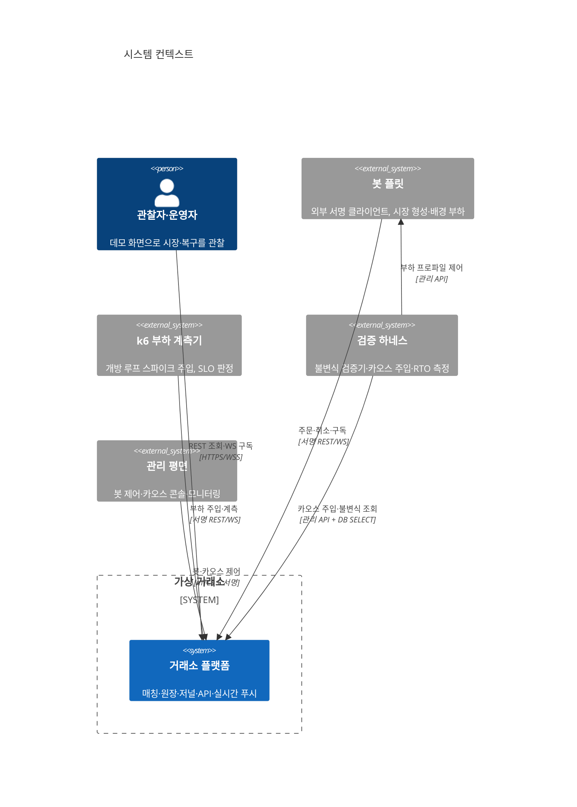
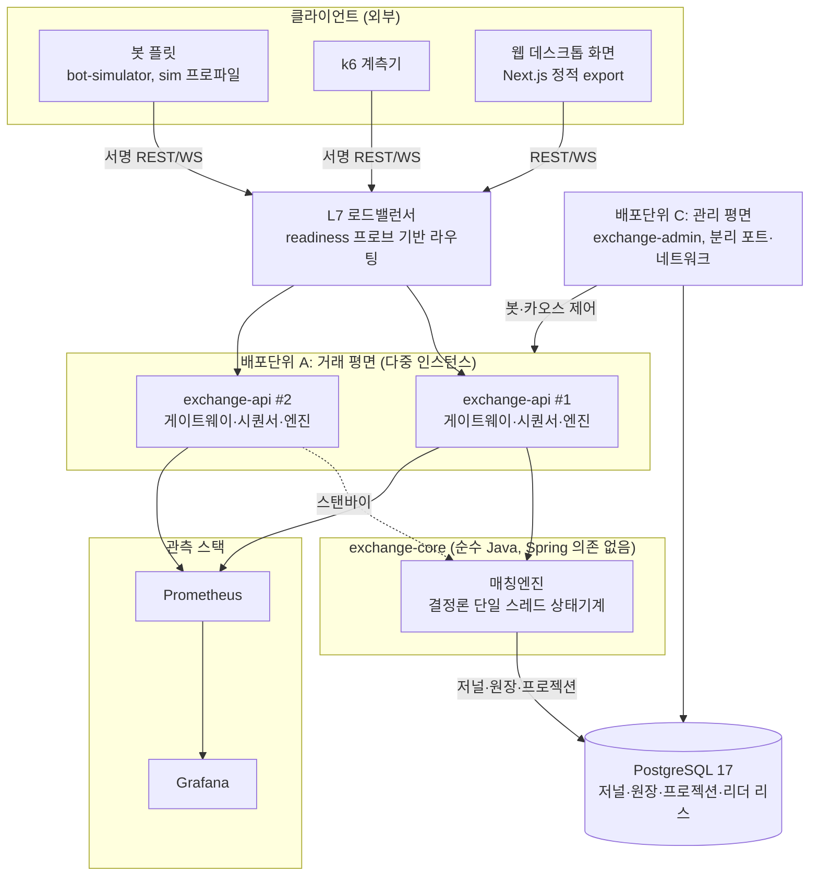
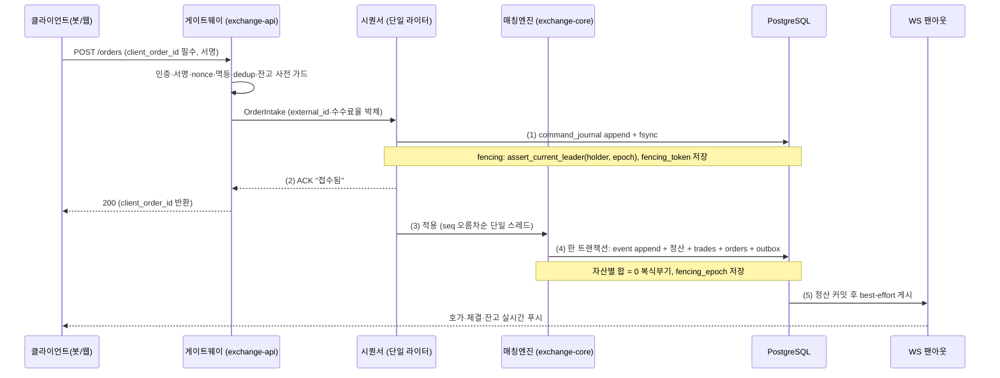
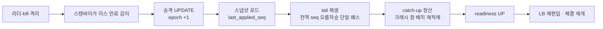
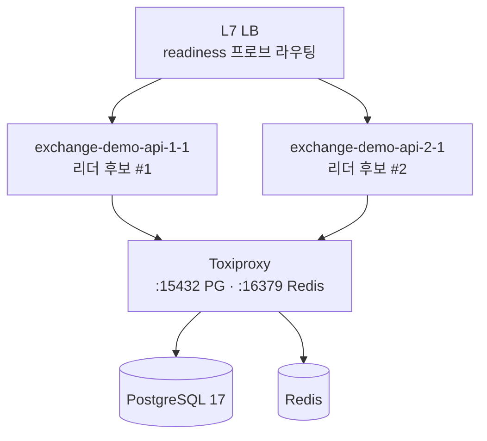

# 아키텍처 개관

발표·인수인계용 단일 문서. 시스템 전체 구조, 데이터 흐름, 고가용성 설계, 결정론·불변식, 기술 스택, 모듈 경계, 배포 토폴로지를 한곳에 모은다.

정본은 개별 계약 문서다. 이 문서와 계약이 어긋나면 계약 문서가 이긴다.

- `docs/백엔드_DB_설계.md`(v2.15): DDL·복구·원장·fencing 정본
- `docs/백엔드_API_설계.md`(v2.12): REST·WS·인증·SLO 정본
- `docs/하네스_검증설계.md`(v1.1): 불변식·카오스·RTO 측정 정본
- `docs/ROADMAP.md`: 마일스톤 정본

## 1. 시스템 개요

봇이 실시간으로 매매하는 가상 암호화폐 거래소. 완전 시뮬레이션이며 실거래·실자산은 없다. 최상위 목표는 두 가지를 데이터로 증명하는 것이다.

- 증명 ①(체결 무결): 트래픽 폭주와 장애에도 체결이 어긋나지 않는다. 자산별 원장 합 = 0, 주문 중복·유실 0.
- 증명 ②(자동 복구): 서버를 죽여도 사람 개입 없이 복구하고 체결을 재개한다. RTO 30초 이내.

증명 ①은 복식부기 원장의 자산 보존 불변식으로, 증명 ②는 append-only 명령 저널의 결정론 재생으로 데이터 레벨에서 확인한다.

### 1.1 시스템 컨텍스트

봇과 k6는 거래소 외부에서 외부 클라이언트 규약(서명·자체 HTTP 클라이언트)만으로 접속한다. 내부 서비스 직호출이 없다. 카오스 실험에서 거래소만 죽이고 봇은 살려 외부 관점의 자동 복구를 관찰하기 위한 전제다.

### 1.2 컨테이너 구성

배포단위 분리(A 거래, B 봇, C 관리)는 카오스 실험의 전제다. 같은 JVM이면 거래소만 죽이고 봇을 살리는 관찰이 불가능하다.

## 2. 데이터 흐름

### 2.1 진실의 원천(SoT) 3계층

| 계층 | 성격 | 대표 테이블 | 규칙 |
|---|---|---|---|
| ① 복구 원천 | append-only, 불변, 재생 가능 | `command_journal`, `event_journal`, `snapshots` | UPDATE·DELETE·TRUNCATE 금지. 이것만으로 전체 상태 재구성 |
| ② 회계 원천 | append-only, 불변, 복식부기 | `ledger_entries`(+`ledger_transactions` 헤더) | 정정은 상계 분개로만. 자산별 합 = 0 |
| ③ 파생 프로젝션 | 가변, 재구축 가능 | `balances`, `orders`, `trades` | ①②로부터 언제든 재계산. 실패해도 fail-safe |

명령(command)이 이벤트(event)를 낳고, 이벤트가 원장(ledger)에 정산되며, 원장·명령에서 프로젝션이 파생된다. 두 증명 목표가 계층에 대응한다. 증명 ②(자동 복구)는 ①의 명령 재생, 증명 ①(체결 무결)은 ②의 자산 보존 불변식이다.

### 2.2 주문 처리 파이프라인

핵심 계약.

- 접수 ACK는 저널 fsync 성공 후에만 나간다. ACK된 명령은 저널에 존재한다(RPO=0 근거, 단일 인스턴스 범위).
- 매칭은 메모리 단일 라이터, 정산은 한 명령의 방출 배치 = 한 트랜잭션(`SettlementService.appendAndSettle` 단일 경로). event append + 유형별 정산 + trades + orders + outbox가 원자적으로 커밋된다.
- WS 게시는 정산 커밋 후 best-effort다. 게시 유실은 클라이언트 seq gap 감지 후 REST 재동기화로 흡수된다.
- 크래시 창 복구(EngineRecovery)도 같은 정산 sink를 명령 단위로 호출한다. 멱등 판정은 `event_emission_registry`의 `(source_cmd_seq, event_ordinal)` 사전 조회다.

### 2.3 멱등성

주문 생성은 `client_order_id` 필수다. 미제공 시 예외 없이 400이다. 서버 생성 fallback은 없다. 재시도는 같은 키를 재사용하고, 내용 동일이면 멱등 replay로 수렴한다. 5xx·타임아웃 수신 시 클라이언트는 상태를 UNKNOWN으로 간주하고 같은 키로 재조회한 뒤 판단한다. 신규 재전송은 금지한다. 이것이 이중 체결을 원천 차단한다.

## 3. 고가용성 아키텍처

### 3.1 리더 리스와 fencing

단일 라이터를 DB `leader_lease` 행으로 보장한다. `resource`는 전 마켓 공용 단일 값 `matching-engine` 하나다. 마켓별 분할은 전역 seq 채번 권위를 분열시키므로 금지한다.

- `holder`: 프로세스 기동마다 새로 발급하는 UUID. 같은 호스트 재기동의 구·신 프로세스를 구분한다.
- `epoch`: 승격마다 단조 증가하는 fencing 토큰의 원천.
- 승격(`try_acquire_leader`): 만료된 리스만 탈취 가능. epoch를 +1 하고 획득한다.
- 갱신(`renew_leader_lease`): holder·epoch 일치하고 만료 전인 경우만.
- 검증(`assert_current_leader`): 자산을 바꾸는 모든 엔진 기원 트랜잭션(주문 접수·취소·체결 정산·이벤트 catch-up·스냅샷 저장)이 커밋 전 호출한다. holder·epoch 불일치 또는 리스 만료면 예외로 트랜잭션을 롤백한다. `clock_timestamp()`로 실제 벽시계와 비교한다(장기 트랜잭션의 만료 오판 방지).

`command_journal`은 `fencing_token`, `event_journal`·`trades`·`snapshots`는 `fencing_epoch` 컬럼에 승격 epoch를 저장해 stale 쓰기를 데이터로 감사한다(정본 DDL 컬럼명 구분). split-brain 차단 주장은 모든 엔진 기원 쓰기가 이 계약을 지킬 때만 성립한다.

### 3.2 재생 복구

- 재생은 전 마켓 통합, 전역 seq 오름차순 단일 패스다. seq·event_seq가 전역 gapless 시퀀스이므로 마켓별 독립 재생은 크래시 창을 놓친다.
- 각 명령은 자기 마켓 스냅샷의 `last_applied_seq` 이하이면 skip한다(이미 반영). `seq > last_applied_seq`만 적용하므로 재생 시 이중 적용이 원천 불가하다.
- 엔진은 모든 비결정 입력(engine_ts·tie_break·market_state·적용 수수료율)을 명령 payload에서 읽는다. 벽시계·난수를 쓰지 않으므로 재생 결과가 원본과 비트 동일하다.
- 결정론 검증: 재생 상태 해시(`fp_replay`)와 동일 seq 최신 스냅샷 해시(`fp_live`)를 대조해 `recovery_runs.matched=true`로 판정한다.

### 3.3 RTO·RPO 범위와 무손실 failover 요건

| 지표 | 목표 | 측정 |
|---|---|---|
| 복구 RTO | 30초 이내 | `exchange_failover_downtime_seconds`(주1) |
| RPO | 0(단일 인스턴스 범위) | ACK 원장 ⊆ `command_journal` (C16) |

주1: 게이지 `exchange_failover_downtime_seconds`는 감지·승격 구간(T2−T1)의 내부 프록시다. 권위 RTO는 체결 재개까지(T5−T0)로 하네스 §5-1이 정의하며, 외부 관측치와 3원 대조해 판정한다. 게이지는 권위 RTO보다 좁은 창이다.

RPO=0은 로컬 COMMIT fsync 내구성에 근거하므로 단일 PostgreSQL 인스턴스의 프로세스·전원 장애 범위에서 성립한다. `leader_lease`는 동일 primary에 접속한 앱 인스턴스 사이의 단일 라이터 장치이며, DB 클러스터 자체의 primary 교체는 조율하지 못한다.

failover를 포함한 무손실(RPO=0)은 다음 운영 요건 충족을 전제로 한다.

- `synchronous_standby_names`로 동기 standby 강제
- 정산·저널 트랜잭션 `synchronous_commit=on`(remote flush 이상)
- DB 클러스터 리더 선출과 STONITH(Patroni + etcd 담당)
- PITR 아카이브 병행

이 전제가 깨진 failover(비동기 standby 승격, 스토리지 손실, 조기 승격)에서는 fsync된 커밋도 유실될 수 있고, 클라이언트의 "재조회 404 = 저널에 없음" 판정도 유실 구간에서 거짓 음성이 된다. 안전 재전송 계약은 동기복제 전제 하에서만 완전하다.

### 3.4 페일오버 주문 상태머신

5xx·타임아웃을 받은 클라이언트는 상태를 UNKNOWN으로 두고 `by-client/{client_order_id}`로 재조회한다.

- 404 order_not_found: 미접수(저널 append 전) 판정 후 재전송 허용
- 200 OPEN·PARTIAL·FILLED: 접수 확정, 재전송 금지
- 409 order_in_progress: Retry-After 후 재조회 반복해 수렴

재조회는 `command_journal`을 권위 소스로 판정한다. 저널에 있으나 프로젝션 미반영이면 404가 아니라 409를 반환하므로 프로젝션 지연이 거짓 404를 만들지 않는다.

### 3.5 자동 복구의 인프라 토대

컨테이너 재기동 정책(`restart: unless-stopped` 또는 K8s livenessProbe)이 kill 후 자동 재기동을 담당한다. 카오스 API의 `docker_kill`은 이 재기동 정책과 짝을 이룬다. 페일오버 시 readiness 프로브가 `REFUSING_TRAFFIC`을 반환하면 LB가 해당 노드를 즉시 라우팅에서 제외한다.

## 4. 결정론과 불변식

### 4.1 결정론

매칭 코어(exchange-core)는 Spring·락·I/O·벽시계·난수를 쓰지 않는다. 모든 비결정 입력을 명령 payload에 박제한다. 같은 명령 열은 언제 재생해도 같은 결과를 낸다. 주문 id는 시퀀서 사전 채번 값, 체결 id는 event_seq 결정론 파생, 체결 시각은 원인 명령의 engine_ts 파생이다. 저널 재생으로 재구축해도 모두 원본과 동일하다.

### 4.2 불변식(발췌)

전량 SQL 0행으로 기계 판정한다. 하네스 검증기가 상시 실행한다(pg_cron 1분 경량 + 앱 검증기 5분·야간·온디맨드).

- C01 자산 보존: 자산별 원장 총합 = 0
- C02 잔고 정합: `balances` 프로젝션 = 원장 재계산(시스템·LOCKED·GENESIS 포함 전 계정)
- C05·C06 저널 gapless: `command_journal`·`event_journal` 결번 0(유실 0, RPO=0)
- C07·C07' 중복 주문 접수 0: 프로젝션 축과 저널 NEW 커맨드 축 양쪽
- C08 중복 체결 0: `trade_seq_registry` PK 1:1
- C13 NEW 명령 ↔ orders 1:1: 주문 물질화 누락·유령 주문·저널 우회 쓰기 탐지
- C14 LOCKED 잔고 = 열린 주문 잔여 예약 합: 과다락·환급 누락 탐지
- C16 RPO=0 외부 증거: ACK 원장 ⊆ `command_journal`(실험 판정 한정)
- C17 재생 결정론: `recovery_runs.matched=true`
- C18 체결가 = maker 지정가

### 4.3 금액·수량 규약

- 모든 금액·수량·가격은 `NUMERIC(40,18)`. 정수부 22자리로 곱셈 중간값 오버플로를 막는다. float·double 금지.
- 프론트는 문자열로 다룬다. JSON float 금지.
- 방향별 양자화 레짐: 예약은 UP, 체결·감액 차감·환급은 DOWN, 수수료는 HALF_UP. 종결·잔차는 실잔여 락을 전량 소비·해제하고 반올림 잔차는 자산별 마지막 FEE leg가 흡수한다.

## 5. 기술 스택

| 관심사 | 선택 | 버전 |
|---|---|---|
| 런타임 | Spring Boot + Java 21 LTS | SB 3.5.16 |
| 매칭 코어 | 순수 Java(Spring 의존 없음) | Java 21 |
| REST | Spring MVC + Virtual Threads | SB BOM |
| 실시간 푸시 | WebSocket + STOMP | SB BOM |
| 메시징·이벤트 | Spring for Apache Kafka | SB BOM 위임(3.3.x), Kafka 4.x KRaft |
| 영속성(도메인) | Spring Data JPA / Hibernate | 6.6.x |
| 영속성(핫패스 조회) | jOOQ | SB BOM 위임 |
| DB | PostgreSQL | 17+ |
| 마이그레이션 | Flyway | SB BOM 위임 |
| 회복탄력성 | Resilience4j | resilience4j-spring-boot3 2.4.0 |
| 리더선출·분산락 | DB leader_lease(권위) + Redisson(후보 조율 보조) | Redisson 최신 GA |
| 웹 | Next.js 정적 export, 고정형 데스크톱 1280px | out/ 산출 |
| 부하·카오스 | k6 2.1.0, Toxiproxy 2.12.0, Chaos Monkey 3.3.0, Pumba 1.1.7 | 하네스 설계 정본 |
| 관측 | Prometheus 3.13 + Grafana 13.1, Tempo, Loki | 인프라 |

Spring Boot 3.5 경로를 택한 이유는 회복탄력성 계층(Resilience4j)이 SB4를 아직 GA 지원하지 않기 때문이다. 검증된 회복탄력성 스택을 EOL 리스크보다 우선했다.

리더선출 권위 모델은 하네스 설계와 API 설계 사이에 표기 상충이 있다(하네스는 DB leader_lease 권위, API 문서 일부는 Redisson RLock 리더선출로 서술). 하네스 설계 부록 A #6에 따라 API 문서 정정이 선행돼야 한다. 현재 구현·검증의 권위는 DB leader_lease다.

## 6. 모듈 경계와 격리

### 6.1 배포 단위

| 단위 | 모듈 | 역할 | 격리 |
|---|---|---|---|
| A | exchange-api | REST·WS·게이트웨이·시퀀서 | 다중 인스턴스, LB 뒤 |
| B | bot-simulator (kr.exchange.sim) | 봇 플릿·부하 생성 | 독립 스케일, 외부 클라이언트 규약만 사용 |
| C | exchange-admin | 관리·시뮬레이션·카오스 제어 | 분리 포트·분리 네트워크·mTLS |
| 코어 | exchange-core | 매칭엔진·오더북·복식부기 | Spring·락·I/O·벽시계·난수 금지 |

서버 구현 모듈 경계(server/).

- `engine/`: 순수 Java 21 결정론 코어. Spring 의존 금지.
- `app/`: Spring Boot. `api`(REST/WS), `engine`(엔진 어댑터·리더 리스 연동), `ledger`(복식부기·봉인), `journal`(append·스냅샷·재생 복구), `sim`(봇 플릿), `config`.

### 6.2 관리 평면 격벽

가장 위험한 kill-node·카오스·파라미터 변경 평면을 거래 평면과 동일 엄밀도로 격리한다.

- 네트워크 격리: `admin.exchange.local` 별도 호스트·포트, 운영자 네트워크만 접근, mTLS 필수.
- 서명: `scope=admin` 키 + 별도 admin_secret. `/admin/v1/**` path가 canonical에 포함되어 거래 서명과 교차 재사용 불가.
- 비가역 액션 이중 승인: kill-node·network·app 카오스·봇 파라미터 변경은 다른 operator가 발급한 단회용·TTL 5분 approval_token 필수. action·대상에 바인딩되고 검증 성공 시 즉시 소각.

### 6.3 게시판 격벽(로드맵 M3)

종목 토론 게시판·부속 화면은 매칭 핫패스와 격리된 모듈로 구현한다. 게시판·관리자의 부하나 장애가 거래 상시 게이트에 전파되지 않아야 한다. 부가 기능이 코어 경로(매칭·정산·저널)에 의존성을 추가하는 설계는 금지한다. M3 완료 기준이 이 격리를 검증한다.

## 7. 배포 토폴로지

### 7.1 단일 데모(1노드)

15분 데모 시나리오(정상 → 폭주 → 리더 kill → 자동 복구 → 불변식 통과) 재현용. 단일 Windows PC에서 PG17·Redis·Kafka·api·admin·봇·관측 스택·Toxiproxy를 전부 구동한다. 용량 예산상 스파이크 목표치는 절대값이 아니라 기저 대비 배수(10x)로 정의한다. 캘리브레이션으로 호스트 포화가 아닌 서버 백프레셔를 측정함을 사전 확인한다.

### 7.2 2노드 카오스

카오스 매트릭스(E1~E9)를 위한 구성. `exchange-api → toxiproxy → postgres`, `→ toxiproxy → redis`를 상시 경유해 지연·단절·블랙홀을 주입한다. 한 노드가 리더, 다른 노드가 스탠바이다. 리더 kill(E4)·네트워크 분할(E5)·폭주+kill 복합(E6)로 페일오버와 split-brain 차단을 실증한다.

핵심 실험.

- E4 리더 kill(핵심 데모): kill → 스탠바이 승격(epoch +1) → 스냅샷 로드·tail 재생·catch-up → readiness UP → 체결 재개. RTO 30초 이내, `matched=true`, 중복 체결 0.
- E5 네트워크 분할: 구 리더 격리 후 복귀 시 진행 중 append가 fencing 0행으로 self-shutdown. 이중 저널·이중 체결 물리 불가.
- E6 폭주 + 리더 kill 복합(최종 증명): 백프레셔와 페일오버 동시. 유실 0·중복 0·자산합 0·해시 일치.

## 8. 로드맵 위치

현재 M1(코어 거래 + 고가용성 증명 1차)을 진행 중이다. M2 회원, M3 커뮤니티·관리자, M4 하드닝·최종 증명이 이 증명 위에 얹힌다. 모든 마일스톤은 상시 게이트(봇 부하에서 불변식 전 항목 통과, 리더 kill RTO 30초 이내 복구, CI green)를 종료 조건에 포함한다.

## 참고

- 아키텍처 결정 이력은 `docs/adr/`에 ADR로 남긴다. 관례는 `docs/adr/0001-record-architecture-decisions.md` 참조.
- 이 문서는 개관이다. 수치·DDL·API 계약의 정본은 §머리말의 계약 문서다.
