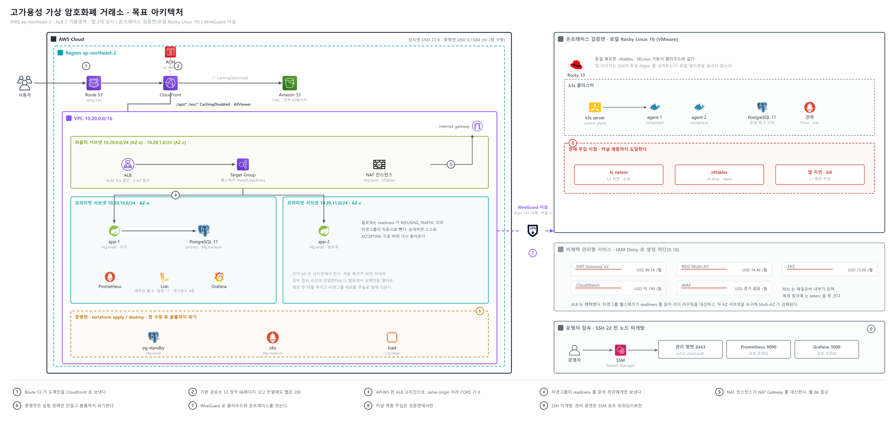

# 고가용성 가상 암호화폐 거래소

한국폴리텍대학 광명융합기술교육원 데이터분석과 파이널 프로젝트 계획서. 1인 프로젝트. 작성 2026-08-25, 개정 2026-08-30, 최종 발표 2026-10-16. 모든 수치는 기준 커밋 2dbf6fb(2026-08-30 23:23) 기준 실계측값이고, 재현되지 않은 값은 "미확인"으로 표기했다. 그 뒤 커밋은 이 문서가 판정하지 않는다. 초판 기준선은 2a71234였다. 개정에서 규모·비용·일정 전 항목을 재계측했고 초판 값이 그 시점에 맞았는지도 함께 대조했다.

---

## 요약

**무엇을 만드는가.** 봇 플릿이 실시간 매매하는 완전 시뮬레이션 암호화폐 거래소. 실거래·실자산 없음. 장애를 의도적으로 주입하고, 원인이 어느 계층인지 좁히고, 장애가 지나간 뒤 데이터가 맞는지를 원장 SQL로 판정한다.

**왜 거래소인가.** 복식부기 원장이 정답 상태를 도메인 성질로 이미 갖는다. 자산별 원장 합 0은 내가 정한 규칙이 아니라 회계 성립 조건이라, 위반이 나오면 변명의 여지가 없다. 게시판이나 부하테스트 대상 서비스로는 사후 정합성 판정이 원리상 불가능하다.

**무엇을 증명하는가.** 반증 조건이 붙은 두 명제다. ① 체결 무결: 폭주·장애에도 자산별 원장 합 0, 주문 중복·유실 0. ② 자동 복구: 무개입 승격, RTO 30초 이내, epoch 정확히 +1. 판정 주체는 사람 눈이 아니라 SQL 위반 행 수, 메트릭 임계, 스크립트 exit code다.

**현재 상태.** 커밋 321건, 서버 Java 274파일, 웹 TS·TSX 189파일, REST 엔드포인트 99, 불변식 26개 상시 검증.

| 성립 | 미성립. 남은 6주의 작업 대상 |
|---|---|
| 정합성 판정. 불변식 26개, 반증 테스트 8건 | 계층 판정. 프로브 0건, tcpdump 미사용 |
| 자동 복구. 페일오버 라이브 PASS 5건, fencing epoch | 데이터 이중화. PostgreSQL 단일 인스턴스 |
| 카오스 실험 9종, 알람 15·대시보드 9 | 외부 공개, 인프라 보안, 무중단 배포 |
| 용량 실측. 기저 10 OPS·상한 100 OPS 확정 | 부하 상시 배선. k6가 아직 단독 구동뿐 |

**발표 축 다섯.** 증명 명제는 위 둘 그대로다. 아래는 그 둘을 심사자에게 보이는 서술 골격이지 증명 대상이 아니다. 축마다 현재 값이 하나씩 붙는다.

| 축 | 지표 | 현재 값 |
|---|---|---|
| 가용성 | 페일오버 RTO 초 | 라이브 실측 5실험 6회차(E2·E4·E5·E6·E7), 0.107 ~ 14.367초. 목표 30초 이내 |
| 정합성 | 원장 불변식 위반 행 수 | 라이브 E5·E7 회차에서 C01~C23 전건 0위반 |
| 확장성·비용 | 확정 기저 OPS와 달력 월 실청구 | 기저 10 OPS, 스파이크 상한 100 OPS. 달력 월 111,096원, 자체 상한 500,000원 |
| 관측 | L3·L4·L7 down 전이 순서 | 프로브 0건. 이 축만 값이 0이고 남은 기간 최우선 결손이다 |
| 보안 | 거부 코드 재현 건수 | 목표 8건 중 실측 확보 1건(429 too_many_requests 5,427건, 45.2%) |

**남은 6주.** 새 기능을 붙이지 않고 전부 인프라·배포·운영·보안에 쓴다. 주입할 대상과 판정할 술어가 둘 다 준비돼 있어 그 위에서 장애를 재현하는 편이 한계효용이 크다.

**운영 관점.** 7.7부터 7.16은 서사를 "내가 만든 것을 내가 증명한다"에서 "운영 중인 사이트를 인수해서 내가 운영한다"로 옮겨 적는다. 트랜잭션이 몰릴 때, 없을 때, 공격이 올 때 각각 무엇을 보고 무엇을 치는지를 명령 수준으로 고정하고, 자동화한 것과 일부러 사람 손에 남긴 것을 계층으로 가른다. 이 관점에서 최우선 결손은 둘이었다. 앞의 것은 2026-09-03 에 닫았다. Alertmanager 와 Discord 수신기를 배선하고 발화부터 통지까지 도달을 실증했다(`harness/evidence/gateoff-20260903-2vcpu/` 10회차). 남은 결손은 하나다. 상시면 컴포즈 3종에 관측 스택 정의가 0건이라 대시보드와 불변식 스캔과 통지가 현재 격리 하네스 전용이다.

**배포 설계의 핵심 판단.** 학교 필수 조건인 외부 상시 접속과 커널 장애 주입은 한 평면에서 양립하지 않는다. 세 평면으로 가른다. 상시면은 2 AZ 이중화를 24시간 유지하고, 증명면은 부하 창에만 서고 판정 후 파기하며, 검증면은 커널 계층 주입 전용으로 온프레미스에 둔다. 관리형 DB는 채택하지 않는다. 복제 링크에 주입할 권한이 없으면 증명이 성립 범위 밖으로 나간다. 로드밸런서는 ALB를 채택한다. 앱의 readiness 계약을 그대로 소비하므로 자작 헬스체크 코드가 사라지고 판정 주체는 여전히 앱이다.

**비용·일정·완료 기준.** 발표까지 총계 USD 157.91(221,074원)이다. 상한은 달력 월 실청구로 판정하며 2026년 9월과 10월이 각각 111,096원으로 자체 상한 500,000원 안이다. 환율 1,500원에서도 상한 안이라 종전 판이 두었던 환율 방어 절차는 더 필요하지 않다. AWS 크레딧 실측 잔액 USD 163.71(만료 2027-05-27) 안에서 소진하고 발표 후 5.80이 남는다. 단가는 AWS 공식 요금표 판본 기준이다. 전체 48일 중 순 가용 303시간, 계획 186시간에 예비 60시간을 남긴다. 고정점은 09-01 제출, 09-08 외부 접속 성립, 10-09 기능 동결, 10-16 발표. 완료 기준은 전부 기계 판정이고 육안 판정 항목은 0개다.

<!--TOC-->

## 1. 프로젝트 개요

### 1.1 한 줄 정의

봇 플릿이 실시간으로 매매하는 완전 시뮬레이션 암호화폐 거래소. 실거래·실자산·런타임 외부 API 의존이 없다. 이 시스템에 장애를 의도적으로 주입하고, 원인이 어느 계층인지 계층별 근거로 좁히고, 장애가 지나간 뒤 데이터가 맞는지를 원장 SQL로 판정한다.

### 1.2 증명하려는 두 명제

기능 목록이 아니라 명제를 증명한다. 명제는 반증 조건을 함께 적을 때만 명제다.

| 구분 | 증명 ① 체결 무결 | 증명 ② 자동 복구 |
|---|---|---|
| 주장 | 트래픽 폭주와 인프라 장애 아래에서도 자산별 원장 합이 0이고 주문 중복 접수·중복 체결·주문 유실이 0이다 | 리더 노드를 죽여도 사람 개입 없이 승격·복구가 일어나고 체결이 재개된다 |
| 관측 대상 | ledger_entries, balances, command_journal, event_journal, trades | leader_lease.epoch, command_journal.fencing_token, trades.engine_ts |
| 판정 술어 | 불변식 26개의 위반 행 수 | 승격 후 최초 신규 TRADE의 engine_ts에서 kill 시각을 뺀 값(T5 정의는 명령 축 fencing 기준) |
| PASS 기준 | 전 항목 0행 | RTO 30초 이내, epoch 정확히 +1, 수동 개입 0회 |
| 반증 조건 | 어느 한 술어라도 1행 반환 | 30초 초과, 승격 미발생, 또는 사람이 손대야 재개 |

### 1.3 판정 방식

판정 주체는 사람 눈이 아니다. 다음 세 가지로만 판정한다.

| 판정 수단 | 구현 |
|---|---|
| SQL 위반 행 수 | 불변식 검증기가 REPEATABLE READ READ ONLY 트랜잭션에서 26개 체크를 돌리고 결과를 invariant_checks 테이블에 적재 |
| 메트릭 임계 | Prometheus 레코딩 룰 9개·알람 15개, Grafana 대시보드 9종 |
| 스크립트 exit code | 카오스 오케스트레이터 9종이 verdict를 산출하고 종료 코드로 판정 |

데모 화면이 잘 도는 것은 증거로 치지 않는다. 판정기가 항상 통과하는 장치가 아니라는 것도 코드로 고정했다. 위반을 고의로 주입해 검출되는지 확인하는 반증 테스트가 8건 이상이다(C08·C11·C16·C17·C18·C20·C21·C23·C24·C25). 이 음성 검증이 없으면 "0행"은 무결의 증거가 아니라 검증기가 죽어 있다는 증거일 수도 있다.

### 1.4 남은 기간의 방향

서비스 애플리케이션은 이미 판정 가능한 상태로 서 있다. 남은 6주는 전부 인프라·배포·운영·보안에 쓴다. 이것은 감출 사실이 아니라 계획의 근거다. 장애를 주입할 대상과 주입 결과를 판정할 술어가 둘 다 준비돼 있으므로, 새 기능을 붙이는 것보다 그 위에서 장애를 재현하는 편이 남은 기간의 한계효용이 크다.

### 1.5 프로젝트 범위

경계를 이름으로 적는다. 범위를 적지 않으면 심사 과정에서 프로젝트가 끝없이 커지고, 무엇을 안 했는지가 약점처럼 읽힌다.

경계를 가르는 기준은 하나다. **기계가 합격과 불합격을 낼 수 있는 것만 포함한다.** 사람 눈으로만 확인 가능한 항목은 이 프로젝트의 판정 대상이 아니다.

포함 범위.

| 축 | 내용 |
|---|---|
| 거래 도메인 | 주문 접수·취소, 매칭·체결, 잔고, 복식부기 원장, 거래내역. 봇 플릿이 24시간 자동 매매한다 |
| 복구 원천 | command_journal·event_journal·snapshots. append-only 이고 트리거가 변경을 막는다 |
| 고가용성 | 2 가용영역. 앱 리더·팔로워, PostgreSQL primary·standby. 리더 리스 단일 쓰기 권한과 epoch 펜싱 |
| 장애 주입 | 카오스 실험 E1~E10. 프로세스 정지, 네트워크 분단, DB 연결 차단, 응답 절단, 커널 계층 지연·유실 |
| 정합성 판정 | 불변식 26종. 자산별 원장 합 0, 중복·유실 0. SQL 위반 행 수로 판정한다 |
| 관측 | Prometheus 레코딩 룰 9·알람 15, Grafana 대시보드 9종, 계층별 프로브 |
| 운영 | 런북, 심각도 등급, 자동화 계층 구분, 부하 구간별 대응 절차 |
| 보안 | 인증 6단계, DB 권한 격자, 레이트리밋, mTLS 관리 평면, SSM 단독 접근 |
| 비용 | 달력 월 실청구 상한 500,000원. 감축 순서 사전 확정 |

제외 범위. 안 하는 것도 이름으로 적는다.

| 제외 | 사유 |
|---|---|
| 실제 원화·가상자산·입출금 | 완전 시뮬레이션이다. 금융 규제 대상 행위를 하지 않는다 |
| 실거래소 API 런타임 연동 | 시세는 빌드 타임 시드로 굳힌다. 런타임 외부 API 의존이 0이라야 외부 장애가 실험 변수로 끼지 않는다 |
| 투자 기능·수익 추구 | 거래소는 증명 대상 워크로드이지 서비스 목적이 아니다 |
| 수평 확장 | 매칭엔진이 단일 라이터다. 전 노드가 동등하게 쓰기를 받는 구조는 주장하지 않는다(13.3) |
| 오케스트레이터 도입 | Kubernetes·ECS·Swarm 은 클라우드 평면에 올리지 않는다. 검증면 k3s 는 채택이며 판정 축이 걸린 평면에는 두지 않는다 |
| 멀티 리전 | 2 가용영역까지다. 리전 장애는 복구 범위 밖이다(13.2) |
| WAF·RLS·침투 테스트·퍼징 | 이 프로젝트가 낼 수 있는 증거가 얇다. 증거를 못 내는 항목은 범위에 넣지 않는다 |
| API 키 발급·회전·폐기 3종 | 키 수명주기 API 를 만들지 않는다. 유출 대응은 DB 직접 조작으로 적고 그 한계를 명시한다 |

경계선에 걸린 항목을 따로 적는다. 넣을지 뺄지가 6주 안에 정해진다.

| 항목 | 현재 판단 |
|---|---|
| 로그 중앙화 | W5 이월. 도구는 Elasticsearch + Filebeat 로 잡되 발표 판정 축에는 걸지 않는다 |
| 침묵 축 실험 | 알람 2종 추가로 대체할지 실험을 신설할지 미결 |
| 공격 축 기계 판정 | 캘리브레이션 주행에 권위 run 을 붙이는 방식을 우선 검토한다 |

---

## 2. 문제 정의와 주제 선정 근거

### 2.1 출발점: 사용자는 한 문장만 말한다

운영 현장에서 장애는 지표로 도착하지 않는다. 문장으로 도착한다. 사용자가 하는 말은 둘 중 하나다. "안 돼요" 또는 "느려요".

엔지니어의 일은 그 한 문장을 계층으로 좁히는 것이다. 도달이 안 된 것인지, 연결이 안 된 것인지, 응답이 틀린 것인지를 가른다. 계층이 정해지면 담당이 정해진다. L3이면 네트워크, L4면 인프라, L7이면 개발이다. 계층 판단이 곧 책임 소재 판단이다.

이 프로젝트의 문제 정의는 여기서 나온다. 장애를 막는 시스템을 만드는 것이 아니라, 장애가 났을 때 어느 계층인지 근거를 대고 좁히는 절차와, 장애가 지나간 뒤 데이터가 맞는지 기계로 판정하는 절차를 만드는 것이다.

### 2.2 문제: 대부분의 장애 실습은 사후 판정을 하지 못한다

| 관점 | 장애 중 관측 | 장애 후 판정 | 판정의 한계 |
|---|---|---|---|
| 가용성 관측 | HTTP 5xx 비율, 다운타임 | 다시 200이 나온다 | 복구는 증명하나 손상 여부는 말하지 못한다 |
| 성능 측정 | TPS, p99 지연 | 지연이 기준선으로 복귀 | "느렸다"까지만 말한다. 무엇이 틀어졌는지는 지표 밖이다 |
| 정합성 판정 | 위와 동일 | 데이터가 정답 상태와 일치하는지 SQL로 대조 | 도메인이 정답 상태를 정의하고 있어야만 가능하다 |

응답시간은 사후 무결을 말하지 못한다. 장애 구간에서 주문이 두 번 접수됐는지, 체결이 유실됐는지, 잔고가 원장과 어긋났는지는 p99가 답하지 않는 질문이다. 판정을 하려면 틀렸을 때 반드시 위반으로 드러나는 정답 상태가 도메인 안에 있어야 한다.

### 2.3 왜 거래소인가: 판정면이 있는 도메인이기 때문이다

거래소를 고른 것은 개발 취향이 아니라 실험 설계 판단이다. 복식부기 원장이 회계 불변식을 도메인 성질로 이미 갖고 있다. 자산별 원장 합은 0이어야 하고, 잔고 프로젝션은 원장 재계산과 일치해야 한다. 이 두 명제는 내가 정한 규칙이 아니라 회계가 성립하기 위한 조건이다. 따라서 장애를 주입한 뒤 위반이 나오면 변명의 여지가 없다.

도메인 후보를 같은 기준으로 비교하면 차이가 분명하다.

| 도메인 후보 | 정답 상태 정의 | 장애 후 판정 방법 | 반증 가능성 |
|---|---|---|---|
| 게시판·URL 단축기 | 없음. 글 1건이 사라져도 "정답"이 없어 위반이 정의되지 않는다 | 육안 확인 | 낮음 |
| 재고·예약 앱 | 부분. 수량 음수 금지 정도 | 단일 제약 조회 | 중간 |
| 부하테스트 대상 서비스 | 없음. 성능 축만 존재 | TPS·p99 비교 | 중간(성능 한정) |
| 거래소(복식부기 원장) | 있음. 자산 보존, 잔고 대 원장 일치, 저널 무결, 멱등 | SQL 위반 행 수 | 높음 |

이 프로젝트의 판정면은 문장이 아니라 실행 가능한 SQL이다.

| ID | 판정 술어 | PASS |
|---|---|---|
| C01 자산 보존 | `SELECT asset_id, SUM(amount) FROM ledger_entries GROUP BY asset_id HAVING SUM(amount) <> 0` | 0행 |
| C02 잔고 대 원장 | `SELECT * FROM balance_ledger_check WHERE mismatch` | 0행 |
| C05 명령 저널 무결 | `(max(seq) - min(seq) + 1) - count(*)` | 0 |
| C07 / C07P 중복 접수 | `orders` 및 `command_journal(NEW)`의 (user_id, client_order_id) 중복 | 0행 |
| C08 중복 체결 | `trades.id` 중복 및 `trade_seq_registry` 1:1 이탈 | 0행 |

### 2.4 접근 방식의 차이

방법론상의 차이는 세 가지다.

- 주입한다. 장애를 기다리거나 기록하지 않고 스크립트로 만들어낸다. 실험 9종이 오케스트레이터로 배선돼 있다.
- 정합성으로 판정한다. 복구됐다는 것을 화면이 아니라 원장 SQL로 판정한다.
- 원인 계층을 지목한다. 계층별 프로브와 패킷 캡처로 좁힌다. 현재 미성립이며 남은 기간의 목표다(3.3 참조).

### 2.5 실무 연결: 계층 판단이 곧 책임 소재 판단

이 프로젝트가 만드는 것은 결국 "안 돼요" 한 문장을 티켓으로 바꾸는 절차다. 주입한 장애마다 어느 계층에서 어떤 신호가 나오는지를 대응표로 축적한다.

| 사용자 진술 | 후보 계층 | 좁히는 관측 | 판별 신호 | 1차 담당 |
|---|---|---|---|---|
| 안 돼요 | L3 도달 실패 | ICMP 프로브, 경로 추적 | 응답 없음, 경로 중단 | 네트워크 |
| 안 돼요 | L4 연결 실패 | TCP 연결 프로브, 패킷 캡처 | SYN 재전송, RST, 연결 타임아웃 | 인프라 |
| 안 돼요 | L7 오류 | HTTP 프로브, 애플리케이션 로그 | 5xx 코드와 에러코드 본문 | 개발 |
| 느려요 | L3 지연 | RTT·손실률 기준선 대비 | RTT 상승, 손실 발생 | 네트워크 |
| 느려요 | L4 큐잉·재전송 | 패킷 캡처 | 재전송 급증, 윈도우 축소 | 인프라 |
| 느려요 | L7 처리 | 애플리케이션 메트릭 | p99 상승, DB 대기 증가, 커넥션 풀 포화 | 개발 |

이 구조는 실제 사례로 한 번 검증됐다. nginx가 POST를 재시도하지 않는 기본 규약 때문에 구 리더가 팔로워로 재합류하는 구간에서 `POST /api/v1/orders`가 전량 503이었고 `GET /api/v1/orderbook`은 200이었다(2026-08-18 실측). 증상은 "주문이 안 돼요" 한 문장이지만, 조회는 되고 쓰기만 막힌다는 계층 신호가 원인을 L7 프록시 설정으로 좁혔다. `non_idempotent` 추가와 reload만으로 20초 안에 체결 599건이 재개됐다. 다만 강등 노드가 업스트림에서 빠지지 않으므로 약 1.25%의 POST 실패 바닥이 남는다. 이 잔여도 한계로 기록한다. 관측 1회 사례이므로 계층 판단의 예시로 쓰고 인과 확정 사례로 제시하지 않는다.

---

## 3. 현재 진척과 남은 범위

### 3.1 규모 실측

계수 기준은 `git ls-tree -r HEAD`가 돌려주는 추적 파일이다. 빌드 산출물(build/, .next/, out/, node_modules/)과 워크트리 사본은 제외했다. 정적 export만 워킹트리 실측이고 그 사실을 행에 적었다.

| 항목 | 실측 | 초판(2a71234) 대조 |
|---|---|---|
| 커밋 | 321건 | 220건. 재계측 결과 초판 값도 그 시점에 맞다 |
| 기간 | 2026-07-22 ~ 2026-08-30 (스팬 40일, 커밋이 찍힌 작업일 14일) | 스팬 35일·작업일 9일. 일치 |
| Java 파일 | 274 (engine main 10 + engine test 4 + app main 194 + app test 66) | 245. 분해까지 일치 |
| 서버 코드 줄수 | engine main 1,099 / app main 22,265 | 1,099 / 18,768. engine은 불변 |
| 웹 TS·TSX | 189파일 32,305줄 | 149파일 23,743줄. 초판의 150파일 23,749줄은 gitignore된 `web/next-env.d.ts`(6줄)를 넣은 워킹트리 계수다 |
| 웹 CSS 모듈 | 43파일 | 37. 일치 |
| 백엔드 테스트 | 68클래스 467메서드 (app @Test 420 + engine @Test 43 + jqwik @Property 4). @Disabled 0건 | 57클래스 376메서드(329+43+4). 일치 |
| 웹 테스트 | 378건 전건 통과(pass 378, fail 0) | 초판 시점 실측은 277건. 286은 초판부터 9건 과다였다 |
| Flyway 마이그레이션 | 26개 (V0~V25, 결번 없음) | 14개. 일치 |
| DB base 테이블 | 50 (public 45 + harness 5). 파티션 포함 CREATE TABLE 100 | 46(41+5) / 96. 일치 |
| PL/pgSQL 함수·뷰·시퀀스 | 함수 17개(CREATE 문 18) / 뷰 6 / 시퀀스 1 | 18 / 5 / 1. 뷰가 1개 늘었다. 함수는 `CREATE OR REPLACE` 중복 1건이라 문 수와 개수가 갈린다 |
| REST 엔드포인트 | 99 (공개 44 · 관리 49 · 하네스 5 · 내부 1) | 81(38·38·4·1). 분해까지 일치 |
| WebSocket | 엔드포인트 1(`/ws/v1`), 채널 6종(공개 4 + 비공개 2) | 동일. 불변 |
| 웹 page 라우트 | 29종 | 22. 일치 |
| 정적 export 산출 | 73페이지 + 404.html, 316파일 6,522,620바이트(6.52MB). 2026-08-30 빌드한 `web/out` 워킹트리 실측 | 66페이지 6.3MB |
| 카오스·하네스 스크립트 | 실험 9종 + 공용 6종 = 15파일, 3,402줄 | 9 + 3 = 12파일 2,413줄. 일치 |
| 카오스 compose 서비스 | 9 (상시 6 + 1회성 1 + obs 프로파일 2) | 동일. 불변 |
| Prometheus·Grafana | 레코딩 룰 9 · 알람 15 · 대시보드 9종 | 동일. 불변 |
| CI 워크플로 | 4 (ci-backend · ci-web · image · style) | 3. `image.yml`이 늘었다 |
| docs 산출물 | 추적 49파일(archive 9 제외 40) | 33파일 + adr 디렉터리 = 34항목 |
| ADR | 13건 (0001~0013). 전건 추적 | 1건(0001). 0002~0013 12건은 커밋 5f1ca36에서 추가 |
| 1인 대체 산출물 | `docs/records/역할체계_운영기록.md` 211줄, `docs/records/검토_판정기록.md` 297줄. 둘 다 추적 | 없음. 커밋 5f1ca36에서 추가 |

기간 주석. 저장소가 뒷받침하는 사실은 커밋 스팬 40일·작업일 14일이다. 연간 범위 대비 진척률 같은 추정 비율은 분모를 뒷받침할 산출물이 없으므로 쓰지 않는다.

1인 대체 주석. 4인 팀 산출물 중 회의록·역할분담표·PR 리뷰 승인 세 가지가 1인 프로젝트에서는 나올 수 없다. ADR 12건이 회의록을, `역할체계_운영기록.md`가 역할분담표를, `검토_판정기록.md`가 PR 리뷰 승인을 각각 대체한다. 대체물이라고 적는 이유는 등가라고 주장하지 않기 위해서다. 합의 과정이 아니라 결정과 그 근거만 남는다. 세 파일 모두 커밋 5f1ca36에 들어가 있어 `git ls-tree -r HEAD`로 확인된다. 남은 것은 원격 푸시뿐이다(13.6).

### 3.2 구현된 것

| 영역 | 상태 |
|---|---|
| 엔진 결정론 코어 | 완료. `server/engine`은 서드파티 import 0건의 순수 Java. OrderBook·MatchingEngineImpl·SingleWriterLoop·SnapshotCodec |
| 저널 계층 | 완료. command append + fsync ACK. append-only를 forbid_mutation 트리거가 ROW·STATEMENT 두 겹으로 물리 차단 |
| 리더 리스·fencing | 완료. DB `leader_lease` 조건부 UPDATE, epoch +1, assert_current_leader 3지점 호출 |
| 복식부기 정산 | 완료. 단일 트랜잭션. 봉인 가드 3종 |
| REST·WS 게이트웨이 | 완료. 멱등·서명·nonce·잔고 사전 가드. REST 99, WS 채널 6종 |
| 스냅샷·복구 | 완료. format_version·engine_version·config_hash 일치와 마켓별 state_checksum 대조를 통과한 세트만 채택. 어긋나면 세트 전체 폐기 후 seq 0 전량 재생 |
| 봇 플릿 | 완료. 12마켓, 마켓메이커 14 + 테이커 12, 봇당 가상 스레드 1개, 시드 SplittableRandom 고정 순서. 상시면 활성 마켓은 3종으로 잡는다(6.5) |
| 불변식 검증기 | 완료. 26개 체크 상시 실행(리더 노드 5분 fixedDelay), 반증 테스트 8건 이상 |
| 카오스 토폴로지·오케스트레이터 | 완료. E1~E9 배선, RTO 측정 체인 |
| 관리 평면 | 완료. 분리 포트 8443, mTLS `client-auth: need`, 1인 승인(ADR 0019), append-only 감사 |
| 회원·커뮤니티 | 코드·통합테스트 반영 완료. 완료 기준인 부하 동시 실행 검증은 미실행 |

### 3.3 비어 있는 것

미성립을 미성립으로 적는 것이 이 계획서의 기본 규율이다. 아래가 남은 6주의 작업 목록 그 자체다.

현재 열은 2026-09-05 시점이다. 2026-09-03 이후에 갱신된 행은 전부 로컬 실측이고 측정 기계는 어피니티로 2코어에 묶은 워크스테이션 또는 2 vCPU 도커 컨테이너다. t4g.small 실물 실측과 클라우드 실측은 여전히 0건이다. 원천은 `harness/evidence/gateoff-20260903-2vcpu/`와 `harness/evidence/lb-distribution-20260905/`다.

| 축 | 현재(2026-09-05) | 남은 기간 목표 |
|---|---|---|
| 정합성 판정 | 성립. 불변식 26개 상시 검증, 라이브 PASS 6건(E1·E2·E4·E5·E6·E7). E9는 판정기 교정 이전이라 세지 않았다 | 유지. 실험 산출물 영속화를 스크립트 배선으로 승격 |
| 자동 복구 | 부분 성립. E2·E4·E5·E6·E7 실측 RTO 확보. 전부 로컬 카오스 스택 실측이다 | 판정 술어 교정 후 전 실험 재주행. 클라우드 재현은 이식 판정 결과 각하한다(10.9) |
| 계층 판정 | 부분 성립. L7 프로브(blackbox_exporter)와 컨테이너 자원 수집기, postgres_exporter가 2026-09-04 측정 평면에 붙어 수집 타깃 7개가 up이다. ICMP·TCP 프로브는 0건이고 tcpdump는 미사용이다. cAdvisor는 Docker Desktop이 컨테이너 이름을 내지 못해 기각하고 `docker stats`를 옮기는 수집기로 대체했다. 정본 수집 설정(`harness/prometheus/prometheus.yml`)에는 잡이 둘뿐이라 상시 배선은 0건이다 | tc netem 주입, ICMP·TCP 프로브 신설, 측정 평면 수집 설정의 정본 승격, 패킷 근거 |
| 부하 축 | 부분 성립. `calibrate.ps1`이 k6를 구동하고 확정치가 실측으로 나왔다. 상한 세 축(주문·조회·동시 접속)까지 실측이 들어왔고 수치와 조건은 10.5가 소유한다. 원천은 `harness/evidence/calibration-runs.json` id=1·id=8과 2026-09-04 회차이고 결정은 ADR 0013이다 | compose·CI 상시 배선과 부하 3종 회차 |
| 데이터 이중화 | 미성립. PostgreSQL 단일 인스턴스. RPO=0은 단일 인스턴스 범위에서만 성립 | 상시면 2 AZ에 primary/standby 스트리밍 복제. Patroni + etcd 자동 승격. 승격 실측이 증명 ②의 판정 대상이다(6.3) |
| 로그 | 미성립. 노드 4개 로그가 분산 | 중앙화 |
| 부하 분산 | 설정 문제로 좁혀졌다. 로컬 카오스 스택의 nginx는 api-2가 `backup`이라 평시 분산이 구조적으로 0이고, 2026-09-05 대조에서 직결과 분담이 소수점까지 같았다(99.4 대 0.6). 같은 nginx 한 대를 `least_conn` 2업스트림으로 바꾸면 node2 분담이 38.5%로 오르고 그 노드 CPU가 3.3%에서 66.8%로 뛴다. 곧 로드밸런서를 두었다는 사실만으로는 분산이 성립하지 않는다 | 검증본 설정을 배포 경로로 승격. 리더 인지 라우팅은 6.11 |
| 동시 접속 상한 | 성립. 2026-09-07 에 고쳤다. 상한을 최대 힙에서 유도하고(`WsConnectionLimit`) 초과 연결을 1013 으로 닫는다(`WsConnectionLimitHandler`). 컨테이너 1GB 에서 상한 1,929 이고, 1,600명이 2초 간격으로 재시도하는 폭주에 거절이 초당 785건 나가는 동안에도 health 200 유지·OOM 0건이며 기존 1,900명 중 10초 이상 끊긴 사람이 0명이다. 원천은 `harness/evidence/ws-admission-20260907/`·`ws-storm-20260907/` | 클라우드 평면 재확인 |
| 외부 공개 | 미성립. 로컬 Docker 한정 | 클라우드 배포, TLS 종단, 방화벽 정책 |
| 인프라 보안 | 미성립. DB 계정 권한 분리 미적용, 컨테이너 하드닝 지시자 0건, 호스트 공개 포트 7개 | 권한 분리 실증, 하드닝, 노출면 축소 |
| 배포 자동화 | 부분 성립. `image.yml`이 GHCR 이미지 빌드·푸시까지 간다. 나머지 3종은 빌드 검증까지만 | 무중단 롤링 배포와 배포 후 권위 run |

### 3.4 미구현으로 남기는 애플리케이션 기능

남은 기간을 인프라에 쓰기로 했으므로 아래는 미구현으로 확정하고 계획서에 이름으로 적는다.

| 항목 | 상태 |
|---|---|
| API 키 발급·회전·폐기 3종 | 미구현. server 전 Java 소스에 `/keys` 매핑 0건 |
| 관리 평면 3종(봇 제거, 시나리오 프리셋, 텔레메트리 WS) | 미구현 |
| orders/batch·일괄 취소·orders/chance·my/trades·my/ledger | 서버 구현 완료, 웹 미연동 |
| V3 통합테스트 T1~T6 | 스텁만 존재. `integrationTest` sourceSet 부재 |
| C16 외부 ACK 파이프라인 자동화 | k6 방출단과 psql 적재 절차는 문서화, 그 사이 자동화 없음 |

---

## 4. 기술 스택과 선택 사유

버전은 build.gradle.kts, package-lock.json, compose, 빌드된 app.jar의 실해석 값이다.

### 4.1 서버 런타임

| 구성 | 버전 | 선택 사유 |
|---|---|---|
| Java | 21 (Temurin) | 가상 스레드를 표준으로 쓰는 최초 LTS. 요청당 스레드 모델을 유지한 채 동시성 상한을 올린다 |
| Spring Boot | 3.5.16 (Framework 6.2.19) | BOM이 보안·전이 의존 버전을 일괄 고정해 핀 드리프트를 줄인다 |
| 서블릿 컨테이너 | Tomcat embed 10.1.55 | Boot 기본. 별도 채택 사유 없음 |
| 커넥션 풀 | HikariCP 6.3.3 | 리스 전용 풀과 요청 풀을 분리 배분해야 해서 풀 단위 계측·격리가 필요 |
| 동시성 | Virtual Threads | 봇 플릿이 봇당 1스레드를 쓰는 구조라 플랫폼 스레드로는 수백 봇을 못 띄운다 |
| DB | PostgreSQL 17-alpine (JDBC 42.7.11) | NUMERIC(40,18) 정확 산술, DEFERRED CONSTRAINT TRIGGER, 파티셔닝, 조건부 UPDATE 기반 리더 리스를 한 엔진에서 얻는다 |
| 마이그레이션 | Flyway 11.7.2 | DDL 정본 문서를 버전 파일로 1:1 대응시켜 스키마 드리프트를 커밋 단위로 추적 |
| 빌드 | Gradle 8.14 | 멀티모듈 분리(engine·app)와 BOM 위임을 동시에 만족 |
| 내결함 | Resilience4j 2.4.0 | 적용 범위는 chaosProbe 서킷브레이커 1개. 거래 경로 레이트리밋은 자체 구현 |
| 비밀번호 | spring-security-crypto 6.5.11 (Argon2id) | 검증된 KDF 구현을 직접 만들지 않는다 |
| 서명 | bcprov-jdk18on 1.80 (Ed25519) | 회원 세션 토큰 서명. JDK 표준 제공 범위 밖이라 명시 핀 |
| 정규화 | java-json-canonicalization 1.1 (RFC 8785 JCS) | API 서명 canonical과 멱등 내용 비교의 공통 원천. 직렬화 차이로 멱등키가 갈리는 것을 막는다 |
| 메트릭 | micrometer-registry-prometheus 1.15.12 | 판정을 메트릭 임계로 하므로 스크레이프 가능한 노출이 필수 |

### 4.2 웹

| 구성 | 버전 | 선택 사유 |
|---|---|---|
| Next.js | 15.5.20 (`output: "export"`) | 정적 export로 산출물을 파일로 고정. 런타임 서버 의존 없이 배포·검증 가능. 오리진 장애와 웹 가용성을 분리할 수 있다 |
| React | 19.2.7 | Next 15 기본 런타임 |
| TypeScript | 5.9.3 | 금액·수량을 문자열로 다루는 계약을 타입으로 강제 |
| @stomp/stompjs | 7.3.0 | 서버 STOMP 브로커와 프로토콜 동일. 자체 프레이밍 구현 회피 |
| klinecharts | 9.8.12 | 메인 캔들·기술적분석 차트 |
| lightweight-charts | 5.2.0 | 대시보드 미니 차트. 지표 없이 가볍게 그리는 용도로 분리 |
| zustand | 5.0.14 | 고객·관리자 스토어 분리. 실시간 갱신이 트리 전체를 리렌더하지 않게 한다 |
| pretendard | 1.3.9 | 로컬 번들 폰트. 런타임 외부 의존 금지 규칙과 충돌하지 않는다 |
| Node (CI) | 22, `npm ci` 락파일 고정 | 빌드 재현성 |

### 4.3 검증·관측

| 구성 | 버전 | 선택 사유 |
|---|---|---|
| Toxiproxy | 2.12.0 | 앱 코드 수정 없이 DB 경로에 지연·단절 주입 |
| Chaos Monkey for Spring Boot | 3.3.0 | 프로세스 내부 결함 주입. 프로파일 게이트로 프로덕션 경로와 분리 |
| k6 | v2.1.0 (문서 핀) | 부하 시나리오. 현재 실행 배선 없음 |
| Prometheus | v3.13.0 | 레코딩 룰 9 · 알람 15 |
| Grafana | 13.1.0 | 대시보드 9종 파일 프로비저닝 |
| nginx | 1.29 | 카오스 토폴로지의 LB. 오픈소스 판이라 능동 health_check 없음 |
| Testcontainers | Boot BOM 위임 | 통합테스트가 실제 PostgreSQL 17에서 돌아야 트리거·제약까지 검증된다 |
| JUnit 5 (BOM 5.11.4), jqwik 1.9.2 | | 엔진 결정론은 예제 테스트가 아니라 속성 기반으로 검증 |

### 4.4 인프라 스택과 선택 사유

이 절이 공지가 명시 요구한 항목이다. 아래는 6주에 새로 도입하는 구성이다.

| 구성 | 선택 | 선택 사유 |
|---|---|---|
| 호스트 OS | Rocky Linux 10.2 (로컬 VM), Rocky Linux 10 AMI (클라우드) | 로컬·클라우드 OS를 동일 배포판으로 맞춰 nftables·SELinux 거동을 같게 한다. RHEL 10 계열은 iptables가 제거돼 nftables가 유일 인터페이스이며, SELinux·firewalld 기본 활성이 보안 축의 실물 근거가 된다 |
| 가상화 | VMware Workstation | 개발 데스크톱에서 Docker를 Windows가 아니라 Linux VM 안에서 돌린다. 한글 경로·Windows 컨테이너 계열 마찰을 구조적으로 제거 |
| 컨테이너 런타임 | Docker CE | 카오스 스크립트 9종이 `docker kill`·`docker pause`·`docker network disconnect`를 직접 호출한다. 런타임 교체는 하네스 전면 개편을 부른다 |
| 오케스트레이터 (AWS 평면) | 채택하지 않음. 노드별 compose + 프라이빗 IP 주입 | Swarm overlay는 VXLAN 캡슐화를 한 겹 더 얹어 tc netem이 무엇을 측정하는지 흐린다. k8s·ECS는 스케줄러가 컨테이너를 자동 재기동해 kill 실험 관측을 오염시킨다. AWS 평면에서 오케스트레이터 미채택은 기능 축소가 아니라 측정 대상 보존이다 |
| 오케스트레이터 (로컬 검증면) | k3s. Rocky Linux 10 VMware 위 server 1 + agent 2 | 6.9 동형화 계약 위에서 GHCR 동일 digest를 구동한다. 오케스트레이터 축을 이름만 적고 끝내지 않으려면 실물 클러스터가 하나는 있어야 하고, 판정 축이 걸리지 않은 평면이 그 자리다. 경계도 같이 못 박는다. 스케줄러의 파드 재배치가 리더 선출과 겹쳐 RTO 판정을 오염시키므로 RTO·epoch를 재는 평면에는 올리지 않는다. EKS는 컨트롤플레인 자체가 시간 과금이라 비용 축에서도 기각인데, 그 단가는 9.2 판본에 없어 회피액 산정에는 넣지 않았다 |
| 클라우드 | AWS ap-northeast-2 | 리전 내 왕복 지연이 RTO 측정에 잡음을 덜 섞는다. 미국 리전은 EC2 20%·아웃바운드 29% 싸지만 왕복 150ms 이상이 측정을 오염시킨다 |
| 컴퓨트 | EC2 (Graviton t4g·c7g) | OS 셸 접근이 필요하다. tc netem·nftables·커널 파라미터·SIGSTOP은 관리형 계층에서 불가능하다. Graviton은 x86 대비 상시면 월 20% 저렴 |
| DB | EC2 자체 운영 PostgreSQL 17 (RDS 비채택) | 5절·8절 참조. 증명하려는 명제가 장애 아래의 무결과 복구인데, 장애를 주입할 권한이 없는 계층은 증명 대상에서 빠진다 |
| 로드밸런서 | ALB (2 가용영역) | 2 AZ 이중화의 진입점을 이중화하려면 관리형이 필요하다. 헬스체크가 앱의 액추에이터 8081을 그대로 읽으므로 판정 주체는 앱이고, 자작 헬스체크 코드가 사라진다. 타겟그룹은 둘이고 경로가 다르다. 계약은 6.11 이 소유한다. 월 고정 USD 16.43 + LCU 변동 |
| 확장 | EC2 Auto Scaling group. 스케일링 정책은 두지 않는다 (ADR 0015) | 조회 계층에만 건다. Min 2 / Desired 2 / Max 3 이고 확장 방식은 AWS 가 규정한 셋 중 수동(manual)이다. 나머지 둘인 예약과 동적 확장 중 동적만 CloudWatch 알람을 요구하는데 9.10 의 IAM Deny 가 CloudWatch 생성을 막는다. 정책을 만들지 않고 희망 용량을 직접 설정하면 그 Deny 를 건드리지 않는다. 그룹 자체는 쓰므로 최소·희망·최대 용량과 타겟그룹 헬스 기반 노드 교체를 그대로 얻고, 카오스 구간에는 `suspend-processes` 로 `ReplaceUnhealthy` 만 정지시켜 자동 교체가 kill 관측을 오염시키지 않게 한다. 쓰기 계층은 확장 대상이 아니다. 단일 라이터라 노드를 늘려도 주문 천장이 오르지 않는다 |
| NAT | NAT 인스턴스 t4g.nano 2대, AZ 로컬 (NAT Gateway 비채택) | 월 USD 78.55 절감. 동시에 nftables masquerade 실물 근거가 된다. AZ 로컬이라 한 AZ를 잃어도 다른 AZ의 아웃바운드가 남는다 |
| 온프레미스·클라우드 연결 | 상시 터널을 두지 않는다 (Site-to-Site VPN 비채택) | 두 평면을 잇는 것은 네트워크가 아니라 같은 GHCR 이미지 digest와 저장소에 커밋한 verdict 파일이다. 검증면 PC가 상시 구동이 아니므로 상시 터널을 전제하면 그 전제가 먼저 깨진다. 필요할 때만 WireGuard를 세우고 상시 의존으로 적지 않는다. 관리형 VPN은 연결당 시간 과금이라 월 약 USD 36이며 이 단가는 9.2 요금표 판본에서 확인하지 않았으므로 9.8 회피액을 확정치로 인용하지 않는다 |
| 정적 웹 | S3 + CloudFront + ACM + Route 53 | 앱 노드 자원을 쓰지 않고, 오리진 장애와 웹 가용성을 분리한다. EC2 전체를 죽이는 실험 중에도 웹은 200을 돌려준다. 프리티어 범위 안이라 비용 0 |
| 관측 | Prometheus·Grafana 자체 운영 (CloudWatch 비채택). 로그 중앙화는 미배선이며 7.1이 목표로 적는다 | 레코딩 룰 9·알람 15·대시보드 9종이 이미 파일로 존재하고 CI가 promtool로 검증한다. 서울 리전 CloudWatch로 옮기면 월 약 USD 190이 든다(추정 기반). Loki는 compose 서비스·수집기·Grafana 데이터소스 어디에도 없으므로 채택 사유 행에 현재형으로 적지 않는다 |
| 리더 리스 | DynamoDB 항목 1개 (ADR 0017) | 리스 갱신이 PostgreSQL 커밋이면 동기 복제 대상 standby 를 전부 잃을 때 갱신이 함께 멈춘다. 그러면 리스가 만료되고, 복제가 streaming 으로 복구돼도 앱 재기동 없이는 돌아오지 않는다. 2026-09-08 실측이 그 연쇄다. 갱신만 이 항목으로 옮기고 트랜잭션 안의 fencing 검증은 PostgreSQL 에 남긴다. 조건부 쓰기가 초당 한 번이고 온디맨드 과금이라 비용은 무시할 수준이다. 기본값은 종전 경로이고 명시 설정으로만 켜진다 |
| 시크릿 | SSM Parameter Store SecureString (Secrets Manager 비채택) | 시크릿당 월 USD 0.40 회피. 표준 파라미터로 충분 |
| 관리자 접근 | SSM Session Manager (SSH 폐쇄) | 인바운드 22를 아예 열지 않는다. 세션 로그가 그 자체로 감사 증거 |
| CI/CD 인증 | GitHub Actions OIDC 페더레이션 | 장기 액세스 키를 발급하지 않는다. 키 유출 경유 과금 사고 경로를 구조적으로 차단 |
| IaC | Terraform (스트레치) | 증명면을 매 회차 생성·파기하는 운용에 필요. 예비 시간 조건 충족 시에만 착수 |

---

## 5. 시스템 아키텍처

### 5.1 모듈 구성

| 모듈 | 규모 | 성질 |
|---|---|---|
| `server/engine` | main 10파일 1,099줄, test 4파일 | 순수 Java. main 소스 import가 전부 `java.*` 표준 라이브러리, 서드파티 0건. Spring·락·I/O·벽시계·난수 금지 |
| `server/app` | main 194파일 22,265줄, test 66파일 | 패키지 분포: api 80, admin 24, engine 19, sim 18, journal 16, harness 10, config 10, ledger 5, dev 4, chaos 4, snapshot 3, 루트 1 |
| `web` | 189파일 32,305줄 | Next.js 정적 export |
| `harness` | compose · 스크립트 15 · k6 자산 · SQL 카탈로그 · Prometheus 룰 · Grafana 대시보드 | 검증 장치 |

`[그림 1] 모듈 구성과 의존 방향`

### 5.2 3계층 SoT (Source of Truth)

| 계층 | 테이블 | 성질 |
|---|---|---|
| ① 복구 원천 | command_journal, event_journal, snapshots | append-only. UPDATE·DELETE를 forbid_mutation 트리거가 ROW·STATEMENT 두 겹으로 물리 차단. 재생 가능 |
| ② 회계 원천 | ledger_transactions, ledger_entries | 복식부기. 자산별 합 0. 봉인 가드 3종(assert_txn_sealed_balanced · guard_sealed_txn · guard_txn_transition) |
| ③ 파생 프로젝션 | balances, orders, trades, position_cost | 언제든 재계산 가능. position_cost는 rebuild_position_cost로 재구축 |

balance_ledger_check 뷰가 잔고 대 원장 합의 불일치를 mismatch 열로 노출한다. 증명 ②는 ①의 명령 재생으로, 증명 ①은 ②의 자산 보존 불변식으로 각각 판정한다.

`[그림 2] 3계층 SoT와 판정 흐름`

### 5.3 고가용성 기제

| 기제 | 구현 |
|---|---|
| 단일 라이터 보장 | DB `leader_lease` 단일 행(resource='matching-engine'). 부트스트랩 시드 INSERT |
| 리더 획득 | `try_acquire_leader`가 `lease_until < clock_timestamp()` 조건부 UPDATE로 epoch를 +1해 반환 |
| 리스 갱신 | `renew_leader_lease`가 holder·epoch 일치와 미만료를 조건으로 갱신 |
| 쓰기 펜싱 | `assert_current_leader`가 holder 불일치·epoch 불일치·리스 만료를 각각 EXCEPTION으로 던진다. 자산 변경 트랜잭션이 커밋 전에 호출한다(CommandJournalAppender · EventJournalAppender · SettlementService 3지점). stale 리더의 쓰기는 롤백된다 |
| split-brain 감사 | command_journal은 fencing_token, event_journal·trades·snapshots는 fencing_epoch에 승격 epoch를 저장. 데이터로 사후 감사 가능 |
| 수용 제한 | 쓰기·조회 2버킷 + 재조회 전용 소형 버킷. 초과는 거절이 아니라 판정 보류(409 requery_deferred + Retry-After). 인증 앞단 전용 필터로 배치해 인증 연산 비용 자체를 상한 안에 둔다. 적용 범위는 `/api/v1/` 접두 경로다. `AdmissionFilter.shouldNotFilter`가 그 밖을 통째로 면제하므로 `/ws/v1` 핸드셰이크에는 연결 수 상한이 없다 |
| 좀비 리더 자발적 강등 | 쓰기 수요 대비 쓰기 커밋 완료율이 임계 미만으로 지속되면 리스 갱신을 포기하고 강등. 판정 규칙을 LeaderStallDetectorTest가 단위 고정 |
| 스냅샷 채택 게이트 | format_version·engine_version·config_hash 일치와 마켓별 state_checksum 대조를 통과한 세트만 채택. 어긋나면 세트 전체 폐기 후 seq 0 전량 재생. 세트가 단일 트랜잭션 INSERT라 부분 세트가 관측되지 않는다 |

수용 제한의 WS 경로 면제는 의도가 아니라 구멍이다. 로컬 2 vCPU 실측에서 그 경로로 들어온 연결이 힙을 말렸고 그때 죽은 스레드에 `matching-engine-writer` 가 있었다. 곧 화면을 열어둔 사람이 매칭 엔진을 멈출 수 있다. 등급별 상한 값은 6.5 에 적는다.

`[그림 3] 리더 리스·펜싱 상태 전이와 페일오버 타임라인`

### 5.4 배포 단위 분리

| 평면 | 내용 |
|---|---|
| A 거래 평면 | 다중 인스턴스 전제. 카오스 토폴로지에서 chaos-api-1 · chaos-api-2. 조회를 나눠 받는 두 번째 노드는 `EXCHANGE_ENGINE_ENABLED=false` 로 띄운다 |
| B 봇 플릿 | 외부 클라이언트 규약(서명·자체 HTTP)만 사용. 내부 직호출 0건. 카오스 스택에서는 엔진을 끈 별도 노드로 분리해 승격 주체 오염을 막는다 |
| C 관리 평면 | 분리 포트 8443 · 분리 네트워크 · mTLS. `exchange.admin.enabled=true` 조건부 등록 |

엔진을 끄는 것이 읽기 전용 노드의 성립 조건이다. 켠 채로 띄우면 기동 시 크래시 창 재적재를 위해 리더 승격을 시도하고, 리더가 살아 있으므로 15초를 소진한 뒤 기동을 거부당한다. 로컬 실측 세 회차에서 같은 경로를 재현했다(`harness/evidence/gateoff-20260903-2vcpu/` 8·25·27회차). 조회 분산이 이 조건 위에 서 있으므로 6.11 의 라우팅 계약과 함께 읽는다.

---

## 6. 인프라와 배포 설계

### 6.1 이 축의 요구와 충돌

학교 공지의 필수 조건은 "반드시 배포하여 외부에서 접속 가능한 상태로 서비스할 것"이다. 동시에 이 프로젝트의 증명 수단은 장애 주입이다. 두 요구가 정면으로 충돌한다.

| # | 요구 | 충돌 지점 |
|---|---|---|
| R1 | 외부 도메인으로 상시 접속 가능 | 실험이 서비스를 망가뜨린다 |
| R2 | 커널 계층 장애 주입(tc netem, nftables, 커널 파라미터) 가능 | 관리형 서비스는 OS 접근이 없다 |
| R3 | 노드 간 실제 네트워크 분단 관측 | 한 호스트에 컨테이너를 몰면 해소되지 않는다 |
| R4 | 발표 노트북 RAM 8GB로 시연 | 로컬 전체 스택 구동 불가 |
| R5 | 비용이 상한 안에 든다 | R1의 상시성과 정면 충돌 |

해결 원칙은 평면 분리다.

| 평면 | 위치 | 구동 | 허용 실험 | 근거 |
|---|---|---|---|---|
| 상시면 | AWS ap-northeast-2 | 24시간 | 앱 계층 kill 과 AZ 상실 재현. 커널 주입은 제외 | 앱과 상태 계층을 둘 다 2 AZ 로 이중화했으므로 노드 하나를 죽여도 서비스가 산다. R1 과 양립한다 |
| 증명면 | AWS, 창 구동 | 실험·발표 창 | 부하 주입과 확정 회차 재현 | 창이 끝나면 볼륨까지 파기한다. 회복 불가 상태를 만들어도 상시면에 도달하지 않는다 |
| 검증면 | 온프레미스, 세션 구동 | 실험 세션 중 | 커널 계층 주입 전량. tc netem, nftables, 네임스페이스 sysctl | 비용 0 이라 회차 수에 제약이 없다. 실패해도 잃는 것이 없으므로 수렴 전 탐색을 여기서 한다 |

검증면을 "상시 사용 가능"으로 적었던 종전 표기를 "세션 구동"으로 고친다. 검증면은 개인 PC 또는 대여 서버 위에 서고 24시간 켜져 있지 않다. 그 사실이 배치 규칙을 하나로 정한다.

> 상시 필요한 것은 AWS 에 둔다. 세션 중에만 필요한 것은 검증면에 둔다.

이 규칙이 관측 배치를 결정한다. Prometheus 는 pull 모델이라 스크레이프를 놓치면 그 구간 시계열이 영구 공백이다. Filebeat 처럼 버퍼링해 재전송할 수단이 없다. 그래서 판정에 걸린 관측은 대상과 같은 평면인 AWS 에 두고, 지연을 견디는 로그 분석만 검증면 몫으로 남긴다.

커널 계층 주입은 검증면 전용이다. 클라우드 노드에 커널 주입을 걸면 SSM 접근 경로가 같은 네트워크를 타서 회복 불가 시 노드를 통째로 잃는다. 증명면은 그 위험을 이미 통과한 회차를 재현하는 자리다.

AWS 는 리허설 장소가 아니라 본실행 장소다. 파괴 실험을 검증면에서 수렴시킨 뒤 확정 회차만 AWS 에서 재현한다.

### 6.2 관리형 대 자체 운영: RDS를 쓰지 않는다

| 축 | RDS PostgreSQL | EC2 자체 운영 | 판정 |
|---|---|---|---|
| OS 셸 접근 | 없음 | root | 자체 운영 필요 |
| 복제 링크에 tc netem 지연·손실 주입 | 불가 | 가능 | 증명 ②의 판정 대상 |
| nftables 로 5432 블랙홀(RST 없는 DROP) | 불가 | 가능 | E2 재현에 필수 |
| 커널 파라미터(keepalive, somaxconn, conntrack) 조작 | 불가 | 가능 | 좀비 커넥션 회수 실험의 원천 |
| PG 프로세스 SIGSTOP·kill -9 | 불가 | 가능 | E7 계열에 필수 |
| 승격 로그 관측 | 불가 | 가능 | 무개입 승격의 판정 근거 |
| 자동 백업·PITR·Multi-AZ 페일오버 | 제공 | 직접 구축 | 자체 운영 시 손실 |

선택 사유를 한 문장으로 적는다. 이 프로젝트가 증명하려는 명제는 장애 아래에서의 무결과 복구다. 장애를 주입할 권한이 없는 계층은 증명 대상에서 빠진다. RDS 를 채택하면 DB 계층 전체가 증명 범위 밖으로 나가고, 남은 명제는 앱 계층 페일오버로 축소된다.

대가는 정직하게 계상한다. RDS 가 대신해 주던 것을 직접 만든다.

| RDS 가 주던 것 | 자체 구현 대체안 | 6주 내 도달 목표 |
|---|---|---|
| 자동 스냅샷 | EBS 스냅샷 일 1회 | 배선 완료 |
| PITR | WAL 아카이빙을 S3 로 | 배선 완료, 복원 리허설 1회 |
| Multi-AZ 페일오버 | 동기 스트리밍 복제 standby 2대 `ANY 1` 정족수 + 자동 승격 | 상시면에 standby 2대를 올리고 승격 실측 1회. 정족수 채택 사유는 ADR 0018 |
| 자동 패치 | dnf-automatic security only | 배선 완료 |

종전 판은 standby 를 증명면에만 두고 자동 승격을 스트레치로 분리했다. 그 배치에서는 AZ-a 를 잃으면 앱이 살아도 서비스가 끝난다. 승격 함수 try_acquire_leader 가 DB 함수이므로 DB 를 잃은 앱은 승격 자체를 하지 못한다. 상태 계층 이중화가 앱 이중화의 전제다. 그래서 standby 를 상시면 AZ-c 로 올린다.

### 6.3 목표 아키텍처

정본은 이 절이다. `제출_20260901/diagram/시스템_아키텍처.png`(생성기 `arch_aws.mjs`)과 `제출_20260901/diagram/시스템_구성도.png`(생성기 `arch_topology.mjs`)은 이 절의 파생물이다. 둘의 용도가 다르다. 아키텍처 도면은 한계와 상태 전이와 비용까지 실은 문서형이고, 구성도는 배치만 그린 한눈 도면이다. 수치는 정본이 갖고 도면은 복사하지 않는다.

종전 판은 ALB 를 기각하고 edge 노드의 nginx 로 리더 인지 라우팅을 직접 짜는 구조였다. 그 판단을 뒤집는다. 사유 셋이다.

1. 리더 라우팅을 자작할 이유가 없다. API 설계가 이미 readiness 프로브 기반 라우팅을 규정하고, 팔로워는 readiness 가 REFUSING_TRAFFIC 이라 503 을 낸다. 쓰기 타겟그룹 헬스체크가 그것을 그대로 읽는다. nginx 사이드카는 ALB 가 기본으로 하는 일을 다시 만든 것이었고 M4 하드닝에 미완으로 남아 있었다.
2. 종전 구조의 edge 단일 노드가 단일 장애점이었다. 외부 진입이 한 노드에 걸려 있으면 그 노드를 잃는 순간 R1 이 깨진다.
3. ALB 는 서로 다른 두 가용영역의 서브넷을 최소 2개 요구한다. ALB 채택이 곧 Multi-AZ 강제다. 이중화를 결심해서 얻는 것이 아니라 구성 요건으로 따라온다.

```
                         Internet
                            |
                        Route 53
                            |
                    CloudFront (단일 배포, 2 오리진)
                     /                    \
              /*  정적                /api/*  /ws/*  동적
                 |                            |
                 S3                          ALB (internet-facing)
            OAC 로 비공개                 ACM ap-northeast-2 TLS 종단
                                          SG 인바운드는 CloudFront 프리픽스만
                                              |
                    Target Group 쓰기 /actuator/health/readiness  port 8081
                    Target Group 조회 /actuator/health/read        port 8081
                                              |
=============================================|============ VPC 10.20.0.0/16 ====
   퍼블릭 서브넷 10.20.0.0/24 (AZ-a)          |    퍼블릭 서브넷 10.20.1.0/24 (AZ-c)
      NAT-a  t4g.nano                         |       NAT-c  t4g.nano
                                              |
   프라이빗 앱 10.20.10.0/24 (AZ-a)           |    프라이빗 앱 10.20.11.0/24 (AZ-c)
      app-1  t4g.small  리더                  |       app-2  t4g.small  팔로워
      매칭엔진 단일 라이터                     |       readiness 503. 쓰기 TG 에서만 빠짐
                                              |       조회 TG 로 트래픽을 받는다
                                              |
   프라이빗 앱 (AZ-c 계속)                    |       bot-1  t4g.small  봇 + 관측
                                              |       봇 플릿 · 엔진 OFF · 리더 경쟁 불참
                                              |       합성 트랜잭션 감시원
                                              |
   프라이빗 DB 10.20.20.0/24 (AZ-a)           |    프라이빗 DB 10.20.21.0/24 (AZ-c)
      PostgreSQL 17 primary  t4g.small        |       PostgreSQL 17 standby-1  t4g.small
                                              |       PostgreSQL 17 standby-2  t4g.small
                          |                   |                    |
                          +--- synchronous_standby_names = ANY 1 (standby_1, standby_2) ---+

   --- 증명면 (창 구동, 창이 끝나면 파기. IaC 는 스트레치라 현재 수단은 수동) ---
      load  c7g.large   부하 발생기 전용

============================================================
   검증면 (온프레미스, 세션 구동, 비용 0)
      Rocky Linux 10 · VM 2대 또는 network namespace
      주입 지점 : tc netem(L3) · nftables(L4) · 프로세스 정지(L7)
      커널 계층 주입은 이 평면 전용
```



`[그림 4] 시스템 아키텍처. 위 ASCII 도식과 같은 구조를 렌더한 것이고 생성기는 diagram/arch_aws.mjs 다`

쓰지 않는 것을 이름으로 적는 것도 그만큼 중요하다. NAT Gateway, RDS, CloudWatch, WAF, EKS 는 전부 비채택이다. ALB 는 종전 비채택 목록에 있었으나 이 절에서 채택으로 뒤집었으므로 9.10 의 IAM Deny 목록에서 뺀다.

두 평면과 한 검증면의 관계를 한 줄로 적는다. 검증면이 탐색하고, 증명면이 재현하고, 상시면이 서비스한다.

종전 판이 그린 WireGuard 상시 터널은 선택으로 내린다. 검증면과 AWS 는 각자 완결되고, 두 평면을 잇는 것은 터널이 아니라 같은 GHCR digest 와 저장소에 커밋한 verdict 파일이다. 대여 서버의 방화벽이 UDP 아웃바운드를 막아도 계획이 흔들리지 않는다.

### 6.4 네트워크와 보안그룹

| 서브넷 | CIDR | AZ | 라우팅 | 배치 |
|---|---|---|---|---|
| public-a | 10.20.0.0/24 | ap-northeast-2a | 0.0.0.0/0 -> IGW | ALB ENI, NAT-a |
| public-c | 10.20.1.0/24 | ap-northeast-2c | 0.0.0.0/0 -> IGW | ALB ENI, NAT-c |
| private-app-a | 10.20.10.0/24 | ap-northeast-2a | 0.0.0.0/0 -> NAT-a ENI | app-1 |
| private-app-c | 10.20.11.0/24 | ap-northeast-2c | 0.0.0.0/0 -> NAT-c ENI | app-2, bot-1 (봇·관측) |
| private-db-a | 10.20.20.0/24 | ap-northeast-2a | 0.0.0.0/0 -> NAT-a ENI | PostgreSQL primary |
| private-db-c | 10.20.21.0/24 | ap-northeast-2c | 0.0.0.0/0 -> NAT-c ENI | PostgreSQL standby-1, standby-2 |

라우트 테이블은 AZ 별로 나눈다. 한 테이블로 합치면 한 NAT 가 두 AZ 공통의 단일 장애점이 된다. NAT 대상은 인스턴스 ID 가 아니라 ENI 로 잡는다. 인스턴스를 교체해도 라우트가 유지된다. NAT 인스턴스는 source/dest check 비활성, EIP 부착, nftables masquerade 와 net.ipv4.ip_forward=1 이 요건이다.

인바운드는 소스 SG 참조로 표현하고 CIDR 하드코딩은 두지 않는다.

| SG | 인바운드 | 소스 | 사유 |
|---|---|---|---|
| sg-alb | 443/tcp | CloudFront 관리형 프리픽스 목록 | 오리진을 CloudFront 뒤로 숨긴다 |
| sg-app | 8080/tcp | sg-alb | 트래픽 포트 |
| sg-app | 8081/tcp | sg-alb | 헬스체크 포트. 이 규칙이 없으면 전 노드 unhealthy |
| sg-db | 5432/tcp | sg-app | 앱에서만 |
| sg-db | 5432/tcp | sg-db | 스트리밍 복제와 etcd 쿼럼 |
| sg-admin | 없음 | | 인바운드 0건. SSM 포트 포워딩으로만 도달 |

8081 규칙을 따로 적는 이유가 있다. 운영 프로파일이 actuator 를 내부 포트 8081 로 분리하고 고객 평면 8080 은 actuator 를 전혀 서빙하지 않는다. 타겟그룹의 트래픽 포트는 8080 이므로 health_check.port 를 traffic-port 가 아니라 8081 로 명시해야 한다. 두 곳 중 하나만 틀려도 증상은 같다. 전 노드가 unhealthy 로 떨어지고 ALB 가 503 을 낸다.

관리 평면은 ALB 뒤에 두지 않는다. 사유는 방어면을 늘리지 않는다는 원칙이 아니라 기술적 불가다. ALB 가 TLS 를 종단하면 클라이언트 인증서가 앱에 전달되지 않고, 앱의 mTLS 신원 도출은 서블릿의 X509Certificate 속성을 직접 읽는 방식이라 값이 비어 기동 검증에서 걸린다. 굳이 LB 뒤에 두려면 TLS 를 종단하지 않는 NLB 패스스루가 유일한 경로다. 채택하지 않는다.

### 6.5 노드 사이징

| 노드 | 타입 | vCPU / RAM | 평면 | 배치 사유 |
|---|---|---|---|---|
| app-1 | t4g.small | 2 / 2 GiB | 상시 | 앱 컨테이너 약 1.4 GiB. 2 GiB 등급이 최소 단위. WS 동시 접속 상한이 이 등급 위에 걸린다 |
| app-2 | t4g.small | 2 / 2 GiB | 상시 | app-1 과 동일 사양. 승격 후 같은 부하를 받는다 |
| pg-primary | t4g.small | 2 / 2 GiB | 상시 | 봇 기저 10 OPS 기준. 캘리브레이션 실측 근거. 종전에 적었던 "실용 상한 약 30 OPS" 는 2026-09-07 재측정으로 폐기했다. 근거는 아래 술어 문단 |
| pg-standby-1 | t4g.small | 2 / 2 GiB | 상시 | 승격 후 primary 가 되므로 동일 사양. AZ-c |
| pg-standby-2 | t4g.small | 2 / 2 GiB | 상시 | `ANY 1` 정족수의 두 번째 표다. AZ-c. 2026-09-08 실측이 한 대 구성의 쓰기 단일 장애점을 확인해 올렸다(ADR 0018) |
| NAT-a, NAT-c | t4g.nano | 2 / 0.5 GiB | 상시 | 패킷 포워딩 전용 |
| 관측 | bot-1 노드에 동거 | | 상시 | Prometheus 와 Grafana. 종전에는 app-2 에 얹었고 사유가 "팔로워는 평시에 트래픽을 받지 않는다" 였는데, 6.11 이 조회 타겟그룹을 만들면서 그 사유가 무효가 됐다(ADR 0016) |
| bot-1 | t4g.small | 2 / 2 GiB | 상시 | 24시간 기저 트래픽 발생원이자 합성 트랜잭션 감시. 관측 스택 동거. AZ-c. 전용 노드로 두는 이유는 아래에 적는다. 등급을 t4g.micro 에서 올린 것은 관측 동거 때문이고 근거는 실측이다. 봇 382 MiB 와 Prometheus 68 MiB 와 Grafana 230 MiB 의 합이 680 MiB 라 1 GiB 에는 OS 몫이 남지 않는다(ADR 0016) |
| load | c7g.large | 2 / 4 GiB | 창 구동 | 비버스터블. 크레딧 고갈이 측정에 섞이지 않는다 |

관측을 bot-1 에 얹는 이유가 둘이다. 첫째 감시는 피검체 밖에 두어야 성립한다. 앱과 운명을 공유하면 앱이 죽는 순간 증언할 프로세스가 함께 사라진다. 둘째 AZ-a 를 잃었을 때 승격을 관측할 수 있어야 한다. 관측이 AZ-a 에 있으면 정확히 관측이 필요한 순간에 함께 사라진다. app-2 동거를 철회한 경위는 위 표의 관측 행에 있다(ADR 0016).

app 등급이 2 GiB 인 근거는 컨테이너 크기만이 아니다. 동시 접속 상한이 이 등급 위에 걸린다. 이 축의 상한을 정하는 것은 CPU 가 아니라 메모리다.

2026-09-07 부터 그 상한을 앱이 스스로 강제한다. 최대 힙에서 유도해(`WsConnectionLimit`, 힙 1MB 당 2.6 연결, 천장 3,000) 넘는 연결을 종료 코드 1013 으로 닫는다. 컨테이너 1GB 는 최대 힙 742MB 라 상한이 1,929 다. 컨테이너를 2GB 로 올리면 이 수가 그만큼 오른다. 유도 계수는 실측에서 옮겼다. 최대 힙 768MB 노드가 정상이었던 지점이 2,000 연결이었다.

상한을 두기 전에는 90초에 걸쳐 3,500 을 붙이면 2,702 연결에서 힙 소진으로 죽었고, 앱 메모리 2GB 로 올려 3,000 연결을 재면 총 수신이 33% 올랐다. 연결당 힙이 2,000 연결에서 약 155KB, 2,702 연결에서 약 258KB 로 비선형이라 등급을 한 단계 올려도 상한이 그만큼 오르지는 않는다. 근거는 `harness/evidence/gateoff-20260903-2vcpu/` 31회차와 `harness/evidence/ws-admission-20260907/`.

DB 규격의 경계선은 2026-09-05·06 의 DB 작업 절감으로 아래로 내려갔다. 아래 표는 그 이전(2026-09-03·04) 값이고 당시 경계선이 4 vCPU 였다. 절감 이후 2026-09-07 재측정에서는 1 vCPU 로 조여도 주문 지연이 128ms 이고 4 vCPU 가 120ms 라 8ms 차다. 경계선은 0.3 vCPU 와 1 vCPU 사이에 있다.

표를 지우지 않고 남기는 이유는 상향 행의 결론이 그대로 살아 있기 때문이다. **위로 올려도 천장이 오르지 않는다**는 판정은 두 판본에서 같고, 지금은 그 위에 주문 수용 정원 6칸이 하나 더 걸린다.

| 방향 | 무엇을 바꿨나 | 결과 |
|---|---|---|
| 하향(2026-09-03·04. 절감 이전) | DB 를 4 vCPU / 4GB 에서 2 vCPU / 2GB 로 | 조회를 함께 실은 60 OPS 에서 주문 p95 1,136ms, 시퀀서 대기열 76, 초당 체결 6.8. 같은 부하가 4 vCPU 에서는 p95 130ms, 대기열 0. 이 회차의 실용 상한이 약 30 OPS 였고 그 값은 폐기했다 |
| 상향(2026-09-03·04) | DB 만 2 vCPU 에서 4 vCPU 로 | 80 OPS 주입에서 DB CPU 는 92% 에서 48% 로 내려가는데 접수율은 46% 에서 39% 로 오히려 낮다. 주문 천장이 움직이지 않는다 |
| 하향(2026-09-07. 절감 이후) | DB 를 4 vCPU 에서 1 vCPU 로 | DB CPU 는 98% 로 붙는데 주문 지연이 128ms 다. 4 vCPU 로 올려도 120ms 다. 0.3 vCPU 까지 조여야 병목이 되고 그때 13.1/s, 459.5ms |

메모리는 반대다. 세 부하 구간 모두 DB 메모리 사용이 26% 이하였다. 줄일 것은 메모리이고 줄이면 안 되는 것은 코어다.

읽기 복제본으로 이 병목을 우회하지 못한다. 2026-09-03 `pg_stat_statements` 시간 비중이 쓰기 58% 대 읽기 42% 였고, 복제본은 그 42% 만 덜어내고 나머지는 writer 에 남는다. 단일 라이터 구조라 그 58% 는 나눌 수 없다. 행 수로 재면 결론이 뒤집힌다. 같은 주행에서 읽은 행이 초당 271,646, 넣은 행이 초당 574 였다. 시간으로 재야 판정이 선다.

2026-09-07 에 그 42% 쪽을 직접 없앴다. 읽기 시간의 대부분이 호가 두 쿼리였고 그 창에서 166,445ms 로 같은 창 쓰기 경로 55,493ms 의 3 배였다. 호가를 엔진 메모리에서 내면서 그 쿼리가 사라졌고, 같은 날 명령당 DB 비용을 다시 가르니 상위가 전부 쓰기 경로다(`reserve_funds` 2.29ms, `apply_position_cost` 1.27ms, `post_ledger_transaction` 1.17ms, `INSERT ledger_entries` 0.94ms, 커밋 2 회 fsync 6.4ms). 곧 복제본이 덜어낼 몫이 더 줄었고 이 절의 결론은 강해졌다. 상시면의 standby 는 조회 분산용 복제본이 아니라 페일오버 대기다.

그래서 상시면 DB 는 t4g.small 을 유지합니다. 상시 부하가 봇 기저 10 OPS 이고 20 OPS 구간이 여유 판정이라 그 규격 안에 들어갑니다.

여기서 천장 수치가 나오므로 측정 술어를 밝힙니다. 접수 기준 천장은 2026-09-07 재측정에서 99 주문/s 입니다. 봇을 끄고 주문 축만 격리해 100·150·200 OPS 를 주입하니 각각 98.2·99.5·97.1/s 로 평평했고 지연도 54~59ms 로 거의 같았습니다. 초과분은 전부 거절입니다. 봇을 켠 운영 조건은 91.3/s 입니다. 봇이 자기 주문과 취소로 같은 단일 라이터를 쓰기 때문에 갈립니다. 근거는 `harness/evidence/final-ceiling-20260907/` 와 `harness/evidence/operational-20260907/` 이고, 종전 60 은 2026-09-04 값입니다.

무엇이 천장을 정하는지가 바뀌었습니다. 종전 판정은 단일 라이터의 DB 쓰기 시간이었는데, 지금은 그 구간에 자원이 남습니다. 99/s 에서 앱 CPU 61~88%, DB CPU 72~79% 입니다. 지금 천장을 정하는 것은 주문 수용 정원 6 칸과 요청 지연입니다. 6 나누기 0.055 초가 초당 109 건이고 실측이 99 건입니다. 정원 6 은 커넥션 풀 16 에서 유도됩니다(`AdmissionLimits`, 16 x 0.40). 풀을 48 로 늘려도 오르지 않았고 그 구간에서 커넥션은 2 개만 쓰였습니다. 밀린 것은 커넥션이 아니라 시퀀서 큐입니다(증거 `scenario-20260907` 5 단계).

지연 기준 "실용 상한 약 30 OPS" 는 폐기합니다. 그 값은 30회차가 DB 2 vCPU 에서 60 OPS 주입에 주문 P95 1,136ms, 대기열 76 을 본 데서 나왔는데, 2026-09-05·06 의 DB 작업 절감(원장 게시의 재조회 셋 제거 `6041f4a`, 마켓 카탈로그 TTL 캐시 `2d0978d`) 뒤로는 재현되지 않습니다. 2026-09-07 에 DB 를 1 vCPU 로 조이자 DB CPU 는 98% 인데 주문 지연이 128ms 였고, 4 vCPU 로 올려도 120ms 로 8ms 만 줄었습니다. 곧 이 규격에서 DB 는 더 이상 지연의 축이 아닙니다. DB 가 다시 축이 되는 지점은 0.3 vCPU 이고 그때 처리량 13.1/s, 지연 459.5ms 입니다(증거 `scenario-20260907` 1·2 단계).

따라서 천장을 인용할 때는 봇 가동 여부를 함께 적습니다. 99 는 봇을 끈 접수 경로의 상한이고 운영 조건의 값은 91 입니다. 7.8 과 12.3 V11 의 상한 세 축은 운영 조건인 91 을 씁니다.

**이 값들은 복제가 없는 구성의 값입니다.** 상시면은 6.3 이 2 AZ 스트리밍 복제를 잡고 RPO 0 을 주장하므로 동기 복제가 필요하고, 동기 복제는 커밋마다 standby 응답을 기다립니다. 2026-09-08 에 그 대가를 쟀습니다. 같은 부하에서 복제 없음 76.3/s, 비동기 65.9/s, 동기 53.0/s, 동기에 AZ 왕복 2ms 를 더하면 46.2/s 입니다. **동기 복제가 천장의 약 30% 를 가져갑니다.** 거절이 23.7/s 에서 53.9/s 로 함께 늘고 p95 는 99.5ms 에서 169.3ms 로 오릅니다. 곧 대가가 지연 폭증이 아니라 접수량 감소로 나타납니다. 근거는 `harness/evidence/sync-replication-20260908/` 이고, AZ 왕복은 toxiproxy 로 만든 값이라 실제 AZ 간 지연은 미측정입니다.

**그 대가로 무엇을 사는지도 2026-09-08 에 이어서 쟀습니다.** 동기 standby 가 한 대일 때 그 standby 를 죽이면 접수가 97.2/s 에서 2 초 만에 0/s 가 되고 수요 전량(약 125/s)이 거절로 바뀝니다. primary 는 살아 있는데 CPU 가 133% 에서 7% 로 떨어집니다. 과부하가 아니라 동기 응답을 기다리며 노는 것입니다. standby 를 2 대로 늘려 `ANY 1` 정족수로 묶으면 한 대가 죽어도 접수가 떨어지지 않습니다. 54.7/s 에서 56.0/s 이고 5xx 0, 주행 전체 503 0 건이라 무중단이 측정으로 뒷받침됩니다. standby_1 과 standby_2 를 각각 죽인 결과가 대칭이고 복구는 재기동 6 초입니다. 다만 둘을 다 잃으면 다시 전면 정지합니다. 곧 정족수가 사 주는 것은 한 대분의 여유이지 동기 복제의 성질 변경이 아닙니다. **그래서 상시면 standby 를 2 대로 올리고 `ANY 1` 정족수로 묶습니다(ADR 0018).** 종전 판의 standby 1 대 구성에서는 그 standby 가 곧 쓰기의 단일 장애점이었습니다. 다만 정족수가 사 주는 것은 한 대분의 여유뿐이라 AZ-c 를 통째로 잃으면 두 대를 함께 잃어 다시 정지합니다. AZ-a 상실은 견딥니다. AZ-c 에 두 대가 남아 하나가 승격하고 나머지 하나가 정족수를 채웁니다. 그 비대칭은 13.2 에 등재합니다. 근거는 `harness/evidence/replication-fault-20260908/`.

**같은 회차가 정본이 예상하지 못한 결함을 하나 찾았고, 같은 날 고쳤습니다.** 리더 리스 갱신이 그 자체로 커밋이라 동기 대기에 함께 막힙니다. 그래서 standby 상실 9.7 초 뒤 리스가 이미 만료되는데 그것을 확인할 커밋이 막혀 있어 아무도 감지하지 못하고, standby 가 돌아와 커밋이 풀리는 순간 `assert_current_leader` 가 `fencing 위반: 리스 만료` 로 리더를 끌어내립니다. **그래서 복제가 `streaming` 으로 복귀해도 readiness 는 503 에 머뭅니다.** 서비스를 되돌린 것은 standby 가 아니라 앱 재기동이고 세 회차에서 재현했습니다. 승격도 커밋을 요구하므로 그 창에서 다른 노드가 리더가 되는 일은 없었고 펜싱은 깨지지 않았습니다. 이 결함은 같은 날 닫았습니다. 리스 갱신을 PostgreSQL 밖으로 옮기고 승격 때만 epoch 을 게시하는 구조로 바꿨습니다(ADR 0017). 같은 장애를 같은 조건으로 다시 내니 stall 87초 동안 리스 갱신이 0.35/s 로 계속됐고, readiness 가 200 을 벗어난 적이 없으며, standby 재기동 3초 뒤 접수가 재개됐습니다. 앱 재기동은 필요 없었습니다. 근거는 `harness/evidence/leader-lease-dynamodb-20260908/` 입니다. 남은 위험은 13.2 에 등재합니다.

규격 상향은 이제 천장의 선행 조건이 아닙니다. DB 를 올려도 정원 6 칸이 그대로라 천장이 움직이지 않습니다. **다만 그 판정은 천장 축에 한합니다.** 2026-09-08 에 DB 코어 한도만 1 에서 4 로 바꿔 세 쌍을 쟀더니 p99 가 318 에서 121ms, 382 에서 146ms, 416 에서 127ms 로 세 쌍 모두 60% 넘게 줄었습니다. 체결률은 16.9 에서 17.7/s 로 사실상 그대로였으므로 종전 문장이 틀린 것은 아니고, 규격 상향의 값이 처리량이 아니라 지연에 있다는 축을 이 절이 보지 않았던 것입니다. 같은 회차에서 DB CPU 소비량은 줄지 않았습니다(+8.7, -5.1, -3.1 로 방향이 일관되지 않음). 곧 코어 증설은 같은 일을 넓게 펴는 것이지 일을 줄이는 것이 아니고, 얻는 것은 큐 대기 제거입니다. 근거는 `harness/evidence/pool-db-matrix-20260908-204634/` 이고 그 README 에 한계도 함께 적었습니다. 풀과 정원을 함께 올리는 쪽은 오히려 지연을 악화시켰습니다(138->223, 86->108, 233->261ms). 풀 대기가 전 회차 0 이라 커넥션이 모자란 상태가 아니었고, 정원만 늘리면 DB 안 경합만 커집니다. 천장을 올리려면 커넥션 풀과 그에 걸린 정원을 함께 올리거나 요청 지연을 줄여야 합니다. 지연 쪽은 저장소가 정합니다. 천장에서 주문당 라이터 시간이 10.1ms 인데 그중 커밋 2 회의 fsync 가 6.41ms 로 63% 입니다. 이 PC 의 fsync 지연이 3.2ms 이고 그 값의 거의 전부가 WSL2 저장 계층입니다. RAM 은 0.002ms 로 1,600 배 빠릅니다(증거 `wal-fsync-20260907`). 곧 다음 축은 DB 코어가 아니라 저장소 지연이고, 배포 볼륨에서 `pg_test_fsync` 를 먼저 돌려 이 값과 대조하는 것이 순서입니다. 비용 판정은 9장이 소유합니다.

이 절의 실측은 전부 로컬 카오스 스택과 도커 컨테이너에서 잰 값이다. 측정 기계도 t4g.small 실물이 아니라 워크스테이션이고, 클라우드 실측은 현재 0건이다. 2026-09-07 회차의 앱은 2 vCPU / 1GB 이지만 DB 는 4 vCPU / 4GB 라 상시면 규격보다 크다. 같은 날 DB 를 1 vCPU 로 조인 대조가 지연 차 8ms 였으므로 이 구간에서 DB 규격이 천장을 정하지 않는다고 읽는다. 근거는 `harness/evidence/gateoff-20260903-2vcpu/` 24·30회차와 `harness/evidence/final-ceiling-20260907/`·`operational-20260907/`·`scenario-20260907/`.

t4g 크레딧 수지도 함께 확인했다. 앱 리더가 천장 부하에서 0.88 vCPU 라 시간당 4.8 크레딧을 깎아 120 시간 만에 마르고, DB 는 천장 부하 0.79 vCPU 에서도 수지가 양수라 마르지 않는다. 9.5 의 계획 부하 창이 달력 월당 45 시간이므로 두 노드 모두 그 창 안에서 버틴다. 조회 노드만 초당 7,684 조회에서 16.6 시간에 마르고, 그 부하는 계획된 상시 부하가 아니라 측정 최대치다. 근거는 `harness/evidence/instance-sizing-20260907/`.

봇 플릿 배치는 논리가 다르다. 종전 판은 예산을 이유로 pg-standby 에 얹었다. 그 전제가 둘 다 바뀌었다.

첫째, 실측이 동거의 대가를 드러냈다. 봇이 백엔드와 같은 JVM 이면 백엔드가 죽을 때 함께 죽는다. 게이트 OFF 실측 두 회차에서 노드가 정지하자 봇도 같이 멈췄고, 그 구간에 무슨 일이 일어났는지 증언할 프로세스가 하나도 남지 않았다(`harness/evidence/gateoff-20260903-2vcpu/`). 같은 실측에서 앱 내부 지표(`/actuator/prometheus`)는 업무면보다 11초 먼저 죽었다. 곧 피검체 안의 관측은 피검체와 함께 사라진다. 감시는 밖에 두어야 성립한다.

둘째, 예산 제약이 외부 지원으로 풀렸다(2026-09-03 저자 결정). 종전 기각 사유는 기술이 아니라 달력 월 상한이었다.

전용 노드에서 봇을 돌리는 것은 코드 변경이 필요 없다. `exchange.engine.enabled=false` 가 `EngineConfig.engineRuntimeLifecycle` 에 이미 배선돼 있고, 그 빈이 리스 시작·라이터 시작·부팅 복구의 유일한 지점이라 이것만 꺼지면 리더 경쟁에서 빠진다. 3분 실증에서 리스 소유자와 epoch 가 불변이었고 봇 노드의 승격·리스 로그는 0행이었다. 봇 노드 상주 메모리는 로컬 JVM 실측 385~416 MB, 컨테이너 실측 342~374 MiB(상한 768 MiB 의 46~49%)다. t4g.nano 는 전체가 0.5 GiB 라 여전히 불가이고, 1 GiB 등급이 최소 단위다.

| 후보 | 판정 |
|---|---|
| 신규 t4g.nano | 불가. JVM 512 MiB 가 0.5 GiB 에 들어가지 않는다 |
| 신규 t4g.micro | **채택**. 상주 메모리 실측 385~416 MB 가 1 GiB 에 들어간다. 리더 경쟁에서 빠지므로 승격 주체를 오염시키지 않는다. 종전 기각 사유였던 예산은 외부 지원으로 해소됐다 |
| app-1 동거 | 불가. 리더가 죽으면 봇도 함께 죽어 트래픽 발생원이 사라진다. E4 회차에서 관측 대상이 없어진다 |
| app-2 동거 | 불가. 관측 2종이 이미 올라간다. 2 GiB 에 앱 1 GiB 와 Prometheus·Grafana 와 봇 512 MiB 를 같이 두지 못한다 |
| pg-standby 동거 | 불가로 전환. 승격이 일어나면 새 primary 가 되어 봇과 자원을 다툰다. 그리고 봇을 빼는 목적이 감시의 독립인데 DB 와 운명을 공유하면 그 목적이 반만 선다 |

전용 노드가 새로 지는 한계 셋을 적는다.

첫째, 두 노드가 같은 마스터키를 써야 한다. `EXCHANGE_AUTH_MASTER_KEY_BASE64` 를 공유하지 않으면 각 프로세스가 서로 다른 임시 키를 쓰므로 봇 노드가 발급·암호화한 API 시크릿을 거래소가 복호화하지 못한다. 봇 주문이 전건 인증 실패로 끝나고 완료율이 0 이 되어, 45초 뒤 `LeaderStallDetector` 가 정상인 거래소를 강등시킨다. 실측에서 재현했다. 곧 오설정된 봇 노드가 멀쩡한 거래소를 죽인다. 복구는 재기동뿐이다(재승격 금지).

둘째, 분리가 거래소의 주문 부하를 줄이지 않는다. 봇 주문율이 동거 시 초당 9~12건에서 분리 뒤 19.3건으로 올랐다. CPU 를 다투지 않게 되어 더 빨리 던진 결과다. 부하 조정은 `exchange.sim.target-ops` 와 `requote-ms` 로 따로 한다.

셋째, 봇 노드가 죽으면 거래소는 멀쩡한 채로 거래만 멈춘다. 봇 프로세스를 죽이고 5분을 관측한 로컬 실측에서 거래소 readiness, 리더 플래그, epoch, 강등 카운터가 전부 정상값 그대로였고 누적 체결만 1,737 에서 고정됐다. 곧 감시원을 세우면 감시원을 감시할 축이 함께 필요하다. 그 침묵 판정은 7.9 가 소유한다. 근거는 `harness/evidence/gateoff-20260903-2vcpu/` 8회차.

봇 활성 마켓은 3종(KRW-BTC·KRW-ETH·KRW-XRP)으로 잡는다. 스키마의 12종은 그대로 두어 C01 자산 보존 판정이 4자산에 걸리게 하고, WebSocket 팬아웃과 메모리를 함께 줄인다. 종전 하드코딩 목록의 KRW-MATIC 은 수집 시점 이후 KRW-POL 로 개명돼 seed-data 산출물과 어긋나 있었으므로 활성 목록에서 뺀다.

버스터블 채택 근거는 9.6 에 적는다. 상시면 전 노드에 cpu-credits standard 를 걸어 초과 과금을 구조적으로 0 으로 만든다. 측정 유효성이 걸린 부하 노드만 비버스터블로 고정한다.

### 6.6 외부 노출면

| 경로 | 대상 | 노출 | 비고 |
|---|---|---|---|
| `/*` | CloudFront -> S3 | 공개 | 정적 export. EC2 전멸에도 200 을 낸다. **공개 번들은 관리 화면을 뺀 것이다. 아래 항 참조** |
| `/api/*` `/ws/*` | CloudFront -> ALB | 공개 | CachingDisabled, AllViewer 정책 |
| 관리 평면 8443 | 없음 | SSM 포트 포워딩 | mTLS client-auth |
| 하네스 API | 없음 | 상시면 미등록 | exchange.harness.enabled=false |
| Prometheus 9090, Grafana 3000 | 없음 | SSM 포트 포워딩 | |
| PostgreSQL 5432 | 없음 | 프라이빗 서브넷 | |
| SSH 22 | 없음 | 전 노드 미개방 | SSM Session Manager 단독 |

라우팅 없음은 인증 검사보다 앞선 방어다. 관리 평면과 하네스 API 는 ALB 리스너 규칙에 존재하지 않으므로 인증을 시도할 기회조차 없다.

**그 원칙이 정적 번들에서는 자동으로 성립하지 않는다.** 관리 화면은 별도 앱이 아니라 같은 Next.js 라우트다(`web/app/admin/`). `output: "export"` 는 전 라우트를 함께 내보내므로 빌드 산출물 `web/out/` 에 `admin.html` 과 `admin/` 10 화면이 들어간다(2026-09-08 확인). 그대로 S3 에 올리면 CloudFront 가 `/*` 규칙으로 그것까지 공개한다. ALB 리스너 규칙은 이 경로에 관여하지 않는다.

곧 위 표의 "관리 평면 노출 없음" 은 8443 API 에만 걸린 서술이었고 화면 축이 비어 있었다. 계약을 여기서 닫는다.

| 항목 | 계약 |
|---|---|
| S3 에 올리는 것 | 관리 화면을 제거한 공개 번들 |
| 제거 수단 | `scripts/prune-admin-bundle.mjs`. 대상이 0 건이면 실패한다 |
| 검증 | `ci-web.yml` 이 PR 마다 실행하고 잔존 시 실패시킨다 |
| 관리 화면 접근 | 공개 경로에 없다. 배포하지 않는다 |

노출 등급은 정보 노출이고 즉시 장악은 아니다. 화면이 부르는 `/admin/v1/*` 은 8443 mTLS 라 클라이언트 인증서 없이는 응답하지 않는다. 그럼에도 제거하는 이유는 위 원칙 때문이다. 라우팅 없음이 인증보다 앞선 방어라고 적었으면 화면에도 같은 기준을 적용해야 한다.

`/ws/*` 가 어느 노드로 가는지는 6.11 의 라우팅 계약에 종속되고, 6.11 이 2026-09-07 에 조회 타겟그룹 쪽으로 정했다. 곧 WS 는 두 노드에 나뉜다. 리더 한 대에 몰면 6.5 의 동시 접속 상한 1,929 가 그 한 대에 통째로 걸리기 때문이다. `deploy/nginx-edge.conf.template` 의 2 업스트림 규약과 같은 갈래다.

### 6.7 웹 빌드 파라미터 (배포 선행 조건)

정적 export 는 NEXT_PUBLIC_* 값을 번들에 굳힌다. 오리진 주소가 빌드에 박히므로 도메인 확정이 웹 빌드의 선행 조건이다.

| 변수 | 값 | 사유 |
|---|---|---|
| NEXT_PUBLIC_API_BASE | 빈 문자열 | same-origin. CloudFront 2 오리진 배치의 이득을 여기서 회수한다 |
| NEXT_PUBLIC_WS_BASE | wss://도메인 | STOMP 클라이언트가 절대 URL 을 요구한다 |
| NEXT_PUBLIC_DATASOURCE | http | 실백엔드 연결 |

same-origin 이므로 CORS 허용 목록과 WS 오리진 화이트리스트가 배포 도메인 하나로 좁아진다.

### 6.8 도메인과 TLS

ACM 인증서가 두 장이고 리전이 다르다.

| 인증서 | 리전 | 용도 |
|---|---|---|
| CloudFront 용 | us-east-1 | CloudFront 는 us-east-1 인증서만 받는다 |
| ALB 용 | ap-northeast-2 | ALB 는 자기 리전 인증서를 쓴다 |

도면에서 CloudFront 용 ACM 을 Region 상자 밖에 그리는 이유가 이것이다. ap-northeast-2 안에 그리면 거짓이 된다.

### 6.9 로컬과 클라우드의 동형화

| 계층 | 검증면 | AWS | 동형화 수단 |
|---|---|---|---|
| OS | Rocky Linux 10 | Rocky Linux 10 AMI | 동일 배포판. nftables·SELinux 거동이 같다 |
| 앱 이미지 | GHCR pull | GHCR pull | 동일 digest |
| DB | PostgreSQL 17 | PostgreSQL 17 | 동일 태그 |
| 스키마 | Flyway | Flyway | 동일 마이그레이션 버전 |
| 구동 단위 | compose 또는 namespace | compose | 동형화 대상 아님 |

두 평면을 잇는 것은 네트워크가 아니라 이 다섯 축이다. 터널이 없어도 동형화는 성립한다.

검증면의 구현 방식은 대여 환경에 맞춰 고른다. 셋 다 주입 결과가 같다.

| 방식 | 요건 | 격리 |
|---|---|---|
| VM 2대 (KVM 또는 VMware) | 가상화 확장, VM 생성 권한 | 가상 스위치 |
| network namespace | root 또는 비특권 user namespace | 네임스페이스 |
| 개인 PC VMware Workstation | 없음 | 가상 스위치 |

기본은 개인 PC 다. 학교 서버를 대여받으면 이관하되, 대여가 확정되기 전까지 계획의 전제로 삼지 않는다.

### 6.10 배포 자동화와 무중단 배포

이미 선 것과 남은 것을 가른다.

| 단계 | 상태 |
|---|---|
| GitHub Actions 게이트 3종 (ci-backend, ci-web, style) | 배선 완료 |
| GHCR 멀티아키 이미지 (amd64 + arm64) | 배선 완료. ci-backend 성공 커밋만 이미지가 된다 |
| deploy.yml 배포 워크플로 | 미착수 |
| 타겟그룹 draining 롤링 | 미착수 |

롤링 절차는 팔로워부터 교체한다.

1. app-2 를 두 타겟그룹 모두에서 뺀다(deregistration delay 대기)
2. app-2 를 새 이미지로 교체 기동
3. readiness 가 healthy 로 돌아올 때까지 대기
4. app-2 를 두 타겟그룹에 재등록
5. app-1 에 리더 강등을 요청해 app-2 로 승격시킨다
6. 새 팔로워가 된 app-1 에 1~4 를 반복한다

리더를 마지막에 교체한다. 순서를 뒤집으면 배포 한 번에 승격이 두 번 일어난다. 롤백은 직전 태그로 재배포한다. 이미지가 불변이므로 되돌림이 결정론적이다.

### 6.11 리더 인지 라우팅

종전 판은 이 절에서 nginx 사이드카를 설계했고 6.3 의 ALB 채택으로 그 설계를 접었다. 남는 것은 계약 명세다. 아래 표는 타겟그룹 둘을 규정한다. 종전 판은 쓰기 경로만 규정했고 조회 분산이 이 계약에서 나오지 않았다.

| 항목 | 쓰기 타겟그룹 | 조회 타겟그룹 |
|---|---|---|
| 헬스체크 경로 | /actuator/health/readiness | /actuator/health/read |
| 헬스체크 포트 | 8081 (traffic-port 아님) | 8081 |
| 트래픽 포트 | 8080 | 8080 |
| 정상 판정 | HTTP 200 | HTTP 200 |
| 비정상 판정 | HTTP 503 | HTTP 503 |
| 대상 | 리더 1대 | 리더와 조회 노드 전부. 2~3대 가변 |
| 리스너 규칙 | POST·PUT·DELETE `/api/v1/**`, `/api/v1/private/**` | 그 외 GET 과 `/ws/**` |

팔로워, 승격 대기, 강등 노드는 readiness 가 REFUSING_TRAFFIC 이라 503 을 낸다. 리더만 200 이다. 쓰기 타겟그룹이 리더가 아닌 노드를 자동으로 뺀다.

조회 타겟그룹은 그 반대가 필요하다. 팔로워도 조회를 받아야 하므로 리더 여부를 보면 안 되고, DB 에 닿는지만 봐야 한다. `/actuator/health/read` 가 그 경로이고 `db` 와 `ping` 만 묶는다(`server/app/src/main/resources/application.yml`, 커밋 `0dbc33f`). readiness 를 그대로 쓰면 팔로워가 빠져 조회 분산이 구조적으로 0 이 된다.

정확한 서술은 "리더에게만 보낸다"가 아니라 "리더가 아닌 노드를 뺀다"이다. 승격 재생 구간에는 두 노드가 모두 503 이고 healthy 타겟이 0 이 되는 창이 실재한다. 승격 코디네이터가 PROMOTING 진입 시 refusing 을 먼저 발행하기 때문이다. 그 구간의 접수는 앱이 503 과 Retry-After 로 흡수한다. LB 제외와 앱 내부 거절이 이중이다.

**조회는 갈리고 주문은 갈리지 않는다.** 조회는 단일 라이터를 지나지 않으므로 노드를 늘리면 나뉘고, 쓰기는 리더 한 대에 묶인다. 로컬 실측에서 조회 600/s 와 주문 2/s 를 로드밸런서에 90초 넣었더니 노드별 요청이 52% 대 48%, CPU 가 20.0% 대 19.3% 였다. 봇은 끈 상태다. 봇은 로드밸런서를 지나지 않고 1번 노드를 직접 부르므로 켜 두면 분담이 60 대 40 으로 보인다. 같은 주행에서 `POST /api/v1/orders` 는 전량 리더로 갔고 팔로워 접수는 0건이다. 팔로워로 샜다면 단일 라이터 루프 정지로 실패했을 것이므로 접수 실패 0 이 곧 쓰기가 갈리지 않았다는 증거다.

이 갈림이 노드 증설의 효과 범위를 규정한다. 노드를 늘리면 조회 용량이 오르고 주문 천장은 그대로다. 대응이 둘로 갈린다. 조회는 늘려서 나누고 주문은 거절로 막는다.

**그 나눔의 실행 주체는 관리자다.** 수동 스케일링을 채택했다(ADR 0015). 판정은 자동이고 실행은 사람이다. Prometheus 가 노드 지표를 모으고 임계를 넘으면 관리자 페이지가 "부하 높음, Scale-Out 권장" 을 표시하며, 관리자가 관리 평면에서 버튼을 눌러 조회 노드를 한 대 늘린다. 스케일링 정책을 두지 않으므로 알람이 조치로 이어지지 않는다.

**DB 는 노드 수가 아니라 규격을 바꾼다.** ADR 0015 의 "확장 대상은 조회 계층뿐이다" 는 노드 수 증감과 그 버튼화를 배제한 문장이고, 규격 상향까지 배제한 것이 아니다. 쓰기가 단일 라이터라 DB 노드를 늘려도 쓰기 천장이 오르지 않으므로 수평 확장이 값을 갖지 않을 뿐이다. 수직 상향은 위 실측대로 지연에서 값을 갖는다.

그 상향을 무중단으로 하는 절차가 `ANY 1` 정족수 위에 선다(ADR 0018). standby 가 한 대뿐이면 그 한 대를 내리는 순간 커밋이 전면 정지하므로 이 절차 자체가 불가능하다. 2026-09-08 실측이 그 차이를 그대로 보인다. 동기 standby 1 대를 죽이면 접수가 97.2 에서 0/s 가 되고, `ANY 1` 정족수에서 두 대 중 한 대를 죽이면 56.0/s 로 이어진다.

| 단계 | 조작 | 그 동안의 쓰기 |
|---|---|---|
| 1 | standby-2 를 큰 규격으로 교체 | 계속된다. standby-1 이 정족수를 채운다 |
| 2 | 복제가 `streaming` 으로 따라잡을 때까지 대기 | 계속된다 |
| 3 | standby-2 로 승격 | 승격 창에서 멈춘다. 그 창은 페일오버 실측 구간과 같다 |
| 4 | 옛 primary 를 큰 규격으로 교체해 standby 로 재합류 | 계속된다 |
| 5 | `synchronous_standby_names` 를 새 primary 기준으로 재설정 | 계속된다 |

멈추는 구간은 3 단계 하나뿐이고 그 길이는 승격 시간이다. 5 단계가 필요한 이유는 승격한 노드가 자기 자신을 동기 대상으로 셀 수 없기 때문이다. 그 재설정은 아직 배선이 없고 ADR 0018 의 미충족에 등재돼 있다. 자동 승격 자체가 미구현이므로 같은 자리에 남는다.

소요는 실측돼 있다. 2026-09-08 에 판정과 실행을 모두 자동으로 묶은 형태를 로컬에서 전 구간 돌려 쟀다. 컨테이너 생성 1.0 초, 앱 기동 15.8 초, 로드밸런서 투입 1.2 초로 증설 한 번이 17.0 초이고 축소는 드레이닝 15 초를 포함해 17.0 초다. 증거는 `harness/evidence/asg-scenario-20260908/` 이다.

실행을 사람에게 두는 이유가 셋이다. 첫째, 4.4 가 오케스트레이터를 기각하며 "스케줄러가 컨테이너를 자동 재기동해 kill 실험 관측을 오염시킨다" 고 적었다. 복구 시작 시점을 사람이 정하면 관측 창을 사람이 소유한다. 둘째, CPU 단독으로는 부하와 정지를 구분하지 못한다. 13.6-a 가 정지 노드의 CPU 를 1.00~1.05 vCPU 로 실측했고 t4g.small 기준 50.0~52.5% 라 임계 근처다. 셋째, 증설이 답이 아닌 축이 있다. 주문은 단일 라이터라 노드를 늘려도 오르지 않는다. 어느 축이 포화인지 가르는 것은 이 절의 판별 절차이고 확장기가 대신하지 못한다.

리더가 죽은 상태에서 노드를 늘려도 쓰기는 돌아오지 않는다. 늘어나는 노드는 `exchange.engine.enabled=false` 인 조회 전용이라 매칭엔진이 없다. 그 구간에 복구되는 것은 조회 용량이고 쓰기 재개는 승격 축이다. 발표와 화면 문구가 "서비스 복구" 가 아니라 "조회 용량 복구" 로 적는다.

**리더가 죽으면 조회는 살고 쓰기는 멈춘다.** 같은 로드밸런서로 조회와 쓰기를 200ms 간격으로 병행 호출하면서 리더 컨테이너를 정지시켰다. 정지 뒤 30회에서 조회는 200 이 30/30, 쓰기는 502 가 30/30 이다. 조회는 `max_fails=1 fail_timeout=2s` 로 죽은 노드가 업스트림에서 빠지고 남은 노드가 받는다. 쓰기 502 는 결함이 아니라 설계다. 단일 라이터 구조에서 리더 없이 쓰기를 받으면 순서가 깨지므로, 받아서 틀리는 것보다 거절이 맞다.

다만 그 뒤가 비어 있다. 이 주행의 2번 노드는 `EXCHANGE_ENGINE_ENABLED=false` 로 띄운 읽기 전용 노드라 승격할 수 없었고 리더 업스트림도 고정이었다. 곧 **로드밸런서 뒤의 자동 승격은 아직 한 번도 관측되지 않았다.** 이것이 이 절의 남은 구멍이고 다음 작업이다.

리더 업스트림 고정은 2026-09-08 에 해소했다. 사이드카가 `conf.d/upstream-leader.conf` 를 갱신한다는 종전 규약은 구현이 0 건이었고 폐기했다. 대신 쓰기 업스트림이 두 노드를 다 들고 팔로워의 503 을 넘긴다. 역할을 맞바꾸고 재적재한 직후 첫 시도에서 새 리더에 닿았다(23ms, 1 회). 다만 이것은 라우팅 축의 해소이고 앱의 자동 승격 자체는 여전히 미관측이다. 두 축을 갈라 읽는다.

로드밸런서를 두었다는 사실만으로는 분산이 성립하지 않는다. 같은 nginx 한 대인데 `backup` 정적 승계와 `least_conn` 2 업스트림이 2번 노드 분담을 0.6% 와 38.5% 로, 그 노드 CPU 를 3.3% 와 66.8% 로 가른다. 38.5% 가 절반이 아닌 것은 그 주행의 주문 접수분이 통째로 리더에 얹히기 때문이고, 조회만 세면 반반에 가깝다. 곧 분산을 만드는 것은 로드밸런서의 존재가 아니라 업스트림 설정이다.

**종전 판의 계약과 실측 평면이 어긋나 있었고 2026-09-07 에 닫았다.** 종전 표는 readiness 기반 단일 타겟그룹이었고 그 구성에서 조회 분산은 구조적으로 0 이다. 조회가 나뉜 실측은 전부 `deploy/nginx-edge.conf.template` 의 2 업스트림 규약에서 나왔다. 조회는 두 노드 `least_conn` 으로 보내고 쓰기는 `limit_except GET` 으로 리더 단독에 보내는 구성이다. ALB 로 같은 것을 얻으려면 타겟그룹을 둘로 갈라 헬스체크 경로를 달리해야 하는데, 그 두 번째 경로가 없어 정하지 못하고 있었다. 위 표가 그 갈래를 채택한 판이다.

**둘로 가르는 쪽을 정본으로 둔다.** 근거는 측정이다. 같은 사용자 수요에서 2 노드가 8,700 req/s 를 내고 1 노드는 2,000~4,000 req/s 에서 포화한다. 노드를 하나 빼면 앱 CPU 가 199% 로 붙고 요청이 밀리며, 다시 붙이면 8,395 req/s 로 돌아온다. 한 대로는 장애이고 두 대면 정상이다(증거 `harness/evidence/scenario-20260907/` 4·6 단계). 단일 타겟그룹은 그 한 대 상태를 상시로 만든다.

`/ws/**` 도 조회 타겟그룹으로 보낸다. 6.5 의 동시 접속 상한이 노드당 1,929 이므로 리더 한 대에 몰면 정원이 절반이 된다. WS 는 단일 라이터를 지나지 않으므로 나뉘어도 순서 계약을 건드리지 않는다.

**compose 경로도 같은 갈래를 낸다.** `deploy/nginx-edge.conf.template` 은 2026-09-08 까지 기동 자체가 불가능했다. 사이드카가 갱신한다던 `exchange_leader` 업스트림이 저장소에 없어 `host not found in upstream` 으로 죽었고, 그 사이드카는 이 절이 6.3 의 ALB 채택으로 접은 바로 그 설계다. 구현이 없는 채로 주석만 남아 정본과 어긋나 있었다. 사이드카 의존을 없애고 쓰기 업스트림에 두 노드를 다 넣어 팔로워의 503 을 `proxy_next_upstream` 이 넘기게 고쳤다. 폴링 없이 같은 결과가 나온다. 조회 20 회가 두 노드에 10 대 10 으로 갈리고 쓰기 20 회가 전부 리더로 가며 클라이언트로 나간 503 은 0 건이다. 리더를 정지시키면 조회 200 이 10/10, 쓰기 502 가 9/10 이고 복구는 자동이다. 증거는 `harness/evidence/edge-bootstrap-20260908/`.

기동 시점의 제약이 하나 붙었다가 2026-09-08 에 해소했다. 업스트림 호스트 중 하나라도 이름 해석에 실패하면 nginx 가 통째로 뜨지 못했고, 그래서 앱 노드 둘이 선 뒤에 엣지를 올려야 했다. `resolve` 지시자를 붙이고 `zone` 과 `resolver` 를 짝지으면 그 해석이 기동 시점에서 런타임으로 미뤄져 제약이 사라진다. A/B 실측에서 없는 호스트 하나를 둔 같은 설정이 `resolve` 있으면 `nginx -t` 를 통과하고 없으면 `[emerg] host not found in upstream` 이다. 증거는 `harness/evidence/asg-scenario-20260908/`.

이 정정이 필요한 이유는 배포 순서 편의가 아니라 조회 계층 확장이다. 노드가 오가는 구성에서 그 제약을 두면 축소 직후 재적재가 로드밸런서를 죽인다.

남는 조건이 하나 있다. 조회 노드는 `EXCHANGE_ENGINE_ENABLED=false` 로 띄워야 한다(6.2). 엔진을 켠 팔로워는 조회 타겟그룹에 들어가도 되지만, 그 노드가 승격을 시도하는 창에는 쓰기와 조회가 같은 노드에 겹친다. 그 겹침의 영향은 재지 않았다.

측정 평면을 함께 적는다. 이 절의 실측은 전부 로컬 카오스 스택과 2 vCPU 컨테이너에서 잰 값이고 클라우드 실측은 현재 0건이다. 근거는 `harness/evidence/gateoff-20260903-2vcpu/` 25·27·28회차와 `harness/evidence/lb-distribution-20260905/`.

### 6.12 발표 노트북 8GB 제약 해소

발표 시연은 클라우드 화면으로 한다. 노트북에서 도는 것은 브라우저와 SSM 세션뿐이다. 격리 카오스 스택은 발표에 띄우지 않는다.

E1 부터 E9 는 개발 PC 의 Docker 에서 돌고 이미 라이브 PASS 기록이 있다. 검증면은 E10 커널 주입 전용이며 VM 2대 또는 네임스페이스로 서므로 최소 구성에서 약 4GB 다. 두 스택을 동시에 돌리지 않는다.

### 6.13 단계 착수

상시성과 비용이 충돌하는 지점을 착수 시점 분리로 푼다. 학교 필수 조건은 컴퓨팅을 요구하지 않는다. Route 53 과 CloudFront 와 S3 만으로 도메인이 HTTPS 로 뜨고 정적 웹이 200 을 낸다.

| 단계 | 기간 | 구성 | 성립하는 것 |
|---|---|---|---|
| S0 BASELINE | 09-01 ~ 09-14 | Route 53, ACM, CloudFront, S3 | R1 외부 접속 요건이 여기서 성립한다 |
| S1 HA STEADY | 09-15 ~ 10-16 | 위 토폴로지 전체 | 앱과 상태 계층 2 AZ 이중화 |
| S2 PROOF | 창 구동 | load c7g.large 단독 | 부하 주입 회차. 달력 월당 45시간 예산 |

앞 2주에 컴퓨팅 시계를 돌리지 않는다. 그 2주에는 Terraform 과 검증면을 만든다. 비용 0 인 작업이 앞에 있고 돈 드는 작업이 뒤에 있다. 리스크 관점에서도 이 순서가 맞다.

09-12 에 apply 와 destroy 를 한 번 리허설한다. 첫 apply 가 곧 본실행이 되는 것을 막는다. 비용은 1시간 미만이다.

---

## 7. 운영 설계

### 7.1 관측 계층

현재 있는 것과 없는 것을 나눠 적는다.

| 계층 | 현재 | 목표 |
|---|---|---|
| 애플리케이션 지표 | 성립. Micrometer + Prometheus. 레코딩 룰 9, 알람 15, 대시보드 9종. CI가 promtool·jq로 병합 전 검증 | 유지 |
| 시스템 지표 | 측정 평면만 성립. 컨테이너 CPU·메모리·망·스레드와 postgres_exporter를 2026-09-04에 붙였다. 정본 수집 설정에는 0건이다 | 같은 수집기를 상시면 컴포즈로 승격. 노드 지표는 node_exporter |
| 계층별 프로브 | L7만 성립. blackbox_exporter가 컨테이너 밖에서 실제 HTTP를 찔러 확인한다. 측정 평면 수집 타깃 7개 중 둘이 이 프로브이고 전부 up이다(2026-09-04). ICMP·TCP는 0건이다 | ICMP·TCP 프로브를 더해 3계층을 채운다 |
| 로그 | 미성립. 노드별 분산 | 로그 축은 W5 이월 항목이다. 도구는 Elasticsearch + Filebeat 로 잡는다. Loki 는 배선이 0건이라 후보에서 뺐다 |
| 외부 가용성 | 미성립 | blackbox_exporter가 외부 도메인을 30초 주기로 프로브, `probe_success` 기록 |

측정 평면과 정본 배선을 갈라 적는 이유가 있다. 위 수집기들은 2026-09-04 실측을 위해 `harness/evidence/gateoff-20260903-2vcpu/msp_prometheus.yml`에 세운 검증본이고, 정본 수집 설정 `harness/prometheus/prometheus.yml`에는 여전히 잡이 둘뿐이다. 곧 지표를 한 번 본 것과 상시로 보는 것은 다른 상태이며, 그 승격이 남은 작업이다.

시스템 지표에서 cAdvisor는 기각했다. Docker Desktop에서는 컨테이너 이름을 내지 못하고 cgroup 단위만 보인다. `docker stats` 출력을 Prometheus 형식으로 옮기는 작은 수집기로 대신했다. 클라우드 리눅스 호스트에서는 같은 제약이 없을 수 있으므로 기각 범위는 로컬로 한정한다.

계층 프로브가 이 프로젝트의 서사와 직결된다. 노드 1대를 정지시키면 ICMP·TCP·HTTP 시계열이 서로 다른 시점에 down으로 전이한다. 그 순서를 대시보드 1장에서 판독할 수 있는 것이 목표이고, 이것이 "어느 계층인지 짚는다"의 실물이다.

`[그림 5] 계층 판독 대시보드 구성`

### 7.2 대시보드 9종

앞의 다섯은 내가 만든 것을 내가 판정하는 화면이고, 뒤의 넷은 인수한 사이트를 운영자 눈으로 보는 화면이다(7.7). 뒤의 넷은 2026-09-04에 배선했다.

| 대시보드 | 내용 |
|---|---|
| 01-integrity | 불변식 위반 행 수, 원장 불균형, 저널 무결 |
| 02-recovery | 리더 epoch 전이, RTO, 승격 이력 |
| 03-load-slo | 처리량, 지연 분위, 오류율, 수용 제한 버킷 |
| 04-system | 노드 자원, 컨테이너 자원, 계층 프로브 (신규 배선분 포함) |
| 05-ops | 지금 상태, 대기 줄, 거절 건수, 컨테이너 자원 |
| 10-msp-overview | 서비스 6칸, 자원 4칸, DB 4칸, 발화 알람 표 |
| 11-msp-service | 들어오는 양, 실패, 느림 |
| 12-msp-infra | 노드별 CPU·메모리·망·스레드, JVM, 리더 여부 |
| 13-msp-db | 커넥션, 트랜잭션, 잠금, 커넥션 풀 대기 |


MSP 네 장은 고객에서 서비스로, 서비스에서 자원으로 파고드는 3단이다. 값을 클릭하면 그 축의 상세로 넘어가고 시간 범위와 고객사 선택이 유지된다. 종합 화면의 상단 순서는 서비스가 먼저이고 CPU가 나중이다. CPU가 20%인데 커넥션이 말라 사이트가 죽는 경우가 있어서, 자원부터 보면 장애를 놓친다. 배선 확인은 네 화면의 모든 패널 질의를 Prometheus에 직접 걸어 빈 결과가 0건임을 확인하는 방식으로 했다. 빈 패널은 대시보드에서 가장 흔한 결함이다.

CloudFront를 지난 사용자 관점 지표와 오리진 직접 측정 판정 지표를 같은 대시보드에 섞지 않고 분리 표기한다. 두 수치가 뒤섞이면 판정이 오염된다.

### 7.3 알람

Prometheus 알람 15개가 이미 파일로 존재하고 CI가 검증한다. 클라우드 배포 후 다음을 추가한다.

| 알람 | 임계 | 대응 |
|---|---|---|
| 외부 프로브 실패 | `probe_success == 0` 2분 지속 | 상시면 장애. 즉시 조사 |
| 오리진 인증서 만료 임박 | 만료 21일 전 | certbot 수동 갱신 |
| certbot dry-run 실패 | 주간 실행 exit != 0 | 갱신 경로 점검 |
| 예산 초과 | AWS Budgets 50 / 80 / 100% (월별 임계, 9.10) | 9.10 감축 순서 적용 |
| 디스크 사용률 | 85% | 저널 파티션 정리 |

### 7.4 장애 대응 절차

사용자 진술을 계층으로 좁히는 소거 절차를 문서화한다(2.5의 표가 그 원본이다).

| 단계 | 행동 | 산출 |
|---|---|---|
| 1 | 외부 프로브 상태 확인 | 도달 여부 |
| 2 | ICMP -> TCP -> HTTP 순으로 전이 시점 비교 | 후보 계층 좁힘 |
| 3 | 노드 자원·컨테이너 자원 확인 | 자원 고갈 배제 |
| 4 | 중앙 로그에서 해당 시각 상관 조회 | 오류 원문 |
| 5 | 필요 시 패킷 캡처(재전송·RST·SYN 재시도) | 계층 확정 |
| 6 | 불변식 권위 run 1회 | 데이터 손상 여부 판정 |
| 7 | verdict 파일 아카이브 | 사후 증거 |

6단계가 이 프로젝트의 특징이다. 복구됐다는 것과 데이터가 맞다는 것을 같은 절차 안에서 분리해 판정한다.

### 7.5 백업과 복구

| 대상 | 방식 | 주기 | 검증 |
|---|---|---|---|
| DB 물리 백업 | EBS 스냅샷 | 일 1회 | 스냅샷에서 볼륨 복원 1회 리허설 |
| DB 논리 백업 | pg_basebackup | 주 1회 | 복원 후 Flyway 버전 대조 |
| WAL 아카이빙 | archive_command로 S3 | 연속 | PITR 복원 리허설 1회 |
| 복제 | 상시면 standby 2대 동기 스트리밍, `ANY 1` 정족수 (AZ-c) | 24시간 | `pg_stat_replication` state=streaming 2행, `sync_state=quorum`. 한 대 상실은 접수를 떨어뜨리지 않는다(ADR 0018) |
| 실험 증거 | verdict JSON · DB 덤프 · 대시보드 스냅샷을 저장소 경로에 영속화 | 실험마다 | 파일 존재 확인 |

마지막 항목이 현재 한계를 닫는다. 카오스 볼륨이 `down -v`로 파기되고 Write-Verdict가 콘솔 JSON만 내므로, 지금은 실행 이력이 저장소에 남지 않는다. 증거 영속화 배선은 감량 대상에서 제외한다.

### 7.6 상시성 방어

| 조건 | 결과 | 방어 |
|---|---|---|
| 예산 소진 | 인스턴스 정지 = 필수 조건 미달 | AWS Budgets 3단 알람 + Budgets Action(증명면 노드 한정) |
| 실험이 상시면을 죽임 | 다운타임 | 커널 계층 주입은 검증면 전용, 나머지 파괴 실험은 증명면 전용. 상시면 실험은 kill·롤링만 |
| 오리진 전체 장애 | 웹은 살고 API만 죽음 | CloudFront가 S3 오리진을 계속 서빙. 프런트에 API 장애 상태 표시 |
| 인증서 만료 | 502 | ACM 자동 갱신 + certbot dry-run 주간 알람 |

상시성을 주장이 아니라 측정으로 남긴다. blackbox_exporter의 `probe_success` 7일 평균을 발표에서 그래프로 제시한다.

### 7.7 MSP 관점과 두 평면의 실행 가능 범위

이 절부터는 서사를 바꿔 적는다. 7.6까지가 "내가 만든 것을 내가 증명한다"라면, 7.7부터는 "운영 중인 사이트를 인수해서 내가 운영한다"이다. 증명 대상은 그대로 두고 관점만 돌린다. 심사 축이 셋이다. 장애가 났을 때 무엇을 보고 무엇을 치는가, 사람 손이 어디서 끊기고 어디서 붙는가, 인수 첫날 무엇을 할 수 있는가.

기존 자산이 이 서사에서 다른 이름을 갖는다.

| 기존 자산 | MSP 서사에서의 이름 |
|---|---|
| 카오스 실험 E1~E9 | 스크립트로 갖고 있는 DR 훈련 9종. 판정이 종료코드라 사람 눈 판정이 0곳이다 |
| 불변식 카탈로그 26종 | 복구됐다와 데이터가 맞다를 분리 판정하는 종료 조건 |
| ADR 13건 | 인수인계 문서. 왜 이 숫자인가에 기각안과 함께 답한다 |
| `StartupSecretValidator` | 무음 장애를 기동 거부로 바꾼 안전장치 |
| `chaos-consumer.ps1` | 작업 승인과 실행의 분리. MSP 변경 관리와 같은 형태 |

이 절의 런북 명령은 대부분 로컬 격리 카오스 스택 기준이다. 확정 토폴로지에서 그대로 실행되지 않는다. 이 차이를 먼저 표로 고정한다. 이 표가 7.7부터 7.16 전체의 전제다.

| 항목 | 격리 하네스 | 확정 토폴로지 |
|---|---|---|
| 관측 스택 | chaos-prometheus 59090, chaos-grafana 53001 | `deploy/compose.node-app.yml`·`node-data`·`node-edge` 3종에 prometheus·grafana 정의 0건 |
| 하네스 API와 불변식 스캐너 | `exchange.harness.enabled=true` | `${HARNESS_ENABLED:-false}`. `HarnessConfig`가 조건부 빈이라 `InvariantVerifier`·`InvariantScheduler`·`HarnessController`가 전부 미생성 |
| 무결성 메트릭 2종 | 등록됨 | 미등록. `LedgerImbalance`·`InvariantViolation` 알람이 시계열 부재로 발화하지 않는다 |
| 관리 평면 | chaos-admin 8443 | ALB·CloudFront 라우팅 없음. SSM 포트 포워딩 단독 |
| actuator | dev 프로파일 8080 | prod 프로파일 8081 분리. 8080 미서빙 |
| 노드 진입 | 로컬 셸 | SSH 22 전 노드 미개방. SSM Session Manager 단독. 세션 실적 0건 |
| 다중 호스트 기동 실적 | 상시 | 0회 |

결론을 숨기지 않는다. 상시면에서 트래픽과 무관하게 확실히 도는 신호는 `up{job=...}`, 리더 게이지 2종, `leader_lease` 행 셋뿐이다. 대시보드 9종과 불변식 스캔은 현재 격리 하네스와 증명면 전용이다. 상시면 관측 배선이 이 계획의 최우선 결손이며 W2 작업의 정본 대상이다.

### 7.8 부하 구간과 고부하 대응

매칭엔진이 단일 라이터라 앱을 늘려도 체결 처리량이 늘지 않는다. 스케일 아웃이 답이 아닐 때 무엇을 하는지가 이 절이다.

| 구간 | 제공 부하 | 접수율 | 429 비율 | 지연 | 출처 |
|---|---|---|---|---|---|
| 기저 | 외부 10 OPS + 봇 10 OPS, 30분 | 10.0/s | 0.0 | 주문 p95 29.06ms | `harness/evidence/calibration-runs.json` id=1 |
| 경계 | 20~30 OPS | 19.7~29.1/s | 1.7~4.2% | 주문 p95 334~417ms | `docs/contracts/하네스_검증설계.md` |
| 포화 | 100 OPS, 2분 | 54.8/s | 45.22% (5,427건) | 수용분 p99 416.1ms | `harness/evidence/calibration-runs.json` id=8 |

위 표는 로컬 16코어 단일 호스트 기준이다. 5,427건은 k6 클라이언트가 응답 코드를 센 값이지 서버 카운터 값이 아니다.

측정 평면을 갈라 적는다. t4g.small 실물 실측은 여전히 0건이다. 다만 2026-09-03과 09-04에 코어 수만 배포 대상에 맞춘 모사 실측이 20회차 넘게 쌓였다. 어피니티로 2코어에 묶은 워크스테이션과 2 vCPU 도커 컨테이너이고, 원천은 `harness/evidence/gateoff-20260903-2vcpu/`다. 아래 상한과 병목 수치는 그 평면 값이며 클라우드 착지 후 재캘리브레이션 대상이라는 점은 그대로다.

부하가 늘 때 어느 지점이 먼저 한계에 도달하는지를 축마다 따로 잰다. 셋은 서로 독립이고 병목도 다르다.

| 축 | 상한 | 병목 | 조건 |
|---|---|---|---|
| 주문 | 91건/s | 주문 수용 정원 6칸 | 2026-09-07 실측. 봇 가동, 앱 2 vCPU / 1GB, DB 4 vCPU / 4GB. 봇을 끄면 99건/s. 초과분은 거절이라 지연이 밀리지 않는다 |
| 조회 | 노드당 약 6,400 req/s | 노드 CPU | 2026-09-07 실측. 1노드가 199% 로 붙어 6,434 req/s, 2노드가 8,700 req/s. 노드를 늘리면 나뉜다 |
| 동시 접속 | 1,929명 | 앱 최대 힙 | 2026-09-07 실측. 컨테이너 1GB 의 최대 힙 742MB 에서 유도한 상한이고 넘는 연결은 1013 으로 닫는다. 컨테이너를 키우면 이 수가 같이 오른다 |

사람 수로 환산하면 갈림이 분명해집니다. 1인당 분당 주문 1건으로 잡으면 주문 축은 5,460명을 받고, 화면만 열어 두는 사람은 1,929명에서 막힙니다. **작은 쪽이 실제 상한이므로 이 서비스의 정원은 1,929명입니다.** 화면 접속은 주문을 내지 않는 사람까지 세므로 실사용에서는 이 축이 먼저 찹니다. 정원이 상수가 아니라는 점도 함께 적습니다. 동시 접속 상한은 앱 최대 힙에서 유도되므로 컨테이너 메모리를 올리면 정원이 따라 오릅니다. 술어는 6.5 가 적습니다.

주문 축의 한계는 산술로도 나온다. 다만 산술의 축이 2026-09-07 에 바뀌었다. 종전 산술은 DB 쓰기 시간 14.2ms 에서 이론 상한 초당 70건을 냈고 실측 60이 그 아래였다. 지금은 실측이 99라 그 산술로 설명되지 않는다. 지금의 축은 주문 수용 정원 6칸과 요청 지연이다. 6 나누기 0.055초가 초당 109건이고 실측 99가 그 아래에 있다. 정원 6은 커넥션 풀 16에서 유도된다.

그래서 DB를 올려도 천장이 움직이지 않는 결론은 유지되고 이유만 바뀐다. 종전 이유는 단일 라이터가 한 번에 하나씩 묻는다는 것이었고, 지금 이유는 그 위에 정원이 하나 더 걸렸다는 것이다. 풀을 48로 늘려 정원을 키운 구간에서도 86.5/s가 83.1/s로 제자리였다. 커넥션이 아니라 시퀀서 큐가 밀렸기 때문이다.

동시 접속 축에 붙는 속도가 함께 걸렸던 것은 해소됐다. 2026-09-04 에는 2,000명이 한꺼번에 붙으면 첫 메시지까지 p50 1,243ms 였고 90초에 나눠 붙으면 20ms 였다. 구독이 성공하면 서버가 그 구독에만 호가 스냅샷을 직송하면서 호가 집계를 한 번 돌았고, 전원이 동시에 붙으면 그 집계가 인원수만큼 몰렸기 때문이다. 2026-09-07 에 호가를 엔진 메모리에서 내면서 그 집계가 사라졌다. 1,900명을 동시에 붙인 회차에서 첫 메시지 p50 이 6ms 다(증거 `harness/evidence/ws-storm-20260907/`).

대신 이 축에 다른 것이 걸린다. 상한을 넘는 연결은 즉시 거절되고, 거절당한 쪽이 곧바로 다시 붙으면 폭주가 된다. 1,600명이 2초 간격으로 재시도하는 회차에서 거절이 초당 약 785건 나갔고 그동안에도 이미 붙은 1,900명은 10초 이상 끊긴 사람이 0명이었다. 곧 상한이 노드만이 아니라 기존 사용자도 지킨다. 클라이언트 쪽 재시도에는 지수 백오프와 지터를 넣었다(`web/lib/api/httpDatasource.ts`).

천장을 상수로 쓰지 않는다고 적었던 이유는 미체결 잔여였다. 같은 100 OPS 주행이 잔여 11.6만 건일 때 24.4/s, 143건일 때 54.8/s로 2.2배 갈렸다. 2026-09-04에 코드는 그대로 두고 잔여만 다르게 두 번 재서 원인을 좁혔다. 잔여 4,717건이 정상 구간 응답을 10배에서 30배 느리게 만들었고, 그 민감도의 정체는 호가 15단 집계였다. 집계에 캐시를 걸자 미체결이 20,671건까지 쌓여도 접수율이 떨어지지 않는다. 곧 이 항목은 미측정 함수가 아니라 원인이 확정되고 대부분 해소된 상태다. 남은 한정은 캐시가 덮지 않는 경로에서 같은 민감도가 재발할 수 있다는 것이고, 그래서 측정 절차에 잔여 회수를 넣었다(10.5).

병목 위치를 실측으로 확정한다.

| 축 | 실측 | 판정 |
|---|---|---|
| 시퀀서 큐 | 정상 상단 21.8, 붕괴 237.2, 시계열 최대 575 | 단일 라이터 직렬 처리율이 천장이다. 알람 임계 50이 정상과 붕괴 사이에 놓인다 |
| HikariCP pending | 가상 스레드 고정이 있던 빌드에서 사용 중 16/16, 대기 16. 고정 제거 뒤 천장 주행에서는 전 구간 0 | 커넥션 풀은 지금 병목이 아니다. 과거에 병목이었고 그 원인은 제거됐다 |
| 거래소 CPU | 시계열 최대 94.0% | 여유가 없다. 상한에 붙는다 |
| DB CPU | 주입 80에서 92% | DB가 먼저 포화하나 그것이 천장은 아니다. 위 산술 참조 |

CPU 행은 판정이 뒤집혔다. 종전 값(기저 16.75%, 포화 31.17%, 여유 있음)은 각 부하 단계가 끝난 뒤에 표본을 찍어 봉우리를 놓친 것이고, Prometheus 시계열로 같은 구간을 다시 읽으면 최대 94.0%다. 커넥션 풀 행도 같은 결함이었다.

CPU를 쓰는 것이 매칭이 아니라는 점이 증설 판단을 가른다. 초당 80건 부하에서 스레드 덤프를 30초 간격으로 두 장 떠 차분하면 총 61.9 CPU초 중 요청 파싱과 서명 검증, JSON 직렬화, JDBC 프로토콜을 맡는 가상 스레드 캐리어가 67.8%이고 실제 주문 매칭은 6.0%다. 곧 코어를 늘려 이득이 나는 쪽은 매칭이 아니라 요청 처리이며, 그 요청 중 조회는 노드를 늘려 나눌 수 있고 주문은 나눌 수 없다.

순수 고부하와 DB 지연은 다른 사건이다. 커넥션 풀이 노드를 죽인 것은 pg 지연을 주입한 E1 회차다. 획득 대기 상한 기본값 30초 아래에서 요청마다 가상 스레드가 생겨 무한히 쌓였고 CPU 463%로 자력 회복이 불가능했다. 조치는 두 겹이다. `connection-timeout`을 3000ms로 유계화하고, `AdmissionLimits`가 수용 슬롯 합을 풀보다 작게 잡아(풀 32에 쓰기 12·조회 12·재조회 3·예비 5) 게이트를 통과한 요청이 커넥션을 기다릴 일 자체를 없앴다. `AdmissionLimitsTest`가 풀 11부터 256까지 전 구간에서 합이 풀 미만임을 강제한다.

대응 절차를 순서로 고정한다.

| 단계 | 조작 | 완료 판정 | 이관 조건 |
|---|---|---|---|
| 1 | firing 알람 목록 판독 | 룰 이름과 발화 시각 확보 | 통지가 Discord 로 도달하므로 인지 시점이 화면을 여는 시각보다 앞선다(7.11) |
| 2 | 방어인지 이상인지 분기 | `admission_rejected{scope=order}` 상승이면서 정상 사유 외 거부가 1/s 미만이면 방어 | 정상 사유 외가 1/s를 넘으면 클라이언트 이상 축으로 이관 |
| 3 | 병목 판정 | 큐 적체에 pending 0이면 라이터 사건, 큐 평탄에 pending 상승이면 DB 사건 | 큐와 지연의 선후를 비교한 동일 회차 기록이 없다. 대기행렬 기대 거동이지 실측이 아니다 |
| 4 | 느려진 것과 틀어진 것 분리 | `harness/sql/summary.sql` 게이트에서 CRITICAL·HIGH FAIL 0행 | C01이 0이 아니면 즉시 무결성 사건으로 승격 |
| 5 | 봇 발행률 하향 | 체결/초와 큐가 함께 내려감 | 이 프로젝트의 상시면에는 봇이 있어 손잡이가 실재한다. 다만 실제 고객사에는 이 손잡이가 없으므로 그 경우 6단계부터 시작한다 |
| 6 | 조회 축 조임 | 체결/초 유지 | 세마포어가 스코프별 독립이라 조회를 조여도 쓰기 상한 12는 그대로다. 공개 IP 버킷이 전역 단일이라 낮추면 전면 읽기 차단이 된다 |
| 7 | 마켓 halt로 유입 차단 | 접수 정지 | 승인 티켓 필수. 1인 승인이라 야간 단독 운영에서도 성립한다(ADR 0019). 종전 판의 2인 승인은 결탁을 막지 못하면서 1인 운영 시간대의 정지 명령을 봉쇄했다 |
| 8 | 축을 갈라 조치를 정하고 근거와 함께 기록 | 조치 기록 작성 | 조회가 원인이면 노드를 늘려 나눈다. 주문이 원인이면 거절로 막는다. 단일 라이터라 주문 축에는 코어 증설이 비례하지 않고, 달력 월 여유가 2,682원뿐이다 |

429가 방어라는 근거는 셋이다. 포화 주행에서 도메인 거절 0, 멱등 재생 0, 수용된 요청 p99 416ms가 SLO 안이다. 다만 한정이 붙는다. `RETRY_AFTER_SECONDS`가 1초 고정이고 지터가 없으며, 부하기가 429를 성공으로 선언하고 재시도하지 않는 개방루프다. 규약 준수 클라이언트가 정확히 1초 뒤 동시에 재시도하는 증폭은 미측정이다.

미체결 잔량 회수(`harness/load/cleanup.js`)는 사건 대응 절차에서 뺀다. 그 스크립트는 부하 테스트 계정 키만 읽어 그 계정 주문만 취소한다. 인수한 사이트에서 고객 미체결 주문을 일괄 취소하는 것은 운영자 재량 밖의 상태 파괴다.

### 7.9 저부하 구간과 침묵 판정

체결 0은 평온이거나 사망이다. 2026-09-03 이전에는 알람 11개 중 체결 0을 보는 것이 하나도 없었다. 그 공백을 `TradeSilence` 와 `BotFleetDown` 두 축으로 메웠다(아래 표). 봇 노드를 강제 종료한 실측에서 거래소 지표는 전부 정상인 채 체결만 멈췄고, 두 축이 각각 60초와 3분 32초 뒤 발화했다.

기준선부터 없다. 문서에 있는 체결률은 전부 외부 k6 주입 주행 중의 값이고, 외부 k6는 창 구동 부하 노드에서만 돈다. 상시 무주행 상태의 체결 기저는 저장소에 측정값이 0건이다. 배치는 6.5 에서 닫았다. 전용 t4g.micro 노드(bot-1, AZ-c)에서 봇 플릿을 돌려 상시면에 24시간 기저 트래픽을 만든다. 종전 판의 pg-standby 동거는 2026-09-03 실측으로 철회했다. 배선은 2026-09-04 에 넣었다. `deploy/compose.node-bot.yml` 이 봇 노드 1개분이고, 거래소와 봇을 컨테이너로 함께 띄워 봇이 리스를 건드리지 않고 체결이 도는 것을 확인했다(증거 12회차). 다만 상시면의 체결 기저 측정은 아직이다. 관측 스택이 상시면 컴포즈에 없어 지표를 수집할 곳이 없다. 그 배선을 넣을 자리는 2026-09-08 에 이 노드로 정했다(ADR 0016). 봇과 관측이 한 노드가 되므로 그 노드가 죽으면 기저 트래픽과 지표 수집이 함께 멈춘다. 그 결합은 13.2 에 등재한다.

침묵 알람을 단순 `== 0`으로 쓰지 않는다. 체결 카운터가 마켓별 첫 체결 시점에 지연 등록되므로 체결을 한 번도 낸 적 없는 노드에는 시계열 자체가 없고, 프로세스가 죽으면 스크레이프가 끊겨 rate가 시계열을 잃는다. 두 경우 모두 `== 0` 비교가 빈 결과가 되어 알람이 성립하지 않는다. 단순 식은 사망 쪽을 못 잡고 평온 쪽만 잡는다. 진입 신호를 `up == 0`과 `absent(exchange_leader_is_leader == 1)`로 앞세우고, 침묵 축은 부재를 0으로 접는 형태로 쓴다.

| 신호 | 임계 | 현재 |
|---|---|---|
| `up{job="exchange-bots"} == 0` | 30초 지속 | 배선. `BotFleetDown`(잡 이름 `chaos-bots`). 실측 발화 60초 |
| `absent(exchange_leader_is_leader == 1)` | 15초 | 성립 |
| `leader_lease.lease_until` 전진 정체 | 최신값이 현재 시각 이전 | 미배선. postgres_exporter 필요 |
| 체결 침묵 | 부재를 0으로 접은 식 | 배선. `TradeSilence`. `(sum(rate(exchange_trades_total[2m])) or vector(0)) == 0 and on() (max(up{job="exchange-api"}) == 1)`. 실측 발화 3분 32초 |
| 합성 트랜잭션 왕복 | preflight 종료코드 비영 | 미배선. 실행 노드와 전용 계정이 선행 |

봇 플릿이 이 서사에서 합성 트랜잭션 역할을 한다. 봇이 도는데 체결이 0이면 평온이 아니라 게이트웨이 사건이다. 실행 노드 비용은 pg-standby 동거로 0이다. 그래도 침묵 판정을 봇 하나에 걸지 않는다. 봇은 내부 경로만 왕복하므로 ALB 와 CloudFront 구간의 고장을 잡지 못한다. 외부 왕복 확인은 blackbox 프로브가 맡고, 두 신호를 교차해야 어느 구간이 끊겼는지 갈린다.

조용할 때 하는 일이 MSP의 가치다. 복구 리허설, 인증서 갱신 dry-run, 백업 복원 검증, 유휴 비용 정리가 여기에 속한다. 복구 리허설은 증명면 창 구동에서만 성립한다. 상시면 페일오버 실측은 현재 0건이고, 카오스 스택 재기동 명령이 볼륨 전삭제를 포함하므로 운영 절차에 넣지 않는다.

### 7.10 공격 대응

낼 수 있는 증거는 "막았다"가 아니라 "거부 코드로 세었다"이다. WAF가 비채택이고 엣지 `limit_req`·`limit_conn`이 0건이라 모든 공격 트래픽이 앱 필터까지 도달한 뒤 거절된다. 이 사실을 발표에서 흐리지 않는다.

| 유형 | 현재 방어 | 관측 |
|---|---|---|
| 체적형 L3/L4 | 앱 계층 수용 제한 단독 | 오리진 도달 요청률만. 소스 축 0건 |
| 크리덴셜 스터핑(회원) | 계정 잠금 5회, 지수 백오프 30~900초, 423, IP 슬라이딩 윈도우 | SQL 조회만 |
| 크리덴셜 스터핑(API 키) | 없음. 스로틀이 계약에만 있고 구현 0건 | 401 카운터 0건 |
| 주문 API 남용 | 토큰버킷 4종, 수용 제한 3버킷 | admission 3종 관측 미배선 |
| WS 연결 고갈 | 세션당 구독 50, 전송 상한 3종, 동시 연결 상한(힙 유도, 초과분 1013 종료) | 상한 유도 계수가 1GB 힙 한 점 실측 |
| 내부 오용 | mTLS client-auth, 인증서 CN 신원, 승인 티켓 7사유(1인 승인, ADR 0019), 감사 로그 append-only | SQL 조회만 |

방어 계층의 실효 한도를 적는다. 필터 순서는 5(요청 크기), 6(수용 제한), 7(공개 레이트리밋), 10(API 인증), 20(관리 인증)이다. 두 곳에 구조적 문제가 있다.

- 공개 IP 버킷은 `EXCHANGE_TRUSTED_PROXIES`가 `deploy/`에 주입되지 않아 ALB 뒤에서 전역 단일 버킷이 된다. 조이면 전 사용자가 함께 막힌다.
- 관리 인증은 60토큰/60초에 가중치 10이라 실효 6요청/분인데, 관리 콘솔이 5초마다 조회 3건을 던져 초당 6토큰을 쓴다. 리필은 초당 1토큰이다. 콘솔을 열어 두면 같은 오퍼레이터의 변경 요청이 429로 튕긴다.

대응 절차에서 특히 주의할 두 가지가 있다. 첫째, 거부 사유 분해로는 정상 폭주와 공격이 갈리지 않는다. 소스 축(IP·경로·User-Agent)이 저장소에 0건이고, 확정 토폴로지에서는 ALB·CloudFront 액세스 로그로 확보 가능하지만 아직 켜지 않았다. 둘째, 계정 정지 조치를 하면 그 계정의 403이 `OrderRejectSpike` 분자에 들어간다. 정지 계정 재시도가 초당 1건만 넘어도 알람이 계속 firing으로 남으므로 조치 시각을 기록해 대조한다.

| 거부 코드 | 코드에 존재 | 실측 발생 |
|---|---|---|
| 429 too_many_requests | 있음 | 5,427건. 용량 캘리브레이션 회차, k6 클라이언트 계수 |
| 401 5종 · 403 7사유 · 423 | 있음 | 0건 |
| 413 · 415 | 있음 | HTTP 계층 단언 0건 |
| 42501 DB 권한 거부 | 테스트 5건 단언 | 운영 경로 0건. 앱 접속 계정과 테이블 소유자가 같은 변수라 현재 격자를 통과한다 |
| P0001 fencing 거부 | 있음 | 0건 |

429가 5,427건 나온 회차와 불변식 전건 0이 나온 회차는 다른 주행이다. 캘리브레이션 스크립트에 불변식 판정이 들어 있지 않고 판정 축이 부하 지표뿐이다. 두 결과를 한 문장으로 붙이지 않는다. 붙이려면 캘리브레이션 종료 직후 권위 run을 치는 배선을 먼저 추가한다.

### 7.11 심각도 등급과 알람 경로

알람은 경로가 있을 때만 알람이다. 알람이 울린다, 무엇을 본다, 무엇을 친다, 무엇으로 끝났다고 판정한다. 이 네 칸이 다 차야 한다. 11개를 이 기준으로 채점한다.

| 경로 상태 | 알람 | 결손 |
|---|---|---|
| 완결 | LedgerImbalance, InvariantViolation, FailoverRtoExceeded, LeaderAbsent | 없음. 단 앞 둘은 상시면에서 시계열 자체가 없다(7.7) |
| 임계 재유도 필요 | OrderP99SloBreach | 정상 주행에서 이미 500ms를 상시 초과한다. SequencerQueueBackpressure 는 2026-09-03 실측으로 재유도해 8192 에서 50 으로 내렸다(아래) |
| 임계 재유도 완료 | SequencerQueueBackpressure | 종전 8192(용량 65536의 1/8)는 수용 제한이 켜져 있으면 구조적으로 닿지 않고, 꺼져 있어도 닿기 전에 노드가 먼저 죽는다. 게이트 OFF 2 vCPU 실측에서 `avg1m` 최대가 정상 구간(주문 20/s, p95 1.6초) 29, 열화 시작 구간(주문 26/s, p95 4.7초) 93 이었다. 둘 사이인 50 으로 내린다. 게이트 ON 주행의 큐는 1~3 이라 오발화하지 않는다. 근거는 `harness/evidence/gateoff-20260903-2vcpu/` 5·6회차 |
| 조치 미정의 | OrderRejectSpike, 스냅샷 3종 | 화면은 있으나 다음 행동으로 넘어갈 축이 끊긴다. 거부 카운터에 계정·IP 차원이 없다 |
| 화면 없음 | RecoverableStandDownRepeating | 대시보드 패널 0개 |

통지 경로는 2026-09-03 에 닫았습니다. Alertmanager 와 Discord 수신기를 배선하고 발화부터 도달까지를 실증했습니다(`harness/evidence/gateoff-20260903-2vcpu/` 10회차). 다만 실제 발화를 확인한 알람은 `BotFleetDown` 과 `TradeSilence` 둘뿐이고 나머지 13건은 정확도가 미검증입니다. 그리고 상시면 컴포즈에 관측 스택 정의가 0건이라 이 경로는 아직 격리 하네스 전용입니다.

심각도 어휘가 두 곳으로 갈려 있다. 불변식 알람은 심각도 라벨을 메트릭에서 받는데 그 원천이 대문자 열거값이고, 나머지 10개는 소문자 리터럴이다. 소문자 기준으로 거는 라우팅은 불변식 알람을 잡지 못한다. 어휘 정본 확정이 통지 배선의 선행 작업이다.

| 등급 | 대응 시점 | 판정식 |
|---|---|---|
| S1 | 즉시 호출 | LedgerImbalance, 불변식 CRITICAL, FailoverRtoExceeded, LeaderAbsent, RecoverableStandDownRepeating |
| S2 | 당일 근무 시간 | 불변식 HIGH, SequencerQueueBackpressure, OrderRejectSpike |
| S3 | 다음 영업일 | 불변식 WARN, 스냅샷 3종, 체결 전파 지연 초과 |

### 7.12 자동화 계층

사람 손이 어디서 끊기고 어디서 붙는지를 네 층으로 갈라 적는다.

| 계층 | 항목 |
|---|---|
| 1층 자가 복구 (개입 0) | 리더 리스 만료 후 무개입 승격, readiness 503 자동 배제, 쓰기 경로 fencing, 좀비 리더 자발적 강등, 백프레셔 무대기 거절, 스냅샷 tail 재생, 컨테이너 restart 정책 |
| 2층 자동 완화 (승인 필요) | 승인 명령 소비기, 승인 토큰 단회 소각 |
| 3층 자동 진단 (사람이 판단) | 불변식 스캔 5분 주기(증명면 한정), 권위 run 판정 구조, 카오스 판정 9종 종료코드, 캘리브레이션 8축, CI 관측 게이트 4단계, 3값 판정 API, 조회 용량 부족 권고 표시(ADR 0015) |
| 4층 수동 | 이미지 digest 반영, 롤백, 실험 사이 스택 재구축, 시크릿 주입, 토큰버킷 용량 변경, DB primary 승격, 비용 확인, 조회 노드 증설과 축소(ADR 0015) |

4층이 남은 작업의 목록이다. 롤백은 실행 코드가 0건이고, Patroni·etcd 설정 파일도 0건이라 DB 승격이 현재 수동이다.

조회 확장이 3층과 4층에 걸쳐 있는 것은 의도한 배치다. 판정을 3층에 두고 실행을 4층에 둔다. 자동 확장으로 올리면 2층 위가 되는데, 이 절이 아래에서 이름으로 금지한 "알람에 자동 액션 연결" 이 정확히 그 승격이다. 근거와 대안은 ADR 0015 가 소유한다.

일부러 자동화하지 않은 것을 이름으로 적는다. 무분별한 자동화는 사고를 키운다.

| 항목 | 이유 |
|---|---|
| 파괴 액션을 서버 프로세스가 직접 수행 | 거래 API 프로세스에 도커 소켓을 주면 원격 코드 실행 하나가 호스트 장악이 된다. 리더를 죽이는 명령을 받은 프로세스가 그 명령으로 사라지면 기록할 주체가 없다 |
| 알람에 자동 액션 연결 | 알람 15개 중 실제 발화를 확인한 것은 2건뿐이다(`BotFleetDown`·`TradeSilence`, 2026-09-03 실측). 나머지 13건은 정확도가 미검증이고, 미검증 신호에 롤백을 걸면 오탐이 곧 사고다 |
| 종신 강등 노드의 자동 재승격 | 재생 불가 노드가 자동 복귀하면 승격과 반납이 반복돼 서비스가 계속 끊긴다 |
| 수용 제한 대기열 | 큐 길이는 도착률과 대기시간의 곱이다. 큐를 두면 E1에서 노드를 죽인 대기 스레드가 다시 쌓인다 |
| 시계 스큐 초과 시 실험 강행 | 거짓 FAIL이 남는다. 자동화가 판단을 내리지 않고 판단 불가를 선언한다 |
| 유입 조임 순서 자동 판정 | 봇 하향은 시장 모사를, 조회 조임은 사용자 화면을, 쓰기 조임은 체결을 버린다. 무엇을 버릴지는 계약이 정한다 |

자동화가 실패한 기록도 남긴다. 이 표가 4층 설계의 근거다.

| 사고 | 결과 | 차단 장치 |
|---|---|---|
| 마스터키 무음 장애. 환경파일 없이 부분 재기동 | 부팅과 헬스체크는 통과한 채 주문 접수가 3시간 49분간 전량 500 | 이미지에 필수 플래그를 굽고 `StartupSecretValidator` 6조건 |
| CI 무음 실패. 실행 비트 누락으로 리눅스 러너 종료코드 126 | 6커밋 연속 실패를 아무도 몰랐다 | 파일 모드 교정. 푸시 후 결론 확인 절차는 미배선 |
| 판정기 오류. 술어를 명령 축 fencing으로 교정 | 같은 데이터에서 RTO가 0.086초와 10.698초로 갈렸다 | 술어 확정과 문서 등재. 교정 후 주행이 E4 하나뿐이라 나머지는 등급을 낮춰 인용 |
| 공허 통과. 원천 테이블이 비어 위반 0 | 검증기가 항상 통과 | 양성 증거 게이트와 위반 고의 주입 반증 테스트 |
| 게이트 미발동. `style.yml` 트리거가 pull_request 단독 | 331 커밋 중 머지가 2건뿐이라 CI에서 사실상 미실행 | 로컬 `check-style.ps1` 수동 실행. push 트리거 추가가 잔여 작업 |

### 7.13 정상 상태 정의와 기준선

복구 판정은 정상 상태로 돌아왔는가이다. 정상 상태 정의가 곧 복구 기준이고, 정상이 정의되지 않은 계층은 이상 탐지도 사건 종료 판정도 성립하지 않는다. 계층마다 그 정의를 어느 절이 소유하는지와 기준선이 서 있는지를 한 표로 모은다. 수치는 각 절이 소유하므로 여기서 다시 적지 않는다.

| 계층 | 정상 상태 소유 절 | 기준선 |
|---|---|---|
| Infrastructure | 7.1 관측 계층 | 부분. 컨테이너 자원 수집기가 측정 평면에 붙어 값은 나오나 정본 배선이 0건이라 상시 범위를 정할 수 없다 |
| Network | 2.5 판별 신호 | 부분. L7 프로브만 입력이 있고 ICMP·TCP는 0건이다(10.3) |
| Application | 7.8 부하 구간 | 확정. 상한 세 축까지 실측이 들어왔다. 로컬 평면이라 클라우드 착지 후 재캘리브레이션 대상 |
| Database | 7.8 병목 판정 | 부분. 커넥션 풀 배분과 질의 시간 비중은 확정, 상시 수집은 결손 |
| Business | 10.5 확정 실측 | 확정. 상시면 기저는 별도 문제이고 7.9 가 소유 |
| Leader | 5.3 기제 | 확정. 다만 침묵 신호 배선은 부분이다(7.9) |
| Ledger | 2.3 판정 술어 | 확정. 26종 전부 SQL 판정 |

결손의 성격이 갈렸다. 2026-09-04 이전에는 세 계층이 다 입력 자체가 없었고, 지금은 값을 한 번 본 상태와 상시로 보는 상태의 차이만 남았다. `postgres_exporter` 는 정본 수집 설정 `harness/prometheus/prometheus.yml` 에 정의 0건이고 11.4 어느 항목에도 잡혀 있지 않다. 검증본은 `harness/evidence/gateoff-20260903-2vcpu/msp_prometheus.yml` 에 있으므로 남은 일은 신설이 아니라 승격이다. 7.9 의 리스 전진 정체 신호가 같은 수집기에 걸려 있으므로 둘은 한 작업이다. 남은 신설은 ICMP·TCP 프로브 하나이고 11.4 A2 가 그 작업이다. 네트워크 장애와 애플리케이션 장애가 지표만으로 갈리지 않는 것이 13.1 한계 1 이다.

Database 기준선은 질의 시간 비중까지 확보했다. `pg_stat_statements` 로 가르면 쓰기가 DB 시간의 58%, 읽기가 42%다. 시간 상위는 자금 예약 15%, 원장 게시 12%, 시세 집계 14%다. 행 수로 재면 읽기가 압도적이라(초당 읽은 행 271,646 대 넣은 행 574) 판정이 뒤집히므로 이 축은 행 수가 아니라 시간으로 잰다. 읽기 복제본이 덜어낼 수 있는 몫이 42%로 한정된다는 뜻이기도 하다.

같은 통계에서 결함을 하나 찾았다. 무결성 점검 쿼리 한 건이 1회에 5,883ms 걸린다. 주문과 체결을 잇는 조인 조건이 `OR` 라 인덱스를 타지 못한다. 호출이 3회뿐이라 총 시간 비중은 4%에 그치지만, 1회 6초는 점검 주기를 좁히지 못하게 만든다. `UNION ALL` 두 갈래로 나누면 각 갈래가 인덱스를 탄다. 정정은 별도 작업이다.

임계는 클라우드 착지 후 정상 구간을 관측해 정한다. 배포 전에 숫자를 박으면 로컬 값이 t4g.small 2노드에서 그대로 성립한다는 가정이 들어간다. 7.8 이 부하 축에 같은 논거로 재캘리브레이션을 걸어 뒀고 시스템 지표 임계에도 같은 규칙을 적용한다.

정상 상태와 운영 목표는 다른 질문이다. 어느 수준까지 약속하는가는 12장이 기계 판정식으로 소유하므로 이 절에 목표표를 따로 두지 않는다.

### 7.14 장애 판별 트리

Alert 다음에 심각도를 먼저 정하고(7.11) 그다음에 계층을 판별한다. 판별식 하나와 대표 사건 둘의 분기를 적는다. 실행 명령은 담지 않는다. 판단 흐름은 이 절이 갖고 명령은 `harness/scripts/` 15파일이 갖는다. 문서에 명령을 넣으면 명령이 바뀔 때 문서가 먼저 낡는다.

응답이 없을 때 가장 먼저 세우는 판별식이다. 대응이 서로 정반대라 이 갈래를 틀리면 조치가 사고를 키운다.

| 증상 | CPU | 송신량 | 원인 | 대응 |
|---|---|---|---|---|
| 응답 없음 | 낮음 | 0 | 고장. 스레드가 일을 못 하고 있다 | 재기동 |
| 응답 없음 | 높음 | 있음 | 부하. 일은 하는데 양이 넘친다 | 거절 또는 증설 |
| 응답 없음 | 높음 | 0 | 힙 소진. GC만 돌고 있다 | 재기동과 메모리 증설 |

세 번째 행이 이 표를 만든 이유다. 2026-09-04 실측에서 WebSocket 연결이 상한 없이 쌓여 힙이 마른 노드가 CPU 99.2%에 송신 0.0MB/s였고 컨테이너는 그대로 Up이었다. 두 행짜리 판별식은 이 상태를 부하로 읽고 증설로 대응하게 만든다. 증설해도 살아나지 않는다. CPU는 GC가 도는 것도 100%로 보이므로, 일한 결과가 밖으로 나가는지는 송신량만 안다.

앞의 두 행이 갈린 근거도 남긴다. 가상 스레드 고정으로 노드가 죽었던 회차는 CPU가 낮았고, 고정을 제거한 뒤 정상적으로 과부하에 든 회차는 94.0%까지 올랐다. 서로 다른 상태를 잰 값이라 둘 다 참이다. 곧 CPU 하나로는 고장과 부하가 갈리지 않고 갈리는 것은 두 지표의 조합이다. CPU가 오르는 이유가 매칭이 아니라 요청 처리라는 점은 7.8 이 적는다.

체결 침묵의 진입 신호는 7.9 가 소유한다. 하한 임계는 봇 서비스 배선 뒤에 확정한다.

```
체결 침묵 신호 발화 (7.9)
 |
 +- 봇 유입이 함께 끊겼는가
 |    YES -> 수요 축. 봇 플릿 상태 확인. 정지면 재기동
 |    NO  -> 유입은 있고 체결만 없다. 아래로 계속
 |
 +- 오류율이 함께 올랐는가
 |    YES -> 계층 소거로 이관. 아래 두 번째 트리
 |
 +- leader_lease 가 갱신되는가
      정지 -> 리더 소실. 무개입 승격을 관찰한다. 30초 초과는 아래 전환점
      갱신 -> 좀비 리더 의심. 자발적 강등(5.3)이 발동했는가
                발동   -> 강등과 재승격을 관찰한다
                미발동 -> 대시보드 패널이 0개다(7.11). leader_lease 직조회로 내려간다
```

마지막 갈래가 이 트리의 이유다. 리더가 살아 있고 리스도 갱신되는데 체결만 0 인 상태는 프로세스 감시로도 리더 감시로도 잡히지 않는다.

두 번째는 계층 소거다. ICMP·TCP·HTTP 전이 시점 비교 자체는 7.4 2단계가 소유하므로 여기서는 그 결과에서 갈라지는 부분만 적는다.

```
7.4 2단계 소거 결과
 |
 +- L3 실패      -> 라우팅, 보안그룹, 인스턴스 상태
 +- L4 실패      -> 프로세스 생존, 리스닝 포트, 백로그
 +- L7 timeout   -> 요청 풀과 스레드 상태
 +- L7 5xx       -> ALB 타겟그룹 healthy 수를 센다
 |                    1 -> 라우팅 정상. 오류는 앱 내부다. 8081 readiness 와 로그
 |                    0 -> 승격 재생 창인지 먼저 본다(6.11). RTO 안이면 정상 창, 초과면 리더 부재
 |                    2 -> 두 노드가 동시에 트래픽을 받는다. split-brain 의심. fencing_token 직조회(5.3)
 +- 셋 다 정상인데 지연만 높음 -> 7.8 3단계 병목 판정으로 이관
```

healthy 수를 분기에 넣은 이유가 있다. 승격 재생 구간에는 두 노드가 모두 503 이고 healthy 타겟이 0 인 창이 실재한다(6.11). 그 창을 리더 부재로 읽으면 정상 상태를 장애로 판정한다. 포트도 갈라 본다. 헬스체크는 8081, 트래픽은 8080 이고 팔로워는 8081 이 503 이다(6.11). 8081 하나만 프로브하면 정상 팔로워가 사망으로 보인다. 8080 쪽 응답은 6.11 이 규정하지 않으므로 두 포트에 프로브를 각각 건다.

전환점을 정의한다. 1인 프로젝트라 사람 사이 인계가 성립하지 않으므로, 자동 조치가 정해진 시간 안에 목표를 달성하지 못해 사람이 개입하는 지점을 전환점으로 두고 전환 시각과 사유를 기록한다. 근거가 있는 임계는 하나다. 리더 승격 30초이고 넘으면 그 자체가 RTO 계약 위반이므로 사건을 S1 로 올린다(7.11). 다만 그 뒤에 칠 수동 승격 절차가 정본에 없다. 7.12 4층 수동 목록에 앱 리더 승격이 없고 사람이 개시하는 강등 경로는 6.10 5단계의 배포용 강등 요청뿐이다. 절차 신설은 잔여 작업이고 이 계획에 소요가 잡혀 있지 않다. 나머지 임계는 7.13 의 기준선 결손이 풀린 뒤 정한다.

### 7.15 런북 카드

카드는 판단 흐름을 갖고 실행 명령은 `harness/scripts/` 가 갖는다. 알람에서 카드까지 한 홉으로 가도록 알람 정의에 카드 식별자를 붙인다. 7.11 의 조치 미정의 4건이 곧 어느 카드에도 귀속되지 않은 알람이다.

| 카드 | 대상 | 상태 |
|---|---|---|
| NET-01 | 네트워크 계층 진입. 12~15단계는 전 카드 공통 종료 구간이다 | 본문 완성형. 단계별 실행 가능 시점은 아래 표가 갖는다 |
| TXN-01 | 트랜잭션 급증 | 7.8 이 8단계 절차를 이미 갖는다. 카드 형식으로 옮기는 작업만 남는다 |
| TXN-02 | 트랜잭션 급감과 정지 | 7.9 가 신호 5종을 갖되 기저 미측정이라 임계가 비어 있다 |
| APP-01 | 애플리케이션 장애 | 8081 readiness 와 로그 상관. 로그 중앙화(11.4 A3) 의존 |
| LDR-01 | 리더 장애와 승격 | 7.12 1층 자가 복구다. 30초 초과 뒤의 수동 절차는 정본에 없다(7.14) |
| DB-01 | 데이터베이스 장애 | primary 승격의 자동·수동 여부가 정본 안에서 갈려 있다. 7.5 와 13.7 을 먼저 맞춘 뒤 쓴다 |
| LEDGER-01 | 원장 불일치 | 자동 조치를 붙이지 않는다. 7.12 가 알람 자동 액션을 비채택으로 규정한다 |

대표 카드 하나를 완성형으로 적는다. 자동과 수동의 귀속은 7.12 가 소유하므로 카드에 다시 적지 않는다.

| # | 확인 | 정상 | 비정상 시 다음 | 현재 |
|---|---|---|---|---|
| 1 | 어느 신호가 발화했는가 | 해당 없음 | 2 | 통지는 배선됐으나 상시면 관측 스택이 없어 그 평면에서는 아직 무음이다(7.11) |
| 2 | 공개 API 2xx 비율 | 정상 범위 | 3 | 상시면 관측 스택 미배선(7.7) |
| 3 | 봇 가동 여부 | 가동 중 | 정지면 TXN-02 | 컴포즈에 bots 정의 0건. W1 선행 작업(7.9) |
| 4 | 요청 유입률 | 0 초과 | 0 이면 수요 축 | 상시면 관측 스택 미배선(7.7) |
| 5 | L3 ICMP 응답 | 응답 | 실패면 11 로 L3 | 프로브 0건. 11.4 A2 |
| 6 | L4 TCP 8080 연결 | 성립 | 실패면 11 로 L4 | 프로브 0건. 11.4 A2 |
| 7 | L7 HTTP 8080 상태 | 2xx | 5xx 또는 timeout 이면 8 | 프로브 0건. 11.4 A2 |
| 8 | ALB 쓰기 타겟그룹 healthy 수 | 1 | 0 이면 승격 창 확인(6.11), 2 면 split-brain 조회 | 클라우드 미배포. 11.3 W1 |
| 8-1 | ALB 조회 타겟그룹 healthy 수 | 2 | 1 이면 조회가 한 대에 몰린 상태다. 그 상태의 포화 실측은 6.11 | 클라우드 미배포. 11.3 W1 |
| 9 | 대상 노드 8081 readiness | 리더 200, 팔로워 503 | 그 밖이면 LDR-01 | prod 는 actuator 가 8081 분리이고 SSM 세션 실적 0건(7.7) |
| 10 | 커넥션 풀 사용량과 질의 지연 | 정상 범위 | 이상이면 DB-01 | 풀은 관측 가능, 질의 지연은 수집기 없음(7.13) |
| 11 | 계층 결정과 조치 | 해당 없음 | 계층별 카드 | 5~7 에 종속 |
| 12 | 세 프로브와 공개 API 2xx 복귀 | 전부 정상 | 11 로 복귀 | 5~7 에 종속 |
| 13 | 체결 재개 | 재개 확인 | TXN-02 | 비교할 상시면 기저가 0건(7.9) |
| 14 | 불변식 26종 | 위반 0행 | LEDGER-01 | 상시면에 스캐너가 미생성이다(7.7). `harness/sql/invariants.sql` psql 직조회로 대체 가능하나 접속이 SSM 단독이고 세션 실적 0건이다 |
| 15 | 사건 종료 | 12~14 전부 충족 | 해당 없음 | 12~14 에 종속 |

설계상 사람 판단이 필요한 단계는 11 과 15 다. 프로브 결과가 서로 어긋날 때는 사람이 판단해야 하고, 종료를 자동으로 닫으면 재발을 놓친다. 통지가 배선됐으므로 1단계는 하네스 평면에서 자동으로 열린다. 상시면은 관측 스택이 없어 아직 사람이 한다.

막고 있는 것을 셋으로 가른다. 6주 안에 풀리는 것은 계층 프로브(11.4 A2, W2), 상시면 관측과 봇 배선(11.3 W1·W2), 클라우드 착지(11.3 W1)다. 6주에 풀리지 않는 구조는 상시면 하네스 API 부재이고, 10.9 가 이식을 막는 공통 원인 표에서 그 영향을 사전·사후 권위 run 전량으로 적었다. 클라우드를 배포해도 14단계의 자동 판정은 상시면에서 열리지 않고 psql 직조회 수동 대체만 남는다. 평면이 다른 것은 12~14단계의 리허설이고 카오스 스택에서만 돈다. 이 셋을 하나로 뭉뚱그리면 10.9 판정을 사실상 뒤집게 된다.

나머지 6종은 각 카드가 의존하는 배선 작업(11.4 A2·A3·H1·D1)이 끝나는 시점에 함께 쓴다. 별도 소요를 11.4 에 새로 잡지 않는다. 카드 실행 결과의 판정은 12.7 이 맡고 카드 자체는 12.6 산출 여부로만 센다.

### 7.16 사건 기록과 지표

지표는 시각을 남겨야 계산된다. 어디에 무엇을 남기는지 정하지 않으면 탐지와 복구 지표가 영원히 미측정으로 남는다. 실험 회차와 실제 장애가 같은 양식을 쓴다.

| 필드 | 내용 | 취득 |
|---|---|---|
| 사건 ID | 회차 식별자 | 스크립트 생성 |
| 발생 | 주입 시각 또는 최초 이상 시각 | 주입 스크립트 |
| 탐지 | 알람 발화 시각 | 알람 이력. 통지 경로 배선 전까지는 사람이 화면을 연 시각이다(7.11) |
| 계층 확정 | 원인 계층을 지목한 시각 | 카드 11단계 |
| 조치 | 조치를 시작한 시각 | 카드 11단계 |
| 복구 확인 | 서비스 정상 확인 시각 | 프로브와 공개 API 응답 |
| 체결 재개 | 체결이 다시 난 시각 | DB 직조회. 페일오버 회차의 술어는 10.2 가 소유한다 |
| 정합성 확인 | 불변식 판정 완료 시각 | 권위 run 결과 |
| 심각도 | S1 ~ S3 | 7.11 |
| 자동화 층 | 1 ~ 4층 | 7.12 |
| 사용 카드 | 카드 식별자 | 수동 기입 |
| 개입 여부 | 사람이 손댔는가 | 수동 기입 |
| 결과 | PASS, FAIL, SKIP, N/A | 판정 스크립트 종료코드. SKIP 은 E3 처럼 구조적으로 적용되지 않는 회차다(10.1) |

파생은 셋이다. 탐지 소요는 탐지에서 발생을, 복구 소요는 복구 확인에서 탐지를, 계층 판별 소요는 계층 확정에서 탐지를 뺀 값이다. 복구 확인과 체결 재개를 한 필드에 담지 않는 이유가 있다. 서비스가 200 을 내는 시각과 체결이 다시 나는 시각이 다르고, 한 필드로 합치면 회차 종류에 따라 다른 것을 재게 된다. RTO 는 여기서 다시 정의하지 않고 10.2 술어를 그대로 쓴다.

계층 판별 소요를 따로 재는 이유도 적는다. 원인 계층을 지목하는 데 걸린 시간이 이 프로젝트 서사에 대한 정량 답이고 복구 소요 안에 묻으면 보이지 않는다. 개입 여부는 자동 복구 판정에 쓴다. 자동 복구 시험에서 사람이 손대면 그 회차는 무개입 승격으로 세지 않는다.

기록은 verdict 와 같은 위치에 파일로 남긴다. 콘솔 출력만 남기면 휘발한다(10.6). 배선은 11.4 H1 이 갖는다.

---

## 8. 보안 설계

애플리케이션 보안은 이미 구현돼 있고 코드로 대조 가능하다. 인프라 보안은 비어 있다. 남은 6주에 새로 만드는 것은 인프라 보안이고, 애플리케이션 보안은 새로 만들지 않고 이미 있는 것을 증거 형태로 정리한다.

판정 원칙. "설정했다"는 증거가 아니다. 금지된 조작을 실제로 시도해 거부 코드가 나온 기록만 증거로 인정한다.

### 8.1 애플리케이션 보안 (기구현)

인증·서명 체인. API 키 인증은 6단계를 순서 고정으로 검증한다. 순서 자체가 계약이다. 순서를 바꾸면 서명이 깨진 요청이 `nonce_used`로 보이는 오분류가 생긴다.

| 단계 | 검증 | 실패 코드 | 방어 대상 |
|---|---|---|---|
| 1 | JWT 구조 파싱 | `jwt_verification` | 형식 오염 |
| 2 | HMAC-SHA256 대조 | `invalid_signature` | 위조·변조 |
| 3 | timestamp 단방향 창 | `timestamp_out_of_window` | 오래된 요청 재생 |
| 4 | nonce 중복 차단 | `nonce_used` | 동일 창 안 재전송 |
| 5 | canonical(query_hash) 대조 | `invalid_query_payload` | 서명 후 파라미터 교체 |
| 6 | scope 확인 | `insufficient_scope` | 권한 초과 |

세부 방어 장치.

| 장치 | 구현 | 막는 것 |
|---|---|---|
| 상수시간 비교 | `MessageDigest.isEqual` | HMAC 조기 반환 타이밍 사이드채널 |
| recvWindow 음수 클램프 | `Math.max(0, ...)` | 음수 recvWindow가 하한을 반전시켜 과거 timestamp를 무한 허용하는 경로 |
| nonce TTL 산정 | `recvWindow + CLOCK_SKEW` | 허용창보다 짧은 TTL이 만드는 재전송 창 |
| canonical 바인딩 | method + path 포함, SHA-512 | 같은 바디를 다른 엔드포인트로 재사용 |
| JCS 정규화 | RFC 8785 | 직렬화 차이로 서명·멱등키가 갈리는 것 |

비밀 취급.

| 대상 | 방식 | 설계 근거 |
|---|---|---|
| 회원 비밀번호 | Argon2id + 서버 페퍼 | 페퍼를 접합하지 않고 `HMAC-SHA256(pepper, password)`로 고정 길이 파생 후 투입. 접합은 경계가 모호해 서로 다른 쌍이 같은 입력을 만든다 |
| 회원 세션 토큰 | Ed25519 비대칭 서명 | 서명 길이 64바이트 선차단으로 검증기 예외 경로 제거 |
| API 시크릿 | AES-256-GCM 봉투암호화, 저장마다 새 IV | HMAC 재계산에 복호가 필요해 비가역 해시 저장이 불가능. 마스터키 32바이트 길이 검증 |

남용·자원고갈 방어.

| 계층 | 기제 | 특이점 |
|---|---|---|
| 수용 제한 | AdmissionFilter | 인증 앞단 전용 필터에 배치해 인증 연산 비용 자체를 상한 안에 둔다. 용량 초과의 기본형은 429 `too_many_requests` + Retry-After이고, 재조회 수렴 경로만 409 `requery_deferred`를 쓴다. 이 경로에서 429는 그 자체로 계약 위반이라 코드를 가른다 |
| 계정 버킷 | AccountRateLimiter | 계약 기본 100토큰/10s |
| 공개 IP 버킷 | PublicRateLimitFilter | 계약 기본 300토큰/10s |
| 가입 경로 | 무인증 signup에 IP 한도 + password 길이 상한 | Argon2id는 메모리 하드라 해시 단계가 그 자체로 DoS 벡터 |
| XFF 신뢰 경계 | `internal-proxies` 명시 핀 | Tomcat 기본은 RFC1918 전량이라 사설 소켓피어 배포에서 클라이언트 XFF를 채택해 IP 버킷 회전 우회가 열린다. 기본을 루프백으로 좁히고 운영은 LB VIP CIDR만 주입. 미주입 시 fail-closed |

관리 평면 격리.

| 항목 | 값 |
|---|---|
| 포트 | 8443 (고객 평면 8080과 분리) |
| 전송 | TLS + mTLS `client-auth: need`. 인증서 없는 핸드셰이크 자체를 거부 |
| 신원 권위 | 클라이언트 인증서 CN. 요청 바디의 자가신고 operator_id를 신뢰하지 않는다 |
| 헤더 우회 차단 | `trusted-forwarding` 기본 false. 운영 기동에서 true면 부팅 중단 |
| 파괴 액션 | 승인 티켓(approval-ttl 5m, 1인 승인), 세션과 독립 게이트 |
| 감사 | `admin_audit_log` append-only(트리거 봉쇄) |

기동 시점 fail-closed. `StartupSecretValidator`가 6개 조건에서 기동을 중단한다. 마스터키·페퍼·세션시드 미주입, keystore 비밀번호 `changeit`, keystore 경로에 `admin-demo` 포함, `trusted-forwarding=true`. 이 여섯 조건은 그 자체가 거부 재현 증거이며, 시크릿 하나를 뺀 채 기동해 프로세스가 죽는 것을 보이면 된다. 추가 투입 0.

### 8.2 실사에서 나온 결함: 권한 격자가 런타임에 적용되지 않는다

이것이 보안 축의 출발점이다.

마이그레이션 26개 중 14개(V0·V1·V3·V4·V5·V6·V7·V9·V11·V13·V14·V15·V21·V23)가 GRANT·REVOKE를 담는다. 원장·잔고 4개 테이블(ledger_transactions·ledger_entries·balances·position_cost)은 `app_role`에 SELECT만 주고 INSERT·UPDATE·DELETE·TRUNCATE를 명시 REVOKE한다. 유일 쓰기 경로는 SECURITY DEFINER 함수 8개다(apply_position_cost·create_balance_for_account·post_ledger_transaction·rebuild_position_cost·register_event_emission·register_trade_seq·release_funds·reserve_funds). PUBLIC EXECUTE를 회수한 함수가 5건이다. 초판은 이 함수를 9개로 적었는데 `CREATE OR REPLACE` 중복 1건을 함께 센 값이라 문 수는 9, 함수 수는 8이다.

그러나 이 격자는 현재 런타임에서 한 번도 적용된 적이 없다.

| 관측 | 근거 |
|---|---|
| 앱이 접속하는 DB 계정이 1개이고 그 계정이 DB·테이블 소유자 | compose의 `SPRING_DATASOURCE_USERNAME`이 `POSTGRES_USER`와 동일 |
| PostgreSQL에서 테이블 소유자는 GRANT·REVOKE 격자를 통과하지 않는다 | 소유자는 암묵 전권 보유 |
| `app_role`에 GRANT된 로그인 계정이 생성된 적 없음 | V0 주석이 "실제 LOGIN 사용자는 배포 환경 프로비저닝에서 별도 생성"이라 적고, 그 프로비저닝 산출물이 없다 |

즉 현재 원장 직접 UPDATE는 거부되지 않는다. 같은 종류의 결함이 이미 한 번 관측됐다. V9 마이그레이션 주석이 기록한다. `operator_roles` 하드 DELETE 권한 누락이 통합테스트가 슈퍼유저로 도는 탓에 배포 직전까지 숨어 있었다.

결론. 보안 축 1순위는 새 기능 추가가 아니라 이미 설계된 권한 경계를 런타임에 실제로 켜고 그것이 작동함을 거부 코드로 증명하는 것이다. 투입 대비 증거 밀도가 가장 높고 증명 ①과 직접 결합한다.

### 8.3 인프라 보안 신규 작업

| 순위 | 항목 | 투입 | 핵심 증거 |
|---|---|---|---|
| S1 | DB 계정 권한 분리 실증 | 2일 | 거부 재현 5건 |
| S2 | 컨테이너 하드닝 | 1일 | 읽기전용 루트 쓰기 실패, 권한 상승 실패 |
| S3 | 공급망·시크릿 스캔 CI | 0.5일 | 카나리아 브랜치 CI 실패 로그 |
| S4 | 노출면 축소·nftables | 1.5일 | 외부 nmap 전후 비교 |
| S5 | SELinux enforcing 유지 | 1일 | AVC denial 발생과 소멸 |
| S6 | 시크릿 관리 | 1일 | `docker inspect`·`/proc/environ`에서 0건 |
| S7 | TLS 종단·갱신 자동화 | 1.5일 | TLSv1.1 핸드셰이크 거부 |
| S8 | 클라우드 네트워크 경계 | 1일 | 프라이빗 IP 직접 접속 타임아웃 |
| S9 | 호스트 접근 하드닝 | 0.5일 | 비밀번호 인증 거부 로그 |

합계 10작업일.

S1 상세. LOGIN 롤 3개를 신설한다.

| LOGIN 롤 | 권한 | 사용 주체 |
|---|---|---|
| `exchange_migrator` | 스키마 소유, DDL 전권, Flyway 실행 | 마이그레이션 잡 전용 |
| `exchange_app` | app_role. 프로젝션·저널 DML. 원장 직접 DML 금지 | 앱 런타임 |
| `exchange_ro` | harness_role. SELECT only | Grafana 데이터소스, 불변식 조회 |
| `exchange_repl` | REPLICATION | standby |

동시에 앱의 `spring.flyway.enabled`를 prod에서 false로 내리고 마이그레이션을 별도 1회성 잡으로 분리한다. 현행은 api-1이 마이그레이션을 겸하고 api-2는 순서에 의존하는데, 다중 노드 롤링 배포에서 이 순서 의존이 깨진다.

거부 재현 표. 서로 다른 기제가 서로 다른 코드로 거부한다는 점이 핵심이다. 앞 5건이 S1의 DB 권한 격자, 뒤 3건이 이미 구현된 애플리케이션 경계다. 8건 중 실측 확보는 429 하나뿐이다(캘리브레이션 id=8에서 5,427건, 45.2%). 403 두 건은 코드에 있으나 거부 로그를 증거로 남긴 적이 없다.

| 시도 | 기대 결과 | 거부 기제 |
|---|---|---|
| `UPDATE ledger_entries SET amount = amount + 1000000` | 42501 permission denied | GRANT 격자 |
| `UPDATE command_journal SET payload = '{}'` | P0001 트리거 EXCEPTION | forbid_mutation ROW·STATEMENT |
| `DROP TABLE trades` | 42501 must be owner | 소유권 분리 |
| `SET ROLE exchange_migrator` | permission denied to set role | 롤 멤버십 분리 |
| `rebuild_position_cost` 호출 | 42501 | 함수 EXECUTE 미부여 |
| 미등록 운영자 토큰으로 `/admin/v1/*` 호출 | 403 admin_forbidden | AdminAuthFilter·AdminPrincipal 역할 검사 |
| 자기가 발급한 승인 티켓을 자기가 사용 | 200. 1인 승인이라 통과한다(ADR 0019) | `AdminPlaneIntegrationTest` |
| 남이 발급받은 승인 티켓을 다른 운영자가 사용 | 403 admin_forbidden (reason=requester_mismatch) | ApprovalService requester 바인딩 |
| 수용 제한 위를 때리는 주문 폭주 | 429 too_many_requests | AdmissionControl.Shed.CAPACITY 백프레셔 |

S4 상세. 카오스 스택이 호스트에 공개하는 포트가 현재 7개다(55432 PostgreSQL, 58474 Toxiproxy admin, 18080·28080 app 직결, 58080 nginx, 59090 Prometheus, 53001 Grafana). Toxiproxy admin API는 인증이 없는 장애 주입 API다. 목표는 443 단독이다.

여기서 발표에 쓸 실패가 하나 나온다. firewalld에서 55432를 막아도 외부에서 계속 접속된다. Docker의 공개 포트가 nat PREROUTING의 DNAT를 거쳐 FORWARD 체인으로 흐르는데 firewalld 존 정책은 INPUT 체인에 적용되기 때문이다. 방화벽이 컨테이너 공개 포트를 막지 못한다. 올바른 조치는 규칙 추가가 아니라 `ports:` 바인딩 축소다. 이 진단은 이 프로젝트의 명제(계층을 짚는다)와 정확히 같은 형태다.

### 8.4 하지 않는 것과 사유

| 항목 | 사유 |
|---|---|
| 침투 테스트·퍼징 | 이 축은 방어 설정의 실증이지 공격 내성 증명이 아니다. 6주에 유의미한 공격 커버리지가 나오지 않는다 |
| OWASP Top 10 전수 점검 | 동상. 대신 각 조치가 막는 구체 시나리오 1개씩만 적는다 |
| STRIDE 위협 모델 문서 | 문서만 늘고 실증 증거가 나오지 않는다 |
| 마스터키 회전 | 재암호화 잡이 없다. 유출 시 대응은 전면 재발급뿐이며 이를 한계로 적는다 |
| NonceStore Redis 전환 | 13절 참조. 보안 개선 하나가 HA 판정 설계와 부하 오류율 예산을 동시에 건드린다 |
| WAF | 비용·운영 부담 대비 나올 증거가 얇다 |
| RLS | 단일 테넌트라 테이블 단위 권한으로 충분하고, SECURITY DEFINER 함수와 정책이 충돌한다 |

---

## 9. 비용 산정

### 9.1 산정 원칙

- 단가는 AWS Price List Bulk API 서울 리전 오퍼 파일 판본 20260824193147 을 원천으로 한다. 3자 요약 사이트 수치를 쓰지 않는다.
- 원천에 없는 값은 유도값 또는 미확인으로 표시하고 그 사실을 표에 남긴다. 미확인을 0 으로 대입한 합계는 하한이 아니라 오답이므로 합계에서 분리해 적는다.
- 환산 환율은 1 USD = 1,400원이다. 1,350·1,450·1,500원 민감도를 병기한다.
- 자체 상한은 월 500,000원이다. 종전 100,000원에서 올렸다. 2026-09-08 지도교수 승인이고 승인액은 "50만원 이상" 이다. 크레딧 지급 예정이며 지급 확인은 아직이다. 승인 전 판본의 100,000원 판정은 9.5 에 남긴다.
- 부가세 10%를 별도 계상한다.

상한 판정의 기준면을 바꾼다. 종전 판은 730시간 월 런레이트로 판정했다. 확정 구조는 그 값을 한 번도 실현하지 않는다. S1 이 09-15 에 시작해 10-16 에 끝나므로 9월분 384시간과 10월분 384시간으로 갈리고, 어느 달력 월도 이 토폴로지를 30일 내내 돌리지 않는다. 실현하지 않는 가상값으로 상한을 판정하면 판정이 사실을 말하지 못한다.

> 상한은 달력 월 실청구액으로 판정한다. 730시간 런레이트는 참고값으로만 병기한다.

크레딧 잔액이 있으므로 이 기간의 실제 현금 지출은 0 이다. 그럼에도 상한을 현금 기준으로 완화하지 않는다. 500,000원은 현금 한도가 아니라 설계 제약이며, 이 제약이 RDS 대신 자체 복제를, NAT Gateway 대신 NAT 인스턴스를, CloudWatch 대신 자체 관측을 고르게 만든 원인이다. 크레딧으로 상한을 무효화하면 그 선택들의 근거가 함께 사라진다. 크레딧은 상한의 대체물이 아니라 미확인 항목이 실청구로 붙었을 때의 완충으로만 쓴다.

종전 판이 쓴 1,851원은 환율이 아니다. 100,000 / 54.01 = 1,851.5 로 역산한 손익분기 환율이고, 54.01 은 폐기 대상인 종전 토폴로지의 런레이트다. 폐기한 구조에서 유도한 상수를 신 구조의 환산율로 쓰면 순환이므로 쓰지 않는다. 신 구조의 손익분기 환율은 9.5 에 따로 적는다.

### 9.2 서울 리전 단가 (2026-08-24 판)

| 항목 | 단가 | 원천 |
|---|---|---|
| t4g.nano (2 vCPU / 0.5 GiB) | USD 0.0052 /hr | 유도값. t4g.micro 의 절반 단위 |
| t4g.micro (2 / 1 GiB) | USD 0.0104 /hr | 오퍼 파일 |
| t4g.small (2 / 2 GiB) | USD 0.0208 /hr | 오퍼 파일 |
| t4g.medium (2 / 4 GiB) | USD 0.0416 /hr | 오퍼 파일 |
| c7g.large (2 / 4 GiB, 비버스터블) | USD 0.0816 /hr | 오퍼 파일 |
| EBS gp3 | USD 0.0912 /GB-월 | 오퍼 파일 |
| EBS 스냅샷 | USD 0.0500 /GB-월 | 오퍼 파일 |
| 퍼블릭 IPv4 | USD 0.0050 /hr | 오퍼 파일 |
| 인터넷 아웃바운드 | USD 0.126 /GB | 오퍼 파일 |
| ALB | USD 0.0225 /hr + USD 0.008 /LCU-hr | 오퍼 파일 |
| NAT Gateway (비채택) | USD 0.059 /hr + USD 0.059 /GB | 오퍼 파일 |
| RDS db.t4g.small Multi-AZ (비채택) | USD 0.102 /hr | 오퍼 파일 |
| CloudWatch 로그 수집 (비채택) | USD 0.76 /GB | 오퍼 파일 |
| Route 53 호스팅 영역 | USD 0.50 /월 | 오퍼 파일 |

확정 구조가 요구하는데 오퍼 파일에 행이 없는 항목이다. 전부 미확인으로 표기하고 9.4 합계에서 분리한다.

| 미확인 항목 | 어디에 걸리나 | 현재 처리 |
|---|---|---|
| AZ 간 데이터 전송 /GB | 스트리밍 복제, ALB 의 타 AZ 라우팅, etcd 쿼럼 | 물량과 단가 둘 다 미확인. 상시 과금 대상 |
| ALB LCU 실적 | ALB 변동분 | 1 LCU 가정. 실측 아님 |
| S3 저장·요청 단가 | 정적 오리진 | 종전 판의 결과값 USD 0.14 /월 승계 |
| CloudFront 단가 | 2 오리진 | 프리티어 한도 안으로 계상 |
| Route 53 질의 단가 | 호스팅 영역 질의 | 종전 판의 결과값 USD 0.08 /월 승계 |
| SSM Session Manager | 관리 접근 | 미확인 |

AZ 간 전송은 단일 AZ 전제였던 종전 판에 없던 항목이다. 2 AZ 를 채택한 순간 없던 항목이 아니라 새로 생긴 미확인 항목이 된다. 9.10 의 Budgets 알람이 이 결손을 실청구로 잡는 장치다.

### 9.3 프리티어 적용 범위

2025-07-15 이후 개설 계정은 12개월 프리티어 대상이 아니다.

| 항목 | 값 |
|---|---|
| 지급 크레딧 | USD 200 (가입 100 + 활동 수행 100) |
| 기소진 | USD 36.29 |
| 잔액 | USD 163.71 |
| 만료 | 2027-05-27 |

| 프리티어 항목 | 반영 |
|---|---|
| CloudFront 아웃바운드 1TB/월, 요청 1,000만/월 | 적용. 정적 export 6.52MB 규모는 전량 한도 안 |
| S3 5GB, GET 2만, PUT 2천 | 적용 |
| EC2 750시간 t3.micro | 미적용. 신규 계정 대상 아님 |
| 인터넷 아웃바운드 100GB/월 | 미적용. 보수적으로 전액 과금 |
| EBS, EIP, Route 53 | 프리티어 항목 아님. 전액 과금 |

### 9.4 구간별 비용

S0 구간 14일 336시간(09-01 ~ 09-14). S1 구간 32일 768시간(09-15 ~ 10-16). 합 46일 1,104시간.

Route 53 호스팅 영역과 S3 는 월 정액이므로 시간 안분하지 않는다. 9월분과 10월분으로 각 1회씩 계상한다.

S0 구성.

| 항목 | 산식 | USD |
|---|---|---|
| Route 53 호스팅 영역 (9월분) | 0.50 | 0.5000 |
| Route 53 질의 (9월분) | 0.08 | 0.0800 |
| S3 저장·요청 (9월분) | 0.14 | 0.1400 |
| CloudFront | 프리티어 한도 안 | 0.0000 |
| ACM | 미확인 | - |
| 소계 | | 0.7200 |

S0 의 0.72 는 2026년 9월에 한 번 청구된다. S1 이 9월 중순에 합류해도 이 정액이 다시 붙지 않는다.

S1 확정 단가분.

| 항목 | 산식 | USD |
|---|---|---|
| ALB 고정분 | 0.0225 x 768 | 17.2800 |
| ALB LCU 변동분 (1 LCU 가정) | 0.008 x 1 x 768 | 6.1440 |
| app t4g.small x2 | 0.0208 x 2 x 768 | 31.9488 |
| PostgreSQL t4g.small x3 | 0.0208 x 3 x 768 | 47.9232 |
| 봇 t4g.small x1 (관측 동거) | 0.0208 x 768 | 15.9744 |
| NAT 인스턴스 t4g.nano x2 (유도값) | 0.0052 x 2 x 768 | 7.9872 |
| 퍼블릭 IPv4 x2 (NAT EIP) | 0.0050 x 2 x 768 | 7.6800 |
| EBS gp3 8노드 x 20 GiB | 160 x 0.0912 x 768/730 | 15.3515 |
| 인터넷 아웃바운드 20GB 추정 | 20 x 0.126 x 768/730 | 2.6512 |
| Route 53 + S3 (10월분 정액) | 0.72 | 0.7200 |
| 확정 단가 소계 | | 153.6604 |

미확인 항목(AZ 간 전송, SSM)은 위 소계에 넣지 않았다. 따라서 135.7669 는 확정 단가만의 하한이다.

봇 노드 등급을 t4g.micro 에서 t4g.small 로 올렸다(ADR 0016). 관측 스택을 그 노드에 얹기 때문이고 증분은 S1 전 구간 USD 7.9872 다. 달력 월로는 0.0104 x 384 = USD 3.9936, VAT 포함 4.39, 1,400원 환율로 6,150원이다. 전용 관측 노드를 세우는 대안은 인스턴스와 EBS 를 합쳐 달력 월 13,777원으로 2.24 배였다.

S1 의 시간 비례분만 따로 뽑으면 시간당 USD 0.1445 이다(종전 0.1341 에 봇 t4g.micro 0.0104 를 더한 값). 9.5 의 달력 월 판정이 이 값을 쓴다.

이 미해소는 2026-09-08 에 닫았다. 종전 판은 봇 노드 추가분을 흡수할 여유가 없어 상한 상향을 외부 지원 규모에 걸어 두었다. 같은 날 지도교수가 50만원 이상을 승인했고 크레딧으로 지급한다고 했다. 그래서 9.1 의 상한을 500,000원으로 올리고 9.5 의 달력 월 실청구를 봇 노드와 세 번째 DB 노드까지 반영해 다시 계산했다. 지급 확인은 아직이므로 지급 전까지는 승인액을 상한으로 쓰되 실청구 판정 방식은 바꾸지 않는다.

S2 창 구동. app-2 와 pg-standby 와 관측이 S1 상시면으로 올라갔으므로 증명면에 남는 것은 부하 발생기 단독이다. 종전 판의 4노드 합계 0.2256 을 그대로 쓰면 이중 계상이 된다.

| 항목 | 산식 | USD |
|---|---|---|
| load c7g.large 90시간 | 0.0816 x 90 | 7.3440 |
| 창 구동 볼륨 40 GiB | 40 x 0.0912 x 90/730 | 0.4498 |
| 소계 | | 7.7938 |

부하 발생기의 실효 시간 단가는 볼륨을 포함해 USD 0.0866 /hr 이다. 90시간이라는 값은 임의로 고른 것이 아니라 9.5 의 상한 판정이 역산한 결과다.

### 9.5 달력 월 실청구와 상한 판정

상한은 달력 월로 판정한다. 먼저 S2 를 뺀 기본선을 세운다.

| 달력 월 | 구성 | 시간 | 소계 USD | VAT 포함 | @1,400원 |
|---|---|---|---|---|---|
| 2026년 9월 기본 | S0 정액 + S1 16일 | 384 | 59.30 | 65.23 | 91,317원 |
| 2026년 10월 기본 | S1 16일 + 10월 정액 | 384 | 59.30 | 65.23 | 91,317원 |

두 달의 기본선이 같은 값인 것은 우연이 아니다. S1 이 두 달에 정확히 16일씩 걸치고 정액 0.72 가 각 달에 한 번씩 붙는다.

기본선이 상한의 91.3%다. 남은 8.7%가 S2 부하 발생기에 쓸 수 있는 전부이며 그 여유는 환율의 함수다.

이 표는 두 가지 이유로 재작성 대상이다. 첫째는 9.4 가 이미 적은 것이다. 이 절의 수치는 봇 노드를 반영하지 않은 값이라 그 자체로 하한이 아니다. 둘째는 2026-09-08 의 ADR 0016 이 그 봇 노드를 t4g.micro 에서 t4g.small 로 올린 것이다. 달력 월 증분이 6,150원이고 위 여유 8.7% 안에서 소진된다. 두 항목을 함께 반영한 재작성이 선행 과제이며, 그 전까지 이 절의 원화 금액을 상한 판정의 근거로 인용하지 않는다.

| 환율 | 달력 월 기본선 | 상한까지 여유 | S2 가용 시간 |
|---|---|---|---|
| 1,350원 | 88,056원 | 11,944원 | 92시간 |
| 1,400원 | 91,317원 | 8,683원 | 65시간 |
| 1,450원 | 94,578원 | 5,422원 | 39시간 |
| 1,500원 | 97,840원 | 2,160원 | 15시간 |

> S2 부하 발생기는 달력 월당 45시간을 계획값으로 잡는다. 총 90시간이며 9월 45시간, 10월 45시간이다.

45시간은 1,400원 가용치 65시간의 69%다. 나머지 20시간을 미확인 항목의 완충으로 남긴다. 110시간을 한 달에 몰면 그 달이 105,987원으로 상한을 넘고, 55시간씩 나눠도 여유가 1,348원(1.3%)뿐이라 미확인 항목 하나에 무너진다. 시간 예산을 총량이 아니라 달력 월당으로 정의하는 이유가 여기에 있다.

계획값 45시간을 적용한 달력 월 실청구다.

| 달력 월 | 소계 USD | VAT 포함 | @1,400원 | 상한 500,000원 |
|---|---|---|---|---|
| 2026년 9월 | 72.14 | 79.35 | 111,096원 | 통과. 여유 388,904원 |
| 2026년 10월 | 72.14 | 79.35 | 111,096원 | 통과. 여유 388,904원 |

종전 값은 각 63.19 USD, 97,318원이었다. 세 번째 DB 노드가 달력 월당 8.95 USD 를 더한다. 내역은 t4g.small 0.0208 x 384시간 = 7.9872 와 EBS 20 GiB 20 x 0.0912 x 384/730 = 0.9595 다.

환율 민감도.

| 환율 | 달력 월 실청구 | 상한 대비 | 조치 |
|---|---|---|---|
| 1,350원 | 107,128원 | 여유 78.6% | 계획값 유지 |
| 1,400원 | 111,096원 | 여유 77.8% | 계획값 유지 |
| 1,450원 | 115,063원 | 여유 77.0% | 계획값 유지 |
| 1,500원 | 119,031원 | 여유 76.2% | 계획값 유지 |

손익분기 환율은 6,301원이다. 종전 판의 1,851원보다 여유가 줄었다. 이중화 두 축(앱과 상태)을 얹은 대가이며 그 대가를 치른 결과가 AZ 상실 내성이다.

환율이 1,450원을 넘으면 계획값 자체가 상한을 넘는다. 그때는 S2 시간을 위 표의 가용치로 내리며 그것이 9.10 감축 순서 1번이 실제로 발동하는 조건이다. 환율은 통제 대상이 아니므로 통제 가능한 유일한 변수인 S2 시간으로 흡수한다.

미확인 항목이 실청구에 붙으면 여유 2,682원이 먼저 잠식된다. USD 로 환산하면 1.74 이고 AZ 간 전송이 월 10GB 를 넘기면 이 여유를 대부분 쓴다. 9.10 의 Budgets 알람 임계를 이 표 기준으로 잡는다.

### 9.6 버스터블 크레딧 초과 위험과 제거

T 계열은 기본이 Unlimited 모드다. 크레딧이 고갈되면 초과분이 vCPU 시간당 USD 0.04 로 과금된다. t4g.small 을 100% 부하로 한 달 돌리면 초과 과금이 인스턴스 요금의 여러 배가 되어 비버스터블보다 비싸진다. 9.5 의 여유가 2,682원이므로 이 위험은 상한 판정을 직접 깨뜨린다.

이 위험을 모드 전환으로 제거한다.

| 대상 | 조치 | 결과 |
|---|---|---|
| 상시면 app x2, PostgreSQL x2, NAT x2 | `--cpu-credits standard` | 크레딧 소진 시 베이스라인으로 스로틀. 초과 과금이 구조적으로 0 |
| 증명면 load | 비버스터블 c7g.large 고정 | 초과 과금 0. 크레딧 고갈 성능 변동이 측정에 섞이지 않는다 |

종전 판은 이 절의 논지로 앱 노드를 비버스터블로 고정했다. 그 판단은 측정 유효성이 걸린 노드에만 적용한다. 상시면은 standard 모드로 초과 과금을 0 으로 만들고 스로틀이 걸리는 상황 자체를 관측 대상으로 삼는다. RTO 를 재는 회차는 증명면 비버스터블 노드에서 돌린다.

증거 등급을 갈라 적는다. 상시면에서 도는 리더 kill 은 시연이고 계획서에 인용하는 RTO 수치는 증명면 회차 실측이다.

### 9.7 발표까지의 총 비용

| 항목 | USD |
|---|---|
| S0 (09-01 ~ 09-14) | 0.72 |
| S1 확정 단가분 (09-15 ~ 10-16) | 135.76 |
| S2 창 구동 90시간 | 7.79 |
| 소계 | 143.55 |
| 부가세 10% | 14.36 |
| 총계 | 157.91 |

| 항목 | USD | 원(1,400) |
|---|---|---|
| 총계 | 157.91 | 221,074 |
| 크레딧 잔액 163.71 대비 잔여 | 5.80 | 8,120 |

잔여 USD 24.68 은 미확인 항목(AZ 간 전송, SSM, ACM)을 0 으로 둔 값이다. 실제 잔여는 이보다 적다.

발표 후 런웨이를 계산한다. S1 토폴로지의 730시간 월 런레이트는 USD 112.08 이고 잔여 24.68 을 여기에 나누면 약 7일이다. 발표 다음 날 destroy 를 전제로 하지 않으면 크레딧이 10월 하순에 소진되고 그 시점부터 실제 현금 청구가 시작된다.

이 7일이 9.10 감축 순서를 문서 장식이 아니라 실행 계획으로 만드는 근거다.

### 9.8 비용을 줄이는 설계 선택

비채택으로 회피한 액수다. ALB 는 채택했으므로 회피액에서 뺀다. 같은 값을 회피액과 실지출로 두 번 계상하지 않는다. 월 730시간 기준이다.

| 비채택 | 관리형 월 비용 | 자체 구현 월 비용 | 회피액 |
|---|---|---|---|
| NAT Gateway x2 | 0.059 x 730 x 2 = 86.14 | t4g.nano x2 = 7.59 | 78.55 |
| RDS db.t4g.small Multi-AZ | 0.102 x 730 = 74.46 | t4g.small x2 + EBS 40GB = 34.02 | 40.44 |
| CloudWatch | 약 190 (추정) | 자체 Prometheus·Grafana = 0 | 약 190 |
| Site-to-Site VPN | 약 36.5 (추정) | WireGuard 또는 미사용 = 0 | 약 36.5 |
| 합계 | | | 약 345 |

CloudWatch 와 VPN 의 값은 추정이며 오퍼 파일에서 확인하지 않았다. 회피 총계를 확정치로 인용하지 않는다. 오퍼 파일로 확인한 두 건만 세면 118.99 다.

이것은 비용 회피가 아니라 과제 그 자체다. RDS 는 페일오버 내부가 닫혀 있어 복제 링크에 tc netem 을 걸 수 없고 승격 로그도 볼 수 없다. 증명 ②의 판정 대상이 사람 개입 없는 승격인 이상 승격 주체가 내 손 안에 있어야 한다.

ALB 는 반대 방향의 사례다. 능동 헬스체크를 자작하는 것이 종전 계획의 잔여 과제였는데 관리형을 채택해 그 과제를 없앤 것이 아니라 앱의 readiness 계약을 그대로 소비하게 만들어 자작 코드를 제거했다. 판정 주체는 여전히 앱이다.

### 9.9 채택하지 않은 선택지

| 선택지 | 기각 사유 |
|---|---|
| RDS Multi-AZ | 복제 링크 주입 불가. 증명 범위 축소 |
| NAT Gateway | AZ 로컬 경로는 인스턴스와 동일. 월 78.55 차이 |
| CloudWatch | 판정 임계를 직접 소유해야 한다 |
| EKS | 컨트롤플레인 시간 과금. 오케스트레이터는 검증면 k3s 로 충분 |
| WAF | 이 프로젝트가 낼 수 있는 증거가 얇다 |
| Site-to-Site VPN | 터널 자체가 실험 대상이다. 관리형은 계층 접근을 막는다 |
| Elasticsearch 상시 운영 | 상시면 RAM 여유가 없다. 로그 축은 미배선이며 W5 이월 |

### 9.10 초과 방지 장치와 감축 순서

| 장치 | 내용 |
|---|---|
| 예방 | IAM Deny: NAT Gateway, RDS, CloudWatch, WAF, EKS 생성 금지. ALB 는 채택했으므로 목록에서 뺀다 |
| 탐지 | AWS Budgets 월 임계. 9월 USD 63, 10월 USD 63. 9.5 계획값에 여유를 두지 않은 값이므로 발화가 곧 감축 신호다 |
| 탐지 | 일 단위 비용 이상 알람. 전일 대비 30% 초과 시 |
| 대응 | 증명면 terraform destroy. 창 구동이므로 즉시 회수 가능 |

종전 판의 IAM Deny 목록에 ALB 가 들어 있었다. 그대로 두면 terraform apply 가 AccessDenied 로 실패한다. 문서 모순이 아니라 배포 파손이므로 반드시 함께 고친다.

Budgets 임계는 9.5 의 달력 월 계획값 63.19 를 올림한 값이다. 종전 임계 9월 60 · 10월 50 은 폐기 구조의 시간당 단가로 계산한 값이라 신 구조에서는 배포 첫날부터 상시 발화한다.

감축 순서를 미리 정한다. 대상 자원이 확정 구조에 실재하는 것만 적는다. 회수액은 S1 잔여 구간 전체 기준이다.

| 순위 | 조치 | 회수액 | 잃는 것 |
|---|---|---|---|
| 1 | S2 를 달력 월 45시간에서 환율표 가용치로 내린다 | 최대 USD 5.19 | 부하 회차 수. 상한 초과 시 자동 발동 |
| 2 | 봇 OPS 하향으로 아웃바운드 20GB 에서 12GB 로 | USD 1.06 | 배경 부하 강도 |
| 3 | EBS 노드당 20 GiB 에서 16 GiB 로 | USD 2.30 | 로그 보존 기간 |
| 4 | pg-standby 를 창 구동으로 내림 | USD 17.89 | AZ 상실 내성. 증명 ②의 핵심이라 최후 수단 |
| 5 | app-2 를 창 구동으로 내림 | USD 17.89 | 앱 이중화. 실질적으로 계획 포기 |

순위 1 부터 3 까지를 모두 발동해도 회수액은 USD 8.55 이고 달력 월로는 절반인 4.28 이다. 원화로 약 6,000원이며 여유 2,682원의 두 배를 조금 넘는 수준이다. 즉 미확인 항목이 월 USD 4 를 넘게 붙으면 순위 3 까지로는 막지 못한다.

순위 4 와 5 는 이중화를 되돌리는 조치다. 여기까지 가면 이 계획서의 전제가 깨지므로 그 전에 S2 를 0 으로 만들고 발표를 상시면 시연만으로 구성하는 편이 낫다. S2 를 0 으로 두면 달력 월이 91,317원이 되어 1,450원 환율에서도 94,578원으로 상한 안이다.

---

## 10. 검증 계획

### 10.1 장애 실험 매트릭스

실험 9종이 오케스트레이터로 배선돼 있다(스크립트 15파일 3,402줄, 실험별 env 9개). 실행 평면은 10.9 가 확정한 대로다. E1~E9 는 로컬 카오스 스택 전속이고 E10 은 온프레미스 검증면 전용이다. AWS 상시면에서는 카오스 실험을 돌리지 않는다. 초판은 클라우드 재현을 W6 조건으로 잡았으나 이식 전수 대조에서 성립하지 않는 것으로 판정했다.

| ID | 실험 | 주입 | 현재 상태 |
|---|---|---|---|
| E1 | PG 지연 | Toxiproxy 200/100ms | 라이브 PASS. errorRate 0, 복구 2.06초, 두 버킷 포화에서 노드 생존 |
| E2 | PG 단절·블랙홀 | 커넥션 절단 | 라이브 PASS. RTO 13.882초, 재실행 14.367초, epoch 1 -> 2 |
| E3 | Redis 정지 | 해당 없음 | SKIP이 유효 판정 |
| E4 | 리더 kill | `docker kill` | 라이브 PASS. RTO 6.688초, epoch 1 -> 2, RPO 0행 |
| E5 | 네트워크 분단 | 네트워크 분리 | 라이브 PASS. RTO 11.99초, 리더 교체, 체결 35,070 -> 36,257 |
| E6 | 스파이크 + 페일오버 | 400 ops + kill | 라이브 PASS. RTO 0.107초 |
| E7 | 그레이 장애 | `docker pause` | 라이브 PASS. RTO 9.983초, 좀비 stale 0 |
| E8 | 앱 내부 assault | Chaos Monkey | 배선 완료, 라이브 PASS 미기록 |
| E9 | 커밋 경로 단절 | 커밋 시점 절단 | 라이브 PASS(판정기 교정 이전, 등급 낮음) |
| E10 | tc netem 커널 큐 주입 | 지연·유실·재정렬·대역폭 | 신규. 남은 기간 목표 |

E5·E7 두 실험 모두 C01~C23 전건 0위반이었다. 복구됐다는 사실과 데이터가 맞다는 사실을 같은 실행 안에서 함께 판정했다.

E3는 미완이 아니다. 스크립트 헤더가 Redisson 미배선(redis·redisson·lettuce·jedis 의존 0건, spring.data.redis 설정 0건, compose에 redis 서비스 0건)을 근거로 SKIP을 유효 판정으로 규정한다. 리더십 권위가 DB leader_lease이므로 Redis 장애가 매칭·리더십·split-brain에 도달할 경로 자체가 없다. 스크립트는 SKIP 경로에서도 leader_lease holder·lease_alive를 읽고 권위 run 1회를 돌려 "Redis 없이 DB 권위 리더십이 성립"을 증거로 남긴다.

E4 RTO 6.688초의 근거와 한정. 원천은 `harness/evidence/failover-runs.json`이고 커밋 6045575에 추적된다. runId E4-20260829-121235, 주행 2026-08-29, verdict PASS, old_epoch 1 -> new_epoch 2, rpo_records 0, cmdGap·evtGap·dupFill·dupOrder·assetSum 전건 0이다. 술어 축도 맞다. T5를 명령 축 fencing으로 바꾼 커밋은 ae40c35(2026-08-18)이고 `harness/scripts/e4-leader-kill.ps1`이 그때 신설된 공용 `Get-FirstTradeSql`을 호출한다. 이 주행은 술어 교체 11일 뒤다.

한정 셋. 첫째, 로컬 카오스 스택 1회차이고 클라우드 스택 실측이 아니다. 둘째, 그 주행에서 C16(ACK 원장 대조)과 C17(재생 결정론)이 0행이었는데 이는 위반 0이 아니라 판정 대상이 없었다는 뜻이다. 두 체크의 원천 배선은 2026-08-30(커밋 2f3251d)에 들어갔으므로 다음 주행부터 실데이터로 판정된다. 셋째, 회차가 1건이라 분산을 모른다. 12.1 P2와 11.3 W6이 요구하는 것은 클라우드 스택 재현이며 그것이 남은 일이다.

E 번호 밖에서 사고 두 건을 더 실측했다. 매트릭스가 노드와 DB에 넣는 주입만 다루고 그 앞단과 접속 축을 비우고 있었다.

| 사건 | 관측 | 남은 구멍 |
|---|---|---|
| 로드밸런서 뒤에서 리더 정지 | 조회는 30회 중 30회 200으로 살아남고 쓰기는 30회 중 30회 502로 멈춘다. 죽은 노드는 `max_fails` 로 빠진다 | 쓰기 502는 설계다. 다만 자동 승격이 없어 사람이 재기동해야 한다. 이 회차의 2번 노드는 엔진을 끈 읽기 전용이라 승격 자체가 불가능했고, 리더 업스트림도 고정이었다. 곧 로드밸런서가 있는 상태의 페일오버는 아직 한 번도 관측되지 않았다 |
| WebSocket 힙 소진 | 동시 2,702 연결에서 힙이 마르고 매칭 엔진 쓰기 스레드가 죽는다. 컨테이너는 Up, CPU 99.2%, 송신 0.0MB/s | 2026-09-07 에 동시 연결 상한으로 막았다(6.5). 남는 구멍은 관측이다. 붕괴 전 구간에서 오류와 침묵이 0이라 연결 수만 세면 붕괴가 성공으로 보인다. 판별은 7.14 표가 맡는다 |

둘 다 2026-09-04 로컬 실측이고 근거는 `harness/evidence/gateoff-20260903-2vcpu/` 28회차와 31회차다. 두 번째 사건의 정정과 그 확인은 `harness/evidence/ws-admission-20260907/`·`ws-storm-20260907/` 이다. E 번호를 주지 않은 이유는 주입 원시연산이 카오스 오케스트레이터 밖이고 판정도 오케스트레이터를 타지 않기 때문이다.

### 10.2 RTO 정의

페일오버 후 최초 신규 TRADE의 engine_ts(T5)에서 kill 시각(T0)을 뺀 값이다. T5 술어는 명령 축 fencing 기준(`command_journal.fencing_token > 구 epoch`)으로 확정됐다. 이벤트 축 술어와 승격 워터마크 술어는 승격 재생 산출물을 재개로 오인해 RTO를 과소 보고하므로 폐기됐다(E6 동일 조건 실측 0.086초 대 10.698초).

판정 프로토콜. 사전 권위 run(불변식 green) -> 주입 -> 무개입 관찰 -> 사후 권위 run.

### 10.3 계층 판정 (신규)

이 축이 이 프로젝트의 핵심 서사이고 2026-09-04에 첫 실물이 붙었다. 아직 세 계층 중 하나뿐이다.

| 항목 | 현재 | 목표 | 판정 |
|---|---|---|---|
| ICMP·TCP·HTTP 프로브 | L7만. blackbox_exporter가 컨테이너 밖에서 실제 HTTP를 찔러 확인한다(7.1). ICMP·TCP는 0건이다 | 같은 exporter에 ICMP·TCP 모듈을 더해 3계층 | 노드 1대 정지 시 세 시계열이 서로 다른 시점에 down으로 전이하고 대시보드 1장에서 순서 판독 |
| 시스템 지표 | 컨테이너 CPU·메모리·망·스레드와 postgres_exporter가 측정 평면에 있다. 정본 수집 설정에는 0건이다. cAdvisor는 로컬에서 기각했다(7.1) | 노드 지표는 node_exporter. 컨테이너 지표는 현재 수집기를 상시면으로 승격 | 노드·컨테이너 자원이 실험 구간에 정렬돼 보인다 |
| 커널 계층 주입 | 없음(Toxiproxy는 프록시 레벨) | tc netem 지연·유실·재정렬·대역폭. 온프레미스 검증면 전용 | E10 판정 스크립트 exit 0, 불변식 위반 0행 |
| 패킷 근거 | 미사용 | tcpdump 캡처 | 재전송 또는 RST를 근거로 원인 계층 지목 |
| 로그 상관 | 노드별 분산 | Elasticsearch + Filebeat (W5 이월) | 6노드 로그가 단일 질의로 조회. 발표 판정에는 걸지 않는다 |

Toxiproxy와 tc netem의 차이를 발표에서 흐리지 않는다. Toxiproxy는 프록시 레벨 주입이라 커널 큐 거동을 재현하지 않는다. 지금까지의 네트워크 분단 실험은 전부 모사이고 실제 파티션이 아니다.

주입 위치도 흐리지 않는다. 커널 계층 주입은 온프레미스 검증면(로컬 Rocky Linux 10, k3s)에서만 한다. 클라우드 노드에 커널 주입을 걸면 SSM 접근 경로가 같은 네트워크를 타서 회복 불가 시 노드를 통째로 잃는다(13.4 리스크 14). 검증면은 비용이 0이라 회차 수 제약이 없고 실패해도 잃는 것이 없다. 두 평면을 잇는 것은 상시 터널이 아니라 같은 GHCR 이미지 digest와 저장소에 커밋한 verdict 파일이다(6.9). 이미지·스키마·설정이 같으므로 검증면 결과를 증명면에서 재현할 때 그 차이가 변수로 끼지 않는다. 발표에서 적을 문장은 "AWS에서 커널을 때렸다"가 아니라 "커널 계층 결과는 검증면 실측이고 AWS는 그 위 계층을 재현했다"이다.

### 10.4 불변식

앱 검증기(InvariantCheck enum)가 배선한 체크는 26개다. C04는 enum 밖이고 DEFERRED CONSTRAINT TRIGGER가 하드 강제한다. SQL 판정 카탈로그 harness/sql/invariants.sql(235줄)은 C04 포함 27개 ID를 다룬다. 두 수치는 초판 이후 불변이다.

등재 목록. C01, C02, C03, C05, C06, C07, C07P, C08, C09, C10, C11, C12, C13A, C13B, C14, C15, C16, C17, C18, C19, C20, C21, C22, C23, C24, C25.

Scope가 두 축이라 혼동하기 쉽다. 분리해 적는다.

| 축 | 대상 |
|---|---|
| 서버측 `AUTHORITATIVE_ONLY` (상시 스케줄 제외, 권위 run에서만 평가) | C13A, C16, C19, C22, C23, C24, C25 (7종) |
| 하네스측 라이브 게이팅 면제 | C13A, C16, C19 (3종). C22·C23은 게이팅에서 빼지 않는다 |

상시 스캔은 InvariantScheduler가 5분 fixedDelay로 리더 노드에서만 돈다.

검증기 반증. InvariantVerifierIntegrationTest가 @Test 12개이고 그중 위반 고의 주입·검출이 8건 이상이다. 초판의 14는 클래스 레벨 애노테이션 2건을 함께 센 값이라 초판부터 틀렸다. C16은 CI 경로에서 공허 통과가 아니다. 같은 테스트가 봇 NEW 명령을 harness.loadtest_acks에 실적재해 조인을 실데이터로 평가하고, 미저널 ACK 1건을 고의 주입해 pass=false로 떨어지는지까지 음성 검증한다.

### 10.5 부하

초판은 이 축을 "자산은 실재하나 실행 배선 0건"으로 적었다. 그 서술은 더 이상 맞지 않는다. `harness/scripts/calibrate.ps1`이 `grafana/k6:1.4.0`을 핀으로 구동하고 판정 결과를 `harness.calibration_runs`에 적재한다. 저장소 사본은 `harness/evidence/calibration-runs.json`이다.

자산 현황. order_flow.js 483줄(orders_steady·orders_spike·market_reads·ws_stomp 4시나리오 + thresholds), preflight.js 291줄(주행 전 필수 게이트), calibrate.js 166줄, cleanup.js 130줄(잔여 회수), scenarios/thundering-herd.js 66줄, lib/sign.js 59줄, lib/stomp.js 57줄(k6/websockets 위 STOMP 1.2 직접 구현), ws_capacity.js(동시 접속 상한 측정, 2026-09-04 신설).

`ws_capacity.js` 를 만들며 확인한 서버 규약 셋을 함께 적는다. 측정 도구가 규약을 어기면 도구 결함이 서버 한계로 오독된다. 첫째, STOMP 하트비트가 10초 고정이라 그 안에 아무것도 보내지 않으면 서버가 세션을 닫는다. 첫 시도에서 이것을 빠뜨려 유지 실패가 전량 조기 종료로 계상됐다. 둘째, 구독이 성공하면 서버가 그 구독에만 호가 스냅샷을 직송하고 그때 호가 집계를 한 번 돈다. 그래서 동시에 붙는 경우와 나눠 붙는 경우를 갈라 잰다. 셋째, `/ws/v1` 핸드셰이크는 수용 제어를 통과한다(3.3).

확정 실측. 결정은 ADR 0013이고 정본 수치는 `docs/contracts/하네스_검증설계.md` §2-4다.

| 구분 | 원천 | 값 |
|---|---|---|
| 기저 | id=1. 데모 구성(봇 10 OPS), 30분 단독 주행 | 외부 10 OPS. 주문 18,001건 전량 접수, 429 0건, 멱등 재생 0건, 주문 p95 29.1ms |
| 스파이크 상한 | id=8. 2분 `-SpikeCheck` 주행 | 외부 100 OPS. 제공 12,001건 중 접수 6,574건(54.8/s), 429 5,427건(45.2%), 수용 전용 p95 232.8ms |
| 주문 천장 | 2026-09-07 k6 계단 실측 | 91 주문/s. 봇 가동, 앱 2 vCPU / 1GB, DB 4 vCPU / 4GB. 봇을 끄면 99/s 이고 100·150·200 주입에 98.2·99.5·97.1 로 평평하다. 초과분은 거절이고 지연은 54~59ms 로 같다. 종전 60(2026-09-04)에서 52% 올랐다 |
| 조회 천장 | 2026-09-07 노드 증설 대조 | 노드당 약 6,400 req/s. 1노드가 CPU 199% 로 포화해 6,434 req/s, 2노드가 각각 118% 로 합계 8,700 req/s. 같은 수요에서 1노드는 2,000~4,000 req/s 에서 밀린다 |
| 동시 접속 천장 | 2026-09-07 WS 실측 | 1,929명. 앱 컨테이너 1GB 의 최대 힙 742MB 에서 유도한 상한이고 초과분은 1013 으로 닫는다. 종전에는 상한이 없어 2,702에서 힙 소진으로 노드가 죽었다(2026-09-04) |
| 체결 처리량 | 확정 기저 구성 | 6.4 trades/s |

앞선 판의 "노드 커맨드 천장 약 40~42/s"는 12코어 워크스테이션에서 성능 개선 이전에 잰 값이라 대체했다. 위 세 천장의 앱은 전부 2 vCPU 모사 평면이고 t4g.small 실물 실측은 0건이다. 2026-09-07 회차의 DB 만 4 vCPU / 4GB 로 상시면 규격보다 크며, 그 규격이 천장을 정하지 않는다는 대조는 6.5 가 적는다. 아직 `docs/contracts/하네스_검증설계.md` 에는 반영되지 않았으므로 그 정본 갱신이 선행 작업으로 남는다. 세 축을 사람 수로 옮긴 해석은 7.8 이 소유한다.

명목치를 실측으로 갈았다. 종전 합격 기준은 주문 300 req/s, 스파이크 3,000 req/s, 체결 150 trades/s였는데 셋 다 근거 없는 명목치였고 실측 천장의 7배를 넘었다. 스파이크 목표는 절대값이 아니라 기저 대비 배수(10배)로 정의를 바꿨다. 기계나 봇 구성이 바뀌어도 정의가 살아남는다.

확정 전에 계측 결함 넷이 전부 용량 문제로 오독되고 있었다. LB가 재생성된 컨테이너의 옛 IP를 붙잡아 502 10,239건, 부하기 키 불일치로 주문 2,000건 전량 401, `client_order_id` 반복으로 3,600건 중 2,799건이 멱등 재생, `ws.setTimeout` 미존재 예외로 WS 임계 둘이 표본 0으로 통과. 넷 다 통과로 보였다는 점이 요지다. 판정 통과가 판정 유효를 뜻하지 않는다.

천장이 움직인 근거로 성능 개선 두 건의 전후를 남긴다. 값만 적고 상세는 증거에 둔다.

| 개선 | 전 | 후 |
|---|---|---|
| 원장 봉인 검증 트리거의 분개당 재스캔 | 분개당 1.000회 | 0.291회. 호출 71% 감소. 마이그레이션 V26. 무결성 4시험은 종전 판정을 그대로 유지했다 |
| 호가 15단 집계 캐시 | 호출 68,640회에 294.5초 | 1,112회에 2.3초. 시간 기준 99.2% 감소 |
| 위 캐시가 옮긴 천장 | 40 주문/s | 80 주문/s(봇 없음). 60 주입에서 접수율 68%가 100%로, p95 26.6초가 39ms로 바뀐다 |

캐시의 대가는 호가창이 최대 1초 늦게 갱신되는 것이다. 체결과 잔고와 주문 접수는 영향받지 않는다. 캐시가 호가 표시 경로에만 걸려 있고 판정 경로는 이 값을 읽지 않는다.

측정 절차에 미체결 잔여 회수를 넣는다. 개선 전 주행을 잔여 4,500건에서, 개선 후 주행을 13,000건에서 재서 전후 대조가 한 번 무효가 됐다. 잔여가 통제되지 않으면 뒤에 잰 주행이 항상 불리하고 그 불리함이 코드 변경의 효과로 오독된다. `cleanup.js` 를 주행 앞에 두는 것이 그 통제다. 다만 이 스크립트는 부하 계정 주문만 취소하므로 운영 절차가 아니라 측정 절차에만 들어간다(7.8).

남은 것.

| 단계 | 내용 | 판정 |
|---|---|---|
| B1 상시 배선 | compose 서비스 + 카오스 스크립트 호출 + CI 스텝 | 워크플로 4종과 카오스 스크립트 9종 어디에도 아직 k6 호출이 없고 compose에도 k6 서비스가 없다. `calibrate.ps1` 단독 구동을 벗어나야 한다 |
| B2 부하 3종 실행 | 정상, 스파이크, 페일오버 중 부하 | 각 회차 결과를 파일로 기록 |

이 배선이 없으면 "0행 = 무결" 주장이 "0행 = 아무 일도 안 일어남"과 구분되지 않는다. 기저 30분 주행이 그 구분을 한 번은 세웠다. 남은 것은 그것을 카오스 실험과 CI 안으로 넣어 매 회차 자동으로 세우는 일이다. k6 실행 배선을 감량 불가 항목에 남겨 둔 이유가 이것이다.

### 10.6 증거 등급과 보존

| 등급 | 정의 | 예 |
|---|---|---|
| E-A 거부·주입 재현 | 금지된 조작을 실제 실행해 거부 코드를 획득 | 42501, P0001, 핸드셰이크 거부 |
| E-B 상태 덤프 | 적용된 설정을 기계 판독 형식으로 추출 | `nft list ruleset`, `docker inspect`, `\dp` |
| E-C 외부 스캔 | 외부 관점 도구 리포트와 exit code | nmap, Trivy, gitleaks |
| E-D 자동화 실행 로그 | 갱신·배포 자동화 실제 실행 기록 | `certbot renew --dry-run`, systemd timer |

현재 실험 판정 산출물의 영속화가 배선이 아니라 수동 회수다. `harness/evidence/` 아래 추적 파일이 88건으로 늘었으나 늘어난 방식이 요지다. 전부 사람이 주행 뒤에 손으로 옮긴 측정 산출물이고, 그중 실험 회차의 판정 산출물은 여전히 둘뿐이다. `calibration-runs.json`(캘리브레이션 id=1·id=8)과 `failover-runs.json`(E4 페일오버 판정 1건)이며 둘 다 `git ls-files`로 추적이 확인된다. 나머지 86건은 2026-09-02부터 09-05까지의 용량·관측 실측 원본이다. 반면 Write-Verdict는 콘솔 JSON만 출력하고, 페일오버 판정은 컨테이너 안 harness.failover_runs에 적재돼 `down -v`로 파기된다. 곧 회차마다 자동으로 떨어지는 경로는 아직 0건이다. 실험 9종 회차마다 verdict JSON·DB 덤프·대시보드 스냅샷이 저장소 경로에 자동으로 떨어지는 배선을 W2에 넣는다.

### 10.7 CI 게이트

| 워크플로 | 잡·스텝 |
|---|---|
| ci-backend.yml | build-test(Temurin 21, gradlew build, Testcontainers) + observability(promtool check config·rules, jq 기반 대시보드 panels 검증) |
| ci-web.yml | Node 22 핀, npm ci, npm run build, 정적 export 산출물 검증, tsc --noEmit, npm test(378건) |
| image.yml | GHCR 이미지 빌드·푸시. 초판에서 신규였고 배선 완료 |
| style.yml | 산출물 스타일 게이트 |
| security.yml (신규) | gitleaks 전 히스토리, Trivy 이미지·config, npm audit. 카나리아 브랜치로 스캐너 작동 자체를 증명 |
| deploy.yml (신규) | 웹·앱 배포, 수동 승인 환경 |

### 10.8 최종 데모 시나리오

발표에서 보일 것을 미리 고정한다. 대본은 `docs/demo/15분_라이브데모_대본.md` 가 정본이고 이 절은 그 요약이다.

데모의 요지는 한 줄이다. **리더를 죽였다에서 끝내지 않고, 30초 안에 복구됐고 그 창에서 원장이 안 깨졌다는 것까지 같은 화면에서 잇는다.** 이 셋이 이어지지 않으면 이 프로젝트의 명제 두 개가 발표에서 성립하지 않는다.

| 구간 | 내용 | 화면 |
|---|---|---|
| 00:00~02:00 | 정상 상태. 봇이 매매 중이고 자산별 원장 합이 0 | 대시보드 01-integrity, k6 터미널 |
| 02:00~04:30 | 폭주 10배. 수용 제한이 429 로 막고 도메인 거절은 0 | 대시보드 03-load-slo, 거부 사유 분해 |
| 04:30~05:30 | 승인 절차. 승인 티켓 없이는 주입 명령이 큐에 들어가지 않는다 | 관리 평면 mTLS 세션 |
| 05:30~08:30 | 리더 kill. 무개입 승격을 관찰한다 | 대시보드 02-recovery, epoch 계단과 소유권 타임라인 |
| 08:30~10:00 | 복구 판정. RTO·RPO 와 verdict | `failover_runs` 행, `/admin/v1/ha/recovery` |
| 10:00~11:30 | 멱등 시연. 커밋 응답이 끊겨도 중복 체결이 없다 | E9 경로 |
| 11:30~13:30 | 불변식 통과 증명. 26종 SQL 을 DB 원본에서 돌린다 | psql 직조회 결과 |
| 13:30~15:00 | 마무리. 한계와 미측정 항목을 먼저 말한다 | 백업 슬라이드 |

축소판을 함께 준비한다. 시간이 밀리거나 앞 순서가 지연되면 8분 판으로 접는다. 권위 설명 50초, E4 리더 kill 2분 20초, DB 원본 확인 1분, E9 멱등 시연 2분, DB 원본 0행 1분 20초, 마무리 30초 구성이다.

판정을 화면이 아니라 원본에서 낸다. 대시보드는 메트릭 미러이고 판정 근거는 DB 직조회다. 심사위원이 "화면은 조작 가능하지 않나"라고 물으면 같은 사실을 `psql` 로 다시 낸다. 이 이중 확인이 대본에 절차로 들어 있다.

실패 대비를 미리 정한다. 라이브 데모는 깨진다는 전제로 짠다.

| 실패 모드 | 대응 |
|---|---|
| 페일오버가 발생하지 않음 | 리스 TTL 만료를 기다리는 구간임을 설명하고 타임라인 패널로 대기 상태를 보인다 |
| 시계 스큐로 승격 지연 | 시계 가드가 주입 없이 SKIP 을 내는 설계임을 밝힌다. 미판정을 통과로 접지 않는 것이 이 프로젝트의 규율이다 |
| kill 대상이 팔로워였음 | 실제 리더 확인 절차를 먼저 돌린다. 대본 5-3 이 그 절차다 |
| Grafana 패널 무데이터 | 대시보드 수정은 컨테이너 재기동이 필요하므로 발표 중 고치지 않는다. DB 원본으로 넘어간다 |
| 전 구간 실패 | 전 구간 녹화본으로 대체한다. W7 완료 기준 R2 가 이 산출물이다 |

실행 평면은 10.9 가 확정했다. 카오스 구간은 전부 로컬 스택과 검증면 회차이고 상시면에서는 실험을 돌리지 않는다. 화면에 띄우는 회차마다 어느 평면 결과인지를 먼저 밝힌다.

라이브와 녹화를 가른다. 녹화본 대체가 허용되므로 라이브 구간을 저위험만 남긴다. 라이브는 도메인 접속 200, 봇 체결 곡선, 원장 SQL 직조회 셋이다. 실패할 여지가 거의 없고 그 셋만으로 "지금 실제로 서 있다"가 성립한다. 장애 주입 구간은 미리 찍은 녹화본으로 보인다.

녹화본의 약점은 조작 가능성이고 이 프로젝트는 그 반박을 갖고 있다. 판정이 SQL 위반 행 수와 종료코드이고 verdict 파일이 저장소에 커밋된다. 녹화본에 나온 수치를 발표 중 저장소 파일과 대조해 보이면 라이브보다 강한 증거가 된다. 라이브는 그 순간만 보여주지만 파일은 남는다.

녹화본이면 15분 안에 실험을 하나만 겨우 넣는 제약도 사라진다. E1 부터 E10 까지 전 구간을 미리 찍어 핵심만 편집하고, 남는 시간을 설계와 운영 설명에 쓴다.


### 10.9 실험 평면 배치와 이식 판정

초판은 카오스 실험을 클라우드 스택에서 재현하는 것을 W6 완주 조건으로 잡았다. 스크립트 9종과 공용 판정 라이브러리를 확정 토폴로지 기준으로 전수 대조한 결과 그 계획이 성립하지 않는다. 계획을 먼저 고치고 실행을 맞춘다.

이식 판정이다. blocked 는 스크립트 수정으로 도달하지 못한다는 뜻이다.

| 실험 | 주입 원시연산 | 상시면 이식 | 각하 근거 |
|---|---|---|---|
| E1 PG 지연 | Toxiproxy downstream latency | **blocked** | `deploy/` 3종에 toxiproxy 정의 0건. 상시면 DB 접속이 직결이라 지연을 넣을 홉이 없다 |
| E2 PG 블랙홀 | Toxiproxy timeout=0 | **blocked** | 동일. 보안그룹이나 nftables 로 대체하면 무응답이 아니라 거부가 되어 실험 정의가 바뀐다 |
| E3 Redis 정지 | 없음(SKIP 판정) | needs_change | 주입은 없으나 판정 경로가 하네스 API 와 `docker exec` 에 걸린다 |
| E4 리더 kill | `docker kill` | needs_change | 주입은 SSM 원격 실행으로 보존된다. 리더 감지·권위 run·T5 산출·드레인이 전부 재작성 대상 |
| E5 네트워크 분단 | `docker network disconnect` | **blocked** | 단일 데몬이 컨테이너와 네트워크를 함께 소유할 때만 성립하는 명령이다. AZ 경계를 넘지 못한다 |
| E6 스파이크 + kill | 봇 400 OPS 후 kill | needs_change | 봇 노드 배선이 선행. 설정값 `SPIKE_PLATEAU_SEC` 이 코드에서 쓰이지 않는 죽은 값이라 함께 고친다 |
| E7 그레이 장애 | `docker pause` | needs_change | 지배 증거인 stale write 계수가 psql 직조회다. 접속 방식을 바꿀 때 빈 결과를 0 으로 읽으면 위양성 PASS 가 난다 |
| E8 앱 내부 assault | Chaos Monkey | 대체 | 동등 판정이 이미 CI 에서 돈다. `ChaosAssaultCircuitBreakerTest` 가 매 커밋 `gradlew build` 안에서 서킷브레이커 전이를 판정한다 |
| E9 커밋 절단 | Toxiproxy reset_peer | **blocked** | 프록시 홉 필수. 커널 RST 재현은 검증면 소관이다 |
| E10 커널 큐 주입 | tc netem | 검증면 전용 | 설계상 온프레미스 전용이다. 미실시이며 W5 에 처음 돌린다 |

이식을 막는 공통 원인 넷이다. 실험 하나의 문제가 아니라 구조다.

| 원인 | 실물 | 영향 |
|---|---|---|
| 하네스 API 부재 | `deploy/compose.node-app.yml` 이 하네스를 상시면에 등록하지 않는다고 명시하고 스위치를 기본 꺼짐으로 준다 | 사전·사후 권위 run 전량 |
| 하네스 API 를 켤 수 없음 | `HarnessController` 가 `/harness/v1` 을 일반 MVC 로 등록해 관리 포트가 아니라 고객 포트에 붙는다. 무인증이고 부하 계정 키를 평문으로 발급한다 | 활성화 각하 사유 |
| DB 접속이 컨테이너 내부 실행 | 공용 라이브러리가 `docker exec` 로 psql 을 부른다 | 판정 SQL 전량 |
| 리더 감지가 단일 데몬 전제 | 두 노드의 컨테이너 로그를 한 셸에서 대조해 리더를 고른다 | 페일오버 실험 전량 |

배치를 이렇게 확정한다.

| 평면 | 증명하는 것 | 실험 |
|---|---|---|
| 상시면 AWS | 서비스가 24시간 산다 | 없음. 외부 접속 성립, SSM 단독 접근, ALB 헬스체크 배제, 봇 기저 트래픽 |
| 로컬 카오스 스택 | 장애가 나도 복구되고 원장이 안 깨진다 | E1~E9 |
| 온프레미스 검증면 | 커널 계층 고장에서도 같은 결론이 선다 | E10 |

이 배치의 대가를 숨기지 않는다. "AWS 에서 리더를 죽여 복구를 실측했다"는 이 계획으로 주장할 수 없다. 발표에서 쓸 문장은 "복구 실측은 카오스 스택 회차이고, AWS 는 그 위에서 서비스가 상시로 서는 것을 증명한다"이다. 실측 평면을 먼저 밝히는 것이 12.3 V 계열 판정의 전제다.

각하하지 않은 대안도 적는다. 상시면에 toxiproxy 사이드카를 세우고 DB 주소를 그 리스너로 돌리면 E1·E2·E9 가 살아난다. 하네스 API 를 관리 포트로 옮기고 인증을 붙이면 권위 run 이 살아난다. 둘 다 6주 안에 가능한 규모가 아니라고 판단해 범위 밖에 둔다. 판단 근거는 남은 순 가용 시간이지 기술적 불가능이 아니다.

---

## 11. 일정

### 11.1 기간과 가용 시간

기준일 2026-08-30(일). 계획서 제출 2026-09-01(화) 12:00. 최종 발표 2026-10-16(금). 초판 기준일은 2026-08-25였고 그 사이 5일이 지났다. 지난 5일은 계획 잔량에서 뺀다.

| 구분 | 값 |
|---|---|
| 전체 기간 | 48일 (2026-08-30 ~ 2026-10-16, 양끝 포함) |
| 수업일 | 30일 (평일 35일에서 공휴일 5일 제외) |
| 휴일 | 18일 (주말 13 + 평일 공휴일 5) |

일수는 9.7과 같은 방식으로 양끝을 포함해 센다. 기간 중 공휴일은 09-24, 09-25, 09-28, 10-05, 10-09다. 전업 수행이므로 공휴일은 작업일 수를 줄이지 않고 수업 유무만 바꾼다. 연휴 구간은 가용 시간이 오히려 늘어난다.

| 일 유형 | 일수 | 유효 시간/일 | 소계 |
|---|---|---|---|
| 수업일 | 30 | 6h | 180h |
| 휴일 | 18 | 9h | 162h |
| 총 가용 | 48 | | 342h |
| 의도적 휴식 4일 | | -9h | -36h |
| 09-01 반일 | | -3h | -3h |
| 순 가용 | | | 303h (37.9인일) |

초판 대비 33h가 줄었다. 줄어든 전량이 W0에서 나온다. 계획 작업 소계 186h와 예비 60h는 그대로 두고 W0을 51h에서 18h로 내렸다. 계획을 깎지 않고 준비 구간을 깎는다.

수업일 6시간은 보수 추정이고 검증되지 않은 가정이다. 09-02 ~ 09-04 사흘간 실 작업 시간을 기록해 09-04(금)에 재캘리브레이션한다. 실측이 5h 미만이면 전체 예산을 재산정하고 감량 순위 1~3을 선제 적용한다.

의도적 휴식 4일은 낭비가 아니라 계획 항목이다. 48일 연속 무휴 계획은 후반부 판단력 저하로 회수되고, 그 회수 시점이 하필 코드 동결 직전이다.

### 11.2 고정점

| 고정점 | 일자 | 침범 불가 사유 |
|---|---|---|
| 계획서·PPT 제출 | 2026-09-01(화) 12:00 | 학교 제출 기한 |
| 클라우드 외부 접속 성립 | 2026-09-08(화) | 학교 필수 조건. 여기서 막히면 남은 전 계획의 전제가 깨진다 |
| 1차 코드 동결(기능 동결) | 2026-10-09(금) 18:00 | 발표 준비 7일 확보선 |
| 2차 전면 동결 + 태깅 | 2026-10-13(화) 24:00 | 리허설 대상 고정 |
| 최종 발표 | 2026-10-16(금) | 학교 지정 |

### 11.3 주차별 계획

| 주차 | 기간 | 순 가용 | 주제 | 완료 정의(DoD) |
|---|---|---|---|---|
| W0 | 08-30 ~ 09-01 | 18h | 계획서·PPT 제출 + 원격 동기화 | 팀즈 업로드 완료. 로컬 커밋 10건이 origin/main에 반영(현재 origin/main은 1b66f90). 도면이 6.3과 같은 토폴로지로 재생성. `git status` 클린. VM 이설은 W1로 넘긴다 |
| W1 | 09-02 ~ 09-08 | 48h | 실행 환경 이설 + 클라우드 착지 + 방화벽 | VM에서 `docker compose up -d --wait` 성공, 상시 6서비스 healthy. `deploy/compose.node-bot.yml` 로 봇 노드를 띄워 상시면 체결 기저가 0이 아님을 확인. 컴포즈 정의는 2026-09-04 에 추가됐고 로컬 2노드 분리 구동까지 확인했으므로 W1 잔여는 클라우드 구동뿐이다. 공인 도메인 HTTPS로 웹 200, `GET /api/v1/markets` 200. nftables 적용 상태에서 지정 포트 외 인바운드 전부 차단(외부 nmap 확인). `getenforce`가 Enforcing |
| W2 | 09-09 ~ 09-15 | 48h | 상시면 관측 배선 + 통지 경로 | 상시면 컴포즈에 관측 스택이 정의되고 SSM 포트 포워딩으로 대시보드 9종이 열린다(현재 상시면 정의 0건). 알람 1건이 실제로 통지까지 도달. 통지 경로는 2026-09-03 에 로컬 하네스에서 배선하고 발화부터 도달까지 실증했으므로 W2 잔여는 상시면 이식과 실제 웹훅 URL 투입이다. 심각도 어휘 정본 확정. 노드 1대 정지 시 L3·L4·L7 시계열이 서로 다른 시점에 down으로 전이하고 순서 판독 가능. 실험 1회가 verdict 파일을 남김 |
| W3 | 09-16 ~ 09-22 | 39h | 부하 상시 배선 + LB 분산 | 카오스 스크립트와 CI가 k6를 호출하고 thresholds 위반 시 exit code 0 아님. `calibrate.ps1` 단독 구동 밖으로 나온다. 증명면 app-2가 합류한 창에서 조회 트래픽이 두 노드에 분산(GET 만 집계해 어느 쪽도 90% 초과 안 함). 쓰기는 리더 단독. 로컬에서는 2026-09-04·09-05 에 선행 확인했으므로 W3 잔여는 클라우드 이식이다 |
| W4 | 09-23 ~ 09-29 | 39h | DB 이중화 + 권한 분리 | 상시면 pg-standby에서 `pg_stat_replication` state=streaming 1행. primary 정지 후 Patroni 자동 승격으로 서비스 재개, 손실 트랜잭션 수와 소요 시간 실측 기록. 앱 런타임 롤로 DDL 시도 시 42501 |
| W5 | 09-30 ~ 10-06 | 51h | 실 네트워크 장애 + 배포 자동화 + 로그 축 + 흡수 | 검증면에서 tc netem 지연·유실 하에 E10 exit 0, 불변식 0행. tcpdump 캡처에서 재전송 또는 RST로 원인 계층 지목. main 푸시부터 배포 완료까지 체결 정지 0초. 6노드 로그가 단일 질의로 조회(A3 이월분) |
| W6 | 10-07 ~ 10-09 | 21h | 최종 증명 완주, 코드 동결 | 카오스 스택에서 E1·E2·E4·E5·E6·E7·E9 순차 완주, 전건 verdict 파일이 `harness/evidence/` 에 산출. 자산합 위반 0행, 중복·유실 0, E4 RTO 30초 이내. 검증면 E10 exit 0. 상시면은 같은 창에서 도메인 HTTPS 200 과 봇 기저 체결 0 초과를 유지. 실험 평면 배치 근거는 10.9 다 |
| W7 | 10-10 ~ 10-16 | 39h | 발표 준비, 리허설 | 리허설 3회 완료, 각 회차 15분 이내. 데모 폴백(녹화본) 준비. 태그 v1.0.0 |

주차 경계를 화요일 밤에 둔다. 매주 화요일 22:00에 DoD를 이진 판정하고 다음 주 착수 전에 감량 여부를 결정한다. 부분 달성은 미달로 계상한다.

### 11.4 작업 항목과 소요

| ID | 항목 | 소요 | 배치 |
|---|---|---|---|
| E1 | AWS VPC·서브넷·SG·EC2 프로비저닝, docker 설치 | 12h | W1 |
| E2 | 도메인·DNS, Let's Encrypt TLS 종단, nginx 443 | 8h | W1 |
| E3 | 웹 정적 export 배포 + API 오리진 연결 | 8h | W1 |
| F1 | nftables 정책 설계·적용, firewalld·SELinux 증빙 | 12h | W1 |
| A1 | node_exporter + 컨테이너 자원 수집기 배선 | 4h | W2 |
| A2 | blackbox 3계층 프로브, 알람 룰, 계층 판독 대시보드 | 16h | W2 |
| A3 | Elasticsearch + Filebeat 로그 중앙화 | 12h | W5 |
| H1 | 실험 판정 산출물 파일 영속화 | 8h | W2 |
| B1 | k6 상시 배선(compose·카오스 스크립트·CI) | 12h | W3 |
| B2 | 부하 3종 실행·기록 | 8h | W3 |
| G1 | 리더 인지 LB 라우팅(읽기·쓰기 경로 분리 + 리더 대상 갱신) | 12h | W3 |
| D1 | PostgreSQL 스트리밍 복제, 수동 승격 실측 | 16h | W4 |
| F2 | DB 롤 분리 | 8h | W4 |
| F3 | 시크릿 분리, 보안 헤더 | 6h | W4 |
| C1 | 검증면 tc netem 주입 배선 + E10 신규 실험 | 12h | W5 |
| C2 | tcpdump 계층 지목 증거 | 4h | W5 |
| G2 | 배포 자동화(GHCR + 롤링) | 8h | W5 |
| H3 | soak 2시간 무인 실행 | 4h | W5 |
| H2 | 클라우드 스택 전 실험 완주 | 16h | W6 |
| | 계획 작업 소계 | 186h | |
| | 예비(슬랙) | 60h | |
| | 구현 구간 합계 | 246h | |

A1 과 G1 은 소요와 배치를 바꾸지 않고 내용만 실측에 맞춘다. A1 의 cAdvisor 는 Docker Desktop 에서 컨테이너 이름을 내지 못해 로컬에서 기각했고 `docker stats` 를 옮기는 소형 수집기로 갈음했다(2026-09-04). 클라우드 리눅스 호스트에서는 다시 성립할 수 있으므로 기각은 로컬 한정이고 클라우드는 미검증이다. G1 은 리더 하나를 찾아 보내는 일이 아니라 조회를 두 노드로 나누고 쓰기만 리더로 보내는 경로 분리와, 리더가 바뀔 때 그 대상을 갱신하는 일 둘로 갈린다. 앞의 절반은 로컬에서 실측으로 성립했고 뒤의 절반은 아직 한 번도 관측되지 않았다(13.1 한계 30).

스트레치 항목은 기본 계획에 넣지 않는다. 예비 잔량 조건을 충족할 때만 착수한다. Patroni + etcd 자동 승격 24h(W4 종료 시 잔량 30h 이상), Terraform 코드화 16h(W5 종료 시 20h 이상), 비용 대시보드 8h(W5 종료 시 10h 이상).

### 11.5 예비일 운영

이 저장소에는 환경 마찰 5종(한글 경로 Gradle 파손, pwsh7 미설치 BOM 파싱 실패, `down -v` 볼륨 미삭제, 공유 .next 손상, Docker VM 시계 비단조성)이 문서화돼 있다. 판정 경로 추적 한 번이 2~3일을 먹은 전례가 7건이다. 슬랙 0 계획은 이 저장소에서는 실패가 확정돼 있다.

| 종류 | 규모 | 위치 | 운영 규칙 |
|---|---|---|---|
| 주간 슬랙 | 37h (W1 8 · W2 8 · W3 7 · W4 9 · W6 5) | W1 ~ W4, W6 | 해당 주 안에서만 소진. 이월하지 않는다. W0은 18h로 줄어 슬랙이 없다 |
| 연휴 흡수 블록 | 23h (W5 잔량) | 10-03 ~ 10-05 | 코드 동결 4일 전 마지막 흡수 지점 |

두 줄의 합 60h가 11.4의 예비 총액과 일치한다. 각 값은 주차별 순 가용에서 11.4 배치를 뺀 잔량이다. W5는 순 가용 51h에 C1 12 + C2 4 + G2 8 + H3 4 = 28h를 배치해 잔량 23h다. 초판은 이 자리에 27h를 적었는데 그것은 10-03·10-04·10-05 세 휴일의 달력 용량 3 x 9h이지 잔량이 아니다. 4h 과대 표기는 아래 "주간 슬랙이 0이 된 주" 규칙의 발동을 늦춘다. W4 잔량 9h는 09-24 ~ 09-28 연휴에 배치해 긴 블록이 필요한 DB 복제에 쓴다. W7 39h는 발표 준비 구간이라 구현 구간 246h 밖이고 예비에 포함하지 않는다.

소진 규칙. 예비는 신규 항목 착수에 쓰지 않고 계획 항목의 초과분 흡수에만 쓴다. 한 항목이 추정의 1.5배를 넘기면 즉시 중단하고 화요일 판정까지 보류한다. 주간 슬랙이 0이 된 주는 그 주에 감량 1단계를 적용한다. 연휴 흡수 블록을 쓰기 시작한 시점에 스트레치 3종은 전부 폐기한다.

장애 유형별 대응 시한. 환경 마찰 4h, 판정 경로 의심 8h(판정기부터 검사한다. 과거 7건 중 다수가 서버가 아니라 판정 경로 결함이었다), 클라우드 계정·과금·쿼터 2h.

### 11.6 코드 동결

| 단계 | 일시 | 허용 | 금지 |
|---|---|---|---|
| 1차 (기능 동결) | 10-09(금) 18:00 | 문서, 발표 자료, 데모 데이터 리셋, 데모 차단 결함 hotfix | 신규 기능, 신규 실험, 리팩터링, 의존성 버전 변경 |
| 2차 (전면 동결) | 10-13(화) 24:00 | 없음 | 전부. 태그 v1.0.0 부착 후 브랜치 보호 |

hotfix 예외는 데모 시나리오를 실행 불가로 만드는 결함에 한한다. 변경 후 전 실험 재실행은 요구하지 않고 스모크 1회와 불변식 권위 run 1회만 요구한다.

### 11.7 감량 순서

밀린 뒤에 무엇을 자를지 고민하면 늦다. 위에서부터 자른다.

| 순위 | 자를 항목 | 대체 | 잃는 것 |
|---|---|---|---|
| 1 | soak 2시간 | 30분 축소본 | 장기 누수·드리프트 관측. 기저 확정 주행이 이미 30분이므로 축소본의 판정 기준은 그것을 재사용한다 |
| 2 | 로그 중앙화 | `docker compose logs` 수집 스크립트 + 파일 아카이브 | 실시간 상관 조회. 사후 조회는 유지 |
| 3 | tcpdump 증거 | 수동 캡처 1회, 자동화 포기 | 재현 가능한 패킷 근거 |
| 4 | 배포 자동화 | 수동 배포 스크립트 | 무중단 배포 실증. 배포 자체는 됨 |
| 5 | 시크릿 관리 | 파일 분리까지만, 보안 헤더 생략 | 헤더 축 |
| 6 | 부하 3종 | 1종(정상)만 실행 | 스파이크·페일오버 중 부하 수치 |
| 7 | DB 복제 | 복제 구성까지만, 승격 미측정 | RPO 실측 |
| 8 | 리더 인지 LB | 현행 backup 정적 승계 유지 | 평시 분산. 약 1.25% POST 실패 바닥 존치. 잃는 크기가 실측으로 나왔다. 같은 nginx 한 대인데 `backup` 이면 2번 노드 분담이 0.6%, `least_conn` 이면 38.5% 이고 그 노드 CPU 가 3.3% 대 66.8% 로 갈린다(로컬 카오스 스택, 2026-09-05, `harness/evidence/lb-distribution-20260905/`) |

절대 자르지 않는 항목. 클라우드 배포 3종(학교 필수 조건), nftables·SELinux(보안 축의 유일한 실물 근거), 시스템 지표와 계층 프로브(지도교수 지침의 핵심), k6 상시 배선(단독 구동만으로 부하 축을 주장하면 과장이 된다), 증거 파일 영속화(심사에서 증명할 수 없다), 최종 완주, 발표 준비 7일.

---

## 12. 완료 기준

전부 기계 판정한다. "된 것 같다"는 판정하지 않는다.

### 12.1 증명 명제

| # | 기준 | 판정 방법 |
|---|---|---|
| P1 | 증명 ① 체결 무결 | 카오스 스택에서 부하와 장애 주입을 겹친 회차에 불변식 26개 위반 행 수 0. 판정 평면을 결과에 함께 기록한다(10.9) |
| P2 | 증명 ② 자동 복구 | 클라우드 스택 E4에서 RTO 30초 이내, epoch 정확히 +1, 수동 개입 0회. 로컬 실측 6.688초는 이 판정을 대신하지 않는다(10.1) |
| P3 | 판정기 신뢰성 | 반증 테스트 8건 이상이 위반 주입 시 pass=false로 떨어진다 |

### 12.2 배포·인프라

| # | 기준 | 판정 방법 |
|---|---|---|
| D1 | 외부 도메인 HTTPS 접속 | 외부 회선에서 `curl -sI https://<도메인>` 첫 줄 200 |
| D2 | 웹이 실서버 데이터 표시 | 배포 번들에 `NEXT_PUBLIC_DATASOURCE=http` 인라인 확인 + `/api/v1/markets` 200 + 화면 시세 갱신 |
| D3 | WS 실시간 수신 | `wss://<도메인>/ws/v1` 연결 후 60초간 `/topic/trade.KRW-BTC` 프레임 1건 이상 |
| D4 | 무중단 롤링 배포 | 상시면 app-1과 app-2를 순차 교체하는 전 구간에서 k6 `orders_steady` 에러율 0, 사후 불변식 0행, RTO 30초 이내. ALB 쓰기 타겟그룹이 readiness 503으로 교체 대상을 먼저 배제하는지 함께 판정한다(6.10). 조회 타겟그룹은 readiness 를 보지 않으므로 배제가 자동이 아니고, 절차가 명시적으로 빼야 한다(6.11) |
| D5 | TLS 종단 | 엣지·오리진 모두 TLS 1.2 이상, TLSv1.1 핸드셰이크 거부. `certbot renew --dry-run` exit 0 |
| D6 | 오리진 우회 차단 | 오리진 퍼블릭 IP 직접 HTTPS 요청 시 관리자 IP 외에서 타임아웃 |
| D7 | DB 권한 분리 | 앱 계정으로 DDL·원장 직접 DML 시도 시 42501, 저널 UPDATE 시 P0001 |
| D8 | 상시성 | blackbox `probe_success` 7일 평균 0.99 이상 |
| D9 | 시크릿 미하드코딩 | gitleaks 0건. 노드에서 `docker inspect`로 평문 시크릿 0건 |

### 12.3 관측·검증

| # | 기준 | 판정 방법 |
|---|---|---|
| V1 | 계층 판독 | 노드 1대 정지 시 L3(ICMP)·L4(TCP)·L7(HTTP) 세 시계열의 down 전이 시점이 서로 다르고 대시보드 1장에서 순서 판독 |
| V2 | 커널 계층 주입 | 검증면에서 tc netem 하에 E10 판정 스크립트 exit 0, 불변식 위반 0행 |
| V3 | 패킷 근거 | tcpdump 캡처에서 재전송 또는 RST를 근거로 원인 계층 지목 |
| V4 | 로그 중앙화 | 4노드 로그가 단일 Grafana 쿼리로 조회 |
| V5 | 부하 실측 | 카오스 스크립트와 CI가 k6를 호출하고 thresholds 위반 시 exit code 0 아님. 3종 회차 결과 파일 존재 |
| V6 | 부하 분산 | 증명면 app-2 합류 창에서 조회 트래픽의 노드별 분배에서 어느 쪽도 90% 초과하지 않음. 집계는 GET 만 센다. 쓰기는 설계상 리더 단독이므로 총 요청으로 세면 주문량이 리더 쪽에 통째로 얹혀 분산이 실제보다 낮게 보인다 |
| V7 | DB 복제 | `pg_stat_replication` state=streaming 1행. 승격 후 손실 트랜잭션 수와 소요 시간 실측 기록 |
| V8 | 증거 영속화 | 카오스 스택 최종 완주 7실험과 검증면 E10 의 verdict 파일이 저장소 경로에 존재. 각 파일에 실행 평면을 기록한다 |
| V9 | 백업 복원 | EBS 스냅샷에서 복원한 볼륨으로 서비스 기동, Flyway 버전 대조 일치. 복원 DB 에 SSM 포트 포워딩으로 접속해 `harness/sql/invariants.sql` 직조회 위반 0행. 상시면은 스캐너가 미생성이므로(7.7) 판정 경로를 psql 직조회로 고정한다 |
| V10 | 탐지 지표 | 하한 알람이 발화한 회차에서 발생 시각과 탐지 시각의 차가 7.16 양식으로 파일에 기록 |
| V11 | 용량 상한 | 주문·조회·화면 접속 세 축의 상한과 각 축을 묶는 자원이 측정 평면과 함께 결과 파일에 기록. 발표에서 쓰는 동시 사용자 수가 세 축 중 가장 작은 값을 넘지 않음 |

V9 와 V10 은 11.4 에 새 항목을 잡지 않는다. V9 는 D1 16h, V10 은 A2 16h 안에서 소진하고, 소진되지 않으면 W4·W2 화요일 판정에서 신규 항목으로 올린다.

V11 도 새 항목을 잡지 않는다. 세 축의 값은 2026-09-04 에 이미 측정했고 값과 근거는 10.5 가, 사람 수 환산은 7.8 이 소유한다. 남은 일은 그 값을 결과 파일과 발표 자료에 같은 평면 표기로 옮기는 것뿐이다. 이 판정을 따로 두는 이유는 세 축이 서로 다른 자원에 묶여 있어 한 축의 값으로 나머지를 대신할 수 없기 때문이다. 클라우드 규격에서 다시 재지 않는다. 상한을 재려면 노드를 한계까지 밀어야 하는데 상시면에서는 실험을 돌리지 않는다(10.9).

### 12.4 비용

| # | 기준 | 판정 방법 |
|---|---|---|
| B1 | 2026년 9월과 10월 각각 달력 월 실청구 500,000원 이하 | AWS 청구서(부가세 포함, 크레딧 차감 전). 계획값 각 111,096원 |
| B2 | 크레딧 소진이 계획 안 | 발표 시점 잔여 USD 24.68 이상 |
| B3 | 예산 초과 방지 장치 작동 | Budgets 알람 수신 이력, IAM Deny 정책 실물, S2 창 종료 시 terraform destroy 로그 |
| B4 | 장기 액세스 키 0개 | IAM 액세스 키 목록 비어 있음 |

### 12.5 발표

| # | 기준 |
|---|---|
| R1 | 리허설 3회 완료, 각 회차 15분 이내 |
| R2 | 데모 폴백(전 구간 녹화본) 확보 |
| R3 | 태그 v1.0.0 부착 |

### 12.6 산출물

발표 시점에 저장소와 클라우드에 남는 것을 적는다. 이미 있는 것과 6주에 만드는 것을 갈라 적는다. 이 구분이 없으면 계획서가 완료 보고서처럼 읽힌다.

| 산출물 | 상태 | 위치 |
|---|---|---|
| 외부 접속 가능한 서비스 | 6주에 만든다 | 공인 도메인 HTTPS. 정적 웹과 API 오리진 분리 |
| 소스 코드 | 있다 | `server/app` main 194파일 22,265줄, `server/engine`, `web` |
| 도면 3종과 생성기 | 있다 | `diagram/` 아래 `arch_aws.mjs` 시스템 아키텍처, `incident_flow.mjs` 장애 대응 흐름, `layer_triage.mjs` 계층 판별. 코드로 생성하므로 설계가 바뀌면 다시 굽는다. 내용은 `lib/content.mjs` 하나를 읽어 SVG 판과 draw.io 판이 갈리지 않는다 |
| Terraform IaC | 6주에 만든다 | 현재 `.tf` 파일 0개 |
| 카오스 하네스 | 있다 | `harness/scripts/` 15파일 3,300행. 실험 9종 배선, E10 미실시 |
| 공용 판정 라이브러리 | 있다 | `harness/scripts/lib.ps1`. 사전·사후 권위 run, 공허 통과 차단, 시계 가드 |
| 불변식 카탈로그 | 있다 | `InvariantCheck.java` 26종, `harness/sql/invariants.sql` 27개 판정 ID |
| 판정 산출물 | 부분 | `harness/evidence/` 추적 88파일. 늘어난 것은 손으로 회수한 측정 산출물이고 실험 회차가 스스로 verdict 를 떨어뜨리는 배선은 여전히 0건이다. 그 배선이 W2 작업이다 |
| 관측 산출물 | 있다 | 레코딩 룰 9, 알람 15, 대시보드 9종. CI 가 promtool 로 검증한다 |
| 알람 통지 경로 | 부분 | 로컬 하네스에 Alertmanager 를 배선하고 발화부터 도달까지 실증했다(2026-09-03). 상시면 이식과 실제 웹훅 URL 투입이 남는다 |
| 런북 | 6주에 만든다 | 카드 7종. 현재 저장소 전수 runbook 문자열 0건. 본문 완성형은 NET-01 1종(7.15)이고 나머지 6종은 대응 배선 완료 시점에 쓴다. 7.7~7.16 이 그 설계다 |
| RTO·RPO 실측 기록 | 부분 | `harness.failover_runs`. 교정 후 술어 회차는 E4 1건 |
| 비용 실측 | 6주에 만든다 | AWS 청구서. 9.5 달력 월 판정과 대조한다 |
| ADR | 있다 | `docs/adr/` 13건. 기각안을 함께 적는다 |
| 계약 문서 | 있다 | `docs/contracts/` 8종. API·DB·하네스·CI/CD·디자인 시스템 |
| 게이트 스크립트 | 있다 | `scripts/` 5종 1,248행. 스타일·문서링크·토큰·브라우저 |
| 데모 대본과 녹화본 | 부분 | 대본은 있다. 녹화본은 W7 완료 기준 R2 |
| 발표자료 | 있다 | `제출_20260901/기획안_요약.pptx` 8장. `deck.js` 가 생성기다 |

도면 셋은 서로 다른 질문에 답하며 대신하지 않는다. 시스템 아키텍처는 무엇을 운영하는가,
장애 대응 흐름은 어떻게 운영하는가, 계층 판별은 원인을 어떻게 좁히는가다. 넷째를 만들지
않는다. 관측 계층과 Scorecard 는 표가 더 정확하고 평면 분리는 첫 도면이 이미 담는다.

산출물 판정 기준을 적는다. 문서가 존재한다는 이유만으로 완료로 세지 않는다. 스크립트는 종료코드가 나와야 하고, 대시보드는 실데이터를 그려야 하며, 실험은 verdict 파일이 남아야 한다. 이 규칙 때문에 위 표에 부분이 넷 있다.

### 12.7 최종 Scorecard

대표 시나리오 일곱을 한 표로 본다. 축이 어디까지 찼는지만 싣고 수치는 싣지 않는다. 실측값의 정본은 10.1 이고 같은 숫자를 두 절에 두면 한쪽만 고쳐져 갈린다. NOT RUN 은 실행하지 않았다는 뜻이고 측정에 실패했다는 뜻이 아니다.

| 시나리오 | 평면 | 탐지 | 계층 지목 | 복구 | 정합 |
|---|---|---|---|---|---|
| 리더 kill (E4) | 카오스 스택 | NOT RUN | NOT RUN | RTO 실측 1회차. 교정된 술어로 주행한 유일 회차다(10.1) | RPO 0행. C16·C17 은 판정 대상 없음(10.1) |
| 네트워크 분단 (E5) | 카오스 스택 | NOT RUN | NOT RUN | RTO 실측. 술어 교정 이전이라 등급이 낮다(10.1) | C01~C23 전건 0위반(10.1) |
| 스파이크 + kill (E6) | 카오스 스택 | NOT RUN | NOT RUN | RTO 실측. 술어 교정 이전이라 등급이 낮다(10.1) | verdict PASS. 체크별 행 수는 기록 없음 |
| 커널 큐 주입 (E10) | 검증면 | NOT RUN | NOT RUN | NOT RUN | NOT RUN |
| 체결 침묵 | 로컬 실측 스택 | 알람 두 축이 실제로 발화. 정상 구간 오발화 0 | NOT RUN | NOT RUN | NOT RUN |
| LB 뒤 리더 정지 | 로컬 실측 스택 | NOT RUN | 조회와 쓰기가 서로 다른 코드로 갈려 원인이 LB 상류 구성으로 좁혀진다 | 조회는 남은 노드로 자동 전환. 쓰기는 자동 승격이 없어 사람이 재기동해야 한다 | NOT RUN |
| WS 힙 소진 | 로컬 실측 스택 | NOT RUN. 오류와 침묵이 전 구간 0 이라 연결 수만 세면 붕괴가 성공으로 보인다 | 컨테이너 Up, CPU 높음, 송신 0 의 조합이 이 사망을 과부하와 가른다 | NOT RUN. 재기동 외 경로 없음 | NOT RUN |

표의 마지막 세 행은 E 번호가 붙은 장애 실험이 아니다. 침묵 탐지 축은 7.9 가, 뒤의 둘은 10.1 말미가 소유한다. 뒤의 둘에 E 번호를 주지 않은 이유는 10.1 이 적는다. 로컬 실측 스택은 카오스 컴포즈가 아니라 배포 대상과 같은 2 vCPU 로 묶은 격리 구성이고, 어느 쪽도 클라우드가 아니다.

탐지 열이 한 행, 계층 지목 열이 두 행에서 찼다. 나머지는 여전히 NOT RUN 이다. 알람 통지 경로가 로컬 하네스에만 있고 상시면에 없으며, 계층 프로브는 세 계층 중 L7 하나만 그것도 로컬 측정 평면에만 있기 때문이다. 앞의 세 행은 복구와 정합이 차 있는데 탐지와 판별이 비어 있고, 뒤의 세 행은 대체로 그 반대입니다. E10 은 네 열이 모두 비어 아직 어느 쪽도 아닙니다. 이 대비가 남은 6주의 작업 목록입니다. 한 시나리오에서 네 열이 모두 찬 회차는 아직 없다.

평면 열이 이 표의 전제다. 10.9 가 상시면 실험을 없음으로 확정했으므로 이 표를 클라우드 상시면 값으로 채우지 않는다. 상시면이 증명하는 것은 서비스가 24시간 서는 것이고 그 판정은 12.2 가 갖는다.

이 표는 12.1 P2 판정을 대신하지 않는다. P2 는 클라우드 스택 E4 회차를 요구하는데 10.9 이식 판정과 13.1 한계 2 는 클라우드에서 실험을 돌리지 않는다고 적는다. 12.1 P2, 11.4 H2, 10.1 말미 세 곳이 10.9 이전 서술로 남아 있고 이 표는 그 불일치를 해소하지 않는다. 판정 평면을 먼저 확정하는 것이 선행 작업이다.

발표 시점에 탐지와 계층 지목 열이 채워지고 정합 열이 전부 0행이면 이 계획의 관측 축이 닫힌다.

---

## 13. 한계와 리스크

안 한 것을 안 했다고 이름으로 적는다. 심사에서 물으면 그대로 답할 내용이다.

### 13.1 현재 성립하지 않는 주장

| # | 한계 | 내용 |
|---|---|---|
| 1 | 계층 판정이 아직 미성립 | 서사의 핵심 문장인 "원인 계층을 패킷 근거로 짚는다"는 현재 성립하지 않는다. L7 HTTP 프로브만 2026-09-04 에 로컬 측정 평면에 붙었고(blackbox_exporter, 수집 타깃 7개 up) ICMP·TCP 는 여전히 0건이라 세 시계열을 겹쳐 순서를 읽는 일이 아직 불가능하다. 정본 수집 설정 `harness/prometheus/prometheus.yml` 에는 그 배선이 없고 증거 디렉터리의 검증본에만 있다. 컨테이너 자원은 같은 날 수집이 붙었으나 cAdvisor 가 아니다. Docker Desktop 에서 컨테이너 이름을 내지 못해 기각하고 `docker stats` 를 옮기는 소형 수집기로 갈음했으며 그 기각은 로컬 한정이다. tcpdump 는 미사용이다. Toxiproxy는 프록시 레벨이라 커널 큐 거동을 재현하지 않는다. 이 문장을 현재형으로 쓰면 계획서 자체가 반증된다. 발표 시점까지 실행되지 않으면 해당 주장을 슬라이드에서 삭제한다 |
| 2 | 증명 ②의 대표 수치가 클라우드에서 나온 적이 없다 | RTO 실측은 전부 로컬 카오스 스택 회차다. E2 13.882·재실행 14.367, E4 6.688, E5 11.99, E6 0.107, E7 9.983으로 5실험 6회차이고 kill 실험은 E4와 E6 둘이다. 클라우드 스택에서는 실험을 한 번도 돌린 적이 없고, 10.9 의 이식 판정에 따라 앞으로도 돌리지 않는다. 따라서 "AWS 에서 리더를 죽여 30초 이내에 복구했다"는 이 계획으로 주장하지 않는다. 발표에서 쓸 문장은 "복구 실측은 카오스 스택 회차이고 AWS 는 그 위에서 서비스가 상시로 서는 것을 증명한다"이다. 실측 평면을 먼저 밝힌다 |
| 3 | 증거 영속화가 배선이 아니라 수동 회수다 | 카오스 볼륨은 `down -v`로 파기되고 Write-Verdict는 콘솔 JSON만 낸다. 저장소에 남은 판정 산출물은 `harness/evidence/` 추적 88파일이고 전부 손으로 옮긴 것이다. 파일 수가 는 것은 배선이 생겨서가 아니라 09-02 이후 실측 회차의 원자료를 수기로 회수했기 때문이다. 그중 판정기가 낸 verdict 는 여전히 `calibration-runs.json` 과 `failover-runs.json` 둘뿐이고 나머지는 측정 산출물이다. 실험 9종 회차가 자동으로 파일을 남기는 배선이 없다 |
| 4 | "0행 = 무결"과 "0행 = 아무 일도 안 일어남"의 구분 | 기저 30분 확정 주행(주문 18,001건, 429 0, 재생 0)이 이 구분을 한 번 세웠다. 다만 그 주행은 `calibrate.ps1` 단독 구동이고, 카오스 실험 9종·워크플로 4종·compose 어디에도 k6 호출이 아직 없다. 장애 주입과 부하를 같은 회차에서 겹친 실측이 아직 없다는 것이 남은 결손이다 |
| 30 | 페일오버 실측 여섯 회차 전부가 로드밸런서 없는 토폴로지다 | RTO 를 잰 회차들은 컨테이너를 직접 불러 판정했다. 실제 배치는 앞에 로드밸런서가 서고, 그 상태에서 리더가 죽으면 조회와 쓰기의 운명이 갈린다는 것을 2026-09-04 에 처음 쟀다. 다만 그 회차에서도 승격은 일어날 수 없었고 리더 대상은 고정이었다. 상세와 남은 구멍은 6.11 이 소유한다. 여기서 적을 것은 "리더가 죽어도 30초 안에 스스로 돌아온다"가 로드밸런서를 낀 구성에서는 아직 한 번도 확인되지 않았다는 사실이다. 한계 2 가 평면(로컬 대 클라우드)의 문제라면 이것은 토폴로지의 문제라 성격이 다르다 |
| 31 | 수용 제한이 전 경로를 덮는다는 주장이 성립하지 않는다 | 5.3 과 8.1 이 적은 수용 제한은 `AdmissionFilter` 이고 그 필터는 `/api/v1/` 로 시작하는 경로만 본다. WebSocket 핸드셰이크는 그 밖이라 연결 수에 상한이 없다. 그래서 이 경로의 한계는 거절이 아니라 노드 사망으로 나타난다. 실측값과 사망 경로는 3.3 이 소유한다. 발표에서 "몰려와도 거절로 막고 노드는 산다"를 쓰려면 이 구멍을 먼저 닫아야 하고, 닫지 않으면 그 문장을 주문과 조회 경로로 한정해 말한다. 정정은 11.4 작업 목록에 없다. 착수하면 예비에서 흡수한다 |

### 13.2 물리·구조적 한계

| # | 한계 | 내용 |
|---|---|---|
| 5 | 물리 장비 없음 | 현재 전 구성이 단일 개발 머신의 Docker 컨테이너다. 클라우드 이관으로 노드 간 실제 ENI 트래픽까지는 가지만 물리 세그먼트 분리는 아니다. 09-03 이후 실측이 2 vCPU 기준인 것도 실물이 아니라 12코어 워크스테이션을 어피니티로 2코어에 묶은 값이다. 코어 수는 맞췄으나 메모리 대역, 스토리지, 네트워크는 t4g.small 이 아니다. 그 수치를 클라우드 실측으로 읽지 않는다 |
| 6 | 단일 리전 | 2 가용영역은 확보했으나 리전은 ap-northeast-2 하나다. 리전 장애는 이 프로젝트의 복구 범위 밖이고 그렇게 적는다. 2 AZ 채택으로 AZ 간 전송료라는 미확인 과금 항목이 새로 생겼다(9.2) |
| 7 | AZ 상실을 실제로 일으킬 수 없다 | 상시면은 2 AZ 이중화이지만 AWS 가용영역을 임의로 정지시킬 권한이 없다. AZ-a 상실 실험은 그 AZ의 app-1과 pg-primary를 동시에 정지시키는 모사이고, 실제 AZ 정전에서 함께 죽는 ENI·EBS·제어평면까지 재현하지 않는다. 발표에서 쓸 문장은 "AZ 상실을 재현했다"가 아니라 "AZ-a의 두 노드를 동시에 잃었을 때 AZ-c에서 다시 섰다"이다. 이 구분을 흐리지 않는다 |
| 8 | 서비스 평면에서는 파괴 실험을 못 한다 | 평면 분리는 "실제로 사용자가 접속 중인 시스템에 장애를 주입했다"는 주장을 포기하는 대가로 성립한다. tc netem·nftables·커널 파라미터 실험은 전부 증명면 결과다. 이 구분을 발표에서 흐리지 않는다 |
| 9 | AWS 실험은 로컬 실험의 부분집합 | 9종 전량을 AWS에서 반복 실행할 예산이 없다. "AWS에서 9종 전부 통과"는 이 예산으로 주장할 수 없다. AWS에서 재현할 실험을 명시적으로 골라 적는다 |
| 10 | 시계 스큐 내성 미증명 | Docker VM 시계의 비단조성이 과거 E5·E7 판정을 흔든 적이 있다. 시계 스큐 자체에 대한 내성은 검증 범위 밖이다 |
| 11 | 봇 노드가 기저 트래픽과 관측을 함께 진다 | 2026-09-08 에 관측 스택을 bot-1 로 옮겼다(ADR 0016). 그 노드 한 대가 죽으면 상시면 체결 기저와 지표 수집이 함께 멈춘다. 대안이던 전용 관측 노드는 달력 월 13,777원으로 채택안의 2.24 배라 예산이 받지 않았다. 덧붙여 bot-1 은 자기 자신을 수집하므로 그 노드의 장애는 그 지표로 판정할 수 없고, 계층 프로브(11.4 A2)가 외부에서 그 축을 덮어야 한다 |
| 12 | 리더 리스 만료 판정이 노드 시계에 걸린다 | 2026-09-08 에 리더 리스 갱신을 PostgreSQL 커밋 경로에서 뗐다(ADR 0017). 그 전에는 동기 standby 를 전부 잃으면 갱신도 함께 막혀 리스가 만료되고 복구 뒤에도 readiness 가 503 에 머물렀는데, 옮긴 뒤 실측에서 stall 87초 동안 갱신이 0.35/s 로 계속됐고 앱 재기동 없이 3초 만에 정상화됐다(`harness/evidence/leader-lease-dynamodb-20260908/`). 남은 것은 시계다. PostgreSQL 은 만료를 `clock_timestamp()` 로 판정해 모든 노드가 같은 시계를 봤지만 DynamoDB 는 조건식에서 쓸 서버 시계를 노출하지 않아 기준 시각이 호출한 노드의 시계다. 스큐가 TTL 에 가까우면 이른 탈취가 가능하고, 그 내성은 위 한계 10 대로 검증 범위 밖이다 |

| 13 | 복구가 저널 상한에 기댄다 | 2026-09-08 에 부하 중 노드 교체 불가를 고쳤고 2026-09-09 에 승격 경로까지 같은 구조로 맞췄다. 기동과 승격이 모두 [체크포인트 상한 대조 + 잡아 둔 head 상한 재적재] 두 단계를 탄다. 상한 없는 재생 경로가 남아 있지 않다. 그 전에는 승격 재생만 무상한이었고 종료 근거가 fencing 하나뿐이라, 리스를 잃은 노드가 그 재생을 계속 돌면 끝나지 않았다(무효 1회차에서 CPU 200% 로 4분간 무응답). 남는 전제는 이벤트가 명령 단위로 원자 커밋된다는 것이다. 그 전제가 깨지면 체크포인트가 '이벤트가 전부 있는 마지막 명령' 을 뜻하지 않게 되고 두 단계의 경계가 무의미해진다. 그 전제는 DB 제약이 아니라 코드 계약이다(정산이 이벤트 적재와 같은 트랜잭션). 근거는 `harness/evidence/follower-rejoin-20260908/` |
| 14 | 승격 재생이 엔진 상태를 두 벌로 만든다 | 같은 날 실측이다. 승격 재생은 새 엔진을 만들어 설치하므로 그 순간 인메모리 상태가 두 벌이다. OPEN 주문 195,808건 상태에서 2 vCPU / 1 GiB 노드가 승격 재생을 끝내지 못하고 CPU 200%, 메모리 770MiB/1GiB로 고정된 채 readiness가 응답하지 않았다(`OutOfMemoryError` 로그 0건, GC 스파이럴). 2 GiB로 올리자 같은 조건에서 12.0초에 성립했다. 팔로워 정상 상태 메모리가 484MiB이므로 두 벌이 1 GiB 힙을 넘는다. 노드 규격 산정에 이 몫을 넣어야 한다 |
| 15 | 정족수도 AZ 동시 상실은 막지 못한다 | 2026-09-08 에 상시면 standby 를 2 대로 올리고 `ANY 1` 정족수로 묶었다(ADR 0018). 한 대 상실은 접수를 떨어뜨리지 않는 것이 실측으로 확인됐다(`harness/evidence/replication-fault-20260908/`). 다만 3 노드를 2 AZ 에 나누면 한 AZ 가 반드시 2 노드를 갖고, 그 AZ 를 잃으면 남는 1 노드가 정족수를 못 채워 쓰기가 정지한다. 배치는 primary AZ-a, standby 둘 다 AZ-c 이므로 견디는 쪽이 AZ-a 상실이고 못 견디는 쪽이 AZ-c 상실이다. 증명 대상이 primary AZ 상실이라 그쪽을 골랐다. 3 AZ 로 넓히지 않는 한 이 비대칭은 남는다 |
| 16 | 단독 운영자 고의를 사전에 막지 못한다 | 2026-09-08 에 파괴 액션 승인을 1인 승인으로 바꿨다(ADR 0019). 종전 판의 2인 승인은 결탁을 막은 것이 아니라 1인 운영 시간대의 정지 명령을 봉쇄했다. 운영 인원이 1인이라 두 인증서를 한 사람이 번갈아 제시하는 것은 반결탁의 외형일 뿐이었다. 바꾼 뒤 남는 방어는 승인 티켓 발급 단계, TTL 5분, 단회 소각, 액션·대상 바인딩, requester 바인딩, 역할 게이트, append-only 감사다. 사라진 것은 발급자와 사용자의 분리 한 겹이고, 그래서 단독 운영자의 고의는 사전에 막히지 않고 감사 로그로만 사후에 드러난다. 운영 인원이 늘면 다른 운영자 발급 경로가 그대로 살아 있으므로 규칙을 되돌리지 않고 2인 운용이 가능하다 |
### 13.3 다중 노드 선행 조건 (미충족)

수평 확장은 주장하지 않는다. 현재 다중 인스턴스는 리더·팔로워 페일오버 구조로만 성립한다.

| 항목 | 상태 |
|---|---|
| NonceStore | ConcurrentHashMap 기반 단일 노드 인메모리. 정본 계약은 Redis SET. 노드 간 공유가 없어 교차 노드 재전송이 뚫린다 |
| WebSocket | 단일 노드 SimpleBroker. StompBrokerRelay 등 크로스노드 팬아웃 없음. 연결 수 상한도 노드 하나에 걸린다. 수용 제어가 이 경로를 면제하므로 상한은 거절이 아니라 힙 소진으로 나타난다(13.1 한계 31) |
| 잔고 사전 가드 | in-flight 예약 누계가 게이트웨이 프로세스 인메모리. 다중 노드에서 성립하지 않는다 |

NonceStore는 알려진 보안 결함이고 이번 6주에 닫지 않는다. 닫으려 하면 다른 축과 충돌한다. nginx가 `non_idempotent`로 POST를 재시도하는데 공유 nonce 저장소가 생기면 그 재시도가 등록된 nonce를 재생해 401이 되어 가용성 지표가 나빠진다. 또 E3의 SKIP 유효 판정 근거가 "Redisson 미배선"이므로 Redis를 넣으면 그 판정 근거가 무효가 된다. 보안 개선 하나가 HA 판정 설계와 부하 오류율 예산을 동시에 건드린다. 선택은 "닫지 않고 한계로 명시"로 고정한다.

RPO=0은 단일 PostgreSQL 인스턴스 범위에서만 성립한다. failover를 포함한 무손실은 동기 standby, synchronous_commit, 클러스터 STONITH 운영 요건을 전제하며 그 전제는 충족돼 있지 않다. W6에 standby 동기화와 수동 승격까지는 도달 가능하다고 보지만 자동 승격은 미완으로 남을 확률이 실질적이다.

### 13.4 실행 리스크

| # | 리스크 | 완화 |
|---|---|---|
| 11 | Rocky Linux 10 AMI의 AWS 가용성과 SSM Agent 호환을 실측하지 않았다 | W1 최우선 확인 항목. 공식 AMI가 없거나 SSM Agent가 RHEL 10 계열에서 문제를 내면 SSH 폐쇄 계획이 흔들린다 |
| 12 | Docker와 nftables의 마찰 | RHEL 10에 iptables가 없다. Docker Engine의 nftables 지원 성숙도를 실측하지 않았다. 최악의 경우 podman 전환인데 그러면 카오스 스크립트 9종이 깨진다. 완화책은 방화벽 작업을 호스트 인그레스 경계와 포트 노출 축소로 한정하는 것이다. 1주차에 이 판정을 먼저 한다 |
| 13 | 권한 분리 전환이 회귀를 낸다. 규모를 모른다 | 통합테스트 39클래스가 슈퍼유저로 돌아 이 결함군을 구조적으로 못 잡는다. 전환 후에야 목록이 나온다. 완화책은 프로파일 스위치로 즉시 롤백 가능하게 하고, 최소 1개 클래스를 앱 롤 접속으로 돌리는 회귀 러너를 함께 만드는 것이다 |
| 14 | tc netem이 자기 발등을 찍을 수 있다 | 클라우드 노드에 네트워크 장애를 주입하면 SSM 접근 경로도 같은 네트워크를 탄다. 회복 불가 시 콘솔 강제 재기동뿐이고 그 사이 실험 데이터가 유실된다. 완화는 평면 분리와 EBS 스냅샷 사전 확보이지만 노드를 잃는 사건 자체를 막지는 못한다 |
| 15 | 가용 시간 가정이 검증되지 않았다 | 수업일 6h가 5h로 내려가면 순 가용이 303h에서 273h로 줄어 예비 60h를 전부 태워도 모자란다. 09-04 특별 판정을 넣은 이유다 |
| 16 | 예비 60h가 과거 마찰 규모에 미달한다 | 판정 경로 추적 전례 7건이 각각 2~3일, 합하면 100h를 넘는다. 예비가 성립하는 조건은 동시에 2건 이상 터지지 않고 시한 규칙(환경 4h, 판정 8h)을 실제로 지켜 조기 중단하는 것이다. 조기 중단을 지키지 못하는 것이 가장 흔한 실패 모드다 |
| 17 | W6가 3일뿐이다 | 교정된 판정 술어로 전 실험을 한 번에 완주해 본 적이 없는 상태로 최종 완주에 진입한다. 10.9 로 클라우드 이식이 빠져 완주 대상이 카오스 스택 7종과 검증면 E10 으로 줄었으나, 실험 사이 스택 재구축이 필요해 3일이 여전히 얇다. 실패하면 예비 5h로 흡수가 안 되므로 실험 일부를 미완주로 남기고 한계로 발표하는 결말이 된다 |
| 18 | 계획에 잡히지 않은 소요 | 도메인 DNS 전파 지연, AWS 계정 검증·쿼터, 추석 연휴 가족 일정, AWS SAA 학습 시간 0h 배정 |
| 19 | 버전 스큐가 롤백에서 드러난다 | 웹은 빌드 타임에 계약을 인라인한 정적 산출물이고 앱은 컨테이너 이미지라 롤백 단위가 다르다. 웹·앱 태그를 커밋 SHA로 묶어 동시 롤백하는 규약이 필요하며 아직 설계만 있고 스크립트가 없다 |
| 20 | CloudFront가 관측을 한 겹 흐린다 | 사용자가 보는 경로는 CF를 지난 경로이고 판정은 오리진 직접 측정이다. 두 수치를 대시보드에서 분리 표기하지 않으면 뒤섞인다 |

### 13.5 비용 축의 미확정 값

| # | 항목 | 상태 |
|---|---|---|
| 21 | 인터넷 아웃바운드 20GB/월 | 추정. WebSocket 6채널 지속 송출이 유일한 폭주 경로이고 상한을 관측 전에는 못 잡는다. 9.4는 이 값을 가동시간에 비례 배분하므로 실측이 어긋나면 달력 월 판정이 함께 흔들린다. 배포 첫 주에 실측으로 갱신 |
| 22 | Micrometer 시계열 500종 | 추정. CloudWatch 대안 비용의 절반 이상이 이 가정 위에 있다. `/actuator/prometheus` 계수로 확정 |
| 23 | 증명면 가동 90시간 | 추정. AWS에서 실험을 한 번도 돌린 적이 없어 회차당 소요를 모른다. 총량이 아니라 달력 월당 45시간으로 배분을 고정했으므로(9.5) 한 달에 몰려 상한을 넘는 실패 모드는 닫혔다. 남은 위험은 45시간이 회차 수에 모자라는 경우이며 그때는 회차를 줄이지 상한을 올리지 않는다 |
| 24 | arm64 이미지 실물 확인 | 미검증. 하나라도 없으면 x86 폴백이다. 상시면 6노드가 전부 Graviton 계열이라 폴백 시 증가폭이 종전 구조보다 크고, x86 대응 타입 단가가 9.2에 없어 금액을 못 적는다. W1에 이미지 매니페스트를 실측한다 |
| 25 | 크레딧의 VAT 적용 여부 | 미확인. 잔액 USD 163.71과 만료 2027-05-27은 콘솔 실측으로 확정됐으나, 크레딧이 VAT까지 덮는지는 청구서를 받기 전에는 모른다. 잔여 계산은 VAT 포함액을 전액 차감하는 보수 전제다 |
| 29 | 상한의 정의 | **해소**. 9.1이 "크레딧 차감 전, 달력 월 실청구"로 확정했다. 크레딧으로 상한을 무효화하지 않는 이유도 함께 적었다. 상한을 현금 기준으로 완화하면 RDS 대신 자체 복제를, NAT Gateway 대신 인스턴스를 고른 근거가 함께 사라진다 |
| 26 | 단가 스냅샷 | 2026-08-24 판. AWS는 요금을 바꾼다 |
| 27 | 환율 | 손익분기가 1,439원이다. 2026년 7~8월 실환율이 1,406~1,494원 구간이었으므로 상한 초과가 가상의 시나리오가 아니라 구간 안이다. 9.5가 환율별 S2 가용 시간을 표로 정의해 이 변동을 흡수한다 |
| 28 | 사고 비용은 산정에 없다 | 켜 둔 채 잊은 노드, 지우지 못한 스냅샷, 유출 키로 인한 채굴 과금. 특히 저장소 이름과 주제에 암호화폐 문자열이 들어가 자동 스캐너의 표적이 되기 쉽다. 장기 액세스 키 미발급이 가장 확실한 방어다 |

### 13.6 개발 환경 한계

| 항목 | 상태 |
|---|---|
| 한글 경로 | 현재 저장소 물리 경로에서 `gradlew test`가 ClassNotFoundException으로 실패한다. 3조합 중 PowerShell + 정션 `C:\dev\exchange` 1조합만 통과한다. W0에 Rocky VM 이설로 이 계열 결함을 구조적으로 제거한다 |
| 문서 경로 오류 | 문서 7개 파일 24행이 드라이브 문자를 박아 두어 PC 가 바뀌면 전부 틀린 경로가 됐다. `$env:EXCHANGE_HOME` 환경변수로 분리해 **해소**(커밋 d9f07f6) |
| 통합테스트 Docker 의존 | 39클래스가 각자 PostgreSQLContainer를 선언하고 공유 베이스도 재사용 설정도 없다. Docker가 없으면 해당 242개 테스트 메서드가 실패한다 |
| 원격 미반영 | ADR 12건(0002~0013), `docs/records/역할체계_운영기록.md`, `docs/records/검토_판정기록.md`는 커밋 5f1ca36으로 추적 상태가 됐다. 다만 origin/main이 1b66f90이라 로컬 커밋 10건이 아직 원격에 없다. 심사자가 저장소를 열어 대조하려면 W0에 푸시해야 한다. `.codex/`와 라이브데모 대본은 해소됐다 |
| 도면과 본문 불일치 | **해소**. 종전에는 도면이 ALB 채택·2 가용영역을 그리고 본문이 nginx·단일 AZ를 적어 어긋났다. 이 판에서 ALB 채택·2 가용영역을 본문 정본으로 확정하고 도면을 그 정본에서 다시 생성했다. 생성기는 `제출_20260901/diagram/arch_aws.mjs`이고 아이콘을 저장소 안 `icons/`로 옮겨 다른 PC 절대경로 의존을 제거했다 |

### 13.6-a 비용 통제와 관측 결손 (2026-09-03 ~ 09-05 실측 감사)

게이트 OFF 실측과 그 독립 감사, 이어진 용량·라우팅 회차에서 드러난 결손이다. 등재만 하고
이번에 손대지 않는다. 근거는 `harness/evidence/gateoff-20260903-2vcpu/` 와
`harness/evidence/lb-distribution-20260905/` 이고 측정 평면은 전부 로컬이다.

| 항목 | 상태 |
|---|---|
| 초과 과금 방지 미구현 | 9.6 이 택한 `--cpu-credits standard` 의 구현이 0건이다. `.tf` 파일이 0개이고 `deploy/` 는 compose 3종뿐이며 어떤 파일에도 이 설정이 없다. T 계열 기본값은 Unlimited 이므로 지금 배포하면 초과 과금이 열린 채로 뜬다 |
| 예산 초과 대응 실행 불가 | 9.10 이 예산 초과 대응 장치로 적은 `terraform destroy` 도 같은 이유로 실행할 수 없다. IaC 가 없으므로 파괴할 상태 파일도 없다 |
| Budgets 임계 절사 | 임계 USD 63 은 계획값 63.19 의 올림이 아니라 절사다. 계획대로 돌려도 매 달력 월 100% 임계를 넘는다 |
| 버스터블 기저 미기재 | 9.6 이 초과 과금 위험을 논하면서 그 위험을 계산할 기준값(t4g.small 기저 0.4 vCPU = 2 vCPU x 20%)을 적지 않았다. 유일한 기재처가 봇 튜닝 YAML 주석이다 |
| 위험 모델이 정지 상태를 못 담음 | 9.6 의 위험 모델은 부하 기반이다. 실측의 정지 노드는 처리량 0 인데 CPU 를 1.00~1.05 vCPU 태운다(HikariCP 하우스키퍼 스핀). 부하와 무관한 소각이라 이 모델 밖이다. 09-04 회차가 여기에 셋째 상태를 더한다. 정상적으로 과부하에 든 노드의 CPU 최대가 94.0% 다. 곧 크레딧을 태우는 경로가 부하, 정지, 과부하 셋이고 9.6 은 그중 하나만 모델에 갖고 있다 |
| DB 호스트 CPU 수집기 없음 | 두 회차 모두 DB 호스트 CPU 가 68% 에서 0.1% 미만으로 붕괴했다. 이 장애에서 가장 판별력 있는 외부 신호인데 수집기가 0건이다. 09-04 에 postgres_exporter 와 컨테이너 자원 수집기가 로컬 측정 평면에 붙어 이 구멍의 절반이 메워졌다. 정본 수집 설정에는 여전히 없으므로 상시면 기준으로는 결손이 그대로다. 7.13 이 Infrastructure 계층 기준선을 결손으로 적어 둔 것과 같은 구멍이다 |
| `up == 0` 알람 미배선 | 스크레이프 실패 자체를 재는 축이 알람에 없다. 대시보드 패널만 있다. 기존 `LeaderAbsent` 보다 이르고 원인 서술이 정확하다 |
| 좀비 판별 축 미배선 | 앱이 죽은 뒤 영구히 관측 가능한 유일한 권위 축은 DB 직조회다. `leader_lease.lease_until` 은 전진하는데 `command_journal` 최대 seq 가 전진하지 않으면 좀비 리더다. postgres_exporter 또는 상시면 스캐너가 필요하다 |
| 수용 게이트 지표 미노출 | admission 3종이 대시보드에도 알람에도 없다. 게이트를 켜도 그 방어가 도는지 Prometheus 로 확인할 수 없다 |
| 좀비 판정기 사각 | `LeaderStallDetector` 의 수요 축 `attempts` 가 `ApiAuthFilter` 진입부에서만 증가한다. 전방 문이 막히면 요청이 그 지점에 닿지 못해 수요가 0 으로 읽히고 판정기가 영구 미발화한다. 임계 조정이 아니라 수요 축을 문 바깥으로 옮겨야 하는 문제다 |
| 실험 절차 미등재 | 게이트 OFF 주행 절차 스크립트가 `harness/scripts` 에 없다. 증거 디렉터리에만 있어 재현이 저장소 절차로 서지 않는다 |
| 봇 카나리아 불성립 | 봇 플릿이 백엔드와 같은 JVM 이라 피검체와 함께 죽는다. 합성 트랜잭션 감시 역할을 맡길 수 없다 |
| 무결성 점검 쿼리가 1회 6초 | 인덱스를 타지 못하는 조인 때문에 점검 주기를 좁힐 수 없다. 원인과 정정안은 7.13 이 소유한다. 이 목록에는 미정정 결손으로만 남긴다 |
| WS 수용 제어 부재 | 수용 제한이 WebSocket 경로를 면제해 연결 수 상한이 없다. 13.1 한계 31 이 소유한다. 2026-09-04 시점에서 다음 작업 1순위로 꼽힌 항목이다 |

### 13.7 안 하는 것

이름으로 적는다.

- API 키 발급·회전·폐기 3종. 관리 평면 3종(봇 제거·시나리오 프리셋·텔레메트리 WS).
- 침투 테스트, 퍼징, OWASP Top 10 전수 점검, STRIDE 위협 모델 문서, WAF, RLS, 마스터키 회전.
- AWS 평면의 오케스트레이터 도입(Kubernetes·ECS·Swarm). 로컬 검증면 k3s는 채택이며 판정 축이 걸린 평면에는 올리지 않는다(4.4·6.1).
- 수평 확장(전 노드가 동등하게 쓰기를 받는 구조).
- 다중 AZ·다중 리전 복구.
- 자동 DB 승격(Patroni·repmgr·STONITH). 예비 잔량 조건 충족 시에만 스트레치로 착수.
- 모바일 앱과 반응형 웹. 고정형 데스크톱 전용 웹이며 최소 폭 1280px다.